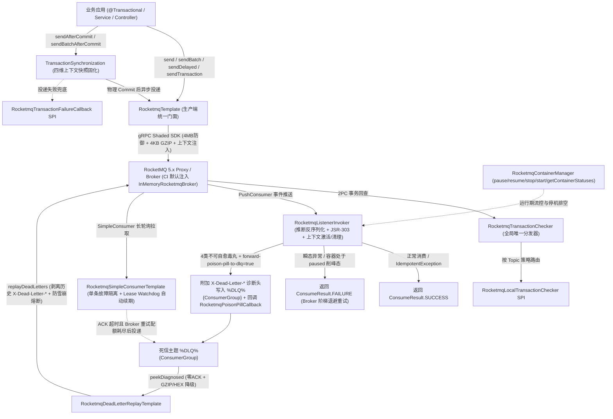

# ateng-boot-rocketmq 生产增强与原生分布式事务 Starter

> 基于 Apache RocketMQ 5.x 官方 Java SDK (Shaded gRPC 瘦客户端) 与 JDK 17/21+ 原生能力构建的工业级消息通信与分布式事务底座 Starter。提供生产级高阶发信门面（`RocketmqTemplate`）、流式微批拉取与租约控制门面（`RocketmqSimpleConsumerTemplate`）、运行期消费容器动态运维门面（`RocketmqContainerManager` / `RocketmqContainerStatus`）、死信队列结构化诊断与受控重放门面（`RocketmqDeadLetterReplayTemplate` / `RocketmqDeadLetterRecord`）、毒丸转储回调扩展点（`RocketmqPoisonPillCallback`）、毫秒级延时调度与原生撤回（`recallMessage`）、批量双层自动切片（`sendBatch`）、FIFO 顺序投递、原生 2PC 分布式事务与统一回查分发（`RocketmqTransactionChecker`）、本地事务提交感知发信（`sendAfterCommit` / `sendBatchAfterCommit` + 补偿 SPI）、声明式事件驱动监听容器（`@RocketmqListener`）、微服务推断反序列化解耦、4MB 大报文防御与 4KB 透明 GZIP 压缩、`@Idempotent` 幂等静默确认、全链路 `ReentrantLock` 防虚拟线程 Pinning、`SmartLifecycle` 确定性停机排空以及 100% 内存自洽双模测试沙箱。

---

## 0. 特性与公共 API 全景速查矩阵

> 阅读下文前，可通过下表快速定位模块对外暴露的全部公共门面、注解、SPI、配置属性（`ateng.boot.rocketmq.*`）及对应的测试与样例锚点（100% 对齐源码与 [Sample 体验工程 README](../ateng-boot-samples/ateng-boot-sample-rocketmq/README.md)）。

| 特性分类 | 特性名称 | 核心门面 / 注解 / SPI | 关键配置项 (`ateng.boot.rocketmq.*`) | 关键 API 签名 / 核心行为 | 锚定验证源头 (`*Test` / Sample) |
| :--- | :--- | :--- | :--- | :--- | :--- |
| **可靠消息发信** | 统一生产端发信门面（普通/异步/单向/延时/定时/FIFO/2PC/后置/批量） | `RocketmqTemplate` | `enabled`<br>`endpoints`<br>`ssl-enabled`<br>`request-timeout`<br>`producer.send-timeout`<br>`producer.max-attempts`<br>`producer.max-batch-size`<br>`producer.batch-slice-size`<br>`producer.max-payload-size`<br>`producer.compression-threshold`<br>`producer.topics` | `send(...)` / `sendAsync(...)` / `sendOneway(...)`（支持 `topic`、`tag`、`bizKey`、`payload`、`userProperties` 重载）<br>`sendDelayed(...)` / `sendDelayedAsync(...)` / `sendDeliverAt(...)` / `sendDeliverAtAsync(...)`<br>`recallMessage(topic, recallHandle)` / `recallMessageAsync(topic, recallHandle)`<br>`sendOrderly(...)` / `sendOrderlyAsync(...)`<br>`sendTransaction(...)`<br>`sendAfterCommit(...)` / `sendBatchAfterCommit(...)`<br>`sendBatch(...)` / `sendBatchAsync(...)`（基于 `BatchSliceUtil` 自动分片）<br>`getProducer()`：内聚四维上下文注入、多级 `bizKey` 提取、Topic 正则拦截、4MB Fail-Fast、4KB GZIP 压缩与结构化日志 | `RocketmqTemplateTest`<br>`RocketmqProduceController`<br>`RocketmqDelayController`<br>`RocketmqTransactionController`<br>`SampleRocketmqWebControllerTest` |
| **流式微批拉取** | SimpleConsumer 租约拉取、单条容错与自动续期守护 | `RocketmqSimpleConsumerTemplate` | `simple-consumer.invisible-duration`<br>`simple-consumer.max-message-num`<br>`simple-consumer.await-duration`<br>`simple-consumer.auto-renew-lease`<br>`simple-consumer.max-lease-renew-attempts` | `receive(topic, consumerGroup, [tag], [maxNum], [invisibleDuration])` / `receiveAsync(...)`<br>`ack([consumerGroup], messageView)` / `ackAsync([consumerGroup], messageView)`<br>`changeInvisibleDuration([consumerGroup], messageView, invisibleDuration)` / `changeInvisibleDurationAsync(...)`<br>`receiveAndExecute(..., targetType, consumer/biConsumer, [failureHandler])`<br>`getOrCreateConsumer(topic, consumerGroup, tag)`：长轮询 Pop 拉取、动态 `FilterExpression` 刷新、推断反序列化、单条故障隔离（`IdempotentException` 自动 ACK，失败回调 `failureHandler`）与租约自动续期守护看门狗 | `RocketmqSimpleConsumerTemplateTest`<br>`RocketmqSimpleConsumerController`<br>`SampleRocketmqWebControllerTest`<br>`SampleRocketmqE2eTest` |
| **容器运维管控** | 消费监听容器动态流控、不可变状态快照与启停 | `RocketmqContainerManager`<br>`RocketmqContainerStatus`<br>`RocketmqListenerEndpoint` | `consumer.consumption-thread-count`<br>`consumer.max-cache-message-count`<br>`consumer.close-timeout` | `getEndpointIds()` / `getEndpoints()` / `getEndpoint(id)` / `findEndpoints(idOrTopic)`<br>`getContainerStatuses()` / `getContainerStatus(id)`（返回不可变 `RocketmqContainerStatus`）<br>`pause(idOrTopic)` / `resume(idOrTopic)` / `pauseAll()` / `resumeAll()` / `isPaused(idOrTopic)`<br>`start(idOrTopic)` / `stop(idOrTopic)` / `startAll()` / `stopAll()` / `isRunning(idOrTopic)`：区分短时阶梯退避削峰与长时维护窗口物理断连 | `RocketmqContainerManagerTest`<br>`RocketmqContainerController`<br>`SampleRocketmqWebControllerTest`<br>`SampleRocketmqE2eTest` |
| **死信队列治理** | 死信只读探查、结构化诊断、清洗重放与丢弃清理 | `RocketmqDeadLetterReplayTemplate`<br>`RocketmqDeadLetterRecord`<br>`DeadLetterReplayResult`<br>`DeadLetterReplayDetail` | `dead-letter.max-replay-attempts`<br>`dead-letter.default-batch-size`<br>`dead-letter.max-batch-size`<br>`dead-letter.invisible-duration`<br>`dead-letter.discard-on-max-attempts-blocked` | `getDlqTopic(consumerGroup)`<br>`peekDeadLetters(consumerGroup, [maxNum], [invisibleDuration])`（零 ACK 探查）<br>`peekDiagnosed(consumerGroup, [maxNum], [invisibleDuration])`（返回不可变 `RocketmqDeadLetterRecord`，自动解压 GZIP/UTF-8，异常字节降级有界十六进制预览）<br>`replayDeadLetters(consumerGroup, [maxNum], [targetTopic], [invisibleDuration])`（返回 `DeadLetterReplayResult` / `DeadLetterReplayDetail`，剥离历史 `X-Dead-Letter-*` 故障头与 `X-Replay-Time`，防二次雪崩熔断）<br>`discardDeadLetters(consumerGroup, [maxNum])` / `discardDeadLetter(consumerGroup, messageView)`<br>`getSimpleConsumerTemplate()` / `getRocketmqTemplate()` | `RocketmqDeadLetterReplayTemplateTest`<br>`RocketmqDeadLetterController`<br>`SampleRocketmqWebControllerTest`<br>`SampleRocketmqE2eTest` |
| **毒丸归档与回调** | 消费端不可自愈毒丸自动归档 `%DLQ%` 与 SPI 回调 | `RocketmqPoisonPillCallback`<br>`RocketmqListenerInvoker` | `consumer.forward-poison-pill-to-dlq` | `onPoisonPill(messageView, topic, consumerGroup, dlqTopic, forwardedToDlq, cause)`：捕获 GZIP 损坏（`GZIP_DECOMPRESS_FAILED`）、JSON 破损（`DESERIALIZATION_FAILED`）、JSR-303 校验失败（`VALIDATION_FAILED`）及 `FatalExceptionClassifier` 致命异常（`FATAL_EXCEPTION`）；保留原始载荷并附带 `X-Dead-Letter-*` 诊断头归档 `%DLQ%<ConsumerGroup>`，回调通知并隔离回调异常，统一返回 `ConsumeResult.SUCCESS` 终止自旋 | `RocketmqListenerInvokerTest`<br>`SamplePoisonPillCallbackRecorder`<br>`RocketmqDeadLetterController`<br>`SampleRocketmqWebControllerTest`<br>`SampleRocketmqE2eTest` |
| **原生 2PC 事务回查** | 全局事务回查路由分发器与领域检查器 SPI | `RocketmqTransactionChecker`<br>`RocketmqLocalTransactionChecker` | - | `addChecker(checker)` / `getCheckers()` / `check(messageView)`<br>`RocketmqLocalTransactionChecker`：`getTopic()`、`check(messageView)` / `checkLocalTransaction(messageView)`：自动按 Topic 策略路由至业务检查器决断 `COMMIT` / `ROLLBACK` / `UNKNOWN` | `RocketmqTransactionCheckerTest`<br>`RocketmqTransactionController`<br>`SampleRocketmqWebControllerTest` |
| **本地事务执行器** | 2PC 半消息投递后本地业务决断回调 SPI | `RocketmqLocalTransactionExecutor` | - | `execute(sendReceipt)`：返回 `TransactionResolution`（`COMMIT` / `ROLLBACK` / `UNKNOWN`），执行抛出异常自动决断 `ROLLBACK` | `RocketmqTemplateTest`<br>`RocketmqTransactionController`<br>`SampleRocketmqE2eTest` |
| **事务发信补偿** | 本地事务提交后发信失败兜底补偿 SPI | `RocketmqTransactionFailureCallback` | - | SAM 4 参：`onFailure(topic, bizKey, payload, cause)`<br>全上下文 6 参默认重载：`onFailure(topic, tag, bizKey, payload, traceId, cause)`：当 `sendAfterCommit` / `sendBatchAfterCommit` 在数据库 Commit 后发信失败时触发兜底补偿 | `RocketmqTemplateTest`<br>`SampleRocketmqE2eTest` |
| **声明式监听注解** | 声明式事件驱动消费监听注解 | `@RocketmqListener` | - | 属性：`id` / `endpointId`（`@AliasFor` 双向互为别名，默认 `consumerGroup#topic`）、`topic`、`consumerGroup`、`tag`（默认 `*`）、`sql92`、`consumptionThreadCount`、`maxCacheMessageCount`，支持 Spring `${...}` 占位符表达式 | `RocketmqConsumerContainerTest`<br>`OrderStandardConsumer`<br>`SampleRocketmqE2eTest` |
| **消费受管容器** | 监听端点注册校验与确定性生命周期管理 | `RocketmqConsumerContainer` | `consumer.consumption-thread-count`<br>`consumer.max-cache-message-count`<br>`consumer.close-timeout` | 实现 `SmartInitializingSingleton`、`SmartLifecycle`、`DisposableBean`：扫描注册端点、校验 Topic 正则 `^[%a-zA-Z0-9_-]+$`；`ReentrantLock` 保护并发启停；停机时基于 Core 受管线程池排空在途消费 | `RocketmqConsumerContainerTest`<br>`SampleRocketmqE2eTest` |
| **底层客户端工厂 SPI** | PushConsumer 与 SimpleConsumer 工厂抽象及默认实现 | `PushConsumerFactory`<br>`SimpleConsumerFactory`<br>`DefaultPushConsumerFactory`<br>`DefaultSimpleConsumerFactory` | - | `createPushConsumer(clientConfig, group, topic, filter, listener, threads, cacheCount)`<br>`createSimpleConsumer(clientConfig, group, subscriptions, awaitDuration)`：支持生产直连 gRPC Proxy 与测试替身 `InMemoryRocketmqBroker`（`@Profile("!local")`）无缝切换 | `AtengRocketmqAutoConfigurationTest`<br>`InMemoryRocketmqBroker`<br>`SampleRocketmqE2eTest` |
| **消费调用执行器** | 入站上下文还原、推断反序列化、毒丸防护与幂等确认 | `RocketmqListenerInvoker` | `consumer.forward-poison-pill-to-dlq` | 实现 `MessageListener`：还原四维上下文并 `finally` 清理；透明 GZIP 解压；支持 `MessageView`、`byte[]`、`String`、DTO 与泛型集合反序列化；JSR-303 校验；`IdempotentException` 静默确认 | `RocketmqListenerInvokerTest`<br>`SampleRocketmqE2eTest` |
| **消息辅助与常量** | 序列化、GZIP 压缩、上下文与业务键解析工具及保留头常量 | `RocketmqMessageHelper`<br>`RocketmqConstants` | - | `resolveBizKey(bizKey, payload)` / `extractBizKey(messageView)` / `toPayloadBytes(payload)` / `compressGzip(bytes)` / `decompressGzip(bytes)`；`RocketmqConstants` 定义 `TOPIC_REGEX`、`DLQ_TOPIC_PREFIX`、`HEADER_COMPRESSION` 与 `X-Dead-Letter-*` 诊断头常量 | `RocketmqMessageHelperTest` |
| **自动装配与配置** | 防御性自动装配核心类与强类型配置属性 | `AtengRocketmqAutoConfiguration`<br>`AtengRocketmqProperties` | `enabled`<br>`endpoints`<br>`access-key`<br>`secret-key`<br>`ssl-enabled`<br>`request-timeout`<br>`producer.*` / `consumer.*` / `simple-consumer.*` / `dead-letter.*` | 基于 `@AutoConfiguration` 注册，缺失 `endpoints` 平滑静默跳过；`Duration` / `DataSize` 强类型属性与 `@NestedConfigurationProperty` 嵌套校验 | `AtengRocketmqAutoConfigurationTest`<br>`AtengRocketmqPropertiesTest` |

---

## 1. 模块定位与快速起步

### 1.1 模块定位与核心价值

- **纯净官方 Shaded 瘦客户端**：100% 依托官方 `rocketmq-client-java:5.2.2` Shaded 坐标与 JDK 17 原生能力，物理隔绝 gRPC、Netty 与老旧 Remoting 依赖污染；
- **四大高阶业务与运维门面**：
  - `RocketmqTemplate`：同步/异步/单向发信、毫秒级延时与定时调度、原生延时精准撤回、批量双层切片并发、FIFO 顺序投递、2PC 分布式事务与本地事务提交感知发信；
  - `RocketmqSimpleConsumerTemplate`：流式微批长轮询拉取、不可见租约动态续期、自动续期守护看门狗与单条容错函数式闭包；
  - `RocketmqContainerManager`：不可变端点状态快照审计（`RocketmqContainerStatus`）、短时阶梯退避削峰（`pause`/`resume`）与长时物理断连启停（`stop`/`start`）；
  - `RocketmqDeadLetterReplayTemplate`：零 ACK 只读探查（`peekDeadLetters`）、结构化诊断预览与损坏字节十六进制降级（`peekDiagnosed` / `RocketmqDeadLetterRecord`）、重放清洗历史故障头与防二次雪崩熔断（`replayDeadLetters`）、物理丢弃清理（`discardDeadLetters`）。
- **核心底座协同**：复用 `ateng-boot-core` 四维上下文传播（`MDC traceId`、`TenantContextHolder`、`UserContextHolder`）、`BatchSliceUtil`、`FatalExceptionClassifier`、`IdempotentException` 与受管异步线程池，严禁野线程与 `synchronized`（全面防 JDK 21+ 虚拟线程 Pinning）。

### 1.2 Maven 引入坐标

**方式一：通过 `ateng-boot-bom` 统一纳管版本（推荐）**

```xml
<dependencyManagement>
    <dependencies>
        <dependency>
            <groupId>io.github.atengk</groupId>
            <artifactId>ateng-boot-bom</artifactId>
            <version>1.2.0</version>
            <type>pom</type>
            <scope>import</scope>
        </dependency>
    </dependencies>
</dependencyManagement>

<dependencies>
    <dependency>
        <groupId>io.github.atengk</groupId>
        <artifactId>ateng-boot-rocketmq</artifactId>
    </dependency>
</dependencies>
```

**方式二：独立显式版本号引入**

```xml
<dependencies>
    <dependency>
        <groupId>io.github.atengk</groupId>
        <artifactId>ateng-boot-rocketmq</artifactId>
        <version>1.2.0</version>
    </dependency>
</dependencies>
```

### 1.3 最小起步配置 (`application.yml`)

```yaml
ateng:
  boot:
    rocketmq:
      enabled: true
      endpoints: "127.0.0.1:8081"          # RocketMQ 5.x gRPC Proxy 接入地址
      request-timeout: 3s                  # gRPC 客户端全局请求超时
      producer:
        send-timeout: 3s                   # 生产端发信确认超时
        topics:
          - sample_order_topic             # 启动期预拉取路由的业务主题
```

### 1.4 极简实战代码（业务实体 + 发信 + 消费）

```java
// 1. 业务消息模型（逆向提取自 OrderMessage.java）
@Data
@Builder
@NoArgsConstructor
@AllArgsConstructor
public class OrderMessage {
    @NotBlank(message = "订单ID不能为空")
    private String orderId;
    @PositiveOrZero(message = "订单金额不能为负数")
    private Double amount;
    private String customerName;
    private String status;
}

// 2. 生产端发信服务（逆向提取自 TradeRocketmqProducer.java）
@Component
@RequiredArgsConstructor
public class TradeRocketmqProducer {
    private final RocketmqTemplate rocketmqTemplate;

    public SendReceipt sendOrderWithTag(OrderMessage order, String tag) {
        return rocketmqTemplate.send("sample_order_topic", tag, order.getOrderId(), order);
    }
}

// 3. 消费端声明式监听（逆向提取自 OrderStandardConsumer.java）
@Slf4j
@Component
public class OrderStandardConsumer {
    @RocketmqListener(
            topic = "sample_order_topic",
            consumerGroup = "sample_order_group",
            tag = "create || pay"
    )
    public void onOrderMessage(@Valid OrderMessage order, MessageView messageView) {
        String traceId = MDC.get("traceId");
        String tenantId = TenantContextHolder.getTenantId();
        String userId = UserContextHolder.getUserId();

        log.info("[SAMPLE-CONSUME] 接收订单消息: orderId={}, tag={}, traceId={}, tenantId={}, userId={}",
                order.getOrderId(), messageView.getTag().orElse(""), traceId, tenantId, userId);

        receivedOrders.add(order);
    }
}
```

---

## 2. 核心架构与链路原理

### 2.1 自动装配拓扑与全链路消息流转



### 2.2 核心设计不变量与生产运维边界

1. **消费端异常分流与毒丸 `%DLQ%` 防自旋闭环**：
   - `RocketmqListenerInvoker` 严格区分**瞬态可恢复异常**与**不可自愈毒丸异常**（GZIP 解压失败、JSON 反序列化失败、JSR-303 参数校验违规、`FatalExceptionClassifier` 判定的致命异常）：
   - 遇到瞬态异常返回 `ConsumeResult.FAILURE` 交由 Broker 退避重试；遇到 `IdempotentException` 直接记录告警并返回 `ConsumeResult.SUCCESS` 静默确认；遇到毒丸异常且 `forward-poison-pill-to-dlq=true` 时，保留原始字节与核心业务属性并附加 `X-Dead-Letter-*` 诊断头转储至 `%DLQ%<ConsumerGroup>`，随后隔离异常调用 `RocketmqPoisonPillCallback`，统一返回 `ConsumeResult.SUCCESS` 彻底消灭 16 次无效重试风暴。
2. **`pause`/`resume` 与 `stop`/`start` 运行期运维清晰边界**：
   - **短时突发削峰（`pause` / `resume` / `pauseAll` / `resumeAll`）**：保留底层 gRPC 长连接心跳，不销毁消费实例，但新到达消息由 Invoker 立即返回 `ConsumeResult.FAILURE`，促使 Broker 触发秒级阶梯退避延时重投，恢复时零重连建连开销。
   - **长时维护窗口停机（`stop` / `start` / `stopAll` / `startAll`）**：在 `ReentrantLock` 保护下物理关闭并释放目标端点的 `PushConsumer` 客户端，彻底停止服务端推流，**零 Broker 重试配额消耗**；维护结束后按已注册端点元数据原地热重建激活。
3. **`SmartLifecycle` 确定性停机顺序与虚拟线程安全**：
   - 停机阶段严格按 `RocketmqConsumerContainer`（`phase = Integer.MAX_VALUE - 100`，优先关闭所有 `PushConsumer` 并按 `consumer.close-timeout` 在 Core 受管线程池异步排空在途消费）→ `RocketmqSimpleConsumerTemplate`（`phase = Integer.MAX_VALUE - 200`，停止租约自动续期守护与释放缓存 `SimpleConsumer`）→ 受管 `Producer` 销毁依次收口，保障停机“只出不进、零丢信”。
   - 模块全链路临界区统一采用 `ReentrantLock`（在 `finally` 中严格校验 `lock.isHeldByCurrentThread()` 后释放），严禁 `synchronized` 导致 JDK 21+ 虚拟线程 Carrier Pinning，且严禁私自 `new Thread()` 或 `Executors` 创建野线程。
4. **双模测试架构隔离**：
   - 底层通过 `PushConsumerFactory` 与 `SimpleConsumerFactory` 解耦物理客户端组装。Test 沙箱在 `@Profile("!local")` 下自动注入 `InMemoryRocketmqBroker` 内存替身实现毫秒级自洽全绿；启用 `-Dspring.profiles.active=local` 时自动退避为默认工厂直连真实 RocketMQ 5.x Proxy。

---

## 3. 可靠消息生产套件 (Reliable Message Producing Suite)

### 3.1 同步阻塞发信与四维上下文透传

- **专属 YAML 配置**：
  ```yaml
  ateng:
    boot:
      rocketmq:
        producer:
          send-timeout: 3s                 # 同步发信确认超时时间（默认 3s）
          max-attempts: 3                  # 发送失败最大重试次数（默认 3 次）
  ```
- **业务 Java 示例**（逆向提取自 `RocketmqProduceController.java`）：
  ```java
  @PostMapping("/sync")
  public Result<OrderProduceResponse> sendSync(@Valid @RequestBody OrderProduceRequest request) {
      OrderMessage order = request.toOrderMessage();
      String tag = StringUtils.hasText(request.getTag()) ? request.getTag() : "create";
      SendReceipt receipt = standardScenarioService.sendSync(order, tag, request.getProperties());
      OrderProduceResponse response = OrderProduceResponse.builder()
              .orderId(order.getOrderId())
              .messageId(receipt.getMessageId().toString())
              .tag(tag)
              .status("SUCCESS")
              .build();
      return Result.success(response);
  }
  ```
- **核心机制与边界防御**：
  同步阻塞直至 Broker 返回 `SendReceipt`。框架自动捕获当前四维上下文快照（`MDC traceId`、`TenantContextHolder`、`UserContextHolder`）注入消息头；`RocketmqMessageHelper.resolveBizKey` 执行显式 `bizKey` → 实体 `getId()`/`getBizKey()`/`getOrderNo()`/`getCode()`/`getKey()` → MDC `traceId` → UUID 多级兜底，并双写原生 `Keys` 与 `X-Biz-Key`。

### 3.2 异步非阻塞发信与单向极速埋点

- **专属 YAML 配置**：
  ```yaml
  ateng:
    boot:
      rocketmq:
        producer:
          send-timeout: 3s                 # 底层异步投递与回调超时基线（默认 3s）
  ```
- **业务 Java 示例**（逆向提取自 `RocketmqProduceController.java`）：
  ```java
  // 1. 异步非阻塞发信
  @PostMapping("/async")
  public Result<OrderProduceResponse> sendAsync(@Valid @RequestBody OrderProduceRequest request) {
      OrderMessage order = request.toOrderMessage();
      CompletableFuture<SendReceipt> future = standardScenarioService.sendAsync(order, request.getProperties());
      SendReceipt receipt = awaitFuture(future);
      OrderProduceResponse response = OrderProduceResponse.builder()
              .orderId(order.getOrderId())
              .messageId(receipt.getMessageId().toString())
              .tag("create")
              .status("ASYNC_SUCCESS")
              .build();
      return Result.success(response);
  }

  // 2. 单向极速发送（埋点/非交易日志）
  @PostMapping("/oneway")
  public Result<Void> sendOneway(@Valid @RequestBody OrderProduceRequest request) {
      OrderMessage order = request.toOrderMessage();
      standardScenarioService.sendOneway(order);
      return Result.success();
  }
  ```
- **核心机制与边界防御**：
  `sendAsync` 返回 `CompletableFuture<SendReceipt>`，发送链路在异步回调中按结构化格式记录耗时与结果；`sendOneway` 以 Fire-and-Forget 方式异步投递并捕获异常记录因果日志，严禁用于对投递确认有强依赖的金融交易指令。

---

## 4. 保序消息与批量切片套件 (FIFO & Batch Slicing Suite)

### 4.1 局部严格保序消息投递 (FIFO MessageGroup)

- **专属 YAML 配置**：
  ```yaml
  ateng:
    boot:
      rocketmq:
        producer:
          topics:
            - sample_fifo_topic            # 启用 FIFO MessageGroup 的顺序主题
  ```
- **业务 Java 示例**（逆向提取自 `RocketmqProduceController.java`）：
  ```java
  @PostMapping("/fifo")
  public Result<OrderProduceResponse> sendFifo(@Valid @RequestBody OrderProduceRequest request) {
      OrderMessage order = request.toOrderMessage();
      String messageGroup = StringUtils.hasText(request.getMessageGroup()) ? request.getMessageGroup() : order.getOrderId();
      SendReceipt receipt = standardScenarioService.sendFifo(order, messageGroup);
      OrderProduceResponse response = OrderProduceResponse.builder()
              .orderId(order.getOrderId())
              .messageId(receipt.getMessageId().toString())
              .tag("fifo")
              .status("FIFO_SUCCESS")
              .build();
      return Result.success(response);
  }
  ```
- **核心机制与边界防御**：
  基于 RocketMQ 5.x `messageGroup` 实现分区局部保序：相同 `messageGroup` 路由至同一消息队列并由消费端串行消费，不同分组间保持全并发吞吐；底层校验禁止对同一消息同时设置 `messageGroup` 与定时调度时间戳。

### 4.2 双层智能切片批量发信 (`sendBatch` / `sendBatchAsync`)

- **专属 YAML 配置**：
  ```yaml
  ateng:
    boot:
      rocketmq:
        producer:
          max-batch-size: 500              # 单次调用最大批量上限，超出 Fail-Fast（默认 500）
          batch-slice-size: 64             # 底层并发切片步长（默认 64 条/片）
          send-timeout: 3s                 # 批量聚合等待超时（默认 3s）
  ```
- **业务 Java 示例**（逆向提取自 `RocketmqProduceController.java`）：
  ```java
  // 1. 同步批量可靠切片发送（支持统一用户属性与超时控制）
  @PostMapping("/batch")
  public Result<BatchProduceResponse> sendBatch(@Valid @RequestBody ValidList<OrderProduceRequest> requests) {
      List<OrderMessage> orders = requests.stream().map(OrderProduceRequest::toOrderMessage).toList();
      List<SendReceipt> receipts = standardScenarioService.sendBatch(orders, "batch", extractBatchProperties(requests));
      return Result.success(buildBatchResponse(requests, orders, receipts));
  }

  // 2. 异步批量可靠切片发送（返回 CompletableFuture<List<SendReceipt>>）
  @PostMapping("/batch-async")
  public Result<BatchProduceResponse> sendBatchAsync(@Valid @RequestBody ValidList<OrderProduceRequest> requests) {
      List<OrderMessage> orders = requests.stream().map(OrderProduceRequest::toOrderMessage).toList();
      List<SendReceipt> receipts = awaitFuture(standardScenarioService
              .sendBatchAsync(orders, "batch", extractBatchProperties(requests)));
      return Result.success(buildBatchResponse(requests, orders, receipts));
  }
  ```
- **核心机制与边界防御**：
  遵循“单次上限校验 + 分片并发投递”双层防线：入参列表超出 `max-batch-size` 或任一元素超过 4MB 时前置 Fail-Fast 拦截；合法列表通过 Core `BatchSliceUtil` 按 `batch-slice-size`（默认 64）切片并行发起 `sendAsync`，由 `CompletableFuture.allOf` 统一汇聚回执并在异常时保留原始 `cause` 链转译为 `MessageDeliveryException`。

---

## 5. 延时调度与精准撤回套件 (Delay Scheduling & Recall Suite)

### 5.1 相对时长延时与绝对时间定时投递

- **专属 YAML 配置**：
  ```yaml
  ateng:
    boot:
      rocketmq:
        producer:
          send-timeout: 3s                 # 定时/延时发信与异步等待超时（默认 3s）
          topics:
            - sample_delay_topic
  ```
- **业务 Java 示例**（逆向提取自 `RocketmqDelayController.java`）：
  ```java
  // 1. 相对时长延时投递（支持 sendDelayed 与异步 sendDelayedAsync）
  @PostMapping("/duration")
  public Result<OrderDelayResponse> sendDelayed(@Valid @RequestBody OrderDelayRequest request) {
      OrderMessage order = request.toOrderMessage();
      long seconds = request.resolveDelaySeconds();
      Duration delay = Duration.ofSeconds(seconds);
      long deliverAtTimestamp = System.currentTimeMillis() + delay.toMillis();
      SendReceipt receipt = batchDelayScenarioService.sendDelayed(order, delay, request.getProperties());
      return Result.success(buildDelayResponse(order, receipt, seconds, deliverAtTimestamp, "DELAY_SCHEDULED"));
  }

  // 2. 绝对时间定时调度（支持 sendDeliverAt 与异步 sendDeliverAtAsync）
  @PostMapping("/deliver-at")
  public Result<OrderDelayResponse> sendDeliverAt(@Valid @RequestBody OrderDelayRequest request) {
      OrderMessage order = request.toOrderMessage();
      long targetTimestamp = request.resolveDeliverAtTimestamp();
      Instant deliverAt = Instant.ofEpochMilli(targetTimestamp);
      SendReceipt receipt = batchDelayScenarioService.sendDeliverAt(order, deliverAt, request.getProperties());
      return Result.success(buildDelayResponse(order, receipt, null, targetTimestamp, "SCHEDULED_SUCCESS"));
  }
  ```
- **核心机制与边界防御**：
  RocketMQ 5.x 原生支持毫秒级任意时刻调度（彻底摆脱 4.x 固定 18 档延时等级约束）；门面强制校验 `delay` 不可为空且不可为负数（`!delay.isNegative()`，允许 `Duration.ZERO`）、`deliverAt` 不可为空（`Assert.notNull`），提前拦截空参或非法负延时调用。

### 5.2 原生延时消息精准撤回 (`recallMessage` / `recallMessageAsync`)

- **专属 YAML 配置**：
  ```yaml
  ateng:
    boot:
      rocketmq:
        producer:
          send-timeout: 3s                 # recallMessageAsync 超时兜底（默认 3s）
  ```
- **业务 Java 示例**（逆向提取自 `RocketmqDelayController.java`）：
  ```java
  @PostMapping("/recall")
  public Result<Boolean> recallDelayedMessage(@Valid @RequestBody OrderRecallRequest request) {
      String topic = StringUtils.hasText(request.getTopic()) ? request.getTopic() : TradeRocketmqProducer.TOPIC_DELAY;
      batchDelayScenarioService.recallDelayedMessage(topic, request.getRecallHandle());
      return Result.success(true);
  }
  ```
- **核心机制与边界防御**：
  针对“未支付订单 30 分钟关单但用户在第 5 分钟完成支付”场景，凭发送回执 `SendReceipt.getRecallHandle()` 直接调用原生撤回 API，在 Broker 侧物理取消未到期定时消息，零无效下行消费开销。

---

## 6. 2PC 分布式事务半消息与统一回查分发架构 (2PC Transaction Suite)

### 6.1 2PC 半消息发信与本地业务决断

- **专属 YAML 配置**：
  ```yaml
  ateng:
    boot:
      rocketmq:
        producer:
          topics:
            - sample_tx_topic              # 事务主题，用于触发统一事务回查路由
  ```
- **业务 Java 示例**（逆向提取自 `RocketmqTransactionController.java`）：
  ```java
  @PostMapping("/half-message")
  public Result<OrderProduceResponse> sendHalfMessage(@Valid @RequestBody OrderTransactionRequest request) {
      OrderMessage order = request.toOrderMessage();
      boolean success = request.getLocalSuccess() == null || request.getLocalSuccess();
      SendReceipt receipt = transactionScenarioService.createOrderWith2PcTransaction(order, success);
      return Result.success(OrderProduceResponse.builder()
              .orderId(order.getOrderId())
              .messageId(receipt.getMessageId().toString())
              .tag("tx")
              .status(success ? "2PC_COMMITTED" : "2PC_ROLLED_BACK")
              .build());
  }
  ```
- **核心机制与边界防御**：
  先持久化投递半消息至 Broker，再执行 `RocketmqLocalTransactionExecutor.execute(sendReceipt)` 决断 `COMMIT` / `ROLLBACK` / `UNKNOWN`；本地决断若抛出未捕获异常，框架自动降级执行 `transaction.rollback()`，严防半消息永久悬停。

### 6.2 领域解耦多 Topic 回查分发 (`RocketmqLocalTransactionChecker`)

- **专属 YAML 配置**：
  ```yaml
  ateng:
    boot:
      rocketmq:
        request-timeout: 3s                # 事务回查通信全局请求超时（默认 3s）
        producer:
          topics:
            - sample_tx_topic              # 启动期向 Proxy 注册的事务主题
  ```
- **业务 Java 示例**（逆向提取自 `SampleOrderTransactionChecker.java`）：
  ```java
  @Slf4j
  @Component
  public class SampleOrderTransactionChecker implements RocketmqLocalTransactionChecker {
      @Getter
      private final Set<String> committedOrders = ConcurrentHashMap.newKeySet();
      @Getter
      private final Set<String> rolledBackOrders = ConcurrentHashMap.newKeySet();

      @Override
      public String getTopic() {
          return TradeRocketmqProducer.TOPIC_TX;
      }

      @Override
      public TransactionResolution check(MessageView messageView) {
          String bizKey = RocketmqMessageHelper.extractBizKey(messageView);
          if (committedOrders.contains(bizKey)) {
              return TransactionResolution.COMMIT;
          }
          if (rolledBackOrders.contains(bizKey)) {
              return TransactionResolution.ROLLBACK;
          }
          return TransactionResolution.UNKNOWN;
      }
  }
  ```
- **核心机制与边界防御**：
  全局单例 `RocketmqTransactionChecker` 自动扫描纳管所有 `RocketmqLocalTransactionChecker` Bean（支持多领域 Topic 策略路由）；Broker 发起超时回查时精准派发给对应主题实现类，彻底避免单体庞大回查类；未命中或执行异常兜底返回 `UNKNOWN` 等待下一轮回查。

---

## 7. 本地事务感知发信与补偿防线 (Post-Commit Transaction Guard)

### 7.1 `sendAfterCommit` / `sendBatchAfterCommit` 提交感知发信

- **专属 YAML 配置**：
  ```yaml
  ateng:
    boot:
      rocketmq:
        producer:
          send-timeout: 3s                 # 事务 Commit 后发信超时（默认 3s）
  ```
- **业务 Java 示例**（逆向提取自 `RocketmqTransactionController.java`）：
  ```java
  // 1. 单条本地事务提交感知发信（回滚绝对零发信）
  @PostMapping("/send-after-commit")
  public Result<String> sendAfterCommit(@Valid @RequestBody OrderTransactionRequest request) {
      OrderMessage order = request.toOrderMessage();
      boolean success = request.getLocalSuccess() == null || request.getLocalSuccess();
      if (success) {
          transactionScenarioService.createOrderWithSendAfterCommit(order, request.getTag(), request.getProperties());
          return Result.success("TX_COMMITTED_AND_SENT");
      }
      try {
          transactionScenarioService.createOrderWithRollback(order);
      } catch (IllegalStateException ex) {
          log.warn("[TX-SAMPLE] 捕获预期的本地事务回滚异常: orderId={}, error={}", order.getOrderId(), ex.getMessage());
      }
      return Result.success("TX_ROLLED_BACK_ZERO_SEND");
  }

  // 2. 批量本地事务提交感知发信（在注册同步钩子时固化四维上下文快照）
  @PostMapping("/send-batch-after-commit")
  public Result<String> sendBatchAfterCommit(@Valid @RequestBody ValidList<OrderTransactionRequest> requests) {
      String batchTag = OrderTransactionRequest.resolveBatchTag(requests);
      Map<String, String> batchProperties = OrderTransactionRequest.resolveBatchProperties(requests);
      List<OrderMessage> orders = requests.stream().map(OrderTransactionRequest::toOrderMessage).toList();
      boolean allSuccess = requests.stream().allMatch(req -> req.getLocalSuccess() == null || req.getLocalSuccess());
      if (allSuccess) {
          transactionScenarioService.createOrdersWithSendBatchAfterCommit(orders, batchTag, batchProperties);
          return Result.success("TX_BATCH_COMMITTED_AND_SENT");
      }
      try {
          transactionScenarioService.createOrdersWithBatchRollback(orders, batchTag, batchProperties);
      } catch (IllegalStateException ex) {
          log.warn("[TX-SAMPLE] 捕获预期的批量本地事务回滚异常: count={}, error={}", orders.size(), ex.getMessage());
      }
      return Result.success("TX_BATCH_ROLLED_BACK_ZERO_SEND");
  }
  ```
- **核心机制与边界防御**：
  在注册 Spring `TransactionSynchronization` 时立即冻结当前线程四维上下文快照（`MDC traceId`、`TenantId`、`UserId`、`IgnoreTenant`）；仅当 `STATUS_COMMITTED` 时还原快照投递消息，本地事务回滚时钩子自动撤销，物理发信零触发；未在活动事务中调用时立即直发并保障兼容。

### 7.2 事务发信失败全上下文补偿扩展 (`RocketmqTransactionFailureCallback`)

- **专属 YAML 配置**：
  ```yaml
  ateng:
    boot:
      rocketmq:
        producer:
          send-timeout: 3s                 # 事务 Commit 后发信等待确认超时（默认 3s）
          max-attempts: 3                  # 底层 SDK 自动重试次数，全部耗尽后触发回调补偿
  ```
- **业务 Java 示例**（逆向提取自 `SampleRocketmqE2eTest.RecordingTransactionFailureCallback`）：
  ```java
  // 1. 注册补偿回调 Bean（生产环境可直接标注 @Component，测试环境通过 @TestConfiguration 注入）
  @Bean
  public RecordingTransactionFailureCallback recordingTransactionFailureCallback() {
      return new RecordingTransactionFailureCallback();
  }

  // 2. 实现 4 参 SAM 与 6 参全上下文默认重载（完整记录 topic、tag、bizKey、payload、traceId 与 cause）
  public static class RecordingTransactionFailureCallback implements RocketmqTransactionFailureCallback {

      private final List<FailureRecord> records = new CopyOnWriteArrayList<>();

      @Override
      public void onFailure(String topic, String bizKey, Object payload, Throwable cause) {
          records.add(new FailureRecord(topic, null, bizKey, payload, null, cause));
      }

      @Override
      public void onFailure(String topic, String tag, String bizKey, Object payload, String traceId, Throwable cause) {
          records.add(new FailureRecord(topic, tag, bizKey, payload, traceId, cause));
      }
  }
  ```
- **核心机制与边界防御**：
  `RocketmqTransactionFailureCallback` 保留 `onFailure(topic, bizKey, payload, cause)` 为函数式抽象方法，并提供 6 参 `default` 重载 `onFailure(topic, tag, bizKey, payload, traceId, cause)`。框架触发补偿时优先调用 6 参重载，旧版 4 参实现自动无缝向后兼容，业务新实现同时重写 4 参与 6 参（或使用抽象类适配器）即可获取完整 `tag` 与 `traceId`。

---

## 8. 声明式监听容器与服务端过滤推断 (Declarative Consumer & Filter Suite)

### 8.1 服务端 Tag/SQL92 过滤下推与 `id`/`endpointId` 别名契约

- **专属 YAML 配置**：
  ```yaml
  ateng:
    boot:
      rocketmq:
        consumer:
          consumption-thread-count: 20     # 消费端点默认并发工作线程数（默认 20）
          max-cache-message-count: 1024    # 客户端本地最大缓存拉取条数（默认 1024）
  ```
- **业务 Java 示例**（逆向提取自 `OrderStandardConsumer.java` 与 `OrderSqlConsumer.java`）：
  ```java
  // 1. Tag 过滤下推（OrderStandardConsumer：未显式指定 id/endpointId 时自动生成 "sample_order_group#sample_order_topic"）
  @RocketmqListener(
          topic = "sample_order_topic",
          consumerGroup = "sample_order_group",
          tag = "create || pay"
  )
  public void onOrderMessage(@Valid OrderMessage order, MessageView messageView) {
      String traceId = MDC.get("traceId");
      String tenantId = TenantContextHolder.getTenantId();
      String userId = UserContextHolder.getUserId();

      log.info("[SAMPLE-CONSUME] 接收订单消息: orderId={}, tag={}, traceId={}, tenantId={}, userId={}",
              order.getOrderId(),
              messageView.getTag().orElse(""),
              traceId,
              tenantId,
              userId);

      receivedOrders.add(order);
      if (traceId != null) {
          receivedTraceIds.add(traceId);
      }
      if (tenantId != null) {
          receivedTenantIds.add(tenantId);
      }
  }

  // 2. 显式命名端点 ID 与 SQL92 属性过滤下推（OrderSqlConsumer：id 与 endpointId 通过 @AliasFor 互为别名）
  @RocketmqListener(
          endpointId = "sample-sql-order-listener",
          topic = "sample_sql_topic",
          consumerGroup = "sample_sql_group",
          sql92 = "amount > 100"
  )
  public void onSqlFilteredOrder(OrderMessage order, MessageView messageView) {
      log.info("[SAMPLE-SQL-CONSUME] 接收 SQL92 过滤消息: orderId={}, amount={}",
              order.getOrderId(),
              order.getAmount());

      receivedSqlOrders.add(order);
  }
  ```
- **核心机制与边界防御**：
  过滤规则在 Broker 服务端执行计算，不匹配的消息零网络下行开销；`id` 与 `endpointId` 使用 Spring `@AliasFor` 互为别名（不可同时设置不同值），未显式配置时自动按 `consumerGroup#topic` 规则生成唯一运维标识；配置冲突或 Topic 非法（如含点号 `.`）在启动注册阶段 Fail-Fast 阻断。

### 8.2 微服务推断反序列化与 JSR-303 快速失败

- **专属 YAML 配置**：
  ```yaml
  ateng:
    boot:
      rocketmq:
        consumer:
          forward-poison-pill-to-dlq: true # JSR-303 校验失败或不可自愈反序列化异常触发毒丸安全归档（默认 true）
  ```
- **业务 Java 示例**（逆向提取自 `OrderMessage.java` 与 `PoisonPillRocketmqConsumer.java`）：
  ```java
  // 1. 业务实体独立声明 JSR-303 约束，无需与生产端共享类名头
  @Data
  @Builder
  @NoArgsConstructor
  @AllArgsConstructor
  public class OrderMessage {
      @NotBlank(message = "订单ID不能为空")
      private String orderId;
      @PositiveOrZero(message = "订单金额不能为负数")
      private Double amount;
      private String customerName;
      private String status;
  }

  // 2. 消费方法形参声明 @Valid 后由 Invoker 自动执行推断反序列化与前置校验
  @RocketmqListener(
          topic = "sample_order_topic",
          consumerGroup = "sample_poison_group",
          tag = "poison"
  )
  public void onPoisonMessage(@Valid OrderMessage order) {
      if (order.getOrderId() != null && order.getOrderId().contains("POISON_FATAL")) {
          throw new IllegalArgumentException("致命数据格式错误，不可自愈，丢弃毒丸: orderId=" + order.getOrderId());
      }

      poisonProcessCount.incrementAndGet();
      log.info("[SAMPLE-POISON] 正常消费: orderId={}", order.getOrderId());
  }
  ```
- **核心机制与边界防御**：
  `RocketmqListenerInvoker` 不依赖生产端类名头字段，直接根据目标方法形参（`MessageView`、`byte[]`、`String`、任意 POJO、`List<T>` 等 `ParameterizedType`）精准还原业务对象；在反序列化前透明解压 GZIP，在调用方法前自动通过 `Validator` 执行 `@Valid` / JSR-303 校验并在 `finally` 无条件清理四维上下文；遇到反序列化破损或校验违规时触发毒丸防自旋闭环，彻底阻止无效重试。

---

## 9. 流式微批拉取与租约控制套件 (SimpleConsumer & Lease Suite)

### 9.1 微批长轮询拉取与动态租约续期

- **专属 YAML 配置**：
  ```yaml
  ateng:
    boot:
      rocketmq:
        simple-consumer:
          invisible-duration: 30s          # 默认不可见租约时长（默认 30s）
          max-message-num: 32              # 单批最大拉取条数（默认 32）
          await-duration: 5s               # 长轮询挂起等待时长（默认 5s）
  ```
- **业务 Java 示例**（逆向提取自 `RocketmqSimpleConsumerController.java`）：
  ```java
  // 1. 流式微批长轮询拉取
  @PostMapping("/pull")
  public Result<List<SimpleMessageVO>> pullMessages(@Valid @RequestBody(required = false) SimplePullRequest request) {
      SimplePullRequest req = request != null ? request : new SimplePullRequest();
      List<MessageView> messages = simpleConsumerPullScenarioService.pullMessages(
              req.resolveTopic(), req.resolveGroup(), req.resolveTag(), req.resolveMaxNum(), req.resolveInvisibleDuration());
      return Result.success(messages.stream().map(SimpleConsumerPullScenarioService::convertToVO).toList());
  }

  // 2. 动态续期不可见租约
  @PostMapping("/renew")
  public Result<String> renewLease(@Valid @RequestBody SimpleRenewRequest request) {
      simpleConsumerPullScenarioService.renewLease(request.getGroup(), request.getMessageId(), request.resolveDuration());
      return Result.success("租约续期成功: messageId=" + request.getMessageId());
  }
  ```
- **核心机制与边界防御**：
  按 `consumerGroup` 维护懒加载缓存并支持同一消费组订阅 `FilterExpression` 变更时的动态 `subscribe` 刷新；拉取消息在 `invisibleDuration` 内对集群其余消费实例隐身，长任务处理可通过 `changeInvisibleDuration` 延长处理窗口。

### 9.2 单条故障隔离、自动续期守护与显式 ACK (`receiveAndExecute`)

- **专属 YAML 配置**：
  ```yaml
  ateng:
    boot:
      rocketmq:
        simple-consumer:
          invisible-duration: 30s          # 默认基础租约时长（默认 30s）
          auto-renew-lease: true           # 是否开启耗时处理期间的不可见租约自动续期守护（默认 true）
          max-lease-renew-attempts: 5      # 单条消息允许自动续期次数上限，0 表示不续期（默认 5）
  ```
- **业务 Java 示例**（逆向提取自 `RocketmqSimpleConsumerController.java`）：
  ```java
  // 受控容错隔离消费闭包（支持单条异常隔离、IdempotentException 静默 ACK 与长耗时自动续期守护）
  @PostMapping("/consume-resilient")
  public Result<SimpleConsumeReportVO> consumeAndExecuteResilient(
          @Valid @RequestBody(required = false) SimplePullRequest request) {
      SimplePullRequest req = request != null ? request : new SimplePullRequest();
      return Result.success(simpleConsumerPullScenarioService.pullAndExecuteResilient(
              req.resolveTopic(), req.resolveGroup(), req.resolveTag(),
              req.resolveMaxNum(), req.resolveInvisibleDuration(), req.resolveSimulateDelayDuration()));
  }
  ```
- **核心机制与边界防御**：
  `receiveAndExecute` 每条消息独立激活与清理四维上下文：单条执行成功或命中 `IdempotentException` 时自动执行 `ack` 出队；单条抛出其他异常时仅跳过该条 `ack`、回调可选 `failureHandler` 并继续处理同批其余消息（绝不整批阻断）。开启 `auto-renew-lease=true` 时，看门狗按 `max(1s, invisibleDuration / 2)` 周期在受管异步调度器中自动调用 `changeInvisibleDurationAsync` 续期，受 `max-lease-renew-attempts`（默认 5 次）强力约束并在 `finally` 确定性取消，杜绝卡死任务引发无限活锁。

---

## 10. 消费端容器运维与死信受控治理套件 (Ops & DLQ Governance Suite)

### 10.1 容器状态快照审计、动态削峰暂停与物理启停

- **专属 YAML 配置**：
  ```yaml
  ateng:
    boot:
      rocketmq:
        consumer:
          close-timeout: 15s               # 优雅停机与物理 stop 排空在途消费超时时间（默认 15s）
  ```
- **业务 Java 示例**（逆向提取自 `RocketmqContainerController.java`）：
  ```java
  // 1. 查询全量消费监听容器的只读不可变运行期状态快照
  @GetMapping("/statuses")
  public Result<List<RocketmqContainerStatus>> getContainerStatuses() {
      return Result.success(containerOpsService.getContainerStatuses());
  }

  // 2. 动态削峰暂停 / 恢复（按端点 ID 或主题；亦支持 pauseAll() / resumeAll()）
  @PostMapping("/pause")
  public Result<Boolean> pauseEndpoint(@Valid @RequestBody ContainerControlRequest request) {
      return Result.success(containerOpsService.pauseEndpoint(request.getEndpointId()));
  }

  // 3. 长时维护窗口物理停止 / 热启动（stopAll() / startAll() 同理）
  @PostMapping("/stop")
  public Result<Boolean> stopEndpoint(@Valid @RequestBody ContainerControlRequest request) {
      return Result.success(containerOpsService.stopEndpoint(request.getEndpointId()));
  }
  ```
- **核心机制与边界防御**：
  `getContainerStatuses()` / `getContainerStatus(id)` 产出不可变 `RocketmqContainerStatus` 快照（完整暴露 `filterType`、`filterExpression`、`running`、`paused`、`consumptionThreadCount`、`statusDescription` 等运维信息）。`pause`/`resume` 适合秒级/分钟级突发降载；`stop`/`start` 适合长时间停机窗口，物理关闭连接且零消耗 Broker 重试配额。

### 10.2 死信队列结构化诊断窥视 (`peekDiagnosed`)、头清洗重放与丢弃

- **专属 YAML 配置**：
  ```yaml
  ateng:
    boot:
      rocketmq:
        dead-letter:
          max-replay-attempts: 3           # 最大累计重放次数，达到即熔断拦截防二次雪崩（默认 3）
          default-batch-size: 32           # 探查与重放默认批量大小（默认 32）
          max-batch-size: 100              # 单批最大上限（硬限制 1..1000，默认 100）
          invisible-duration: 30s          # 探查与拉取默认不可见租约时长（默认 30s）
          discard-on-max-attempts-blocked: false # 达到熔断上限时是否自动 ACK 移出防队列阻塞（默认 false）
  ```
- **业务 Java 示例**（逆向提取自 `RocketmqDeadLetterController.java`）：
  ```java
  // 1. 结构化诊断窥视（零 ACK，自动解析异常头、GZIP 解压并在二进制损坏时回退有界十六进制预览）
  @PostMapping("/peek-diagnosed")
  public Result<List<RocketmqDeadLetterRecord>> peekDiagnosedDeadLetters(@Valid @RequestBody DeadLetterPeekRequest request) {
      return Result.success(deadLetterService.peekDiagnosedDeadLetters(
              request.getConsumerGroup(), request.resolveLimit()));
  }

  // 2. 受控清洗重放（自动剥离历史 X-Dead-Letter-* 故障头与 X-Replay-Time，累计重放计数防雪崩）
  @PostMapping("/replay")
  public Result<DeadLetterReplayVO> replayDeadLetters(@Valid @RequestBody DeadLetterReplayRequest request) {
      DeadLetterReplayResult result = StringUtils.hasText(request.getTargetTopic())
              ? deadLetterService.replayDeadLettersToTopic(request.getConsumerGroup(), request.resolveLimit(), request.getTargetTopic().trim())
              : deadLetterService.replayDeadLetters(request.getConsumerGroup(), request.resolveLimit());
      return Result.success(DeadLetterReplayScenarioService.convertToReplayVO(result));
  }

  // 3. 批量物理确认丢弃（对应单条对称方法 discardDeadLetter）
  @PostMapping("/discard")
  public Result<Integer> discardDeadLetters(@Valid @RequestBody DeadLetterDiscardRequest request) {
      return Result.success(deadLetterService.discardDeadLetters(
              request.getConsumerGroup(), request.resolveLimit()));
  }
  ```
- **核心机制与边界防御**：
  `peekDiagnosed` 对每条死信产出不可变 `RocketmqDeadLetterRecord`（含 `originalTopic`、`originalMessageId`、`deliveryAttempt`、`replayCount`、`reason`、`deadLetterTimestamp`、`exceptionClassName`、`exceptionMessage`、`payloadAsString`、`hexPreview`、`payloadSizeBytes` 及不可变 `properties`）：正常文本或 GZIP 载荷透明解压为 UTF-8 明文；遇到损坏 GZIP 或非 UTF-8 二进制字节时自动切换为最多 256 字节的有界十六进制预览（`[HEX-PREVIEW size=...] ...`），绝不因单条坏消息阻断整批查询。`replayDeadLetters` 在发往业务主题前彻底清除历史故障 `X-Dead-Letter-*` 头与旧 `X-Replay-Time`，防止故障元信息污染下游；仅在目标投递确认成功（或触发熔断且配置了自动丢弃）后才 ACK 原死信，遇到压缩头损坏的消息跳过重投记入 `failedCount` 防御脏数据扩散。

---

## 11. 毒丸转储回调、安全防线与完整配置清单

### 11.1 消费端毒丸归档 `%DLQ%`、`RocketmqPoisonPillCallback` 接管与幂等静默确认

- **专属 YAML 配置**：
  ```yaml
  ateng:
    boot:
      rocketmq:
        consumer:
          forward-poison-pill-to-dlq: true # 遇到不可自愈毒丸异常时是否自动转储至 %DLQ%<Group>（默认 true）
  ```
- **业务 Java 示例**（逆向提取自 `SamplePoisonPillCallbackRecorder.java` 与 `RocketmqDeadLetterController.java`）：
  ```java
  // 1. 业务侧注册可选 RocketmqPoisonPillCallback SPI 扩展 Bean 实时感知毒丸事件
  @Slf4j
  @Component
  public class SamplePoisonPillCallbackRecorder implements RocketmqPoisonPillCallback {
      @Override
      public void onPoisonPill(MessageView messageView,
                               String topic,
                               String consumerGroup,
                               String dlqTopic,
                               boolean forwardedToDlq,
                               Throwable cause) {
          log.warn("[SAMPLE-POISON-CALLBACK] 捕获毒丸事件: msgId={}, topic={}, group={}, dlqTopic={}, forwarded={}, cause={}",
                  messageView != null && messageView.getMessageId() != null ? messageView.getMessageId().toString() : null,
                  topic, consumerGroup, dlqTopic, forwardedToDlq, cause != null ? cause.getClass().getName() : null);
      }
  }

  // 2. Sample 端触发验证四种毒丸模式（FATAL / VALIDATION / MALFORMED_JSON / CORRUPTED_GZIP）
  @PostMapping("/poison-pill")
  public Result<OrderProduceResponse> triggerPoisonPill(
          @Valid @RequestBody(required = false) DeadLetterPoisonPillRequest request) {
      return Result.success(deadLetterService.triggerPoisonPill(request));
  }
  ```
- **核心机制与边界防御**：
  - **四类毒丸全捕获**：覆盖 GZIP 解压失败（`GZIP_DECOMPRESS_FAILED`）、JSON 反序列化失败（`DESERIALIZATION_FAILED`）、JSR-303 校验违规（`VALIDATION_FAILED`）及 `FatalExceptionClassifier.isFatal(ex)` 致命异常（`FATAL_EXCEPTION`）。
  - **原样归档与容错**：`forward-poison-pill-to-dlq=true` 时无损拷贝原始载荷、Tag、Keys、`MessageGroup` 与业务扩展头（自动过滤 `__*`/`%RETRY%*`/`%DLQ%*` 保留前缀），附带 `X-Dead-Letter-Reason`、`X-Dead-Letter-Exception-Class`、`X-Dead-Letter-Exception-Message`、`X-Dead-Letter-Timestamp`、`X-Dead-Letter-Delivery-Attempt` 等诊断头发送至 `%DLQ%<ConsumerGroup>`；若可选 `Producer` 缺失或转发失败仅输出告警并继续触发回调（`forwardedToDlq=false`），绝不引发消费重试死循环；`RocketmqPoisonPillCallback` 抛出任何异常均会被严格捕获隔离；`forward-poison-pill-to-dlq=false` 时跳过 `%DLQ%` 投递仅执行回调与静默确认。
  - **防重幂等静默确认**：消费方法抛出 `IdempotentException` 时自动判定为幂等重放，记录 `[MQ-IDEMPOTENT-DUPLICATE]` 告警并直接返回 `ConsumeResult.SUCCESS`。

### 11.2 4MB 大报文前置防御与 4KB 透明 GZIP 压缩

- **专属 YAML 配置**：
  ```yaml
  ateng:
    boot:
      rocketmq:
        producer:
          max-payload-size: 4MB            # 单条消息载荷容量硬上限（默认 4MB）
          compression-threshold: 4KB       # 触发透明 GZIP 压缩阈值（默认 4KB）
  ```
- **业务 Java 示例**（逆向提取自 `SampleRocketmqE2eTest.java#testMaxPayloadSizeDefense`）：
  ```java
  byte[] largeBytes = new byte[5 * 1024 * 1024]; // 5MB

  // 正常发送小报文不抛异常；超过 4KB 阈值会自动 GZIP 压缩并附加 X-Compression: gzip
  assertThat(producer.sendOrderWithTag(OrderMessage.builder().orderId("ORD-NORMAL").build(), "create")).isNotNull();

  // 通过底层发送超限载荷 (5MB > 4MB 上限)，触发 Fail-Fast
  assertThatThrownBy(() -> producer.getRocketmqTemplate().send(TradeRocketmqProducer.TOPIC_ORDER, largeBytes))
          .isInstanceOf(MessageDeliveryException.class)
          .hasMessageContaining("消息体过大");
  ```
- **核心机制与边界防御**：
  - **超限 Fail-Fast**：原始或压缩后报文体积超过 `producer.max-payload-size`（默认 `4MB`）立即抛出 `MessageDeliveryException`，阻断超大帧冲击 Proxy/Broker；
  - **透明压/解压**：报文超出 `producer.compression-threshold`（默认 `4KB`）自动 GZIP 压缩并附加 `X-Compression: gzip`，消费端 `RocketmqListenerInvoker`、`RocketmqSimpleConsumerTemplate` 与 `RocketmqDeadLetterReplayTemplate.peekDiagnosed` 对其全透明解压。

### 11.3 生产扩展接管指南 (`@ConditionalOnMissingBean`)

- **专属 YAML 配置**：
  ```yaml
  ateng:
    boot:
      rocketmq:
        endpoints: "127.0.0.1:8081"        # 保留防御性自动装配开关与连接基线
        ssl-enabled: false
  ```
- **业务 Java 示例**（基于 `@ConditionalOnMissingBean` 平滑覆盖默认工厂与 SPI）：
  ```java
  @Configuration(proxyBeanMethods = false)
  public class CustomRocketmqExtensionConfiguration {

      @Bean
      public PushConsumerFactory customPushConsumerFactory() {
          // 接管 PushConsumer 客户端构造（如定制 TLS 证书链、Proxy 鉴权或链路监控装饰）
          return new DefaultPushConsumerFactory();
      }

      @Bean
      public SimpleConsumerFactory customSimpleConsumerFactory() {
          // 接管 SimpleConsumer 客户端构造（测试沙箱即通过此 SPI 在 @Profile("!local") 下注入 InMemoryRocketmqBroker）
          return new DefaultSimpleConsumerFactory();
      }
  }
  ```
- **核心机制与边界防御**：
  - **底层工厂覆盖**：`AtengRocketmqAutoConfiguration` 对 `PushConsumerFactory`、`SimpleConsumerFactory` 以及核心门面 Bean 均标配 `@ConditionalOnMissingBean`，业务方声明自定义 `@Bean` 即可无侵入接管；
  - **事务失败补偿**：实现 `RocketmqTransactionFailureCallback` 注册 Spring Bean 落库本地可靠补偿表；
  - **毒丸告警/审计**：实现 `RocketmqPoisonPillCallback` 注册 Spring Bean 对接告警群、审计库或人工工单；
  - **多领域事务回查**：按不同 Topic 分别注册多个 `RocketmqLocalTransactionChecker` Bean 实现解耦路由。

### 11.4 完整 YAML 配置属性清单 (全量速查附录)

```yaml
ateng:
  boot:
    rocketmq:
      enabled: true                        # 是否启用 RocketMQ 增强底座（默认 true）
      endpoints: "127.0.0.1:8081"          # RocketMQ 5.x gRPC Proxy 接入地址（未配置时平滑跳过装配）
      access-key: ""                       # ACL AccessKey（可选）
      secret-key: ""                       # ACL SecretKey（可选）
      ssl-enabled: false                   # 是否开启 TLS/SSL 加密通信（默认 false）
      request-timeout: 3s                  # gRPC 客户端全局请求超时时长（默认 3s）
      producer:
        send-timeout: 3s                   # 发信确认等待超时时长（默认 3s）
        max-attempts: 3                    # 发送失败最大重试次数（默认 3）
        max-batch-size: 500                # 批量发信单次调用最大条数上限（默认 500）
        batch-slice-size: 64               # 批量发信底层并行切片步长（默认 64）
        max-payload-size: 4MB              # 单条消息载荷容量硬上限（默认 4MB）
        compression-threshold: 4KB         # 透明 GZIP 压缩触发阈值（默认 4KB）
        topics:                            # 启动期预加载路由的主题列表
          - sample_order_topic
          - sample_delay_topic
          - sample_fifo_topic
          - sample_tx_topic
          - sample_sql_topic
      consumer:
        consumption-thread-count: 20       # 声明式监听端点默认并发线程数（默认 20）
        max-cache-message-count: 1024      # 消费端本地最大消息缓存条数（默认 1024）
        close-timeout: 15s                 # 优雅停机/物理停止排空在途消费超时时长（默认 15s）
        forward-poison-pill-to-dlq: true   # 毒丸不可自愈异常是否自动附带诊断头转储至 %DLQ%<Group>（默认 true）
      simple-consumer:
        invisible-duration: 30s            # 流式拉取默认不可见租约时长（默认 30s）
        max-message-num: 32                # 单次流式拉取最大消息条数（默认 32）
        await-duration: 5s                 # 长轮询挂起最大等待时长（默认 5s）
        auto-renew-lease: true             # receiveAndExecute 期间是否开启租约自动续期守护（默认 true）
        max-lease-renew-attempts: 5        # 单条消息允许自动续期的最大次数上限（默认 5）
      dead-letter:
        max-replay-attempts: 3             # 死信累计最大重放次数上限（默认 3）
        default-batch-size: 32             # 死信探查与重放默认批量大小（默认 32）
        max-batch-size: 100                # 死信单批最大治理条数上限（硬上限 1000，默认 100）
        invisible-duration: 30s            # 死信探查与拉取默认不可见租约时长（默认 30s）
        discard-on-max-attempts-blocked: false # 触发雪崩熔断时是否自动确认移出死信队列（默认 false）
```
