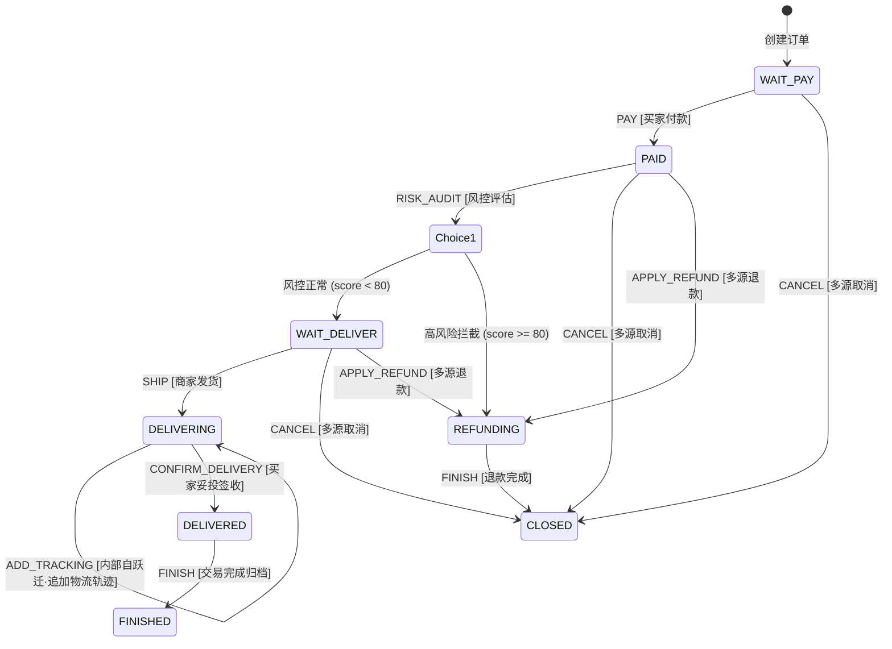

# ateng-boot-sample-statemachine 轻量无状态状态机场景自验工程

> 专一 `ateng-boot-statemachine` 电商订单 8 大状态全生命周期场景自验：外部主干流转、Choice 动态风控条件路由、内部自跃迁物流追踪、多源取消汇聚收敛、节点 Entry/Exit 生命周期、零副作用只读预检探测、CAS 乐观锁并发防重、声明式幂等放行、事务提交后不可逆通知、大批量切片关单与轨迹审计监听。

---

## 1. 场景痛点与功能定位

在复杂的电商履约业务中，订单状态流转极易演化为充斥着散落 `if-else` 的“面条代码”，并常伴随并发重复点击导致状态乱跳、部分操作失败导致状态半成功、第三方异步回调重复投递及大批量超时处理线程卡死等生产级痛点。

`ateng-boot-sample-statemachine` 遵循 [ADR-0028](../../docs/adr/0028-samples-modularization-and-incremental-integration-testing.md) 1:1 独立沙箱原则与非 Web 组件级底座规范，基于纯净 Headless 架构与 H2 内存数据库建立完全离线自洽的 4 大专职场景服务体系：
- **纯内存离线自洽（100% In-Memory Offline Hermetic）**：依赖 H2 内存库与 `@SpringBootTest`，纯净非 Web 环境，秒级极速自验，无任何外部物理中间件依赖；
- **场景一：电商订单生命周期全流转 (`OrderLifecycleScenarioService`)**：覆盖 `WAIT_PAY` $\to$ `PAID` $\to$ `WAIT_DELIVER` $\to$ `DELIVERING` $\to$ `DELIVERED` $\to$ `FINISHED` 主干链路、Choice 动态风控分支（`score >= 80` 拦截至 `REFUNDING`）、内部自跃迁物流追加、多源汇聚取消（至 `CLOSED`）、多源退款申请及状态节点 Entry/Exit 生命周期动作；
- **场景二：零副作用只读预检探测 (`OrderProbeScenarioService`)**：提供 `canFire`、`verifyTransition` 与 `getAvailableEvents`，纯读试算流转可行性与推演目标状态，为前端动态渲染按钮权限，强保证 0 次 Action 执行与 0 次数据库写操作；
- **场景三：支付异步回调并发与幂等治理 (`PaymentCallbackScenarioService`)**：高并发重复回调通过 `fireEventWithCas` CAS-First 安全时序阻断原子冲突；声明式幂等策略（`idempotent(true)`）优雅放行重复回调；并通过 `performAfterCommit` 在本地事务确定性提交后触发短信/履约等不可逆外部通知；
- **场景四：超时订单大批量切片关单 (`OrderTimeoutBatchScenarioService`)**：依托 `fireEventBatch` 切片流转引擎，分批执行超时自动关单，输出结构化聚合回执（`BatchTransitionResult`），兼顾高吞吐与局部异常容错。

---

## 2. 电商订单生命周期状态拓扑图



---

## 3. 场景组件与端到端测试对齐

| 场景组件 | 覆盖核心门面与特性 | 对应端到端测试 |
| :--- | :--- | :--- |
| `OrderLifecycleScenarioService` | `StateMachineBuilder`, `externalTransition`, `choiceTransition`, `internalTransition`, `multiFromTransition`, `state(S).onEntry/onExit`, 导出 Mermaid / PlantUML | `OrderLifecycleIntegrationTest#testHappyPathFullLifecycle`<br>`testInternalTransitionKeepsState`<br>`testChoiceTransitionBranchingAndRollback`<br>`testMultiFromTransitionCancel`<br>`testStateNodeLifecycleEntryAndExitActions`<br>`testTopologyExportMermaidAndPlantUml` |
| `OrderProbeScenarioService` | 零副作用只读探测：`canFire`, `verifyTransition`, `getAvailableEvents`, 动态按钮权限评估 | `OrderLifecycleIntegrationTest#testOrderProbeScenarioService` |
| `PaymentCallbackScenarioService` | `fireEventWithCas` 并发 CAS-First 冲突阻断、`idempotent(true)` 声明式幂等放行、`performAfterCommit` 事务提交后不可逆通知 | `OrderLifecycleIntegrationTest#testPaymentCallbackCasAndIdempotency`<br>`testPaymentCallbackPostCommitNotification` |
| `OrderTimeoutBatchScenarioService` | `fireEventBatch` 切片流转引擎、`BatchOptions`、`BatchTransitionResult` 聚合回执与部分失败容错 | `OrderLifecycleIntegrationTest#testBatchCancelExpiredOrders`<br>`testBatchPartialFailureResilience` |
| `OrderTransitionAuditLogger` | 专职状态流转轨迹审计监听器 SPI (`StateTransitionAuditListener`)，捕获结构化审计事件 (`TransitionAuditEvent`) | `OrderLifecycleIntegrationTest#testAuditListenerCapture` |

---

## 4. 本地运行与集成测试自验

本工程提供 100% 离线自洽的自动化集成测试套件，执行如下 Maven 命令验证 4 大专职场景服务流程：

```bash
mvn test -pl ateng-boot-samples/ateng-boot-sample-statemachine -am -T 1C -nsu -B
```

控制台预期输出：
```text
[INFO] Running io.github.atengk.boot.sample.statemachine.OrderLifecycleIntegrationTest
[INFO] Tests run: 13, Failures: 0, Errors: 0, Skipped: 0
[INFO] Running io.github.atengk.boot.sample.statemachine.SampleStateMachineApplicationTest
[INFO] Tests run: 1, Failures: 0, Errors: 0, Skipped: 0
[INFO] BUILD SUCCESS
```
