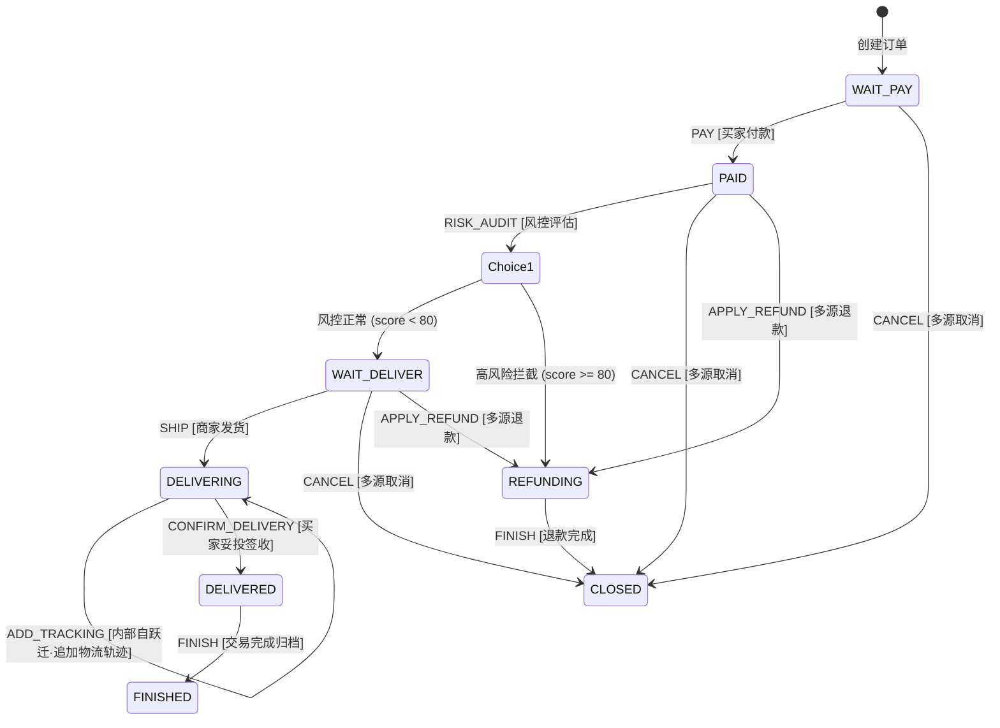

# ateng-boot-sample-statemachine 轻量无状态状态机场景自验工程

> 专一 `ateng-boot-statemachine` 电商订单 8 大状态全生命周期场景自验：外部主干流转、Choice 动态风控条件路由、内部自跃迁物流追踪、多源取消汇聚收敛、CAS 乐观锁并发防重、Spring 本地事务原子回滚与 Mermaid 状态图动态导出。

---

## 1. 场景痛点与功能定位

在复杂的电商履约业务中，订单状态流转极易演化为充斥着散落 `if-else` 的“面条代码”，并常伴随并发重复点击导致状态乱跳、部分操作失败导致状态半成功等生产级痛点。

`ateng-boot-sample-statemachine` 遵循 [ADR-0028](../../docs/adr/0028-samples-modularization-and-incremental-integration-testing.md) 1:1 独立沙箱原则，基于 H2 内存数据库建立完全离线自洽的端到端电商订单流转模型：
- **纯内存离线自洽（100% In-Memory Offline Hermetic）**：依赖 H2 内存库，秒级极速自验，无任何外部物理中间件依赖；
- **电商订单 8 大状态全生命周期流转**：覆盖 `WAIT_PAY` $\to$ `PAID` $\to$ `WAIT_DELIVER` $\to$ `DELIVERING` $\to$ `DELIVERED` $\to$ `FINISHED` 主干链路，以及 `REFUNDING` 和 `CLOSED` 异常/逆向链路；
- **Choice 动态条件分支路由**：买家付款后，依据风控模型评分自动分流（低风险正常进入 `WAIT_DELIVER`，高风险触发拦截直接进入 `REFUNDING` 退款流程）；
- **内部自跃迁（Internal Transition）**：订单配送中（`DELIVERING`）追加物流追踪轨迹，保持订单状态绝对不变，仅更新物流实体物理字段；
- **多源汇聚跃迁（Multi-From Transition）**：待支付、已支付、待发货三大前置状态在买家/商家取消时，统一汇聚收敛至终态 `CLOSED`；
- **CAS 乐观锁防重与本地事务原子回滚**：集成 `StateMachineCasTemplate` / `fireEventWithCas`，高并发重复触发同一跃迁时自动识别行更新为 0 并抛出 `CONCURRENT_CAS_CONFLICT(59005)`；当 Action 执行异常时，依托 Spring 本地事务 `@Transactional` 自动回滚数据库状态修改；
- **动态图例导出端点**：提供 Web Controller 端点实时导出 Mermaid 状态图语法，直观反映状态机当前拓扑。

---

## 2. 电商订单生命周期状态拓扑图



---

## 3. 场景组件与端到端测试对齐

| 场景组件 / 控制器 | 覆盖核心门面与特性 | 对应端到端测试 |
| :--- | :--- | :--- |
| `OrderStateMachineConfig` | `StateMachineBuilder`, `externalTransition`, `choiceTransition`, `internalTransition`, `multiFromTransition` | `OrderLifecycleIntegrationTest` |
| `OrderService` | `fireEventWithCas`, `fireEvent`, `StateMachineCasTemplate`, `@Transactional` 回滚 | `OrderLifecycleIntegrationTest` |
| `OrderStateMachineController` | 统一返回 `Result<T>`，零实体泄露，导出 Mermaid 图例端点 | `OrderLifecycleIntegrationTest` |
| `OrderMapper` | CAS 原子更新 `UPDATE t_order SET status=?, version=version+1 WHERE id=? AND status=? AND version=?` | `OrderLifecycleIntegrationTest` |

---

## 4. 核心场景实测代码范式

### 1. 强类型 Fluent DSL 状态机编排
```java
@Configuration
public class OrderStateMachineConfig {

    public static final String MACHINE_ID = "ORDER_LIFECYCLE";

    @Bean
    public StateMachine<OrderState, OrderEvent, OrderContext> orderStateMachine() {
        StateMachineBuilder<OrderState, OrderEvent, OrderContext> builder = StateMachineBuilder.builder();

        // 1. 外部主干跃迁：WAIT_PAY -> PAID
        builder.externalTransition()
                .from(OrderState.WAIT_PAY)
                .to(OrderState.PAID)
                .on(OrderEvent.PAY)
                .when(ctx -> ctx != null && ctx.getAmount() != null)
                .perform((from, to, event, ctx) -> log.info("[Action] 支付成功: orderSn={}", ctx.getOrderSn()));

        // 2. Choice 动态风控条件路由
        builder.choiceTransition()
                .from(OrderState.PAID)
                .on(OrderEvent.RISK_AUDIT)
                .when(ctx -> ctx != null && ctx.getRiskScore() != null && ctx.getRiskScore() >= 80)
                .to(OrderState.REFUNDING)
                .defaultTo(OrderState.WAIT_DELIVER)
                .perform((from, to, event, ctx) -> log.info("[Action] 风控流转完成: {} -> {}", from, to));

        // 3. 内部自跃迁：追加物流轨迹，状态保持不变
        builder.internalTransition()
                .from(OrderState.DELIVERING)
                .on(OrderEvent.ADD_TRACKING)
                .when(ctx -> ctx != null && ctx.getTrackingRemark() != null)
                .perform((from, to, event, ctx) -> log.info("[Action] 追加物流动态: remark={}", ctx.getTrackingRemark()));

        // 4. 多源汇聚跃迁：取消订单收敛至 CLOSED
        builder.multiFromTransition()
                .from(OrderState.WAIT_PAY, OrderState.PAID, OrderState.WAIT_DELIVER)
                .to(OrderState.CLOSED)
                .on(OrderEvent.CANCEL)
                .perform((from, to, event, ctx) -> log.info("[Action] 订单取消并关闭"));

        return builder.build(MACHINE_ID);
    }
}
```

### 2. CAS 乐观锁防重与本地事务原子回滚
```java
@Transactional(rollbackFor = Exception.class)
public TransitionResult<OrderState> processTransition(Long orderId, OrderTransitionRequest request) {
    OrderDO order = getOrderOrThrow(orderId);
    OrderState sourceState = order.getStatus();

    OrderContext context = OrderContext.builder()
            .orderId(order.getId())
            .orderSn(order.getOrderSn())
            .riskScore(request.getRiskScore())
            .failTrigger(Boolean.TRUE.equals(request.getFailTrigger()))
            .build();

    // 实体状态 CAS 乐观锁防重流转门面（并发冲突返回 0 行时抛出 CONCURRENT_CAS_CONFLICT 异常）
    OrderState targetState = orderStateMachine.fireEventWithCas(
            order,
            OrderDO::getStatus,
            OrderDO::setStatus,
            request.getEvent(),
            context,
            (ent, from, to) -> orderMapper.updateStatusWithCas(ent.getId(), from.name(), to.name(), ent.getVersion())
    );

    return TransitionResult.success(sourceState, targetState, request.getEvent());
}
```

---

## 5. 本地运行与集成测试自验

本工程提供离线自洽的自动化集成测试套件，执行如下 Maven 命令验证全生命周期流转、并发冲突与事务回滚：

```bash
mvn test -pl ateng-boot-samples/ateng-boot-sample-statemachine -T 1C -nsu -B
```

控制台预期输出：
```text
[INFO] Running io.github.atengk.boot.sample.statemachine.OrderLifecycleIntegrationTest
[INFO] Tests run: 8, Failures: 0, Errors: 0, Skipped: 0
[INFO] BUILD SUCCESS
```
