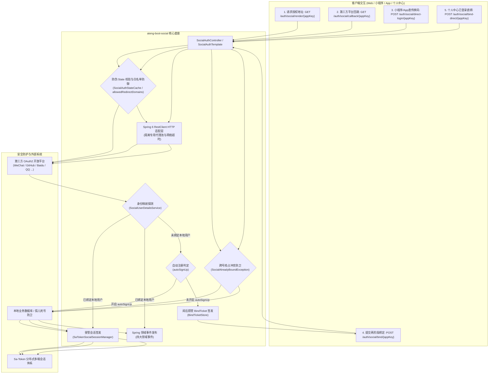

# ateng-boot-social 第三方社会化登录与 OAuth2 Starter

> 基于 Spring Boot 3 与 Dromara Anduin 2.3.0（JustAuth 现代演进版）协议引擎打造的企业级生产就绪第三方社会化登录与 OAuth2 基础设施 Starter。提供涵盖微信开放平台/公众号/小程序/企业微信 V2、钉钉 V2、华为 V3、微软 Entra ID、Apple Sign In、Okta、GitHub、Gitee、百度、QQ/QQ 小程序及企业自建 SSO（`AuthSource` 扩展）的全生态平台统一登录抽象、OAuth 2.1 PKCE 状态解耦与阅后即焚、OIDC `idToken` 透传、微信快照页虚拟号刚性阻断、多端独立设备治理、动态防伪 State 状态机、阅后即焚 BindTicket 两阶段绑定、首次登录静默自动开户、开放重定向白名单校验、个人中心已登录直绑与跨号抢占防卫、第三方令牌续期与吊销、孤儿死号防卫及 Spring 领域事件驱动体系。

---

## 0. 特性与公共 API 全景速查矩阵

| 特性分类 | 特性名称 | 核心门面 / 注解 / SPI | 关键配置项 (`ateng.boot.social.*`) | 关键 API 签名 / 核心行为 | 锚定验证源头 (*Test / Sample) |
| :--- | :--- | :--- | :--- | :--- | :--- |
| **核心门面** | 生成授权跳转地址 (含 PKCE) | `SocialAuthTemplate` | `allowed-redirect-domains`, `apps.<appKey>.pkce` | `getAuthorizeUrl(appKey)` / `getAuthorizeUrl(appKey, context)` | `SocialAuthTemplateTest` / `SocialWebOAuthController` |
| **核心门面** | Web 回调换码认证 (GET/POST) | `SocialAuthTemplate` | `state-timeout`, `apps.<appKey>.reject-snapshot-user` | `login(appKey, callback)` / `login(appKey, callback, options)`（含 PKCE `code_verifier` 阅后即焚） | `SocialAuthTemplateTest` / `SocialWebOAuthController` |
| **核心门面** | 凭证直传换码认证 | `SocialAuthTemplate` | `apps.<appKey>.ignore-check-*`, `auto-sign-up`, `reject-snapshot-user` | `directLogin(appKey, code)` / `directLogin(appKey, code, options)` / `directLogin(appKey, callback, options)` | `SocialAuthTemplateTest` / `SocialMiniProgramAuthController` |
| **核心门面** | 两阶段凭据绑定 | `SocialAuthTemplate` | `bind-ticket-timeout` | `bind(bindTicket, userId)` / `bind(bindTicket, userId, options)` / `bind(appKey, bindTicket, userId, options)` | `SocialAuthTemplateTest` / `SocialAccountBindController` |
| **核心门面** | 已登录直接绑定 | `SocialAuthTemplate` | `apps.<appKey>.reject-snapshot-user` | `bindDirect(userId, appKey, code)` / `bindDirect(userId, appKey, callback)` / `bindDirect(userId, appKey, callback, checkState)` | `SocialAuthTemplateTest` / `SocialAccountBindController` |
| **核心门面** | 孤儿账号防卫解绑 | `SocialAuthTemplate` | `enabled` | `unbind(userId, appKey)` | `SocialAuthTemplateTest` / `SocialAccountBindController` |
| **核心门面** | 第三方令牌续期 | `SocialAuthTemplate` | `apps.<appKey>.*` | `refreshToken(appKey, refreshToken)` / `refreshToken(appKey, authToken)` | `SocialAuthTemplateTest` / `SocialWebOAuthController` |
| **核心门面** | 第三方授权吊销 | `SocialAuthTemplate` | `apps.<appKey>.*` | `revokeAuth(appKey, accessToken)` / `revokeAuth(appKey, authToken)` | `SocialAuthTemplateTest` / `SocialWebOAuthController` |
| **核心门面** | 已绑定账号列表查询 | `SocialAuthTemplate` | 无 (空安全保底) | `listBoundAccounts(userId)`（保底返回空列表，严禁返回 null） | `SocialAuthTemplateTest` / `SocialAccountBindController` |
| **核心门面** | 独立用户画像获取 | `SocialAuthTemplate` | `apps.<appKey>.reject-snapshot-user` | `getSocialUser(appKey, callback)` / `getDirectSocialUser(appKey, code)` | `SocialAuthTemplateTest` |
| **核心门面** | 应用配置与扩展源治理 | `SocialAuthTemplate` | 无 (动静双轨解析) | `getAppConfig(appKey)`, `getRegisteredAppKeys()`, `registerExtendSource(sources)`, `unregisterExtendSource(sourceName)`, `getExtendSourceNames()` | `SocialAuthTemplateTest` / `SocialMultiTenantConfigController` |
| **应用工厂** | 多应用路由与热更新治理 | `SocialAppFactory` | `apps.<appKey>.proxy.*`, `connect-timeout`, `read-timeout` | `createAuthRequest(appKey)`, `getAppConfig(appKey)`, `getRegisteredAppKeys()`, `registerExtendSource(source)`, `unregisterExtendSource(name)`, `getExtendSourceNames()`, `unregisterAppRestClient(appKey)`, `clearAppRestClients()` | `SocialAppFactoryTest` / `SocialMultiTenantConfigController` |
| **企业级配置** | 平台专有属性矩阵 | `SocialAppItemProperties` / `SocialAppConfig` | `pkce`, `reject-snapshot-user`, `microsoft-tenant-id`, `kid`, `team-id`, `login-type`, `lang`, `usertype`, `ding-talk-org-type`, `ding-talk-corp-id`, `ding-talk-exclusive-login`, `ding-talk-exclusive-corp-id`, `domain-prefix`, `auth-server-id`, `device-id`, `client-os-type`, `pack-id`, `stack-overflow-key` | `toAppConfig(appKey)` / `toAuthConfig()` 100% 映射底层 `AuthConfig` | `SocialAppFactoryTest` |
| **REST 控制器** | 开箱即用统一端点 | `SocialAuthController` | `controller.enabled=true`, `controller.prefix` | 暴露 `/render/{appKey}`, `GET/POST /callback/{appKey}`, `/direct-login/{appKey}`, `/bind/{appKey}`, `/bind-direct/{appKey}`, `/unbind/{appKey}`, `/refresh-token/{appKey}` (兼容 `/refresh/{appKey}`), `/revoke-token/{appKey}` (兼容 `/revoke/{appKey}`), `/bindings` | `SocialAuthControllerTest` / `SampleSocialIntegrationTest` |
| **扩展 SPI** | 自定义 OAuth2 平台接入 | `AuthSource` | `apps.<appKey>.source=<CUSTOM_NAME>` | 实现 `AuthSource` 注册为 Spring Bean 或调用 `SocialAppFactory.registerExtendSource`，优先级高于内置枚举 | `SocialAppFactoryTest` / `SampleEnterpriseSsoAuthSource` |
| **扩展 SPI** | 用户身份与持久化映射 | `SocialUserDetailsService` | 无 (Spring 容器注册接管) | `loadUserIdBySocialUser`, `canUnbind`, `bind`, `bindSocialUser`, `unbind`, `autoRegisterUser`, `listBoundAccounts` | `SampleSocialUserDetailsService` |
| **扩展 SPI** | 登录会话与凭据签发 | `SocialSessionManager` | 无 (默认装配 `SaTokenSocialSessionManager`) | `createSession(userId, options, socialUser)` | `SaTokenSocialSessionManagerTest` |
| **扩展 SPI** | 防伪状态与 PKCE 缓存 | `SocialAuthStateCache` | `state-timeout`, `state-cache-key-prefix`, `max-in-memory-cache-size` | `generateState`, `cache`, `containsKey`, `get`, `getContext`, `removeContext`（通过 `StateContext.rawStateValue` 隔离非深链原生键值） | `InMemorySocialAuthStateCacheTest` / `RedisSocialAuthStateCacheTest` |
| **扩展 SPI** | 两阶段绑定票据存储 | `BindTicketStore` | `bind-ticket-timeout`, `bind-ticket-key-prefix` | `createTicket`, `contains`, `get`, `remove` | `InMemoryBindTicketStoreTest` / `RedisBindTicketStoreTest` |
| **扩展 SPI** | SaaS 多租户动态应用配置 | `SocialAppConfigProvider` | 无 (Spring 容器注入) | `getAppConfig(appKey)`（配合配置指纹自动热更新专有 `RestClient`） | `SocialAppFactoryTest` / `SampleSocialAppConfigProvider` |
| **安全防卫** | 微信快照页虚拟号阻断 | `SocialSnapshotUserException` | `reject-snapshot-user`, `apps.<appKey>.reject-snapshot-user` | 命中 `snapshotUser=true` (`is_snapshotuser=1`) 时刚性抛出错误码 `7009` | `SocialAuthTemplateTest` / `SocialMiniProgramAuthController` |
| **领域事件** | 社交认证成功事件 | `SocialAuthenticatedEvent` | 无 (Spring ApplicationEvent) | `getUserId()`, `getAppKey()`, `getSocialUser()`, `getOptions()`, `getStateContext()` | `SampleSocialEventListener` |
| **领域事件** | 账号绑定完成事件 | `SocialBoundEvent` | 无 (Spring ApplicationEvent) | `getUserId()`, `getAppKey()`, `getSocialUser()` | `SampleSocialEventListener` |
| **领域事件** | 账号解除绑定事件 | `SocialUnboundEvent` | 无 (Spring ApplicationEvent) | `getUserId()`, `getAppKey()`, `getUnbindTime()` | `SampleSocialEventListener` |
| **领域事件** | 绑定票据签发事件 | `SocialBindTicketIssuedEvent` | 无 (Spring ApplicationEvent) | `getAppKey()`, `getMaskedTicket()`, `getSocialUser()`, `getIssuedTime()` | `SampleSocialEventListener` |

---

## 1. 模块定位与 Maven 坐标

`ateng-boot-social` 针对多平台第三方 OAuth2 接入中普遍存在的“平台 API 碎片化、企业私有 SSO 难以接入、OAuth 2.1 PKCE 状态污染、微信快照虚拟号污染用户表、State 伪造穿透、未绑定流程复杂、跨号抢占冲突、开放重定向钓鱼、孤儿死号失控”等痛点，提供纯原生、零第三方臃肿依赖（Zero-Bloat）的工业级基础设施解决方案。

### Maven 依赖引入

**方式一：已引入 `ateng-boot-bom`（推荐，免写版本号）**

```xml
<dependency>
    <groupId>io.github.atengk</groupId>
    <artifactId>ateng-boot-social</artifactId>
</dependency>
```

**方式二：独立引入（显式声明当前稳定版本号）**

```xml
<dependency>
    <groupId>io.github.atengk</groupId>
    <artifactId>ateng-boot-social</artifactId>
    <version>1.2.0</version>
</dependency>
```

---

## 2. 核心架构与设计不变量



### 核心设计不变量

1. **显式强类型契约自洽 (ADR-0002)**：所有对外暴露的 REST 控制器统配返回强类型 `Result<T>`，彻底杜绝全局 `@ResponseBodyAdvice` 隐式劫持；
2. **传输契约与持久层绝对解耦 (ADR-0010)**：Controller 严禁直接接收或返回持久化实体，统一使用专用 Request/DTO 与标准化视图对象 `SocialBoundAccount`、`SocialAuthResult`；
3. **内存真明文与数据零泄露 (ADR-0012)**：第三方用户画像 `SocialUser` 在业务层与内存中保持真实明文，脱敏收敛于展示视图与审计日志；
4. **两阶段阅后即焚防重放 (Zero-Leakage Replay Defense)**：第三方换码成功而本地未绑定时，签发高熵 `BindTicket`（默认 TTL 5 分钟），一次读取物理核销，重复请求立即拦截；
5. **跨号抢占冲突刚性防卫 (Anti-Hijack Defense)**：在两阶段绑定与已登录直绑流程中，若第三方账号已绑定至其他本地用户，刚性抛出 `SocialAlreadyBoundException`（错误码 `7007`），阻断账号覆盖与越权串号；同用户重复绑定幂等放行；
6. **开放重定向白名单校验 (Open Redirect Defense)**：严格基于 `ateng.boot.social.allowed-redirect-domains` 校验回调跳转目标地址，域名非法时抛出 `SocialRedirectUriInvalidException`（错误码 `7008`），防御网络钓鱼；
7. **孤儿账号死号防卫 (Orphan Account Defense)**：解绑操作前置强制触发 `canUnbind` 校验；若用户未设独立密码且未绑手机号，严禁解绑唯一社交凭据（错误码 `7002`），防止账号沦为不可登入的孤儿死号；
8. **双模自洽与零臃肿 (ADR-0011, ADR-0021)**：纯原生标准库与 Spring 6 原生能力驱动，支持原生 JVM 内存状态机与 Redis 分布式集群存储无缝切换。

---

## 3. 多平台接入与声明式配置

### 3.1 多平台声明式配置与独立网络代理池

#### 专属 YAML 配置片段

```yaml
ateng:
  boot:
    social:
      enabled: true
      connect-timeout: 5s
      read-timeout: 5s
      state-timeout: 5m
      bind-ticket-timeout: 5m
      allowed-redirect-domains:
        - "ateng.example.com"
        - "*.example.com"
        - "localhost"
      apps:
        # GitHub 平台配置（支持挂载独立 HTTP 代理）
        github_app:
          source: GITHUB
          client-id: "YOUR_GITHUB_CLIENT_ID"
          client-secret: "YOUR_GITHUB_CLIENT_SECRET"
          redirect-uri: "https://ateng.example.com/sample/social/oauth/callback/github_app"
          proxy:
            type: HTTP
            hostname: "127.0.0.1"
            port: 7890
        # 微信小程序配置（直传 code 模式免除 State 与 RedirectUri 校验，开启自动开户）
        wechat_mp_app:
          source: WECHAT_MINI_PROGRAM
          client-id: "YOUR_WX_APPID"
          client-secret: "YOUR_WX_SECRET"
          ignore-check-state: true
          ignore-check-redirect-uri: true
          auto-sign-up: true
        # 百度开放平台配置（支持令牌续期与授权吊销）
        baidu_app:
          source: BAIDU
          client-id: "YOUR_BAIDU_CLIENT_ID"
          client-secret: "YOUR_BAIDU_CLIENT_SECRET"
          redirect-uri: "https://ateng.example.com/sample/social/oauth/callback/baidu_app"
```

#### 业务 Java 示例（逆向提取自 `SocialWebOAuthController`）

```java
@GetMapping("/render/{appKey}")
public Result<String> renderAuthorizeUrl(
        @PathVariable("appKey") String appKey,
        @RequestParam(value = "redirectUrl", required = false) String redirectUrl,
        @RequestParam(value = "tenantId", required = false) String tenantId) {
    String url = scenarioService.generateWebAuthorizeUrl(appKey, redirectUrl, tenantId);
    return Result.success(url);
}
```

#### 机制与边界说明

- **独立代理隔离**：支持全局默认代理（`ateng.boot.social.proxy`）与各应用独立代理（`apps.<appKey>.proxy`）；国际化平台（如 GitHub）可定向配置内网代理穿透，国内平台走直连；
- **强类型超时控制**：连接超时与读取超时均采用 `java.time.Duration` 强类型约束，消除无量纲配置歧义，防止底层网络握手无限挂起消耗容器线程池。

---

### 3.2 动态多租户与平台路由扩展 (SocialAppConfigProvider SPI)

#### 专属 YAML 配置片段

```yaml
ateng:
  boot:
    social:
      enabled: true
      # 静态配置作为回退兜底，动态租户应用由 SocialAppConfigProvider SPI 优先接管
      connect-timeout: 3s
      read-timeout: 3s
```

#### 业务 Java 示例（逆向提取自 `SampleSocialAppConfigProvider`）

当企业需要从数据库、配置中心或 SaaS 多租户元数据中动态装配第三方平台凭据时，实现 `SocialAppConfigProvider` 并注入 Spring 容器即可自动优先接管：

```java
package io.github.atengk.boot.sample.social.provider;

import io.github.atengk.boot.core.context.TenantContextHolder;
import io.github.atengk.boot.social.config.SocialAppConfig;
import io.github.atengk.boot.social.spi.SocialAppConfigProvider;
import org.springframework.stereotype.Component;

/**
 * 动态多租户应用配置提供者样例
 *
 * @author Ateng
 * @since 2026-11-07
 */
@Component
public class CustomDynamicSocialAppProvider implements SocialAppConfigProvider {

    @Override
    public SocialAppConfig getAppConfig(String appKey) {
        String tenantId = TenantContextHolder.getTenantId();
        // 1. 动态根据租户上下文加载对应应用配置
        if ("tenant_saas_01".equals(tenantId) && "saas_github".equals(appKey)) {
            return SocialAppConfig.builder()
                    .appKey(appKey)
                    .source("GITHUB")
                    .clientId("dynamic_saas_client_id")
                    .clientSecret("dynamic_saas_client_secret")
                    .redirectUri("https://tenant01.example.com/callback")
                    .build();
        }
        // 2. 未匹配时返回 null，框架自动平滑回退查找 YAML 静态配置
        return null;
    }
}
```

#### 机制与边界说明

- **多租户客户端配置指纹热更新**：当 `SocialAppConfigProvider` 动态返回的应用包含专有 `connectTimeout`、`readTimeout` 或 `proxy` 时，`SocialAppFactory` 基于 `(connectTimeout, readTimeout, proxy)` 构建不可变配置指纹 `AppClientFingerprint` 并原子比对；仅在租户后台热修改网络配置导致指纹变更时才重建并替换 `SpringRestClientHttpImpl` 中的专有 `RestClient`，若租户移除专有网络配置则自动卸载并回退至全局默认客户端；
- **对称驱逐 API**：`SocialAppFactory` 暴露 `unregisterAppRestClient(appKey)` 与 `clearAppRestClients()`，支持租户下线时主动释放专有 HTTP 客户端。

---

### 3.3 企业自建 SSO 与自定义平台扩展 (AuthSource SPI)

#### 专属 YAML 配置片段

```yaml
ateng:
  boot:
    social:
      apps:
        enterprise_sso_app:
          source: ENTERPRISE_SSO
          client-id: "enterprise_sso_client_id"
          client-secret: "enterprise_sso_client_secret"
          redirect-uri: "http://localhost:8080/sample/social/oauth/callback/enterprise_sso_app"
          auto-sign-up: true
```

#### 业务 Java 示例（逆向提取自 `SampleEnterpriseSsoAuthSource`）

```java
package io.github.atengk.boot.sample.social.provider;

import org.dromara.anduin.cache.AuthStateCache;
import org.dromara.anduin.config.AuthConfig;
import org.dromara.anduin.config.AuthSource;
import org.dromara.anduin.model.AuthCallback;
import org.dromara.anduin.model.AuthToken;
import org.dromara.anduin.model.AuthUser;
import org.dromara.anduin.request.AuthDefaultRequest;
import org.springframework.stereotype.Component;
import tools.jackson.databind.JsonNode;

@Component
public class SampleEnterpriseSsoAuthSource implements AuthSource {

    public static final String SOURCE_NAME = "ENTERPRISE_SSO";
    private static final SampleEnterpriseSsoAuthSource INSTANCE = new SampleEnterpriseSsoAuthSource();

    @Override
    public String authorize() {
        return "https://sso.ateng.example.com/oauth2/authorize";
    }

    @Override
    public String accessToken() {
        return "https://sso.ateng.example.com/oauth2/token";
    }

    @Override
    public String userInfo() {
        return "https://sso.ateng.example.com/oauth2/userinfo";
    }

    @Override
    public String getName() {
        return SOURCE_NAME;
    }

    @Override
    public Class<? extends AuthDefaultRequest> getTargetClass() {
        return EnterpriseSsoAuthRequest.class;
    }

    public static class EnterpriseSsoAuthRequest extends AuthDefaultRequest {

        public EnterpriseSsoAuthRequest(AuthConfig config) {
            super(config, INSTANCE);
        }

        public EnterpriseSsoAuthRequest(AuthConfig config, AuthStateCache authStateCache) {
            super(config, INSTANCE, authStateCache);
        }

        @Override
        public AuthToken getAccessToken(AuthCallback authCallback) {
            String response = doPostAuthorizationCode(authCallback.getCode());
            JsonNode object = toNode(response);
            validateResponse(object);
            return AuthToken.builder()
                    .accessToken(getStringValue(object, "access_token"))
                    .refreshToken(getStringValue(object, "refresh_token"))
                    .expireIn(getIntValue(object, "expires_in"))
                    .idToken(getStringValue(object, "id_token"))
                    .openId(getStringValue(object, "sub"))
                    .build();
        }

        @Override
        public AuthUser getUserInfo(AuthToken authToken) {
            String response = doGetUserInfo(authToken);
            JsonNode object = toNode(response);
            validateResponse(object);
            String openId = getStringValue(object, "sub");
            if (openId == null || openId.isBlank()) {
                openId = authToken.getOpenId();
            }
            return AuthUser.builder()
                    .rawUserInfo(object)
                    .uuid(openId)
                    .username(getStringValue(object, "username"))
                    .nickname(getStringValue(object, "nickname"))
                    .email(getStringValue(object, "email"))
                    .avatar(getStringValue(object, "avatar"))
                    .token(authToken)
                    .source(SOURCE_NAME)
                    .build();
        }
    }
}
```

#### 机制与边界说明

- **容器自动发现与对称编程式管理**：实现 `AuthSource` 并标注 `@Component` 即可被 `SocialAppFactory` 自动发现；同时支持运行期调用 `socialAppFactory.registerExtendSource(authSource)` 与 `unregisterExtendSource(sourceName)` 动态增删扩展平台；
- **三级路由优先级与上游缺陷自愈**：`SocialAppFactory` 按照 `自定义扩展源 (extendSources) > 内置自愈补丁 (AFDIAN / QQ_MINI_PROGRAM) > AuthDefaultSource` 顺序匹配，既允许业务自定义同名源覆盖内置实现，又透明修复了上游 `AFDIAN` 与 `QQ_MINI_PROGRAM` 的枚举映射缺陷。

---

### 3.4 企业级平台专有配置矩阵（微软 Entra / 企微 V2 / 钉钉 V2 / Apple / Okta）

#### 专属 YAML 配置片段

```yaml
ateng:
  boot:
    social:
      apps:
        microsoft_entra_app:
          source: MICROSOFT
          client-id: "YOUR_MS_CLIENT_ID"
          client-secret: "YOUR_MS_CLIENT_SECRET"
          redirect-uri: "https://ateng.example.com/auth/social/callback/microsoft_entra_app"
          microsoft-tenant-id: "YOUR_AZURE_DIRECTORY_TENANT_GUID"
          pkce: true
        dingtalk_v2_app:
          source: DINGTALK_V2
          client-id: "YOUR_DINGTALK_APPKEY"
          client-secret: "YOUR_DINGTALK_SECRET"
          redirect-uri: "https://ateng.example.com/auth/social/callback/dingtalk_v2_app"
          ding-talk-corp-id: "YOUR_CORP_ID"
          ding-talk-exclusive-login: true
          ding-talk-exclusive-corp-id: "YOUR_EXCLUSIVE_CORP_ID"
        apple_app:
          source: APPLE
          client-id: "com.example.ateng.service"
          client-secret: "YOUR_APPLE_P8_PRIVATE_KEY"
          redirect-uri: "https://ateng.example.com/auth/social/callback/apple_app"
          kid: "YOUR_APPLE_KEY_ID"
          team-id: "YOUR_APPLE_TEAM_ID"
```

#### 业务 Java 示例（逆向提取自 `SocialMultiTenantConfigController`）

```java
@GetMapping("/app-config")
public Result<SocialAppConfig> getAppConfig(
        @RequestParam("appKey") String appKey,
        @RequestParam(value = "tenantId", required = false) String tenantId) {
    SocialAppConfig config;
    if (tenantId != null && !tenantId.isBlank()) {
        config = TenantContextHolder.runWithTenant(tenantId, () -> scenarioService.getAppConfig(appKey));
    } else {
        config = scenarioService.getAppConfig(appKey);
    }
    return Result.success(config);
}
```

#### 机制与边界说明

- **100% 强类型穿透**：`SocialAppItemProperties` 与 `SocialAppConfig.toAuthConfig()` 全量映射微软 Entra 目录租户（`microsoft-tenant-id`，向后兼容 `tenant-id`）、Apple Sign In（`kid` / `team-id`）、企业微信网页授权与扫码 V2（`agent-id` / `login-type` / `lang` / `usertype`）、钉钉 V2 专属组织登录（`ding-talk-org-type` / `ding-talk-corp-id` / `ding-talk-exclusive-login` / `ding-talk-exclusive-corp-id`）、Okta（`domain-prefix` / `auth-server-id`）等企业级平台必填字段。

---

## 4. OAuth2 授权认证与全场景绑定套件

### 4.1 标准 Web 扫码授权与防伪 State 状态机（含开放重定向白名单）

#### 专属 YAML 配置片段

```yaml
ateng:
  boot:
    social:
      state-timeout: 5m
      state-cache-key-prefix: "social:state:"
      max-in-memory-cache-size: 10000
      allowed-redirect-domains:
        - "ateng.example.com"
        - "*.example.com"
        - "localhost"
```

#### 业务 Java 示例

```java
package io.github.atengk.boot.sample.social.service;

import io.github.atengk.boot.social.model.SocialAuthResult;
import io.github.atengk.boot.social.model.SocialLoginOptions;
import io.github.atengk.boot.social.model.StateContext;
import io.github.atengk.boot.social.template.SocialAuthTemplate;
import lombok.RequiredArgsConstructor;
import org.dromara.anduin.model.AuthCallback;
import org.springframework.stereotype.Service;

@Service
@RequiredArgsConstructor
public class WebLoginScenarioService {

    private final SocialAuthTemplate socialAuthTemplate;

    /**
     * 1. 生成携带多租户与回跳上下文的高熵防伪授权地址（自动白名单校验）
     */
    public String buildAuthorizeUrl(String appKey, String redirectUrl, String tenantId) {
        StateContext context = StateContext.builder()
                .redirectUrl(redirectUrl)
                .tenantId(tenantId)
                .build();
        return socialAuthTemplate.getAuthorizeUrl(appKey, context);
    }

    /**
     * 2. Web 回调换码认证并签发会话
     */
    public SocialAuthResult handleCallback(String appKey, String code, String state) {
        AuthCallback callback = AuthCallback.builder()
                .code(code)
                .state(state)
                .build();
        SocialLoginOptions options = SocialLoginOptions.builder()
                .deviceType("PC")
                .loginType("USER")
                .build();
        return socialAuthTemplate.login(appKey, callback, options);
    }
}
```

#### 机制与边界说明

- **高熵防伪防穿透**：`SocialAuthTemplate` 基于无锁安全随机生成全局唯一的防伪 `state`，并结构化绑定 `StateContext`（租户、回跳地址、创建时间戳等）；
- **开放重定向白名单校验**：当传入 `redirectUrl` 时，框架校验其域名是否属于 `allowed-redirect-domains` 白名单（支持通配符 `*.example.com`）；校验未通过时抛出 `SocialRedirectUriInvalidException`（错误码 `7008`）；
- **阅后即焚防重放**：换码进入时，`SocialAuthStateCache.removeContext(state)` 原子核销状态码；重复请求抛出 `SocialStateExpiredException`（错误码 `7004`），彻底阻断重放与 CSRF 拦截。

---

### 4.2 移动端与小程序直传换码登录（含首次登录 Auto-Signup 自动开户）

#### 专属 YAML 配置片段

```yaml
ateng:
  boot:
    social:
      apps:
        wechat_auto_app:
          source: WECHAT_MINI_PROGRAM
          client-id: "YOUR_WX_APPID"
          client-secret: "YOUR_WX_SECRET"
          ignore-check-state: true
          ignore-check-redirect-uri: true
          auto-sign-up: true # 开启首次登录静默自动注册开户
```

#### 业务 Java 示例

对于微信小程序 `wx.login` 获取的 `js_code` 或 App 原生 SDK 授权的凭据，支持直传换码：

```java
public SocialAuthResult loginByMiniProgram(String appKey, String wxCode) {
    SocialLoginOptions options = SocialLoginOptions.builder()
            .deviceType("MINI_PROGRAM")
            .build();
    // 当对应应用开启 autoSignUp: true 且未查找到本地用户时，底层自动调用 autoRegisterUser 完成开户并直接签发登录会话
    return socialAuthTemplate.directLogin(appKey, wxCode, options);
}
```

#### 机制与边界说明

- **免重定向无状态换码**：移动端与小程序不经过 Web 浏览器 OAuth2 重定向，配置 `ignore-check-state: true` 与 `ignore-check-redirect-uri: true` 后直接向平台服务端发起 `code2Session` 换码；
- **首次登录静默自动开户**：当应用或全局开启 `auto-sign-up: true` 且 `loadUserIdBySocialUser` 未命中存量绑定时，自动回调 `SocialUserDetailsService.autoRegisterUser(appKey, socialUser)` 创建本地用户并签发会话，免去两阶段绑定步骤。

---

### 4.3 阅后即焚 BindTicket 与两阶段账号绑定

#### 专属 YAML 配置片段

```yaml
ateng:
  boot:
    social:
      bind-ticket-timeout: 5m
      bind-ticket-key-prefix: "social:bind_ticket:"
```

#### 业务 Java 示例

当第三方账号未匹配本地用户且未开启自动开户时，框架自动返回 `REQUIRE_BIND` 状态与短时有效的 `bindTicket`。前端引导用户完成身份验证后提交核销：

```java
public SocialAuthResult bindLocalAccount(String appKey, String bindTicket, String userId) {
    SocialLoginOptions options = SocialLoginOptions.builder()
            .deviceType("PC")
            .loginType("USER")
            .build();
    return socialAuthTemplate.bind(appKey, bindTicket, userId, options);
}
```

#### 机制与边界说明

- **敏感信息物理隔离**：第三方 AccessToken 与敏感用户凭据不直接暴露给客户端前端，仅在服务端通过 `bindTicket` 暂存并关联；
- **一次性消费销毁**：`BindTicketStore.remove(ticket)` 执行强一致原子读取并删除；过期或重复消费立即拦截抛出 `SocialException`（错误码 `7005`）。

---

### 4.4 个人中心已登录直接绑定与跨号抢占冲突防卫

#### 专属 YAML 配置片段

```yaml
ateng:
  boot:
    social:
      apps:
        wechat_mp_app:
          source: WECHAT_MINI_PROGRAM
          client-id: "sample_wx_appid"
          client-secret: "sample_wx_secret"
          ignore-check-state: true
          ignore-check-redirect-uri: true
```

#### 业务 Java 示例

在个人中心设置页面，用户已持有本地系统登录态，直接发起第三方账号绑定（支持直传 code 模式与 Web 回调模式）：

```java
/**
 * 个人中心已登录态直接绑定第三方账号
 */
public SocialUser bindDirect(String userId, String appKey, String code) {
    // 仅完成第三方身份与当前本地用户的持久化关联，发布 SocialBoundEvent，不生成新登录会话
    return socialAuthTemplate.bindDirect(userId, appKey, code);
}
```

#### 机制与边界说明

- **冲突拦截契约**：在两阶段 `bind` 与已登录 `bindDirect` 过程中，框架统一调用 `detailsService.loadUserIdBySocialUser(appKey, socialUser)`：
  - 若已绑定至其他用户（`existingUserId != null && !existingUserId.equals(userId)`），刚性抛出 `SocialAlreadyBoundException`（错误码 `7007`），阻断账号劫持；
  - 若已绑定至当前同一用户（`existingUserId.equals(userId)`），幂等放行并安全刷新绑定信息。

---

### 4.5 账号安全解绑与孤儿死号防卫

#### 专属 YAML 配置片段

```yaml
ateng:
  boot:
    social:
      enabled: true
      apps:
        github_app:
          source: GITHUB
          client-id: "sample_github_client_id"
          client-secret: "sample_github_client_secret"
```

#### 业务 Java 示例

```java
public void unbindAccount(String userId, String appKey) {
    socialAuthTemplate.unbind(userId, appKey);
}
```

#### 机制与边界说明

- **死号防卫契约**：在触发物理解绑前，`SocialAuthTemplate` 显式回调 `SocialUserDetailsService.canUnbind(userId, appKey)` 业务检查；
- **拒绝规则**：若本地用户未设置独立账号密码，且未绑定手机号等备用凭据，解绑唯一的第三方登入方式将导致该账号永久无法登录（即“孤儿死号”）。此时方法直接阻断并抛出 `SocialUnbindRejectedException`（错误码 `7002`），保障用户资产安全。

---

### 4.6 第三方令牌生命周期对称治理（续期与吊销）

#### 专属 YAML 配置片段

```yaml
ateng:
  boot:
    social:
      apps:
        baidu_app:
          source: BAIDU
          client-id: "sample_baidu_client_id"
          client-secret: "sample_baidu_client_secret"
          redirect-uri: "http://localhost:8080/auth/social/callback/baidu_app"
```

#### 业务 Java 示例

```java
/**
 * 1. 刷新第三方平台访问令牌 (refreshToken)
 */
public SocialToken refreshAccessToken(String appKey, String refreshToken) {
    return socialAuthTemplate.refreshToken(appKey, refreshToken);
}

/**
 * 2. 吊销第三方平台访问授权 (revokeAuth)
 */
public void revokeAccessToken(String appKey, String accessToken) {
    socialAuthTemplate.revokeAuth(appKey, accessToken);
}
```

#### 机制与边界说明

- **对称令牌生命周期**：`refreshToken` 与 `revokeAuth` 统一封装底层平台 OAuth2 令牌刷新与撤销协议；当第三方平台不支持刷新或吊销，或凭据已失效时，统一转译为 `SocialAuthException`（错误码 `7003`）并保留原始异常链。

---

### 4.7 个人中心已绑定社交账号列表查询

#### 专属 YAML 配置片段

```yaml
ateng:
  boot:
    social:
      controller:
        enabled: true
        prefix: /auth/social
```

#### 业务 Java 示例

```java
public List<SocialBoundAccount> listUserBindings(String userId) {
    // 保底返回空列表 Collections.emptyList()，彻底消除 NPE 风险
    return socialAuthTemplate.listBoundAccounts(userId);
}
```

#### 机制与边界说明

- **空安全集合契约**：当 `userId` 无匹配绑定记录或 `SocialUserDetailsService.listBoundAccounts` 返回 `null` 时，`SocialAuthTemplate` 强制兜底返回 `Collections.emptyList()`，100% 杜绝下游空指针异常。

---

### 4.8 OAuth 2.1 PKCE 授权挑战、code_verifier 阅后即焚与 OIDC idToken 透传

#### 专属 YAML 配置片段

```yaml
ateng:
  boot:
    social:
      apps:
        huawei_pkce_app:
          source: HUAWEI_V3
          client-id: "sample_huawei_client_id"
          client-secret: "sample_huawei_client_secret"
          redirect-uri: "http://localhost:8080/sample/social/oauth/callback/huawei_pkce_app"
          pkce: true # 开启 OAuth 2.1 PKCE (S256 code_challenge)
```

#### 业务 Java 示例（逆向提取自 `SocialWebOAuthController`）

```java
@GetMapping("/render-pkce/{appKey}")
public Result<String> renderPkceAuthorizeUrl(
        @PathVariable("appKey") String appKey,
        @RequestParam(value = "redirectUrl", required = false) String redirectUrl,
        @RequestParam(value = "tenantId", required = false) String tenantId) {
    String url = scenarioService.generateWebAuthorizeUrl(appKey, redirectUrl, tenantId);
    return Result.success(url);
}

@RequestMapping(value = "/callback/{appKey}", method = {RequestMethod.GET, RequestMethod.POST})
public Result<SocialAuthResult> completeWebLogin(
        @PathVariable("appKey") String appKey,
        AuthCallback callback) {
    SocialAuthResult result = scenarioService.completeWebLogin(appKey, callback);
    return Result.success(result);
}
```

#### 机制与边界说明

- **PKCE 状态缓存隔离**：`SocialAuthStateCache.cache(key, value)` 将非深链原生键值（如 OAuth 2.1 PKCE `code_verifier`）专职写入 `StateContext.rawStateValue`，不写入 `redirectUrl`，在保留内存与 Redis 双模统一存取契约的同时杜绝深链地址污染；
- **code_verifier 阅后即焚**：在 `login` / `getSocialUser` / `bindDirect` 的 `finally` 块中，框架确定性删除 `<SOURCE>:code_verifier:<state>`，实现 PKCE 校验码单次消费即焚；
- **OIDC `idToken` 完整透传**：`SocialToken` 完整保留第三方 OIDC 平台（华为 V3、微软 Entra、Apple、Google、企业 SSO 等）签发的 `idToken`。

---

### 4.9 微信快照页虚拟账号刚性防卫与 QQ 小程序直传登录

#### 专属 YAML 配置片段

```yaml
ateng:
  boot:
    social:
      # 全局默认是否拒绝微信快照页虚拟账号 (默认: false)
      reject-snapshot-user: false
      apps:
        wechat_snapshot_guard_app:
          source: WECHAT_MP
          client-id: "sample_wx_mp_appid"
          client-secret: "sample_wx_mp_secret"
          ignore-check-state: true
          reject-snapshot-user: true # 刚性阻断微信 is_snapshotuser=1 虚拟号
        qq_mini_app:
          source: QQ_MINI_PROGRAM
          client-id: "sample_qq_mini_appid"
          client-secret: "sample_qq_mini_secret"
          ignore-check-state: true
          ignore-check-redirect-uri: true
```

#### 业务 Java 示例（逆向提取自 `SocialMiniProgramAuthController`）

```java
@PostMapping("/qq-direct-login")
public Result<SocialAuthResult> qqMiniProgramDirectLogin(
        @Valid @RequestBody SocialDirectLoginRequest request) {
    SocialAuthResult result = scenarioService.directLogin("qq_mini_app", request.getCode(), request.getDeviceType());
    return Result.success(result);
}

@PostMapping("/snapshot-guard-login")
public Result<SocialAuthResult> snapshotGuardLogin(
        @Valid @RequestBody SocialDirectLoginRequest request) {
    SocialAuthResult result = scenarioService.directLogin("wechat_snapshot_guard_app", request.getCode(), request.getDeviceType());
    return Result.success(result);
}
```

#### 机制与边界说明

- **快照虚拟号零污染防线**：当用户在微信公众号/网页授权中未同意隐私协议而进入快照浏览模式（平台返回 `is_snapshotuser=1`，对应 `SocialUser.snapshotUser == true`）且应用开启 `reject-snapshot-user: true` 时，`SocialAuthTemplate` 在入库与签发会话前刚性抛出 `SocialSnapshotUserException`（错误码 `7009`），彻底杜绝虚拟假 OpenID 污染生产用户表。

---

## 5. 开箱即用 REST 控制器与前端集成

### 5.1 声明式开箱控制器配置

#### 专属 YAML 配置片段

```yaml
ateng:
  boot:
    social:
      controller:
        enabled: true           # 开启内置受管 REST 控制器
        prefix: /auth/social    # 路由前缀，默认为 /auth/social
```

#### 暴露端点全景

| HTTP 方法 | 请求路径 | 请求参数 / Body | 响应契约 | 核心功能 |
| :--- | :--- | :--- | :--- | :--- |
| `GET` | `{prefix}/render/{appKey}` | Query: `redirectUrl`, `tenantId` | `Result<String>` | 生成带防伪 State 的重定向 URL |
| `GET` / `POST` | `{prefix}/callback/{appKey}` | Query / Form: `code`, `state`, `auth_code`, `user` 等 | `Result<SocialAuthResult>` | Web 回调换码认证（同时支持 GET 重定向与 Apple `form_post`） |
| `POST` | `{prefix}/direct-login/{appKey}` | Body: `SocialDirectLoginRequest`（支持 `code`/`authCode`/`oauthToken`） | `Result<SocialAuthResult>` | 小程序/移动端直传凭证认证 |
| `POST` | `{prefix}/bind/{appKey}` | Body: `SocialBindRequest` | `Result<SocialAuthResult>` | 消费 BindTicket 绑定本地用户 |
| `POST` | `{prefix}/bind-direct/{appKey}` | Body: `SocialDirectBindRequest` | `Result<SocialUser>` | 个人中心已登录直接绑定第三方账号 |
| `POST` | `{prefix}/unbind/{appKey}` | Body: `SocialUnbindRequest` | `Result<Void>` | 解除第三方绑定关系（带孤儿防卫） |
| `POST` | `{prefix}/refresh-token/{appKey}` (兼容 `/refresh/{appKey}`) | Body: `SocialTokenRefreshRequest` | `Result<SocialToken>` | 刷新第三方平台访问令牌 |
| `POST` | `{prefix}/revoke-token/{appKey}` (兼容 `/revoke/{appKey}`) | Body: `SocialTokenRevokeRequest` | `Result<Void>` | 吊销第三方平台访问授权凭据 |
| `GET` | `{prefix}/bindings` | Query: `userId` (可选，自动探测会话) | `Result<List<SocialBoundAccount>>` | 查询指定用户已绑定的第三方社交账号 |

---

### 5.2 统一响应状态机与错误码体系

#### `SocialAuthResult` 状态机定义（实现 `IBaseEnum<String>` 通用枚举契约）

```java
public enum SocialAuthState implements IBaseEnum<String> {
    LOGGED_IN("LOGGED_IN", "已绑定并成功签发会话"),
    REQUIRE_BIND("REQUIRE_BIND", "首次访问需补充绑定本地账号");
}
```

#### 异常转译与业务错误码矩阵

| 错误码 (code) | 语义枚举 / 异常类 | 触发场景说明 | 处理建议 |
| :--- | :--- | :--- | :--- |
| `7001` | `SocialAppNotFoundException` | 请求的 `appKey` 在配置和动态提供者中均不存在 | 检查客户端传入的 appKey 是否正确配置 |
| `7002` | `SocialUnbindRejectedException` | 用户未设密码且未绑手机号，触发孤儿死号前置拦截 | 引导用户先设置密码或绑定手机号后再解绑 |
| `7003` | `SocialAuthException` | 第三方平台通信失败、授权拒绝或网络超时 | 提示第三方登录服务暂不可用，稍后重试 |
| `7004` | `SocialStateExpiredException` | OAuth2 防伪 State 非法、过期或被二次消费 | 提示用户授权超时，引导重新扫码 |
| `7005` | `SocialException (BindTicket Invalid)` | 绑定凭据 BindTicket 非法、已过期或已被重复消费 | 引导用户重新发起第三方授权获取新凭证 |
| `7006` | `SocialException (User Not Found)` | 未查找到绑定的本地用户且未开启自动开户 | 引导用户进入两阶段账号绑定流程 |
| `7007` | `SocialAlreadyBoundException` | 待绑定的第三方账号已被其他本地用户绑定 | 提示该账号已被其他用户关联，禁止跨号绑定 |
| `7008` | `SocialRedirectUriInvalidException` | 授权回调目标域名不在系统允许的白名单内 | 检查客户端传入的 redirectUrl 是否在白名单配置中 |
| `7009` | `SocialSnapshotUserException` | 命中微信快照页虚拟账号 (`is_snapshotuser=1`) 且开启防卫拦截 | 引导用户点击网页底部同意完整微信网页授权后再试 |

---

## 6. 扩展点接管与领域事件驱动

### 6.1 用户身份持久化映射接管 (SocialUserDetailsService SPI)

必须在业务工程中实现并注册为 Spring Bean：

```java
package io.github.atengk.boot.sample.social.service;

import io.github.atengk.boot.social.model.SocialBoundAccount;
import io.github.atengk.boot.social.model.SocialUser;
import io.github.atengk.boot.social.spi.SocialUserDetailsService;
import org.springframework.stereotype.Service;

import java.util.List;

@Service
public class EnterpriseSocialUserDetailsService implements SocialUserDetailsService {

    @Override
    public String loadUserIdBySocialUser(String appKey, SocialUser socialUser) {
        // 1. 优先通过微信 unionId 匹配全域统一账号
        if (socialUser.getUnionId() != null) {
            String userId = findByUnionId(socialUser.getUnionId());
            if (userId != null) return userId;
        }
        // 2. 降级通过 appKey + openId 匹配
        return findByOpenId(appKey, socialUser.getOpenId());
    }

    @Override
    public boolean canUnbind(String userId, String appKey) {
        // 检查用户是否具备备用登录凭据
        return checkUserHasPasswordOrMobile(userId);
    }

    @Override
    public void bindSocialUser(String userId, String appKey, SocialUser socialUser) {
        // 记录第三方绑定关系表并更新用户画像
        insertBinding(userId, appKey, socialUser.getOpenId(), socialUser.getUnionId());
    }

    @Override
    public void unbind(String userId, String appKey) {
        // 物理删除或软删除绑定关系
        deleteBinding(userId, appKey);
    }

    @Override
    public String autoRegisterUser(String appKey, SocialUser socialUser) {
        // 首次登录静默自动开户
        return createNewUserFromSocial(appKey, socialUser);
    }

    @Override
    public List<SocialBoundAccount> listBoundAccounts(String userId) {
        // 查询用户已绑定的第三方账号列表
        return queryBoundAccountsByUserId(userId);
    }
}
```

---

### 6.2 登录会话签发与 Sa-Token 深度集成 (SocialSessionManager SPI)

- **默认行为**：当类路径存在 `ateng-boot-satoken` 与 `StpUtil` 时，自动装配 `SaTokenSocialSessionManager`，调用 `LoginHelper.login` 完成受管会话签发；
- **定制接管**：若系统使用专有 JWT 或双 Token 刷新体系，实现 `SocialSessionManager` 即可无缝覆盖默认行为：

```java
@Component
public class CustomJwtSocialSessionManager implements SocialSessionManager {
    @Override
    public Object createSession(String userId, SocialLoginOptions options, SocialUser socialUser) {
        return jwtTokenService.generateToken(userId, options.getDeviceType());
    }
}
```

---

### 6.3 Spring 领域事件驱动与异步审计

#### 业务 Java 示例

```java
package io.github.atengk.boot.sample.social.listener;

import io.github.atengk.boot.social.event.SocialAuthenticatedEvent;
import io.github.atengk.boot.social.event.SocialBindTicketIssuedEvent;
import io.github.atengk.boot.social.event.SocialBoundEvent;
import io.github.atengk.boot.social.event.SocialUnboundEvent;
import lombok.extern.slf4j.Slf4j;
import org.springframework.context.event.EventListener;
import org.springframework.scheduling.annotation.Async;
import org.springframework.stereotype.Component;

@Slf4j
@Component
public class SocialSecurityEventListener {

    @Async
    @EventListener
    public void onAuthenticated(SocialAuthenticatedEvent event) {
        log.info("[审计] 用户社交认证成功: userId={}, appKey={}, openId={}",
                event.getUserId(), event.getAppKey(), event.getSocialUser().getOpenId());
    }

    @Async
    @EventListener
    public void onBound(SocialBoundEvent event) {
        log.info("[审计] 用户完成社交绑定: userId={}, appKey={}", event.getUserId(), event.getAppKey());
    }

    @Async
    @EventListener
    public void onUnbound(SocialUnboundEvent event) {
        log.info("[审计] 用户解除社交绑定: userId={}, appKey={}", event.getUserId(), event.getAppKey());
    }

    @Async
    @EventListener
    public void onTicketIssued(SocialBindTicketIssuedEvent event) {
        log.info("[审计] 签发两阶段绑定票据: appKey={}, maskedTicket={}", event.getAppKey(), event.getMaskedTicket());
    }
}
```

---

## 7. 生产边界、非功能语义与故障模式

1. **分布式集群一致性**：在微服务多副本部署环境下，自动适配 Redis 分布式存储（需引入 `ateng-boot-redis`），确保各节点间防伪 State 与 BindTicket 的透明共享与原子删除；无 Redis 时安全回退为单机本地 Caffeine 缓存；
2. **防重放与单次有效**：State 与 BindTicket 遵循严格的“读后即焚（Get-and-Delete）”单次语义，杜绝网络嗅探二次回放漏洞；
3. **跨号抢占防卫**：无论是两阶段绑定还是已登录直绑，持久层必须执行冲突检测，防止不同本地用户抢占同一社交身份；
4. **钓鱼重定向安全网**：所有授权跳转回跳地址必须经过白名单校验，杜绝开放重定向安全漏洞；
5. **内存安全与自动驱逐**：在本地单机模式下，底层采用基于 Caffeine 的弱引用与 TTL 有界缓存（默认上限 10,000 条），保障在长期海量未回调场景下内存不膨胀、无 OOM 隐患；
6. **网络容错与超时降级**：所有第三方 HTTP 交互均由 Spring 6 `RestClient` 受管驱动，遵循 `connect-timeout` 与 `read-timeout` 阈值，遇网络故障抛出受控业务异常 `SocialAuthException`。

---

## 8. 完整 YAML 配置属性清单

```yaml
ateng:
  boot:
    social:
      # 是否启用社交登录核心底座 (默认: true)
      enabled: true
      # 底层 HTTP 连接超时时间 (默认: 10s)
      connect-timeout: 10s
      # 底层 HTTP 读取超时时间 (默认: 15s)
      read-timeout: 15s
      # OAuth2 防伪状态码 State 有效期 (默认: 5m)
      state-timeout: 5m
      # 两阶段绑定临时凭据 BindTicket 有效期 (默认: 5m)
      bind-ticket-timeout: 5m
      # Redis 防伪 State 缓存键前缀 (默认: social:state:)
      state-cache-key-prefix: "social:state:"
      # Redis 绑定票据缓存键前缀 (默认: social:bind_ticket:)
      bind-ticket-key-prefix: "social:bind_ticket:"
      # 单机本地 Caffeine 缓存最大条目数上限 (默认: 10000)
      max-in-memory-cache-size: 10000
      # 首次社交登录未匹配本地用户时是否全局默认自动注册开户 (默认: false)
      auto-sign-up: false
      # 全局默认是否拒绝微信快照页虚拟账号 is_snapshotuser=1 (默认: false)
      reject-snapshot-user: false
      # 允许的授权回调重定向域名白名单列表 (为空表示不限制，支持通配符 *.example.com)
      allowed-redirect-domains:
        - "ateng.example.com"
        - "*.example.com"
        - "localhost"

      # 全局默认网络代理配置 (可选)
      proxy:
        type: HTTP          # 代理协议: DIRECT, HTTP, SOCKS
        hostname: 127.0.0.1  # 代理主机名或 IP
        port: 7890          # 代理端口号

      # 内置受管 REST 控制器配置
      controller:
        enabled: false       # 是否暴露默认控制器 (默认: false)
        prefix: /auth/social # 控制器请求路径前缀 (默认: /auth/social)

      # 静态声明式第三方应用配置映射集 (Map<appKey, SocialAppItemProperties>)
      apps:
        github_app:
          source: GITHUB              # 平台标识 (支持内置枚举或自定义 AuthSource 名称)
          client-id: ""               # 平台客户端 ID / AppId
          client-secret: ""           # 平台客户端密钥 / AppSecret
          redirect-uri: ""            # 回调重定向绝对地址
          server-url: ""              # 私有化部署服务器地址 (如 Gitea 可选)
          scopes: []                  # 申请授权作用域列表 (可选)
          ignore-check-state: false   # 是否忽略 State 防伪校验 (小程序等场景可选 true)
          ignore-check-redirect-uri: false # 是否忽略 RedirectUri 校验
          pkce: false                 # 是否启用 OAuth 2.1 PKCE 模式 (华为 V3 / Twitter 等可选)
          reject-snapshot-user: false # 当前应用是否拒绝微信快照页虚拟账号 (覆盖全局)
          agent-id: ""                # 企业微信应用 AgentId (可选)
          login-type: "CorpApp"       # 企业微信扫码登录类型 (CorpApp / ServiceApp)
          lang: "zh"                  # 企业微信语言代码 (zh / en)
          usertype: "member"          # 企业微信第三方登录用户类型 (admin / member / all)
          alipay-public-key: ""       # 支付宝公钥 (可选)
          union-id: false             # 是否申请 unionid (QQ 等可选)
          microsoft-tenant-id: ""     # 微软 Entra ID (Azure AD) 目录租户标识 (推荐)
          tenant-id: ""               # 微软 Entra ID 目录租户标识 (向后兼容别名)
          kid: ""                     # Apple Sign In 密钥标识符 (Key ID)
          team-id: ""                 # Apple Sign In 开发者团队 ID (Team ID)
          ding-talk-org-type: ""      # 钉钉 V2 组织类型限制 (可选)
          ding-talk-corp-id: ""       # 钉钉 V2 企业 CorpId (可选)
          ding-talk-exclusive-login: false # 钉钉 V2 是否开启专属帐号登录
          ding-talk-exclusive-corp-id: ""  # 钉钉 V2 专属帐号企业 CorpId
          domain-prefix: ""           # Okta / Coding 平台域名前缀 (可选)
          auth-server-id: "default"   # Okta 授权服务器 ID (默认 default)
          device-id: ""               # 喜马拉雅等平台设备唯一标识 (可选)
          client-os-type: 3           # 喜马拉雅客户端操作系统类型 (1-iOS, 2-Android, 3-Web)
          pack-id: ""                 # 喜马拉雅客户端包名 (可选)
          stack-overflow-key: ""      # StackOverflow API Key (可选)
          connect-timeout: 5s         # 应用级专有连接超时 (覆盖全局)
          read-timeout: 5s            # 应用级专有读取超时 (覆盖全局)
          auto-sign-up: false         # 当前应用是否开启首次登录自动注册 (覆盖全局)
          proxy:                      # 应用级独立代理配置 (优先级高于全局代理)
            type: HTTP
            hostname: 127.0.0.1
            port: 7890
```
