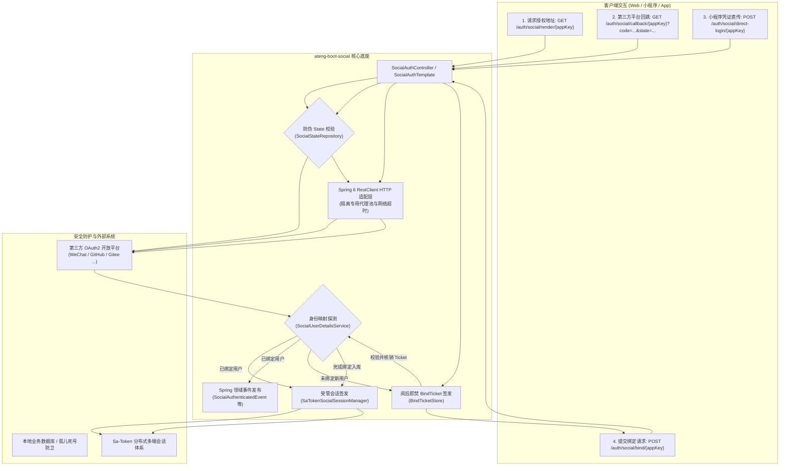

# ateng-boot-social 第三方社会化登录与 OAuth2 Starter

> 基于 Spring Boot 3 与 Dromara Anduin（JustAuth 升级版）协议引擎打造的企业级生产就绪第三方社会化登录与 OAuth2 基础设施 Starter。提供涵盖微信开放平台/小程序/企业微信、GitHub、Gitee 等全生态平台的统一登录抽象、多端独立设备治理、动态防伪 State 状态机、阅后即焚 BindTicket 两阶段绑定、孤儿账号死号防卫与 Spring 领域事件驱动体系。

---

## 0. 特性与公共 API 全景速查矩阵

| 特性分类 | 特性名称 | 核心门面 / 注解 / SPI | 关键配置项 (`ateng.boot.social.*`) | 关键 API 签名 / 核心行为 | 锚定验证源头 (*Test / Sample) |
| :--- | :--- | :--- | :--- | :--- | :--- |
| **核心门面** | 生成授权跳转地址 | `SocialAuthTemplate` | `apps.<appKey>.*` | `getAuthorizeUrl(appKey)` / `getAuthorizeUrl(appKey, context)` | `SocialAuthTemplateTest` / `SampleSocialIntegrationTest` |
| **核心门面** | Web 回调换码认证 | `SocialAuthTemplate` | `state-timeout`, `apps.<appKey>.*` | `login(appKey, callback)` / `login(appKey, callback, options)` | `SocialAuthTemplateTest` / `SampleSocialIntegrationTest` |
| **核心门面** | 小程序/移动端直传凭证 | `SocialAuthTemplate` | `apps.<appKey>.ignore-check-*` | `directLogin(appKey, code)` / `directLogin(appKey, code, options)` | `SocialAuthTemplateTest` / `SampleSocialIntegrationTest` |
| **核心门面** | 消费凭据完成两阶段绑定 | `SocialAuthTemplate` | `bind-ticket-timeout` | `bind(appKey, bindTicket, userId, options)` | `SocialAuthTemplateTest` / `SampleSocialIntegrationTest` |
| **核心门面** | 解绑与孤儿防卫 | `SocialAuthTemplate` | `enabled` | `unbind(userId, appKey)` | `SocialAuthTemplateTest` / `SampleSocialIntegrationTest` |
| **REST 控制器** | 统一开箱 REST 控制器 | `SocialAuthController` | `controller.enabled=true`, `controller.prefix` | 暴露 `/render`, `/callback`, `/direct-login`, `/bind`, `/unbind` 端点 | `SocialAuthControllerTest` / `SampleSocialIntegrationTest` |
| **扩展 SPI** | 用户身份与持久化映射 | `SocialUserDetailsService` | 无 (Spring 容器注册接管) | `loadUserIdBySocialUser`, `canUnbind`, `bind`, `unbind` | `SampleSocialUserDetailsService` |
| **扩展 SPI** | 登录会话与凭据签发 | `SocialSessionManager` | 无 (默认装配 `SaTokenSocialSessionManager`) | `createSession(userId, options, socialUser)` | `SaTokenSocialSessionManagerTest` |
| **扩展 SPI** | 防伪状态存储策略 | `SocialStateRepository` | `state.type=memory/redis` | `saveState`, `getState`, `removeState` | `InMemorySocialAuthStateCacheTest` / `RedisSocialAuthStateCacheTest` |
| **扩展 SPI** | 阅后即焚绑定票据存储 | `BindTicketStore` | `state.type=memory/redis` | `saveBindTicket`, `consumeBindTicket`, `removeBindTicket` | `BindTicketStoreTest` |
| **扩展 SPI** | 动态应用配置源 | `DynamicSocialAppProvider` | 无 (Spring 容器注入) | `getAppConfig(appKey)`, `getAllAppConfigs()` | `DynamicSocialAppProviderTest` |
| **领域事件** | 认证通过事件 | `SocialAuthenticatedEvent` | 无 (Spring ApplicationEvent) | `getUserId()`, `getAppKey()`, `getSocialUser()` | `SampleSocialEventListener` |
| **领域事件** | 两阶段绑定成功事件 | `SocialBoundEvent` | 无 (Spring ApplicationEvent) | `getUserId()`, `getAppKey()`, `getSocialUser()` | `SampleSocialEventListener` |
| **领域事件** | 解除绑定成功事件 | `SocialUnboundEvent` | 无 (Spring ApplicationEvent) | `getUserId()`, `getAppKey()` | `SampleSocialEventListener` |
| **领域事件** | 绑定票据签发事件 | `SocialBindTicketIssuedEvent` | 无 (Spring ApplicationEvent) | `getAppKey()`, `getOpenId()`, `getBindTicket()` | `SampleSocialEventListener` |

---

## 1. 模块定位与 Maven 坐标

`ateng-boot-social` 针对多平台第三方 OAuth2 接入中普遍存在的“平台 API 碎片化、State 伪造穿透、未绑定流程复杂、孤儿死号失控”等痛点，提供纯原生、零第三方工具包（Zero-Bloat）的工业级解决方案。

### Maven 依赖引入

在应用模块的 `pom.xml` 中引入依赖（由于全反应堆纳管于 `ateng-boot-bom`，无需声明 `<version>`）：

```xml
<dependency>
    <groupId>io.github.atengk</groupId>
    <artifactId>ateng-boot-social</artifactId>
</dependency>
```

---

## 2. 核心架构与设计不变量



### 核心设计不变量

1. **显式强类型契约自洽 (ADR-0002)**：所有对外暴露的 REST 端点统配返回强类型 `Result<SocialAuthResult>`，彻底杜绝全局 `@ResponseBodyAdvice` 隐式劫持；
2. **内存真明文与数据零泄露 (ADR-0012)**：第三方用户画像 `SocialUser` 在内存中保持明文，脱敏收敛于展示层；
3. **两阶段阅后即焚防重放 (Zero-Leakage Replay Defense)**：第三方换码成功而本地未绑定时，签发具备短时 TTL（默认 5 分钟）的高熵 `BindTicket`，一次消费立即物理销毁，杜绝重放劫持；
4. **孤儿账号死号防卫 (Orphan Account Defense)**：解绑操作前置强制触发 `canUnbind` 校验；若用户未设独立密码且未绑手机号，严禁解绑唯一社交凭据，防止账号沦为永久不可登入的孤儿死号；
5. **双模自洽与零臃肿 (ADR-0011, ADR-0021)**：纯原生标准库与 Spring 6 原生能力驱动，支持原生 JVM 内存状态机与 Redis 分布式集群存储无缝切换。

---

## 3. 多平台接入与声明式配置

### 3.1 多平台声明式配置与独立网络代理池

#### 专属 YAML 配置片段

```yaml
ateng:
  boot:
    social:
      enabled: true
      connect-timeout: 5s
      read-timeout: 5s
      state-timeout: 5m
      bind-ticket-timeout: 5m
      apps:
        # GitHub 平台配置（支持挂载独立 HTTP 代理）
        github_app:
          source: GITHUB
          client-id: "YOUR_GITHUB_CLIENT_ID"
          client-secret: "YOUR_GITHUB_CLIENT_SECRET"
          redirect-uri: "https://api.example.com/auth/social/callback/github_app"
          proxy:
            type: HTTP
            hostname: "127.0.0.1"
            port: 7890
        # 微信小程序配置（直传 code 模式免除 State 与 RedirectUri 校验）
        wechat_mp_app:
          source: WECHAT_MINI_PROGRAM
          client-id: "YOUR_WX_APPID"
          client-secret: "YOUR_WX_SECRET"
          ignore-check-state: true
          ignore-check-redirect-uri: true
```

#### 机制与边界说明

- **独立代理隔离**：支持全局默认代理（`ateng.boot.social.proxy`）与各应用独立代理（`apps.<appKey>.proxy`）；国际化平台（如 GitHub）可定向配置内网代理穿透，国内平台走直连；
- **强类型超时控制**：连接超时与读取超时均采用 `java.time.Duration` 强类型约束，防止底层网络握手无限挂起消耗容器线程池。

---

### 3.2 动态多租户与平台路由扩展 (DynamicSocialAppProvider SPI)

#### 业务 Java 扩展示例

当企业需要从数据库、配置中心或多租户元数据中动态装配第三方平台凭据时，实现 `DynamicSocialAppProvider` 并注入 Spring 容器即可自动生效：

```java
package io.github.atengk.boot.sample.social.provider;

import io.github.atengk.boot.social.properties.SocialAppProperties;
import io.github.atengk.boot.social.spi.DynamicSocialAppProvider;
import org.springframework.stereotype.Component;

import java.util.Map;

/**
 * 动态多租户应用配置提供者样例
 *
 * @author Ateng
 * @since 2026-11-03
 */
@Component
public class CustomDynamicSocialAppProvider implements DynamicSocialAppProvider {

    @Override
    public SocialAppProperties getAppConfig(String appKey) {
        // 从数据库或缓存中按 tenantId / appKey 动态查询
        if ("tenant_dynamic_app".equals(appKey)) {
            SocialAppProperties props = new SocialAppProperties();
            props.setSource("GITHUB");
            props.setClientId("dynamic_client_id");
            props.setClientSecret("dynamic_client_secret");
            props.setRedirectUri("https://tenant.example.com/callback");
            return props;
        }
        return null;
    }

    @Override
    public Map<String, SocialAppProperties> getAllAppConfigs() {
        return Map.of();
    }
}
```

---

## 4. OAuth2 授权认证与两阶段绑定套件

### 4.1 标准 Web 扫码授权与防伪 State 状态机

#### 专属 YAML 配置片段

```yaml
ateng:
  boot:
    social:
      state-timeout: 5m
      state:
        type: memory # 单机默认 memory，集群环境配置为 redis
        prefix: "ateng:social:state:"
```

#### 业务 Java 示例

```java
package io.github.atengk.boot.sample.social.service;

import io.github.atengk.boot.social.model.SocialAuthResult;
import io.github.atengk.boot.social.model.SocialLoginOptions;
import io.github.atengk.boot.social.model.StateContext;
import io.github.atengk.boot.social.template.SocialAuthTemplate;
import lombok.RequiredArgsConstructor;
import org.dromara.anduin.model.AuthCallback;
import org.springframework.stereotype.Service;

@Service
@RequiredArgsConstructor
public class WebLoginScenarioService {

    private final SocialAuthTemplate socialAuthTemplate;

    /**
     * 1. 生成携带多租户与回跳上下文的高熵防伪授权地址
     */
    public String buildAuthorizeUrl(String appKey, String redirectUrl, String tenantId) {
        StateContext context = StateContext.builder()
                .redirectUrl(redirectUrl)
                .tenantId(tenantId)
                .build();
        return socialAuthTemplate.getAuthorizeUrl(appKey, context);
    }

    /**
     * 2. Web 回调换码认证并签发会话
     */
    public SocialAuthResult handleCallback(String appKey, String code, String state) {
        AuthCallback callback = AuthCallback.builder()
                .code(code)
                .state(state)
                .build();
        SocialLoginOptions options = SocialLoginOptions.builder()
                .deviceType("PC")
                .loginType("USER")
                .build();
        return socialAuthTemplate.login(appKey, callback, options);
    }
}
```

#### 机制与边界说明

- **高熵防伪防穿透**：`SocialAuthTemplate` 基于无锁安全随机生成全局唯一的防伪 `state`，并绑定四维上下文 `StateContext`（租户、回跳地址、创建时间戳等）；
- **阅后即焚防 CSRF 攻击**：回调换码进入时，`SocialStateRepository.removeState(state)` 立即原子核销状态码；重复请求直接抛出 `SocialStateExpiredException`（错误码 `7003`），彻底阻断重放与 CSRF 拦截。

---

### 4.2 移动端/微信小程序直传凭据登录 (DirectLogin)

#### 业务 Java 示例

对于微信小程序 `wx.login` 获取的临时 `code` 或 App 原生 SDK 授权的凭据，支持免除浏览器跳转与 State 校验，直接通过 HTTP 接口直传换码：

```java
public SocialAuthResult loginByMiniProgram(String appKey, String wxCode) {
    SocialLoginOptions options = SocialLoginOptions.builder()
        .deviceType("MINI_PROGRAM")
        .build();
    return socialAuthTemplate.directLogin(appKey, wxCode, options);
}
```

---

### 4.3 阅后即焚 BindTicket 与两阶段绑定

#### 专属 YAML 配置片段

```yaml
ateng:
  boot:
    social:
      bind-ticket-timeout: 5m
```

#### 业务 Java 示例

当第三方账号在本地用户中心未匹配到绑定记录时，框架自动返回 `REQUIRE_BIND` 状态与短时有效的 `bindTicket`。前端引导用户输入账号密码或手机验证码后，提交核销完成绑定：

```java
public SocialAuthResult bindLocalAccount(String appKey, String bindTicket, String userId) {
    SocialLoginOptions options = SocialLoginOptions.builder()
        .deviceType("PC")
        .loginType("USER")
        .build();
    return socialAuthTemplate.bind(appKey, bindTicket, userId, options);
}
```

#### 机制与边界说明

- **敏感信息物理隔离**：第三方 AccessToken 与敏感用户凭据不直接暴露给客户端前端，仅在服务端通过 `bindTicket` 暂存并关联；
- **一次性消费销毁**：`BindTicketStore.consumeBindTicket(ticket)` 执行强一致原子读取并删除；过期或重复消费立即拦截抛出 `SocialBindTicketExpiredException`（错误码 `7005`）。

---

### 4.4 解绑门面与孤儿账号死号防卫

#### 业务 Java 示例

```java
public void unbindAccount(String userId, String appKey) {
    socialAuthTemplate.unbind(userId, appKey);
}
```

#### 孤儿账号防卫核心机制

- **死号防卫契约**：在触发物理解绑前，`SocialAuthTemplate` 显式回调 `SocialUserDetailsService.canUnbind(userId, appKey)` 业务检查；
- **拒绝规则**：若本地用户未设置独立账号密码，且未绑定手机号等备用凭据，解绑唯一的第三方登入方式将导致该账号永久无法登录（即“孤儿死号”）。此时方法直接阻断并抛出 `SocialUnbindRejectedException`（错误码 `7002`），保障用户资产安全。

---

## 5. 开箱即用 REST 控制器与前端集成

### 5.1 声明式开箱控制器配置

#### 专属 YAML 配置片段

```yaml
ateng:
  boot:
    social:
      controller:
        enabled: true           # 开启内置受管 REST 控制器
        prefix: /auth/social    # 路由前缀，默认为 /auth/social
```

#### 暴露端点全景

| HTTP 方法 | 请求路径 | 请求参数 / Body | 响应契约 | 核心功能 |
| :--- | :--- | :--- | :--- | :--- |
| `GET` | `{prefix}/render/{appKey}` | Query: `redirectUrl`, `tenantId` | `Result<String>` | 生成带防伪 State 的平台重定向 URL |
| `GET` | `{prefix}/callback/{appKey}` | Query: `code`, `state`, `deviceType` | `Result<SocialAuthResult>` | Web 回调换码认证并签发登录会话 |
| `POST` | `{prefix}/direct-login/{appKey}` | Body: `SocialDirectLoginRequest` | `Result<SocialAuthResult>` | 小程序/移动端直传凭证认证 |
| `POST` | `{prefix}/bind/{appKey}` | Body: `SocialBindRequest` | `Result<SocialAuthResult>` | 消费 BindTicket 绑定本地用户 |
| `POST` | `{prefix}/unbind/{appKey}` | Body: `SocialUnbindRequest` | `Result<Void>` | 解除第三方绑定关系（带孤儿防卫） |

---

### 5.2 统一响应状态机与错误码体系

#### `SocialAuthResult` 状态机定义

```java
public enum SocialAuthState {
    LOGGED_IN,      // 认证成功，已签发本地会话凭据 (tokenInfo 非空)
    REQUIRE_BIND    // 认证成功但本地未绑定，已签发短时 bindTicket 引导两阶段绑定
}
```

#### 异常转译与业务错误码矩阵

| 错误码 (code) | 语义枚举 / 异常类 | 触发场景说明 | 处理建议 |
| :--- | :--- | :--- | :--- |
| `7001` | `SocialAppNotFoundException` | 请求的 `appKey` 在配置和动态提供者中均不存在 | 检查客户端传入的 appKey 是否正确配置 |
| `7002` | `SocialUnbindRejectedException` | 用户未设密码且未绑手机号，触发孤儿死号前置拦截 | 引导用户先设置密码或绑定手机号后再解绑 |
| `7003` | `SocialStateExpiredException` | OAuth2 防伪 State 非法、过期或被二次消费 | 提示用户授权超时，引导重新扫码 |
| `7004` | `SocialAuthFailedException` | 第三方平台通信失败、授权拒绝或网络超时 | 提示第三方登录服务暂不可用，稍后重试 |
| `7005` | `SocialBindTicketExpiredException` | 绑定凭据 BindTicket 非法、已过期或已被重复消费 | 引导用户重新发起第三方授权获取新凭证 |

---

## 6. 扩展点接管与领域事件驱动

### 6.1 用户身份持久化映射接管 (SocialUserDetailsService SPI)

必须在业务工程中实现并注册为 Spring Bean：

```java
package io.github.atengk.boot.sample.social.service;

import io.github.atengk.boot.social.model.SocialUser;
import io.github.atengk.boot.social.spi.SocialUserDetailsService;
import org.springframework.stereotype.Service;

@Service
public class EnterpriseSocialUserDetailsService implements SocialUserDetailsService {

    @Override
    public String loadUserIdBySocialUser(String appKey, SocialUser socialUser) {
        // 1. 优先通过微信 unionId 匹配全域统一账号
        if (socialUser.getUnionId() != null) {
            String userId = findByUnionId(socialUser.getUnionId());
            if (userId != null) return userId;
        }
        // 2. 降级通过 appKey + openId 匹配
        return findByOpenId(appKey, socialUser.getOpenId());
    }

    @Override
    public boolean canUnbind(String userId, String appKey) {
        // 检查用户是否具备备用登录凭据
        return checkUserHasPasswordOrMobile(userId);
    }

    @Override
    public void bind(String userId, String appKey, SocialUser socialUser) {
        // 记录第三方绑定关系表并更新用户画像
        insertBinding(userId, appKey, socialUser.getOpenId(), socialUser.getUnionId());
    }

    @Override
    public void unbind(String userId, String appKey) {
        // 物理删除或软删除绑定关系
        deleteBinding(userId, appKey);
    }
}
```

---

### 6.2 登录会话签发与 Sa-Token 深度集成 (SocialSessionManager SPI)

- **默认行为**：当类路径存在 `ateng-boot-satoken` 与 `StpUtil` 时，自动装配 `SaTokenSocialSessionManager`，调用 `LoginHelper.login` 完成受管会话签发；
- **定制接管**：若系统使用专有 JWT 或双 Token 刷新体系，实现 `SocialSessionManager` 即可无缝覆盖默认行为：

```java
@Component
public class CustomJwtSocialSessionManager implements SocialSessionManager {
    @Override
    public Object createSession(String userId, SocialLoginOptions options, SocialUser socialUser) {
        return jwtTokenService.generateToken(userId, options.getDeviceType());
    }
}
```

---

### 6.3 Spring 领域事件驱动与异步审计

#### 业务 Java 示例

```java
package io.github.atengk.boot.sample.social.listener;

import io.github.atengk.boot.social.event.SocialAuthenticatedEvent;
import io.github.atengk.boot.social.event.SocialBoundEvent;
import io.github.atengk.boot.social.event.SocialUnboundEvent;
import lombok.extern.slf4j.Slf4j;
import org.springframework.context.event.EventListener;
import org.springframework.scheduling.annotation.Async;
import org.springframework.stereotype.Component;

@Slf4j
@Component
public class SocialSecurityEventListener {

    @Async
    @EventListener
    public void onAuthenticated(SocialAuthenticatedEvent event) {
        log.info("[审计] 用户社交认证成功: userId={}, appKey={}, openId={}",
                event.getUserId(), event.getAppKey(), event.getSocialUser().getOpenId());
    }

    @Async
    @EventListener
    public void onBound(SocialBoundEvent event) {
        log.info("[审计] 用户完成社交绑定: userId={}, appKey={}", event.getUserId(), event.getAppKey());
    }

    @Async
    @EventListener
    public void onUnbound(SocialUnboundEvent event) {
        log.info("[审计] 用户解除社交绑定: userId={}, appKey={}", event.getUserId(), event.getAppKey());
    }
}
```

---

## 7. 生产边界、非功能语义与故障模式

1. **分布式集群一致性**：在微服务多副本部署环境下，必须将 `ateng.boot.social.state.type` 显式切换为 `redis`，确保各节点间防伪 State 与 BindTicket 的透明共享与原子删除；
2. **防重放与单次有效**：State 与 BindTicket 遵循严格的“读后即焚（Get-and-Delete）”单次语义，杜绝网络嗅探二次回放漏洞；
3. **内存安全与自动驱逐**：在 `memory` 模式下，底层采用基于 Caffeine/ConcurrentHashMap 的弱引用与 TTL 有界缓存，保障在长期海量未回调场景下内存不膨胀、无 OOM 隐患；
4. **网络容错与超时降级**：所有第三方 HTTP 交互均由 Spring 6 `RestClient` 受管驱动，遵循 `connect-timeout` 与 `read-timeout` 阈值，遇网络故障抛出受控业务异常 `SocialAuthFailedException`。

---

## 8. 完整 YAML 配置属性清单

```yaml
ateng:
  boot:
    social:
      # 是否启用社交登录核心底座 (默认: true)
      enabled: true
      # 底层 HTTP 连接超时时间 (默认: 5s)
      connect-timeout: 5s
      # 底层 HTTP 读取超时时间 (默认: 5s)
      read-timeout: 5s
      # OAuth2 防伪状态码 State 有效期 (默认: 5m)
      state-timeout: 5m
      # 两阶段绑定临时凭据 BindTicket 有效期 (默认: 5m)
      bind-ticket-timeout: 5m

      # 全局网络代理配置 (可选)
      proxy:
        type: HTTP          # 代理协议: DIRECT, HTTP, SOCKS
        hostname: 127.0.0.1  # 代理主机名或 IP
        port: 7890          # 代理端口号

      # 状态机与绑定凭据持久化策略
      state:
        type: memory        # 存储类型: memory (单机), redis (分布式)
        prefix: "ateng:social:state:" # 缓存键前缀

      # 开箱即用 REST 控制器配置
      controller:
        enabled: false       # 是否暴露默认控制器 (默认: false)
        prefix: /auth/social # 控制器请求路径前缀 (默认: /auth/social)

      # 静态声明式第三方应用配置映射集 (Map<appKey, SocialAppProperties>)
      apps:
        github_app:
          source: GITHUB              # 平台枚举标识 (如 GITHUB, WECHAT_OPEN, WECHAT_MP 等)
          client-id: ""               # 平台客户端 ID / AppId
          client-secret: ""           # 平台客户端密钥 / AppSecret
          redirect-uri: ""            # 回调重定向绝对地址
          scopes: []                  # 申请授权作用域列表 (可选)
          ignore-check-state: false   # 是否忽略 State 防伪校验 (小程序等场景可选 true)
          ignore-check-redirect-uri: false # 是否忽略 RedirectUri 校验
          device-type: ""             # 默认客户端设备类型 (可选)
          timeout: 30d                # 默认会话有效期 (可选)
          proxy:                      # 应用级独立代理配置 (优先级高于全局代理)
            type: HTTP
            hostname: 127.0.0.1
            port: 7890
```
