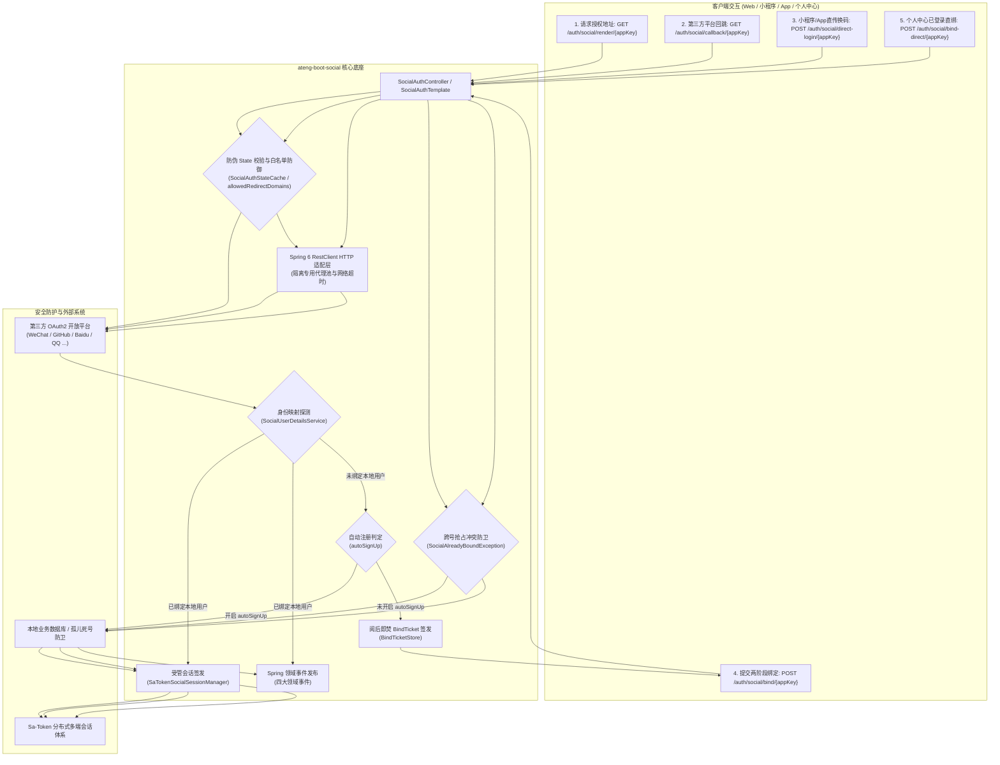

# ateng-boot-social 第三方社会化登录与 OAuth2 Starter

> 基于 Spring Boot 3 与 Dromara Anduin（JustAuth 升级版）协议引擎打造的企业级生产就绪第三方社会化登录与 OAuth2 基础设施 Starter。提供涵盖微信开放平台/小程序/企业微信、GitHub、Gitee、百度、QQ 等全生态平台的统一登录抽象、多端独立设备治理、动态防伪 State 状态机、阅后即焚 BindTicket 两阶段绑定、首次登录静默自动开户、开放重定向白名单校验、个人中心已登录直绑与跨号抢占防卫、第三方令牌续期与吊销、孤儿死号防卫及 Spring 领域事件驱动体系。

---

## 0. 特性与公共 API 全景速查矩阵

| 特性分类 | 特性名称 | 核心门面 / 注解 / SPI | 关键配置项 (`ateng.boot.social.*`) | 关键 API 签名 / 核心行为 | 锚定验证源头 (*Test / Sample) |
| :--- | :--- | :--- | :--- | :--- | :--- |
| **核心门面** | 生成授权跳转地址 | `SocialAuthTemplate` | `allowed-redirect-domains`, `apps.<appKey>.*` | `getAuthorizeUrl(appKey)` / `getAuthorizeUrl(appKey, context)` | `SocialAuthTemplateTest` / `SocialWebOAuthController` |
| **核心门面** | Web 回调换码认证 | `SocialAuthTemplate` | `state-timeout`, `apps.<appKey>.*` | `login(appKey, callback)` / `login(appKey, callback, options)` | `SocialAuthTemplateTest` / `SocialWebOAuthController` |
| **核心门面** | 凭证直传换码认证 | `SocialAuthTemplate` | `apps.<appKey>.ignore-check-*`, `auto-sign-up` | `directLogin(appKey, code)` / `directLogin(appKey, code, options)` | `SocialAuthTemplateTest` / `SocialMiniProgramAuthController` |
| **核心门面** | 两阶段凭据绑定 | `SocialAuthTemplate` | `bind-ticket-timeout` | `bind(bindTicket, userId)` / `bind(appKey, bindTicket, userId, options)` | `SocialAuthTemplateTest` / `SocialAccountBindController` |
| **核心门面** | 已登录直接绑定 | `SocialAuthTemplate` | `apps.<appKey>.*` | `bindDirect(userId, appKey, code)` / `bindDirect(userId, appKey, callback)` | `SocialAuthTemplateTest` / `SocialAccountBindController` |
| **核心门面** | 孤儿账号防卫解绑 | `SocialAuthTemplate` | `enabled` | `unbind(userId, appKey)` | `SocialAuthTemplateTest` / `SocialAccountBindController` |
| **核心门面** | 第三方令牌续期 | `SocialAuthTemplate` | `apps.<appKey>.*` | `refreshToken(appKey, refreshToken)` / `refreshToken(appKey, authToken)` | `SocialAuthTemplateTest` / `SocialWebOAuthController` |
| **核心门面** | 第三方授权吊销 | `SocialAuthTemplate` | `apps.<appKey>.*` | `revokeAuth(appKey, accessToken)` / `revokeAuth(appKey, authToken)` | `SocialAuthTemplateTest` / `SocialWebOAuthController` |
| **核心门面** | 已绑定账号列表查询 | `SocialAuthTemplate` | 无 (空安全保底) | `listBoundAccounts(userId)`（保底返回空列表，严禁返回 null） | `SocialAuthTemplateTest` / `SocialAccountBindController` |
| **核心门面** | 独立用户画像获取 | `SocialAuthTemplate` | `apps.<appKey>.*` | `getSocialUser(appKey, callback)` / `getDirectSocialUser(appKey, code)` | `SocialAuthTemplateTest` |
| **核心门面** | 标准化应用配置提取 | `SocialAuthTemplate` | 无 (动静双轨解析) | `getAppConfig(appKey)` | `SocialAuthTemplateTest` / `SocialMultiTenantConfigController` |
| **REST 控制器** | 开箱即用统一端点 | `SocialAuthController` | `controller.enabled=true`, `controller.prefix` | 暴露 `/render`, `/callback`, `/direct-login`, `/bind`, `/bind-direct`, `/unbind`, `/refresh-token`, `/revoke-token`, `/bindings` | `SocialAuthControllerTest` / `SampleSocialIntegrationTest` |
| **扩展 SPI** | 用户身份与持久化映射 | `SocialUserDetailsService` | 无 (Spring 容器注册接管) | `loadUserIdBySocialUser`, `canUnbind`, `bindSocialUser`, `unbind`, `autoRegisterUser`, `listBoundAccounts` | `SampleSocialUserDetailsService` |
| **扩展 SPI** | 登录会话与凭据签发 | `SocialSessionManager` | 无 (默认装配 `SaTokenSocialSessionManager`) | `createSession(userId, options, socialUser)` | `SaTokenSocialSessionManagerTest` |
| **扩展 SPI** | 防伪状态缓存策略 | `SocialAuthStateCache` | `state-timeout`, 本地 JVM / Redis 自动适配 | `generateState`, `cache`, `containsKey`, `getContext`, `removeContext` | `InMemorySocialAuthStateCacheTest` / `RedisSocialAuthStateCacheTest` |
| **扩展 SPI** | 两阶段绑定票据存储 | `BindTicketStore` | `bind-ticket-timeout`, 本地 JVM / Redis 自动适配 | `createTicket`, `contains`, `get`, `remove` | `InMemoryBindTicketStoreTest` / `RedisBindTicketStoreTest` |
| **扩展 SPI** | SaaS 多租户动态应用配置 | `SocialAppConfigProvider` | 无 (Spring 容器注入) | `getAppConfig(appKey)` | `SocialAppFactoryTest` / `SampleSocialAppConfigProvider` |
| **领域事件** | 社交认证成功事件 | `SocialAuthenticatedEvent` | 无 (Spring ApplicationEvent) | `getUserId()`, `getAppKey()`, `getSocialUser()`, `getOptions()`, `getStateContext()` | `SampleSocialEventListener` |
| **领域事件** | 账号绑定完成事件 | `SocialBoundEvent` | 无 (Spring ApplicationEvent) | `getUserId()`, `getAppKey()`, `getSocialUser()` | `SampleSocialEventListener` |
| **领域事件** | 账号解除绑定事件 | `SocialUnboundEvent` | 无 (Spring ApplicationEvent) | `getUserId()`, `getAppKey()`, `getUnbindTime()` | `SampleSocialEventListener` |
| **领域事件** | 绑定票据签发事件 | `SocialBindTicketIssuedEvent` | 无 (Spring ApplicationEvent) | `getAppKey()`, `getMaskedTicket()`, `getSocialUser()`, `getIssuedTime()` | `SampleSocialEventListener` |

---

## 1. 模块定位与 Maven 坐标

`ateng-boot-social` 针对多平台第三方 OAuth2 接入中普遍存在的“平台 API 碎片化、State 伪造穿透、未绑定流程复杂、跨号抢占冲突、开放重定向钓鱼、孤儿死号失控”等痛点，提供纯原生、零第三方臃肿依赖（Zero-Bloat）的工业级基础设施解决方案。

### Maven 依赖引入

在应用模块的 `pom.xml` 中引入依赖（由于全反应堆纳管于 `ateng-boot-bom`，无需声明 `<version>`）：

```xml
<dependency>
    <groupId>io.github.atengk</groupId>
    <artifactId>ateng-boot-social</artifactId>
</dependency>
```

---

## 2. 核心架构与设计不变量



### 核心设计不变量

1. **显式强类型契约自洽 (ADR-0002)**：所有对外暴露的 REST 控制器统配返回强类型 `Result<T>`，彻底杜绝全局 `@ResponseBodyAdvice` 隐式劫持；
2. **传输契约与持久层绝对解耦 (ADR-0010)**：Controller 严禁直接接收或返回持久化实体，统一使用专用 Request/DTO 与标准化视图对象 `SocialBoundAccount`、`SocialAuthResult`；
3. **内存真明文与数据零泄露 (ADR-0012)**：第三方用户画像 `SocialUser` 在业务层与内存中保持真实明文，脱敏收敛于展示视图与审计日志；
4. **两阶段阅后即焚防重放 (Zero-Leakage Replay Defense)**：第三方换码成功而本地未绑定时，签发高熵 `BindTicket`（默认 TTL 5 分钟），一次读取物理核销，重复请求立即拦截；
5. **跨号抢占冲突刚性防卫 (Anti-Hijack Defense)**：在两阶段绑定与已登录直绑流程中，若第三方账号已绑定至其他本地用户，刚性抛出 `SocialAlreadyBoundException`（错误码 `7007`），阻断账号覆盖与越权串号；同用户重复绑定幂等放行；
6. **开放重定向白名单校验 (Open Redirect Defense)**：严格基于 `ateng.boot.social.allowed-redirect-domains` 校验回调跳转目标地址，域名非法时抛出 `SocialRedirectUriInvalidException`（错误码 `7008`），防御网络钓鱼；
7. **孤儿账号死号防卫 (Orphan Account Defense)**：解绑操作前置强制触发 `canUnbind` 校验；若用户未设独立密码且未绑手机号，严禁解绑唯一社交凭据（错误码 `7002`），防止账号沦为不可登入的孤儿死号；
8. **双模自洽与零臃肿 (ADR-0011, ADR-0021)**：纯原生标准库与 Spring 6 原生能力驱动，支持原生 JVM 内存状态机与 Redis 分布式集群存储无缝切换。

---

## 3. 多平台接入与声明式配置

### 3.1 多平台声明式配置与独立网络代理池

#### 专属 YAML 配置片段

```yaml
ateng:
  boot:
    social:
      enabled: true
      connect-timeout: 5s
      read-timeout: 5s
      state-timeout: 5m
      bind-ticket-timeout: 5m
      allowed-redirect-domains:
        - "ateng.example.com"
        - "*.example.com"
        - "localhost"
      apps:
        # GitHub 平台配置（支持挂载独立 HTTP 代理）
        github_app:
          source: GITHUB
          client-id: "YOUR_GITHUB_CLIENT_ID"
          client-secret: "YOUR_GITHUB_CLIENT_SECRET"
          redirect-uri: "https://ateng.example.com/sample/social/oauth/callback/github_app"
          proxy:
            type: HTTP
            hostname: "127.0.0.1"
            port: 7890
        # 微信小程序配置（直传 code 模式免除 State 与 RedirectUri 校验，开启自动开户）
        wechat_mp_app:
          source: WECHAT_MINI_PROGRAM
          client-id: "YOUR_WX_APPID"
          client-secret: "YOUR_WX_SECRET"
          ignore-check-state: true
          ignore-check-redirect-uri: true
          auto-sign-up: true
        # 百度开放平台配置（支持令牌续期与授权吊销）
        baidu_app:
          source: BAIDU
          client-id: "YOUR_BAIDU_CLIENT_ID"
          client-secret: "YOUR_BAIDU_CLIENT_SECRET"
          redirect-uri: "https://ateng.example.com/sample/social/oauth/callback/baidu_app"
```

#### 机制与边界说明

- **独立代理隔离**：支持全局默认代理（`ateng.boot.social.proxy`）与各应用独立代理（`apps.<appKey>.proxy`）；国际化平台（如 GitHub）可定向配置内网代理穿透，国内平台走直连；
- **强类型超时控制**：连接超时与读取超时均采用 `java.time.Duration` 强类型约束，消除无量纲配置歧义，防止底层网络握手无限挂起消耗容器线程池。

---

### 3.2 动态多租户与平台路由扩展 (SocialAppConfigProvider SPI)

#### 业务 Java 扩展示例

当企业需要从数据库、配置中心或 SaaS 多租户元数据中动态装配第三方平台凭据时，实现 `SocialAppConfigProvider` 并注入 Spring 容器即可自动优先接管：

```java
package io.github.atengk.boot.sample.social.provider;

import io.github.atengk.boot.core.context.TenantContextHolder;
import io.github.atengk.boot.social.config.SocialAppConfig;
import io.github.atengk.boot.social.spi.SocialAppConfigProvider;
import org.springframework.stereotype.Component;

/**
 * 动态多租户应用配置提供者样例
 *
 * @author Ateng
 * @since 2026-11-07
 */
@Component
public class CustomDynamicSocialAppProvider implements SocialAppConfigProvider {

    @Override
    public SocialAppConfig getAppConfig(String appKey) {
        String tenantId = TenantContextHolder.getTenantId();
        // 1. 动态根据租户上下文加载对应应用配置
        if ("tenant_saas_01".equals(tenantId) && "saas_github".equals(appKey)) {
            return SocialAppConfig.builder()
                    .appKey(appKey)
                    .source("GITHUB")
                    .clientId("dynamic_saas_client_id")
                    .clientSecret("dynamic_saas_client_secret")
                    .redirectUri("https://tenant01.example.com/callback")
                    .build();
        }
        // 2. 未匹配时返回 null，框架自动平滑回退查找 YAML 静态配置
        return null;
    }
}
```

---

## 4. OAuth2 授权认证与全场景绑定套件

### 4.1 标准 Web 扫码授权与防伪 State 状态机（含开放重定向白名单）

#### 专属 YAML 配置片段

```yaml
ateng:
  boot:
    social:
      state-timeout: 5m
      allowed-redirect-domains:
        - "ateng.example.com"
        - "*.example.com"
      state:
        type: memory # 单机默认 memory，分布式集群配置为 redis
        prefix: "ateng:social:state:"
```

#### 业务 Java 示例

```java
package io.github.atengk.boot.sample.social.service;

import io.github.atengk.boot.social.model.SocialAuthResult;
import io.github.atengk.boot.social.model.SocialLoginOptions;
import io.github.atengk.boot.social.model.StateContext;
import io.github.atengk.boot.social.template.SocialAuthTemplate;
import lombok.RequiredArgsConstructor;
import org.dromara.anduin.model.AuthCallback;
import org.springframework.stereotype.Service;

@Service
@RequiredArgsConstructor
public class WebLoginScenarioService {

    private final SocialAuthTemplate socialAuthTemplate;

    /**
     * 1. 生成携带多租户与回跳上下文的高熵防伪授权地址（自动白名单校验）
     */
    public String buildAuthorizeUrl(String appKey, String redirectUrl, String tenantId) {
        StateContext context = StateContext.builder()
                .redirectUrl(redirectUrl)
                .tenantId(tenantId)
                .build();
        return socialAuthTemplate.getAuthorizeUrl(appKey, context);
    }

    /**
     * 2. Web 回调换码认证并签发会话
     */
    public SocialAuthResult handleCallback(String appKey, String code, String state) {
        AuthCallback callback = AuthCallback.builder()
                .code(code)
                .state(state)
                .build();
        SocialLoginOptions options = SocialLoginOptions.builder()
                .deviceType("PC")
                .loginType("USER")
                .build();
        return socialAuthTemplate.login(appKey, callback, options);
    }
}
```

#### 机制与边界说明

- **高熵防伪防穿透**：`SocialAuthTemplate` 基于无锁安全随机生成全局唯一的防伪 `state`，并结构化绑定 `StateContext`（租户、回跳地址、创建时间戳等）；
- **开放重定向白名单校验**：当传入 `redirectUrl` 时，框架校验其域名是否属于 `allowed-redirect-domains` 白名单（支持通配符 `*.example.com`）；校验未通过时抛出 `SocialRedirectUriInvalidException`（错误码 `7008`）；
- **阅后即焚防重放**：换码进入时，`SocialAuthStateCache.removeContext(state)` 原子核销状态码；重复请求抛出 `SocialStateExpiredException`（错误码 `7003`），彻底阻断重放与 CSRF 拦截。

---

### 4.2 移动端与小程序直传换码登录（含首次登录 Auto-Signup 自动开户）

#### 专属 YAML 配置片段

```yaml
ateng:
  boot:
    social:
      apps:
        wechat_auto_app:
          source: WECHAT_MINI_PROGRAM
          client-id: "YOUR_WX_APPID"
          client-secret: "YOUR_WX_SECRET"
          ignore-check-state: true
          ignore-check-redirect-uri: true
          auto-sign-up: true # 开启首次登录静默自动注册开户
```

#### 业务 Java 示例

对于微信小程序 `wx.login` 获取的 `js_code` 或 App 原生 SDK 授权的凭据，支持直传换码：

```java
public SocialAuthResult loginByMiniProgram(String appKey, String wxCode) {
    SocialLoginOptions options = SocialLoginOptions.builder()
            .deviceType("MINI_PROGRAM")
            .build();
    // 当对应应用开启 autoSignUp: true 且未查找到本地用户时，底层自动调用 autoRegisterUser 完成开户并直接签发登录会话
    return socialAuthTemplate.directLogin(appKey, wxCode, options);
}
```

---

### 4.3 阅后即焚 BindTicket 与两阶段账号绑定

#### 专属 YAML 配置片段

```yaml
ateng:
  boot:
    social:
      bind-ticket-timeout: 5m
```

#### 业务 Java 示例

当第三方账号未匹配本地用户且未开启自动开户时，框架自动返回 `REQUIRE_BIND` 状态与短时有效的 `bindTicket`。前端引导用户完成身份验证后提交核销：

```java
public SocialAuthResult bindLocalAccount(String appKey, String bindTicket, String userId) {
    SocialLoginOptions options = SocialLoginOptions.builder()
            .deviceType("PC")
            .loginType("USER")
            .build();
    return socialAuthTemplate.bind(appKey, bindTicket, userId, options);
}
```

#### 机制与边界说明

- **敏感信息物理隔离**：第三方 AccessToken 与敏感用户凭据不直接暴露给客户端前端，仅在服务端通过 `bindTicket` 暂存并关联；
- **一次性消费销毁**：`BindTicketStore.remove(ticket)` 执行强一致原子读取并删除；过期或重复消费立即拦截抛出 `SocialException`（错误码 `7005`）。

---

### 4.4 个人中心已登录直接绑定与跨号抢占冲突防卫

#### 业务 Java 示例

在个人中心设置页面，用户已持有本地系统登录态，直接发起第三方账号绑定（支持直传 code 模式与 Web 回调模式）：

```java
/**
 * 个人中心已登录态直接绑定第三方账号
 */
public SocialUser bindDirect(String userId, String appKey, String code) {
    // 仅完成第三方身份与当前本地用户的持久化关联，发布 SocialBoundEvent，不生成新登录会话
    return socialAuthTemplate.bindDirect(userId, appKey, code);
}
```

#### 跨号抢占冲突防卫机制

- **冲突拦截契约**：在两阶段 `bind` 与已登录 `bindDirect` 过程中，框架统一调用 `detailsService.loadUserIdBySocialUser(appKey, socialUser)`：
  - 若已绑定至其他用户（`existingUserId != null && !existingUserId.equals(userId)`），刚性抛出 `SocialAlreadyBoundException`（错误码 `7007`），阻断账号劫持；
  - 若已绑定至当前同一用户（`existingUserId.equals(userId)`），幂等放行并安全刷新绑定信息。

---

### 4.5 账号安全解绑与孤儿死号防卫

#### 业务 Java 示例

```java
public void unbindAccount(String userId, String appKey) {
    socialAuthTemplate.unbind(userId, appKey);
}
```

#### 孤儿账号防卫核心机制

- **死号防卫契约**：在触发物理解绑前，`SocialAuthTemplate` 显式回调 `SocialUserDetailsService.canUnbind(userId, appKey)` 业务检查；
- **拒绝规则**：若本地用户未设置独立账号密码，且未绑定手机号等备用凭据，解绑唯一的第三方登入方式将导致该账号永久无法登录（即“孤儿死号”）。此时方法直接阻断并抛出 `SocialUnbindRejectedException`（错误码 `7002`），保障用户资产安全。

---

### 4.6 第三方令牌生命周期对称治理（续期与吊销）

#### 业务 Java 示例

```java
/**
 * 1. 刷新第三方平台访问令牌 (refreshToken)
 */
public SocialToken refreshAccessToken(String appKey, String refreshToken) {
    return socialAuthTemplate.refreshToken(appKey, refreshToken);
}

/**
 * 2. 吊销第三方平台访问授权 (revokeAuth)
 */
public void revokeAccessToken(String appKey, String accessToken) {
    socialAuthTemplate.revokeAuth(appKey, accessToken);
}
```

---

### 4.7 个人中心已绑定社交账号列表查询

#### 业务 Java 示例

```java
public List<SocialBoundAccount> listUserBindings(String userId) {
    // 保底返回空列表 Collections.emptyList()，彻底消除 NPE 风险
    return socialAuthTemplate.listBoundAccounts(userId);
}
```

---

## 5. 开箱即用 REST 控制器与前端集成

### 5.1 声明式开箱控制器配置

#### 专属 YAML 配置片段

```yaml
ateng:
  boot:
    social:
      controller:
        enabled: true           # 开启内置受管 REST 控制器
        prefix: /auth/social    # 路由前缀，默认为 /auth/social
```

#### 暴露端点全景

| HTTP 方法 | 请求路径 | 请求参数 / Body | 响应契约 | 核心功能 |
| :--- | :--- | :--- | :--- | :--- |
| `GET` | `{prefix}/render/{appKey}` | Query: `redirectUrl`, `tenantId` | `Result<String>` | 生成带防伪 State 的重定向 URL |
| `GET` | `{prefix}/callback/{appKey}` | Query: `code`, `state`, `deviceType` | `Result<SocialAuthResult>` | Web 回调换码认证并签发登录会话 |
| `POST` | `{prefix}/direct-login/{appKey}` | Body: `SocialDirectLoginRequest` | `Result<SocialAuthResult>` | 小程序/移动端直传凭证认证 |
| `POST` | `{prefix}/bind/{appKey}` | Body: `SocialBindRequest` | `Result<SocialAuthResult>` | 消费 BindTicket 绑定本地用户 |
| `POST` | `{prefix}/bind-direct/{appKey}` | Body: `SocialDirectBindRequest` | `Result<SocialUser>` | 个人中心已登录直接绑定第三方账号 |
| `POST` | `{prefix}/unbind/{appKey}` | Body: `SocialUnbindRequest` | `Result<Void>` | 解除第三方绑定关系（带孤儿防卫） |
| `POST` | `{prefix}/refresh-token/{appKey}` | Body: `SocialTokenRefreshRequest` | `Result<SocialToken>` | 刷新第三方平台访问令牌 |
| `POST` | `{prefix}/revoke-token/{appKey}` | Body: `SocialTokenRevokeRequest` | `Result<Void>` | 吊销第三方平台访问授权凭据 |
| `GET` | `{prefix}/bindings` | Query: `userId` (可选，自动探测会话) | `Result<List<SocialBoundAccount>>` | 查询指定用户已绑定的第三方社交账号 |

---

### 5.2 统一响应状态机与错误码体系

#### `SocialAuthResult` 状态机定义

```java
public enum SocialAuthState {
    LOGGED_IN,      // 认证成功，已签发本地会话凭据 (tokenInfo 非空)
    REQUIRE_BIND    // 认证成功但本地未绑定，已签发短时 bindTicket 引导两阶段绑定
}
```

#### 异常转译与业务错误码矩阵

| 错误码 (code) | 语义枚举 / 异常类 | 触发场景说明 | 处理建议 |
| :--- | :--- | :--- | :--- |
| `7001` | `SocialAppNotFoundException` | 请求的 `appKey` 在配置和动态提供者中均不存在 | 检查客户端传入的 appKey 是否正确配置 |
| `7002` | `SocialUnbindRejectedException` | 用户未设密码且未绑手机号，触发孤儿死号前置拦截 | 引导用户先设置密码或绑定手机号后再解绑 |
| `7003` | `SocialStateExpiredException` | OAuth2 防伪 State 非法、过期或被二次消费 | 提示用户授权超时，引导重新扫码 |
| `7004` | `SocialAuthException` | 第三方平台通信失败、授权拒绝或网络超时 | 提示第三方登录服务暂不可用，稍后重试 |
| `7005` | `SocialException (BindTicket Invalid)` | 绑定凭据 BindTicket 非法、已过期或已被重复消费 | 引导用户重新发起第三方授权获取新凭证 |
| `7006` | `SocialException (User Not Found)` | 未查找到绑定的本地用户且未开启自动开户 | 引导用户进入两阶段账号绑定流程 |
| `7007` | `SocialAlreadyBoundException` | 待绑定的第三方账号已被其他本地用户绑定 | 提示该账号已被其他用户关联，禁止跨号绑定 |
| `7008` | `SocialRedirectUriInvalidException` | 授权回调目标域名不在系统允许的白名单内 | 检查客户端传入的 redirectUrl 是否在白名单配置中 |

---

## 6. 扩展点接管与领域事件驱动

### 6.1 用户身份持久化映射接管 (SocialUserDetailsService SPI)

必须在业务工程中实现并注册为 Spring Bean：

```java
package io.github.atengk.boot.sample.social.service;

import io.github.atengk.boot.social.model.SocialBoundAccount;
import io.github.atengk.boot.social.model.SocialUser;
import io.github.atengk.boot.social.spi.SocialUserDetailsService;
import org.springframework.stereotype.Service;

import java.util.List;

@Service
public class EnterpriseSocialUserDetailsService implements SocialUserDetailsService {

    @Override
    public String loadUserIdBySocialUser(String appKey, SocialUser socialUser) {
        // 1. 优先通过微信 unionId 匹配全域统一账号
        if (socialUser.getUnionId() != null) {
            String userId = findByUnionId(socialUser.getUnionId());
            if (userId != null) return userId;
        }
        // 2. 降级通过 appKey + openId 匹配
        return findByOpenId(appKey, socialUser.getOpenId());
    }

    @Override
    public boolean canUnbind(String userId, String appKey) {
        // 检查用户是否具备备用登录凭据
        return checkUserHasPasswordOrMobile(userId);
    }

    @Override
    public void bindSocialUser(String userId, String appKey, SocialUser socialUser) {
        // 记录第三方绑定关系表并更新用户画像
        insertBinding(userId, appKey, socialUser.getOpenId(), socialUser.getUnionId());
    }

    @Override
    public void unbind(String userId, String appKey) {
        // 物理删除或软删除绑定关系
        deleteBinding(userId, appKey);
    }

    @Override
    public String autoRegisterUser(String appKey, SocialUser socialUser) {
        // 首次登录静默自动开户
        return createNewUserFromSocial(appKey, socialUser);
    }

    @Override
    public List<SocialBoundAccount> listBoundAccounts(String userId) {
        // 查询用户已绑定的第三方账号列表
        return queryBoundAccountsByUserId(userId);
    }
}
```

---

### 6.2 登录会话签发与 Sa-Token 深度集成 (SocialSessionManager SPI)

- **默认行为**：当类路径存在 `ateng-boot-satoken` 与 `StpUtil` 时，自动装配 `SaTokenSocialSessionManager`，调用 `LoginHelper.login` 完成受管会话签发；
- **定制接管**：若系统使用专有 JWT 或双 Token 刷新体系，实现 `SocialSessionManager` 即可无缝覆盖默认行为：

```java
@Component
public class CustomJwtSocialSessionManager implements SocialSessionManager {
    @Override
    public Object createSession(String userId, SocialLoginOptions options, SocialUser socialUser) {
        return jwtTokenService.generateToken(userId, options.getDeviceType());
    }
}
```

---

### 6.3 Spring 领域事件驱动与异步审计

#### 业务 Java 示例

```java
package io.github.atengk.boot.sample.social.listener;

import io.github.atengk.boot.social.event.SocialAuthenticatedEvent;
import io.github.atengk.boot.social.event.SocialBindTicketIssuedEvent;
import io.github.atengk.boot.social.event.SocialBoundEvent;
import io.github.atengk.boot.social.event.SocialUnboundEvent;
import lombok.extern.slf4j.Slf4j;
import org.springframework.context.event.EventListener;
import org.springframework.scheduling.annotation.Async;
import org.springframework.stereotype.Component;

@Slf4j
@Component
public class SocialSecurityEventListener {

    @Async
    @EventListener
    public void onAuthenticated(SocialAuthenticatedEvent event) {
        log.info("[审计] 用户社交认证成功: userId={}, appKey={}, openId={}",
                event.getUserId(), event.getAppKey(), event.getSocialUser().getOpenId());
    }

    @Async
    @EventListener
    public void onBound(SocialBoundEvent event) {
        log.info("[审计] 用户完成社交绑定: userId={}, appKey={}", event.getUserId(), event.getAppKey());
    }

    @Async
    @EventListener
    public void onUnbound(SocialUnboundEvent event) {
        log.info("[审计] 用户解除社交绑定: userId={}, appKey={}", event.getUserId(), event.getAppKey());
    }

    @Async
    @EventListener
    public void onTicketIssued(SocialBindTicketIssuedEvent event) {
        log.info("[审计] 签发两阶段绑定票据: appKey={}, maskedTicket={}", event.getAppKey(), event.getMaskedTicket());
    }
}
```

---

## 7. 生产边界、非功能语义与故障模式

1. **分布式集群一致性**：在微服务多副本部署环境下，自动适配 Redis 分布式存储（需引入 `ateng-boot-redis`），确保各节点间防伪 State 与 BindTicket 的透明共享与原子删除；无 Redis 时安全回退为单机本地 Caffeine 缓存；
2. **防重放与单次有效**：State 与 BindTicket 遵循严格的“读后即焚（Get-and-Delete）”单次语义，杜绝网络嗅探二次回放漏洞；
3. **跨号抢占防卫**：无论是两阶段绑定还是已登录直绑，持久层必须执行冲突检测，防止不同本地用户抢占同一社交身份；
4. **钓鱼重定向安全网**：所有授权跳转回跳地址必须经过白名单校验，杜绝开放重定向安全漏洞；
5. **内存安全与自动驱逐**：在本地单机模式下，底层采用基于 Caffeine 的弱引用与 TTL 有界缓存（默认上限 10,000 条），保障在长期海量未回调场景下内存不膨胀、无 OOM 隐患；
6. **网络容错与超时降级**：所有第三方 HTTP 交互均由 Spring 6 `RestClient` 受管驱动，遵循 `connect-timeout` 与 `read-timeout` 阈值，遇网络故障抛出受控业务异常 `SocialAuthException`。

---

## 8. 完整 YAML 配置属性清单

```yaml
ateng:
  boot:
    social:
      # 是否启用社交登录核心底座 (默认: true)
      enabled: true
      # 底层 HTTP 连接超时时间 (默认: 10s)
      connect-timeout: 10s
      # 底层 HTTP 读取超时时间 (默认: 15s)
      read-timeout: 15s
      # OAuth2 防伪状态码 State 有效期 (默认: 5m)
      state-timeout: 5m
      # 两阶段绑定临时凭据 BindTicket 有效期 (默认: 5m)
      bind-ticket-timeout: 5m
      # Redis 防伪 State 缓存键前缀 (默认: social:state:)
      state-cache-key-prefix: "social:state:"
      # Redis 绑定票据缓存键前缀 (默认: social:bind_ticket:)
      bind-ticket-key-prefix: "social:bind_ticket:"
      # 单机本地 Caffeine 缓存最大条目数上限 (默认: 10000)
      max-in-memory-cache-size: 10000
      # 首次社交登录未匹配本地用户时是否全局默认自动注册开户 (默认: false)
      auto-sign-up: false
      # 允许的授权回调重定向域名白名单列表 (为空表示不限制，支持通配符 *.example.com)
      allowed-redirect-domains:
        - "ateng.example.com"
        - "*.example.com"
        - "localhost"

      # 全局默认网络代理配置 (可选)
      proxy:
        type: HTTP          # 代理协议: DIRECT, HTTP, SOCKS
        hostname: 127.0.0.1  # 代理主机名或 IP
        port: 7890          # 代理端口号

      # 内置受管 REST 控制器配置
      controller:
        enabled: false       # 是否暴露默认控制器 (默认: false)
        prefix: /auth/social # 控制器请求路径前缀 (默认: /auth/social)

      # 静态声明式第三方应用配置映射集 (Map<appKey, SocialAppItemProperties>)
      apps:
        github_app:
          source: GITHUB              # 平台枚举标识 (如 GITHUB, WECHAT_OPEN, WECHAT_MP, BAIDU 等)
          client-id: ""               # 平台客户端 ID / AppId
          client-secret: ""           # 平台客户端密钥 / AppSecret
          redirect-uri: ""            # 回调重定向绝对地址
          server-url: ""              # 私有化部署服务器地址 (如 Gitea 可选)
          scopes: []                  # 申请授权作用域列表 (可选)
          ignore-check-state: false   # 是否忽略 State 防伪校验 (小程序等场景可选 true)
          ignore-check-redirect-uri: false # 是否忽略 RedirectUri 校验
          agent-id: ""                # 企业微信应用 AgentId (可选)
          alipay-public-key: ""       # 支付宝公钥 (可选)
          union-id: false             # 是否申请 unionid (QQ 等可选)
          connect-timeout: 5s         # 应用级专有连接超时 (覆盖全局)
          read-timeout: 5s            # 应用级专有读取超时 (覆盖全局)
          auto-sign-up: false         # 当前应用是否开启首次登录自动注册 (覆盖全局)
          proxy:                      # 应用级独立代理配置 (优先级高于全局代理)
            type: HTTP
            hostname: 127.0.0.1
            port: 7890
```
