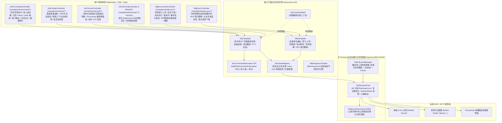
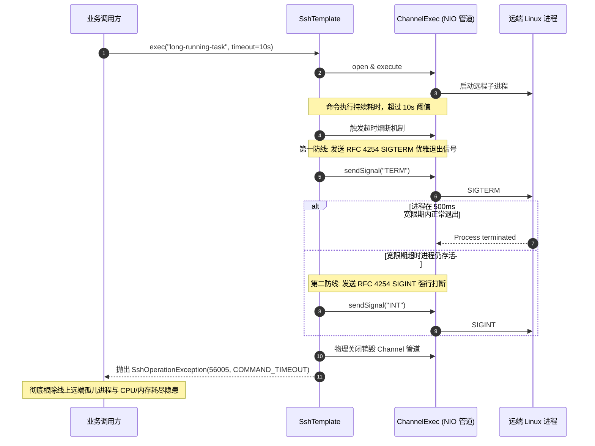
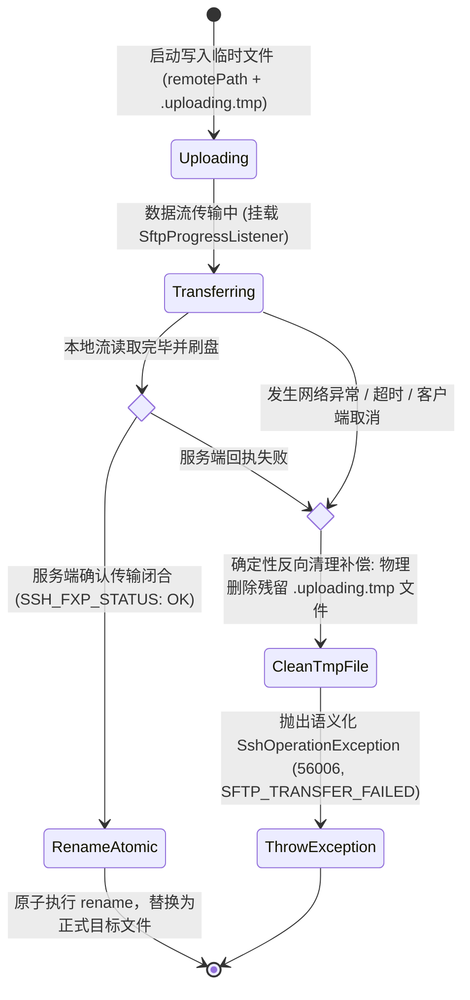
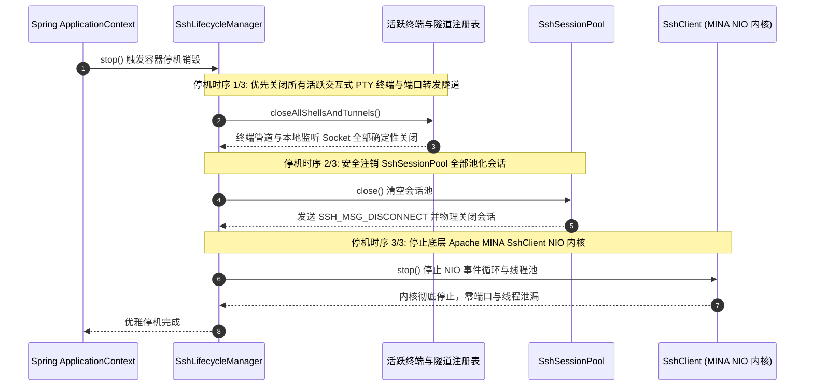

# ateng-boot-ssh 基础设施 Starter

> 工业级 SSH 远程命令执行、SFTP 安全文件传输与 WebSSH 交互终端基础设施 Starter，基于 Apache MINA SSHD 原生异步驱动内核构建。全链路采用 `ReentrantLock` 消除 JDK 21+ 虚拟线程 Carrier Pinning，全面涵盖四位一体拓扑路由（缺省单机 / YAML 命名字典 / 线程动态切源 / CMDB 纯内存直连）、LRU/TTL 活跃心跳会话缓存池与运行态观测快照（`SshSessionPool` / `SshPoolStats`）、YAML 声明式 `jump-host` 环路防卫与动态注销驱逐（`SshClientRegistry.unregister`）、同步有界输出防 OOM（`BoundedByteArrayOutputStream`）、POSIX 工作目录转义、`SshCommandInterceptor` 高危命令防火墙、RFC 4254 孤儿进程超时信号防卫（`TERM`/`INT`）、无 TTY 原生 Sudo 提权管道与口令抹零、Core 四维上下文集群并发巡检（`execBatchAdvanced`）、双向受管端口转发（`LOCAL` / `REMOTE`）、SFTP 全量具名节点路由/原子上传/符号链接治理/大文件断点续传下载/进度防抖/双向目录树同步，以及基于 Spring 原生 WebSocket 驱动的 WebSSH 交互式伪终端会话（`SshShellHandle`）。

---

## 0. 特性与公共 API 全景速查矩阵 (Feature & API Panorama Matrix)

| 特性分类 | 特性名称 | 核心门面 / 模型 / SPI | 关键配置项 (`ateng.boot.ssh.*`) | 关键 API 签名 / 核心行为 | 锚定验证源头 (*Test / Controller) |
| :--- | :--- | :--- | :--- | :--- | :--- |
| **命令执行** | 同步短命令执行契约 | `SshTemplate`<br>`SshExecOptions`<br>`SshExecResult` | `command-timeout`<br>`max-output-size` | `exec(String)` / `exec(String, SshExecOptions)` / `exec(String, String)` / `exec(SshServerInfo, String)`，返回强类型 `SshExecResult`（含 `exitCode`、`stdout`、`stderr`、`duration`、`truncated`） | `SshTemplateCommandExecutionTest`<br>`SshCommandController`<br>`SampleSshWebIntegrationTest` |
| **命令执行** | 有界输出防 OOM 与 POSIX 目录转义 | `BoundedByteArrayOutputStream`<br>`SshCommandExecutor` | `max-output-size` | 限制同步命令 `stdout`/`stderr` 最大内存缓冲（默认 `10MB`），超限安全截断并继续排空通道，`SshExecResult.isTruncated()` 置为 `true`；`workingDir` 拦截 `\0`/`\r`/`\n` 并执行 POSIX 单引号安全转义 | `BoundedByteArrayOutputStreamTest`<br>`SshCommandExecutorTest`<br>`SshTemplateCommandExecutionTest`<br>`SshCommandController`<br>`SampleSshWebIntegrationTest` |
| **命令执行** | 命令拦截器 SPI 与高危命令防火墙 | `SshCommandInterceptor`<br>`HighRiskCommandInterceptor` | `dangerous-command-guard-enabled`<br>`dangerous-command-patterns` | SPI 提供 `beforeExecute` / `afterExecute` / `onError`；内置最高优先级守卫拦截 `rm -rf /`、`mkfs`、`dd` 覆写、Fork 炸弹、`shutdown`/`reboot` 及自定义黑名单正则，阻断码 `56017 (COMMAND_FORBIDDEN)` | `AtengSshAutoConfigurationTest`<br>`SshTemplateCommandExecutionTest`<br>`SampleCommandAuditInterceptor`<br>`SshCommandController`<br>`SampleSshWebIntegrationTest` |
| **命令执行** | 非阻塞异步执行 | `SshTemplate` | `command-timeout` | `execAsync(String)` / `execAsync(String, SshExecOptions)` / `execAsync(String, String)` / `execAsync(SshServerInfo, String)` / `execScriptAsync(...)`，返回 `CompletableFuture<SshExecResult>`，在 Core 受管异步线程池调度 | `SshTemplateProbeAndAsyncTest`<br>`SshCommandController`<br>`SampleSshWebIntegrationTest` |
| **命令执行** | 原生 Sudo 提权安全管道 | `SshTemplate` | `command-timeout` | `execSudo(String, String)` / `execSudo(String, char[])` / `execSudo(String, String, String)` / `execSudo(SshServerInfo, String, String)`，底层构建 `-S -p ''` 安全管道，口令发送完毕后立即执行 `Arrays.fill` 擦除抹零 | `SshTemplateSudoAndBatchTest`<br>`SshCommandController`<br>`SampleSshWebIntegrationTest` |
| **命令执行** | 多行脚本管道执行 | `SshTemplate` | `command-timeout` | `execScript(String)` / `execScript(String, String)` / `execScript(SshServerInfo, String)`，自动将 Windows CRLF 规范化为 Unix LF，打包为远端 Shell 管道执行 | `SshTemplateCommandExecutionTest`<br>`SshCommandController`<br>`SampleSshWebIntegrationTest` |
| **命令执行** | 长任务流式按行消费 | `SshTemplate`<br>`Consumer<String>` | `command-timeout` | `execStream(String, Consumer<String>)` / `execStream(String, Consumer<String>, Consumer<String>)` / `execStream(SshServerInfo, String, Consumer<String>, Consumer<String>, SshExecOptions)`，按行回调消费远端滚动日志，防 OOM，返回退出码 | `LineStreamingOutputStreamTest`<br>`SshCommandController`<br>`SampleSshWebIntegrationTest` |
| **命令执行** | 轻量无害连通性探针 | `SshTemplate` | `connect-timeout`<br>`auth-timeout` | `testConnection(String)` / `testConnection(SshServerInfo)` / `testConnectionOrThrow(...)`，仅执行 TCP 握手与 SSH 凭据身份验证协商即刻断开，不分配伪终端或执行进程 | `SshTemplateProbeAndAsyncTest`<br>`SshCommandController`<br>`SampleSshWebIntegrationTest` |
| **命令执行** | 瞬态单次任务隔离执行与会话回调 | `SshTemplate`<br>`SshSessionPool`<br>`SshSessionCallback` | `connect-timeout`<br>`auth-timeout` | `execOnce(...)` / `execSudoOnce(...)` 执行完毕即物理断开零句柄残留；`execute(SshSessionCallback<T>)` / `execute(SshServerInfo, SshSessionCallback<T>)` / `execute(SshServerInfo, SshSessionAction)` 在池化会话上安全执行自定义底层操作 | `ProxyJumpCascadingTest`<br>`SshTemplateCommandExecutionTest`<br>`SampleSshIntegrationTest` |
| **集群治理** | 集群多主机基础并发巡检 | `SshTemplate` | `command-timeout` | `execBatch(...)` / `execBatchNamed(...)` / `execSudoBatch(...)`，联动 Core 受管线程池并透传四维快照 | `SshTemplateSudoAndBatchTest`<br>`SampleSshIntegrationTest` |
| **集群治理** | 集群高级批量巡检聚合 | `SshTemplate`<br>`SshBatchOptions`<br>`SshBatchExecResult` | `command-timeout` | `execBatchAdvanced(...)` / `execBatchAdvancedNamed(...)`，返回强类型 `SshBatchExecResult`（含成功/失败计数、明细字典、`isAllSuccess()`、`throwIfAnyFailed()`） | `SshTemplateSudoAndBatchTest`<br>`SshClusterController`<br>`SampleSshWebIntegrationTest` |
| **集群治理** | CMDB 纯内存资产直连 | `SshServerInfo` | - | 不可变值对象，支持动态指定主机、端口、用户名、口令/私钥、跳板机与主机公钥校验策略，无需提前在配置文件中声明 | `SshServerInfoTest`<br>`SshClusterController`<br>`SampleSshWebIntegrationTest` |
| **集群治理** | 线程级动态切源路由 | `SshContextHolder` | `servers.*` | `setServer(String)` / `setServerInfo(SshServerInfo)` / `getServer()` / `getServerInfo()` / `runWith(...)` / `runWithInfo(...)` / `clear()`，支持栈式嵌套作用域并在 `finally` 确定性复位现场 | `SshContextHolderTest`<br>`SshClusterController`<br>`SampleSshWebIntegrationTest` |
| **集群治理** | 命名多主机受管注册表与注销驱逐 | `SshClientRegistry` | `servers.*`<br>`servers.*.jump-host` | `register(String, SshServerInfo\|SshProperties)` / `registerProperties(SshProperties)` / `unregister(String)` / `getServer(String)` / `getDefaultServer()` / `contains(String)` / `getServerNames()` / `getServers()` / `clear()` / `addEvictionListener(...)` / `removeEvictionListener(...)`；注销、清空或覆写（含下游 `jump-host` 级联刷新）自动联动 `SshSessionPool::evict` | `SshClientRegistryTest`<br>`AtengSshAutoConfigurationTest`<br>`SshClusterController`<br>`SampleSshWebIntegrationTest` |
| **集群治理** | 会话池运行态统计快照 | `SshTemplate`<br>`SshSessionPool`<br>`SshPoolStats` | `pool.*` | `SshTemplate.getPoolStats()` / `SshSessionPool.getStats()`，返回不可变 `SshPoolStats`（`maxSessions`、`poolSize`、`activeSessions`、`totalCreated`、`totalHits`、`totalEvicted`、`totalFailed`、`getHitRate()`） | `SshSessionPoolTest`<br>`SshClusterController`<br>`SampleSshWebIntegrationTest` |
| **网络穿透** | 受管本地端口转发 (`ssh -L`) | `SshTemplate`<br>`SshTunnelHandle`<br>`TunnelMode` | `connect-timeout` | `openLocalTunnel(int, String, int)` / `openLocalTunnel(String, int, String, int)` / `openLocalTunnel(SshServerInfo, int, String, int)` / `openLocalTunnel(SshServerInfo, SshdSocketAddress, SshdSocketAddress)`，支持 `localPort=0` 动态分配端口 | `SshTemplateTunnelTest`<br>`SshTunnelController`<br>`SampleSshWebIntegrationTest` |
| **网络穿透** | 受管远程端口转发 (`ssh -R`) | `SshTemplate`<br>`SshTunnelHandle`<br>`TunnelMode` | `connect-timeout` | `openRemoteTunnel(int, String, int)` / `openRemoteTunnel(String, int, String, int)` / `openRemoteTunnel(SshServerInfo, int, String, int)` / `openRemoteTunnel(SshServerInfo, SshdSocketAddress, SshdSocketAddress)`，共享客户端标配 `REMOTE_FORWARDED_ONLY_FILTER` | `SshTemplateTunnelTest`<br>`SshTunnelHandleTest`<br>`SshTunnelController`<br>`SampleSshWebIntegrationTest` |
| **网络穿透** | 受管隧道生命周期句柄 | `SshTunnelHandle`<br>`TunnelMode`<br>`AutoCloseable` | - | 提供 `getTunnelMode()`（`LOCAL` / `REMOTE`）、`isAlive()`、`isClosed()`、`close()`、`getLocalHost()`、`getLocalPort()`、`getRemoteHost()`、`getRemotePort()`，幂等释放监听与反向绑定 | `SshTunnelHandleTest`<br>`SshLifecycleManagerTunnelTeardownTest`<br>`SshTunnelController`<br>`SampleSshWebIntegrationTest` |
| **网络穿透** | ProxyJump 跳板机穿透与 YAML 环路防卫 | `SshServerInfo`<br>`SshClientRegistry`<br>`SshSessionPool` | `jump-host`<br>`servers.*.jump-host` | 支持 YAML `jump-host` 声明与 `SshServerInfo.builder().jumpHost(...)`，内置自环/多级环路与缺失节点 Fail-Fast 检测（`56010 JUMP_HOST_FAILED`），双向生命周期级联清理 | `ProxyJumpCascadingTest`<br>`SshClientRegistryTest`<br>`SshTunnelController`<br>`SampleSshWebIntegrationTest` |
| **网络穿透** | 隧道真实 TCP 流量交互 | `SshTunnelHandle` + `Socket` | - | 支持本地转发正向 TCP 穿透（`/tcp-echo`）与远程转发反向 TCP 穿透（`/remote-tcp-echo`）并接收完整回显数据 | `SshScenarioService`<br>`SshTunnelController`<br>`SampleSshWebIntegrationTest` |
| **SFTP 传输** | SFTP 全量具名路由与核心门面 | `SftpTemplate`<br>`SftpProperties` | `sftp.buffer-size`<br>`sftp.transfer-timeout`<br>`sftp.atomic-upload-enabled`<br>`sftp.atomic-upload-suffix` | 全部文件/目录/元数据方法（`upload`、`download`、`downloadToFile`、`downloadToBytes`、`append`、`readString`、`writeString`、`stat`、`exists`、`list`、`delete`、`deleteRecursively`、`chmod`、`mkdir`、`mkdirs`、`rename`、`move`、`uploadDirectory`、`downloadDirectory`）对称支持 `(String serverName, ...)` 与 `(SshServerInfo, ...)` | `SftpTemplateTest`<br>`SftpTemplateNamedAndAdvancedTest`<br>`SftpDocumentController`<br>`SampleSshWebIntegrationTest` |
| **SFTP 传输** | SFTP 原子上传覆盖防脏读 | `SftpTemplate` | `sftp.atomic-upload-enabled`<br>`sftp.atomic-upload-suffix` | 上传期间写入 `<target>.uploading.tmp`，完全闭合后原子执行 `rename`（兼容 SFTP v3/v5+）；发生传输异常自动执行确定性反向清理补偿 | `SftpTemplateTest`<br>`SftpDocumentController`<br>`SampleSshWebIntegrationTest` |
| **SFTP 传输** | 远程符号链接创建与读取 | `SftpTemplate` | - | `createSymlink([serverName\|serverInfo], linkPath, targetPath)` 与 `readLink([serverName\|serverInfo], linkPath)`，全路径经 `normalizeRemotePath` 清洗拦截 `../` 越界，创建前自动补齐父目录 | `SftpTemplateNamedAndAdvancedTest`<br>`SftpDocumentController`<br>`SampleSshWebIntegrationTest` |
| **SFTP 传输** | 大文件断点续传下载 | `SftpTemplate` | `sftp.buffer-size`<br>`sftp.transfer-timeout` | `downloadResume([serverName\|serverInfo], remotePath, localFile, [listener])`；`localSize > remoteSize` Fail-Fast 抛 `56006`、`==` 满额回调幂等返回（兼容 0 字节文件）、`<` 基于偏移量定点续读追加 | `SftpTemplateNamedAndAdvancedTest`<br>`SftpSyncController`<br>`SampleSshWebIntegrationTest` |
| **SFTP 传输** | 纯文本与配置读写 | `SftpTemplate` | `sftp.buffer-size` | `readString(...)` / `writeString(...)`，支持缺省、`serverName` 与 `SshServerInfo` 重载，默认 UTF-8 编码 | `SftpTemplateTest`<br>`SftpDocumentController`<br>`SampleSshWebIntegrationTest` |
| **SFTP 传输** | 文件尾部增量追加写 | `SftpTemplate` | `sftp.buffer-size` | `append([serverName\|serverInfo], remotePath, InputStream\|byte[])`，基于 `O_CREAT \| O_APPEND` 向已有文件末尾增量写入 | `SftpTemplateTest`<br>`SftpDocumentController`<br>`SampleSshWebIntegrationTest` |
| **SFTP 传输** | 原地重命名与跨目录移动 | `SftpTemplate` | - | `rename(...)` 原地原子重命名；`move(...)` 自动探测目标父目录并跨目录安全平移文件 | `SftpTemplateTest`<br>`SftpDocumentController`<br>`SampleSshWebIntegrationTest` |
| **SFTP 传输** | 文件元数据查询与存在探测 | `SftpTemplate`<br>`SftpFileInfo` | - | `exists(...)` 探测路径是否存在；`stat(...)` / `list(...)` 返回只读不可变 `SftpFileInfo` 元数据对象 | `SftpTemplateTest`<br>`SftpDocumentController`<br>`SampleSshWebIntegrationTest` |
| **SFTP 传输** | DFS 递归清空非空目录 | `SftpTemplate` | - | `deleteRecursively(...)`，深度优先后序遍历递归删除非空目录（安全单点摘除软链），内置敏感系统根目录黑名单防卫 | `SftpTemplateTest`<br>`SftpSyncController`<br>`SampleSshWebIntegrationTest` |
| **SFTP 传输** | 目录树双向整包同步 | `SftpTemplate` | `sftp.buffer-size` | `uploadDirectory(...)` 与 `downloadDirectory(...)`（支持 `File` 与 `Path` 及 `serverName`），镜像递归目录树，过滤 `.DS_Store`、`desktop.ini` 并防软链成环 | `SftpTemplateTest`<br>`SftpTemplateNamedAndAdvancedTest`<br>`SftpSyncController`<br>`SampleSshWebIntegrationTest` |
| **SFTP 传输** | 流式传输进度节流防抖 | `SftpProgressThrottler`<br>`SftpProgressListener` | `sftp.buffer-size` | `SftpProgressThrottler.of(SftpProgressListener, Duration)`，底层全 `ReentrantLock` 无 Pinning，按时间间隔或百分比步长防抖节流并保证终态 100% 必达 | `SftpProgressThrottlerTest`<br>`SftpSyncController`<br>`SampleSshWebIntegrationTest` |
| **WebSSH** | 交互式终端开启门面 | `SshTemplate`<br>`SshShellHandle` | `command-timeout` | `openShell()` / `openShell(SshShellOptions)` / `openShell(String)` / `openShell(SshServerInfo)`，开辟 PTY 伪终端通道并返回受管生命周期句柄 | `SshTemplateShellTest`<br>`WebSshWebSocketHandler`<br>`SampleSshIntegrationTest` |
| **WebSSH** | 交互终端受管生命周期句柄 | `SshShellHandle`<br>`AutoCloseable` | - | 采用纯二进制数据模型与 `ReentrantLock` 写入防 Pinning，提供 `sendInput(byte[])`、`onOutput(Consumer<byte[]>)`、`resize(cols, rows)`、`onClose(Runnable)`、`close()` | `SshShellHandleTest`<br>`WebSshWebSocketHandler`<br>`SampleSshIntegrationTest` |
| **WebSSH** | 终端规格富选项模型 | `SshShellOptions` | - | `defaults()`（默认 `xterm-256color`, 80x24）、`ofSize(cols, rows)`、`ofTerm(term)`，支持环境变量字典、像素宽高与 `PtyMode` 声明 | `SshShellOptionsTest`<br>`WebSshWebSocketHandler` |
| **WebSSH** | 终端元数据诊断端点 | `SshTerminalController` | - | `GET /sample/ssh/terminal/info`，对外暴露终端默认类型、规格行列尺寸与 WebSocket 握手状态 | `SshTerminalController`<br>`SampleSshWebIntegrationTest` |
| **底层治理** | 无 Pinning 受管会话缓存池 | `SshSessionPool`<br>`AutoCloseable` | `pool.max-sessions`<br>`pool.idle-timeout`<br>`pool.heartbeat-interval` | 64 分段 `ReentrantLock` 消除 JDK 21+ 虚拟线程 Pinning；按 `username@host:port#hash->via(...)` 复合键池化复用活会话，后台心跳保活与空闲超时淘汰 | `SshSessionPoolTest`<br>`SampleSshIntegrationTest` |
| **底层治理** | 多元认证与纯内存私钥 | `SshKeyLoader` | `password`<br>`private-key`<br>`private-key-path`<br>`passphrase` | 支持口令密码、纯内存 OpenSSH/PEM 私钥字符串（RAM 运行零磁盘落盘）、本地密钥文件与预置 KeyPair 统合认证 | `SshKeyLoaderAndAuthenticationTest`<br>`SampleSshIntegrationTest` |
| **底层治理** | 云原生纯内存指纹容器 | `InMemoryServerKeyVerifier`<br>`HostKeyPolicy` | `host-key-policy` | 提供 `LENIENT`、`STRICT`、`IGNORE`，支持 `registerKnownKey(...)` 与 `removeKnownKey(...)` 对称治理，100% 内存运行不写盘 `~/.ssh/known_hosts` | `InMemoryServerKeyVerifierTest`<br>`SshClusterController`<br>`SampleSshWebIntegrationTest` |
| **底层治理** | 确定性三步停机时序 | `SshLifecycleManager`<br>`SmartLifecycle` | - | 停机时序：【1. 优先关闭所有活跃交互式 PTY 终端与双向端口转发隧道 -> 2. 安全注销池化 Session -> 3. 停止底层 NIO SshClient】 | `SshLifecycleManagerTest`<br>`SshLifecycleManagerShellTeardownTest`<br>`SshLifecycleManagerTunnelTeardownTest` |
| **底层治理** | 因果异常体系与统一错误码 | `SshOperationException`<br>`SshResultCode` | - | 拦截底层 NIO 与协议层异常，转译为语义化 `SshOperationException`，赋予规范错误码（`56001`~`56017`）并 100% 完整保留原始 `cause` 链 | `SshExceptionAndResultCodeTest`<br>`SampleSshWebIntegrationTest` |

---

## 1. 模块定位与快速起步

### 1.1 模块定位与核心价值
`ateng-boot-ssh` 是面向现代云原生与高并发生产环境的工业级 SSH/SFTP 基础设施套件：
- **纯原生异步零臃肿依赖**：依托 Apache MINA SSHD (`sshd-core` + `sshd-sftp`) 原生协议引擎构建，100% 基于 Java 原生 NIO 异步非阻塞事件驱动模型，绝不引入外部非标臃肿依赖；
- **长连接池化与瞬态借还双轨制**：为高频命令执行与端口转发提供 LRU/TTL 会话池（`SshSessionPool`），为 SFTP 文件传输开辟瞬态短会话，兼顾秒级并发与物理资源极致安全；
- **云原生只读容器适配**：纯内存主机指纹校验器彻底攻克了 Kubernetes 只读根文件系统（Read-Only Rootfs）下写入 `known_hosts` 失败崩溃的痼疾；
- **全场景工业级加固**：覆盖高危命令拦截防火墙（`SshCommandInterceptor`）、有界输出防 OOM、无 TTY Sudo 提权安全管道、超时孤儿进程信号主动防卫、ProxyJump 跳板机级联穿透与环路检测、双向受管端口转发（`LOCAL` / `REMOTE`）、SFTP 全量具名节点路由/原子上传/符号链接/大文件断点续传下载与高频节流防抖、DFS 递归删除与双向目录镜像、以及 WebSSH 交互式伪终端。

**方式一：推荐结合 `ateng-boot-bom` 引入（免配版本号）：**

```xml
<dependencyManagement>
    <dependencies>
        <dependency>
            <groupId>io.github.atengk</groupId>
            <artifactId>ateng-boot-bom</artifactId>
            <version>1.2.0</version>
            <type>pom</type>
            <scope>import</scope>
        </dependency>
    </dependencies>
</dependencyManagement>

<dependencies>
    <dependency>
        <groupId>io.github.atengk</groupId>
        <artifactId>ateng-boot-ssh</artifactId>
    </dependency>
</dependencies>
```

**方式二：独立显式版本引入：**

```xml
<dependency>
    <groupId>io.github.atengk</groupId>
    <artifactId>ateng-boot-ssh</artifactId>
    <version>1.2.0</version>
</dependency>
```

### 1.2 最小可用配置 (Happy Path)
在 `application.yml` 中配置缺省服务器即可开箱即用：

```yaml
ateng:
  boot:
    ssh:
      enabled: true
      host: 127.0.0.1
      port: 2222
      username: opsuser
      password: YOUR_PASSWORD
      host-key-policy: lenient
      connect-timeout: 10s
      auth-timeout: 15s
      command-timeout: 60s
      max-output-size: 10MB
      dangerous-command-guard-enabled: true
      pool:
        max-sessions: 64
        idle-timeout: 5m
        heartbeat-interval: 15s
      sftp:
        buffer-size: 32KB
        transfer-timeout: 10m
        atomic-upload-enabled: true
        atomic-upload-suffix: .uploading.tmp
```

### 1.3 极简开箱实战
代码 100% 逆向提取自已跑通的样例工程业务组件 [`SshScenarioService.java`](../ateng-boot-samples/ateng-boot-sample-ssh/src/main/java/io/github/atengk/boot/sample/ssh/service/SshScenarioService.java) 与 [`SftpScenarioService.java`](../ateng-boot-samples/ateng-boot-sample-ssh/src/main/java/io/github/atengk/boot/sample/ssh/service/SftpScenarioService.java)：

```java
// 1. 同步执行远程命令（摘自 SshScenarioService）
public SshExecResult exec(String command) {
    log.info("ateng-boot-ssh-sample: 正在执行同步命令 [{}]", command);
    return sshTemplate.exec(command);
}

// 2. 纯文本配置文件快捷写入与读取（摘自 SftpScenarioService）
public void writeConfig(String remotePath, String content) {
    log.info("ateng-boot-ssh-sample: 正在写入远端配置文件 [remotePath={}]", remotePath);
    sftpTemplate.writeString(remotePath, content);
}

public String readConfig(String remotePath) {
    log.info("ateng-boot-ssh-sample: 正在读取远端配置文件 [remotePath={}]", remotePath);
    return sftpTemplate.readString(remotePath);
}
```

---

## 2. 核心架构与设计不变量

### 2.1 整体分层架构与双模通道拓扑



### 2.2 RFC 4254 孤儿进程超时信号防卫时序图 (RFC 4254 Signal Guard)
当 `exec(...)` 或 `execStream(...)` 发生超时熔断时，框架拒绝粗暴关闭本地 Socket 导致远端进程沦为孤儿在后台僵死挂起：



### 2.3 SFTP 临时文件原子上传覆盖状态机 (Atomic Upload Invariant)
为根除网络中断引发的残缺半截文件污染下游，框架默认开启原子上传机制（先写临时文件后原子重命名覆盖）：



### 2.4 确定性三步优雅停机时序图 (Graceful Shutdown Invariant)
在 Spring Boot 容器销毁阶段，`SshLifecycleManager`（注册于 `Integer.MAX_VALUE - 1000` 高阶 Phase）严格遵循确定性时序执行物理资源释放：



---

## 3. 远程命令执行与安全提权套件

### 3.1 同步短命令执行 (exec)
用于在远端服务器上同步执行短耗时运维命令，强类型返回退出码、标准输出、标准错误与耗时。

```yaml
ateng:
  boot:
    ssh:
      command-timeout: 60s                        # 远程命令执行超时阈值（默认 60s）
```

（代码逆向提取自 [`SshCommandController.java`](../ateng-boot-samples/ateng-boot-sample-ssh/src/main/java/io/github/atengk/boot/sample/ssh/controller/SshCommandController.java) 与 [`SshScenarioService.java`](../ateng-boot-samples/ateng-boot-sample-ssh/src/main/java/io/github/atengk/boot/sample/ssh/service/SshScenarioService.java)）
```java
@PostMapping("/exec")
public Result<SshExecResultVO> exec(@Valid @RequestBody SshCommandRequest request) {
    SshExecResult result = sshScenarioService.exec(
            request.getServerName(), request.getCommand(), request.getMaxOutputBytes());
    return Result.success(SshExecResultVO.from(result));
}
```
- **核心机制**：底层自动从 `SshSessionPool` 借用或复用会话，建立 `ChannelExec`，开启无 TTY 管道传输；执行超时由 RFC 4254 信号防卫机制安全熔断。

### 3.2 非阻塞异步 Future 命令执行 (execAsync)
将耗时命令异步提交至 Core 受管异步线程池调度，透明透传 Core 四维上下文，返回 `CompletableFuture<SshExecResult>`。

```yaml
ateng:
  boot:
    ssh:
      command-timeout: 120s                       # 异步任务命令超时阈值
```

（代码逆向提取自 [`SshCommandController.java`](../ateng-boot-samples/ateng-boot-sample-ssh/src/main/java/io/github/atengk/boot/sample/ssh/controller/SshCommandController.java)）
```java
@PostMapping("/exec-async")
public CompletableFuture<Result<SshExecResultVO>> execAsync(@Valid @RequestBody SshCommandRequest request) {
    CompletableFuture<SshExecResult> future;
    if (StringUtils.hasText(request.getServerName())) {
        future = sshScenarioService.execAsync(request.getServerName(), request.getCommand());
    } else {
        future = sshScenarioService.execAsync(request.getCommand());
    }
    return future.thenApply(res -> Result.success(SshExecResultVO.from(res)));
}
```
- **核心机制**：严禁创建未经托管的野线程，任务依托框架 Core 受管线程池运行，全链路自动携带 MDC `traceId` 与租户上下文。

### 3.3 原生 Sudo 提权安全管道与口令内存抹零 (execSudo)
针对生产环境中以低权限普通账号登录、需提权执行特权运维命令（如重启服务、修改内核参数）的场景，提供无 TTY 原生 Sudo 提权安全管道。

```yaml
ateng:
  boot:
    ssh:
      command-timeout: 60s
```

（代码逆向提取自 [`SshCommandController.java`](../ateng-boot-samples/ateng-boot-sample-ssh/src/main/java/io/github/atengk/boot/sample/ssh/controller/SshCommandController.java)）
```java
@PostMapping("/exec-sudo")
public Result<SshExecResultVO> execSudo(@Valid @RequestBody SshSudoRequest request) {
    SshExecResult result;
    if (StringUtils.hasText(request.getServerName())) {
        result = sshScenarioService.execSudo(request.getServerName(), request.getCommand(), request.getSudoPassword());
    } else {
        result = sshScenarioService.execSudo(request.getCommand(), request.getSudoPassword());
    }
    return Result.success(SshExecResultVO.from(result));
}
```
- **核心机制**：底层自动构建 `sudo -S -p '' <command>` 安全管道，通过标准输入将密码写入管道，执行完毕后在 `finally` 块中立即调用 `Arrays.fill(bytes, (byte) 0)` 抹零擦除口令内存，彻底杜绝 JVM 堆转储分析中的凭据泄漏隐患。

### 3.4 跨平台多行复杂脚本管道规范化 (execScript)
支持在远端主机执行多行 Shell 运维脚本，自动清洗跨操作系统行尾分隔符。

```yaml
ateng:
  boot:
    ssh:
      command-timeout: 180s
```

（代码逆向提取自 [`SshCommandController.java`](../ateng-boot-samples/ateng-boot-sample-ssh/src/main/java/io/github/atengk/boot/sample/ssh/controller/SshCommandController.java)）
```java
@PostMapping("/exec-script")
public Result<SshExecResultVO> execScript(@Valid @RequestBody SshScriptRequest request) {
    SshExecResult result = sshScenarioService.runMaintenanceScript(request.getServerName(), request.getScriptBody());
    return Result.success(SshExecResultVO.from(result));
}
```
- **核心机制**：自动将 Windows CRLF (`\r\n`) 转换为标准 Unix LF (`\n`)，封装为 `sh -s` 管道执行，杜绝因 `\r` 字符导致远端 Linux 报错 `syntax error near unexpected token`。

### 3.5 长任务滚动日志按行实时流式消费 (streamLog)
针对日志跟踪、部署流水线实时输出等长耗时命令，提供零内存缓冲按行流式消费，防止千兆滚动日志打爆 JVM 堆内存。

```yaml
ateng:
  boot:
    ssh:
      command-timeout: 300s                       # 长命令超时阈值
```

（代码逆向提取自 [`SshCommandController.java`](../ateng-boot-samples/ateng-boot-sample-ssh/src/main/java/io/github/atengk/boot/sample/ssh/controller/SshCommandController.java)）
```java
@PostMapping("/stream-log")
public Result<List<String>> streamLog(@Valid @RequestBody SshStreamLogRequest request) {
    List<String> capturedLines = Collections.synchronizedList(new ArrayList<>());
    int exitCode = sshScenarioService.streamLogs(request.getServerName(), request.getCommand(), capturedLines::add);
    return Result.success(capturedLines);
}
```
- **核心机制**：基于 `LineStreamingOutputStream` 逐字节解析换行符，产生完整行即刻回调 `Consumer<String>`，零全量内存缓冲，退出后返回远端进程退出码。

### 3.6 有界输出防 OOM、POSIX 目录转义与高危命令防火墙 (max-output-size / SshCommandInterceptor)
同步命令执行默认限制内存缓冲上限，并在命令下发前执行拦截器防火墙校验与 `workingDir` POSIX 安全转义，防止大输出 OOM 与高危误操作。

```yaml
ateng:
  boot:
    ssh:
      max-output-size: 10MB                       # 同步命令 stdout/stderr 最大内存缓冲容量（默认 10MB）
      dangerous-command-guard-enabled: true       # 启用内置高危命令防火墙（默认 true）
      dangerous-command-patterns:                 # 可选追加自定义高危指令正则黑名单
        - "(?i)\\bdrop\\s+database\\b"
```

（代码逆向提取自 [`SshCommandController.java`](../ateng-boot-samples/ateng-boot-sample-ssh/src/main/java/io/github/atengk/boot/sample/ssh/controller/SshCommandController.java) 与 [`SshScenarioService.java`](../ateng-boot-samples/ateng-boot-sample-ssh/src/main/java/io/github/atengk/boot/sample/ssh/service/SshScenarioService.java)）
```java
@PostMapping("/exec")
public Result<SshExecResultVO> exec(@Valid @RequestBody SshCommandRequest request) {
    SshExecResult result = sshScenarioService.exec(
            request.getServerName(), request.getCommand(), request.getMaxOutputBytes());
    return Result.success(SshExecResultVO.from(result));
}
```
- **核心机制与边界防御**：
  - **有界缓冲防 OOM**：`BoundedByteArrayOutputStream` 在达到 `maxOutputSize` 后保留前缀并静默消费丢弃后续字节（防远端进程写阻塞或 SIGPIPE），同时置位 `SshExecResult.isTruncated() == true`；
  - **高危命令防火墙**：`HighRiskCommandInterceptor` 以 `Ordered.HIGHEST_PRECEDENCE` 驻守前置链路，默认拦截 `rm -rf /`、`mkfs`、`dd` 块设备覆写、Fork 炸弹与 `shutdown`/`reboot`/`halt`/`poweroff`/`init 0|6`，命中后立即 Fail-Fast 抛出 `SshOperationException(56017, COMMAND_FORBIDDEN)`；
  - **POSIX 目录转义**：`SshCommandExecutor` 前置拒绝 `workingDir` 中的 `\0`/`\r`/`\n` 非法控制字符，并采用 `cd '<escaped>' && ( ... )` 标准 POSIX 单引号转义拼接工作目录。

---

## 4. 多主机拓扑与集群批量巡检套件

### 4.1 线程栈级上下文动态切源路由 (SshContextHolder)
支持在多主机环境下透明切源至指定节点，无需显式穿透传递节点名称，执行完毕后在 `finally` 中严格复位。

```yaml
ateng:
  boot:
    ssh:
      servers:
        node1:
          host: 127.0.0.1
          port: 2223
          username: worker1
          password: YOUR_PASSWORD
```

（代码逆向提取自 [`SshClusterController.java`](../ateng-boot-samples/ateng-boot-sample-ssh/src/main/java/io/github/atengk/boot/sample/ssh/controller/SshClusterController.java)）
```java
@PostMapping("/context-switch")
public Result<String> contextSwitch(@Valid @RequestBody SshContextSwitchRequest request) {
    String output = sshScenarioService.executeWithContextSwitch(request.getServerName(), request.getCommand());
    return Result.success(output);
}
```
- **核心机制**：基于 `ThreadLocal` 栈式结构维护上下文，支持嵌套切源与 `runWith` 作用域闭包，杜绝线程池污染与跨租户串节点。

### 4.2 CMDB 纯内存资产动态直连 (SshServerInfo)
面对 CMDB 资产管理系统、公有云按需弹出的动态虚机，无需在静态 YAML 中预先声明，支持通过纯内存不可变值对象 `SshServerInfo` 动态直连。

```yaml
ateng:
  boot:
    ssh:
      connect-timeout: 10s
      auth-timeout: 15s
```

（代码逆向提取自 [`SshClusterController.java`](../ateng-boot-samples/ateng-boot-sample-ssh/src/main/java/io/github/atengk/boot/sample/ssh/controller/SshClusterController.java)）
```java
@PostMapping("/dynamic-connect")
public Result<SshExecResultVO> dynamicConnect(@Valid @RequestBody SshDynamicHostRequest request) {
    var serverBuilder = SshServerInfo.builder()
            .host(request.getHost())
            .port(request.getPort())
            .username(request.getUsername())
            .hostKeyPolicy(HostKeyPolicy.LENIENT);

    if (StringUtils.hasText(request.getPassword())) {
        serverBuilder.password(request.getPassword());
    }
    if (StringUtils.hasText(request.getPrivateKey())) {
        serverBuilder.privateKey(request.getPrivateKey());
    }

    SshExecResult result = sshScenarioService.exec(serverBuilder.build(), request.getCommand());
    return Result.success(SshExecResultVO.from(result));
}
```
- **核心机制**：`SshServerInfo` 为不可变值对象，支持复合池化复用；结合 `HostKeyPolicy.LENIENT` 实现云原生只读环境下自适应连接。

### 4.3 集群多节点高级受控批量巡检与熔断聚合 (batch-inspect)
联动 Core 受管线程池对集群多节点并发下发巡检命令，支持精细配置并发度、单机超时与失败快速熔断。

```yaml
ateng:
  boot:
    ssh:
      command-timeout: 30s
```

（代码逆向提取自 [`SshClusterController.java`](../ateng-boot-samples/ateng-boot-sample-ssh/src/main/java/io/github/atengk/boot/sample/ssh/controller/SshClusterController.java)）
```java
@PostMapping("/batch-inspect")
public Result<SshBatchExecResultVO> batchInspect(@Valid @RequestBody SshBatchInspectRequest request) {
    var optionsBuilder = SshBatchOptions.builder()
            .concurrency(request.getConcurrency())
            .failFast(Boolean.TRUE.equals(request.getFailFast()));

    if (request.getTimeoutSeconds() != null && request.getTimeoutSeconds() > 0) {
        optionsBuilder.timeout(Duration.ofSeconds(request.getTimeoutSeconds()));
    }

    SshBatchExecResult batchResult = sshScenarioService.runBatchInspectionNamed(
            request.getServerNames(), request.getCommand(), optionsBuilder.build());

    return Result.success(SshBatchExecResultVO.from(batchResult));
}
```
- **核心机制**：返回强类型 `SshBatchExecResult`，提供 `isAllSuccess()` 校验、`getFailureCount()` 失败统计与失败主机列表过滤，开启 `failFast=true` 时任一节点失败立即熔断取消其余任务。

### 4.4 零副作用轻量无害连通性探针 (probe-health)
用于系统启动健康检查、运维探针与资产上线验证，毫秒级快速检测网络连通性与鉴权凭据有效性。

```yaml
ateng:
  boot:
    ssh:
      connect-timeout: 5s
      auth-timeout: 5s
```

（代码逆向提取自 [`SshCommandController.java`](../ateng-boot-samples/ateng-boot-sample-ssh/src/main/java/io/github/atengk/boot/sample/ssh/controller/SshCommandController.java)）
```java
@GetMapping("/probe-health")
public Result<Boolean> probeHealth(@RequestParam(value = "serverName", required = false) String serverName) {
    boolean connected = sshScenarioService.testConnection(serverName);
    return Result.success(connected);
}
```
- **核心机制**：仅执行 TCP 握手建连与 SSH 身份凭据鉴权，验证通过后即刻断开，绝不开辟 PTY 伪终端通道，绝不启动远程进程，零远端系统负载副作用。

### 4.5 会话池运行态统计快照与动态注销驱逐 (pool-stats / unregister)
提供 `SshSessionPool` 实时只读观测快照，并在节点配置注销或覆写时自动联动驱逐旧连接会话。

```yaml
ateng:
  boot:
    ssh:
      pool:
        max-sessions: 64                          # 会话池最大活跃容量上限（默认 64）
        idle-timeout: 5m                          # 空闲会话自动逐出时间（默认 5m）
        heartbeat-interval: 15s                   # 长连接心跳保活周期（默认 15s）
```

（代码逆向提取自 [`SshClusterController.java`](../ateng-boot-samples/ateng-boot-sample-ssh/src/main/java/io/github/atengk/boot/sample/ssh/controller/SshClusterController.java) 与 [`AtengSshAutoConfiguration.java`](../ateng-boot-ssh/src/main/java/io/github/atengk/boot/ssh/autoconfigure/AtengSshAutoConfiguration.java)）
```java
@GetMapping("/pool-stats")
public Result<SshPoolStatsVO> poolStats() {
    SshPoolStats stats = sshScenarioService.getPoolStats();
    return Result.success(SshPoolStatsVO.from(stats));
}

@PostMapping("/unregister-node")
public Result<Boolean> unregisterNode(@Valid @RequestBody SshClusterUnregisterNodeRequest request) {
    boolean removed = sshScenarioService.unregisterManagedNode(request.getServerName());
    return Result.success(removed);
}

@PostMapping("/remove-known-key")
public Result<Boolean> removeKnownKey(@Valid @RequestBody SshRemoveKnownKeyRequest request) {
    boolean removed = sshScenarioService.removeKnownHostKey(request.getHost(), request.getPort());
    return Result.success(removed);
}
```
- **核心机制与边界防御**：
  - `SshPoolStats` 封装 `maxSessions`、`poolSize`、`activeSessions`、`totalCreated`、`totalHits`、`totalEvicted`、`totalFailed` 与 `getHitRate()`，只读不可变且零额外阻塞；
  - `AtengSshAutoConfiguration` 将 `pool::evict` 注册为 `SshClientRegistry` 驱逐监听器：调用 `registry.unregister(name)` 或覆盖注册同名节点（含上游 `jump-host` 覆写时下游节点级联刷新）自动驱逐并物理断开对应旧主机池化会话；
  - `InMemoryServerKeyVerifier.removeKnownKey(host, port)` 支持云主机同 IP 重建更换公钥后定点移除旧指纹缓存。

---

## 5. 受管端口转发与跳板机穿透套件

### 5.1 本地端口转发受管句柄生命周期 (open-tunnel / close-tunnel)
支持将本地端口透明转发至远端隔离内网服务（如内网数据库、Redis、HTTP API），句柄由框架统一纳管并在停机时确定性释放。

```yaml
ateng:
  boot:
    ssh:
      connect-timeout: 10s
```

（代码逆向提取自 [`SshTunnelController.java`](../ateng-boot-samples/ateng-boot-sample-ssh/src/main/java/io/github/atengk/boot/sample/ssh/controller/SshTunnelController.java)）
```java
// 1. 开启受管本地端口转发隧道 (localPort 设为 0 时由操作系统分配空闲端口)
@PostMapping("/open-tunnel")
public Result<SshTunnelInfoVO> openTunnel(@Valid @RequestBody SshTunnelOpenRequest request) {
    int boundPort = sshScenarioService.openManagedTunnel(
            request.getServerName(),
            request.getLocalPort() != null ? request.getLocalPort() : 0,
            request.getRemoteHost(),
            request.getRemotePort());

    return Result.success(SshTunnelInfoVO.builder()
            .tunnelMode(TunnelMode.LOCAL)
            .localPort(boundPort)
            .localHost("127.0.0.1")
            .remoteHost(request.getRemoteHost())
            .remotePort(request.getRemotePort())
            .alive(true).build());
}

// 2. 对称安全释放受管端口转发隧道
@PostMapping("/close-tunnel")
public Result<Boolean> closeTunnel(@Valid @RequestBody SshTunnelCloseRequest request) {
    boolean closed = sshScenarioService.closeManagedTunnel(request.getLocalPort());
    return Result.success(closed);
}
```
- **核心机制**：返回实现 `AutoCloseable` 的 `SshTunnelHandle`（`tunnelMode = TunnelMode.LOCAL`），支持通过 `close()` 幂等关闭本地 ServerSocket 监听；受管隧道集中注册至 `SshLifecycleManager`，容器退出时 1/3 优先销毁。

### 5.2 远程端口转发与反向 TCP 穿透 (open-remote-tunnel / close-remote-tunnel)
对称支持 `ssh -R` 远程反向端口转发：在远端 SSH 服务端绑定监听端口并将入站流量经加密隧道反向代理至本地目标服务，适用于内网 Webhook 回调与边缘节点反向接入。

```yaml
ateng:
  boot:
    ssh:
      connect-timeout: 10s
      auth-timeout: 15s
```

（代码逆向提取自 [`SshTunnelController.java`](../ateng-boot-samples/ateng-boot-sample-ssh/src/main/java/io/github/atengk/boot/sample/ssh/controller/SshTunnelController.java)）
```java
// 1. 开启受管远程端口转发隧道 (remotePort 设为 0 时由远端服务端自动分配可用端口)
@PostMapping("/open-remote-tunnel")
public Result<SshTunnelInfoVO> openRemoteTunnel(@Valid @RequestBody SshRemoteTunnelOpenRequest request) {
    SshTunnelHandle handle = sshScenarioService.openManagedRemoteTunnel(
            request.getServerName(),
            request.getRemotePort() != null ? request.getRemotePort() : 0,
            request.getLocalHost(),
            request.getLocalPort());
    return Result.success(SshTunnelInfoVO.from(handle));
}

// 2. 对称安全释放远程端口转发隧道
@PostMapping("/close-remote-tunnel")
public Result<Boolean> closeRemoteTunnel(@Valid @RequestBody SshRemoteTunnelCloseRequest request) {
    boolean closed = sshScenarioService.closeManagedRemoteTunnel(request.getRemotePort());
    return Result.success(closed);
}
```
- **核心机制与边界防御**：`AtengSshAutoConfiguration` 为共享 `SshClient` 装配最小权限 `SshTunnelHandle.REMOTE_FORWARDED_ONLY_FILTER`，仅放行反向入站 `forwarded-tcpip` 通道（拒绝非受控正向代理滥用）；`SshTunnelHandle.close()` 对称注销远端端口绑定并由 `SshLifecycleManager` 停机兜底回收。

### 5.3 ProxyJump 跳板机级联穿透与 YAML 环路防卫 (proxy-jump / jump-host)
支持通过 Java 编程式构造或 YAML 声明式 `jump-host` 穿越多级跳板机网络（Client -> Jump1 -> Jump2 -> InternalTarget）执行运维指令与传输文件。

```yaml
ateng:
  boot:
    ssh:
      connect-timeout: 15s
      auth-timeout: 20s
      servers:
        bastion:
          host: 10.0.0.1
          port: 2222
          username: jumpuser
          password: YOUR_PASSWORD
        internal-db-host:
          host: 172.16.0.10
          port: 22
          username: opsuser
          password: YOUR_PASSWORD
          jump-host: bastion                      # YAML 声明式指定前置跳板机节点名
```

（代码逆向提取自 [`SshTunnelController.java`](../ateng-boot-samples/ateng-boot-sample-ssh/src/main/java/io/github/atengk/boot/sample/ssh/controller/SshTunnelController.java)）
```java
@PostMapping("/proxy-jump")
public Result<SshExecResultVO> proxyJump(@Valid @RequestBody SshProxyJumpRequest request) {
    SshExecResult result = sshScenarioService.runCascadingProxyJump(
            request.getTargetHost(), request.getTargetPort(),
            request.getJump1Host(), request.getJump1Port(),
            request.getJump2Host(), request.getJump2Port(),
            request.getCommand());
    return Result.success(SshExecResultVO.from(result));
}
```
- **核心机制与边界防御**：`SshClientRegistry.registerProperties` 在装配阶段按拓扑解析多级 `jump-host` 引用链，若发现自引用、循环依赖（如 `A -> B -> A`）或引用不存在的节点名，立即 Fail-Fast 抛出 `SshOperationException(56010, JUMP_HOST_FAILED)`；异常时执行级联逆向会话资源回收。

---

## 6. SFTP 工业级文件传输与目录同步套件

### 6.1 表单与文件原子上传覆盖与对称流式下载
支持通过表单 `MultipartFile` 或输入流上传文件，上传期间启用临时文件缓冲与原子重命名，防止下游脏读；提供流式下载端点。

```yaml
ateng:
  boot:
    ssh:
      sftp:
        buffer-size: 32KB                         # 流式传输数据块缓冲区大小（默认 32KB）
        transfer-timeout: 10m                     # 单文件传输超时阈值（默认 10m）
        atomic-upload-enabled: true               # 启用原子上传覆盖防脏读（默认 true）
        atomic-upload-suffix: .uploading.tmp      # 原子上传临时文件后缀名
```

（代码逆向提取自 [`SftpDocumentController.java`](../ateng-boot-samples/ateng-boot-sample-ssh/src/main/java/io/github/atengk/boot/sample/ssh/controller/SftpDocumentController.java)）
```java
// 1. 表单文件原子上传
@PostMapping(value = "/upload", consumes = MediaType.MULTIPART_FORM_DATA_VALUE)
public Result<String> upload(@RequestParam("file") MultipartFile file,
                             @RequestParam("remotePath") @NotBlank String remotePath) throws IOException {
    sftpScenarioService.upload(remotePath, file.getBytes());
    return Result.success("上传成功: " + remotePath);
}

// 2. 对称流式下载至 HTTP 响应
@GetMapping("/download")
public void download(@RequestParam("remotePath") @NotBlank(message = "远程路径不能为空") String remotePath,
                     HttpServletResponse response) throws IOException {
    byte[] data = sftpScenarioService.download(remotePath);
    String filename = StringUtils.getFilename(remotePath);
    if (!StringUtils.hasText(filename)) {
        filename = "download.bin";
    }
    String encodedFilename = URLEncoder.encode(filename, StandardCharsets.UTF_8).replace("+", "%20");
    response.setContentType(MediaType.APPLICATION_OCTET_STREAM_VALUE);
    response.setHeader(HttpHeaders.CONTENT_DISPOSITION,
            "attachment; filename=\"" + encodedFilename + "\"; filename*=UTF-8''" + encodedFilename);
    response.setContentLength(data.length);
    response.getOutputStream().write(data);
    response.getOutputStream().flush();
}
```
- **核心机制**：写入时先落地 `<target>.uploading.tmp`，完全刷盘后原子执行 rename；若传输异常则执行补偿清理删除脏临时碎片。

### 6.2 纯文本快捷读写与文件增量追加写
免除样板流编排，支持以 UTF-8 编码安全读写配置文件、合同报文，支持向已有文件末尾增量追加日志。

```yaml
ateng:
  boot:
    ssh:
      sftp:
        buffer-size: 32KB
```

（代码逆向提取自 [`SftpDocumentController.java`](../ateng-boot-samples/ateng-boot-sample-ssh/src/main/java/io/github/atengk/boot/sample/ssh/controller/SftpDocumentController.java)）
```java
// 1. 快捷写入 UTF-8 纯文本文件
@PostMapping("/write-text")
public Result<Boolean> writeText(@Valid @RequestBody SftpWriteTextRequest request) {
    sftpScenarioService.writeConfig(request.getRemotePath(), request.getContent());
    return Result.success(true);
}

// 2. 快捷读取 UTF-8 纯文本文件
@GetMapping("/read-text")
public Result<String> readText(@RequestParam("remotePath") @NotBlank String remotePath) {
    String content = sftpScenarioService.readConfig(remotePath);
    return Result.success(content);
}

// 3. 尾部增量追加写
@PostMapping("/append-text")
public Result<Boolean> appendText(@Valid @RequestBody SftpAppendTextRequest request) {
    sftpScenarioService.append(request.getRemotePath(), request.getContent().getBytes(StandardCharsets.UTF_8));
    return Result.success(true);
}
```
- **核心机制**：底层自动探测父目录是否存在，若缺失则自动级联创建父目录；追加写基于底层追加文件模式操作。

### 6.3 目录树整包双向递归镜像同步 (upload-dir / download-dir)
支持将本地目录结构整包递归镜像同步至远程 SFTP 服务端，或从远端整包下载至本地，保留多层级子目录与空目录结构。

```yaml
ateng:
  boot:
    ssh:
      sftp:
        buffer-size: 64KB
```

（代码逆向提取自 [`SftpSyncController.java`](../ateng-boot-samples/ateng-boot-sample-ssh/src/main/java/io/github/atengk/boot/sample/ssh/controller/SftpSyncController.java)）
```java
// 1. 递归镜像上传整包目录树
@PostMapping("/upload-dir")
public Result<SftpSyncResultVO> uploadDirectory(@Valid @RequestBody SftpDirectorySyncRequest request) {
    long start = System.currentTimeMillis();
    sftpScenarioService.syncUploadDirectory(new File(request.getLocalDir()), request.getRemoteDir());
    return Result.success(SftpSyncResultVO.builder()
            .localDir(request.getLocalDir()).remoteDir(request.getRemoteDir())
            .durationMs(System.currentTimeMillis() - start).success(true).build());
}

// 2. 递归镜像下载整包目录树
@PostMapping("/download-dir")
public Result<SftpSyncResultVO> downloadDirectory(@Valid @RequestBody SftpDirectorySyncRequest request) {
    long start = System.currentTimeMillis();
    sftpScenarioService.syncDownloadDirectory(request.getRemoteDir(), new File(request.getLocalDir()));
    return Result.success(SftpSyncResultVO.builder()
            .localDir(request.getLocalDir()).remoteDir(request.getRemoteDir())
            .durationMs(System.currentTimeMillis() - start).success(true).build());
}
```
- **核心机制**：内置环境宿主中立过滤，自动剔除 Windows `desktop.ini`、macOS `.DS_Store` 等平台特有隐性干扰文件，路径经过 `FileUtil.cleanPath` 清洗防范路径穿越越界。

### 6.4 DFS 深度优先递归清空删除非空目录树 (delete-dir)
传统 SFTP 协议原生 `rmdir` 只能删除空目录。框架提供 DFS 深度优先后序遍历，支持安全清空并删除整棵非空目录树。

```yaml
ateng:
  boot:
    ssh:
      sftp:
        transfer-timeout: 5m
```

（代码逆向提取自 [`SftpSyncController.java`](../ateng-boot-samples/ateng-boot-sample-ssh/src/main/java/io/github/atengk/boot/sample/ssh/controller/SftpSyncController.java)）
```java
@PostMapping("/delete-dir")
public Result<Boolean> deleteDirectory(@Valid @RequestBody SftpDeleteDirectoryRequest request) {
    boolean deleted = sftpScenarioService.deleteRecursively(request.getRemotePath());
    return Result.success(deleted);
}
```
- **核心机制**：采用后序遍历，优先递归清理子目录内的全部叶子文件及子文件夹，最后删除当前根目录；内置敏感系统根目录黑名单防卫（严禁删除 `/`、`/bin`、`/etc` 等关键目录）。

### 6.5 大文件流式传输进度节流防抖 (upload-large)
大文件（如数百兆安装包、镜像）传输过程中，高频进度回调极易引发 CPU 飙升与日志风暴。框架提供 `SftpProgressThrottler` 节流防抖装饰器。

```yaml
ateng:
  boot:
    ssh:
      sftp:
        buffer-size: 64KB
```

（代码逆向提取自 [`SftpSyncController.java`](../ateng-boot-samples/ateng-boot-sample-ssh/src/main/java/io/github/atengk/boot/sample/ssh/controller/SftpSyncController.java) 与 [`SftpScenarioService.java`](../ateng-boot-samples/ateng-boot-sample-ssh/src/main/java/io/github/atengk/boot/sample/ssh/service/SftpScenarioService.java)）
```java
@PostMapping("/upload-large")
public Result<String> uploadLargeFile(@Valid @RequestBody SftpLargeTransferRequest request) {
    byte[] payload = new byte[request.getSizeKb() * 1024];
    Arrays.fill(payload, (byte) 'A');

    AtomicLong callbackCount = new AtomicLong(0);
    sftpScenarioService.uploadWithThrottledProgress(
            request.getRemotePath(),
            payload,
            Duration.ofMillis(100),
            (transferred, total) -> callbackCount.incrementAndGet()
    );

    return Result.success("大文件节流上传成功: 触发回调次数=" + callbackCount.get());
}
```
- **核心机制**：按指定时间间隔（如 100ms）或百分比步长防抖节流，并在传输结束（100% 满额）时保证最终状态确定性触达。

### 6.6 SFTP 具名节点路由与远程符号链接治理 (symlink / read-link)
`SftpTemplate` 全量文件、目录与元数据方法均对称支持 `(String serverName, ...)` 具名路由；同时提供远程符号链接创建与目标读取（常用于发布版本软链原子切换）。

```yaml
ateng:
  boot:
    ssh:
      servers:
        release-node:
          host: 192.168.1.105
          port: 22
          username: deployer
          password: YOUR_PASSWORD
```

（代码逆向提取自 [`SftpDocumentController.java`](../ateng-boot-samples/ateng-boot-sample-ssh/src/main/java/io/github/atengk/boot/sample/ssh/controller/SftpDocumentController.java)）
```java
// 1. 在远端创建符号链接
@PostMapping("/symlink")
public Result<Boolean> createSymlink(@Valid @RequestBody SftpSymlinkRequest request) {
    sftpScenarioService.createSymlink(request.getLinkPath(), request.getTargetPath());
    return Result.success(true);
}

// 2. 读取远端符号链接指向的目标路径
@GetMapping("/read-link")
public Result<String> readLink(@RequestParam("linkPath") @NotBlank String linkPath) {
    String targetPath = sftpScenarioService.readLink(linkPath);
    return Result.success(targetPath);
}
```
- **核心机制与边界防御**：`createSymlink` 与 `readLink` 均强制通过 `normalizeRemotePath` 清洗 `linkPath` 与 `targetPath`，拦截 `../` 路径穿越；`createSymlink` 自动递归补齐软链接缺失父目录，且 `deleteRecursively` 遇软链仅单点摘除链接本身、严禁穿透删除目标目录真实数据。

### 6.7 大文件断点续传下载 (download-resume)
针对大体积安装包或镜像在网络中断后的容错拉取场景，支持基于本地已落盘字节偏移量发起定点续传下载。

```yaml
ateng:
  boot:
    ssh:
      sftp:
        buffer-size: 64KB
        transfer-timeout: 15m
```

（代码逆向提取自 [`SftpSyncController.java`](../ateng-boot-samples/ateng-boot-sample-ssh/src/main/java/io/github/atengk/boot/sample/ssh/controller/SftpSyncController.java) 与 [`SftpScenarioService.java`](../ateng-boot-samples/ateng-boot-sample-ssh/src/main/java/io/github/atengk/boot/sample/ssh/service/SftpScenarioService.java)）
```java
@PostMapping("/download-resume")
public Result<SftpDownloadResumeResultVO> downloadResume(@Valid @RequestBody SftpDownloadResumeRequest request) {
    long start = System.currentTimeMillis();
    String cleanLocalPath = FileUtil.cleanPath(request.getLocalPath());
    File localFile = new File(cleanLocalPath);
    sftpScenarioService.downloadResume(request.getRemotePath(), localFile);
    return Result.success(SftpDownloadResumeResultVO.builder()
            .remotePath(request.getRemotePath())
            .localPath(localFile.getAbsolutePath())
            .fileSize(localFile.length())
            .durationMs(System.currentTimeMillis() - start)
            .success(true)
            .message("大文件断点续传下载成功")
            .build());
}
```
- **核心机制与边界防御**：
  - 自动比对本地文件大小 `localSize` 与远程 `stat` 大小 `remoteSize`；
  - 若 `localSize > remoteSize`，立即 Fail-Fast 抛出 `SshOperationException(56006, SFTP_TRANSFER_FAILED)`（绝不篡改本地文件）；
  - 若 `localSize == remoteSize`，兼容远程 0 字节文件并触发满额进度回调后幂等返回；
  - 若 `0 <= localSize < remoteSize`，通过 `sftp.open(..., OpenMode.Read)` 与 `sftp.read(handle, fileOffset, ...)` 从偏移量 `localSize` 处追加写入本地文件，实时回调 `(fileOffset, remoteSize)` 进度。

---

## 7. WebSSH 交互式伪终端套件

### 7.1 PTY 伪终端开启与受管生命周期句柄 (openShell)
支持通过纯原生方式开辟 PTY 伪终端通道，返回 `SshShellHandle` 生命周期句柄，无缝驱动网页端 xterm.js 终端。

```yaml
ateng:
  boot:
    ssh:
      command-timeout: 3600s                      # 终端会话允许的最长活跃时长
```

（代码逆向提取自 [`WebSshWebSocketHandler.java`](../ateng-boot-samples/ateng-boot-sample-ssh/src/main/java/io/github/atengk/boot/sample/ssh/websocket/WebSshWebSocketHandler.java)）
```java
@Override
public void afterConnectionEstablished(WebSocketSession session) {
    // 1. 开启交互式 PTY 伪终端通道 (默认 xterm-256color, 80x24)
    SshShellHandle shell = sshTemplate.openShell(SshShellOptions.defaults());
    session.getAttributes().put("SSH_SHELL_HANDLE", shell);

    // 2. 远端终端输出 -> 二进制实时推送到前端 xterm.js
    shell.onOutput(bytes -> {
        if (session.isOpen()) {
            try {
                session.sendMessage(new BinaryMessage(ByteBuffer.wrap(bytes)));
            } catch (IOException ignored) {}
        }
    });

    // 3. 远端通道关闭 -> 联动切断前端 WebSocket 会话
    shell.onClose(() -> {
        if (session.isOpen()) {
            try {
                session.close(CloseStatus.NORMAL);
            } catch (IOException ignored) {}
        }
    });
}
```
- **核心机制**：采用纯二进制字节流数据模型，提供 `sendInput(byte[])` 与 `onOutput(Consumer<byte[]>)`，支持 ANSI 控制字符与 256 色终端输出无损渲染；实现 `AutoCloseable` 确保会话断开后确定性销毁 PTY 通道。

### 7.2 动态自适应视口重设与 WebSocket 协议协同 (resize)
支持响应前端浏览器窗口拉伸与全屏切换，向远端 Linux 发送 `SSH_MSG_CHANNEL_WINDOW_CHANGE` 协议包，自适应调整终端尺寸。

```yaml
ateng:
  boot:
    ssh:
      command-timeout: 3600s
```

（代码逆向提取自 [`WebSshWebSocketHandler.java`](../ateng-boot-samples/ateng-boot-sample-ssh/src/main/java/io/github/atengk/boot/sample/ssh/websocket/WebSshWebSocketHandler.java) 与 [`SshTerminalController.java`](../ateng-boot-samples/ateng-boot-sample-ssh/src/main/java/io/github/atengk/boot/sample/ssh/controller/SshTerminalController.java)）
```java
@Override
protected void handleTextMessage(WebSocketSession session, TextMessage message) {
    SshShellHandle shell = (SshShellHandle) session.getAttributes().get("SSH_SHELL_HANDLE");
    if (shell == null || !shell.isAlive()) return;

    String payload = message.getPayload();
    // 动态自适应视口调整 (前端消息格式: {"action":"resize","cols":120,"rows":40})
    if (payload.contains("resize")) {
        try {
            JsonNode root = objectMapper.readTree(payload);
            shell.resize(root.path("cols").asInt(80), root.path("rows").asInt(24));
            return;
        } catch (Exception ignored) {}
    }
    shell.sendInput(payload);
}
```
- **核心机制**：调用 `shell.resize(cols, rows)` 动态向服务端发送视口协商包，实时重排 vim、top、htop 等全屏交互程序的显示布局。

---

## 8. 生产扩展接管与核心非功能边界

### 8.1 SshSessionPool 无 Pinning 连接池治理与运行态观测
在高并发远程命令执行场景中，频繁三次握手与 SSH 凭据协商存在 200~500ms 固有开销。框架提供 `SshSessionPool` 受管连接池：
- **虚拟线程防 Pinning**：连接池 64 分段锁及内部流/句柄并发临界区 100% 采用 `ReentrantLock`（严格在 `finally` 判断 `isHeldByCurrentThread()` 后释放），在 JDK 21+ 虚拟线程运行时下彻底杜绝 Carrier Thread Pinning；
- **复合键池化与观测快照**：按 `username@host:port#hash->via(...)` 复合特征键池化会话，通过 `SshTemplate.getPoolStats()` / `SshSessionPool.getStats()` 暴露不可变 `SshPoolStats`（容量、活跃数、新建/命中/淘汰/失败数及命中率）；
- **心跳保活与注销联动驱逐**：后台定时发送心跳探针防范 NAT 静默断链；`SshClientRegistry.unregister` 或覆盖注册同名主机时自动联动 `pool::evict` 驱逐旧连接；SFTP 与 `execOnce` 开辟瞬态连接并在使用后即刻释放。

### 8.2 云原生纯内存主机公钥指纹校验器 (InMemoryServerKeyVerifier)
在 Kubernetes 生产环境中，Pod 普遍挂载只读根文件系统（Read-Only Rootfs）。传统客户端尝试向 `~/.ssh/known_hosts` 写入指纹将导致应用崩溃。框架内置 `InMemoryServerKeyVerifier`：
- **纯内存运行与对称清理**：指纹状态 100% 驻留堆内存，严禁任何写盘操作；提供 `registerKnownKey(...)` 与 `removeKnownKey(...)` 对称 API，支撑云主机同 IP 重建更换公钥时的定点旧指纹移除；
- **三档安全策略 (`HostKeyPolicy`)**：
  - `LENIENT`（默认）：首次连接自动信任并缓存在内存中，后续连接校验防篡改；
  - `STRICT`：生产最高安全级，仅信任预设公钥指纹列表，指纹不匹配抛出 `56003 (HOST_KEY_REJECTED)`，彻底防范中间人攻击（MITM）；
  - `IGNORE`：内网安全沙箱环境免检。

### 8.3 命令拦截器 SPI 与自定义 Bean 覆盖接管
支持通过实现 `SshCommandInterceptor` SPI（可配合 `@Order` / `Ordered` 指定顺序）无侵入接入命令安全审计、动态拦截或耗时指标采集；同时核心门面均标配 `@ConditionalOnMissingBean`：

```java
@Configuration
public class CustomSshConfig {

    @Bean
    @Order(100)
    public SshCommandInterceptor commandAuditInterceptor() {
        return new SshCommandInterceptor() {
            @Override
            public void beforeExecute(SshServerInfo server, String command, SshExecOptions options) {
                // 命令下发前审计记录或合规校验
            }
        };
    }

    @Bean
    @ConditionalOnMissingBean
    public SshTemplate customSshTemplate(SshSessionPool sessionPool,
                                         SshClientRegistry registry,
                                         SshProperties properties) {
        return new SshTemplate(sessionPool, registry, properties);
    }
}
```

### 8.4 确定性三步停机与资源防泄漏边界
在 Spring Boot 应用销毁阶段，`SshLifecycleManager` 严格遵循确定性时序释放资源：
1. **优先切断长连接上层**：销毁全部活跃的 WebSSH 交互式伪终端通道与双向端口转发隧道（`LOCAL` / `REMOTE`）；
2. **安全注销池化会话**：向远端发送 SSH 协议断开帧并销毁全部 `ClientSession`；
3. **停止 MINA NIO 内核**：停止底座 `SshClient` 事件循环与受管工作线程池。

### 8.5 十七维因果异常体系与统一错误码 (SshResultCode)

| 状态码 | 枚举常量 | 业务含义 | 典型触发场景 |
| :--- | :--- | :--- | :--- |
| **56001** | `CONNECT_FAILED` | SSH连接建立失败 | 网络不通、目标端口未监听、TCP 握手超时 |
| **56002** | `AUTH_FAILED` | SSH身份凭据认证失败 | 账号密码错误、私钥未授权、passphrase 错误 |
| **56003** | `HOST_KEY_REJECTED` | SSH服务端主机指纹校验未通过 | STRICT 模式下主机公钥指纹与已知列表不匹配（防 MITM 中间人攻击） |
| **56004** | `COMMAND_EXEC_FAILED` | SSH远程命令执行异常 | ChannelExec 开辟失败、执行管道 IO 异常 |
| **56005** | `COMMAND_TIMEOUT` | SSH远程命令执行超时 | 命令耗时超出阈值，已触发 SIGTERM/SIGINT 孤儿进程信号防卫 |
| **56006** | `SFTP_TRANSFER_FAILED` | SFTP文件传输或读写异常 | 网络断开、磁盘满、IO 流管道中断、断点续传本地字节大于远程字节 |
| **56007** | `SFTP_FILE_NOT_FOUND` | SFTP远程文件或目录不存在 | 访问不存在的远程文件、stat/readLink 失败 |
| **56008** | `SFTP_PERMISSION_DENIED` | SFTP远程操作权限不足 | 目标路径无写权限、无 chmod 权限 |
| **56009** | `TUNNEL_FAILED` | SSH端口转发隧道异常 | 本地/远端端口冲突、远端转发目标不可达 |
| **56010** | `JUMP_HOST_FAILED` | SSH跳板机中继穿透失败 | 跳板机会话建立失败、YAML `jump-host` 自环/成环或节点缺失 |
| **56011** | `SERVER_NOT_FOUND` | 未找到指定的SSH服务节点 | 访问未在 `SshClientRegistry` 中注册的命名节点 |
| **56012** | `OPERATION_FAILED` | SSH通用操作执行失败 | 默认保底操作失败、高危命令正则语法非法 |
| **56013** | `SHELL_OPEN_FAILED` | SSH交互式终端创建失败 | ChannelShell 开辟失败、服务端未配置 ShellFactory |
| **56014** | `SHELL_OPERATION_FAILED` | SSH交互式终端操作失败 | 终端已关闭状态下发送输入、resize 调整失败 |
| **56015** | `BATCH_EXEC_FAILED` | SSH集群批量命令执行异常 | 批量巡检调度异常、部分或全部节点执行失败 |
| **56016** | `PROBE_FAILED` | SSH服务节点连通性探测失败 | `testConnectionOrThrow` 探测目标握手或鉴权失败 |
| **56017** | `COMMAND_FORBIDDEN` | SSH高危命令被安全策略阻断 | 命中 `HighRiskCommandInterceptor` 内置或自定义正则黑名单 |

---

## 9. 完整 YAML 配置属性清单 (YAML Reference)

```yaml
ateng:
  boot:
    ssh:
      enabled: true                               # 是否启用 SSH 基础设施自动装配（默认 true）
      host: 127.0.0.1                             # 默认主节点服务器主机名或 IP 地址
      port: 22                                    # 默认主节点服务器 SSH 端口（默认 22）
      username: root                              # 默认登录连接用户名
      password: ""                                # 登录口令密码（明文或加密凭据）
      private-key: ""                             # 纯内存私钥内容（支持 OpenSSH / PKCS#8 / PEM，零磁盘落盘）
      private-key-path: ""                        # 本地磁盘私钥文件路径
      passphrase: ""                              # 加密私钥的密码短语
      host-key-policy: LENIENT                    # 主机指纹策略：LENIENT(宽容自适应) / STRICT(白名单强校验) / IGNORE(内网免检)
      jump-host: ""                               # 默认主节点前置跳板机节点名称（引用 servers.<name>，支持级联与环路防卫）
      connect-timeout: 10s                        # 网络 TCP 连接与 SSH 协议协商超时阈值（默认 10s）
      auth-timeout: 15s                           # 用户凭据身份鉴权认证超时阈值（默认 15s）
      command-timeout: 60s                        # 远程命令执行超时阈值（默认 60s，超时触发 RFC 4254 信号防卫）
      max-output-size: 10MB                       # 单次同步命令 stdout/stderr 最大内存缓冲容量上限（默认 10MB，防 OOM）
      dangerous-command-guard-enabled: true       # 是否启用内置高危毁灭性命令安全防火墙（默认 true）
      dangerous-command-patterns: []              # 自定义附加高危命令拦截正则表达式列表

      # SshSessionPool 受管长连接池治理调优
      pool:
        max-sessions: 64                          # 连接池最大活跃会话容量上限（默认 64）
        idle-timeout: 5m                          # 空闲会话自动逐出超时时间（默认 5m）
        heartbeat-interval: 15s                   # 保持长连接心跳保活探针发送周期（默认 15s）

      # SFTP 安全文件传输引擎调优
      sftp:
        buffer-size: 32KB                         # 流式传输数据块缓冲区大小（默认 32KB）
        transfer-timeout: 10m                     # 单文件传输读写超时阈值（默认 10m）
        atomic-upload-enabled: true               # 是否启用原子上传机制（先写 .uploading.tmp 后原子 rename，防脏读）
        atomic-upload-suffix: .uploading.tmp      # 原子上传临时文件后缀名（默认 .uploading.tmp）

      # 命名多主机节点字典（主节点自动注册为 default 节点）
      servers:
        node1:
          host: 192.168.1.101
          port: 22
          username: worker1
          password: YOUR_PASSWORD
          command-timeout: 30s
          jump-host: bastion
        node2:
          host: 192.168.1.102
          port: 22
          username: worker2
          password: YOUR_PASSWORD
          command-timeout: 30s
        bastion:
          host: 10.0.0.1
          port: 2222
          username: jumpuser
          password: YOUR_PASSWORD
          host-key-policy: IGNORE
```
