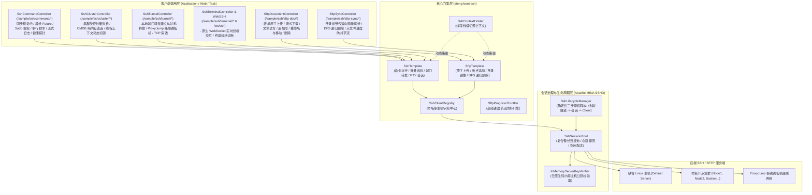
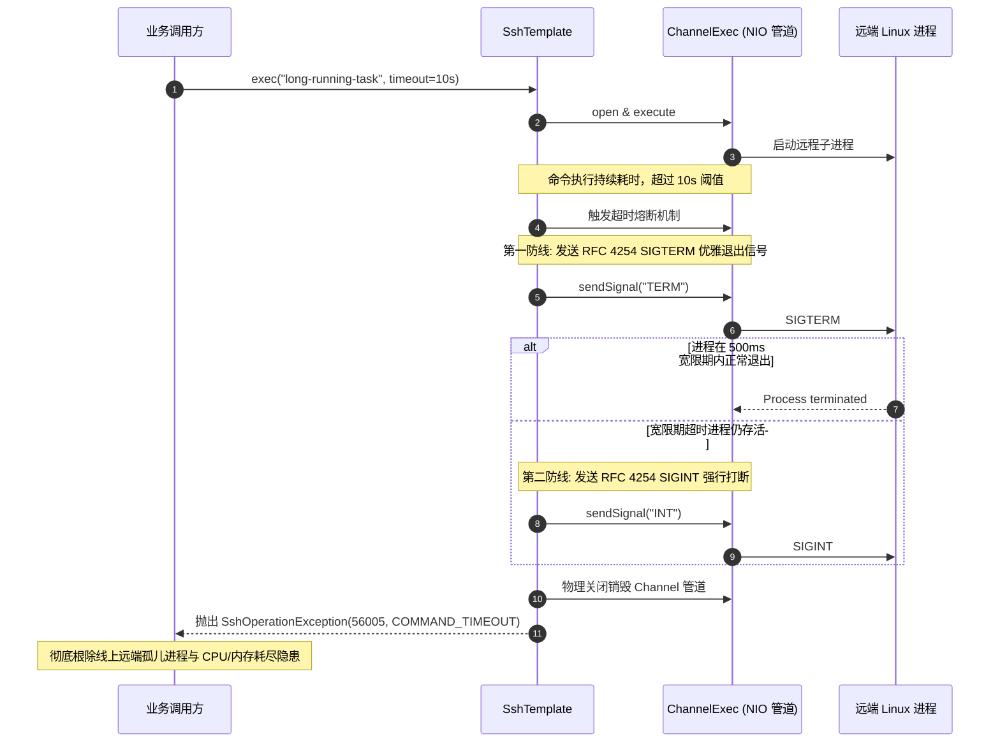
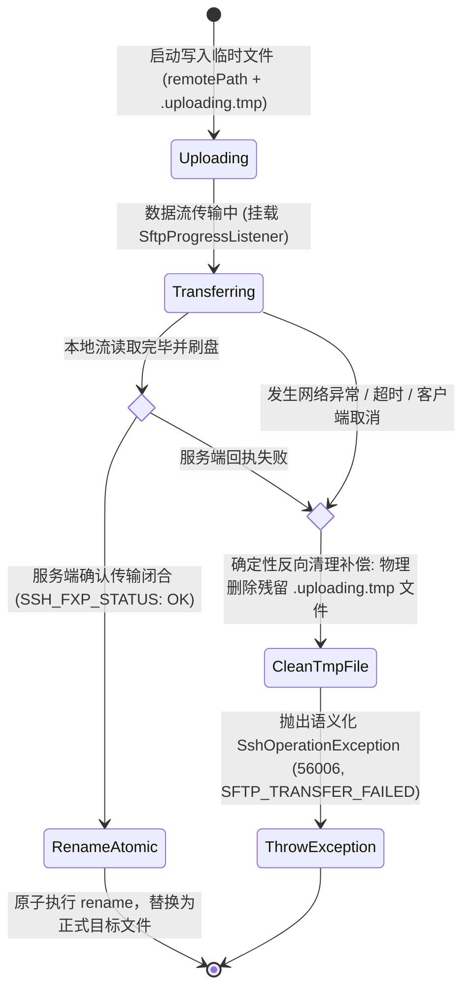
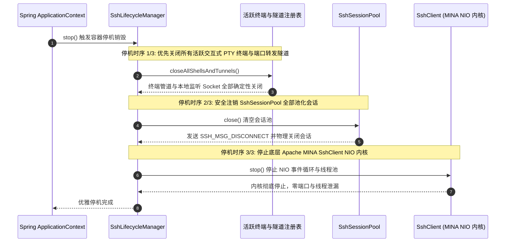

# ateng-boot-ssh 基础设施 Starter

> 工业级 SSH 远程命令执行、SFTP 安全文件传输与 WebSSH 交互终端基础设施 Starter，基于 Apache MINA SSHD 原生异步驱动内核构建。全面涵盖四位一体拓扑路由（缺省单机 / YAML 命名字典 / 线程动态切源 / CMDB 纯内存直连）、LRU/TTL 活跃心跳会话缓存池（`SshSessionPool`）、RFC 4254 孤儿进程超时主动信号防卫（`TERM`/`INT`）、无 TTY 原生 Sudo 提权安全管道与密码即时内存抹零、Core 四维上下文全链路透传集群并发巡检（`execBatch` / `execBatchAdvanced`）、无害轻量连通性探针（`testConnection`）、受管本地端口转发（`SshTunnelHandle`）、ProxyJump 级联跳板机穿透、SFTP 临时文件原子上传防脏读（`.uploading.tmp` + `rename`）、流式传输高频节流防抖（`SftpProgressThrottler`）、深度优先（DFS）递归删除非空目录树、双向目录树整包同步、以及基于 Spring 原生 WebSocket 驱动的 WebSSH 交互式 PTY 伪终端会话（`SshShellHandle`）。

---

## 0. 特性与公共 API 全景速查矩阵 (Feature & API Panorama Matrix)

| 特性分类 | 特性名称 | 核心门面 / 模型 / SPI | 关键配置项 (`ateng.boot.ssh.*`) | 关键 API 签名 / 核心行为 | 锚定验证源头 (*Test / Controller) |
| :--- | :--- | :--- | :--- | :--- | :--- |
| **命令执行** | 同步短命令执行契约 | `SshTemplate` | `command-timeout` | `exec(String)` / `exec(String, SshExecOptions)` / `exec(String, String)` / `exec(SshServerInfo, String)`，返回强类型 `SshExecResult`（含 `exitCode`、`stdout`、`stderr`、`duration`） | `SshTemplateCommandExecutionTest`<br>`SshCommandController`<br>`SampleSshWebIntegrationTest` |
| **命令执行** | 非阻塞异步执行 | `SshTemplate` | `command-timeout` | `execAsync(String)` / `execAsync(String, SshExecOptions)` / `execAsync(String, String)` / `execAsync(SshServerInfo, String)`，返回 `CompletableFuture<SshExecResult>`，在 Core 受管异步线程池调度 | `SshTemplateAsyncExecutionTest`<br>`SshCommandController`<br>`SampleSshWebIntegrationTest` |
| **命令执行** | 原生 Sudo 提权安全管道 | `SshTemplate` | `command-timeout` | `execSudo(String, String)` / `execSudo(String, char[])` / `execSudo(String, String, String)` / `execSudo(SshServerInfo, String, String)`，底层构建 `-S -p ''` 安全管道，口令发送完毕后立即执行 `Arrays.fill` 擦除抹零 | `SshTemplateSudoAndBatchTest`<br>`SshCommandController`<br>`SampleSshWebIntegrationTest` |
| **命令执行** | 多行脚本管道执行 | `SshTemplate` | `command-timeout` | `execScript(String)` / `execScript(String, String)` / `execScript(SshServerInfo, String)`，自动将 Windows CRLF 规范化为 Unix LF，打包为远端 Shell 管道执行 | `SshTemplateCommandExecutionTest`<br>`SshCommandController`<br>`SampleSshWebIntegrationTest` |
| **命令执行** | 长任务流式按行消费 | `SshTemplate`<br>`Consumer<String>` | `command-timeout` | `execStream(String, Consumer<String>)` / `execStream(String, Consumer<String>, Consumer<String>)` / `execStream(SshServerInfo, String, Consumer<String>, Consumer<String>, SshExecOptions)`，按行回调消费远端滚动日志，防 OOM，返回退出码 | `LineStreamingOutputStreamTest`<br>`SshCommandController`<br>`SampleSshWebIntegrationTest` |
| **命令执行** | 轻量无害连通性探针 | `SshTemplate` | `connect-timeout`<br>`auth-timeout` | `testConnection(String)` / `testConnection(SshServerInfo)`，仅执行 TCP 握手与 SSH 凭据身份验证协商即刻断开，不分配伪终端或执行进程，返回 `boolean` | `SshTemplateConnectivityProbeTest`<br>`SshCommandController`<br>`SampleSshWebIntegrationTest` |
| **命令执行** | 瞬态单次任务隔离执行 | `SshTemplate`<br>`SshSessionPool` | `connect-timeout`<br>`auth-timeout` | `execOnce(SshServerInfo, String)` / `execOnce(SshServerInfo, String, SshExecOptions)`，执行完毕立即确定性物理断开关闭底层连接，零连接与句柄残留 | `ProxyJumpCascadingTest`<br>`SampleSshIntegrationTest` |
| **集群治理** | 集群多主机基础并发巡检 | `SshTemplate` | `command-timeout` | `execBatch(Collection<SshServerInfo>, String)` / `execBatchNamed(Collection<String>, String)` / `execSudoBatch(Collection<SshServerInfo>, String, String)`，联动 Core 受管线程池并透传四维快照 | `SshTemplateSudoAndBatchTest`<br>`SampleSshIntegrationTest` |
| **集群治理** | 集群高级批量巡检聚合 | `SshTemplate`<br>`SshBatchOptions`<br>`SshBatchExecResult` | `command-timeout` | `execBatchAdvanced(Collection<SshServerInfo>, String, SshBatchOptions)` / `execBatchAdvancedNamed(Collection<String>, String, SshBatchOptions)`，返回强类型 `SshBatchExecResult`（含成功/失败计数、明细字典、`isAllSuccess()`、`throwIfAnyFailed()`） | `SshBatchAdvancedExecutionTest`<br>`SshClusterController`<br>`SampleSshWebIntegrationTest` |
| **集群治理** | CMDB 纯内存资产直连 | `SshServerInfo` | - | 不可变值对象，支持动态指定主机、端口、用户名、口令/私钥与主机公钥校验策略，无需提前在配置文件中声明 | `SshServerInfoTest`<br>`SshClusterController`<br>`SampleSshWebIntegrationTest` |
| **集群治理** | 线程级动态切源路由 | `SshContextHolder` | `servers.*` | `setServer(String)` / `setServerInfo(SshServerInfo)` / `getServer()` / `getServerInfo()` / `runWith(String, Supplier<T>)` / `runWithInfo(SshServerInfo, Supplier<T>)` / `clear()`，支持栈式嵌套作用域并在 `finally` 确定性复位现场 | `SshContextHolderTest`<br>`SshClusterController`<br>`SampleSshWebIntegrationTest` |
| **集群治理** | 命名多主机受管注册表 | `SshClientRegistry` | `servers.*` | `register(String, SshServerInfo)` / `getServer(String)` / `getDefaultServer()` / `containsServer(String)` / `getServerNames()`，集中纳管 YAML 声明的多主机资产字典 | `SshClientRegistryTest`<br>`SampleSshIntegrationTest` |
| **网络穿透** | 受管本地端口转发 | `SshTemplate`<br>`SshTunnelHandle` | `connect-timeout` | `openLocalTunnel(int, String, int)` / `openLocalTunnel(String, int, String, int)` / `openLocalTunnel(SshServerInfo, int, String, int)`，支持操作系统动态分配可用随机端口 (`localPort=0`) | `SshTemplateTunnelTest`<br>`SshTunnelController`<br>`SampleSshWebIntegrationTest` |
| **网络穿透** | 受管隧道生命周期句柄 | `SshTunnelHandle`<br>`AutoCloseable` | - | 实现 `AutoCloseable`，提供 `close()`、`isAlive()`、`isClosed()`、`getLocalPort()`、`getLocalHost()`、`getRemoteHost()`、`getRemotePort()`，幂等安全释放本地监听 Socket | `SshTunnelHandleTest`<br>`SshTunnelController`<br>`SampleSshWebIntegrationTest` |
| **网络穿透** | ProxyJump 跳板机穿透 | `SshServerInfo`<br>`SshSessionPool` | `connect-timeout`<br>`auth-timeout` | `SshServerInfo.builder().jumpHost(...)`，递归解析级联跳板机拓扑，通过跳板机会话开启临时转发直连目标，双向生命周期级联清理 | `ProxyJumpCascadingTest`<br>`SshTunnelController`<br>`SampleSshWebIntegrationTest` |
| **网络穿透** | 隧道真实 TCP 流量交互 | `SshTunnelHandle` + `Socket` | - | 本地客户端向本地转发端口发起 TCP 读写，成功透传至远端隔离内网服务并接收回显数据 | `SshScenarioService`<br>`SshTunnelController`<br>`SampleSshWebIntegrationTest` |
| **SFTP 传输** | SFTP 核心操作门面 | `SftpTemplate`<br>`SftpProperties` | `sftp.buffer-size`<br>`sftp.transfer-timeout`<br>`sftp.atomic-upload-enabled`<br>`sftp.atomic-upload-suffix` | `upload(...)`、`download(...)`、`append(...)`、`rename(...)`、`move(...)`、`readString(...)`、`writeString(...)`、`exists(...)`、`stat(...)`、`delete(...)`、`chmod(...)`、`mkdir(...)`、`mkdirs(...)`，瞬态借还连接 | `SftpTemplateTest`<br>`SftpDocumentController`<br>`SampleSshWebIntegrationTest` |
| **SFTP 传输** | SFTP 原子上传覆盖防脏读 | `SftpTemplate` | `sftp.atomic-upload-enabled`<br>`sftp.atomic-upload-suffix` | 上传期间写入 `<target>.uploading.tmp`，完全闭合后原子执行 `rename`；发生传输异常自动执行确定性反向清理补偿，根除下游脏读 | `SftpTemplateTest`<br>`SftpDocumentController`<br>`SampleSshWebIntegrationTest` |
| **SFTP 传输** | 纯文本与配置读写 | `SftpTemplate` | `sftp.buffer-size` | `readString(String)` / `readString(String, Charset)` / `writeString(String, String)` / `writeString(String, String, Charset)`，默认 UTF-8 编码，免除样板流编排 | `SftpTemplateLifecycleMethodsTest`<br>`SftpDocumentController`<br>`SampleSshWebIntegrationTest` |
| **SFTP 传输** | 文件尾部增量追加写 | `SftpTemplate` | `sftp.buffer-size` | `append(String, InputStream)` / `append(String, InputStream, SftpProgressListener)`，基于原生追加模式向已有文件末尾增量写入 | `SftpTemplateLifecycleMethodsTest`<br>`SftpDocumentController`<br>`SampleSshWebIntegrationTest` |
| **SFTP 传输** | 原地重命名与跨目录移动 | `SftpTemplate` | - | `rename(String, String)` 原地原子重命名；`move(String, String)` 自动探测目标父目录并跨目录安全平移文件 | `SftpTemplateLifecycleMethodsTest`<br>`SftpDocumentController`<br>`SampleSshWebIntegrationTest` |
| **SFTP 传输** | 文件元数据查询与存在探测 | `SftpTemplate`<br>`SftpFileInfo` | - | `exists(String)` 探测路径是否存在；`stat(String)` / `list(String)` 返回只读不可变 `SftpFileInfo` 元数据对象 | `SftpTemplateTest`<br>`SftpDocumentController`<br>`SampleSshWebIntegrationTest` |
| **SFTP 传输** | DFS 递归清空非空目录 | `SftpTemplate` | - | `deleteRecursively(String remotePath)`，深度优先后序遍历递归删除非空目录，内置敏感系统根目录黑名单防卫 | `SftpTemplateTest`<br>`SftpDocumentController`<br>`SftpSyncController`<br>`SampleSshWebIntegrationTest` |
| **SFTP 传输** | 目录树双向整包同步 | `SftpTemplate` | `sftp.buffer-size` | `uploadDirectory(File, String)` 与 `downloadDirectory(String, File)`，镜像递归整包目录树，环境宿主中立过滤 `.DS_Store`、`desktop.ini` | `SftpTemplateTest`<br>`SftpSyncController`<br>`SampleSshWebIntegrationTest` |
| **SFTP 传输** | 流式传输进度节流防抖 | `SftpProgressThrottler`<br>`SftpProgressListener` | `sftp.buffer-size` | `SftpProgressThrottler.of(SftpProgressListener, Duration)`，按指定时间间隔防抖节流，抑制高频进度回调引发的 CPU 与日志风暴 | `SftpProgressThrottlerTest`<br>`SftpSyncController`<br>`SampleSshWebIntegrationTest` |
| **WebSSH** | 交互式终端开启门面 | `SshTemplate`<br>`SshShellHandle` | `command-timeout` | `openShell()` / `openShell(SshShellOptions)` / `openShell(String)` / `openShell(SshServerInfo)`，开辟 PTY 伪终端通道并返回受管生命周期句柄 | `SshTemplateShellTest`<br>`WebSshWebSocketHandler`<br>`SampleSshIntegrationTest` |
| **WebSSH** | 交互终端受管生命周期句柄 | `SshShellHandle`<br>`AutoCloseable` | - | 采用纯二进制数据模型，提供 `sendInput(byte[])`、`onOutput(Consumer<byte[]>)`、`resize(cols, rows)`、`onClose(Runnable)`、`close()`，无损传输 ANSI 字符与颜色 | `SshShellHandleTest`<br>`WebSshWebSocketHandler`<br>`SampleSshIntegrationTest` |
| **WebSSH** | 终端规格富选项模型 | `SshShellOptions` | - | `defaults()`（默认 `xterm-256color`, 80x24）、`ofSize(cols, rows)`、`ofTerm(term)`，支持环境变量字典、像素宽高与 `PtyMode` 声明 | `SshShellOptionsTest`<br>`WebSshWebSocketHandler` |
| **WebSSH** | 终端元数据诊断端点 | `SshTerminalController` | - | `GET /sample/ssh/terminal/info`，对外暴露终端默认类型、规格行列尺寸与 WebSocket 握手状态 | `SshTerminalController`<br>`SampleSshWebIntegrationTest` |
| **底层治理** | 受管会话缓存池 | `SshSessionPool`<br>`AutoCloseable` | `pool.max-sessions`<br>`pool.idle-timeout`<br>`pool.heartbeat-interval` | 按 `username@host:port#hash->via(...)` 复合键池化复用活会话，消除 200~500ms 重复建连开销；后台探针心跳保活与空闲超时自动淘汰 | `SshSessionPoolTest`<br>`SampleSshIntegrationTest` |
| **底层治理** | 多元认证与纯内存私钥 | `SshKeyLoader` | `password`<br>`private-key`<br>`private-key-path`<br>`passphrase` | 支持口令密码、纯内存 OpenSSH/PEM 私钥字符串（RAM 运行零磁盘落盘）、本地密钥文件与预置 KeyPair 统合认证 | `SshKeyLoaderAndAuthenticationTest`<br>`SampleSshIntegrationTest` |
| **底层治理** | 云原生纯内存指纹容器 | `InMemoryServerKeyVerifier`<br>`HostKeyPolicy` | `host-key-policy` | 提供 `LENIENT`（宽容记录首次指纹）、`STRICT`（生产已知指纹白名单）、`IGNORE`（内网免检），100% 内存运行，绝不尝试写盘 `~/.ssh/known_hosts` | `InMemoryServerKeyVerifierTest`<br>`SampleSshIntegrationTest` |
| **底层治理** | 确定性三步停机时序 | `SshLifecycleManager`<br>`SmartLifecycle` | - | 停机时序：【1. 优先关闭所有活跃交互式 PTY 终端与端口转发隧道 -> 2. 安全注销池化 Session -> 3. 停止底层 NIO SshClient】，杜绝端口悬挂与野进程残留 | `SshLifecycleManagerTest`<br>`SshLifecycleManagerShellTeardownTest` |
| **底层治理** | 因果异常体系与统一错误码 | `SshOperationException`<br>`SshResultCode` | - | 拦截底层 NIO 与协议层异常，转译为语义化 `SshOperationException`，赋予规范错误码（`56001`~`56014`）并 100% 完整保留原始因果链堆栈 | `SshExceptionAndResultCodeTest`<br>`SampleSshWebIntegrationTest` |

---

## 1. 模块定位与快速起步

### 1.1 模块定位与核心价值
`ateng-boot-ssh` 是面向现代云原生与高并发生产环境的工业级 SSH/SFTP 基础设施套件：
- **纯原生异步零臃肿依赖**：依托 Apache MINA SSHD (`sshd-core` + `sshd-sftp`) 原生协议引擎构建，100% 基于 Java 原生 NIO 异步非阻塞事件驱动模型，绝不引入外部非标臃肿依赖；
- **长连接池化与瞬态借还双轨制**：为高频命令执行与端口转发提供 LRU/TTL 会话池（`SshSessionPool`），为 SFTP 文件传输开辟瞬态短会话，兼顾秒级并发与物理资源极致安全；
- **云原生只读容器适配**：纯内存主机指纹校验器彻底攻克了 Kubernetes 只读根文件系统（Read-Only Rootfs）下写入 `known_hosts` 失败崩溃的痼疾；
- **全场景工业级加固**：覆盖无 TTY Sudo 提权安全管道、超时孤儿进程信号主动防卫、ProxyJump 跳板机级联多跳穿透、受管本地端口转发、SFTP 原子上传与高频节流防抖、DFS 递归删除与全目录双向镜像、以及 WebSSH 交互式伪终端。

```xml
<dependency>
    <groupId>io.github.atengk</groupId>
    <artifactId>ateng-boot-ssh</artifactId>
</dependency>
```

### 1.2 最小可用配置 (Happy Path)
在 `application.yml` 中配置缺省服务器即可开箱即用：

```yaml
ateng:
  boot:
    ssh:
      enabled: true
      host: 127.0.0.1
      port: 2222
      username: testuser
      password: testpassword
      host-key-policy: lenient
      connect-timeout: 10s
      auth-timeout: 15s
      command-timeout: 60s
      pool:
        max-sessions: 64
        idle-timeout: 5m
        heartbeat-interval: 15s
      sftp:
        buffer-size: 32KB
        transfer-timeout: 10m
        atomic-upload-enabled: true
        atomic-upload-suffix: .uploading.tmp
```

### 1.3 极简开箱实战
代码 100% 逆向提取自已跑通的样例工程业务组件 [`SshScenarioService.java`](../ateng-boot-samples/ateng-boot-sample-ssh/src/main/java/io/github/atengk/boot/sample/ssh/service/SshScenarioService.java) 与 [`SftpScenarioService.java`](../ateng-boot-samples/ateng-boot-sample-ssh/src/main/java/io/github/atengk/boot/sample/ssh/service/SftpScenarioService.java)：

```java
@Slf4j
@Service
@RequiredArgsConstructor
public class DevopsOpsService {

    private final SshTemplate sshTemplate;
    private final SftpTemplate sftpTemplate;

    // 1. 同步执行 Linux 基础命令
    public String checkSystemUptime() {
        SshExecResult result = sshTemplate.exec("uptime");
        log.info("命令执行耗时: {} ms, exitCode: {}", result.getDuration().toMillis(), result.getExitCode());
        return result.getStdout();
    }

    // 2. 纯文本配置文件安全写入与读取
    public void deployConfig(String remotePath, String jsonConfig) {
        sftpTemplate.writeString(remotePath, jsonConfig);
        String saved = sftpTemplate.readString(remotePath);
        log.info("配置同步校验成功: length={}", saved.length());
    }
}
```

---

## 2. 核心架构与设计不变量

### 2.1 整体分层架构与双模通道拓扑



### 2.2 RFC 4254 孤儿进程超时信号防卫时序图 (RFC 4254 Signal Guard)
当 `exec(...)` 或 `execStream(...)` 发生超时熔断时，框架拒绝粗暴关闭本地 Socket 导致远端进程沦为孤儿在后台僵死挂起：



### 2.3 SFTP 临时文件原子上传覆盖状态机 (Atomic Upload Invariant)
为根除网络中断引发的残缺半截文件污染下游，框架默认开启原子上传机制（先写临时文件后原子重命名覆盖）：



### 2.4 确定性三步优雅停机时序图 (Graceful Shutdown Invariant)
在 Spring Boot 容器销毁阶段，`SshLifecycleManager`（注册于 `Integer.MAX_VALUE - 1000` 高阶 Phase）严格遵循确定性时序执行物理资源释放：



---

## 3. 远程命令执行与安全提权套件

### 3.1 同步短命令执行 (exec)
用于在远端服务器上同步执行短耗时运维命令，强类型返回退出码、标准输出、标准错误与耗时。

```yaml
ateng:
  boot:
    ssh:
      command-timeout: 60s                        # 远程命令执行超时阈值（默认 60s）
```

（代码逆向提取自 [`SshCommandController.java`](../ateng-boot-samples/ateng-boot-sample-ssh/src/main/java/io/github/atengk/boot/sample/ssh/controller/SshCommandController.java) 与 [`SshScenarioService.java`](../ateng-boot-samples/ateng-boot-sample-ssh/src/main/java/io/github/atengk/boot/sample/ssh/service/SshScenarioService.java)）
```java
@PostMapping("/exec")
public Result<SshExecResultVO> exec(@Valid @RequestBody SshCommandRequest request) {
    SshExecResult result;
    if (StringUtils.hasText(request.getServerName())) {
        result = sshScenarioService.exec(request.getServerName(), request.getCommand());
    } else {
        result = sshScenarioService.exec(request.getCommand());
    }
    return Result.success(SshExecResultVO.from(result));
}
```
- **核心机制**：底层自动从 `SshSessionPool` 借用或复用会话，建立 `ChannelExec`，开启无 TTY 管道传输；执行超时由 RFC 4254 信号防卫机制安全熔断。

### 3.2 非阻塞异步 Future 命令执行 (execAsync)
将耗时命令异步提交至 Core 受管异步线程池调度，透明透传 Core 四维上下文，返回 `CompletableFuture<SshExecResult>`。

```yaml
ateng:
  boot:
    ssh:
      command-timeout: 120s                       # 异步任务命令超时阈值
```

（代码逆向提取自 [`SshCommandController.java`](../ateng-boot-samples/ateng-boot-sample-ssh/src/main/java/io/github/atengk/boot/sample/ssh/controller/SshCommandController.java)）
```java
@PostMapping("/exec-async")
public CompletableFuture<Result<SshExecResultVO>> execAsync(@Valid @RequestBody SshCommandRequest request) {
    CompletableFuture<SshExecResult> future;
    if (StringUtils.hasText(request.getServerName())) {
        future = sshScenarioService.execAsync(request.getServerName(), request.getCommand());
    } else {
        future = sshScenarioService.execAsync(request.getCommand());
    }
    return future.thenApply(res -> Result.success(SshExecResultVO.from(res)));
}
```
- **核心机制**：严禁创建未经托管的野线程，任务依托框架 Core 受管线程池运行，全链路自动携带 MDC `traceId` 与租户上下文。

### 3.3 原生 Sudo 提权安全管道与口令内存抹零 (execSudo)
针对生产环境中以低权限普通账号登录、需提权执行特权运维命令（如重启服务、修改内核参数）的场景，提供无 TTY 原生 Sudo 提权安全管道。

```yaml
ateng:
  boot:
    ssh:
      command-timeout: 60s
```

（代码逆向提取自 [`SshCommandController.java`](../ateng-boot-samples/ateng-boot-sample-ssh/src/main/java/io/github/atengk/boot/sample/ssh/controller/SshCommandController.java)）
```java
@PostMapping("/exec-sudo")
public Result<SshExecResultVO> execSudo(@Valid @RequestBody SshSudoRequest request) {
    SshExecResult result;
    if (StringUtils.hasText(request.getServerName())) {
        result = sshScenarioService.execSudo(request.getServerName(), request.getCommand(), request.getSudoPassword());
    } else {
        result = sshScenarioService.execSudo(request.getCommand(), request.getSudoPassword());
    }
    return Result.success(SshExecResultVO.from(result));
}
```
- **核心机制**：底层自动构建 `sudo -S -p '' <command>` 安全管道，通过标准输入将密码写入管道，执行完毕后在 `finally` 块中立即调用 `Arrays.fill(bytes, (byte) 0)` 抹零擦除口令内存，彻底杜绝 JVM 堆转储分析中的凭据泄漏隐患。

### 3.4 跨平台多行复杂脚本管道规范化 (execScript)
支持在远端主机执行多行 Shell 运维脚本，自动清洗跨操作系统行尾分隔符。

```yaml
ateng:
  boot:
    ssh:
      command-timeout: 180s
```

（代码逆向提取自 [`SshCommandController.java`](../ateng-boot-samples/ateng-boot-sample-ssh/src/main/java/io/github/atengk/boot/sample/ssh/controller/SshCommandController.java)）
```java
@PostMapping("/exec-script")
public Result<SshExecResultVO> execScript(@Valid @RequestBody SshScriptRequest request) {
    SshExecResult result = sshScenarioService.runMaintenanceScript(request.getServerName(), request.getScriptBody());
    return Result.success(SshExecResultVO.from(result));
}
```
- **核心机制**：自动将 Windows CRLF (`\r\n`) 转换为标准 Unix LF (`\n`)，封装为 `sh -s` 管道执行，杜绝因 `\r` 字符导致远端 Linux 报错 `syntax error near unexpected token`。

### 3.5 长任务滚动日志按行实时流式消费 (streamLog)
针对日志跟踪、部署流水线实时输出等长耗时命令，提供零内存缓冲按行流式消费，防止千兆滚动日志打爆 JVM 堆内存。

```yaml
ateng:
  boot:
    ssh:
      command-timeout: 300s                       # 长命令超时阈值
```

（代码逆向提取自 [`SshCommandController.java`](../ateng-boot-samples/ateng-boot-sample-ssh/src/main/java/io/github/atengk/boot/sample/ssh/controller/SshCommandController.java)）
```java
@PostMapping("/stream-log")
public Result<List<String>> streamLog(@Valid @RequestBody SshStreamLogRequest request) {
    List<String> capturedLines = Collections.synchronizedList(new ArrayList<>());
    int exitCode = sshScenarioService.streamLogs(request.getServerName(), request.getCommand(), capturedLines::add);
    return Result.success(capturedLines);
}
```
- **核心机制**：基于 `LineStreamingOutputStream` 逐字节解析换行符，产生完整行即刻回调 `Consumer<String>`，零全量内存缓冲，退出后返回远端进程退出码。

---

## 4. 多主机拓扑与集群批量巡检套件

### 4.1 线程栈级上下文动态切源路由 (SshContextHolder)
支持在多主机环境下透明切源至指定节点，无需显式穿透传递节点名称，执行完毕后在 `finally` 中严格复位。

```yaml
ateng:
  boot:
    ssh:
      servers:
        node1:
          host: 127.0.0.1
          port: 2223
          username: worker1
          password: worker1pass
```

（代码逆向提取自 [`SshClusterController.java`](../ateng-boot-samples/ateng-boot-sample-ssh/src/main/java/io/github/atengk/boot/sample/ssh/controller/SshClusterController.java)）
```java
@PostMapping("/context-switch")
public Result<String> contextSwitch(@Valid @RequestBody SshContextSwitchRequest request) {
    String output = sshScenarioService.executeWithContextSwitch(request.getServerName(), request.getCommand());
    return Result.success(output);
}
```
- **核心机制**：基于 `ThreadLocal` 栈式结构维护上下文，支持嵌套切源与 `runWith` 作用域闭包，杜绝线程池污染与跨租户串节点。

### 4.2 CMDB 纯内存资产动态直连 (SshServerInfo)
面对 CMDB 资产管理系统、公有云按需弹出的动态虚机，无需在静态 YAML 中预先声明，支持通过纯内存不可变值对象 `SshServerInfo` 动态直连。

```yaml
ateng:
  boot:
    ssh:
      connect-timeout: 10s
      auth-timeout: 15s
```

（代码逆向提取自 [`SshClusterController.java`](../ateng-boot-samples/ateng-boot-sample-ssh/src/main/java/io/github/atengk/boot/sample/ssh/controller/SshClusterController.java)）
```java
@PostMapping("/dynamic-connect")
public Result<SshExecResultVO> dynamicConnect(@Valid @RequestBody SshDynamicHostRequest request) {
    var serverBuilder = SshServerInfo.builder()
            .host(request.getHost())
            .port(request.getPort())
            .username(request.getUsername())
            .hostKeyPolicy(HostKeyPolicy.LENIENT);

    if (StringUtils.hasText(request.getPassword())) {
        serverBuilder.password(request.getPassword());
    }
    if (StringUtils.hasText(request.getPrivateKey())) {
        serverBuilder.privateKey(request.getPrivateKey());
    }

    SshExecResult result = sshScenarioService.exec(serverBuilder.build(), request.getCommand());
    return Result.success(SshExecResultVO.from(result));
}
```
- **核心机制**：`SshServerInfo` 为不可变值对象，支持复合池化复用；结合 `HostKeyPolicy.LENIENT` 实现云原生只读环境下自适应连接。

### 4.3 集群多节点高级受控批量巡检与熔断聚合 (batch-inspect)
联动 Core 受管线程池对集群多节点并发下发巡检命令，支持精细配置并发度、单机超时与失败快速熔断。

```yaml
ateng:
  boot:
    ssh:
      command-timeout: 30s
```

（代码逆向提取自 [`SshClusterController.java`](../ateng-boot-samples/ateng-boot-sample-ssh/src/main/java/io/github/atengk/boot/sample/ssh/controller/SshClusterController.java)）
```java
@PostMapping("/batch-inspect")
public Result<SshBatchExecResultVO> batchInspect(@Valid @RequestBody SshBatchInspectRequest request) {
    var optionsBuilder = SshBatchOptions.builder()
            .concurrency(request.getConcurrency())
            .failFast(Boolean.TRUE.equals(request.getFailFast()));

    if (request.getTimeoutSeconds() != null && request.getTimeoutSeconds() > 0) {
        optionsBuilder.timeout(Duration.ofSeconds(request.getTimeoutSeconds()));
    }

    SshBatchExecResult batchResult = sshScenarioService.runBatchInspectionNamed(
            request.getServerNames(), request.getCommand(), optionsBuilder.build());

    return Result.success(SshBatchExecResultVO.from(batchResult));
}
```
- **核心机制**：返回强类型 `SshBatchExecResult`，提供 `isAllSuccess()` 校验、`getFailureCount()` 失败统计与失败主机列表过滤，开启 `failFast=true` 时任一节点失败立即熔断取消其余任务。

### 4.4 零副作用轻量无害连通性探针 (probe-health)
用于系统启动健康检查、运维探针与资产上线验证，毫秒级快速检测网络连通性与鉴权凭据有效性。

```yaml
ateng:
  boot:
    ssh:
      connect-timeout: 5s
      auth-timeout: 5s
```

（代码逆向提取自 [`SshCommandController.java`](../ateng-boot-samples/ateng-boot-sample-ssh/src/main/java/io/github/atengk/boot/sample/ssh/controller/SshCommandController.java)）
```java
@GetMapping("/probe-health")
public Result<Boolean> probeHealth(@RequestParam(value = "serverName", required = false) String serverName) {
    boolean connected = sshScenarioService.testConnection(serverName);
    return Result.success(connected);
}
```
- **核心机制**：仅执行 TCP 握手建连与 SSH 身份凭据鉴权，验证通过后即刻断开，绝不开辟 PTY 伪终端通道，绝不启动远程进程，零远端系统负载副作用。

---

## 5. 受管端口转发与跳板机穿透套件

### 5.1 本地端口转发受管句柄生命周期 (open-tunnel / close-tunnel)
支持将本地端口透明转发至远端隔离内网服务（如内网数据库、Redis、HTTP API），句柄由框架统一纳管并在停机时确定性释放。

```yaml
ateng:
  boot:
    ssh:
      connect-timeout: 10s
```

（代码逆向提取自 [`SshTunnelController.java`](../ateng-boot-samples/ateng-boot-sample-ssh/src/main/java/io/github/atengk/boot/sample/ssh/controller/SshTunnelController.java)）
```java
// 1. 开启受管端口转发隧道 (localPort 设为 0 时由操作系统分配空闲端口)
@PostMapping("/open-tunnel")
public Result<SshTunnelInfoVO> openTunnel(@Valid @RequestBody SshTunnelOpenRequest request) {
    int boundPort = sshScenarioService.openManagedTunnel(
            request.getServerName(),
            request.getLocalPort() != null ? request.getLocalPort() : 0,
            request.getRemoteHost(),
            request.getRemotePort());

    return Result.success(SshTunnelInfoVO.builder()
            .localPort(boundPort)
            .localHost("127.0.0.1")
            .remoteHost(request.getRemoteHost())
            .remotePort(request.getRemotePort())
            .alive(true).build());
}

// 2. 对称安全释放受管端口转发隧道
@PostMapping("/close-tunnel")
public Result<Boolean> closeTunnel(@Valid @RequestBody SshTunnelCloseRequest request) {
    boolean closed = sshScenarioService.closeManagedTunnel(request.getLocalPort());
    return Result.success(closed);
}
```
- **核心机制**：返回实现 `AutoCloseable` 的 `SshTunnelHandle`，支持通过 `close()` 幂等关闭本地 ServerSocket 监听；受管隧道集中注册至 `SshLifecycleManager`，容器退出时 1/3 优先销毁。

### 5.2 ProxyJump 两级跳板机级联穿透 (proxy-jump)
支持穿越两级或多级跳板机网络（Client -> Jump1 -> Jump2 -> InternalTarget）执行运维指令与传输文件。

```yaml
ateng:
  boot:
    ssh:
      connect-timeout: 15s
      auth-timeout: 20s
```

（代码逆向提取自 [`SshTunnelController.java`](../ateng-boot-samples/ateng-boot-sample-ssh/src/main/java/io/github/atengk/boot/sample/ssh/controller/SshTunnelController.java)）
```java
@PostMapping("/proxy-jump")
public Result<SshExecResultVO> proxyJump(@Valid @RequestBody SshProxyJumpRequest request) {
    SshExecResult result = sshScenarioService.runCascadingProxyJump(
            request.getTargetHost(), request.getTargetPort(),
            request.getJump1Host(), request.getJump1Port(),
            request.getJump2Host(), request.getJump2Port(),
            request.getCommand());
    return Result.success(SshExecResultVO.from(result));
}
```
- **核心机制**：基于 `SshServerInfo.jumpHost` 递归声明拓扑，底层通过中继跳板机建立临时安全通道串联多级链路，并在顶层任务完成或异常时执行级联逆向资源回收。

---

## 6. SFTP 工业级文件传输与目录同步套件

### 6.1 表单与文件原子上传覆盖与对称流式下载
支持通过表单 `MultipartFile` 或输入流上传文件，上传期间启用临时文件缓冲与原子重命名，防止下游脏读；提供流式下载端点。

```yaml
ateng:
  boot:
    ssh:
      sftp:
        buffer-size: 32KB                         # 流式传输数据块缓冲区大小（默认 32KB）
        transfer-timeout: 10m                     # 单文件传输超时阈值（默认 10m）
        atomic-upload-enabled: true               # 启用原子上传覆盖防脏读（默认 true）
        atomic-upload-suffix: .uploading.tmp      # 原子上传临时文件后缀名
```

（代码逆向提取自 [`SftpDocumentController.java`](../ateng-boot-samples/ateng-boot-sample-ssh/src/main/java/io/github/atengk/boot/sample/ssh/controller/SftpDocumentController.java)）
```java
// 1. 表单文件原子上传
@PostMapping(value = "/upload", consumes = MediaType.MULTIPART_FORM_DATA_VALUE)
public Result<String> upload(@RequestParam("file") MultipartFile file,
                             @RequestParam("remotePath") @NotBlank String remotePath) throws IOException {
    sftpScenarioService.upload(remotePath, file.getBytes());
    return Result.success("上传成功: " + remotePath);
}

// 2. 对称流式下载至 HTTP 响应
@GetMapping("/download")
public void download(@RequestParam("remotePath") @NotBlank String remotePath,
                     HttpServletResponse response) throws IOException {
    byte[] data = sftpScenarioService.download(remotePath);
    response.setContentType(MediaType.APPLICATION_OCTET_STREAM_VALUE);
    response.setHeader(HttpHeaders.CONTENT_DISPOSITION, "attachment; filename=\"" + remotePath + "\"");
    response.setContentLength(data.length);
    response.getOutputStream().write(data);
    response.getOutputStream().flush();
}
```
- **核心机制**：写入时先落地 `<target>.uploading.tmp`，完全刷盘后原子执行 rename；若传输异常则执行补偿清理删除脏临时碎片。

### 6.2 纯文本快捷读写与文件增量追加写
免除样板流编排，支持以 UTF-8 编码安全读写配置文件、合同报文，支持向已有文件末尾增量追加日志。

```yaml
ateng:
  boot:
    ssh:
      sftp:
        buffer-size: 32KB
```

（代码逆向提取自 [`SftpDocumentController.java`](../ateng-boot-samples/ateng-boot-sample-ssh/src/main/java/io/github/atengk/boot/sample/ssh/controller/SftpDocumentController.java)）
```java
// 1. 快捷写入 UTF-8 纯文本文件
@PostMapping("/write-text")
public Result<Boolean> writeText(@Valid @RequestBody SftpWriteTextRequest request) {
    sftpScenarioService.writeConfig(request.getRemotePath(), request.getContent());
    return Result.success(true);
}

// 2. 快捷读取 UTF-8 纯文本文件
@GetMapping("/read-text")
public Result<String> readText(@RequestParam("remotePath") @NotBlank String remotePath) {
    String content = sftpScenarioService.readConfig(remotePath);
    return Result.success(content);
}

// 3. 尾部增量追加写
@PostMapping("/append-text")
public Result<Boolean> appendText(@Valid @RequestBody SftpAppendTextRequest request) {
    sftpScenarioService.append(request.getRemotePath(), request.getContent().getBytes(StandardCharsets.UTF_8));
    return Result.success(true);
}
```
- **核心机制**：底层自动探测父目录是否存在，若缺失则自动级联创建父目录；追加写基于底层追加文件模式操作。

### 6.3 目录树整包双向递归镜像同步 (upload-dir / download-dir)
支持将本地目录结构整包递归镜像同步至远程 SFTP 服务端，或从远端整包下载至本地，保留多层级子目录与空目录结构。

```yaml
ateng:
  boot:
    ssh:
      sftp:
        buffer-size: 64KB
```

（代码逆向提取自 [`SftpSyncController.java`](../ateng-boot-samples/ateng-boot-sample-ssh/src/main/java/io/github/atengk/boot/sample/ssh/controller/SftpSyncController.java)）
```java
// 1. 递归镜像上传整包目录树
@PostMapping("/upload-dir")
public Result<SftpSyncResultVO> uploadDirectory(@Valid @RequestBody SftpDirectorySyncRequest request) {
    long start = System.currentTimeMillis();
    sftpScenarioService.syncUploadDirectory(new File(request.getLocalDir()), request.getRemoteDir());
    return Result.success(SftpSyncResultVO.builder()
            .localDir(request.getLocalDir()).remoteDir(request.getRemoteDir())
            .durationMs(System.currentTimeMillis() - start).success(true).build());
}

// 2. 递归镜像下载整包目录树
@PostMapping("/download-dir")
public Result<SftpSyncResultVO> downloadDirectory(@Valid @RequestBody SftpDirectorySyncRequest request) {
    long start = System.currentTimeMillis();
    sftpScenarioService.syncDownloadDirectory(request.getRemoteDir(), new File(request.getLocalDir()));
    return Result.success(SftpSyncResultVO.builder()
            .localDir(request.getLocalDir()).remoteDir(request.getRemoteDir())
            .durationMs(System.currentTimeMillis() - start).success(true).build());
}
```
- **核心机制**：内置环境宿主中立过滤，自动剔除 Windows `desktop.ini`、macOS `.DS_Store` 等平台特有隐性干扰文件，路径经过 `FileUtil.cleanPath` 清洗防范路径穿越越界。

### 6.4 DFS 深度优先递归清空删除非空目录树 (delete-dir)
传统 SFTP 协议原生 `rmdir` 只能删除空目录。框架提供 DFS 深度优先后序遍历，支持安全清空并删除整棵非空目录树。

```yaml
ateng:
  boot:
    ssh:
      sftp:
        transfer-timeout: 5m
```

（代码逆向提取自 [`SftpSyncController.java`](../ateng-boot-samples/ateng-boot-sample-ssh/src/main/java/io/github/atengk/boot/sample/ssh/controller/SftpSyncController.java)）
```java
@PostMapping("/delete-dir")
public Result<Boolean> deleteDirectory(@Valid @RequestBody SftpDeleteDirectoryRequest request) {
    boolean deleted = sftpScenarioService.deleteRecursively(request.getRemotePath());
    return Result.success(deleted);
}
```
- **核心机制**：采用后序遍历，优先递归清理子目录内的全部叶子文件及子文件夹，最后删除当前根目录；内置敏感系统根目录黑名单防卫（严禁删除 `/`、`/bin`、`/etc` 等关键目录）。

### 6.5 大文件流式传输进度节流防抖 (upload-large)
大文件（如数百兆安装包、镜像）传输过程中，高频进度回调极易引发 CPU 飙升与日志风暴。框架提供 `SftpProgressThrottler` 节流防抖装饰器。

```yaml
ateng:
  boot:
    ssh:
      sftp:
        buffer-size: 64KB
```

（代码逆向提取自 [`SftpSyncController.java`](../ateng-boot-samples/ateng-boot-sample-ssh/src/main/java/io/github/atengk/boot/sample/ssh/controller/SftpSyncController.java) 与 [`SftpScenarioService.java`](../ateng-boot-samples/ateng-boot-sample-ssh/src/main/java/io/github/atengk/boot/sample/ssh/service/SftpScenarioService.java)）
```java
@PostMapping("/upload-large")
public Result<String> uploadLargeFile(@Valid @RequestBody SftpLargeTransferRequest request) {
    byte[] payload = new byte[request.getSizeKb() * 1024];
    Arrays.fill(payload, (byte) 'A');

    AtomicLong callbackCount = new AtomicLong(0);
    sftpScenarioService.uploadWithThrottledProgress(
            request.getRemotePath(),
            payload,
            Duration.ofMillis(100),
            (transferred, total) -> callbackCount.incrementAndGet()
    );

    return Result.success("大文件节流上传成功: 触发回调次数=" + callbackCount.get());
}
```
- **核心机制**：按指定时间间隔（如 100ms）或百分比步长防抖节流，并在传输结束（100% 满额）时保证最终状态确定性触达。

---

## 7. WebSSH 交互式伪终端套件

### 7.1 PTY 伪终端开启与受管生命周期句柄 (openShell)
支持通过纯原生方式开辟 PTY 伪终端通道，返回 `SshShellHandle` 生命周期句柄，无缝驱动网页端 xterm.js 终端。

```yaml
ateng:
  boot:
    ssh:
      command-timeout: 3600s                      # 终端会话允许的最长活跃时长
```

（代码逆向提取自 [`WebSshWebSocketHandler.java`](../ateng-boot-samples/ateng-boot-sample-ssh/src/main/java/io/github/atengk/boot/sample/ssh/websocket/WebSshWebSocketHandler.java)）
```java
@Override
public void afterConnectionEstablished(WebSocketSession session) {
    // 1. 开启交互式 PTY 伪终端通道 (默认 xterm-256color, 80x24)
    SshShellHandle shell = sshTemplate.openShell(SshShellOptions.defaults());
    session.getAttributes().put("SSH_SHELL_HANDLE", shell);

    // 2. 远端终端输出 -> 二进制实时推送到前端 xterm.js
    shell.onOutput(bytes -> {
        if (session.isOpen()) {
            try {
                session.sendMessage(new BinaryMessage(ByteBuffer.wrap(bytes)));
            } catch (IOException ignored) {}
        }
    });

    // 3. 远端通道关闭 -> 联动切断前端 WebSocket 会话
    shell.onClose(() -> {
        if (session.isOpen()) {
            try {
                session.close(CloseStatus.NORMAL);
            } catch (IOException ignored) {}
        }
    });
}
```
- **核心机制**：采用纯二进制字节流数据模型，提供 `sendInput(byte[])` 与 `onOutput(Consumer<byte[]>)`，支持 ANSI 控制字符与 256 色终端输出无损渲染；实现 `AutoCloseable` 确保会话断开后确定性销毁 PTY 通道。

### 7.2 动态自适应视口重设与 WebSocket 协议协同 (resize)
支持响应前端浏览器窗口拉伸与全屏切换，向远端 Linux 发送 `SSH_MSG_CHANNEL_WINDOW_CHANGE` 协议包，自适应调整终端尺寸。

```yaml
ateng:
  boot:
    ssh:
      command-timeout: 3600s
```

（代码逆向提取自 [`WebSshWebSocketHandler.java`](../ateng-boot-samples/ateng-boot-sample-ssh/src/main/java/io/github/atengk/boot/sample/ssh/websocket/WebSshWebSocketHandler.java) 与 [`SshTerminalController.java`](../ateng-boot-samples/ateng-boot-sample-ssh/src/main/java/io/github/atengk/boot/sample/ssh/controller/SshTerminalController.java)）
```java
@Override
protected void handleTextMessage(WebSocketSession session, TextMessage message) {
    SshShellHandle shell = (SshShellHandle) session.getAttributes().get("SSH_SHELL_HANDLE");
    if (shell == null || !shell.isAlive()) return;

    String payload = message.getPayload();
    // 动态自适应视口调整 (前端消息格式: {"action":"resize","cols":120,"rows":40})
    if (payload.contains("resize")) {
        try {
            JsonNode root = objectMapper.readTree(payload);
            shell.resize(root.path("cols").asInt(80), root.path("rows").asInt(24));
            return;
        } catch (Exception ignored) {}
    }
    shell.sendInput(payload);
}
```
- **核心机制**：调用 `shell.resize(cols, rows)` 动态向服务端发送视口协商包，实时重排 vim、top、htop 等全屏交互程序的显示布局。

---

## 8. 生产扩展接管与核心非功能边界

### 8.1 SshSessionPool 连接池治理与复合键复用
在高并发远程命令执行场景中，频繁三次握手与 SSH 凭据协商存在 200~500ms 固有开销。框架提供 `SshSessionPool` 受管连接池：
- **复合键池化**：按 `username@host:port#hash->via(...)` 复合特征键池化会话，多线程并发执行时安全复用活连接；
- **心跳保活与空闲淘汰**：后台定时发送心跳探针保持 TCP 连接活跃，防范云厂商 NAT 防火墙静默断链；超过 `idle-timeout` 自动平滑回收空闲连接；
- **瞬态任务隔离**：对 SFTP 传输与一次性跳板机任务开辟瞬态连接并在使用后即刻释放，绝不污染全局长连接池。

### 8.2 云原生纯内存主机公钥指纹校验器 (InMemoryServerKeyVerifier)
在 Kubernetes 生产环境中，Pod 普遍挂载只读根文件系统（Read-Only Rootfs）。传统客户端尝试向 `~/.ssh/known_hosts` 写入指纹将导致应用崩溃。框架内置 `InMemoryServerKeyVerifier`：
- **纯内存运行**：指纹状态 100% 驻留堆内存，严禁任何写盘操作；
- **三档安全策略 (`HostKeyPolicy`)**：
  - `LENIENT`（默认）：首次连接自动信任并缓存在内存中，后续连接校验防篡改；
  - `STRICT`：生产最高安全级，仅信任预设公钥指纹列表，指纹不匹配抛出 `56003 (HOST_KEY_REJECTED)`，彻底防范中间人攻击（MITM）；
  - `IGNORE`：内网安全沙箱环境免检。

### 8.3 自定义 Bean 覆盖接管 (@ConditionalOnMissingBean)
核心门面与组件均标配 `@ConditionalOnMissingBean`，支持下游业务按需声明自定义 Bean 实现全权接管：
```java
@Configuration
public class CustomSshConfig {

    @Bean
    public SshTemplate customSshTemplate(SshClientRegistry registry, SshSessionPool sessionPool) {
        return new SshTemplate(registry, sessionPool);
    }
}
```

### 8.4 确定性三步停机与资源防泄漏边界
在 Spring Boot 应用销毁阶段，`SshLifecycleManager` 严格遵循确定性时序释放资源：
1. **优先切断长连接上层**：销毁全部活跃的 WebSSH 交互式伪终端通道与本地端口转发监听 ServerSocket；
2. **安全注销池化会话**：向远端发送 SSH 协议断开帧并销毁全部 `ClientSession`；
3. **停止 MINA NIO 内核**：停止底座 `SshClient` 事件循环与受管工作线程池。

### 8.5 十四维因果异常体系与统一错误码 (SshResultCode)

| 状态码 | 枚举常量 | 业务含义 | 典型触发场景 |
| :--- | :--- | :--- | :--- |
| **56001** | `CONNECT_FAILED` | SSH连接建立失败 | 网络不通、目标端口未监听、TCP 握手超时 |
| **56002** | `AUTH_FAILED` | SSH身份凭据认证失败 | 账号密码错误、私钥未授权、passphrase 错误 |
| **56003** | `HOST_KEY_REJECTED` | SSH服务端主机指纹校验未通过 | STRICT 模式下主机公钥指纹与已知列表不匹配（防 MITM 中间人攻击） |
| **56004** | `COMMAND_EXEC_FAILED` | SSH远程命令执行异常 | ChannelExec 开辟失败、执行管道 IO 异常 |
| **56005** | `COMMAND_TIMEOUT` | SSH远程命令执行超时 | 命令耗时超出阈值，已触发 SIGTERM/SIGINT 孤儿进程信号防卫 |
| **56006** | `SFTP_TRANSFER_FAILED` | SFTP文件传输或读写异常 | 网络断开、磁盘满、IO 流管道中断 |
| **56007** | `SFTP_FILE_NOT_FOUND` | SFTP远程文件或目录不存在 | 访问不存在的远程文件、stat 失败 |
| **56008** | `SFTP_PERMISSION_DENIED` | SFTP远程操作权限不足 | 目标路径无写权限、无 chmod 权限 |
| **56009** | `TUNNEL_FAILED` | SSH端口转发隧道异常 | 本地端口冲突、远端转发目标不可达 |
| **56010** | `JUMP_HOST_FAILED` | SSH跳板机中继穿透失败 | 跳板机会话建立失败、多跳中继通道断开 |
| **56011** | `SERVER_NOT_FOUND` | 未找到指定的SSH服务节点 | 访问未在 `SshClientRegistry` 中注册的命名节点 |
| **56012** | `OPERATION_FAILED` | SSH通用操作执行失败 | 默认保底操作失败 |
| **56013** | `SHELL_OPEN_FAILED` | SSH交互式终端创建失败 | ChannelShell 开辟失败、服务端未配置 ShellFactory |
| **56014** | `SHELL_OPERATION_FAILED` | SSH交互式终端操作失败 | 终端已关闭状态下发送输入、resize 调整失败 |

---

## 9. 完整 YAML 配置属性清单 (YAML Reference)

```yaml
ateng:
  boot:
    ssh:
      enabled: true                               # 是否启用 SSH 基础设施自动装配（默认 true）
      host: 127.0.0.1                             # 默认主节点服务器主机名或 IP 地址
      port: 22                                    # 默认主节点服务器 SSH 端口（默认 22）
      username: root                              # 默认登录连接用户名
      password: ""                                # 登录口令密码（明文或加密凭据）
      private-key: ""                             # 纯内存私钥内容（支持 OpenSSH / PKCS#8 / PEM，零磁盘落盘）
      private-key-path: ""                        # 本地磁盘私钥文件路径
      passphrase: ""                              # 加密私钥的密码短语
      host-key-policy: LENIENT                    # 主机指纹策略：LENIENT(宽容自适应) / STRICT(白名单强校验) / IGNORE(内网免检)
      connect-timeout: 10s                        # 网络 TCP 连接与 SSH 协议协商超时阈值（默认 10s）
      auth-timeout: 15s                           # 用户凭据身份鉴权认证超时阈值（默认 15s）
      command-timeout: 60s                        # 远程命令执行超时阈值（默认 60s，超时触发 RFC 4254 信号防卫）

      # SshSessionPool 受管长连接池治理调优
      pool:
        max-sessions: 64                          # 连接池最大活跃会话容量上限（默认 64）
        idle-timeout: 5m                          # 空闲会话自动逐出超时时间（默认 5m）
        heartbeat-interval: 15s                   # 保持长连接心跳保活探针发送周期（默认 15s）

      # SFTP 安全文件传输引擎调优
      sftp:
        buffer-size: 32KB                         # 流式传输数据块缓冲区大小（默认 32KB）
        transfer-timeout: 10m                     # 单文件传输读写超时阈值（默认 10m）
        atomic-upload-enabled: true               # 是否启用原子上传机制（先写 .uploading.tmp 后原子 rename，防脏读）
        atomic-upload-suffix: .uploading.tmp      # 原子上传临时文件后缀名（默认 .uploading.tmp）

      # 命名多主机节点字典（主节点自动注册为 default 节点）
      servers:
        node1:
          host: 192.168.1.101
          port: 22
          username: worker1
          password: YOUR_PASSWORD
          command-timeout: 30s
        node2:
          host: 192.168.1.102
          port: 22
          username: worker2
          password: YOUR_PASSWORD
          command-timeout: 30s
        bastion:
          host: 10.0.0.1
          port: 2222
          username: jumpuser
          password: YOUR_PASSWORD
          host-key-policy: IGNORE
```
