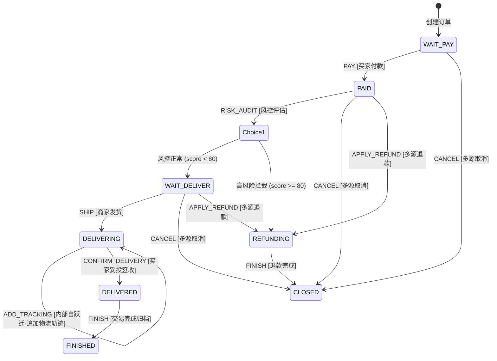

# ateng-boot-statemachine 基础设施 Starter

> 面向复杂业务生命周期治理与订单履约的高性能轻量无状态状态机底座 Starter，坚持纯原生零重型臃肿依赖设计，提供强类型 Fluent DSL 规则编排（支持外部主干跃迁、内部自跃迁、多源汇聚跃迁、Choice 动态分支与节点 Entry/Exit 生命周期）、纯只读零副作用预检探测（`canFire` / `verifyTransition` / `getAvailableEvents`）、CAS 乐观锁前置时序防重（`StateMachineCasTemplate`）、声明式幂等策略（`idempotent(true)`）、Spring 本地事务提交后不可逆通知（`performAfterCommit`）、大批量切片流转引擎（`fireEventBatch`）、专职轨迹审计监听器 SPI（`StateTransitionAuditListener`）、三阶段切面拦截器 SPI（`StateMachineInterceptor`）、双通道容器查找与内省增强（`StateMachineFactory`）及动态 Mermaid / PlantUML 状态拓扑图导出（参见 [ADR-0051](../docs/adr/0051-high-performance-stateless-business-state-machine-architecture.md)、[ADR-0080](../docs/adr/0080-statemachine-full-scenario-hardening-and-resilient-governance-architecture.md)）。

---

## 0. 特性与公共 API 全景速查矩阵 (Feature & API Panorama Matrix)

| 特性分类 | 特性名称 | 核心门面 / 注解 / SPI | 关键配置项 (`ateng.boot.statemachine.*`) | 关键 API 签名 / 核心行为 | 锚定验证源头 (*Test / Sample) |
| :--- | :--- | :--- | :--- | :--- | :--- |
| **DSL 编排** | 构建器工厂门面 | `StateMachineBuilder` / `StateMachineBuilderFactory` | - | `StateMachineBuilder.builder()` / `StateMachineBuilderFactory.create()`，创建全新强类型 Fluent DSL 构建器 | `StateMachineBuilderTest` / `OrderStateMachineConfig` |
| **DSL 编排** | 外部主干跃迁装配 | `ExternalTransitionBuilder` | - | `externalTransition().from(S).to(S).on(E).when(Condition).perform(Action)`，声明标准外部状态流转（$S_1 \to S_2$） | `ExternalTransitionTest` / `OrderLifecycleIntegrationTest` |
| **DSL 编排** | 内部自跃迁装配 | `InternalTransitionBuilder` | - | `internalTransition().from(S).on(E).when(Condition).perform(Action)`，声明内部自流转（$S_1 \to S_1$ 保持主状态不变执行属性更新） | `InternalTransitionTest` / `OrderLifecycleIntegrationTest` |
| **DSL 编排** | 多源汇聚跃迁装配 | `MultiFromTransitionBuilder` | - | `multiFromTransition().from(S...).to(S).on(E).when(Condition).perform(Action)`，声明多前置状态统一收敛跃迁 | `MultiFromTransitionTest` / `OrderLifecycleIntegrationTest` |
| **DSL 编排** | Choice 条件分支路由 | `ChoiceTransitionBuilder` | - | `choiceTransition().from(S).on(E).when(Condition).to(S).defaultTo(S).perform(Action)`，声明多分支动态分流路由 | `ChoiceTransitionTest` / `OrderLifecycleIntegrationTest` |
| **DSL 编排** | 状态节点生命周期 | `StateLifecycleBuilder` | - | `state(S).onEntry(Action).onExit(Action)`，定义状态节点进入与退出生命周期动作，遵循标准 UML 语义 | `StateLifecycleTest` / `OrderLifecycleIntegrationTest` |
| **DSL 编排** | 声明式幂等放行 | `TransitionBuilder` / `StateMachineBuilder` / `IdempotentStrategy` | - | `.idempotent(true)`、`.idempotent(IdempotentStrategy)` 或构建器级 `idempotentStrategy(...)`，当前状态已是目标状态时放行重复事件，跳过 Action 执行 | `IdempotentTransitionTest` / `PaymentCallbackScenarioService` |
| **DSL 编排** | 事务提交后动作同步 | `ExternalTransitionBuilder` / `ChoiceTransitionBuilder` | - | `.performAfterCommit(Action)`，注册挂载 Spring `TransactionSynchronizationManager.afterCommit` 钩子 | `PostCommitActionTest` / `PaymentCallbackScenarioService` |
| **DSL 编排** | 审计与拦截器挂载 | `StateMachineBuilder` | - | `registerAuditListener(...)` 挂载审计监听器；`interceptor(...)` 挂载切面；`build(machineId)` 构建只读机台 | `StateTransitionAuditListenerTest` / `OrderStateMachineConfig` |
| **只读预检** | 流转可行性探测 | `StateMachine<S, E, C>` | - | `canFire(S, E, C)` / `canFire(T, getter, E, C)`，纯只读校验卫语句，强保证 0 次 Action 执行与 0 次 DB 修改 | `ReadOnlyProbeTest` / `OrderProbeScenarioService` |
| **只读预检** | 目标状态推演 | `StateMachine<S, E, C>` | - | `verifyTransition(S, E, C)` / `verifyTransition(T, getter, E, C)`，试算目标状态与卫语句，Guard 异常安全降级容错 | `ReadOnlyProbeTest` / `OrderProbeScenarioService` |
| **只读预检** | 可用事件反查 | `StateMachine<S, E, C>` | - | `getAvailableEvents(S, C)`，反查当前状态下所有条件满足的合法事件集合，供前端动态渲染按钮权限 | `ReadOnlyProbeTest` / `OrderProbeScenarioService` |
| **核心门面** | Fail-Fast 驱动跃迁 | `StateMachine<S, E, C>` | - | `fireEvent(S, E, C)`，驱动单状态跃迁，未找到路由或校验不通过时显式抛出 `StateMachineException` | `StateMachineTest` / `OrderLifecycleIntegrationTest` |
| **核心门面** | 安全探测静默跃迁 | `StateMachine<S, E, C>` | - | `fireEventQuietly(S, E, C)`，静默试算跃迁路由与卫语句，返回不可变 `TransitionResult<S>` 结构化结果 | `StateMachineTest` / `StateMachineCasTemplateTest` |
| **核心门面** | 实体零侵入 Lambda 驱动 | `StateMachine<S, E, C>` | - | `fireEvent(T, Function<T,S>, BiConsumer<T,S>, E, C)`，自动通过 Getter 提取状态并在成功后通过 Setter 回写实体 | `EntityLambdaAccessorTest` / `OrderLifecycleScenarioService` |
| **核心门面** | CAS 乐观锁防重门面 | `StateMachine<S, E, C>` | - | `fireEventWithCas(T, getter, setter, E, C, CasUpdater)`，CAS-First 安全时序更新持久层并执行 Action | `StateMachineCasTemplateTest` / `PaymentCallbackScenarioService` |
| **核心门面** | CAS 静默安全探测门面 | `StateMachine<S, E, C>` | - | `fireEventWithCasQuietly(T, getter, setter, E, C, CasUpdater)`，静默执行 CAS 跃迁与持久化并返回结果 | `StateMachineCasTemplateTest` |
| **核心门面** | 大批量切片流转引擎 | `StateMachine<S, E, C>` | - | `fireEventBatch(List<T>, getter, setter, E, C, BatchOptions)`，基于 Core `BatchSliceUtil` 分批切片执行并聚合回执 | `BatchTransitionEngineTest` / `OrderTimeoutBatchScenarioService` |
| **核心门面** | 动态 Mermaid 图例导出 | `StateMachine<S, E, C>` | - | `generateMermaid()` / `exportMermaidDiagram()`，实时输出 Mermaid `stateDiagram-v2` 状态拓扑图语法文本 | `MermaidExportTest` / `OrderLifecycleIntegrationTest` |
| **核心门面** | 动态 PlantUML 图例导出 | `StateMachine<S, E, C>` | - | `generatePlantUML()`，实时输出 PlantUML `@startuml ... @enduml` 状态拓扑图语法文本 | `MermaidExportTest` / `OrderLifecycleIntegrationTest` |
| **并发防重** | CAS 执行模板引擎 | `StateMachineCasTemplate` | - | `execute(...)` 与 `executeQuietly(...)`，协调只读预检试算、持久层条件更新与 Action 有序调度 | `StateMachineCasTemplateTest` / `PaymentCallbackScenarioService` |
| **并发防重** | CAS 条件更新器函数 | `CasUpdater<T, S>` | - | `updateWithCas(T entity, S sourceState, S targetState)`，对应持久层原子 SQL 条件更新契约 | `StateMachineCasTemplateTest` / `OrderMapper` |
| **全局工厂** | 状态机单例注册表 | `StateMachineFactory` | - | `get(id)`、`contains(id)`、`getAllMachineIds()`、`size()`、`registerOrUpdate(m)`、`unregister(id)`，支持容器内省 | `StateMachineFactoryTest` / `OrderLifecycleIntegrationTest` |
| **机台治理** | 拦截器与审计动态治理 | `StateMachine<S, E, C>` | - | `addInterceptor(...)`、`removeInterceptor(...)`、`getInterceptors()`、`addAuditListener(...)`、`removeAuditListener(...)`、`getAuditListeners()`，对称治理与安全去重 | `StateTransitionAuditListenerTest` / `StateMachineInterceptorTest` |
| **扩展 SPI** | 轨迹审计监听器 | `StateTransitionAuditListener<S, E, C>` | - | `onTransitionCompleted(TransitionAuditEvent)`、`supports(machineId)`，机台隔离守护、异步持久化流转轨迹审计日志、全链路行为追踪与外部数仓上报 | `StateTransitionAuditListenerTest` / `OrderTransitionAuditLogger` |
| **扩展 SPI** | 执行切面拦截器 | `StateMachineInterceptor<S, E, C>` | - | `beforeTransition`、`afterTransition`、`onException`，三阶段生命周期切面拦截点 | `StateMachineInterceptorTest` / `AtengStateMachineAutoConfiguration` |
| **内置拦截器** | 脱敏与耗时日志切面 | `LoggingStateMachineInterceptor` | `ateng.boot.statemachine.logging.enabled`<br>`ateng.boot.statemachine.logging.log-context` | 联动 MDC `traceId` 与 `DesensitizeUtil` 对状态机入站跃迁、上下文及执行耗时进行受控安全日志打印 | `LoggingStateMachineInterceptorTest` / `AtengStateMachineAutoConfigurationTest` |
| **内置拦截器** | Micrometer 指标度量切面 | `MetricsStateMachineInterceptor` | `ateng.boot.statemachine.metrics.enabled` | 自动向 Micrometer 注册 Counter 统计总跃迁数与失败数，并通过 Timer 监控跃迁延时分布 | `MetricsStateMachineInterceptorTest` / `AtengStateMachineAutoConfigurationTest` |
| **自动装配** | 状态机自动装配引导类 | `AtengStateMachineAutoConfiguration` | `ateng.boot.statemachine.enabled` | 自动化注册配置类、Logging 拦截器、平滑探测 Metrics 嵌套配置与机台容器生命周期初始化器 | `AtengStateMachineAutoConfigurationTest` / `SampleStateMachineApplicationTest` |
| **生命周期** | 容器机台初始化器 | `StateMachineInitializer` | - | 容器刷新后自动扫描 Spring 容器内所有 `StateMachine` Bean，装配切面、审计监听器并注册至 `StateMachineFactory` | `AtengStateMachineAutoConfigurationTest` / `OrderLifecycleIntegrationTest` |
| **结果模型** | 跃迁执行结果载荷 | `TransitionResult<S>` | - | `isAccepted()` / `isSuccess()`、`isIdempotent()`、`getSourceState()`、`getTargetState()`、`getEvent()`、`getCause()`、`getResultCode()` | `TransitionResultTest` / `OrderLifecycleIntegrationTest` |
| **结果模型** | 轨迹审计事件对象 | `TransitionAuditEvent<S, E, C>` | - | `getMachineId()`、`getFromState()`、`getToState()`、`getEvent()`、`getOperator()`、`getTraceId()`、`getElapsed()`、`isSuccess()`、`getCause()` | `StateTransitionAuditListenerTest` / `OrderLifecycleIntegrationTest` |
| **结果模型** | 批量切片聚合回执 | `BatchTransitionResult<S, T>` | - | `getTotalCount()`、`getSuccessCount()`、`getFailureCount()`、`getSuccessEntities()`、`getFailures()`、`isAllSuccess()` | `BatchTransitionEngineTest` / `OrderLifecycleIntegrationTest` |
| **结果码契约** | 专属错误码枚举 | `StateMachineResultCode` | - | `TRANSITION_NOT_FOUND(59001)`、`CONDITION_FAILED(59002)`、`ACTION_EXECUTION_FAILED(59003)`、`DUPLICATE_MACHINE_ID(59004)`、`CONCURRENT_CAS_CONFLICT(59005)`、`MACHINE_NOT_FOUND(59006)`、`BATCH_TRANSITION_FAILED(59007)`、`STATE_LIFECYCLE_FAILED(59008)` | `StateMachineResultCodeTest` |
| **异常体系** | 专属受控业务异常 | `StateMachineException` | - | 继承 `BusinessException`，携带 `resultCode`、`fromState`、`targetState`、`event` 与原始 `cause` | `StateMachineExceptionTest` |

---

## 1. 模块定位与 Maven 坐标

`ateng-boot-statemachine` 是面向复杂业务生命周期治理与订单履约的高性能无状态业务状态机底座：
- **纯原生无重依赖哲学 (Zero-Bloat Invariant)**：完全依托 JDK 17 与 Spring 6 标准能力构建，坚决不引入 Spring StateMachine、Squirrel 等重量级第三方引擎，零冗余字节码膨胀；
- **严格无状态与线程安全不变量 (Stateless Invariant)**：状态机实例全局单例且严格不可变，内部仅维护静态规则路由映射表，业务状态完全收敛于实体或数据库；
- **显式强类型契约与 5 大流转拓扑**：提供 Fluent DSL 声明外部主干流转（`externalTransition`）、内部自跃迁更新物理字段（`internalTransition`）、多源汇聚（`multiFromTransition`）、Choice 动态风控条件分流（`choiceTransition`）与状态节点进出生命周期（`state(S).onEntry/onExit`）；
- **CAS-First 安全时序与并发防重**：原生协同数据库条件更新（`UPDATE ... WHERE status = :from AND version = :ver`），防范并发重复点击；CAS 更新成功后再行执行 Action 动作链，杜绝并发冲突下的虚假副作用；
- **声明式幂等策略与事务提交后动作同步**：支持 `.idempotent(true)` 优雅放行重复回调；支持 `.performAfterCommit` 注册 Spring 本地事务提交后钩子，彻底杜绝本地回滚导致的外部不可逆短信/履约幽灵单边账；
- **大批量切片流转与轨迹审计 SPI**：提供 `fireEventBatch` 切片批处理引擎并聚合回执；提供 `StateTransitionAuditListener` 专职审计监听器，保障全链路行为可追溯。

### Maven 坐标引入

在已导入 `ateng-boot-bom` 的工程中，无需声明版本号即可直接引入：

```xml
<dependency>
    <groupId>io.github.atengk</groupId>
    <artifactId>ateng-boot-statemachine</artifactId>
</dependency>
```

---

## 2. 最小起步体验 (Happy Path & Out-of-the-Box)

以下示例代码 100% 逆向提取自已在 CI 与单测全绿跑通的场景样例工程 [`ateng-boot-sample-statemachine`](../ateng-boot-samples/ateng-boot-sample-statemachine)。

### 步骤一：配置应用属性 (`application.yml`)

```yaml
ateng:
  boot:
    statemachine:
      enabled: true
      logging:
        enabled: true
        log-context: true
      metrics:
        enabled: true
```

### 步骤二：声明强类型状态机编排 (`OrderStateMachineConfig.java`)

```java
@Configuration
public class OrderStateMachineConfig {

    public static final String MACHINE_ID = "ORDER_LIFECYCLE";

    @Bean
    public StateMachine<OrderState, OrderEvent, OrderContext> orderStateMachine() {
        StateMachineBuilder<OrderState, OrderEvent, OrderContext> builder = StateMachineBuilder.builder();

        // 0. 状态节点 Entry / Exit 生命周期动作
        builder.state(OrderState.WAIT_DELIVER)
                .onEntry((from, to, event, ctx) -> log.info("[State-Entry] 进入待发货状态: orderSn={}", ctx.getOrderSn()))
                .onExit((from, to, event, ctx) -> log.info("[State-Exit] 离开待发货状态: orderSn={}", ctx.getOrderSn()));

        // 1. 外部主干跃迁：WAIT_PAY -> PAID (PAY)，配置声明式幂等与事务提交后不可逆通知
        builder.externalTransition()
                .from(OrderState.WAIT_PAY)
                .to(OrderState.PAID)
                .on(OrderEvent.PAY)
                .idempotent(true)
                .when(ctx -> ctx != null && ctx.getAmount() != null)
                .perform((from, to, event, ctx) -> log.info("[Action] 订单支付成功: orderSn={}, amount={}", ctx.getOrderSn(), ctx.getAmount()))
                .performAfterCommit((from, to, event, ctx) -> log.info("[PostCommit] 触发外部不可逆短信/履约通知: orderSn={}", ctx.getOrderSn()));

        // 2. Choice 动态条件分支路由：PAID -> (风控判断) -> REFUNDING(高风险拦截) / WAIT_DELIVER(正常放行)
        builder.choiceTransition()
                .from(OrderState.PAID)
                .on(OrderEvent.RISK_AUDIT)
                .when(ctx -> ctx != null && ctx.getRiskScore() != null && ctx.getRiskScore() >= 80)
                .to(OrderState.REFUNDING)
                .defaultTo(OrderState.WAIT_DELIVER)
                .perform((from, to, event, ctx) -> log.info("[Action] 订单风控评估完成: orderSn={}, 流转结果={} -> {}", ctx.getOrderSn(), from, to));

        // 3. 外部主干跃迁：WAIT_DELIVER -> DELIVERING (SHIP)
        builder.externalTransition()
                .from(OrderState.WAIT_DELIVER)
                .to(OrderState.DELIVERING)
                .on(OrderEvent.SHIP)
                .when(ctx -> ctx != null && ctx.getTrackingNo() != null && !ctx.getTrackingNo().isBlank())
                .perform((from, to, event, ctx) -> log.info("[Action] 订单发货出库: orderSn={}, trackingNo={}", ctx.getOrderSn(), ctx.getTrackingNo()));

        // 4. 内部自跃迁：DELIVERING -> DELIVERING (ADD_TRACKING) 保持状态不变
        builder.internalTransition()
                .from(OrderState.DELIVERING)
                .on(OrderEvent.ADD_TRACKING)
                .when(ctx -> ctx != null && ctx.getTrackingRemark() != null && !ctx.getTrackingRemark().isBlank())
                .perform((from, to, event, ctx) -> log.info("[Action-Internal] 追加物流动态: orderSn={}, remark={}", ctx.getOrderSn(), ctx.getTrackingRemark()));

        // 5. 多源汇聚跃迁：[WAIT_PAY, PAID, WAIT_DELIVER] 统一汇聚流向 CLOSED (CANCEL)
        builder.multiFromTransition()
                .from(OrderState.WAIT_PAY, OrderState.PAID, OrderState.WAIT_DELIVER)
                .to(OrderState.CLOSED)
                .on(OrderEvent.CANCEL)
                .perform((from, to, event, ctx) -> log.info("[Action-MultiFrom] 订单取消并关闭: orderSn={}, 原状态={}", ctx.getOrderSn(), from));

        return builder.build(MACHINE_ID);
    }
}
```

### 步骤三：业务服务中驱动流转并协同 CAS 乐观锁 (`PaymentCallbackScenarioService.java`)

```java
@Service
public class PaymentCallbackScenarioService {

    private final OrderMapper orderMapper;
    private final StateMachine<OrderState, OrderEvent, OrderContext> orderStateMachine;

    public PaymentCallbackScenarioService(OrderMapper orderMapper, StateMachine<OrderState, OrderEvent, OrderContext> orderStateMachine) {
        this.orderMapper = orderMapper;
        this.orderStateMachine = orderStateMachine;
    }

    /**
     * 处理外部渠道支付异步回调通知（带 CAS 乐观锁并发防重与声明式幂等放行）
     */
    @Transactional(rollbackFor = Exception.class)
    public TransitionResult<OrderState> handlePaymentCallback(Long orderId, BigDecimal paidAmount, String channelTxNo) {
        OrderDO order = orderMapper.selectById(orderId);
        OrderState sourceState = order.getStatus();

        OrderContext context = OrderContext.builder()
                .orderId(order.getId())
                .orderSn(order.getOrderSn())
                .amount(paidAmount != null ? paidAmount : order.getAmount())
                .operator("PAY_CALLBACK:" + channelTxNo)
                .build();

        // CAS 驱动跃迁（内置声明式幂等探测与 performAfterCommit 调度）
        OrderState targetState = orderStateMachine.fireEventWithCas(
                order,
                OrderDO::getStatus,
                OrderDO::setStatus,
                OrderEvent.PAY,
                context,
                (ent, from, to) -> orderMapper.updateStatusWithCas(ent.getId(), from.name(), to.name(), ent.getVersion())
        );

        if (sourceState != targetState) {
            order.setVersion(order.getVersion() + 1);
        }

        return TransitionResult.success(sourceState, targetState, OrderEvent.PAY);
    }
}
```

---

## 3. 生产扩展接管 (Customization & Extensibility)

### 1. 自定义流转轨迹审计监听器 SPI (`StateTransitionAuditListener`)

开发者可通过实现 `StateTransitionAuditListener<S, E, C>` 扩展点，异步持久化流转轨迹审计日志、全链路行为追踪或上报数仓：

```java
@Component
public class OrderTransitionAuditLogger implements StateTransitionAuditListener<OrderState, OrderEvent, OrderContext> {

    private static final Logger log = LoggerFactory.getLogger(OrderTransitionAuditLogger.class);

    @Override
    public void onTransitionCompleted(TransitionAuditEvent<OrderState, OrderEvent, OrderContext> event) {
        log.info("[Audit] 状态机 [{}] 跃迁审计: from={} -> to={}, event={}, success={}, traceId={}, 耗时={}ms",
                event.getMachineId(), event.getFromState(), event.getToState(), event.getEvent(),
                event.isSuccess(), event.getTraceId(), event.getElapsed().toMillis());
    }
}
```
> [!NOTE]
> 容器启动时，`StateMachineInitializer` 会自动发现 Spring 上下文中所有 `StateTransitionAuditListener` Bean，并自动挂载至所有受管状态机实例中。

### 2. 自定义全局切面拦截器 (`StateMachineInterceptor`)

```java
@Component
public class AuditStateMachineInterceptor implements StateMachineInterceptor<OrderState, OrderEvent, OrderContext> {

    private static final Logger log = LoggerFactory.getLogger(AuditStateMachineInterceptor.class);

    @Override
    public void beforeTransition(OrderState fromState, OrderEvent event, OrderContext context) {
        log.info("[Interceptor] 准备流转: from={}, event={}, orderSn={}", fromState, event, context != null ? context.getOrderSn() : null);
    }

    @Override
    public void afterTransition(OrderState fromState, OrderState toState, OrderEvent event, OrderContext context, Duration elapsed) {
        log.info("[Interceptor] 流转成功: {} -> {}, 耗时={}ms", fromState, toState, elapsed != null ? elapsed.toMillis() : 0);
    }

    @Override
    public void onException(OrderState fromState, OrderEvent event, OrderContext context, Exception exception) {
        log.error("[Interceptor] 流转异常: from={}, event={}, err={}", fromState, event, exception.getMessage());
    }
}
```

### 3. 双通道机台获取与内省增强 (`StateMachineFactory`)

状态机底座提供双通道访问支持，并支持机台数量与已注册 ID 内省：

```java
// 通道一：Spring 容器强类型原生注入（推荐业务单机台场景）
@Autowired
private StateMachine<OrderState, OrderEvent, OrderContext> orderStateMachine;

// 通道二：全局工厂单例查找与内省（推荐微服务路由或通用调度引擎）
StateMachine<OrderState, OrderEvent, OrderContext> machine = StateMachineFactory.get("ORDER_LIFECYCLE");

// 容器内省能力
boolean exists = StateMachineFactory.contains("ORDER_LIFECYCLE");
Set<String> allMachineIds = StateMachineFactory.getAllMachineIds();
int machineCount = StateMachineFactory.size();
```

---

## 4. 核心生产边界与非功能语义 (Production Boundary & Failure Modes)

### 1. CAS-First 前置安全时序不变量
- **传统时序缺陷**：若先执行 Action（如扣减积分或调用发券）再执行 DB CAS 更新，当并发冲突导致 DB 更新返回 0 行时，已执行的 Action 无法完全撤销，导致虚假副作用与单边脏数据；
- **CAS-First 安全执行时序**：
  1. **纯只读预检试算**：调用 `verifyTransition` 试算目标状态并校验条件卫语句，强保证 0 次 Action 执行与 0 次 DB 修改；
  2. **声明式幂等判定**：若当前状态已是目标状态且配置了 `idempotent(true)`，直接平滑放行返回当前状态；
  3. **持久层 CAS 原子更新**：执行 `UPDATE ... WHERE status = :from AND version = :ver`；
  4. **并发冲突熔断**：受影响行数为 0 时，立即阻断并抛出 `CONCURRENT_CAS_CONFLICT(59005)`，**绝对不触发任何 Action**；
  5. **内存回写与动作调度**：CAS 成功后，同步回写内存实体状态并按序触发生命周期与 Action 动作链。

### 2. UML 状态节点生命周期语义不变量 (Entry/Exit Actions)
- **外部跃迁执行顺序**：源状态与目标状态不同（$S_1 \to S_2$）或外部自跃迁时，严格遵循 UML 标准规范：
  $$\text{sourceState.onExit} \longrightarrow \text{transition.perform} \longrightarrow \text{targetState.onEntry}$$
- **内部自跃迁免进出豁免**：内部自流转（`internalTransition`，$S_1 \to S_1$ 且不离开主状态）**绝对不触发 `onExit` 与 `onEntry` 动作**，仅执行跃迁 Action。

### 3. Spring 本地事务提交后动作同步 (`performAfterCommit`)
- **不可逆外部通知痛点**：在 `@Transactional` 本地事务内，Action 执行发送短信或通知外部物流，若后续业务代码抛出异常导致本地数据库事务原子回滚，短信已经发出无法撤回，产生单边幽灵账；
- **提交后异步同步机制**：通过 `.performAfterCommit` 配置的动作，在 Spring 事务活跃时自动注册挂载至 `TransactionSynchronizationManager.registerSynchronization` 的 `afterCommit` 钩子中；
- 仅当本地数据库事务确定性提交（Commit）成功后才执行外部通知；若事务回滚（Rollback），外部通知钩子自动丢弃，彻底消除幽灵单边账。

### 4. 零副作用只读预检探测与 Guard 异常安全容错
- `canFire(S, E, C)`、`verifyTransition(S, E, C)` 与 `getAvailableEvents(S, C)` 专供前端动态渲染按钮权限与业务流程试算推演；
- 执行期间**绝对禁止触发任何 Action、外部 RPC、事务同步器或持久层写操作**；
- 当条件卫语句（Guard `Condition`）在预检期间发生非受控未捕获异常时，探测门面自动捕获并安全降级为 `false` / `TransitionResult.failure`，绝不因卫语句逻辑缺陷导致前端页面加载崩溃。

### 5. 大批量超时切片关单引擎与容错治理
- 针对定时任务大批量取消超时订单场景，`fireEventBatch` 依托 `ateng-boot-core` 的 `BatchSliceUtil` 将大集合平滑切片（默认批次 200）；
- 支持通过 `BatchOptions.of(batchSize, failFast)` 配置批次大小与异常处理策略；
- 在 Fail-Safe 模式下，单笔订单状态机流转失败（如已被买家并发支付导致状态不匹配）不阻塞后续订单处理，聚合输出 `BatchTransitionResult`，包含成功总数、失败清单及详细因果异常。

---

## 5. 状态机拓扑可视化导出

状态机提供实时 Mermaid 与 PlantUML 图例动态生成引擎：

```java
// 导出 Mermaid 语法文本
String mermaidCode = orderStateMachine.generateMermaid();

// 导出 PlantUML 语法文本
String plantUmlCode = orderStateMachine.generatePlantUML();
```

生成的 Mermaid 标准 `stateDiagram-v2` 语法，可直接渲染至 Markdown、Apipost 或管理端控制台：


