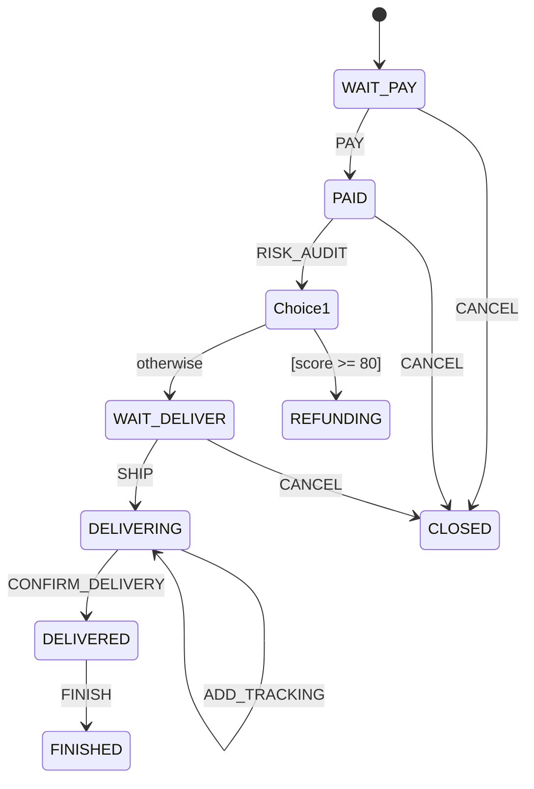

# ateng-boot-statemachine 基础设施 Starter

> 面向复杂业务生命周期治理与订单履约的高性能轻量无状态状态机底座 Starter，坚持纯原生零重型臃肿依赖设计，提供强类型 Fluent DSL 规则编排（支持外部主干跃迁、内部自跃迁、多源汇聚跃迁与 Choice 动态条件分支路由）、实体状态零侵入 Lambda 便捷访问门面、CAS 状态乐观锁并发防重执行模板（`StateMachineCasTemplate`）、三阶段切面拦截器 SPI（`StateMachineInterceptor`）、双通道容器查找（Spring 注入 + `StateMachineFactory`）与动态 Mermaid/PlantUML 状态拓扑图导出。

---

## 0. 特性与公共 API 全景速查矩阵 (Feature & API Panorama Matrix)

| 特性分类 | 特性名称 | 核心门面 / 注解 / SPI | 关键配置项 (`ateng.boot.statemachine.*`) | 关键 API 签名 / 核心行为 | 锚定验证源头 (*Test / Sample) |
| :--- | :--- | :--- | :--- | :--- | :--- |
| **DSL 编排** | 构建器工厂门面 | `StateMachineBuilder` / `StateMachineBuilderFactory` | - | `StateMachineBuilder.builder()` / `StateMachineBuilderFactory.create()`，创建全新强类型 Fluent DSL 构建器 | `StateMachineBuilderTest` / `OrderStateMachineConfig` |
| **DSL 编排** | 外部主干跃迁装配 | `ExternalTransitionBuilder` | - | `externalTransition().from(S).to(S).on(E).when(Condition).perform(Action)`，声明标准外部状态流转（$S_1 \to S_2$） | `ExternalTransitionTest` / `OrderLifecycleIntegrationTest` |
| **DSL 编排** | 内部自跃迁装配 | `InternalTransitionBuilder` | - | `internalTransition().from(S).on(E).when(Condition).perform(Action)`，声明内部自流转（$S_1 \to S_1$ 保持主状态不变执行属性更新） | `InternalTransitionTest` / `OrderLifecycleIntegrationTest` |
| **DSL 编排** | 多源汇聚跃迁装配 | `MultiFromTransitionBuilder` | - | `multiFromTransition().from(S...).to(S).on(E).when(Condition).perform(Action)`，声明多前置状态统一收敛跃迁 | `MultiFromTransitionTest` / `OrderLifecycleIntegrationTest` |
| **DSL 编排** | Choice 条件分支路由 | `ChoiceTransitionBuilder` | - | `choiceTransition().from(S).on(E).when(Condition).to(S).defaultTo(S).perform(Action)`，声明多分支动态分流路由 | `ChoiceTransitionTest` / `OrderLifecycleIntegrationTest` |
| **DSL 编排** | 拦截器装配与机台构建 | `StateMachineBuilder` | - | `interceptor(StateMachineInterceptor)` 挂载切面；`build(String machineId)` 完成校验并构建只读不可变状态机实例 | `StateMachineBuilderTest` / `OrderStateMachineConfig` |
| **核心门面** | Fail-Fast 驱动跃迁 | `StateMachine<S, E, C>` | - | `fireEvent(S, E, C)`，驱动单状态跃迁，未找到路由或校验不通过时显式抛出 `StateMachineException` | `StateMachineTest` / `OrderLifecycleIntegrationTest` |
| **核心门面** | 安全探测静默跃迁 | `StateMachine<S, E, C>` | - | `fireEventQuietly(S, E, C)`，静默试算跃迁路由与卫语句，返回不可变 `TransitionResult<S>` 结构化结果 | `StateMachineTest` / `StateMachineCasTemplateTest` |
| **核心门面** | 实体零侵入 Lambda 驱动 | `StateMachine<S, E, C>` | - | `fireEvent(T, Function<T,S>, BiConsumer<T,S>, E, C)`，自动通过 Getter 提取状态并在成功后通过 Setter 回写实体 | `EntityLambdaAccessorTest` / `OrderService` |
| **核心门面** | 实体零侵入静默探测 | `StateMachine<S, E, C>` | - | `fireEventQuietly(T, Function<T,S>, BiConsumer<T,S>, E, C)`，自动提取并探测，成功后安全回写实体 | `EntityLambdaAccessorTest` |
| **核心门面** | CAS 乐观锁防重门面 | `StateMachine<S, E, C>` | - | `fireEventWithCas(T, Function, BiConsumer, E, C, CasUpdater)`，结合持久层 CAS 条件更新防并发冲突 | `StateMachineCasTemplateTest` / `OrderService` |
| **核心门面** | CAS 静默安全探测门面 | `StateMachine<S, E, C>` | - | `fireEventWithCasQuietly(T, Function, BiConsumer, E, C, CasUpdater)`，静默执行 CAS 跃迁与持久化并返回结果 | `StateMachineCasTemplateTest` |
| **核心门面** | 动态 Mermaid 图例导出 | `StateMachine<S, E, C>` | - | `generateMermaid()` / `exportMermaidDiagram()`，实时输出 Mermaid `stateDiagram-v2` 状态拓扑图语法文本 | `MermaidExportTest` / `OrderStateMachineController` |
| **核心门面** | 动态 PlantUML 图例导出 | `StateMachine<S, E, C>` | - | `generatePlantUML()`，实时输出 `@startuml ... @enduml` 状态拓扑图文本 | `StateMachineBuilderTest` |
| **并发防重** | CAS 执行模板引擎 | `StateMachineCasTemplate` | - | `execute(...)` 与 `executeQuietly(...)`，协调状态机就地试算与 `CasUpdater` 条件持久化，受影响行数 0 抛出异常 | `StateMachineCasTemplateTest` / `OrderService` |
| **并发防重** | CAS 条件更新器函数 | `CasUpdater<T, S>` | - | `updateWithCas(T entity, S sourceState, S targetState)`，对应持久层原子 SQL 条件更新契约 | `StateMachineCasTemplateTest` / `OrderMapper` |
| **全局工厂** | 状态机单例注册表 | `StateMachineFactory` | - | `get(String machineId)`、`register(String, StateMachine)`、`contains(String)`，提供解耦的全局单例查找 | `StateMachineFactoryTest` / `OrderLifecycleIntegrationTest` |
| **扩展 SPI** | 状态机执行切面拦截器 | `StateMachineInterceptor<S, E, C>` | - | `beforeTransition`、`afterTransition`、`onTransitionError`，三阶段生命周期切面拦截点 | `StateMachineInterceptorTest` / `AtengStateMachineAutoConfiguration` |
| **内置拦截器** | 脱敏与耗时日志切面 | `LoggingStateMachineInterceptor` | `ateng.boot.statemachine.logging.enabled`<br>`ateng.boot.statemachine.logging.include-context` | 联动 MDC `traceId` 与 `DesensitizeUtil` 对状态机入站跃迁、上下文及执行耗时进行受控安全日志打印 | `LoggingStateMachineInterceptorTest` / `AtengStateMachineAutoConfigurationTest` |
| **内置拦截器** | Micrometer 指标度量切面 | `MetricsStateMachineInterceptor` | `ateng.boot.statemachine.metrics.enabled`<br>`ateng.boot.statemachine.metrics.slow-execution-threshold` | 自动向 Micrometer 注册 Counter 统计总跃迁数与失败数，并通过 Timer 监控跃迁延时分布与慢跃迁告警 | `MetricsStateMachineInterceptorTest` / `AtengStateMachineAutoConfigurationTest` |
| **自动装配** | 状态机自动装配引导类 | `AtengStateMachineAutoConfiguration` | `ateng.boot.statemachine.enabled` | 自动化注册配置类、Logging 拦截器、平滑探测 Metrics 嵌套配置与机台容器生命周期初始化器 | `AtengStateMachineAutoConfigurationTest` / `SampleSmokeIntegrationTest` |
| **生命周期** | 容器机台初始化器 | `StateMachineInitializer` | - | 容器刷新完成后自动扫描 Spring 容器内所有 `StateMachine` Bean，装配切面拦截器并注册至 `StateMachineFactory` | `AtengStateMachineAutoConfigurationTest` / `OrderLifecycleIntegrationTest` |
| **结果模型** | 跃迁执行结果载荷 | `TransitionResult<S>` | - | `isAccepted()` / `isSuccess()`、`getSourceState()`、`getTargetState()`、`getEvent()`、`getFailureReason()`、`getCause()` | `TransitionResultTest` / `OrderLifecycleIntegrationTest` |
| **结果码契约** | 专属错误码枚举 | `StateMachineResultCode` | - | `TRANSITION_NOT_FOUND(59001)`、`GUARD_CONDITION_FAILED(59002)`、`ACTION_EXECUTION_FAILED(59003)`、`MACHINE_ID_CONFLICT(59004)`、`CONCURRENT_CAS_CONFLICT(59005)` | `StateMachineResultCodeTest` |
| **异常体系** | 专属受控业务异常 | `StateMachineException` | - | 继承 `BusinessException`，携带 `resultCode`、`fromState`、`targetState`、`event` 与原始 `cause` | `StateMachineExceptionTest` |

---

## 1. 模块定位与 Maven 坐标

`ateng-boot-statemachine` 是面向复杂业务生命周期治理与订单履约的高性能无状态业务状态机底座：
- **纯原生无重依赖哲学 (Zero-Bloat Invariant)**：完全依托 JDK 17 与 Spring 6 标准能力构建，坚决不引入 Spring StateMachine、Squirrel 等重量级第三方引擎，零冗余字节码膨胀；
- **严格无状态与线程安全不变量 (Stateless Invariant)**：状态机实例全局单例且严格不可变，内部仅维护静态规则路由映射表，业务状态完全收敛于实体或数据库；
- **显式强类型契约与 4 大流转拓扑**：提供 Fluent DSL 声明外部主干流转（`externalTransition`）、内部自跃迁更新物理字段（`internalTransition`）、多源汇聚（`multiFromTransition`）与 Choice 动态风控条件分流（`choiceTransition`）；
- **CAS 乐观锁防重与本地事务原子回滚**：原生协同数据库条件更新（`UPDATE ... WHERE status = :from AND version = :ver`），防范并发重复点击；当 Action 发生异常时，完美协同 Spring `@Transactional` 本地事务原子回滚；
- **微服务与无侵入协同**：提供双通道获取机制（Spring `@Autowired` 注入与全局单例工厂 `StateMachineFactory.get(machineId)`），并提供 Web 端点动态导出 Mermaid / PlantUML 状态拓扑图。

### Maven 坐标引入

在已导入 `ateng-boot-bom` 的工程中，无需声明版本号即可直接引入：

```xml
<dependency>
    <groupId>io.github.atengk</groupId>
    <artifactId>ateng-boot-statemachine</artifactId>
</dependency>
```

---

## 2. 最小起步体验 (Happy Path & Out-of-the-Box)

以下示例代码 100% 逆向提取自已在 CI 与单测全绿跑通的场景样例工程 [`ateng-boot-sample-statemachine`](../ateng-boot-samples/ateng-boot-sample-statemachine)。

### 步骤一：配置应用属性 (`application.yml`)

```yaml
ateng:
  boot:
    statemachine:
      enabled: true
      logging:
        enabled: true
        include-context: true
      metrics:
        enabled: true
        slow-execution-threshold: 200ms
```

### 步骤二：声明强类型状态机编排 (`OrderStateMachineConfig.java`)

```java
@Configuration
public class OrderStateMachineConfig {

    public static final String MACHINE_ID = "ORDER_LIFECYCLE";

    @Bean
    public StateMachine<OrderState, OrderEvent, OrderContext> orderStateMachine() {
        StateMachineBuilder<OrderState, OrderEvent, OrderContext> builder = StateMachineBuilder.builder();

        // 1. 外部主干跃迁：WAIT_PAY -> PAID (PAY)
        builder.externalTransition()
                .from(OrderState.WAIT_PAY)
                .to(OrderState.PAID)
                .on(OrderEvent.PAY)
                .when(ctx -> ctx != null && ctx.getAmount() != null)
                .perform((from, to, event, ctx) -> log.info("[Action] 订单支付成功: orderSn={}", ctx.getOrderSn()));

        // 2. Choice 动态条件分支路由：PAID -> (风控判断) -> REFUNDING(高危拦截) / WAIT_DELIVER(正常放行)
        builder.choiceTransition()
                .from(OrderState.PAID)
                .on(OrderEvent.RISK_AUDIT)
                .when(ctx -> ctx != null && ctx.getRiskScore() != null && ctx.getRiskScore() >= 80)
                .to(OrderState.REFUNDING)
                .defaultTo(OrderState.WAIT_DELIVER)
                .perform((from, to, event, ctx) -> log.info("[Action] 风控流转完成: {} -> {}", from, to));

        // 3. 内部自跃迁：DELIVERING -> DELIVERING (ADD_TRACKING) 保持状态不变
        builder.internalTransition()
                .from(OrderState.DELIVERING)
                .on(OrderEvent.ADD_TRACKING)
                .when(ctx -> ctx != null && ctx.getTrackingRemark() != null)
                .perform((from, to, event, ctx) -> log.info("[Action] 追加物流轨迹: remark={}", ctx.getTrackingRemark()));

        // 4. 多源汇聚跃迁：[WAIT_PAY, PAID, WAIT_DELIVER] 统一在取消事件下收敛至 CLOSED
        builder.multiFromTransition()
                .from(OrderState.WAIT_PAY, OrderState.PAID, OrderState.WAIT_DELIVER)
                .to(OrderState.CLOSED)
                .on(OrderEvent.CANCEL)
                .perform((from, to, event, ctx) -> log.info("[Action] 订单取消并关闭"));

        return builder.build(MACHINE_ID);
    }
}
```

### 步骤三：业务服务中驱动流转并协同 CAS 乐观锁 (`OrderService.java`)

```java
@Service
public class OrderService {

    private final OrderMapper orderMapper;
    private final StateMachine<OrderState, OrderEvent, OrderContext> orderStateMachine;

    public OrderService(OrderMapper orderMapper, StateMachine<OrderState, OrderEvent, OrderContext> orderStateMachine) {
        this.orderMapper = orderMapper;
        this.orderStateMachine = orderStateMachine;
    }

    /**
     * 触发状态流转（带 CAS 乐观锁防重与本地事务回滚）
     */
    @Transactional(rollbackFor = Exception.class)
    public TransitionResult<OrderState> processTransition(Long orderId, OrderTransitionRequest request) {
        OrderDO order = orderMapper.selectById(orderId);
        OrderState sourceState = order.getStatus();

        OrderContext context = OrderContext.builder()
                .orderId(order.getId())
                .orderSn(order.getOrderSn())
                .riskScore(request.getRiskScore())
                .build();

        // 实体状态零侵入 Lambda 门面执行 CAS 乐观锁更新（并发冲突时自动抛出 CONCURRENT_CAS_CONFLICT）
        OrderState targetState = orderStateMachine.fireEventWithCas(
                order,
                OrderDO::getStatus,
                OrderDO::setStatus,
                request.getEvent(),
                context,
                (ent, from, to) -> orderMapper.updateStatusWithCas(ent.getId(), from.name(), to.name(), ent.getVersion())
        );

        return TransitionResult.success(sourceState, targetState, request.getEvent());
    }
}
```

---

## 3. 生产扩展接管 (Customization & Extensibility)

### 1. 自定义状态机全局切面拦截器 (`StateMachineInterceptor`)

开发者可通过实现 `StateMachineInterceptor<S, E, C>` 扩展点，无侵入介入状态机的全生命周期（执行前置校验、跨系统审计埋点或异常钉钉通知）：

```java
@Component
public class AuditStateMachineInterceptor implements StateMachineInterceptor<OrderState, OrderEvent, OrderContext> {

    private static final Logger log = LoggerFactory.getLogger(AuditStateMachineInterceptor.class);

    @Override
    public void beforeTransition(OrderState fromState, OrderEvent event, OrderContext context) {
        log.info("[Audit] 准备执行流转: from={}, event={}, orderSn={}", fromState, event, context != null ? context.getOrderSn() : null);
    }

    @Override
    public void afterTransition(OrderState fromState, OrderState toState, OrderEvent event, OrderContext context, long durationMs) {
        log.info("[Audit] 流转成功: {} -> {}, 耗时={}ms", fromState, toState, durationMs);
    }

    @Override
    public void onTransitionError(OrderState fromState, OrderEvent event, OrderContext context, Exception exception) {
        log.error("[Audit] 流转发生异常: from={}, event={}, err={}", fromState, event, exception.getMessage());
    }
}
```
> [!NOTE]
> 容器启动时，`StateMachineInitializer` 会自动发现 Spring 上下文中所有 `StateMachineInterceptor` Bean，并将其自动装配进所有受管状态机实例中，无需手动向构建器注册。

### 2. 双通道机台获取（解耦业务层依赖）

状态机底座提供双通道访问支持，开发者可根据工程解耦诉求选用：

```java
// 通道一：Spring 容器强类型原生注入（推荐单机台场景）
@Autowired
private StateMachine<OrderState, OrderEvent, OrderContext> orderStateMachine;

// 通道二：全局工厂单例查找（推荐微服务门面或根据动态标识路由的多机台场景）
StateMachine<OrderState, OrderEvent, OrderContext> machine = StateMachineFactory.get("ORDER_LIFECYCLE");
```

---

## 4. 核心生产边界与非功能语义 (Production Boundary & Failure Modes)

### 1. 严格无状态单例不变量 (Stateless Invariant)
- **静态拓扑与无状态生命周期**：`StateMachine` 实例全局单例且严格不可变，内部仅包含由 `StateMachineBuilder.build(machineId)` 编译生成的静态只读路由哈希表（`Map<S, Map<E, List<Transition>>>`）；
- **内存零污染与零泄露**：机台本身不持有任何实体的当前状态、可变字段或线程上下文。同一机台可安全被数以万计的并发请求同时调用，绝对杜绝内存业务状态交叉污染。

### 2. CAS 乐观锁防重流转与并发判定模型
- **防重复点击与 ABA 问题**：在并发场景下（如买家快速连击两次“支付”按钮），状态机协同持久层执行：
  ```sql
  UPDATE t_order SET status = :targetState, version = version + 1 WHERE id = :id AND status = :sourceState AND version = :version
  ```
- **受影响行数裁决**：当并发竞争导致其中一个事务优先更新成功后，后续事务的条件更新将返回 `0` 行。`StateMachineCasTemplate` 立即 Fail-Fast 阻断并抛出 `StateMachineException(StateMachineResultCode.CONCURRENT_CAS_CONFLICT)`，彻底杜绝状态乱跳与超额执行。

### 3. Action 异常与 Spring 本地事务原子回滚机制
- **事务一致性模型**：业务层方法标准挂载 `@Transactional(rollbackFor = Exception.class)`；
- **异常因果链与原子回滚**：当状态机在执行后置 `Action` 动作过程中发生业务异常（如扣减库存失败或外部 RPC 超时抛出异常）时，异常将被原样向上抛出并保留原始 `cause`，触发周围 Spring 本地数据库事务原子回滚，数据库状态保持原样，保障持久层与业务逻辑严格一致。

### 4. 动态图例导出机制
状态机提供实时 Mermaid 图例动态生成引擎：
```java
// 直接在 Web 控制器或排查端点导出
String mermaidCode = orderStateMachine.generateMermaid();
```
输出标准的 `stateDiagram-v2` 语法，可直接渲染到 Markdown 或开发控制台：

