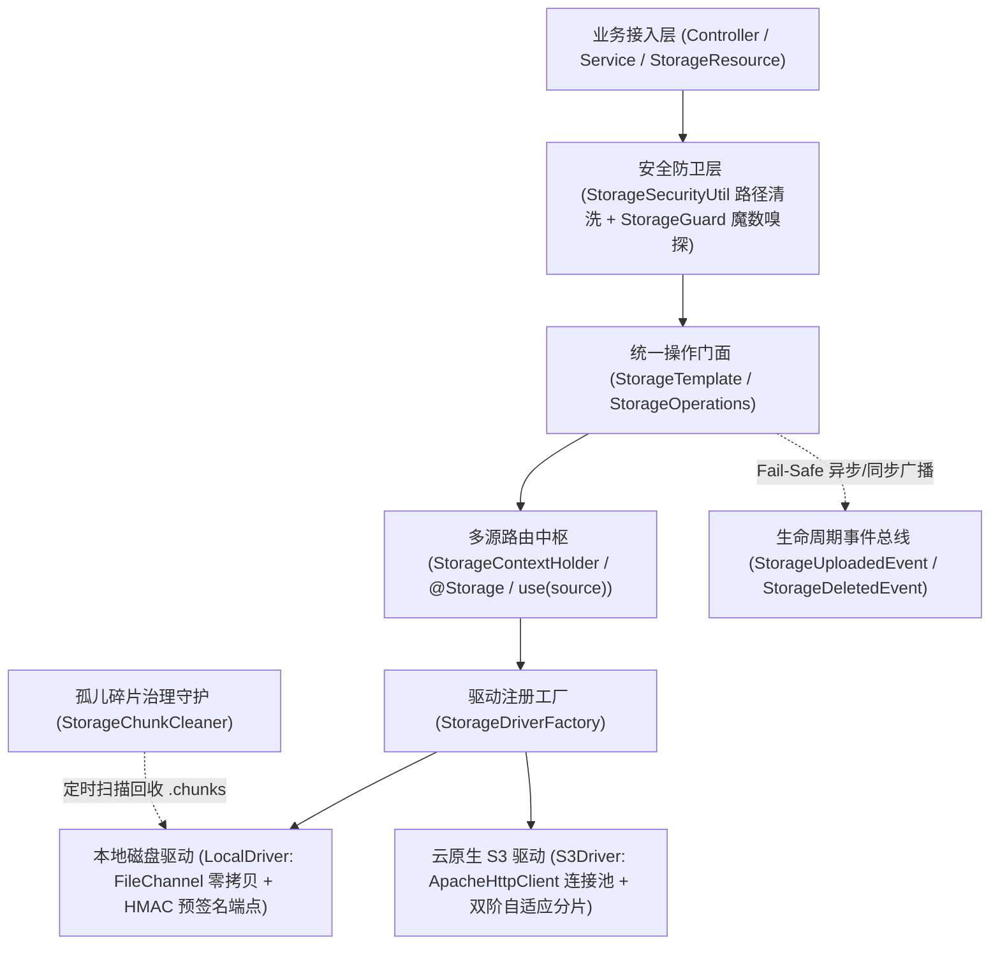

# ateng-boot-storage 基础设施 Starter

> 企业级轻量多源对象存储与安全预签名一体化 Starter，统一抽象 Local 本地磁盘存储与标准 S3 兼容协议（MinIO、RustFS、AWS S3、阿里云 OSS、腾讯云 COS、华为云 OBS），提供路径遍历安全防卫、文件魔数特征嗅探、双阶自适应流式上传防 OOM、极速流式散列计算与秒传、分片直传预签名、孤儿碎片治理守护、Spring Boot Actuator 健康探针与 Spring 原生资源深度集成，天然具备分布式幂等删除保障。

---

## 0. 特性与公共 API 全景速查矩阵 (Feature & API Panorama Matrix)

| 特性分类 | 特性名称 | 核心门面 / 注解 / SPI | 关键配置项 (`ateng.boot.*`) | 关键 API 签名 / 核心行为 | 锚定验证源头 (*Test / Sample) |
| :--- | :--- | :--- | :--- | :--- | :--- |
| **文件上传** | 流式与表单文件上传 | `StorageTemplate`<br>`StorageOperations`<br>`StorageProperties` | `ateng.boot.storage.enabled`<br>`ateng.boot.storage.type` | `upload(String, InputStream)` / `upload(String, InputStream, String, long)` / `upload(String, MultipartFile)` / `upload(MultipartFile)`，自动推导 MIME、清洗路径并安全创建父目录 | `StorageTemplateTest` / `StorageObjectController` / `SampleStorageIntegrationTest` |
| **自定义元数据** | 对象业务扩展元数据注入 | `StorageTemplate`<br>`StorageOperations`<br>`StorageObject` | - | `upload(String, InputStream, Map<String, String>)` / `upload(String, InputStream, String, long, Map<String, String>)` / `upload(String, MultipartFile, Map<String, String>)`，携带扩展元数据并在 `StorageObject.getUserMetadata()` 反查 | `StorageTemplateTest` / `StorageObjectController` / `SampleStorageIntegrationTest` |
| **自适应上传防 OOM** | 未知流长双阶分片缓冲 | `StorageTemplate`<br>`StorageOperations`<br>`S3Driver` | `ateng.boot.storage.s3.*` | `upload(String, InputStream, String, -1L)`，彻底取缔 `readAllBytes()`，恒定 $\le 5\,\text{MB}$ 有界内存缓冲，首阶直传 / 次阶流式分片，异常自动熔断 `abortMultipartUpload` | `S3AdaptiveStreamingTest` / `StorageTransferController` / `SampleS3DualModeIntegrationTest` |
| **便捷载荷存取** | 文本/字节/JSON 强类型存取 | `StorageTemplate`<br>`StorageOperations` | - | `uploadString(String, String)` / `downloadString(String)` / `uploadBytes(String, byte[])` / `uploadBytes(String, byte[], String)` / `downloadBytes(String)` / `uploadJson(String, Object)` / `downloadJson(String, Class<T>)` | `StorageTemplateTest` / `StorageObjectController` / `SampleStorageIntegrationTest` |
| **对象复制与移动** | 跨路径零拷贝复制与原子移动 | `StorageTemplate`<br>`StorageOperations` | - | `copy(String, String)` / `move(String, String)`，S3 服务端免流秒传，Local NIO 零拷贝转移并安全移除源文件 | `StorageTemplateTest` / `StorageObjectController` / `SampleStorageIntegrationTest` |
| **目录检索与分页** | 树状前缀列举与标准分页检索 | `StorageTemplate`<br>`StorageOperations`<br>`StorageObject` | - | `list(String)` / `list(String, boolean)` / `listPage(String, PageQuery)` / `listPage(String, PageQuery, boolean)`，统一区分文件与虚拟目录项并自动过滤 `.chunks` 系统隐藏项 | `StorageTemplateTest` / `StorageObjectController` / `SampleStorageIntegrationTest` |
| **天然幂等删除** | 单文件/批量/目录幂等删除 | `StorageTemplate`<br>`StorageOperations` | - | `delete(String)` / `deleteBatch(List<String>)` / `deleteDirectory(String)`，天然幂等语义，文件不存在亦平滑返回 `true` | `StorageTemplateTest` / `StorageObjectController` / `SampleStorageIntegrationTest` |
| **前缀批量删除** | 前缀级流式批量删除与熔断 | `StorageTemplate`<br>`StorageOperations` | - | `deletePrefix(String)`，流式切片批量清除指定前缀下的所有对象，前置强行熔断空前缀、根路径 `/` 与通配符防误删 | `StorageTemplateTest` / `LocalDriverTest` / `S3DriverTest` / `StorageObjectController` |
| **文件下载与探测** | 流式下载与存在性/元数据探测 | `StorageTemplate`<br>`StorageOperations`<br>`StorageObject` | - | `download(String)` (返回 `InputStream`) / `exists(String)` / `getMetadata(String)`，严格遵循 `try-with-resources` 资源确定性释放 | `StorageTemplateTest` / `StorageTransferController` / `SampleStorageIntegrationTest` |
| **Spring 原生集成** | 原生 WritableResource 断点续传 | `StorageResource`<br>`StorageTemplate` | - | 实现 Spring `Resource` 与 `WritableResource`，支持 `storageTemplate.getResource(path)` 获得受管资源与 HTTP Range `206 Partial Content` 响应 | `StorageResourceTest` / `StorageTransferController` / `SampleStorageIntegrationTest` |
| **字节范围读取** | 断点续传与音视频流 Seek | `StorageTemplate`<br>`StorageOperations` | - | `download(String, long, long)`，按需拉取指定起始偏移量与字节长度切片，S3 原生映射 HTTP Range 报头，Local 依托 `FileChannel.position` 零拷贝定位 | `StorageRangeAndPresignTest` / `StorageTransferController` / `SampleS3DualModeIntegrationTest` |
| **打包归档** | 多文件纯流式 ZIP 打包响应 | `StorageTemplate`<br>`StorageOperations` | - | `downloadAsZip(List<String>, OutputStream)` / `downloadAsZip(Map<String, String>, OutputStream)` / `downloadAsZip(List<String>, HttpServletResponse, String)`，零磁盘临时文件、重名自动消解与 RFC 5987 中文编码 | `StorageTemplateZipTest` / `StorageTransferController` / `SampleStorageIntegrationTest` |
| **流式散列与秒传** | 原生零拷贝流式散列计算 | `StorageHashUtil`<br>`HashAlgorithm`<br>`StorageTemplate` | - | `StorageHashUtil.sha256Hex(InputStream)` / `md5Hex` / `sha1Hex` / `crc32Hex` / `crc32Value` / `hashHex`；`storageTemplate.calculateHash(String, HashAlgorithm)`，流指针零截断与极速秒传指纹比对 | `StorageHashUtilTest` / `StorageTransferController` / `SampleStorageIntegrationTest` |
| **预签名只读** | 安全只读防盗链预签名外链 | `StorageTemplate`<br>`PresignedUrl`<br>`PresignedDownloadRequest` | `ateng.boot.storage.local.download-endpoint`<br>`ateng.boot.storage.local.secret-key` | `getPresignedUrl(String, Duration)` / `getPresignedUrl(String, Duration, String)` / `getPresignedUrl(PresignedDownloadRequest)`，支持 RFC 5987 友好中文下载文件名重写 | `StorageRangeAndPresignTest` / `LocalDriverTest` / `SampleS3DualModeIntegrationTest` |
| **客户端直传预签名** | 预签名安全直传写入外链凭据 | `StorageTemplate`<br>`PresignedUploadRequest`<br>`PresignedUrl` | `ateng.boot.storage.local.upload-endpoint` | `getPresignedUploadUrl(String, Duration)` / `getPresignedUploadUrl(PresignedUploadRequest)`，前端直接向存储端点发起 HTTP PUT 直传数据，完全绕过业务后端中转 | `LocalStorageUploadControllerTest` / `S3DriverTest` / `SampleStorageIntegrationTest` |
| **分片直传预签名** | 端侧大文件分块直传预签名 | `StorageTemplate`<br>`StorageOperations` | `ateng.boot.storage.local.upload-endpoint` | `getPresignedUploadPartUrl(String, String, int, Duration)`，生成指定分片 PUT 写入外链，前端并发直传各分片后通知后端一键合并 | `LocalStorageUploadControllerTest` / `S3DriverTest` / `SampleStorageIntegrationTest` |
| **公共读与永久直链** | 公开桶直链与公共读授权 | `StorageTemplate`<br>`StorageOperations` | `ateng.boot.storage.s3.domain`<br>`ateng.boot.storage.s3.path-style` | `getUrl(String)` 返回永久访问 URL；`uploadPublic(String, InputStream, ...)` / `uploadPublic(String, MultipartFile)` 自动挂载 `PUBLIC_READ`，三级拓扑自适应 | `StoragePublicUrlTest` / `S3DriverTest` / `SampleS3DualModeIntegrationTest` |
| **本地受控端点** | 本地文件安全下载与直传端点 | `LocalStorageDownloadController`<br>`LocalStorageUploadController` | `ateng.boot.storage.local.download-endpoint`<br>`ateng.boot.storage.local.upload-endpoint`<br>`ateng.boot.storage.local.secret-key` | 提供 `/storage/local/download`、`/storage/local/upload` 与 `/storage/local/upload-part` 端点，基于 HMAC-SHA256 常量时间防篡改与时效验证 | `LocalStorageDownloadControllerTest` / `LocalStorageUploadControllerTest` / `SampleStorageIntegrationTest` |
| **分片上传状态机** | 服务端大文件分片合并暂存 | `StorageTemplate`<br>`StorageOperations`<br>`S3ChunkTokenUtil` | - | `initiateChunkedUpload(String)` / `uploadChunk(String, int, InputStream, long)` / `uploadChunk(String, int, byte[])` / `completeChunkedUpload(String, String, int)` / `abortChunkedUpload(String)`，1-based 连续性强校验 | `StorageTemplateChunkedTest` / `SampleStorageIntegrationTest` |
| **碎片治理守护** | 孤儿分片碎片生命周期治理 | `StorageChunkCleaner`<br>`ChunkCleanerProperties` | `ateng.boot.storage.chunk-cleaner.enabled`<br>`ateng.boot.storage.chunk-cleaner.interval`<br>`ateng.boot.storage.chunk-cleaner.max-age` | 后台守护定时扫描并安全回收超期滞留的 `.chunks` 孤儿碎片目录，彻底杜绝服务器磁盘空间悬挂泄漏 | `StorageChunkCleanerTest` |
| **文件安全防卫** | 文件类型与魔数嗅探防卫器 | `StorageGuard`<br>`StorageFileType`<br>`StorageGuardProperties` | `ateng.boot.storage.guard.enabled`<br>`ateng.boot.storage.guard.strict-magic-check`<br>`ateng.boot.storage.guard.allowed-extensions`<br>`ateng.boot.storage.guard.disallowed-extensions` | 识别 15+ 种标准魔数与高危 PE/ELF/Shell 脚本二进制特征，基于 `mark/reset` 零流截断损耗防御恶意伪装上传（40010 / 40011） | `StorageGuardTest` / `SampleStorageIntegrationTest` |
| **路径安全清洗** | 路径穿越防御与常量时间验签 | `StorageSecurityUtil` | - | `cleanPath(String)` / `cleanFilename(String)` / `hmacSha256Hex(String, String)` / `constantTimeEquals(String, String)`，拦截 `..` 路径逃逸、空字符与时序攻击 | `StorageSecurityUtilTest` |
| **多源路由调度** | 编程式与声明式多存储源路由 | `StorageTemplate`<br>`@Storage`<br>`StorageAspect`<br>`StorageSourceProperties` | `ateng.boot.storage.primary`<br>`ateng.boot.storage.sources.*` | `storageTemplate.use(String)` 返回绑定目标源的不可变操作门面；`@Storage("source")` AOP 自动切换并在 `finally` 严密恢复 | `StorageRoutingTest` / `SampleStorageIntegrationTest` |
| **多源异步透传** | 存储源上下文与线程池透传 | `StorageContextHolder`<br>`StorageTaskDecorator` | - | `set(String)` / `get()` / `clear()` / `wrap(Runnable)` / `wrap(Callable)`，将当前线程活动存储源快照安全透传至异步子线程并在任务结束后清理 | `StorageRoutingTest` |
| **对象标签治理** | 对象业务标签完整生命周期 | `StorageTemplate`<br>`StorageOperations` | - | `setObjectTags(String, Map<String, String>)` / `getObjectTags(String)` / `deleteObjectTags(String)`，打通云端生命周期冷热归档与部门财务审计 | `StorageTaggingAndHardeningTest` / `SampleS3DualModeIntegrationTest` |
| **存储分层与加密** | 冷热分层与服务端加密支持 | `S3StorageProperties`<br>`StorageObject` | `ateng.boot.storage.s3.default-storage-class`<br>`ateng.boot.storage.s3.default-server-side-encryption` | 支持配置默认存储类型与服务端加密，并在 `StorageObject` 元数据反查 `storageClass` (`STANDARD`/`STANDARD_IA`/`GLACIER`) 与 `serverSideEncryption` (`AES256`/`aws:kms`) | `StorageTaggingAndHardeningTest` / `S3StoragePropertiesTest` / `SampleS3DualModeIntegrationTest` |
| **连接池与自愈建桶** | 生产级连接池、超时与桶自愈 | `S3Driver`<br>`S3StorageProperties` | `ateng.boot.storage.s3.connect-timeout`<br>`ateng.boot.storage.s3.socket-timeout`<br>`ateng.boot.storage.s3.api-call-timeout`<br>`ateng.boot.storage.s3.max-connections`<br>`ateng.boot.storage.s3.connection-acquisition-timeout`<br>`ateng.boot.storage.s3.auto-create-bucket` | 强类型 `Duration` 三级超时控制与 `ApacheHttpClient` 连接池并发治理；开启 `auto-create-bucket` 时遇 `404 NoSuchBucket` 自动完成建桶自愈 | `S3StoragePropertiesTest` / `StorageTaggingAndHardeningTest` |
| **双核驱动与工厂** | 存储驱动 SPI 与多源工厂 | `StorageDriver`<br>`LocalDriver`<br>`S3Driver`<br>`StorageDriverFactory`<br>`LocalStorageProperties` | `ateng.boot.storage.local.base-path`<br>`ateng.boot.storage.local.domain`<br>`ateng.boot.storage.s3.endpoint`<br>`ateng.boot.storage.s3.bucket` | 统一抽象本地磁盘文件系统与云原生 S3 兼容协议 SPI，支持下游通过 `StorageDriver` 扩展自定义存储后端 | `LocalDriverTest` / `S3DriverTest` |
| **健康探针与诊断** | Actuator 健康探针与运行时诊断 | `StorageHealthIndicator`<br>`StorageTemplate`<br>`StorageOperations` | `management.health.storage.enabled` | 深度集成 `/actuator/health`；提供 `storageTemplate.ping()` 实时连通探测与 `storageTemplate.getDiagnostics()` 连接池/配置指标提取 | `StorageHealthIndicatorTest` / `SampleStorageIntegrationTest` / `SampleS3DualModeIntegrationTest` |
| **事件与异常体系** | 生命周期事件与因果异常体系 | `StorageEvent`<br>`StorageUploadedEvent`<br>`StorageDeletedEvent`<br>`StorageException`<br>`StorageResultCode` | - | 上传与删除成功后广播 Spring 事件（Fail-Safe 异常隔离不阻断主链路）；底层 IO/SDK 异常统一转译为 `StorageException` 并 100% 保留原始 `cause` 因果链 | `StorageTemplateEventTest` / `StorageTemplateTest` / `SampleStorageIntegrationTest` |

---

## 1. 模块定位与 Maven 坐标

`ateng-boot-storage` 是面向生产就绪的高内聚、轻量级多源对象存储基础设施模块：
- **纯净依赖**：仅必需依赖 `ateng-boot-core`，零冗余第三方工具包，Spring Web 与 Spring Boot Actuator 作为按需可选依赖（`optional`）；
- **双核驱动与多源路由**：统一抽象为 `LocalDriver`（本地磁盘文件系统）与 `S3Driver`（云原生 S3 兼容协议，精简版 AWS SDK v2 + Apache HTTP Client 连接池），支持平铺单源与 `sources.*` 命名多存储源动态切换；
- **显式契约与防卫闭环**：提供 `StorageTemplate` / `StorageOperations` 对称操作门面与 Spring 原生 `StorageResource`（实现 `Resource` 与 `WritableResource`），内置路径遍历清洗、文件魔数防伪装嗅探、未知流长双阶分片防 OOM 与分布式天然幂等删除。

```xml
<dependency>
    <groupId>io.github.atengk</groupId>
    <artifactId>ateng-boot-storage</artifactId>
</dependency>
```

---

## 2. 核心架构与设计不变量

### 2.1 双核驱动与多源路由全链路架构



### 2.2 六大核心设计不变量 (Core Design Invariants)

1. **流指针零截断不变量 (Zero-Stream-Truncation Invariant)**：`StorageGuard` 执行文件头部魔数特征嗅探时，强制依托 `BufferedInputStream.mark(512)` 与 `reset()` 精准复位流指针；`StorageHashUtil` 采用 8KB 定长缓冲区分块流式计算散列，确保下游存储驱动读取到 100% 完整的原始字节流。
2. **双阶自适应有界内存防 OOM 不变量 (Bounded-Memory Adaptive Streaming Invariant)**：面对未知长度输入流（`size < 0`），彻底取缔 `InputStream.readAllBytes()`，在 `S3Driver` 内部维持恒定 $\le 5\,\text{MB}$ 有界内存缓冲区；流总长 $\le 5\,\text{MB}$ 时单次 `PutObject` 一步直传，超过 $5\,\text{MB}$ 时自动无缝升阶为 S3 Multipart Upload 流式分片上传，任何中途异常自动触发 `abortMultipartUpload` 熔断清理云端碎片。
3. **分布式天然幂等删除与防误删熔断不变量 (Idempotent Delete & Anti-Purge Fuse Invariant)**：`delete`、`deleteBatch`、`deleteDirectory`、`deleteObjectTags` 天然幂等，目标不存在时静默返回成功，绝不抛出 404 阻断分布式重试；`deletePrefix` 与 `deleteDirectory` 内置前置强校验，凡遇到空字符串、空白符、根路径 `/` 或通配符 `*` 立即抛出 `StorageException(StorageResultCode.INVALID_PATH)` 强行熔断，杜绝误删全盘或整个存储桶。
4. **确定性生命周期与句柄零泄漏不变量 (Deterministic Resource Cleanup Invariant)**：所有文件流、NIO `FileChannel`、S3 `ResponseInputStream` 及 `ZipOutputStream` 均在 `try-with-resources` 中闭环管理；大文件流式 ZIP 打包（`downloadAsZip`）全程基于内存流边读边压，零物理临时文件落盘，且在写出前强制执行全量文件存在性预检。
5. **路径归一化与常量时间防时序攻击不变量 (Path Normalization & Constant-Time Verification Invariant)**：`StorageSecurityUtil` 前置拦截 `\0` 空字符、Windows 盘符与 `..` 相对路径穿越逃逸；本地预签名外链（`/storage/local/download` 与 `/storage/local/upload`）统一使用 HMAC-SHA256 签名并经由 `MessageDigest.isEqual` 常量时间比对，彻底阻断时序侧信道攻击。
6. **因果异常体系与 Fail-Safe 事件隔离不变量 (Causal Exception & Fail-Safe Event Invariant)**：底层 IO 异常与 AWS SDK 异常在驱动边界统一转译为携带 `StorageResultCode` 的 `StorageException` 并 100% 保留原始 `cause` 堆栈；上传与删除成功后触发的 `StorageUploadedEvent` / `StorageDeletedEvent` 采用 Fail-Safe 异常隔离，任何外部监听器抛出的异常仅记录告警日志，绝不逆向污染或中断主业务写入链路。

---

## 3. 核心对象存取、自适应防 OOM 与生命周期治理

本章围绕**企业电子合同与档案管理**业务场景，演示标准表单上传、自定义业务元数据注入、未知流长双阶自适应流式上传防 OOM、常用载荷（批注文本与审计快照 JSON）便捷读写、跨路径零拷贝复制与归档移动、目录树分页检索及天然幂等删除。

### 3.1 表单/流式上传与自定义业务元数据 (`upload` / `userMetadata`)

#### 本节专属 YAML 配置
```yaml
ateng:
  boot:
    storage:
      enabled: true                         # 开启存储模块自动装配（默认 true）
      type: local                           # 默认存储驱动类型：local 或 s3（默认 local）
      local:
        base-path: /data/storage            # 本地存储根目录物理路径（默认系统临时目录）
        domain: http://localhost:8080       # 本地存储对外访问基准域名
```

#### 实战业务代码范式
```java
@RestController
@RequestMapping("/sample/storage/object")
@RequiredArgsConstructor
public class StorageObjectController {

    private final StorageTemplate storageTemplate;

    // 1. 上传电子合同文件（自动执行路径归一化、创建父目录与 MIME 推导）
    @PostMapping("/upload")
    public Result<StorageObject> upload(
            @RequestParam("file") @NotNull(message = "上传文件不能为空") MultipartFile file,
            @RequestParam(value = "path", required = false) String path) {
        String targetPath = (path != null && !path.isBlank()) ? path : file.getOriginalFilename();
        StorageObject object = storageTemplate.upload(targetPath, file);
        return Result.success(object);
    }

    // 2. 上传电子合同并注入自定义业务扩展元数据（如签署人 author、环境标识 env）
    @PostMapping("/upload-with-metadata")
    public Result<StorageObject> uploadWithMetadata(
            @RequestParam("file") @NotNull(message = "上传文件不能为空") MultipartFile file,
            @RequestParam("path") @NotBlank(message = "目标路径不能为空") String path,
            @RequestParam Map<String, String> userMetadata) {
        Map<String, String> customMeta = new HashMap<>(userMetadata);
        customMeta.remove("path");
        StorageObject object = storageTemplate.upload(path, file, customMeta);
        return Result.success(object);
    }
}
```

#### 核心机制与边界防御
- **路径穿越自动净化**：`MultipartFile.getOriginalFilename()` 由 `StorageSecurityUtil.cleanFilename` 剥离客户端伪造的父目录前缀（如 `../../evil.jsp`），防止目录穿越覆写系统文件。
- **自定义元数据跨介质边界**：
  - **S3 协议驱动**：`userMetadata` 原生映射为云端对象自定义请求头（`x-amz-meta-*`）并永久持久化，后续随时调用 `storageTemplate.getMetadata(path)` 均可完整反查；
  - **Local 磁盘驱动**：因跨平台文件系统无统一扩展属性标准，`userMetadata` 随本次上传返回的 `StorageObject` 即时回传；若需在 Local 模式下长期检索业务扩展属性，建议由业务数据库落库维护。

---

### 3.2 未知流长双阶自适应流式分片上传 (`size = -1` 恒定 $\le 5\,\text{MB}$ 防 OOM)

#### 本节专属 YAML 配置
```yaml
ateng:
  boot:
    storage:
      enabled: true
      sources:
        s3:
          type: s3
          s3:
            endpoint: http://127.0.0.1:9000     # S3 兼容服务端点（RustFS / MinIO / OSS）
            bucket: ateng-bucket                # 目标存储桶名称
            access-key: YOUR_ACCESS_KEY         # 访问密钥 AccessKey
            secret-key: YOUR_SECRET_KEY         # 私有密钥 SecretKey
            path-style: true                    # 自建存储推荐开启 Path-Style 模式
            api-call-timeout: 60s               # 单次 S3 API 调用总体硬超时（默认 60s）
```

#### 实战业务代码范式
```java
@PostMapping("/upload-adaptive")
public Result<StorageObject> uploadAdaptive(
        @RequestParam("path") @NotBlank(message = "目标路径不能为空") String path,
        @RequestParam("content") @NotNull(message = "流数据内容不能为空") String content,
        @RequestParam(value = "contentType", defaultValue = "text/plain") String contentType,
        @RequestParam(value = "source", defaultValue = "s3") String source) {
    byte[] payload = content.getBytes(StandardCharsets.UTF_8);
    try (ByteArrayInputStream in = new ByteArrayInputStream(payload)) {
        // size 传 -1L：<=5MB 一步直传，>5MB 自动升阶为 S3 Multipart Upload 流式分片上传
        return Result.success(storageTemplate.use(source).upload(path, in, contentType, -1L));
    } catch (IOException e) {
        throw new StorageException(StorageResultCode.UPLOAD_FAILED, "自适应流式上传失败: " + path, e);
    }
}
```

#### 核心机制与边界防御
- **首阶直传与次阶流式分片自动切换**：当调用方传入 `size = -1L` 时，`S3Driver` 先拉取最多 $5\,\text{MB}$ 数据至有界缓冲区；若流在 $5\,\text{MB}$ 内读尽，直接执行单次 `PutObject` 一步上传（零多余 RPC 开销）；若流大小超过 $5\,\text{MB}$，自动激活 S3 Multipart Upload，按 $5\,\text{MB}$ 标准分片流式推向云端并自动合并。
- **异常确定性熔断回收**：若在流式分片上传中途发生网络中断或上游流异常，`catch` 块强制触发 `abortMultipartUpload` 立即清理云端已上传的孤儿分片，杜绝存储空间隐形泄漏。

---

### 3.3 常用载荷便捷存取 (`uploadString` / `uploadBytes` / `uploadJson`)

#### 本节专属 YAML 配置
```yaml
ateng:
  boot:
    storage:
      enabled: true
      type: local
      local:
        base-path: /data/storage            # 合同批注与 JSON 审计快照本地归档根目录
```

#### 实战业务代码范式
```java
// 1. 电子合同归档审计快照强类型 DTO/VO（挂载 JSR-303 校验注解）
@Data
@Builder
@NoArgsConstructor
@AllArgsConstructor
public class ContractAuditSnapshot {
    @NotBlank(message = "合同编号不能为空")
    private String contractNo;
    @NotBlank(message = "合同标题不能为空")
    private String title;
    @NotBlank(message = "签署负责人不能为空")
    private String signer;
    @NotBlank(message = "归属部门不能为空")
    private String department;
    private String auditStatus;
}

// 2. Controller 便捷读写合同批注文本与审计快照 JSON
@PostMapping("/write-string")
public Result<StorageObject> writeString(@RequestParam("path") @NotBlank String path,
                                         @RequestParam("content") @NotNull String content) {
    return Result.success(storageTemplate.uploadString(path, content));
}

@PostMapping("/write-json")
public Result<StorageObject> writeJson(@RequestParam("path") @NotBlank String path,
                                       @Valid @NotNull @RequestBody ContractAuditSnapshot snapshot) {
    return Result.success(storageTemplate.uploadJson(path, snapshot));
}

@GetMapping("/read-json")
public Result<ContractAuditSnapshot> readJson(@RequestParam("path") @NotBlank String path) {
    ContractAuditSnapshot snapshot = storageTemplate.downloadJson(path, ContractAuditSnapshot.class);
    return Result.success(snapshot);
}
```

#### 核心机制与边界防御
- **底座序列化收敛**：`uploadJson` / `downloadJson` 100% 复用 `ateng-boot-core` 的 `JsonUtil` 门面，自动绑定 `application/json;charset=UTF-8`；`uploadString` / `downloadString` 默认采用 `StandardCharsets.UTF_8` 与 `text/plain;charset=UTF-8`，彻底免除业务层手动创建 `ByteArrayInputStream` 的样板代码。
- **空安全与前置校验**：写入 `null` 载荷或空路径时前置快速失败抛出 `StorageException(StorageResultCode.INVALID_PARAMETER)`。

---

### 3.4 跨路径零拷贝复制与原子归档移动 (`copy` / `move`)

#### 本节专属 YAML 配置
```yaml
ateng:
  boot:
    storage:
      enabled: true
      type: local
      local:
        base-path: /data/storage            # 支持同源内跨目录零拷贝复制与原子归档移动
```

#### 实战业务代码范式
```java
// 1. 跨路径零拷贝生成合同副本（保留原文件）
@PostMapping("/copy")
public Result<Boolean> copy(
        @RequestParam("sourcePath") @NotBlank(message = "源路径不能为空") String sourcePath,
        @RequestParam("targetPath") @NotBlank(message = "目标路径不能为空") String targetPath) {
    boolean success = storageTemplate.copy(sourcePath, targetPath);
    return Result.success(success);
}

// 2. 将签署完成的合同从 staging 暂存区原子归档至 archive 正式区（自动移除源文件）
@PostMapping("/move")
public Result<Boolean> move(
        @RequestParam("sourcePath") @NotBlank(message = "源路径不能为空") String sourcePath,
        @RequestParam("targetPath") @NotBlank(message = "目标路径不能为空") String targetPath) {
    boolean success = storageTemplate.move(sourcePath, targetPath);
    return Result.success(success);
}
```

#### 核心机制与边界防御
- **服务端免流复制与 NIO 零拷贝**：`S3Driver.copy` 直接调用 S3 服务端 `CopyObject` 指令，数据无需流经应用服务器内存或占用公网带宽；`LocalDriver.copy` 采用 `Files.copy(..., StandardCopyOption.REPLACE_EXISTING)` 内核态零拷贝并自动创建目标父目录。
- **事件完整闭环**：`copy` 成功后广播目标路径 `StorageUploadedEvent`；`move` 成功后依次广播目标路径 `StorageUploadedEvent` 与源路径 `StorageDeletedEvent`，确保下游审计日志与缓存状态绝对同步。

---

### 3.5 目录树层级列举与 `PageQuery` 标准分页检索 (`list` / `listPage`)

#### 本节专属 YAML 配置
```yaml
ateng:
  boot:
    storage:
      enabled: true
      type: local
      local:
        base-path: /data/storage            # 自动过滤 .chunks 分片目录与系统隐藏文件
```

#### 实战业务代码范式
```java
// 1. 平铺或递归列举指定归档目录前缀下的合同对象
@GetMapping("/list")
public Result<List<StorageObject>> list(
        @RequestParam(value = "prefix", required = false) String prefix,
        @RequestParam(value = "recursive", defaultValue = "false") boolean recursive) {
    List<StorageObject> list = storageTemplate.list(prefix, recursive);
    return Result.success(list);
}

// 2. 结合 ateng-boot-core 标准 PageQuery / PageResult 分页检索
@GetMapping("/list-page")
public Result<PageResult<StorageObject>> listPage(
        @RequestParam(value = "prefix", required = false) String prefix,
        @Valid @ModelAttribute PageQuery pageQuery,
        @RequestParam(value = "recursive", defaultValue = "false") boolean recursive) {
    PageResult<StorageObject> pageResult = storageTemplate.listPage(prefix, pageQuery, recursive);
    return Result.success(pageResult);
}
```

#### 核心机制与边界防御
- **虚拟目录与文件统一建模**：非递归列举（`recursive = false`）时，子目录统一封装为 `StorageObject`（`directory = true`、`size = 0L`），消除 S3 虚拟公共前缀（`CommonPrefixes`）与本地物理文件夹的模型差异。
- **隐性系统文件自动过滤**：列举过程自动过滤以 `.` 开头的隐藏文件及 `.chunks` 分片暂存目录，且无匹配结果时保底返回 `Collections.emptyList()`，绝不返回 `null`。

---

### 3.6 分布式天然幂等删除与前缀防误删安全熔断 (`delete` / `deleteBatch` / `deletePrefix` / `deleteDirectory`)

#### 本节专属 YAML 配置
```yaml
ateng:
  boot:
    storage:
      enabled: true
      type: local
      local:
        base-path: /data/storage
```

#### 实战业务代码范式
```java
// 1. 单文件天然幂等删除（目标不存在亦平滑返回 true，绝不抛 404 中断重试）
@PostMapping("/delete")
public Result<Boolean> delete(@RequestParam("path") @NotBlank(message = "删除路径不能为空") String path) {
    return Result.success(storageTemplate.delete(path));
}

// 2. 按业务批次前缀流式批量清理（内置空前缀與根路径防误删熔断）
@PostMapping("/delete-prefix")
public Result<Boolean> deletePrefix(@RequestParam("prefix") @NotBlank(message = "删除前缀不能为空") String prefix) {
    return Result.success(storageTemplate.deletePrefix(prefix));
}

// 3. 级联清理整个过期归档目录
@PostMapping("/delete-directory")
public Result<Boolean> deleteDirectory(@RequestParam("dirPath") @NotBlank(message = "目录路径不能为空") String dirPath) {
    return Result.success(storageTemplate.deleteDirectory(dirPath));
}
```

#### 核心机制与边界防御
- **防删库强行熔断 (Anti-Purge Fuse)**：`deletePrefix` 与 `deleteDirectory` 在进入驱动层前执行严格卫语句校验，若传入空串 `""`、纯空格 `"   "`、根路径 `"/"` 或包含通配符 `"*"`，立即抛出 `StorageException(StorageResultCode.INVALID_PATH)` 强行阻断，防止误清空整个存储桶。
- **分批流式清理**：`S3Driver.deletePrefix` 结合 `deleteBatch` 将匹配对象分批提交至 S3 Multi-Object Delete API，避免单次加载海量对象引发内存溢出。

---

## 4. 流式下载、Spring Resource 断点续传与批量归档

本章围绕**电子合同流式调阅、大文件音视频/日志分段加载、多份财务凭证打包下载与企业知识库文档秒传**场景，展示零临时文件流式传输体系。

### 4.1 基础流式下载、存在性探测与确定性资源释放 (`download` / `exists` / `getMetadata`)

#### 本节专属 YAML 配置
```yaml
ateng:
  boot:
    storage:
      enabled: true
      type: local
      local:
        base-path: /data/storage
```

#### 实战业务代码范式
```java
public byte[] inspectAndReadContract(String path) {
    // 1. 轻量级存在性探测与元数据提取（不拉取文件实体流）
    if (!storageTemplate.exists(path)) {
        throw new StorageException(StorageResultCode.OBJECT_NOT_FOUND, "合同文件不存在: " + path);
    }
    StorageObject metadata = storageTemplate.getMetadata(path);
    log.info("准备读取合同: path={}, size={}, etag={}", metadata.getPath(), metadata.getSize(), metadata.getEtag());

    // 2. 流式下载并在 try-with-resources 中确保底层句柄与 HTTP 连接确定性释放
    try (InputStream in = storageTemplate.download(path)) {
        return in.readAllBytes();
    } catch (IOException e) {
        throw new StorageException(StorageResultCode.DOWNLOAD_FAILED, "读取合同流失败: " + path, e);
    }
}
```

#### 核心机制与边界防御
- **确定性连接归还**：`S3Driver.download(path)` 返回底层 `ResponseInputStream<GetObjectResponse>`，直接持有 Apache HTTP Client 连接池租约；调用方**必须**将其置于 `try-with-resources` 中关闭，否则将导致 HTTP 连接池耗尽悬挂。
- **精准异常语义**：当目标对象不存在时，`download` 与 `getMetadata` 统一抛出 `StorageException(StorageResultCode.OBJECT_NOT_FOUND)`（错误码 `40002`）。

---

### 4.2 Spring 原生 `StorageResource` 适配与 HTTP Range 206 断点续传

#### 本节专属 YAML 配置
```yaml
ateng:
  boot:
    storage:
      enabled: true
      type: local
      local:
        base-path: /data/storage
```

#### 实战业务代码范式
```java
@RestController
@RequestMapping("/sample/storage/transfer")
@RequiredArgsConstructor
public class StorageTransferController {

    private final StorageTemplate storageTemplate;

    /**
     * 流式下载存储对象（桥接 Spring StorageResource，原生支持 HTTP Range 206 Partial Content 断点续传）
     */
    @GetMapping("/download")
    public ResponseEntity<Resource> download(@RequestParam("path") @NotBlank(message = "下载路径不能为空") String path) throws IOException {
        StorageResource resource = storageTemplate.getResource(path);
        String filename = resource.getFilename();
        String encodedFilename = URLEncoder.encode(filename, StandardCharsets.UTF_8).replace("+", "%20");

        return ResponseEntity.ok()
                .header(HttpHeaders.CONTENT_DISPOSITION, "attachment; filename=\"" + encodedFilename + "\"; filename*=UTF-8''" + encodedFilename)
                .contentType(MediaType.parseMediaType(resource.getContentType()))
                .contentLength(resource.contentLength())
                .body(resource);
    }
}
```

#### 核心机制与边界防御
- **零样板代码支持 HTTP 206**：`StorageResource` 完整实现 Spring `Resource` 与 `WritableResource` 契约；当客户端携带 `Range: bytes=0-1023` 请求头时，Spring MVC `ResourceHttpMessageConverter` 自动识别并输出 `HTTP 206 Partial Content` 字节切片流。
- **延迟元数据缓存**：`StorageResource` 内部对 `StorageObject` 元数据采用按需懒加载缓存，避免在一次响应周期内重复调用 `contentLength()`、`getContentType()`、`lastModified()` 时发起多次远程 `HeadObject` 请求。

---

### 4.3 分段切片字节范围读取 (`download(path, startOffset, length)` 视频流 Seek)

#### 本节专属 YAML 配置
```yaml
ateng:
  boot:
    storage:
      enabled: true
      sources:
        s3:
          type: s3
          s3:
            endpoint: http://127.0.0.1:9000
            bucket: ateng-bucket
            access-key: YOUR_ACCESS_KEY
            secret-key: YOUR_SECRET_KEY
            socket-timeout: 30s                 # 流式切片读取 Socket 超时（默认 30s）
```

#### 实战业务代码范式
```java
@GetMapping("/download-range")
public Result<String> downloadRange(
        @RequestParam("path") @NotBlank(message = "下载路径不能为空") String path,
        @RequestParam("startOffset") @Min(value = 0, message = "起始偏移量不能为负数") long startOffset,
        @RequestParam("length") @Min(value = 1, message = "读取长度必须大于 0") long length,
        @RequestParam(value = "source", defaultValue = "s3") String source) {
    try (InputStream in = storageTemplate.use(source).download(path, startOffset, length)) {
        return Result.success(new String(in.readAllBytes(), StandardCharsets.UTF_8));
    } catch (StorageException se) {
        throw se;
    } catch (Exception e) {
        throw new StorageException(StorageResultCode.DOWNLOAD_FAILED, "读取分段字节范围失败: " + path, e);
    }
}
```

#### 核心机制与边界防御
- **双核原生按需寻址**：`S3Driver` 自动组装标准 `Range: bytes={startOffset}-{startOffset + length - 1}` 请求头，云端仅回传目标区间字节；`LocalDriver` 依托 `FileChannel.position(startOffset)` 结合有界流包装器按需读取，无需跳过前置字节。
- **非法区间前置阻断**：凡 `startOffset < 0` 或 `length <= 0`，在门面层立即抛出 `StorageException(StorageResultCode.INVALID_PARAMETER)`。

---

### 4.4 多文件零临时文件纯流式打包 ZIP 响应 (`downloadAsZip`)

#### 本节专属 YAML 配置
```yaml
ateng:
  boot:
    storage:
      enabled: true
      type: local
      local:
        base-path: /data/storage
```

#### 实战业务代码范式
```java
/**
 * 多份财务凭证零磁盘临时文件纯流式打包 ZIP 响应下载（内置同名条目自动递增消解与 RFC 5987 中文编码）
 */
@GetMapping("/download-zip")
public void downloadZip(
        @RequestParam("paths") @NotEmpty(message = "打包路径列表不能为空") List<@NotBlank(message = "打包路径不能为空") String> paths,
        @RequestParam(value = "zipFilename", defaultValue = "2026Q1_vouchers.zip") String zipFilename,
        HttpServletResponse response) {
    storageTemplate.downloadAsZip(paths, response, zipFilename);
}
```

#### 核心机制与边界防御
- **前置完整性预检 (Pre-Flight Existence Check)**：在向 `HttpServletResponse` 刷出任何响应头或字节之前，`downloadAsZip` 先遍历校验所有待打包路径的存在性；只要有一个文件缺失，立即抛出 `StorageException(StorageResultCode.OBJECT_NOT_FOUND)` 并由全局异常处理器返回标准错误 JSON，杜绝向客户端输出半截损坏的 ZIP 归档包。
- **重名冲突自动消解**：当不同目录下的同名文件（如 `deptA/voucher.pdf` 与 `deptB/voucher.pdf`）被平铺打包至同一 ZIP 时，内部自动递增重命名为 `voucher (1).pdf`，避免 `ZipException: duplicate entry` 崩溃。

---

### 4.5 原生零拷贝流式散列计算 (`StorageHashUtil`) 与极速秒传闭环

#### 本节专属 YAML 配置
```yaml
ateng:
  boot:
    storage:
      enabled: true
      type: local
      local:
        base-path: /data/storage
```

#### 实战业务代码范式
```java
// 1. 流式零拷贝计算已存储对象的散列哈希指纹（支持 MD5, SHA1, SHA256, CRC32）
@GetMapping("/hash")
public Result<String> calculateHash(
        @RequestParam("path") @NotBlank(message = "目标路径不能为空") String path,
        @RequestParam(value = "algorithm", defaultValue = "SHA256") HashAlgorithm algorithm) {
    String hash = storageTemplate.calculateHash(path, algorithm);
    return Result.success(hash);
}

// 2. 企业知识库文档极速秒传接口：命中指纹池直接零拷贝 copy 落盘，未命中返回 40404 引导前端直传
@PostMapping("/fast-upload")
public Result<StorageObject> fastUpload(
        @RequestParam("targetPath") @NotBlank(message = "目标路径不能为空") String targetPath,
        @RequestParam("hash") @NotBlank(message = "散列哈希不能为空") String hash) {
    String poolSourcePath = "hash-pool/" + hash + ".dat";
    if (!storageTemplate.exists(poolSourcePath)) {
        return Result.fail(TransferResultCode.FAST_UPLOAD_MISSED); // code=40404
    }
    storageTemplate.copy(poolSourcePath, targetPath);
    return Result.success(storageTemplate.getMetadata(targetPath));
}
```

#### 核心机制与边界防御
- **定长分块流式吞吐**：`StorageHashUtil` 100% 基于 JDK 原生 `MessageDigest` 与 `CRC32`，通过 `8192` 字节定长缓冲区分块读取，计算 GB 级大文件散列时堆内存占用恒定为 KB 级，彻底免疫 OOM。
- **秒传零网络上传开销**：秒传命中后直接调用 `storageTemplate.copy(poolSourcePath, targetPath)` 完成服务端零拷贝复用，毫秒级返回完整 `StorageObject` 元数据。

---

## 13. Spring 原生存储生命周期事件广播 (`StorageUploadedEvent` / `StorageDeletedEvent`)

### 场景痛点
在文件成功上传或删除后，业务层常常需要异步触发后续处理（如记录审计日志、刷新 CDN 缓存、生成缩略图、通知消息队列等）。如果直接在业务代码中堆砌强耦合逻辑，代码严重臃肿，且监听器异常可能导致核心文件写入操作被误回滚。

### 核心代码范式
```java
// 1. 无侵入声明式监听存储事件（支持 Spring 原生 @EventListener 与 @Async 异步监听）
@Component
public class StorageEventListener {

    // 监听文件上传成功事件
    @EventListener
    public void onStorageUploaded(StorageUploadedEvent event) {
        System.out.println("文件上传成功: 源=" + event.getSourceKey() 
                + ", 路径=" + event.getPath() 
                + ", 大小=" + event.getSize() + " 字节"
                + ", MIME=" + event.getContentType());
    }

    // 监听文件删除成功事件
    @EventListener
    public void onStorageDeleted(StorageDeletedEvent event) {
        System.out.println("文件删除成功: 源=" + event.getSourceKey() 
                + ", 路径=" + event.getPath());
    }
}
```

### 预期呈现契约
控制台日志输出（实测记录）：
```text
2026-10-19T16:44:48.871+08:00  INFO 33988 --- [ateng-boot-sample-storage] [           main] i.g.a.b.s.s.l.SampleStorageEventListener : [SampleStorageEventListener] 接收到文件上传事件: source=default, path=hello.txt, size=32, contentType=text/plain
2026-10-19T16:44:49.290+08:00  INFO 33988 --- [ateng-boot-sample-storage] [           main] i.g.a.b.s.s.l.SampleStorageEventListener : [SampleStorageEventListener] 接收到文件删除事件: source=default, path=backup/target.txt
```
- **全链路感知**：`upload`、`uploadBytes`、`uploadString`、`uploadJson`、`copy`、`move` 均会自动触发 `StorageUploadedEvent`；`delete`、`deleteBatch`、`deletePrefix` 与 `move` 源文件均会自动触发 `StorageDeletedEvent`；
- **Fail-Safe 异常隔离**：事件发布内部包裹异常防御，任何外部监听器抛出的未捕获异常均仅记录 Warn 告警日志，绝不阻断文件核心上传/删除的成功返回。

---

## 14. 安全预签名只读防盗链外链 (`getPresignedUrl`)

### 场景痛点
传统本地存储通常缺乏外链时效性控制与防盗链签名，必须手动编写下载控制器或配置静态 Nginx 映射，无法与云端 S3 的 Presigned URL 保持契约一致。

### 核心代码范式
```java
@Autowired
private StorageTemplate storageTemplate;

public void generateDownloadUrl() {
    // 生成 15 分钟有效期的只读安全外链（本地驱动自动基于 HMAC-SHA256 签名）
    PresignedUrl presigned = storageTemplate.getPresignedUrl("documents/2026/report.pdf", Duration.ofMinutes(15));
    
    System.out.println("外链地址: " + presigned.getUrl());
    System.out.println("请求方法: " + presigned.getHttpMethod());
    System.out.println("过期时间: " + presigned.getExpiration());
}
```

### 预期呈现契约
控制台输出：
```text
外链地址: http://localhost:8080/storage/local/download?path=documents/2026/report.pdf&expires=1729180000&signature=63a75877c86a63d91cf0ebbf43fa58a69dcbca58d7c9a622617f6e0b7a8d56b0
请求方法: GET
过期时间: 2026-10-17T14:15:00Z
```

外部 HTTP 客户端（浏览器或移动端）直接请求该 URL 时，内置的 `LocalStorageDownloadController` 端点自动拦截校验：
- **时效过期**：返回 HTTP 403 Forbidden；
- **签名不符或参数被篡改**：返回 HTTP 403 Forbidden，控制台真实输出告警：
  ```text
  2026-10-19T16:44:49.570+08:00  WARN 33988 --- [ateng-boot-sample-storage] [           main] g.a.b.s.c.LocalStorageDownloadController : 预签名下载外链签名校验失败或已被篡改: path=secure/data.txt, expires=1792399549
  ```
- **路径穿越攻击**（如注入 `..`）：返回 HTTP 400 Bad Request；
- **校验合法**：以流式响应输出文件内容，并按文件属性设置标准 `Content-Type` 与 `Content-Disposition` 下载响应头。

---

## 15. 客户端直传预签名与本地直传端点交互 (`getPresignedUploadUrl`)

### 场景痛点
面对音视频、安装包等大文件上传，若全部经过业务应用服务器中转转发，将严重占用后端公网带宽与 JVM 内存，引发服务并发瓶颈；传统架构在私有化或本地磁盘部署时，往往无法使用云端预签名直传，导致前端代码必须针对本地和云端写两套完全不同的上传逻辑。

### 核心能力与闭环设计
- **Local 与 S3 双核直传统一抽象**：
  - **S3 协议驱动**：原生生成 AWS S3 / MinIO 预签名 PUT 直传外链凭据；
  - **Local 本地驱动**：生成指向内置受控直传端点（`/storage/local/upload`）的安全 HMAC 凭据，前端统一以 HTTP PUT 方法直传数据；
- **安全防篡改与配额约束（`PresignedUploadRequest`）**：支持在预签名阶段限定 MIME 类型（`contentType`）与最大字节上限（`maxSizeBytes`），直传端点自动执行时效校验与防篡改比对；
- **零中转极速体验**：前端拿到凭据后直接 PUT 写入存储介质，完全不占用业务接口线程。

### 核心代码范式
```java
@Autowired
private StorageTemplate storageTemplate;

// 1. 获取预签名直传写入凭据
public PresignedUrl getDirectUploadUrl(String path) {
    PresignedUploadRequest request = PresignedUploadRequest.builder()
            .path(path)
            .duration(Duration.ofMinutes(10))
            .contentType("text/plain")
            .maxSizeBytes(10 * 1024 * 1024L) // 限制最大 10MB
            .build();
    return storageTemplate.getPresignedUploadUrl(request);
}
```

在 Controller 中暴露直传生成端点：
```java
@GetMapping("/presigned-upload")
public Result<PresignedUrl> getPresignedUploadUrl(
        @RequestParam("path") String path,
        @RequestParam(value = "durationSeconds", defaultValue = "300") long durationSeconds) {
    PresignedUploadRequest request = PresignedUploadRequest.builder()
            .path(path)
            .duration(Duration.ofSeconds(durationSeconds))
            .build();
    PresignedUrl presignedUrl = storageTemplate.getPresignedUploadUrl(request);
    return Result.success(presignedUrl);
}
```

### 预期呈现契约
HTTP GET `/api/storage/presigned-upload?path=direct/doc.txt` 返回预签名凭据：
```json
{
  "code": 200,
  "msg": "操作成功",
  "data": {
    "url": "http://localhost:8080/storage/local/upload?path=direct/doc.txt&expires=1792489000&signature=9c5a7...",
    "httpMethod": "PUT",
    "expiration": "2026-10-20T14:40:00Z",
    "headers": {}
  }
}
```
前端随后直接使用 HTTP PUT 向 `url` 发送二进制文件内容：
```http
PUT /storage/local/upload?path=direct/doc.txt&expires=1792489000&signature=9c5a7... HTTP/1.1
Host: localhost:8080
Content-Type: text/plain

Direct PUT Content
```
响应 HTTP 200 OK，文件直接落盘到底层存储介质并触发上传事件。

---

## 16. 端侧大文件分块直传预签名与完成合并闭环 (`getPresignedUploadPartUrl`)

### 场景痛点
面对数百 MB 或数 GB 级的特大文件，单次直传若遇到网络抖动中断代价极高。前端需要能够并发将大文件分块直传到对象存储，最后由业务后端协调合并。若底层存储为本地文件系统，传统方案缺少对应的分块直传协议。

### 核心代码范式
```java
@Autowired
private StorageTemplate storageTemplate;

// 1. 初始化分块会话，获取唯一 uploadId
String uploadId = storageTemplate.initiateChunkedUpload("chunked/large.bin");

// 2. 为每一个分片生成独立的预签名 PUT 直传外链（分片序号 chunkIndex 1-based）
PresignedUrl part1Url = storageTemplate.getPresignedUploadPartUrl(
        "chunked/large.bin", uploadId, 1, Duration.ofMinutes(15));
PresignedUrl part2Url = storageTemplate.getPresignedUploadPartUrl(
        "chunked/large.bin", uploadId, 2, Duration.ofMinutes(15));

// 3. 前端拿到各分块预签名外链后，并发发起 HTTP PUT 直传各分片数据...

// 4. 前端全部直传完毕后，后端触发一键合并
StorageObject mergedObject = storageTemplate.completeChunkedUpload("chunked/large.bin", uploadId, 2);
```

> [!IMPORTANT]
> **生产落地建议（分片大小阈值）**：
> 在配合前端 Web / App 直传或服务端分片时，分片切片阈值（Chunk Size）请统一配置为 **$\ge 5\,\text{MB}$（推荐生产配置为 $5\,\text{MB} \sim 20\,\text{MB}$）**，末片大小不受限制。
> - **S3 协议硬性约束**：标准 AWS S3 协议规范及严格兼容实现（如 RustFS、阿里云 OSS 等）在协议层强制要求除最后一个分片外，每个分片大小必须 $\ge 5\,\text{MB}$（5242880 字节）；若非末分片小于 5MB，完成合并时将抛出 `EntityTooSmall` 错误被服务端强行拒绝。
> - **双核驱动一致性**：Local 本地驱动虽无最小分片限制，但将切片阈值统一配置为 $\ge 5\,\text{MB}$ 可保障端侧直传逻辑在本地开发测试与云端 S3 / 私有对象存储之间无缝平替、零配置改动。

### 预期呈现契约
在 Sample 控制器交互中（实测记录）：
1. 客户端请求 `GET /api/storage/presigned-upload-part?path=chunked/large.bin&uploadId=xxx&chunkIndex=1`，获取分片 1 直传 URL；
2. 客户端直接 `PUT` 写入第 1 分片数据，服务端返回 200 OK；
3. 客户端直接 `PUT` 写入第 2 分片数据，服务端返回 200 OK；
4. 客户端请求 `POST /api/storage/chunk/complete?uploadId=xxx&path=chunked/large.bin&totalChunks=2`：
```json
{
  "code": 200,
  "msg": "操作成功",
  "data": {
    "path": "chunked/large.bin",
    "filename": "large.bin",
    "size": 34,
    "contentType": "application/octet-stream"
  }
}
```
大文件无损流式合并落盘，临时碎片目录立即自动清理回收。

---

## 17. 孤儿分片碎片生命周期治理守护 (`StorageChunkCleaner`)

### 场景痛点
客户端在执行大文件切片上传过程中，常因用户刷新页面、关闭浏览器、网络彻底中断或客户端崩溃，导致大量未完成合并的分片碎片永远滞留在本地磁盘 `.chunks` 目录或云端 S3 存储桶中，持续蚕食物理磁盘空间甚至引发磁盘满宕机。

### 核心能力与自驱回收
- **自动注册守护任务**：开启 `ateng.boot.storage.chunk-cleaner.enabled: true` 后，自动注册 `StorageChunkCleaner` 定时任务组件；
- **精细化保留时间（`max-age`）与巡检周期（`interval`）**：默认保留 24 小时（`Duration.ofHours(24)`）、每 2 小时巡检一次（`Duration.ofHours(2)`），仅清理最后修改时间超过阈值的孤儿会话目录，绝不误删正在进行中的正常分片会话；
- **零泄漏安全回收**：深度遍历清理孤儿临时目录与碎片文件，清理过程异常捕获隔离，保障系统宿主长期平稳运行。

### 配置范式
```yaml
ateng:
  boot:
    storage:
      chunk-cleaner:
        enabled: true                     # 开启孤儿碎片定时治理清理（默认 true）
        interval: 2h                      # 后台巡检扫描间隔周期（默认 2h）
        max-age: 24h                      # 孤儿分片会话最大滞留容忍存活期（默认 24h）
```

---

## 19. Spring Boot Actuator 存储健康探针感知 (`StorageHealthIndicator`)

### 场景痛点
在云原生与微服务 Kubernetes 探针探测中，需要实时感知底层对象存储（本地磁盘是否满、目录是否存在读写权限；云端 S3 Bucket 是否存在、鉴权凭据是否过期失效），若缺乏健康探针，在存储发生故障时流量仍会被路由进来导致大量业务报错。

### 核心能力与指标输出
- **自动接入 Actuator**：当下游工程引入 `spring-boot-starter-actuator` 且开启 `management.health.storage.enabled: true` 时，自动装配 `StorageHealthIndicator`；
- **双核深度感知**：
  - **Local 驱动**：检查基准物理路径是否存在，且是否具备读（`Files.isReadable`）与写（`Files.isWritable`）权限；
  - **S3 驱动**：向目标存储桶发起轻量级 `HeadBucket` 探测，精准捕获鉴权与连通状态；
- **健康指标聚合**：在 `/actuator/health` 暴露统一 `storage` 组件状态。

### 预期呈现契约
请求 `GET /actuator/health`（开启 `management.endpoint.health.show-details: always`）：
```json
{
  "status": "UP",
  "components": {
    "storage": {
      "status": "UP",
      "details": {
        "primary": "local",
        "driver": "LocalDriver",
        "basePath": "/tmp/ateng-boot-storage-test"
      }
    }
  }
}
```
当存储磁盘无写入权限或 S3 Bucket 异常时，状态自动降级为 `DOWN`，容器编排器可立即感知并触发自愈摘流。

---

## 20. 动态多源路由与调度 (`use` / `@Storage` / 异步透传)

### 场景痛点
大型生产系统往往同时对接多种存储后端（如将公开图片存入 CDN 加速桶、将企业私密合同存入内网私有 MinIO、临时中间数据写入本地磁盘）。若在业务代码中硬编码具体驱动或手动切换，耦合严重且极易在异步线程池中导致上下文串源污染。

### 核心代码范式

#### 1. 编程式链式切源 (`storageTemplate.use`)
返回绑定目标存储源的不可变独立句柄，局部作用域线程安全，不污染全局上下文：

```java
@Autowired
private StorageTemplate storageTemplate;

public void uploadMultiSources() {
    byte[] content = "Hello Multi-Source".getBytes(StandardCharsets.UTF_8);

    // 默认写入 primary 源
    storageTemplate.upload("data/default.txt", new ByteArrayInputStream(content));

    // 链式切换写入公开 OSS 源
    storageTemplate.use("oss-public").upload("images/banner.png", new ByteArrayInputStream(content));

    // 链式切换写入私密 MinIO 源
    storageTemplate.use("minio-secure").upload("contracts/2026.pdf", new ByteArrayInputStream(content));
}
```

#### 2. 声明式注解切源 (`@Storage`)
支持标注在 Spring Service 类或方法上（方法级优先级高于类级），由切面自动切换并在 `finally` 中严格恢复现场：

```java
@Service
public class OrderFileService {

    @Autowired
    private StorageTemplate storageTemplate;

    // 自动切换至 minio-secure 存储源
    @Storage("minio-secure")
    public void archiveSecretContract(String path, InputStream in) {
        // 无需显式切源，方法内部所有 storageTemplate 操作自动路由至 minio-secure
        storageTemplate.upload(path, in);
    }
}
```

#### 3. 跨线程异步透传 (`StorageContextHolder.wrap`)
与 Core 模块的 `AsyncContext` 四维快照深度联动，支持在 `@Async`、线程池及虚拟线程中跨线程安全透传当前活动存储源并在任务执行完毕后严格自恢复：

```java
// 主线程设定上下文
StorageContextHolder.set("oss-public");
MDC.put("traceId", "trace-12345");

// 包装异步任务
Runnable asyncTask = StorageContextHolder.wrap(() -> {
    // 异步工作子线程精准捕获当前存储源与链路标识
    System.out.println("当前存储源: " + StorageContextHolder.get());
    System.out.println("TraceId: " + MDC.get("traceId"));
});

CompletableFuture.runAsync(asyncTask);
```

### 预期呈现契约
控制台输出：
```text
当前存储源: oss-public
TraceId: trace-12345
```
异步任务结束后，工作线程上下文被自动彻底恢复至原始现场，主线程现场丝毫不受影响。

---

## 21. 安全路径防卫机制 (`StorageSecurityUtil`)

`ateng-boot-storage` 内置严格的路径遍历防卫引擎（`StorageSecurityUtil`）：
1. **自动过滤空字符与盘符**：拦截 `\0` 空字符截断攻击与 Windows 盘符（如 `C:`）；
2. **深度消解相对路径**：逐级拆解路径片段，对任何包含 `..` 的逃逸路径快速失败抛出 `StorageException(StorageResultCode.INVALID_PATH)`；
3. **路径归一化净化**：多余斜杠（`//`）与 Windows 反斜杠（`\`）自动规范化收敛为标准相对路径；
4. **常量时间签名校验**：预签名 HMAC-SHA256 校验采用 `MessageDigest.isEqual` 常量时间比对，彻底杜绝时序攻击（Timing Attack）。

---

## 22. 文件魔数特征嗅探与防伪装安全加固 (`StorageGuard`)

### 场景痛点
在文件上传业务中，恶意攻击者常通过修改文件扩展名（例如将恶意的 Windows PE `.exe`、Linux `.elf`、Shell 脚本或木马伪装为 `.png`、`.jpg` 或 `.pdf`）尝试绕过前端与表层扩展名检查直接落盘，引发远程代码执行（RCE）或恶意文件扩散；同时，传统的流探查若盲目 `read()` 原始流，会导致输入流指针偏移造成下游驱动写入被截断或空文件。

### 核心能力与零截断不变量
- **15+ 种标准特征字节比对**：内置图片（PNG、JPEG、GIF、WEBP、BMP）、文档（PDF、OLE2 DOC/XLS/PPT、XML、SVG）、压缩包（ZIP、Office OpenXML、GZ、7Z、TAR）及音视频（MP4、MP3、WAV、AVI）的标准魔数嗅探器；
- **高危恶意二进制特征识别**：精准嗅探 Windows PE（`MZ`）、Linux ELF（`.ELF`）、Shell 脚本（`#!`）、Java 字节码（`CAFEBABE`），杜绝伪装上传；
- **零流截断损耗保障（Zero-Truncation Invariant）**：基于 `BufferedInputStream.mark(512)` 与 `reset()` 机制安全嗅探特征头，嗅探完毕自动精准复位指针，确保下游本地或云端 S3 存储驱动拿到 100% 完整的原始流与 MD5 散列；
- **异常快速失败拦截**：细分抛出 `STORAGE_FILE_TYPE_MISMATCH`（40010，伪装不匹配）与 `STORAGE_FILE_NOT_ALLOWED`（40011，黑白名单拦截）。

### 配置范式
在 `application.yml` 中开启安全防卫与魔数校验：
```yaml
ateng:
  boot:
    storage:
      guard:
        enabled: true                 # 开启文件安全防卫与魔数嗅探拦截（默认 false）
        strict-magic-check: true      # 开启严格魔数强校验（默认 false，开启时已知二进制格式必须与扩展名特征绝对吻合）
        allowed-extensions:           # 允许上传的文件扩展名白名单（默认空集合，即不限制白名单）
          - png
          - jpg
          - jpeg
          - pdf
          - zip
```

### 预期呈现契约
当攻击者尝试将恶意伪装文件上传时（例如文件扩展名为 `.png` 但二进制真实内容为伪装文本），系统立即阻断并记录控制台日志：
```text
2026-10-19T16:44:49.490+08:00  INFO 33988 --- [ateng-boot-sample-storage] [           main] i.g.a.b.w.h.GlobalExceptionHandler       : 业务逻辑中断: code=40010, msg=文件魔数强校验失败：未检测到扩展名 [png] 所需的标准头部特征魔数
```
遵循显式统一响应契约（ADR-0002），HTTP 返回 200 + 业务错误码 `40010`（`STORAGE_FILE_TYPE_MISMATCH`）：
```json
{
  "code": 40010,
  "msg": "文件魔数强校验失败：未检测到扩展名 [png] 所需的标准头部特征魔数",
  "data": null,
  "success": false
}
```
恶意伪装文件被彻底拒之门外，零磁盘与 S3 污染。

---

## 23. 大文件分片合并暂存与生命周期状态机

### 场景痛点
在面对超大文件时，网络瞬断会导致单流直传全盘失败，必须支持客户端切片断点续传。但在服务端实现分片合并时，若处理不当常面临内存溢出（OOM）、跳号损坏文件入库以及未合并分片碎片持续泄漏吞噬磁盘空间等痛点。

### 核心能力与架构设计
- **100% 双核行为平替**：
  - **Local 本地驱动**：在受管 `.chunks/<uploadId>/` 临时隔离目录中暂存碎片，合并时利用 Java NIO `FileChannel.transferTo` **零拷贝流式按序追加合并**，合并完成后立即原子删除临时目录；
  - **S3 云原生驱动**：标准封装 AWS S3 Multipart Upload 原生 API（`CreateMultipartUpload` -> `UploadPart` -> `CompleteMultipartUpload` / `AbortMultipartUpload`），支持 S3 远程服务端无损合并；
- **生产切片阈值规范 ($\ge 5\,\text{MB}$)**：
  - **S3 最小分片硬边界**：AWS S3 与标准对象存储（如 RustFS、OSS 等）规范严格要求除最后一个分片外，各分片尺寸必须 $\ge 5\,\text{MB}$，否则在合并时触发 `EntityTooSmall` 拒绝。
  - **跨端生产最佳实践**：在配合前端 Web / App 直传或服务端切片时，分片切片阈值（Chunk Size）统一推荐配置为 **$5\,\text{MB} \sim 20\,\text{MB}$**（末片大小不受限制），实现 Local 本地磁盘驱动与云原生 S3 驱动在分片行为上的绝对统一与零故障切换。
- **1-based 序号与强连续性校验**：分片序号强制为 `1 ~ totalChunks`；合并时严格检测每一片的存在性与连续性，任一分片缺失立即快速失败，抛出 `STORAGE_CHUNK_MISSING`（`40012`）；
- **全生命周期清理状态机**：提供 `abortChunkedUpload(uploadId)` 主动清理取消机制，与完成合并时的自动清理形成闭环，彻底根绝碎片滞留；
- **事件广播闭环**：分片合并完成后自动广播 `StorageUploadedEvent`，打通下游消息通知与业务状态流转。

### 预期呈现契约
若客户端在上传过程中发生异常，仅上传了第 1 片（遗漏第 2 片，预期总片数: 2）即尝试触发合并，系统立即拦截并快速失败，控制台输出：
```text
2026-10-19T16:44:49.201+08:00  INFO 33988 --- [ateng-boot-sample-storage] [           main] i.g.a.b.w.h.GlobalExceptionHandler       : 业务逻辑中断: code=40012, msg=分片合并失败，缺失第 2 个分片（预期总片数: 2）
```
返回标准错误码 `40012`（`STORAGE_CHUNK_MISSING`）：
```json
{
  "code": 40012,
  "msg": "分片合并失败，缺失第 2 个分片（预期总片数: 2）",
  "data": null,
  "success": false
}
```

---

## 25. 公开桶永久直接访问链接与公共读授权 (`getUrl` / `uploadPublic`)

### 场景痛点
对于公共静态资源（如产品展示图、公开文档、公共头像等）或已挂载 CDN 加速域名的存储桶，业务层通常期望对外提供永久可用的直接访问 URL，以便于 CDN 长效缓存或前端静态渲染；而普通 `getPresignedUrl` 生成的链接强制携带签名参数（如 `X-Amz-Signature`）且具有时效限制，过期后页面即出现图片裂开。

### 核心能力与架构设计
- **永久直链三级拓扑自适应 (`getUrl`)**：
  1. **自定义加速域名优先**：若配置了 `s3.domain`（如 `https://cdn.example.com`），直接生成标准 CDN 链接：`https://cdn.example.com/{path}`；
  2. **Path-Style 模式**：若 `pathStyle = true`，自动拼接：`{endpoint}/{bucket}/{path}`；
  3. **Virtual-Host Style 模式**：若 `pathStyle = false`，动态拼接：`https://{bucket}.{endpointHost}/{path}`；
  4. 生成的 URL 干净纯正，不含任何临时认证与签名参数（如 `X-Amz-Signature`、`X-Amz-Expires` 等）。
- **公共读权限授权直传 (`uploadPublic`)**：在向 S3 上传对象时，自动在请求中挂载 `ObjectCannedACL.PUBLIC_READ`，确保云端对象具备公共匿名读取权限。

### 核心代码范式
```java
@Autowired
private StorageTemplate storageTemplate;

// 1. 赋予公共读权限直传
public StorageObject uploadPublicAsset(String path, InputStream in, long size) {
    return storageTemplate.use("s3").uploadPublic(path, in, "text/html", size);
}

// 2. 获取公开桶永久直连访问 URL（适于 CDN 缓存与静态分发）
public String getDirectAssetUrl(String path) {
    return storageTemplate.use("s3").getUrl(path);
}
```

---

## 27. 预签名外链友好中文文件名重写与响应头定制 (`PresignedDownloadRequest`)

### 场景痛点
在业务系统落地中，云端持久化存储的对象文件名多采用纯随机 UUID 或哈希串（如 `secure/4f2a9b1c.xlsx`）以避免命名冲突。当向用户提供预签名临时安全下载链接时，若直接使用原始路径，浏览器下载弹出的文件名往往就是晦涩的 UUID；若直接在 URL 中拼装中文参数，又常常在不同浏览器间发生乱码。

### 核心能力与架构设计
- **强类型请求模型与流式建造者**：通过 `PresignedDownloadRequest` 统一指定 `duration`、`downloadFilename`、`responseContentType` 等定制属性；
- **RFC 5987 / RFC 6266 双标准国际化编码**：当指定 `downloadFilename` 时，框架自动将其转换为符合标准规范的 `response-content-disposition` 报头参数：
  ```http
  attachment; filename="2026年度业务审计报表.xlsx"; filename*=UTF-8''2026%E5%B9%B4%E5%BA%A6%E4%B8%9A%E5%8A%A1%E5%AE%A1%E8%AE%A1%E6%8A%A5%E8%A1%A8.xlsx
  ```
- 完美兼容 Chrome、Firefox、Edge、Safari 等主流浏览器，确保下载时弹出人类友好的中文或业务文件名。

### 核心代码范式
```java
@Autowired
private StorageTemplate storageTemplate;

/**
 * 生成带友好中文文件名的预签名安全下载链接
 */
public PresignedUrl generateFriendlyDownloadUrl(String path, String friendlyFilename) {
    return storageTemplate.use("s3").getPresignedUrl(
            PresignedDownloadRequest.builder()
                    .path(path)
                    .duration(Duration.ofMinutes(15))
                    .downloadFilename(friendlyFilename)
                    .build()
    );
}
```

---

## 28. 对象业务标签生命周期治理 (`Tagging`)

### 场景痛点
在企业级多租户或合规云治理架构中，海量存储对象需要被打上多维度的业务标签（如 `department=finance`、`project=ateng-boot`、`env=uat`），用于联动云厂商底层生命周期规则（如“按标签在 30 天后自动下沉转冷归档至低频存储”）或精确的按部门财务分账审计。

### 核心能力与架构设计
- **对称完备门面设计**：提供 `setObjectTags`、`getObjectTags`、`deleteObjectTags` 对称门面方法；
- **云端原生映射**：自动转换为 AWS S3 原生 Tagging 实体，打通云上生命周期治理策略；
- **天然对称与幂等**：覆盖式全量设置标签；清空标签时天然幂等，目标对象无标签亦平滑返回。

### 核心代码范式
```java
@Autowired
private StorageTemplate storageTemplate;

public void manageTagsDemo(String path) {
    // 1. 设置对象标签
    Map<String, String> tags = Map.of(
            "environment", "uat",
            "department", "technology",
            "project", "ateng-boot"
    );
    storageTemplate.use("s3").setObjectTags(path, tags);

    // 2. 读取标签
    Map<String, String> currentTags = storageTemplate.use("s3").getObjectTags(path);
    System.out.println("当前对象标签: " + currentTags);

    // 3. 清空标签（天然幂等）
    storageTemplate.use("s3").deleteObjectTags(path);
}
```

---

## 29. 云原生 S3 生产级连接池与超时治理基础设施

### 场景痛点
在微服务高并发访问存储时，默认 HTTP 传输客户端通常未限制底层连接池或缺乏细粒度的硬超时拦截。一旦遇到底层对象存储网络抖动或丢包假死，应用线程会被无界无限阻塞，最终导致 Tomcat / Undertow 工作线程池耗尽，产生全局服务雪崩。

### 核心能力与架构设计
- **Apache HTTP Client 生产连接池**：引入 `software.amazon.awssdk:apache-client`，通过生产级线程安全连接池纳管并发 HTTP 连接，支持配置 `maxConnections`（默认 50）与获取连接的租约超时 `connectionAcquisitionTimeout`（默认 10s）；
- **三级强类型 `Duration` 超时拦截**：
  - `connectTimeout`：HTTP 连接建立硬超时（默认 10s）；
  - `socketTimeout`：数据流读取等待超时（默认 30s）；
  - `apiCallTimeout`：单次 S3 API 调用总体硬超时（默认 60s）；
- **存储桶探测自愈 (`autoCreateBucket`)**：配置为 `true` 时，驱动在启动初始化或操作遇 404 NoSuchBucket 时自动调用 `createBucket` 完成自愈建桶，并输出带有生产引导说明的中文诊断日志。

---

## 30. 场景样例工程与双模自适应实测索引

`ateng-boot-sample-storage` 作为专职场景沙箱，**1:1 全真覆盖了当前模块的所有对外公开特性与边界防卫能力**，并建立了单测试套件双模自适应架构。

👉 样例工程根目录：[ateng-boot-sample-storage](../ateng-boot-samples/ateng-boot-sample-storage/README.md)

### 1. 本地 Local 端到端集成测试 (19 项用例，`SampleStorageIntegrationTest`)
| 序号 | 测试方法名 | 对应验证特性与业务场景 |
| :---: | :--- | :--- |
| 1 | `testUploadAndDownload` | 基础文件上传与下载闭环 |
| 2 | `testExistsAndMetadata` | 存在性检查与 StorageObject 元数据提取 |
| 3 | `testCopyAndMove` | 跨路径对象零拷贝复制与移动归档 |
| 4 | `testDeleteIdempotent` | 单文件与批量天然幂等删除 |
| 5 | `testPresignedDownloadUrl` | 本地 HMAC-SHA256 预签名外链生成与安全受控下载 |
| 6 | `testPresignedUrlTampered` | 防篡改与时序攻击防御（伪造签名或篡改 URL 返回 403） |
| 7 | `testListAndListPage` | 平铺/递归前缀列举与标准 PageQuery 分页检索 |
| 8 | `testConvenientStringAndJson` | 便捷文本与 JSON POJO 序列化存取 |
| 9 | `testDownloadAsZip` | 多文件纯流式 ZIP 压缩响应与 RFC 5987 编码 |
| 10 | `testChunkedUploadLifecycleAndValidation` | 大文件分片会话生命周期、正序落盘、缺片防卫（40012）与主动中止（abort） |
| 11 | `testStorageGuardCamouflageDefense` | 文件魔数特征嗅探与恶意脚本防伪装拦截（40010） |
| 12 | `testDownloadZipWithDuplicatePaths` | ZIP 打包同名重名条目自动递增重命名消解 |
| 13 | `testValidationConstraintDefense` | Controller 传输边界 JSR-303 Fail-Fast 参数校验 |
| 14 | `testPresignedDirectUploadPut` | 客户端直传预签名生成与前端真实 HTTP PUT 直传交互闭环 |
| 15 | `testPresignedChunkedUploadPartAndComplete` | 端侧大文件分块直传预签名外链、分块 PUT 直传与最终合并 |
| 16 | `testCalculateHashAndFastUpload` | `StorageHashUtil` 散列计算端点与极速秒传（200 / 40404 引导） |
| 17 | `testDeletePrefixAndDirectory` | 前缀级流式批量删除与目录级联删除 |
| 18 | `testUploadWithUserMetadata` | 上传携带用户扩展元数据（`userMetadata`）与反查 |
| 19 | `testActuatorHealthIndicator` | Spring Boot Actuator `/actuator/health` 存储健康探针感知 |

### 2. 云原生 S3 双模自适应集成测试 (7 大生产场景，`SampleS3DualModeIntegrationTest`)
| 序号 | 测试方法名 | 对应验证特性与业务场景 |
| :---: | :--- | :--- |
| 1 | `testUploadAdaptiveStream_ShouldSucceed` | 未知流长自适应流式分片上传（双阶内存缓冲 $\le 5\,\text{MB}$ 防 OOM） |
| 2 | `testPublicReadAndPermanentPublicUrl_ShouldSucceed` | 公共读权限直传与永久直接访问直链 (`getUrl`) 校验 |
| 3 | `testByteRangePartialDownload_ShouldSucceed` | 分段切片字节范围读取 (Byte-Range Read) 与精确内容强断言 |
| 4 | `testPresignedDownloadUrlWithFriendlyChineseFilename_ShouldSucceed` | 预签名临时安全下载链接与友好中文文件名定制响应头重写 |
| 5 | `testObjectTaggingLifecycle_ShouldSucceed` | 对象标签 Tagging 完整生命周期治理（设置、获取、清空） |
| 6 | `testStorageClassAndMetadataExtraction_ShouldSucceed` | 存储元数据提取与冷热分层/服务端加密元数据映射 |
| 7 | `testS3HealthPingAndDiagnostics_ShouldSucceed` | S3 存储源健康探测 (`ping`) 与连接池/配置运维诊断 (`diagnostics`) |

### 3. 单套件双模自适应验证指令

#### 阶梯 A：默认/CI 离线自洽构建（秒级通过，零外网依赖）
```bash
mvn test -pl ateng-boot-storage,ateng-boot-samples/ateng-boot-sample-storage -am -T 1C -nsu -B
```
- **机制**：自动激活 `@Profile("!local")` 内存桩，26 项集成测试全部通过，保证云端 CI 100% 极速稳定。

#### 阶梯 B：本地真实中间件联调（直连物理 RustFS / MinIO 服务）
1. 在 `ateng-boot-sample-storage/src/main/resources/` 将模板 `application-local.example.yml` 复制为 `application-local.yml` 并填入真实服务连接信息；
2. 执行激活 `local` 环境的定向测试：
```bash
mvn test -pl ateng-boot-samples/ateng-boot-sample-storage -am "-Dtest=SampleS3DualModeIntegrationTest" "-Dspring.profiles.active=local" "-Dsurefire.failIfNoSpecifiedTests=false" -nsu -B
```
- **机制**：Mock 桩自动失效，直连物理中间件全真走通读写、分片、标签等链路，并在 `@AfterEach` 中自动清理测试残留数据。
