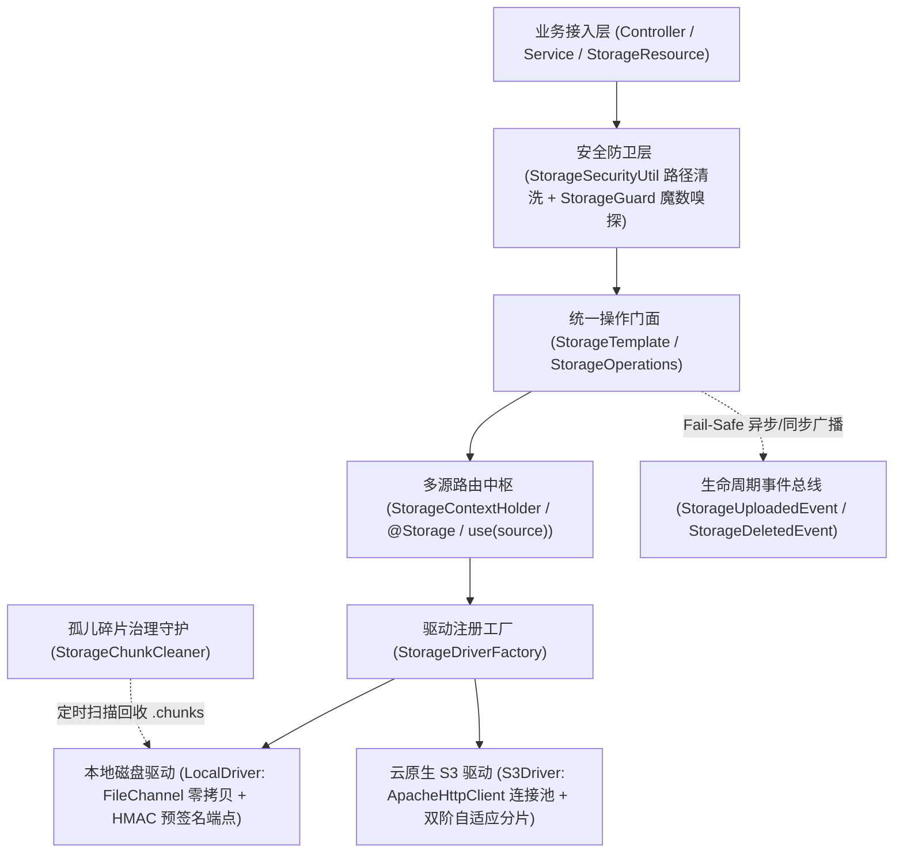

# ateng-boot-storage 基础设施 Starter

> 企业级轻量多源对象存储与安全预签名一体化 Starter，统一抽象 Local 本地磁盘存储与标准 S3 兼容协议（MinIO、RustFS、AWS S3、阿里云 OSS、腾讯云 COS、华为云 OBS），提供路径遍历安全防卫、文件魔数特征嗅探、双阶自适应流式上传防 OOM、极速流式散列计算与秒传、分片直传预签名、孤儿碎片治理守护、Spring Boot Actuator 健康探针与 Spring 原生资源深度集成，天然具备分布式幂等删除保障。

---

## 0. 特性与公共 API 全景速查矩阵 (Feature & API Panorama Matrix)

| 特性分类 | 特性名称 | 核心门面 / 注解 / SPI | 关键配置项 (`ateng.boot.*`) | 关键 API 签名 / 核心行为 | 锚定验证源头 (*Test / Sample) |
| :--- | :--- | :--- | :--- | :--- | :--- |
| **文件上传** | 流式与表单文件上传 | `StorageTemplate`<br>`StorageOperations`<br>`StorageProperties` | `ateng.boot.storage.enabled`<br>`ateng.boot.storage.type` | `upload(String, InputStream)` / `upload(String, InputStream, String, long)` / `upload(String, MultipartFile)` / `upload(MultipartFile)` / `upload(StorageUploadRequest)`，自动推导 MIME、日期归档路径生成并清洗边界 | `StorageTemplateTest` / `StorageObjectController` / `SampleStorageIntegrationTest` |
| **幂等防覆盖上传** | 同名防覆盖写入控制 | `StorageTemplate`<br>`StorageOperations`<br>`StorageResultCode` | - | `uploadIfAbsent(MultipartFile, String)` / `uploadIfAbsent(InputStream, String, String, long)` / `uploadIfAbsent(StorageUploadRequest)`，目标已存在时拒绝覆盖并抛出 `STORAGE_OBJECT_ALREADY_EXISTS` (40024) | `StorageTemplateTest` / `StorageObjectController` / `SampleStorageIntegrationTest` |
| **事务感知协同** | 提交后删除与回滚防孤儿清理 | `StorageTemplate`<br>`StorageOperations`<br>`TransactionUtil` | - | `uploadWithRollbackDelete(...)` / `registerRollbackDelete(String)` 在事务回滚时自动删除孤儿对象；`deleteAfterCommit(String)` / `deleteBatchAfterCommit(List<String>)` 在物理事务提交后延迟执行删除（无事务平滑降级） | `StorageTemplateTransactionTest` / `StorageObjectController` / `SampleStorageIntegrationTest` |
| **自定义元数据** | 对象业务扩展元数据注入 | `StorageTemplate`<br>`StorageOperations`<br>`StorageObject` | - | `upload(String, InputStream, Map<String, String>)` / `upload(String, InputStream, String, long, Map<String, String>)` / `upload(String, MultipartFile, Map<String, String>)`，携带扩展元数据并在 `StorageObject.getUserMetadata()` 反查 | `StorageTemplateTest` / `StorageObjectController` / `SampleStorageIntegrationTest` |
| **自适应上传防 OOM** | 未知流长双阶分片缓冲 | `StorageTemplate`<br>`StorageOperations`<br>`S3Driver` | `ateng.boot.storage.s3.*` | `upload(String, InputStream, String, -1L)`，彻底取缔 `readAllBytes()`，恒定 $\le 5\,\text{MB}$ 有界内存缓冲，首阶直传 / 次阶流式分片，异常自动熔断 `abortMultipartUpload` | `S3AdaptiveStreamingTest` / `StorageTransferController` / `SampleS3DualModeIntegrationTest` |
| **便捷载荷存取** | 文本/字节/JSON 强类型存取 | `StorageTemplate`<br>`StorageOperations` | - | `uploadString(String, String)` / `downloadString(String)` / `uploadBytes(String, byte[])` / `uploadBytes(String, byte[], String)` / `downloadBytes(String)` / `uploadJson(String, Object)` / `downloadJson(String, Class<T>)` | `StorageTemplateTest` / `StorageObjectController` / `SampleStorageIntegrationTest` |
| **对象复制与移动** | 跨路径/跨源复制与迁移 | `StorageTemplate`<br>`StorageOperations` | - | 同源零拷贝 `copy(String, String)` / `move(String, String)`；跨存储源流式传输 `copyTo(String, String, String)` / `moveTo(String, String, String)`，迁移先验落盘后幂等删源 | `StorageTemplateTest` / `StorageObjectController` / `SampleStorageIntegrationTest` / `SampleS3DualModeIntegrationTest` |
| **目录检索与分页** | 树状前缀列举与标准分页检索 | `StorageTemplate`<br>`StorageOperations`<br>`StorageObject` | - | `list(String)` / `list(String, boolean)` / `listPage(String, PageQuery)` / `listPage(String, PageQuery, boolean)`，统一区分文件与虚拟目录项并自动过滤 `.chunks` 系统隐藏项 | `StorageTemplateTest` / `StorageObjectController` / `SampleStorageIntegrationTest` |
| **天然幂等删除** | 单文件/批量/目录幂等删除 | `StorageTemplate`<br>`StorageOperations` | - | `delete(String)` / `deleteBatch(List<String>)` / `deleteDirectory(String)`，天然幂等语义，文件不存在亦平滑返回 `true` | `StorageTemplateTest` / `StorageObjectController` / `SampleStorageIntegrationTest` |
| **前缀批量删除** | 前缀级流式批量删除与熔断 | `StorageTemplate`<br>`StorageOperations` | - | `deletePrefix(String)`，流式切片批量清除指定前缀下的所有对象，前置强行熔断空前缀、根路径 `/` 与通配符防误删 | `StorageTemplateTest` / `LocalDriverTest` / `S3DriverTest` / `StorageObjectController` |
| **文件下载与探测** | 流式下载与存在性/元数据探测 | `StorageTemplate`<br>`StorageOperations`<br>`StorageObject` | - | `download(String)` (返回 `InputStream`) / `exists(String)` / `getMetadata(String)`，严格遵循 `try-with-resources` 资源确定性释放 | `StorageTemplateTest` / `StorageTransferController` / `SampleStorageIntegrationTest` |
| **Spring 原生集成** | 原生 WritableResource 断点续传 | `StorageResource`<br>`StorageTemplate` | `ateng.boot.storage.guard.max-file-size` | 实现 Spring `Resource` 与 `WritableResource`，支持 `storageTemplate.getResource(path)` 获得受管资源（`getOutputStream()` 具备幂等 `close()`、扩展名/魔数与字节上限 `40020` 守卫）与 HTTP Range `206` 响应 | `StorageResourceTest` / `StorageTransferController` / `SampleStorageIntegrationTest` |
| **字节范围读取** | 断点续传与音视频流 Seek | `StorageTemplate`<br>`StorageOperations` | - | `download(String, long, long)`，按需拉取指定起始偏移量与字节长度切片，S3 原生映射 HTTP Range 报头，Local 依托 `FileChannel.position` 零拷贝定位 | `StorageRangeAndPresignTest` / `StorageTransferController` / `SampleS3DualModeIntegrationTest` |
| **打包归档** | 多文件纯流式 ZIP 打包响应 | `StorageTemplate`<br>`StorageOperations` | - | `downloadAsZip(List<String>, OutputStream)` / `downloadAsZip(Map<String, String>, OutputStream)` / `downloadAsZip(List<String>, HttpServletResponse, String)`，零磁盘临时文件、重名自动消解与 RFC 5987 中文编码 | `StorageTemplateZipTest` / `StorageTransferController` / `SampleStorageIntegrationTest` |
| **流式散列与秒传** | 原生零拷贝流式散列计算 | `StorageHashUtil`<br>`HashAlgorithm`<br>`StorageTemplate` | - | `StorageHashUtil.sha256Hex(InputStream)` / `md5Hex` / `sha1Hex` / `crc32Hex` / `crc32` / `hashHex`；`storageTemplate.calculateHash(String, HashAlgorithm)`，流指针零截断与极速秒传指纹比对 | `StorageHashUtilTest` / `StorageTransferController` / `SampleStorageIntegrationTest` |
| **预签名只读** | 安全只读防盗链预签名外链 | `StorageTemplate`<br>`PresignedUrl`<br>`PresignedDownloadRequest` | `ateng.boot.storage.local.download-endpoint`<br>`ateng.boot.storage.local.secret-key` | `getPresignedUrl(String, Duration)` / `getPresignedUrl(String, Duration, String)` / `getPresignedUrl(PresignedDownloadRequest)`，支持 RFC 5987 友好中文下载文件名重写 | `StorageRangeAndPresignTest` / `LocalDriverTest` / `SampleS3DualModeIntegrationTest` |
| **客户端直传预签名** | 预签名安全直传写入外链凭据 | `StorageTemplate`<br>`PresignedUploadRequest`<br>`PresignedUrl` | `ateng.boot.storage.local.upload-endpoint` | `getPresignedUploadUrl(String, Duration)` / `getPresignedUploadUrl(PresignedUploadRequest)`，前端直接向存储端点发起 HTTP PUT 直传数据，完全绕过业务后端中转 | `LocalStorageUploadControllerTest` / `S3DriverTest` / `SampleStorageIntegrationTest` |
| **分片直传预签名** | 端侧大文件分块直传预签名 | `StorageTemplate`<br>`StorageOperations` | `ateng.boot.storage.local.upload-endpoint` | `getPresignedUploadPartUrl(String, String, int, Duration)`，生成指定分片 PUT 写入外链，前端并发直传各分片后通知后端一键合并 | `LocalStorageUploadControllerTest` / `S3DriverTest` / `SampleStorageIntegrationTest` |
| **公共读与永久直链** | 公开桶直链与公共读授权 | `StorageTemplate`<br>`StorageOperations` | `ateng.boot.storage.s3.domain`<br>`ateng.boot.storage.s3.path-style` | `getUrl(String)` 返回永久访问 URL；`uploadPublic(String, InputStream, ...)` / `uploadPublic(String, MultipartFile)` 自动挂载 `PUBLIC_READ`，三级拓扑自适应 | `StoragePublicUrlTest` / `S3DriverTest` / `SampleS3DualModeIntegrationTest` |
| **本地受控端点** | 本地文件安全下载与直传端点 | `LocalStorageDownloadController`<br>`LocalStorageUploadController` | `ateng.boot.storage.local.endpoint-enabled`<br>`ateng.boot.storage.local.download-endpoint`<br>`ateng.boot.storage.local.upload-endpoint`<br>`ateng.boot.storage.local.secret-key` | 提供 `/storage/local/download` 与 `/storage/local/upload`（同时承接带 `uploadId` 与 `chunkIndex` 参数的分片直传），支持 `endpoint-enabled` 开关，基于 HMAC-SHA256 常量时间验签 | `LocalStorageDownloadControllerTest` / `LocalStorageUploadControllerTest` / `SampleStorageIntegrationTest` |
| **分片上传状态机** | 服务端大文件分片合并暂存 | `StorageTemplate`<br>`StorageOperations`<br>`S3ChunkTokenUtil` | `ateng.boot.storage.max-chunk-size` | `initiateChunkedUpload(String)` / `uploadChunk(String, int, InputStream, long)` / `uploadChunk(String, int, byte[])` / `completeChunkedUpload(String, String, int)` / `abortChunkedUpload(String)`，1-based 连续性与 `max-chunk-size` 强校验 | `StorageTemplateChunkedTest` / `SampleStorageIntegrationTest` |
| **碎片治理守护** | 孤儿分片碎片生命周期治理 | `StorageChunkCleaner`<br>`StorageTemplate`<br>`ChunkCleanerProperties` | `ateng.boot.storage.chunk-cleaner.enabled`<br>`ateng.boot.storage.chunk-cleaner.interval`<br>`ateng.boot.storage.chunk-cleaner.max-age` | 后台守护定时扫描及门面手动方法 `cleanExpiredChunkSessions()` / `cleanExpiredChunkSessions(Duration)`，安全回收超期滞留的 `.chunks` 孤儿碎片目录 | `StorageChunkCleanerTest` |
| **文件安全防卫** | 文件类型与魔数嗅探防卫器 | `StorageGuard`<br>`StorageFileType`<br>`StorageGuardProperties` | `ateng.boot.storage.guard.enabled`<br>`ateng.boot.storage.guard.strict-magic-check`<br>`ateng.boot.storage.guard.allowed-extensions`<br>`ateng.boot.storage.guard.disallowed-extensions`<br>`ateng.boot.storage.guard.max-file-size` | 识别 15+ 种标准魔数与高危 PE/ELF/Shell 脚本特征，执行黑名单一票否决（40011，`validatePathAndExtension`）、单文件大小配额拦截（40020，`validateFileSize` / `resolveMaxFileSizeBytes`）与 `mark/reset` 零流截断魔数检验（40010） | `StorageGuardTest` / `StorageResourceTest` / `StorageGovernanceController` / `SampleStorageIntegrationTest` |
| **路径安全清洗** | 路径穿越防御与常量时间验签 | `StorageSecurityUtil`<br>`FileUtil` | - | `StorageSecurityUtil.normalizePath(String)` / `hmacSha256(String, String)` / `verifyHmacSha256(String, String, String)` / `isDangerousExtension(String)` 配合 `FileUtil.cleanFilename(String)`，拦截 `..` 逃逸、空字符与时序攻击 | `StorageSecurityUtilTest` |
| **多源路由调度** | 编程式与声明式多存储源路由 | `StorageTemplate`<br>`@Storage`<br>`StorageAspect`<br>`StorageSourceProperties` | `ateng.boot.storage.primary`<br>`ateng.boot.storage.sources.*` | `storageTemplate.use(String)` 返回绑定目标源的不可变操作门面；`@Storage("source")` AOP 自动切换并在 `finally` 严密恢复 | `StorageRoutingTest` / `SampleStorageIntegrationTest` |
| **多源作用域与透传** | 函数式切源与跨线程异步透传 | `StorageContextHolder`<br>`StorageAsyncContextSnapshotProvider`<br>`StorageTaskDecorator` | - | `executeWith(String, Supplier<T>)` / `runWith(String, Runnable)` 函数式作用域切源与自恢复；`set` / `get` / `getDataSource` / `clear` / `wrap` / `wrapSupplier` 配合 `StorageAsyncContextSnapshotProvider` 联动 Core 五维上下文跨线程透传 | `StorageContextHolderTest` / `AtengStorageAutoConfigurationTest` / `StorageGovernanceController` / `SampleStorageIntegrationTest` |
| **对象标签治理** | 对象业务标签完整生命周期 | `StorageTemplate`<br>`StorageOperations` | - | `setObjectTags(String, Map<String, String>)` / `getObjectTags(String)` / `deleteObjectTags(String)`，打通云端生命周期冷热归档与部门财务审计 | `StorageTaggingAndHardeningTest` / `SampleS3DualModeIntegrationTest` |
| **存储分层与加密** | 冷热分层与服务端加密支持 | `S3StorageProperties`<br>`StorageObject` | `ateng.boot.storage.s3.default-storage-class`<br>`ateng.boot.storage.s3.default-server-side-encryption` | 支持配置默认存储类型与服务端加密，并在 `StorageObject` 元数据反查 `storageClass` (`STANDARD`/`STANDARD_IA`/`GLACIER`) 与 `serverSideEncryption` (`AES256`/`aws:kms`) | `StorageTaggingAndHardeningTest` / `S3StoragePropertiesTest` / `SampleS3DualModeIntegrationTest` |
| **连接池与自愈建桶** | 生产级连接池、超时与桶自愈 | `S3Driver`<br>`S3StorageProperties` | `ateng.boot.storage.s3.connect-timeout`<br>`ateng.boot.storage.s3.socket-timeout`<br>`ateng.boot.storage.s3.api-call-timeout`<br>`ateng.boot.storage.s3.max-connections`<br>`ateng.boot.storage.s3.connection-acquisition-timeout`<br>`ateng.boot.storage.s3.auto-create-bucket` | 强类型 `Duration` 三级超时控制与 `ApacheHttpClient` 连接池并发治理；开启 `auto-create-bucket` 时遇 `404 NoSuchBucket` 自动完成建桶自愈 | `S3StoragePropertiesTest` / `StorageTaggingAndHardeningTest` |
| **双核驱动与工厂** | 存储驱动 SPI 与多源工厂 | `StorageDriver`<br>`LocalDriver`<br>`S3Driver`<br>`StorageDriverFactory`<br>`LocalStorageProperties` | `ateng.boot.storage.local.base-path`<br>`ateng.boot.storage.local.domain`<br>`ateng.boot.storage.s3.endpoint`<br>`ateng.boot.storage.s3.bucket` | 统一抽象本地磁盘文件系统与云原生 S3 兼容协议 SPI，支持下游通过 `StorageDriver` 扩展自定义存储后端 | `LocalDriverTest` / `S3DriverTest` |
| **健康探针与诊断** | Actuator 健康探针与运行时诊断 | `StorageHealthIndicator`<br>`StorageTemplate`<br>`StorageOperations` | `management.health.storage.enabled` | 深度集成 `/actuator/health`；提供 `storageTemplate.ping()` 实时连通探测与 `storageTemplate.getDiagnostics()` 连接池/配置指标提取 | `StorageHealthIndicatorTest` / `SampleStorageIntegrationTest` / `SampleS3DualModeIntegrationTest` |
| **事件与异常体系** | 生命周期事件与因果异常体系 | `StorageEvent`<br>`StorageUploadedEvent`<br>`StorageDeletedEvent`<br>`StorageException`<br>`StorageResultCode` | - | 上传与删除成功后广播 Spring 事件（Fail-Safe 异常隔离不阻断主链路）；底层 IO/SDK 异常统一转译为 `StorageException` 并 100% 保留原始 `cause` 因果链 | `StorageTemplateEventTest` / `StorageTemplateTest` / `SampleStorageIntegrationTest` |

---

## 1. 模块定位与 Maven 坐标

### 1.1 核心定位

`ateng-boot-storage` 是面向生产就绪的高内聚、轻量级多源对象存储基础设施模块：
- **纯净依赖**：仅必需依赖 `ateng-boot-core`，零冗余第三方工具包，Spring Web、Spring Boot Actuator、AWS SDK S3 与 Spring TX 均作为按需可选依赖（`optional`）；
- **双核驱动与多源路由**：统一抽象为 `LocalDriver`（本地磁盘文件系统）与 `S3Driver`（云原生 S3 兼容协议，精简版 AWS SDK v2 + Apache HTTP Client 连接池），支持平铺单源与 `sources.*` 命名多存储源动态切换；
- **显式契约与防卫闭环**：提供 `StorageTemplate` / `StorageOperations` 对称操作门面与 Spring 原生 `StorageResource`（实现 `Resource` 与 `WritableResource`），内置路径遍历清洗、文件魔数防伪装嗅探、未知流长双阶分片防 OOM 与分布式天然幂等删除。

### 1.2 Maven 引入坐标

**方式一：通过 `ateng-boot-bom` 统一纳管版本（推荐）**

```xml
<dependencyManagement>
    <dependencies>
        <dependency>
            <groupId>io.github.atengk</groupId>
            <artifactId>ateng-boot-bom</artifactId>
            <version>1.2.0</version>
            <type>pom</type>
            <scope>import</scope>
        </dependency>
    </dependencies>
</dependencyManagement>

<dependencies>
    <dependency>
        <groupId>io.github.atengk</groupId>
        <artifactId>ateng-boot-storage</artifactId>
    </dependency>
    <!-- 可选：需要接入云原生 S3 协议（MinIO / RustFS / AWS S3 / OSS）时按需引入 -->
    <dependency>
        <groupId>software.amazon.awssdk</groupId>
        <artifactId>s3</artifactId>
    </dependency>
    <dependency>
        <groupId>software.amazon.awssdk</groupId>
        <artifactId>apache-client</artifactId>
    </dependency>
    <!-- 可选：需要启用事务提交后延迟删除或回滚防孤儿清理时确保已引入 spring-tx -->
    <dependency>
        <groupId>org.springframework</groupId>
        <artifactId>spring-tx</artifactId>
    </dependency>
</dependencies>
```

**方式二：独立显式版本号引入**

```xml
<dependencies>
    <dependency>
        <groupId>io.github.atengk</groupId>
        <artifactId>ateng-boot-storage</artifactId>
        <version>1.2.0</version>
    </dependency>
</dependencies>
```

### 1.3 最小可用配置与极简实战代码

无需外部中间件即可默认启用 `LocalDriver`，只需指定根目录与基准域名即可直接注入 `StorageTemplate` 上传与读取对象：

```yaml
ateng:
  boot:
    storage:
      enabled: true
      type: local
      local:
        base-path: /data/storage
        domain: http://localhost:8080
        secret-key: YOUR_HMAC_SECRET_KEY
```

```java
@RestController
@RequestMapping("/sample/storage/object")
@RequiredArgsConstructor
public class StorageObjectController {

    private final StorageTemplate storageTemplate;

    @PostMapping("/upload-quick")
    public Result<StorageObject> uploadQuick(
            @RequestParam("file") @NotNull(message = "上传文件不能为空") MultipartFile file) {
        StorageObject object = storageTemplate.upload(file);
        return Result.success(object);
    }
}
```

---

## 2. 核心架构与设计不变量

### 2.1 双核驱动与多源路由全链路架构



### 2.2 六大核心设计不变量 (Core Design Invariants)

1. **流指针零截断不变量 (Zero-Stream-Truncation Invariant)**：`StorageGuard` 执行文件头部魔数特征嗅探时，强制依托 `BufferedInputStream.mark(512)` 与 `reset()` 精准复位流指针；`StorageHashUtil` 采用 8KB 定长缓冲区分块流式计算散列，确保下游存储驱动读取到 100% 完整的原始字节流。
2. **双阶自适应有界内存防 OOM 不变量 (Bounded-Memory Adaptive Streaming Invariant)**：面对未知长度输入流（`size < 0`），彻底取缔 `InputStream.readAllBytes()`，在 `S3Driver` 内部维持恒定 $\le 5\,\text{MB}$ 有界内存缓冲区；流总长 $\le 5\,\text{MB}$ 时单次 `PutObject` 一步直传，超过 $5\,\text{MB}$ 时自动无缝升阶为 S3 Multipart Upload 流式分片上传，任何中途异常自动触发 `abortMultipartUpload` 熔断清理云端碎片。
3. **分布式天然幂等删除与防误删熔断不变量 (Idempotent Delete & Anti-Purge Fuse Invariant)**：`delete`、`deleteBatch`、`deleteDirectory`、`deleteObjectTags` 天然幂等，目标不存在时静默返回成功，绝不抛出 404 阻断分布式重试；`deletePrefix` 与 `deleteDirectory` 内置前置强校验，凡遇到空字符串、空白符、根路径 `/` 或通配符 `*` 立即抛出 `StorageException(StorageResultCode.INVALID_PATH)` 强行熔断，杜绝误删全盘或整个存储桶。
4. **确定性生命周期与句柄零泄漏不变量 (Deterministic Resource Cleanup Invariant)**：所有文件流、NIO `FileChannel`、S3 `ResponseInputStream` 及 `ZipOutputStream` 均在 `try-with-resources` 中闭环管理；大文件流式 ZIP 打包（`downloadAsZip`）全程基于内存流边读边压，零物理临时文件落盘，且在写出前强制执行全量文件存在性预检。
5. **路径归一化与常量时间防时序攻击不变量 (Path Normalization & Constant-Time Verification Invariant)**：`StorageSecurityUtil` 前置拦截 `\0` 空字符、Windows 盘符与 `..` 相对路径穿越逃逸；本地预签名外链（`/storage/local/download` 与 `/storage/local/upload`）统一使用 HMAC-SHA256 签名并经由 `MessageDigest.isEqual` 常量时间比对，彻底阻断时序侧信道攻击。
6. **因果异常体系与 Fail-Safe 事件隔离不变量 (Causal Exception & Fail-Safe Event Invariant)**：底层 IO 异常与 AWS SDK 异常在驱动边界统一转译为携带 `StorageResultCode` 的 `StorageException` 并 100% 保留原始 `cause` 堆栈；上传与删除成功后触发的 `StorageUploadedEvent` / `StorageDeletedEvent` 采用 Fail-Safe 异常隔离，任何外部监听器抛出的异常仅记录告警日志，绝不逆向污染或中断主业务写入链路。

---

## 3. 核心对象存取、自适应防 OOM 与生命周期治理

本章围绕**企业电子合同与档案管理**业务场景，演示标准表单上传、自定义业务元数据注入、未知流长双阶自适应流式上传防 OOM、常用载荷（批注文本与审计快照 JSON）便捷读写、跨路径零拷贝复制与归档移动、目录树分页检索及天然幂等删除。

### 3.1 表单/流式上传、单参快捷归档与幂等防覆盖 (`upload` / `uploadIfAbsent` / `userMetadata`)

#### 本节专属 YAML 配置
```yaml
ateng:
  boot:
    storage:
      enabled: true                         # 开启存储模块自动装配（默认 true）
      type: local                           # 默认存储驱动类型：local 或 s3（默认 local）
      local:
        base-path: /data/storage            # 本地存储根目录物理路径（默认系统临时目录）
        domain: http://localhost:8080       # 本地存储对外访问基准域名
```

#### 实战业务代码范式
```java
@RestController
@RequestMapping("/sample/storage/object")
@RequiredArgsConstructor
public class StorageObjectController {

    private final StorageTemplate storageTemplate;

    // 1. 上传电子合同文件（自动执行路径归一化、创建父目录与 MIME 推导）
    @PostMapping("/upload")
    public Result<StorageObject> upload(
            @RequestParam("file") @NotNull(message = "上传文件不能为空") MultipartFile file,
            @RequestParam(value = "path", required = false) String path) {
        String targetPath = (path != null && !path.isBlank()) ? path : file.getOriginalFilename();
        StorageObject object = storageTemplate.upload(targetPath, file);
        return Result.success(object);
    }

    // 2. 单参快捷上传电子合同（自动生成 yyyy/MM/dd/{uuid}.{ext} 日期归档安全路径）
    @PostMapping("/upload-quick")
    public Result<StorageObject> uploadQuick(
            @RequestParam("file") @NotNull(message = "上传文件不能为空") MultipartFile file) {
        StorageObject object = storageTemplate.upload(file);
        return Result.success(object);
    }

    // 3. 幂等防覆盖上传（目标路径已存在时抛出 STORAGE_OBJECT_ALREADY_EXISTS 40024 阻断）
    @PostMapping("/upload-if-absent")
    public Result<StorageObject> uploadIfAbsent(
            @RequestParam("file") @NotNull(message = "上传文件不能为空") MultipartFile file,
            @RequestParam("path") @NotBlank(message = "目标路径不能为空") String path) {
        StorageObject object = storageTemplate.uploadIfAbsent(file, path);
        return Result.success(object);
    }

    // 4. 上传电子合同并注入自定义业务扩展元数据（如合同编号、签署人、归属部门）
    @PostMapping("/upload-with-metadata")
    public Result<StorageObject> uploadWithMetadata(
            @RequestParam("file") @NotNull(message = "上传文件不能为空") MultipartFile file,
            @RequestParam("path") @NotBlank(message = "目标路径不能为空") String path,
            @RequestParam Map<String, String> userMetadata) {
        Map<String, String> customMeta = new HashMap<>(userMetadata);
        customMeta.remove("path");
        StorageObject object = storageTemplate.upload(path, file, customMeta);
        return Result.success(object);
    }
}
```

#### 核心机制与边界防御
- **路径穿越自动净化**：`MultipartFile.getOriginalFilename()` 由 `FileUtil.cleanFilename` 剥离客户端伪造的父目录前缀（如 `../../evil.jsp`）并经 `StorageSecurityUtil.normalizePath` 清洗归一化，防止目录穿越覆写系统文件。
- **幂等防覆盖原语 (`uploadIfAbsent`)**：S3 驱动原生映射 `IfNoneMatch("*")` 条件 PUT 原子语义，Local 驱动采用 `StandardOpenOption.CREATE_NEW` 原子建档语义；冲突时统一转译抛出 `40024`（`STORAGE_OBJECT_ALREADY_EXISTS`），绝不覆盖历史关键存证。
- **自定义元数据跨介质边界**：
  - **S3 协议驱动**：`userMetadata` 原生映射为云端对象自定义请求头（`x-amz-meta-*`）并永久持久化，后续随时调用 `storageTemplate.getMetadata(path)` 均可完整反查；
  - **Local 磁盘驱动**：因跨平台文件系统无统一扩展属性标准，`userMetadata` 随本次上传返回的 `StorageObject` 即时回传；若需在 Local 模式下长期检索业务扩展属性，建议由业务数据库落库维护。

---

### 3.2 未知流长双阶自适应流式分片上传 (`size = -1` 恒定 $\le 5\,\text{MB}$ 防 OOM)

#### 本节专属 YAML 配置
```yaml
ateng:
  boot:
    storage:
      enabled: true
      sources:
        s3:
          type: s3
          s3:
            endpoint: http://127.0.0.1:9000     # S3 兼容服务端点（RustFS / MinIO / OSS）
            bucket: ateng-bucket                # 目标存储桶名称
            access-key: YOUR_ACCESS_KEY         # 访问密钥 AccessKey
            secret-key: YOUR_SECRET_KEY         # 私有密钥 SecretKey
            path-style: true                    # 自建存储推荐开启 Path-Style 模式
            api-call-timeout: 60s               # 单次 S3 API 调用总体硬超时（默认 60s）
```

#### 实战业务代码范式
```java
@PostMapping("/upload-adaptive")
public Result<StorageObject> uploadAdaptive(
        @RequestParam("path") @NotBlank(message = "目标路径不能为空") String path,
        @RequestParam("content") @NotNull(message = "流数据内容不能为空") String content,
        @RequestParam(value = "contentType", defaultValue = "text/plain") String contentType,
        @RequestParam(value = "source", defaultValue = "s3") String source) {
    byte[] payload = content.getBytes(StandardCharsets.UTF_8);
    try (ByteArrayInputStream in = new ByteArrayInputStream(payload)) {
        // size 传 -1L：<=5MB 一步直传，>5MB 自动升阶为 S3 Multipart Upload 流式分片上传
        return Result.success(storageTemplate.use(source).upload(path, in, contentType, -1L));
    } catch (IOException e) {
        throw new StorageException(StorageResultCode.UPLOAD_FAILED, "自适应流式上传失败: " + path, e);
    }
}
```

#### 核心机制与边界防御
- **首阶直传与次阶流式分片自动切换**：当调用方传入 `size = -1L` 时，`S3Driver` 先拉取最多 $5\,\text{MB}$ 数据至有界缓冲区；若流在 $5\,\text{MB}$ 内读尽，直接执行单次 `PutObject` 一步上传（零多余 RPC 开销）；若流大小超过 $5\,\text{MB}$，自动激活 S3 Multipart Upload，按 $5\,\text{MB}$ 标准分片流式推向云端并自动合并。
- **异常确定性熔断回收**：若在流式分片上传中途发生网络中断或上游流异常，`catch` 块强制触发 `abortMultipartUpload` 立即清理云端已上传的孤儿分片，杜绝存储空间隐形泄漏。

---

### 3.3 常用载荷便捷存取 (`uploadString` / `uploadBytes` / `uploadJson`)

#### 本节专属 YAML 配置
```yaml
ateng:
  boot:
    storage:
      enabled: true
      type: local
      local:
        base-path: /data/storage            # 合同批注与 JSON 审计快照本地归档根目录
```

#### 实战业务代码范式
```java
// 1. 电子合同归档审计快照强类型 DTO/VO（挂载 JSR-303 校验注解）
@Data
@Builder
@NoArgsConstructor
@AllArgsConstructor
public class ContractAuditSnapshot {
    @NotBlank(message = "合同编号不能为空")
    private String contractNo;
    @NotBlank(message = "合同标题不能为空")
    private String title;
    @NotBlank(message = "签署负责人不能为空")
    private String signer;
    @NotBlank(message = "归属部门不能为空")
    private String department;
    private String auditStatus;
}

// 2. Controller 便捷读写合同批注文本与审计快照 JSON
@PostMapping("/write-string")
public Result<StorageObject> writeString(@RequestParam("path") @NotBlank String path,
                                         @RequestParam("content") @NotNull String content) {
    return Result.success(storageTemplate.uploadString(path, content));
}

@PostMapping("/write-json")
public Result<StorageObject> writeJson(@RequestParam("path") @NotBlank String path,
                                       @Valid @NotNull @RequestBody ContractAuditSnapshot snapshot) {
    return Result.success(storageTemplate.uploadJson(path, snapshot));
}

@GetMapping("/read-json")
public Result<ContractAuditSnapshot> readJson(@RequestParam("path") @NotBlank String path) {
    ContractAuditSnapshot snapshot = storageTemplate.downloadJson(path, ContractAuditSnapshot.class);
    return Result.success(snapshot);
}
```

#### 核心机制与边界防御
- **底座序列化收敛**：`uploadJson` / `downloadJson` 100% 复用 `ateng-boot-core` 的 `JsonUtil` 门面，自动绑定 `application/json;charset=UTF-8`；`uploadString` / `downloadString` 默认采用 `StandardCharsets.UTF_8` 与 `text/plain;charset=UTF-8`，彻底免除业务层手动创建 `ByteArrayInputStream` 的样板代码。
- **空安全与前置校验**：写入 `null` 载荷时前置快速失败抛出 `StorageException(StorageResultCode.UPLOAD_FAILED)`，路径为空或含越界字符时抛出 `StorageException(StorageResultCode.INVALID_PATH)`。

---

### 3.4 跨路径与跨存储源零拷贝复制及原子归档移动 (`copy` / `move` / `copyTo` / `moveTo`)

#### 本节专属 YAML 配置
```yaml
ateng:
  boot:
    storage:
      enabled: true
      primary: default
      sources:
        default:
          type: local
          local:
            base-path: /data/storage        # 主存储源目录
        backup:
          type: local
          local:
            base-path: /data/backup         # 跨源冷备归档目录
```

#### 实战业务代码范式
```java
// 1. 同源跨路径零拷贝生成合同副本（保留原文件）
@PostMapping("/copy")
public Result<Boolean> copy(
        @RequestParam("sourcePath") @NotBlank(message = "源路径不能为空") String sourcePath,
        @RequestParam("targetPath") @NotBlank(message = "目标路径不能为空") String targetPath) {
    boolean success = storageTemplate.copy(sourcePath, targetPath);
    return Result.success(success);
}

// 2. 同源将签署完成的合同从 staging 暂存区原子归档至 archive 正式区（自动移除源文件）
@PostMapping("/move")
public Result<Boolean> move(
        @RequestParam("sourcePath") @NotBlank(message = "源路径不能为空") String sourcePath,
        @RequestParam("targetPath") @NotBlank(message = "目标路径不能为空") String targetPath) {
    boolean success = storageTemplate.move(sourcePath, targetPath);
    return Result.success(success);
}

// 3. 跨存储源流式复制对象（例如从本地 default 源跨介质复制至 backup 或 s3 云存储）
@PostMapping("/copy-to")
public Result<StorageObject> copyTo(
        @RequestParam("sourcePath") @NotBlank(message = "源路径不能为空") String sourcePath,
        @RequestParam("targetSourceKey") @NotBlank(message = "目标存储源标识不能为空") String targetSourceKey,
        @RequestParam("targetPath") @NotBlank(message = "目标路径不能为空") String targetPath) {
    StorageObject copied = storageTemplate.copyTo(sourcePath, targetSourceKey, targetPath);
    return Result.success(copied);
}

// 4. 跨存储源流式迁移对象（先验证写入目标存储源成功，再幂等清除源对象）
@PostMapping("/move-to")
public Result<StorageObject> moveTo(
        @RequestParam("sourcePath") @NotBlank(message = "源路径不能为空") String sourcePath,
        @RequestParam("targetSourceKey") @NotBlank(message = "目标存储源标识不能为空") String targetSourceKey,
        @RequestParam("targetPath") @NotBlank(message = "目标路径不能为空") String targetPath) {
    StorageObject moved = storageTemplate.moveTo(sourcePath, targetSourceKey, targetPath);
    return Result.success(moved);
}
```

#### 核心机制与边界防御
- **同源免流复制与 NIO 零拷贝**：`S3Driver.copy` 直接调用 S3 服务端 `CopyObject` 指令，数据无需流经应用服务器内存或占用公网带宽；`LocalDriver.copy` 采用 `Files.copy(..., StandardCopyOption.REPLACE_EXISTING)` 内核态零拷贝并自动创建目标父目录。
- **跨源流式桥接与防丢失迁移 (`copyTo` / `moveTo`)**：自动提取源对象元数据（`size`、`contentType`、`userMetadata`）并以流式透传写入目标存储源；`moveTo` 严格遵守“先落盘确认目标写入成功、再幂等删除源对象”的两阶段语义，防止网络中断引发数据双丢。
- **事件完整闭环**：`copy` / `copyTo` 成功后广播目标路径 `StorageUploadedEvent`；`move` / `moveTo` 成功后依次广播目标路径 `StorageUploadedEvent` 与源路径 `StorageDeletedEvent`，确保下游审计日志与缓存状态绝对同步。

---

### 3.5 目录树层级列举与 `PageQuery` 标准分页检索 (`list` / `listPage`)

#### 本节专属 YAML 配置
```yaml
ateng:
  boot:
    storage:
      enabled: true
      type: local
      local:
        base-path: /data/storage            # 自动过滤 .chunks 分片目录与系统隐藏文件
```

#### 实战业务代码范式
```java
// 1. 平铺或递归列举指定归档目录前缀下的合同对象
@GetMapping("/list")
public Result<List<StorageObject>> list(
        @RequestParam(value = "prefix", required = false) String prefix,
        @RequestParam(value = "recursive", defaultValue = "false") boolean recursive) {
    List<StorageObject> list = storageTemplate.list(prefix, recursive);
    return Result.success(list);
}

// 2. 结合 ateng-boot-core 标准 PageQuery / PageResult 分页检索
@GetMapping("/list-page")
public Result<PageResult<StorageObject>> listPage(
        @RequestParam(value = "prefix", required = false) String prefix,
        @Valid @ModelAttribute PageQuery pageQuery,
        @RequestParam(value = "recursive", defaultValue = "false") boolean recursive) {
    PageResult<StorageObject> pageResult = storageTemplate.listPage(prefix, pageQuery, recursive);
    return Result.success(pageResult);
}
```

#### 核心机制与边界防御
- **虚拟目录与文件统一建模**：非递归列举（`recursive = false`）时，子目录统一封装为 `StorageObject`（`directory = true`、`size = 0L`），消除 S3 虚拟公共前缀（`CommonPrefixes`）与本地物理文件夹的模型差异。
- **隐性系统文件自动过滤**：列举过程自动过滤以 `.` 开头的隐藏文件及 `.chunks` 分片暂存目录，且无匹配结果时保底返回 `Collections.emptyList()`，绝不返回 `null`。

---

### 3.6 分布式天然幂等删除与前缀防误删安全熔断 (`delete` / `deleteBatch` / `deletePrefix` / `deleteDirectory`)

#### 本节专属 YAML 配置
```yaml
ateng:
  boot:
    storage:
      enabled: true
      type: local
      local:
        base-path: /data/storage
```

#### 实战业务代码范式
```java
// 1. 单文件天然幂等删除（目标不存在亦平滑返回 true，绝不抛 404 中断重试）
@PostMapping("/delete")
public Result<Boolean> delete(@RequestParam("path") @NotBlank(message = "删除路径不能为空") String path) {
    return Result.success(storageTemplate.delete(path));
}

// 2. 按业务批次前缀流式批量清理（内置空前缀與根路径防误删熔断）
@PostMapping("/delete-prefix")
public Result<Boolean> deletePrefix(@RequestParam("prefix") @NotBlank(message = "删除前缀不能为空") String prefix) {
    return Result.success(storageTemplate.deletePrefix(prefix));
}

// 3. 级联清理整个过期归档目录
@PostMapping("/delete-directory")
public Result<Boolean> deleteDirectory(@RequestParam("dirPath") @NotBlank(message = "目录路径不能为空") String dirPath) {
    return Result.success(storageTemplate.deleteDirectory(dirPath));
}
```

#### 核心机制与边界防御
- **防删库强行熔断 (Anti-Purge Fuse)**：`deletePrefix` 与 `deleteDirectory` 在进入驱动层前执行严格卫语句校验，若传入空串 `""`、纯空格 `"   "`、根路径 `"/"` 或包含通配符 `"*"`，立即抛出 `StorageException(StorageResultCode.INVALID_PATH)` 强行阻断，防止误清空整个存储桶。
- **分批流式清理**：`S3Driver.deletePrefix` 结合 `deleteBatch` 将匹配对象分批提交至 S3 Multi-Object Delete API，避免单次加载海量对象引发内存溢出。

---

### 3.7 Spring 事务感知存储协同（回滚防孤儿清理与提交后延迟删除）

#### 本节专属 YAML 配置
```yaml
ateng:
  boot:
    storage:
      enabled: true
      type: local
      local:
        base-path: /data/storage            # 配合 spring-tx 事务同步器实现最终一致性
```

#### 实战业务代码范式
```java
// 1. 事务感知防孤儿上传：事务提交则永久保留；若事务中途异常回滚，自动物理清理已落盘的孤儿文件
@PostMapping("/upload-with-rollback-delete")
public Result<StorageObject> uploadWithRollbackDelete(
        @RequestParam("file") @NotNull(message = "上传文件不能为空") MultipartFile file,
        @RequestParam("path") @NotBlank(message = "目标路径不能为空") String path,
        @RequestParam(value = "simulateFailure", defaultValue = "false") boolean simulateFailure) {
    StorageObject uploaded = transactionTemplate.execute(status -> {
        StorageObject object = storageTemplate.uploadWithRollbackDelete(file, path);
        if (simulateFailure) {
            throw new StorageException(StorageResultCode.OPERATION_FAILED, "模拟业务事务失败，触发回滚删除孤儿文件: " + path);
        }
        return object;
    });
    return Result.success(uploaded);
}

// 2. 事务提交后延迟删除：确保数据库事务尚未提交前文件仍可读；回滚则完整保留，提交后立即清理
@PostMapping("/delete-after-commit")
public Result<Boolean> deleteAfterCommit(
        @RequestParam("path") @NotBlank(message = "目标路径不能为空") String path,
        @RequestParam(value = "simulateFailure", defaultValue = "false") boolean simulateFailure) {
    transactionTemplate.executeWithoutResult(status -> {
        storageTemplate.deleteAfterCommit(path);
        if (simulateFailure) {
            throw new StorageException(StorageResultCode.OPERATION_FAILED, "模拟业务事务失败，取消提交后删除: " + path);
        }
    });
    return Result.success(Boolean.TRUE);
}
```

#### 核心机制与边界防御
- **源句柄固化绑定**：注册 `registerRollbackDelete` 或 `deleteAfterCommit` / `deleteBatchAfterCommit` 时，内部立即捕获并锁定当时的受管存储源句柄（`captureBoundHandle()`），即便事务收尾回调在切源作用域之外触发，也绝不会删错存储源。
- **无事务平滑降级与异常隔离**：底层基于 `ateng-boot-core` `TransactionUtil` 联动 `TransactionSynchronizationManager`；若当前不存在活跃事务或未引入 `spring-tx`，`deleteAfterCommit` 平滑降级为就地同步删除，`registerRollbackDelete` 安全跳过；事务收尾阶段执行物理清理若发生异常，内部捕获记录错误日志，绝不逆向冲击主事务收尾状态。

---

## 4. 流式下载、Spring Resource 断点续传与批量归档

本章围绕**电子合同流式调阅、大文件音视频/日志分段加载、多份财务凭证打包下载与企业知识库文档秒传**场景，展示零临时文件流式传输体系。

### 4.1 基础流式下载、存在性探测与确定性资源释放 (`download` / `exists` / `getMetadata`)

#### 本节专属 YAML 配置
```yaml
ateng:
  boot:
    storage:
      enabled: true
      type: local
      local:
        base-path: /data/storage
```

#### 实战业务代码范式
```java
public byte[] inspectAndReadContract(String path) {
    // 1. 轻量级存在性探测与元数据提取（不拉取文件实体流）
    if (!storageTemplate.exists(path)) {
        throw new StorageException(StorageResultCode.OBJECT_NOT_FOUND, "合同文件不存在: " + path);
    }
    StorageObject metadata = storageTemplate.getMetadata(path);
    log.info("准备读取合同: path={}, size={}, etag={}", metadata.getPath(), metadata.getSize(), metadata.getEtag());

    // 2. 流式下载并在 try-with-resources 中确保底层句柄与 HTTP 连接确定性释放
    try (InputStream in = storageTemplate.download(path)) {
        return in.readAllBytes();
    } catch (IOException e) {
        throw new StorageException(StorageResultCode.DOWNLOAD_FAILED, "读取合同流失败: " + path, e);
    }
}
```

#### 核心机制与边界防御
- **确定性连接归还**：`S3Driver.download(path)` 返回底层 `ResponseInputStream<GetObjectResponse>`，直接持有 Apache HTTP Client 连接池租约；调用方**必须**将其置于 `try-with-resources` 中关闭，否则将导致 HTTP 连接池耗尽悬挂。
- **精准异常语义**：当目标对象不存在时，`download` 与 `getMetadata` 统一抛出 `StorageException(StorageResultCode.OBJECT_NOT_FOUND)`（错误码 `50001`）。

---

### 4.2 Spring 原生 `StorageResource` 适配与 HTTP Range 206 断点续传

#### 本节专属 YAML 配置
```yaml
ateng:
  boot:
    storage:
      enabled: true
      type: local
      local:
        base-path: /data/storage
```

#### 实战业务代码范式
```java
@RestController
@RequestMapping("/sample/storage/transfer")
@RequiredArgsConstructor
public class StorageTransferController {

    private final StorageTemplate storageTemplate;

    /**
     * 流式下载存储对象（桥接 Spring StorageResource，原生支持 HTTP Range 206 Partial Content 断点续传）
     */
    @GetMapping("/download")
    public ResponseEntity<Resource> download(@RequestParam("path") @NotBlank(message = "下载路径不能为空") String path) throws IOException {
        StorageResource resource = storageTemplate.getResource(path);
        String filename = resource.getFilename();
        String encodedFilename = URLEncoder.encode(filename, StandardCharsets.UTF_8).replace("+", "%20");

        return ResponseEntity.ok()
                .header(HttpHeaders.CONTENT_DISPOSITION, "attachment; filename=\"" + encodedFilename + "\"; filename*=UTF-8''" + encodedFilename)
                .contentType(MediaType.parseMediaType(resource.getContentType()))
                .contentLength(resource.contentLength())
                .body(resource);
    }
}
```

#### 核心机制与边界防御
- **零样板代码支持 HTTP 206**：`StorageResource` 完整实现 Spring `Resource` 与 `WritableResource` 契约；当客户端携带 `Range: bytes=0-1023` 请求头时，Spring MVC `ResourceHttpMessageConverter` 自动识别并输出 `HTTP 206 Partial Content` 字节切片流。
- **延迟元数据缓存**：`StorageResource` 内部对 `StorageObject` 元数据采用按需懒加载缓存，避免在一次响应周期内重复调用 `contentLength()`、`getContentType()`、`lastModified()` 时发起多次远程 `HeadObject` 请求。

---

### 4.3 分段切片字节范围读取 (`download(path, startOffset, length)` 视频流 Seek)

#### 本节专属 YAML 配置
```yaml
ateng:
  boot:
    storage:
      enabled: true
      sources:
        s3:
          type: s3
          s3:
            endpoint: http://127.0.0.1:9000
            bucket: ateng-bucket
            access-key: YOUR_ACCESS_KEY
            secret-key: YOUR_SECRET_KEY
            socket-timeout: 30s                 # 流式切片读取 Socket 超时（默认 30s）
```

#### 实战业务代码范式
```java
@GetMapping("/download-range")
public Result<String> downloadRange(
        @RequestParam("path") @NotBlank(message = "下载路径不能为空") String path,
        @RequestParam("startOffset") @Min(value = 0, message = "起始偏移量不能为负数") long startOffset,
        @RequestParam("length") @Min(value = 1, message = "读取长度必须大于 0") long length,
        @RequestParam(value = "source", defaultValue = "s3") String source) {
    try (InputStream in = storageTemplate.use(source).download(path, startOffset, length)) {
        return Result.success(new String(in.readAllBytes(), StandardCharsets.UTF_8));
    } catch (StorageException se) {
        throw se;
    } catch (Exception e) {
        throw new StorageException(StorageResultCode.DOWNLOAD_FAILED, "读取分段字节范围失败: " + path, e);
    }
}
```

#### 核心机制与边界防御
- **双核原生按需寻址**：`S3Driver` 自动组装标准 `Range: bytes={startOffset}-{startOffset + length - 1}` 请求头，云端仅回传目标区间字节；`LocalDriver` 依托 `FileChannel.position(startOffset)` 结合有界流包装器按需读取，无需跳过前置字节。
- **非法区间前置阻断**：凡 `startOffset < 0` 或 `length <= 0`，在门面层立即抛出 `StorageException(StorageResultCode.OPERATION_FAILED)`。

---

### 4.4 多文件零临时文件纯流式打包 ZIP 响应 (`downloadAsZip`)

#### 本节专属 YAML 配置
```yaml
ateng:
  boot:
    storage:
      enabled: true
      type: local
      local:
        base-path: /data/storage
```

#### 实战业务代码范式
```java
/**
 * 多份财务凭证零磁盘临时文件纯流式打包 ZIP 响应下载（内置同名条目自动递增消解与 RFC 5987 中文编码）
 */
@GetMapping("/download-zip")
public void downloadZip(
        @RequestParam("paths") @NotEmpty(message = "打包路径列表不能为空") List<@NotBlank(message = "打包路径不能为空") String> paths,
        @RequestParam(value = "zipFilename", defaultValue = "2026Q1_vouchers.zip") String zipFilename,
        HttpServletResponse response) {
    storageTemplate.downloadAsZip(paths, response, zipFilename);
}
```

#### 核心机制与边界防御
- **前置完整性预检 (Pre-Flight Existence Check)**：在向 `HttpServletResponse` 刷出任何响应头或字节之前，`downloadAsZip` 先遍历校验所有待打包路径的存在性；只要有一个文件缺失，立即抛出 `StorageException(StorageResultCode.OBJECT_NOT_FOUND)` 并由全局异常处理器返回标准错误 JSON，杜绝向客户端输出半截损坏的 ZIP 归档包。
- **重名冲突自动消解**：当不同目录下的同名文件（如 `deptA/voucher.pdf` 与 `deptB/voucher.pdf`）被平铺打包至同一 ZIP 时，内部自动递增重命名为 `voucher (1).pdf`，避免 `ZipException: duplicate entry` 崩溃。

---

### 4.5 原生零拷贝流式散列计算 (`StorageHashUtil`) 与极速秒传闭环

#### 本节专属 YAML 配置
```yaml
ateng:
  boot:
    storage:
      enabled: true
      type: local
      local:
        base-path: /data/storage
```

#### 实战业务代码范式
```java
// 1. 流式零拷贝计算已存储对象的散列哈希指纹（支持 MD5, SHA1, SHA256, CRC32）
@GetMapping("/hash")
public Result<String> calculateHash(
        @RequestParam("path") @NotBlank(message = "目标路径不能为空") String path,
        @RequestParam(value = "algorithm", defaultValue = "SHA256") HashAlgorithm algorithm) {
    String hash = storageTemplate.calculateHash(path, algorithm);
    return Result.success(hash);
}

// 2. 企业知识库文档极速秒传接口：命中指纹池直接零拷贝 copy 落盘，未命中返回 40404 引导前端直传
@PostMapping("/fast-upload")
public Result<StorageObject> fastUpload(
        @RequestParam("targetPath") @NotBlank(message = "目标路径不能为空") String targetPath,
        @RequestParam("hash") @NotBlank(message = "散列哈希不能为空") String hash) {
    String poolSourcePath = "hash-pool/" + hash + ".dat";
    if (!storageTemplate.exists(poolSourcePath)) {
        return Result.fail(TransferResultCode.FAST_UPLOAD_MISSED); // code=40404
    }
    storageTemplate.copy(poolSourcePath, targetPath);
    return Result.success(storageTemplate.getMetadata(targetPath));
}
```

#### 核心机制与边界防御
- **定长分块流式吞吐**：`StorageHashUtil` 100% 基于 JDK 原生 `MessageDigest` 与 `CRC32`，通过 `8192` 字节定长缓冲区分块读取，计算 GB 级大文件散列时堆内存占用恒定为 KB 级，彻底免疫 OOM。
- **秒传零网络上传开销**：秒传命中后直接调用 `storageTemplate.copy(poolSourcePath, targetPath)` 完成服务端零拷贝复用，毫秒级返回完整 `StorageObject` 元数据。

---

## 5. 预签名安全外链、客户端直传与公共读永久直链

本章围绕**电子凭证受控安全分享、大文件绕过应用服务器直传以及公开静态多媒体素材直链访问**等典型生产场景，演示 Local 磁盘与云原生 S3 兼容协议在预签名外链与永久直链方面的统一抽象门面。

### 5.1 预签名只读防盗链安全外链 (`getPresignedUrl`)

#### 本节专属 YAML 配置
```yaml
ateng:
  boot:
    storage:
      enabled: true
      type: local                           # 本地磁盘驱动模式
      local:
        base-path: /data/storage            # 本地存储根路径
        domain: http://localhost:8080       # 本地对外访问基准域名
        download-endpoint: /storage/local/download # 内置受控下载端点
        secret-key: YOUR_HMAC_SECRET_KEY   # HMAC-SHA256 签名密钥（生产环境强制配置高强度随机串）
```

#### 实战业务代码范式
```java
@RestController
@RequestMapping("/sample/storage/presigned")
@RequiredArgsConstructor
public class StoragePresignedController {

    private final StorageTemplate storageTemplate;

    /**
     * 获取指定存储对象的预签名只读防盗链下载外链（默认 300 秒有效）
     */
    @GetMapping("/download-url")
    public Result<PresignedUrl> getPresignedDownloadUrl(
            @RequestParam("path") @NotBlank(message = "文件路径不能为空") String path,
            @RequestParam(value = "durationSeconds", defaultValue = "300") @Min(value = 1, message = "有效时长必须大于 0") long durationSeconds,
            @RequestParam(value = "source", required = false) String source) {
        StorageOperations ops = (source != null && !source.isBlank()) ? storageTemplate.use(source) : storageTemplate;
        PresignedUrl presignedUrl = ops.getPresignedUrl(path, Duration.ofSeconds(durationSeconds));
        return Result.success(presignedUrl);
    }
}
```

#### 核心机制与边界防御
- **双核驱动行为平替**：Local 驱动自动基于 HMAC-SHA256 对 `path` 与 `expires` 生成签名参数，输出指向内置受控端点（`/storage/local/download`）的外链；S3 驱动原生对接 AWS S3 SigV4 算法生成签名外链，双核对外返回统一强类型 `PresignedUrl`。
- **时效与防篡改硬防御**：外部客户端访问本地受控端点时，控制器自动验证时间戳是否过期，并经由 `StorageSecurityUtil.verifyHmacSha256` 常量时间比对签名，若签名不符或参数被篡改立即返回 HTTP 403 Forbidden，路径逃逸拦截返回 400 Bad Request。

---

### 5.2 友好中文下载文件名响应头重写 (`PresignedDownloadRequest` RFC 5987 / RFC 6266)

#### 本节专属 YAML 配置
```yaml
ateng:
  boot:
    storage:
      enabled: true
      sources:
        s3:
          type: s3
          s3:
            endpoint: http://127.0.0.1:9000     # 云原生 S3 服务端点
            bucket: ateng-bucket                # 目标存储桶
            access-key: YOUR_ACCESS_KEY
            secret-key: YOUR_SECRET_KEY
```

#### 实战业务代码范式
```java
/**
 * 获取带友好中文下载文件名的预签名安全下载外链（基于 RFC 5987 / RFC 6266 重写 response-content-disposition）
 */
@GetMapping("/friendly-download-url")
public Result<PresignedUrl> getFriendlyDownloadUrl(
        @RequestParam("path") @NotBlank(message = "文件路径不能为空") String path,
        @RequestParam("filename") @NotBlank(message = "下载文件名不能为空") String filename,
        @RequestParam(value = "durationSeconds", defaultValue = "300") @Min(value = 1, message = "有效时长必须大于 0") long durationSeconds,
        @RequestParam(value = "source", defaultValue = "s3") String source) {
    StorageOperations ops = (source != null && !source.isBlank()) ? storageTemplate.use(source) : storageTemplate;
    PresignedDownloadRequest request = PresignedDownloadRequest.builder()
            .path(path)
            .duration(Duration.ofSeconds(durationSeconds))
            .downloadFilename(filename)
            .build();
    PresignedUrl presignedUrl = ops.getPresignedUrl(request);
    return Result.success(presignedUrl);
}
```

#### 核心机制与边界防御
- **RFC 5987 / RFC 6266 双标准国际化编码**：当指定 `downloadFilename` 时，框架自动将其转换为符合标准规范的 `response-content-disposition` 报头参数：
  ```http
  attachment; filename="2026年度业务审计报表.xlsx"; filename*=UTF-8''2026%E5%B9%B4%E5%BA%A6%E4%B8%9A%E5%8A%A1%E5%AE%A1%E8%AE%A1%E6%8A%A5%E8%A1%A8.xlsx
  ```
- **完美跨浏览器兼容**：兼容 Chrome、Firefox、Edge、Safari 等主流浏览器，解决云端对象采用 UUID 命名而客户端需要弹出人类友好中文文件名的痛点，杜绝乱码。

---

### 5.3 客户端 HTTP PUT 预签名安全直传凭据 (`getPresignedUploadUrl` / `PresignedUploadRequest`)

#### 本节专属 YAML 配置
```yaml
ateng:
  boot:
    storage:
      enabled: true
      local:
        base-path: /data/storage
        domain: http://localhost:8080
        upload-endpoint: /storage/local/upload # 本地直传受控端点
        secret-key: YOUR_HMAC_SECRET_KEY
```

#### 实战业务代码范式
```java
/**
 * 获取客户端 HTTP PUT 预签名安全直传写入外链（支持限定 MIME 类型与最大字节配额）
 */
@GetMapping("/upload-url")
public Result<PresignedUrl> getPresignedUploadUrl(
        @RequestParam("path") @NotBlank(message = "目标路径不能为空") String path,
        @RequestParam(value = "durationSeconds", defaultValue = "300") @Min(value = 1, message = "有效期必须大于 0") long durationSeconds,
        @RequestParam(value = "contentType", required = false) String contentType,
        @RequestParam(value = "maxBytes", defaultValue = "-1") long maxBytes,
        @RequestParam(value = "source", required = false) String source) {
    StorageOperations ops = (source != null && !source.isBlank()) ? storageTemplate.use(source) : storageTemplate;
    PresignedUploadRequest request = PresignedUploadRequest.builder()
            .path(path)
            .duration(Duration.ofSeconds(durationSeconds))
            .contentType(contentType)
            .maxSizeBytes(maxBytes)
            .build();
    PresignedUrl presignedUrl = ops.getPresignedUploadUrl(request);
    return Result.success(presignedUrl);
}
```

#### 核心机制与边界防御
- **零中转直传体验**：前端调用端点获取凭据后，直接通过 HTTP PUT 将数据流写入存储端点，完全绕过业务后端转发，不占用应用服务器线程与公网下行带宽。
- **配额与防篡改约束**：支持在预签名阶段限定 MIME 类型（`contentType`）与文件字节上限（`maxSizeBytes`），直传端点严格校验时效有效性与防篡改签名，超限时拒绝写入。

---

### 5.4 公开宣传素材公共读权限直传与三级拓扑自适应永久直链 (`uploadPublic` / `getUrl`)

#### 本节专属 YAML 配置
```yaml
ateng:
  boot:
    storage:
      enabled: true
      sources:
        s3:
          type: s3
          s3:
            endpoint: http://127.0.0.1:9000     # S3 端点
            bucket: public-bucket               # 公开资产存储桶
            access-key: YOUR_ACCESS_KEY
            secret-key: YOUR_SECRET_KEY
            domain: https://cdn.example.com     # 可选：自定义 CDN 加速域名
            path-style: true                    # 是否开启 Path-Style 寻址模式
```

#### 实战业务代码范式
```java
// 1. 上传公开宣传素材并赋予公共读权限（挂载 Canned ACL: public-read）
@PostMapping("/upload-public")
public Result<StorageObject> uploadPublic(
        @RequestParam("file") @NotNull(message = "上传文件不能为空") MultipartFile file,
        @RequestParam(value = "path", required = false) String path,
        @RequestParam(value = "source", defaultValue = "s3") String source) throws IOException {
    String targetPath = (path != null && !path.isBlank()) ? path : file.getOriginalFilename();
    try (InputStream in = file.getInputStream()) {
        StorageObject object = storageTemplate.use(source).uploadPublic(targetPath, in, file.getContentType(), file.getSize());
        return Result.success(object);
    }
}

// 2. 获取公开桶永久直接访问 URL（三级拓扑自适应，不含临时签名字段）
@GetMapping("/public-url")
public Result<String> getPublicUrl(
        @RequestParam("path") @NotBlank(message = "文件路径不能为空") String path,
        @RequestParam(value = "source", defaultValue = "s3") String source) {
    String url = storageTemplate.use(source).getUrl(path);
    return Result.success(url);
}
```

#### 核心机制与边界防御
- **永久直链三级拓扑自适应 (`getUrl`)**：
  1. **自定义加速域名优先**：若配置了 `s3.domain`（如 `https://cdn.example.com`），直接生成标准 CDN 链接：`https://cdn.example.com/{path}`；
  2. **Path-Style 模式**：若 `pathStyle = true`，自动拼接：`{endpoint}/{bucket}/{path}`；
  3. **Virtual-Host Style 模式**：若 `pathStyle = false`，动态拼接：`https://{bucket}.{endpointHost}/{path}`；
  4. 生成的 URL 干净纯正，不含任何临时认证与签名参数（如 `X-Amz-Signature`、`X-Amz-Expires` 等），适于 CDN 长效缓存与前端静态渲染。

---

## 6. 大文件分片状态机、端侧分块直传与孤儿碎片治理

本章围绕**超大视频课件、系统镜像与设备固件**场景，演示服务端分片会话生命周期、端侧并发直传、连续性强校验与后台孤儿碎片守护。

### 6.1 服务端大文件分片合并暂存与 1-based 连续性防卫 (`initiateChunkedUpload` / `uploadChunk` / `completeChunkedUpload` 40012)

#### 本节专属 YAML 配置
```yaml
ateng:
  boot:
    storage:
      enabled: true
      type: local
      max-chunk-size: 100MB                 # 单个分片允许的最大容量上限（默认 100MB，强类型 DataSize）
      local:
        base-path: /data/storage
```

#### 实战业务代码范式
```java
@RestController
@RequestMapping("/sample/storage/chunk")
@RequiredArgsConstructor
public class StorageChunkController {

    private final StorageTemplate storageTemplate;

    // 1. 初始化大文件分片会话，获取唯一 uploadId
    @PostMapping("/initiate")
    public Result<String> initiateChunk(@RequestParam("path") @NotBlank String path) {
        return Result.success(storageTemplate.initiateChunkedUpload(path));
    }

    // 2. 上传单个分片数据（1-based 序号连续性约束）
    @PostMapping("/upload")
    public Result<Void> uploadChunk(
            @RequestParam("uploadId") @NotBlank String uploadId,
            @RequestParam("chunkIndex") @Min(value = 1) int chunkIndex,
            @RequestParam("file") @NotNull MultipartFile file) throws IOException {
        try (InputStream in = file.getInputStream()) {
            storageTemplate.uploadChunk(uploadId, chunkIndex, in, file.getSize());
        }
        return Result.success();
    }

    // 3. 触发分片合并落盘（严格校验 1 ~ totalChunks 连续性，缺片快速失败返回 40012）
    @PostMapping("/complete")
    public Result<StorageObject> completeChunk(
            @RequestParam("uploadId") @NotBlank String uploadId,
            @RequestParam("path") @NotBlank String path,
            @RequestParam("totalChunks") @Min(value = 1) int totalChunks) {
        return Result.success(storageTemplate.completeChunkedUpload(uploadId, path, totalChunks));
    }
}
```

#### 核心机制与边界防御
- **1-based 连续性强校验**：分片序号强制为 `1 ~ totalChunks`；合并时严格检测每一片的存在性与连续性，任一分片缺失立即快速失败抛出业务错误码 `40012`（`STORAGE_CHUNK_MISSING`）。
- **双核行为平替与零拷贝合并**：
  - **Local 本地驱动**：在受管 `.chunks/<uploadId>/` 临时隔离目录中暂存碎片，合并时利用 Java NIO `FileChannel.transferTo` **零拷贝流式按序追加合并**，合并完成后立即原子删除临时目录；
  - **S3 云原生驱动**：封装 AWS S3 Multipart Upload 原生 API（`CreateMultipartUpload` -> `UploadPart` -> `CompleteMultipartUpload`），由云端服务端执行无损合并。

---

### 6.2 端侧大文件分块 HTTP PUT 直传预签名与后端一键合并 (`getPresignedUploadPartUrl`)

#### 本节专属 YAML 配置
```yaml
ateng:
  boot:
    storage:
      enabled: true
      local:
        base-path: /data/storage
        domain: http://localhost:8080
        upload-endpoint: /storage/local/upload # 本地受控直传端点（同时承接普通直传与分片直传）
        endpoint-enabled: true                 # 开启内置 Local 预签名下载与直传端点（默认 true）
        secret-key: YOUR_HMAC_SECRET_KEY
```

#### 实战业务代码范式
```java
// 1. 获取端侧大文件分片 HTTP PUT 直传预签名外链凭据
@GetMapping("/presigned-part-url")
public Result<PresignedUrl> getPresignedUploadPartUrl(
        @RequestParam("path") @NotBlank String path,
        @RequestParam("uploadId") @NotBlank String uploadId,
        @RequestParam("chunkIndex") @Min(value = 1) int chunkIndex,
        @RequestParam(value = "durationSeconds", defaultValue = "300") @Min(value = 1) long durationSeconds) {
    PresignedUrl presignedUrl = storageTemplate.getPresignedUploadPartUrl(path, uploadId, chunkIndex, Duration.ofSeconds(durationSeconds));
    return Result.success(presignedUrl);
}
```

#### 核心机制与边界防御
- **生产切片阈值规范 ($\ge 5\,\text{MB}$)**：
  - **S3 协议硬性约束**：标准 AWS S3 协议规范强制要求除最后一个分片外，每个分片大小必须 $\ge 5\,\text{MB}$（5242880 字节）；若非末分片小于 5MB，完成合并时将抛出 `EntityTooSmall` 错误被服务端强行拒绝。
  - **跨端生产最佳实践**：在配合前端 Web / App 直传或服务端分片时，分片切片阈值（Chunk Size）统一推荐配置为 **$5\,\text{MB} \sim 20\,\text{MB}$**（末片大小不受限制），保障端侧直传逻辑在 Local 本地与云原生 S3 之间无缝平替。

---

### 6.3 主动中止分片会话与碎片清理状态机 (`abortChunkedUpload`)

#### 本节专属 YAML 配置
```yaml
ateng:
  boot:
    storage:
      enabled: true
```

#### 实战业务代码范式
```java
// 主动中止分片上传会话，递归物理清理临时碎片目录或通知 S3 释放碎片
@PostMapping("/abort")
public Result<Void> abortChunk(@RequestParam("uploadId") @NotBlank String uploadId) {
    storageTemplate.abortChunkedUpload(uploadId);
    return Result.success();
}
```

#### 核心机制与边界防御
- **全生命周期闭环清理**：当用户在端侧取消上传或网络发生不可逆中断时，主动调用 `abort` 触发状态机清理，Local 驱动递归删除物理碎片目录，S3 驱动执行 `AbortMultipartUpload`，杜绝未决会话长期占用存储空间。

---

### 6.4 后台孤儿碎片治理守护与生命周期巡检 (`StorageChunkCleaner` / `ChunkCleanerProperties`)

#### 本节专属 YAML 配置
```yaml
ateng:
  boot:
    storage:
      chunk-cleaner:
        enabled: true                     # 开启孤儿碎片定时治理清理守护（默认 true）
        interval: 2h                      # 巡检扫描间隔周期（默认 2h，强类型 Duration）
        max-age: 24h                      # 孤儿分片会话最大滞留容忍存活期（默认 24h，强类型 Duration）
```

#### 实战业务代码范式
```java
@Autowired(required = false)
private StorageChunkCleaner chunkCleaner;

// 手动触发扫描并清理所有存储源的超期孤儿分片碎片会话
@PostMapping("/clean-expired")
public Result<Integer> cleanExpired() {
    int cleanedCount = (chunkCleaner != null) ? chunkCleaner.triggerClean() : 0;
    return Result.success(cleanedCount);
}
```

#### 核心机制与边界防御
- **自动注册守护任务**：开启 `ateng.boot.storage.chunk-cleaner.enabled: true` 后，系统自动注册 `StorageChunkCleaner` 单线程调度任务；
- **存活阈值安全保护**：仅清理最后修改时间超过 `max-age`（默认 24 小时）的孤儿碎片目录，绝不误删正在进行中的正常分片会话；
- **异常捕获与隔离**：单源清理异常不会扩散阻断其他存储源的扫描，保障系统宿主长期稳定运行。

---

## 7. 动态多存储源路由、云原生 S3 治理与安全防卫

本章演示**混合云多源动态调度、声明式切源、跨线程上下文透传、文件魔数防伪装嗅探与严格路径遍历清洗**。

### 7.1 编程式链式切源与不可变句柄 (`storageTemplate.use(sourceKey)`)

#### 本节专属 YAML 配置
```yaml
ateng:
  boot:
    storage:
      enabled: true
      primary: local                        # 默认活动主存储源
      sources:
        local:
          type: local
          local:
            base-path: /data/files
        backup:
          type: local
          local:
            base-path: /data/backup
        s3:
          type: s3
          s3:
            endpoint: http://127.0.0.1:9000
            bucket: ateng-bucket
            access-key: YOUR_ACCESS_KEY
            secret-key: YOUR_SECRET_KEY
            path-style: true
```

#### 实战业务代码范式
```java
// 编程式 use(...) 链式切源，返回不可变操作门面句柄，局部作用域线程安全
StorageOperations backupOps = storageTemplate.use("backup");
backupOps.uploadBytes("backup/doc.txt", payload);

// 跨源业务编排：将文件从默认源复制至辅助备份源
byte[] data = storageTemplate.downloadBytes("source/contract.txt");
storageTemplate.use("backup").uploadBytes("archive/contract.txt", data);
```

#### 核心机制与边界防御
- **不可变门面与并发安全**：`storageTemplate.use(sourceKey)` 返回绑定目标源的独立不可变句柄，完全在局部栈帧内运作，绝不污染全局或当前线程的活动上下文。

---

### 7.2 声明式注解切源与 AOP 上下文严密恢复 (`@Storage("backup")` / `StorageAspect`)

#### 本节专属 YAML 配置
```yaml
ateng:
  boot:
    storage:
      primary: local
      sources:
        backup:
          type: local
          local:
            base-path: /data/backup
```

#### 实战业务代码范式
```java
@Service
@RequiredArgsConstructor
public class FileStorageDemoService {

    private final StorageTemplate storageTemplate;

    /**
     * 通过声明式注解切源到 backup 备份源
     */
    @Storage("backup")
    public StorageObject uploadToBackup(String path, InputStream in, String contentType, long size) {
        // 方法内部所有 storageTemplate 操作自动路由至 backup 存储源
        return storageTemplate.upload(path, in, contentType, size);
    }
}
```

#### 核心机制与边界防御
- **AOP 切面生命周期管理**：`StorageAspect` 在进入标注了 `@Storage` 的方法前将目标存储源推入 `StorageContextHolder`，并在 `finally` 块中严格弹出恢复现场，防止在异步调用或异常时造成上下文污染。

---

### 7.3 函数式作用域切源与跨线程异步上下文透传 (`StorageContextHolder` / `StorageTaskDecorator`)

#### 本节专属 YAML 配置
```yaml
ateng:
  boot:
    async:
      enabled: true                         # 开启 Core 模块受管异步线程池设施
    storage:
      primary: default
      sources:
        backup:
          type: local
          local:
            base-path: /data/backup
```

#### 实战业务代码范式
```java
// 1. 函数式作用域安全切源（自动捕获外层上下文并在 finally 严格恢复，异常安全且支持多层嵌套）
@GetMapping("/execute-with")
public Result<Map<String, Object>> executeWithScope(
        @RequestParam(value = "source", defaultValue = "backup") @NotBlank String source,
        @RequestParam("path") @NotBlank String path) {
    String outerBefore = StorageContextHolder.get();
    Map<String, Object> result = StorageContextHolder.executeWith(source, () -> {
        Map<String, Object> scoped = new LinkedHashMap<>();
        scoped.put("outerBefore", outerBefore);
        scoped.put("scopedSource", StorageContextHolder.get());
        boolean exists = storageTemplate.exists(path);
        scoped.put("exists", exists);
        if (exists) {
            scoped.put("size", storageTemplate.getMetadata(path).getSize());
        }
        return scoped;
    });
    result.put("outerAfter", StorageContextHolder.get());
    return Result.success(result);
}

// 2. 函数式 runWith 切源配合 wrapSupplier 跨线程异步上下文透传（与 StorageGovernanceController 对齐）
@GetMapping("/run-with-async")
public Result<Map<String, Object>> runWithAsyncScope(
        @RequestParam(value = "source", defaultValue = "backup") @NotBlank(message = "目标存储源不能为空") String source,
        @RequestParam("path") @NotBlank(message = "对象路径不能为空") String path) {
    Map<String, Object> audit = new LinkedHashMap<>();
    StorageContextHolder.runWith(source, () -> {
        audit.put("scopedSource", StorageContextHolder.getDataSource());
        CompletableFuture<Map.Entry<String, StorageObject>> future = CompletableFuture.supplyAsync(
                StorageContextHolder.wrapSupplier(() ->
                        Map.entry(String.valueOf(StorageContextHolder.getDataSource()), storageTemplate.getMetadata(path)))
        );
        Map.Entry<String, StorageObject> asyncResult = future.join();
        audit.put("asyncSource", asyncResult.getKey());
        audit.put("objectPath", asyncResult.getValue().getPath());
        audit.put("objectSize", asyncResult.getValue().getSize());
    });
    audit.put("outerAfter", StorageContextHolder.getDataSource());
    return Result.success(audit);
}
```

#### 核心机制与边界防御
- **嵌套作用域自恢复 (`executeWith` / `runWith`)**：进入作用域前先 `capture()` 保存外层上下文快照，传入 `null` 或空白字符串时安全回退至 `DEFAULT_SOURCE`（`"default"`），离开或抛异常时在 `finally` 严密 `restore(previous)`，彻底消灭手动 `set/clear` 遗漏引发的线程污染。
- **五维快照全链路透传**：`StorageTaskDecorator` 与 Core 模块的 `AsyncContext` / `ContextCopyingTaskDecorator` 深度联动（协同 MDC、User、TenantId、IgnoreTenant），支持在 `@Async`、受管线程池及虚拟线程中安全透传活动存储源并在工作线程收尾后自恢复。

---

### 7.4 文件魔数特征嗅探与扩展名黑白名单拦截 (`StorageGuard` 40010 / 40011 零流截断不变量)

#### 本节专属 YAML 配置
```yaml
ateng:
  boot:
    storage:
      guard:
        enabled: true                       # 开启文件安全防卫与魔数嗅探拦截（默认 false）
        strict-magic-check: true            # 开启严格魔数强校验（默认 false）
        allowed-extensions:                 # 允许上传的文件扩展名白名单（默认空集合，即不限白名单）
          - png
          - jpg
          - jpeg
          - pdf
          - zip
          - txt
        disallowed-extensions:              # 禁止上传的文件扩展名黑名单（一票否决，优先级高于白名单）
          - exe
          - sh
          - bat
          - jsp
          - bak
        max-file-size: 50MB                 # 单文件允许写入的最大容量上限（强类型 DataSize，默认不限制；配置正值后超限抛出 40020）
```

#### 实战业务代码范式
```java
// 通过受防卫保护的上传端点接入 StorageGuard（触发黑名单或魔数伪装拦截返回 40011 / 40010）
@PostMapping("/upload-guarded")
public Result<StorageObject> uploadGuarded(
        @RequestParam("file") @NotNull(message = "上传文件不能为空") MultipartFile file,
        @RequestParam("path") @NotBlank(message = "目标路径不能为空") String path) {
    StorageObject uploaded = storageTemplate.upload(path, file);
    return Result.success(uploaded);
}
```

#### 核心机制与边界防御
- **三级防卫裁决优先级**：① 用户配置 `disallowed-extensions` 黑名单一票否决（优先级高于白名单，示例禁用了 `.jsp`、`.bak` 等）与内置高危后缀 `DANGEROUS_EXTENSIONS`（`.exe`、`.sh`、`.bat`、`.cmd`、`.ps1` 等）快速失败拦截并抛出 `40011`（`STORAGE_FILE_NOT_ALLOWED`）；② 若配置了非空 `allowed-extensions` 白名单，不在白名单内的扩展名抛出 `40011`；③ 若配置了正值 `max-file-size`，超过容量配额的 `StorageTemplate` 上传或 `StorageResource.getOutputStream()` 写入立即抛出 `40020`（`STORAGE_SIZE_EXCEEDED`）并清理临时文件；④ 对二进制字节流头部嗅探真实魔数特征与扩展名不符（如文本伪装成 `.png`）时抛出 `40010`（`STORAGE_FILE_TYPE_MISMATCH`）。
- **零流截断损耗保障 (Zero-Truncation Invariant)**：基于 `BufferedInputStream.mark(512)` 与 `reset()` 机制安全嗅探特征头，嗅探完毕自动精准复位指针，确保下游存储驱动拿到 100% 完整的原始流与 MD5/SHA-256 散列；
- **恶意二进制精准识别**：内置识别 Windows PE（`MZ`）、Linux ELF（`.ELF`）、Shell 脚本（`#!`）、Java 字节码（`CAFEBABE`），彻底防御伪装上传。

---

### 7.5 严格路径遍历清洗与常量时间验签 (`StorageSecurityUtil` 拦截 `..` / 空字符 / 时序侧信道防御)

#### 本节专属 YAML 配置
```yaml
ateng:
  boot:
    storage:
      local:
        secret-key: YOUR_HMAC_SECRET_KEY
```

#### 实战业务代码范式
```java
// 1. 净化相对路径（移除 ../、./、多余斜杠并归一化）
String safePath = StorageSecurityUtil.normalizePath("../../etc/passwd"); // 抛出 INVALID_PATH

// 2. 生成并常量时间比对 HMAC-SHA256 签名（杜绝时序侧信道攻击）
String expectedSig = StorageSecurityUtil.hmacSha256(payload, secretKey);
boolean isValid = StorageSecurityUtil.verifyHmacSha256(payload, secretKey, clientSignature);
```

#### 核心机制与边界防御
- **自动过滤空字符与盘符**：拦截 `\0` 空字符截断攻击与 Windows 盘符（如 `C:`）；
- **深度消解相对路径**：逐级拆解路径片段，对任何包含 `..` 的逃逸路径快速失败抛出 `StorageException(StorageResultCode.INVALID_PATH)`。

---

## 8. 生产扩展接管、事件总线与可观测性健康探针

本章演示**生命周期事件总线、对象标签治理、S3 生产级连接池与超时治理、Actuator 健康探针以及自定义驱动 SPI 扩展接管**。

### 8.1 领域事件广播总线与 Fail-Safe 异常隔离 (`StorageUploadedEvent` / `StorageDeletedEvent`)

#### 本节专属 YAML 配置
```yaml
ateng:
  boot:
    storage:
      enabled: true
```

#### 实战业务代码范式
```java
@Slf4j
@Component
public class SampleStorageEventListener {

    // 监听文件上传成功事件
    @EventListener
    public void onStorageUploaded(StorageUploadedEvent event) {
        log.info("接收到文件上传事件: source={}, path={}, size={}, contentType={}",
                event.getSourceKey(), event.getPath(), event.getSize(), event.getContentType());
    }

    // 监听文件删除成功事件
    @EventListener
    public void onStorageDeleted(StorageDeletedEvent event) {
        log.info("接收到文件删除事件: source={}, path={}", event.getSourceKey(), event.getPath());
    }
}
```

#### 核心机制与边界防御
- **全链路自动触发**：单流上传、便捷存取、分片合并、零拷贝复制与移动均会自动触发 `StorageUploadedEvent`；单文件删除、批量删除、前缀批量删除均会自动触发 `StorageDeletedEvent`。
- **Fail-Safe 异常隔离**：事件发布内部包裹异常捕获与隔离，任何外部监听器抛出的未捕获异常均仅记录 Warn 告警日志，绝不阻断文件核心上传/删除的成功返回。

---

### 8.2 对象业务标签生命周期治理与财务分账审计 (`Tagging` / `setObjectTags` / `getObjectTags` / `deleteObjectTags`)

#### 本节专属 YAML 配置
```yaml
ateng:
  boot:
    storage:
      sources:
        s3:
          type: s3
          s3:
            endpoint: http://127.0.0.1:9000
            bucket: ateng-bucket
            access-key: YOUR_ACCESS_KEY
            secret-key: YOUR_SECRET_KEY
```

#### 实战业务代码范式
```java
@RestController
@RequestMapping("/sample/storage/governance")
@RequiredArgsConstructor
public class StorageGovernanceController {

    private final StorageTemplate storageTemplate;

    // 1. 设置或全量覆盖对象业务标签
    @PostMapping("/tags")
    public Result<Void> setObjectTags(
            @RequestParam("path") @NotBlank String path,
            @RequestBody @NotNull Map<String, String> tags,
            @RequestParam(value = "source", defaultValue = "s3") String source) {
        storageTemplate.use(source).setObjectTags(path, tags);
        return Result.success();
    }

    // 2. 读取对象关联的全部业务标签
    @GetMapping("/tags")
    public Result<Map<String, String>> getObjectTags(
            @RequestParam("path") @NotBlank String path,
            @RequestParam(value = "source", defaultValue = "s3") String source) {
        return Result.success(storageTemplate.use(source).getObjectTags(path));
    }

    // 3. 清空对象关联的所有业务标签（天然幂等）
    @DeleteMapping("/tags")
    public Result<Void> deleteObjectTags(
            @RequestParam("path") @NotBlank String path,
            @RequestParam(value = "source", defaultValue = "s3") String source) {
        storageTemplate.use(source).deleteObjectTags(path);
        return Result.success();
    }
}
```

#### 核心机制与边界防御
- **云端原生映射**：自动转换为 AWS S3 原生 Tagging 实体，打通云上生命周期归档策略（如 30 天后下沉至低频存储）与精确的按部门财务分账审计；
- **天然对称与幂等**：覆盖式全量设置标签；清空标签时天然幂等，目标对象无标签亦平滑返回。

---

### 8.3 云原生 S3 生产级连接池、三级超时治理与冷热分层/加密探查

#### 本节专属 YAML 配置
```yaml
ateng:
  boot:
    storage:
      sources:
        s3:
          type: s3
          s3:
            endpoint: http://127.0.0.1:9000
            bucket: ateng-bucket
            access-key: YOUR_ACCESS_KEY
            secret-key: YOUR_SECRET_KEY
            default-storage-class: STANDARD       # 默认存储级别（STANDARD, STANDARD_IA, GLACIER 等）
            default-server-side-encryption: AES256 # 默认服务端加密算法（AES256 或 aws:kms）
            connect-timeout: 10s                  # HTTP 连接建立硬超时（默认 10s）
            socket-timeout: 30s                   # 数据流读取与网络 IO 挂起超时（默认 30s）
            api-call-timeout: 60s                 # 单次 S3 API 调用总体硬超时（默认 60s）
            max-connections: 50                   # Apache HTTP Client 连接池最大并发连接数（默认 50）
            connection-acquisition-timeout: 10s   # 从连接池获取可用连接的租约最长等待时间（默认 10s）
            auto-create-bucket: false             # 启动/操作时若桶不存在是否自愈自动建桶（默认 false）
```

#### 实战业务代码范式
```java
// 1. 标准上传（自动挂载默认 StorageClass 与 ServerSideEncryption）
@PostMapping("/upload-standard")
public Result<StorageObject> uploadStandard(
        @RequestParam("file") @NotNull MultipartFile file,
        @RequestParam(value = "path", required = false) String path,
        @RequestParam(value = "source", defaultValue = "s3") String source) throws IOException {
    String targetPath = (path != null && !path.isBlank()) ? path : file.getOriginalFilename();
    try (InputStream in = file.getInputStream()) {
        StorageObject object = storageTemplate.use(source).upload(targetPath, in, file.getContentType(), file.getSize());
        return Result.success(object);
    }
}

// 2. 反查对象元数据提取冷热分层与服务端加密状态
@GetMapping("/metadata")
public Result<StorageObject> getMetadata(
        @RequestParam("path") @NotBlank String path,
        @RequestParam(value = "source", defaultValue = "s3") String source) {
    StorageObject object = storageTemplate.use(source).getMetadata(path);
    return Result.success(object);
}
```

#### 核心机制与边界防御
- **生产级连接池并发治理**：引入 `software.amazon.awssdk:apache-client`，通过生产级线程安全连接池纳管并发 HTTP 连接，彻底杜绝无超时网络假死与线程悬挂；
- **桶探测自愈 (`auto-create-bucket`)**：配置为 `true` 时，驱动在启动初始化或操作遇 404 NoSuchBucket 时自动调用 `createBucket` 完成自愈建桶，并输出带有生产引导说明的中文诊断日志。

---

### 8.4 Actuator 健康探针感知与运行时指标诊断 (`StorageHealthIndicator` / `ping` / `getDiagnostics`)

#### 本节专属 YAML 配置
```yaml
management:
  health:
    storage:
      enabled: true                         # 开启存储模块 Actuator 健康探针
  endpoint:
    health:
      show-details: always
```

#### 实战业务代码范式
```java
// 1. 探查指定存储源连通性 (ping)
@GetMapping("/ping")
public Result<Boolean> ping(@RequestParam(value = "source", defaultValue = "s3") String source) {
    return Result.success(storageTemplate.use(source).ping());
}

// 2. 提取指定存储源连接池与配置诊断指标字典
@GetMapping("/diagnostics")
public Result<Map<String, Object>> getDiagnostics(@RequestParam(value = "source", defaultValue = "s3") String source) {
    return Result.success(storageTemplate.use(source).getDiagnostics());
}
```

#### 核心机制与边界防御
- **双核深度感知**：Local 驱动检查物理路径是否存在且具备读写权限；S3 驱动发起轻量级 `HeadBucket` 探测，状态异常时降级为 `DOWN`；
- **诊断指标输出**：`getDiagnostics()` 提取当前驱动类型、端点、存储桶、连接池容量与活动连接数，方便运维排查。

---

### 8.5 生产扩展接管与自定义存储驱动 SPI (`StorageDriver` / `StorageDriverFactory` / `@ConditionalOnMissingBean`)

#### 本节专属 YAML 配置
```yaml
ateng:
  boot:
    storage:
      enabled: true
      type: custom-fastdfs                  # 注册并选用自定义存储驱动
```

#### 实战业务代码范式
```java
// 1. 实现通用 StorageDriver SPI 接口
public class FastDfsStorageDriver implements StorageDriver {
    // 覆盖 upload / download / exists / delete / copy 等全部基础方法
    @Override
    public StorageObject upload(String path, InputStream in, String contentType, long size, Map<String, String> userMetadata) {
        // 自定义 FastDFS 上传逻辑...
        return StorageObject.builder().path(path).size(size).contentType(contentType).build();
    }
    // ...其余接口方法对称实现
}

// 2. 注入受管 Bean（标配 @ConditionalOnMissingBean，支持下游开发者覆盖）
@Configuration
public class CustomStorageConfiguration {

    @Bean
    @ConditionalOnMissingBean(name = "fastDfsStorageDriver")
    public StorageDriver fastDfsStorageDriver() {
        return new FastDfsStorageDriver();
    }
}
```

#### 核心机制与边界防御
- **完备对称 SPI 契约**：`StorageDriver` 提供了读写对称、增删对称、分片全生命周期与元数据提取的完备抽象，下游仅需实现该 SPI 即可无缝接入 Ceph、FastDFS、FTP 或私有自研对象存储；
- **无缝集成门面**：自定义驱动可直接注册至 `StorageDriverFactory`，下游统一通过 `storageTemplate.use("custom-fastdfs")` 调用，享受一致的防卫与事件体系。

---

## 9. 完整 YAML 配置属性清单 (Full Configuration Reference)

以下为 `ateng-boot-storage` 所有的配置属性，100% 逐字对齐源码 `@ConfigurationProperties` 类，类型均为强类型 `Duration` 或 `DataSize`，彻底杜绝无量纲裸数值与歧义：

```yaml
ateng:
  boot:
    storage:
      enabled: true                         # 是否启用存储基础设施模块自动装配（默认 true）
      type: local                           # 单源模式默认存储驱动类型：local 或 s3（默认 local）
      primary: primary                      # 多源模式默认活动主存储源名称（默认 primary）
      max-chunk-size: 100MB                 # 单个分片允许的最大容量上限（默认 100MB，强类型 DataSize）

      # 本地磁盘存储驱动专有属性 (LocalStorageProperties)
      local:
        base-path: /data/storage            # 本地存储根目录绝对路径（默认系统临时目录 /tmp/...）
        domain: http://localhost:8080       # 本地存储对外访问基准域名（用于拼装外链）
        download-endpoint: /storage/local/download # 内置受控下载端点 URI（默认 /storage/local/download）
        upload-endpoint: /storage/local/upload     # 内置受控直传端点 URI（默认 /storage/local/upload）
        endpoint-enabled: true              # 是否开启内置 Local 预签名下载与直传端点（默认 true）
        secret-key: YOUR_HMAC_SECRET_KEY   # HMAC-SHA256 签名密钥（生产环境建议配置 32 位以上高强度字符）

      # 云原生 S3 兼容协议驱动专有属性 (S3StorageProperties)
      s3:
        endpoint: http://127.0.0.1:9000     # S3 服务端点地址（RustFS / MinIO / AWS / 阿里云 OSS / 腾讯云 COS / 华为云 OBS）
        bucket: ateng-bucket                # 目标默认存储桶名称
        access-key: YOUR_ACCESS_KEY         # 访问密钥 AccessKey
        secret-key: YOUR_SECRET_KEY         # 私有密钥 SecretKey
        region: us-east-1                   # 区域标识（默认 us-east-1）
        path-style: true                    # 是否开启 Path-Style 寻址模式（本地自建存储推荐 true，公有云 OSS 设为 false）
        domain: https://cdn.example.com     # 自定义对外直连域名 / CDN 加速域名（可选，getUrl 优先使用）
        auto-create-bucket: false           # 启动/操作时若存储桶不存在是否自愈自动建桶（默认 false）
        default-storage-class: STANDARD     # 默认存储级别（冷热分层：STANDARD, STANDARD_IA, GLACIER 等，可选）
        default-server-side-encryption: AES256 # 默认服务端加密算法（AES256 或 aws:kms，可选）
        connect-timeout: 10s                # HTTP 连接建立硬超时（默认 10s，强类型 Duration）
        socket-timeout: 30s                 # 数据流读取与网络 IO 挂起超时（默认 30s，强类型 Duration）
        api-call-timeout: 60s               # 单次 S3 API 调用总体硬超时（默认 60s，强类型 Duration）
        max-connections: 50                 # Apache HTTP Client 连接池最大并发连接数（默认 50）
        connection-acquisition-timeout: 10s # 从连接池获取可用连接的租约最长等待时间（默认 10s，强类型 Duration）

      # 文件安全防卫器专有属性 (StorageGuardProperties)
      guard:
        enabled: true                       # 是否启用文件上传安全防卫与魔数特征嗅探（默认 false）
        strict-magic-check: true            # 是否开启严格魔数强校验（默认 false，开启时已知二进制格式必须与扩展名特征绝对吻合）
        allowed-extensions:                 # 允许上传的文件扩展名白名单（默认空集合，即不限制白名单）
          - png
          - jpg
          - jpeg
          - pdf
          - zip
        disallowed-extensions:              # 禁止上传的文件扩展名黑名单（默认空集合）
          - exe
          - sh
          - bat
          - elf
        max-file-size: 50MB                 # 单文件允许写入的最大容量上限（强类型 DataSize，默认不限制；配置正值后生效）

      # 孤儿分片碎片生命周期治理专有属性 (ChunkCleanerProperties)
      chunk-cleaner:
        enabled: true                       # 是否开启孤儿碎片定时治理清理守护（默认 true）
        interval: 2h                        # 后台巡检扫描间隔周期（默认 2h，强类型 Duration）
        max-age: 24h                        # 孤儿分片会话最大滞留容忍存活期（默认 24h，强类型 Duration）

      # 命名多存储源配置字典 (StorageSourceProperties)
      sources:
        local:
          type: local
          local:
            base-path: /data/files
            domain: http://localhost:8080
        backup:
          type: local
          local:
            base-path: /data/backup
        oss-public:
          type: s3
          s3:
            endpoint: https://oss-cn-hangzhou.aliyuncs.com
            bucket: app-public
            access-key: YOUR_ACCESS_KEY
            secret-key: YOUR_SECRET_KEY
            path-style: false
            domain: https://cdn.example.com
        s3:
          type: s3
          s3:
            endpoint: http://127.0.0.1:9000
            bucket: ateng-bucket
            access-key: YOUR_ACCESS_KEY
            secret-key: YOUR_SECRET_KEY
            path-style: true

# Spring Boot Actuator 存储健康探针配置
management:
  health:
    storage:
      enabled: true                         # 开启存储模块 Actuator 健康感知（默认 true）
  endpoint:
    health:
      show-details: always
```

---

## 10. 场景样例工程与双模自适应实测索引

`ateng-boot-sample-storage` 作为专职场景沙箱，**1:1 全真覆盖了当前模块的所有对外公开特性与边界防卫能力**，已将全部业务功能拆分为 5 大高内聚 Controller，并建立了单测试套件双模自适应架构。

👉 样例工程根目录：[ateng-boot-sample-storage](../ateng-boot-samples/ateng-boot-sample-storage/README.md)

### 1. 五大高内聚业务领域控制器速查
| 控制器类名 | 统一路由前缀 | 核心业务职责与功能范畴 |
| :--- | :--- | :--- |
| `StorageObjectController` | `/sample/storage/object` | 电子合同表单/单参快捷上传、幂等防覆盖上传（40024）、自定义元数据注入、批注文本/快照 JSON 便捷读写、同源与跨源（`copyTo`/`moveTo`）迁移、事务感知防孤儿回滚与提交后延迟删除、目录树分页检索与防误删熔断 |
| `StorageTransferController` | `/sample/storage/transfer` | 基于 Spring StorageResource 的流式下载与 HTTP Range 206 断点续传、Byte-Range 字节范围切片、未知流长双阶自适应上传防 OOM、纯流式打包 ZIP、SHA-256 极速秒传 |
| `StoragePresignedController` | `/sample/storage/presigned` | Local HMAC-SHA256 与云端 S3 预签名安全只读外链、RFC 5987 友好中文文件名定制响应头重写、客户端 HTTP PUT 直传外链、公共读权限直传与永久直接访问直链 |
| `StorageChunkController` | `/sample/storage/chunk` | 大文件分片上传会话生命周期状态机（初始化、逐片上传、正序合并与缺片 40012 防卫）、端侧分块直传预签名外链、主动中止清理与后台孤儿碎片守护巡检 |
| `StorageGovernanceController` | `/sample/storage/governance` | 声明式 `@Storage`、编程式 `use(...)` 与 `StorageContextHolder.executeWith` 函数式作用域切源、`StorageGuard` 扩展名黑名单拦截（40011）、对象业务标签生命周期治理、冷热分层与加密探查、连通性探针 (`ping`) 与连接池诊断字典提取 |

### 2. 本地与双源端到端集成测试 (26 项用例，`SampleStorageIntegrationTest`)
| 序号 | 测试方法名 | 对应验证特性与业务场景 |
| :---: | :--- | :--- |
| 1 | `testUploadFile` | 表单上传电子合同与 `Result<StorageObject>` 契约及物理文件落盘 |
| 2 | `testDownloadFile` | 文件流式下载与 `Content-Disposition` / `Content-Type` 响应头验证 |
| 3 | `testHttpRangePartialContentDownload` | HTTP Range `206 Partial Content` 断点续传与字节分片响应验证 |
| 4 | `testHmacPresignedUrlAndTamperDefense` | HMAC-SHA256 预签名受控下载与签名篡改拦截（HTTP 403） |
| 5 | `testDynamicMultiSourcePhysicalIsolation` | `@Storage` 注解与 `storageTemplate.use(...)` 动态多源物理路径隔离 |
| 6 | `testCopyMoveAndDeleteIdempotent` | 电子合同跨路径复制 (`copy`)、归档移动 (`move`) 与天然幂等删除 |
| 7 | `testListAndListPage` | 平铺/递归前缀列举与标准 PageQuery 分页检索 |
| 8 | `testConvenientStringAndJson` | 便捷文本与 JSON POJO 序列化存取 |
| 9 | `testDownloadAsZip` | 多文件纯流式 ZIP 压缩响应与 RFC 5987 编码 |
| 10 | `testChunkedUploadLifecycleAndValidation` | 大文件分片会话生命周期、正序落盘、缺片防卫（40012）与主动中止（abort） |
| 11 | `testStorageGuardCamouflageDefense` | 文件魔数特征嗅探与恶意脚本防伪装拦截（40010） |
| 12 | `testDownloadZipWithDuplicatePaths` | ZIP 打包同名重名条目自动递增重命名消解 |
| 13 | `testValidationConstraintDefense` | Controller 传输边界 JSR-303 Fail-Fast 参数校验 |
| 14 | `testPresignedDirectUploadPut` | 客户端直传预签名生成与前端真实 HTTP PUT 直传交互闭环 |
| 15 | `testPresignedChunkedUploadPartAndComplete` | 端侧大文件分块直传预签名外链、分块 PUT 直传与最终合并 |
| 16 | `testCalculateHashAndFastUpload` | `StorageHashUtil` 散列计算端点与极速秒传（200 / 40404 引导） |
| 17 | `testDeletePrefixAndDirectory` | 前缀级流式批量删除与目录级联删除 |
| 18 | `testUploadWithUserMetadata` | 上传携带用户扩展元数据（`userMetadata`）与反查 |
| 19 | `testActuatorHealthIndicator` | Spring Boot Actuator `/actuator/health` 存储健康探针感知 |
| 20 | `testQuickUploadAutoDatePath` | 单参快捷上传自动生成 `yyyy/MM/dd/{uuid}.{ext}` 日期归档安全路径 |
| 21 | `testUploadIfAbsentIdempotency` | 幂等防覆盖上传首次成功、同名冲突拦截返回 `40024`（`STORAGE_OBJECT_ALREADY_EXISTS`） |
| 22 | `testCrossSourceCopyToAndMoveTo` | 跨存储源流式复制 (`copyTo`) 与先落盘后删源迁移 (`moveTo`) |
| 23 | `testTransactionRollbackAndAfterCommitLifecycle` | Spring 事务感知回滚防孤儿清理 (`uploadWithRollbackDelete`) 与提交后延迟删除 (`deleteAfterCommit`) |
| 24 | `testExecuteWithScopedRouting` | `StorageContextHolder.executeWith` 函数式作用域切源与离开作用域自动恢复 |
| 25 | `testDisallowedExtensionsBlacklist` | `StorageGuard` `disallowed-extensions` 黑名单扩展名拦截（`40011`） |
| 26 | `testBatchTxAndRunWithAsyncContextPropagation` | `deleteBatchAfterCommit`、`registerRollbackDelete` 及 `StorageContextHolder.runWith` + `wrapSupplier` 跨线程异步上下文透传 |

### 3. 云原生 S3 双模自适应集成测试 (8 大生产场景，`SampleS3DualModeIntegrationTest`)
| 序号 | 测试方法名 | 对应验证特性与业务场景 |
| :---: | :--- | :--- |
| 1 | `testUploadAdaptiveStream_ShouldSucceed` | 未知流长自适应流式分片上传（双阶内存缓冲 $\le 5\,\text{MB}$ 防 OOM） |
| 2 | `testPublicReadAndPermanentPublicUrl_ShouldSucceed` | 公共读权限直传与永久直接访问直链 (`getUrl`) 校验 |
| 3 | `testByteRangePartialDownload_ShouldSucceed` | 分段切片字节范围读取 (Byte-Range Read) 与精确内容强断言 |
| 4 | `testPresignedDownloadUrlWithFriendlyChineseFilename_ShouldSucceed` | 预签名临时安全下载链接与友好中文文件名定制响应头重写 |
| 5 | `testObjectTaggingLifecycle_ShouldSucceed` | 对象标签 Tagging 完整生命周期治理（设置、获取、清空） |
| 6 | `testStorageClassAndMetadataExtraction_ShouldSucceed` | 存储元数据提取与冷热分层/服务端加密元数据映射 |
| 7 | `testS3HealthPingAndDiagnostics_ShouldSucceed` | S3 存储源健康探测 (`ping`) 与连接池/配置运维诊断 (`diagnostics`) |
| 8 | `testCrossSourceCopyToS3AndExecuteWithScope_ShouldSucceed` | Local -> S3 跨存储源流式复制 (`copyTo`) 与 `executeWith` 作用域协同探测 |

### 4. 单套件双模自适应验证指令

#### 阶梯 A：默认/CI 离线自洽构建（秒级通过，零外网依赖）
```bash
mvn test -pl ateng-boot-storage,ateng-boot-samples/ateng-boot-sample-storage -am -T 1C -nsu -B
```
- **机制**：自动激活 `@Profile("!local")` 内存桩，样例 34 项集成测试全部通过，保证云端 CI 100% 极速稳定。

#### 阶梯 B：本地真实中间件联调（直连物理 RustFS / MinIO 服务）
1. 在 `ateng-boot-sample-storage/src/main/resources/` 将模板 `application-local.example.yml` 复制为 `application-local.yml` 并填入真实服务连接信息；
2. 执行激活 `local` 环境的定向测试：
```bash
mvn test -pl ateng-boot-samples/ateng-boot-sample-storage -am "-Dtest=SampleS3DualModeIntegrationTest" "-Dspring.profiles.active=local" "-Dsurefire.failIfNoSpecifiedTests=false" -nsu -B
```
- **机制**：Mock 桩自动失效，直连物理中间件全真走通读写、分片、标签等链路，并在 `@AfterEach` 中自动清理测试残留数据。

