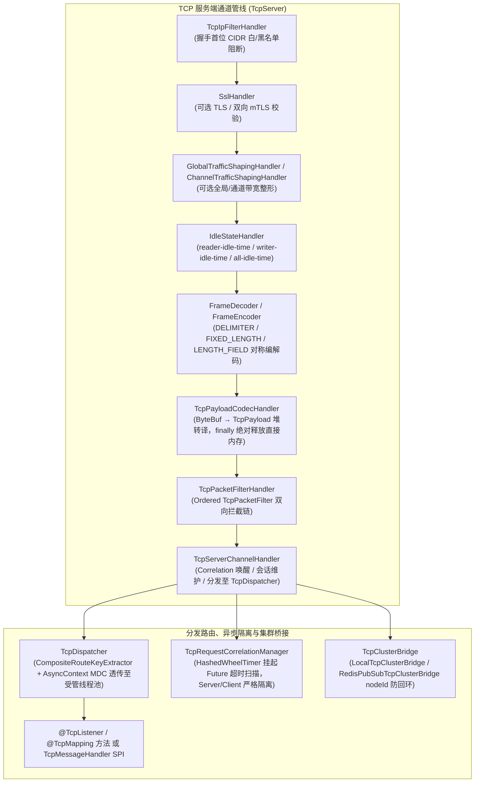

# ateng-boot-tcp 基础设施 Starter

> 工业级 Netty 双模长连接通信底座 Starter，原生基于 Netty 4.1.x 高性能异步事件驱动网络库构建，支持“服务端（Server）+ 客户端（Client）”独立开关与协同治理。内置确定性粘包拆包切片与 `LENGTH_FIELD` 出站对称编码、堆外直接内存确定性释放、会话生命周期治理与“踢旧留新”置换、双向全双工 RPC 与 `HashedWheelTimer` 超时熔断、高低水位出站背压流控、网络层 IP 访问控制防火墙、全局与单连接流量整形、两级自适应集群广播防回环、双轨路由分发（声明式 `@TcpListener` / `@TcpMapping` 与函数式 `TcpMessageHandler<T>` SPI）、受管线程池异步隔离与 MDC Trace 透传、命名多端口拓扑与多客户端注册表、TLS/mTLS 双向强认证、三阶段平滑停机排空，以及 Spring Boot Actuator 与 Micrometer 网络黄金度量体系。
>
> 相关架构决策与领域词汇详见：[ADR-0054 双模 TCP 网络底座架构决策](../docs/adr/0054-industrial-grade-dual-mode-tcp-networking-architecture.md)、[ADR-0083 TCP 全场景加固与背压治理架构决策](../docs/adr/0083-tcp-full-scenario-hardening-backpressure-and-resilient-governance-architecture.md)、[ADR-0105 TCP 样例多控制器解耦与五维规范架构决策](../docs/adr/0105-tcp-sample-multi-controller-and-documentation-specification-architecture.md) 与 [模块领域词汇表](./CONTEXT.md)。

---

## 0. 特性与公共 API 全景速查矩阵 (Feature & API Panorama Matrix)

| 特性分类 | 特性名称 | 核心门面 / 注解 / SPI | 关键配置项 (`ateng.boot.tcp.*`) | 关键 API 签名 / 核心行为 | 锚定验证源头 (`*Test` / Sample) |
| :--- | :--- | :--- | :--- | :--- | :--- |
| **服务端发信与管理** | 多端口服务端注册表 | `TcpServerRegistry`<br>`TcpServer` | `server.*`<br>`servers.<name>.*` | `getServer(String)` / `getRequiredServer(String)` / `getDefaultServer()` / `getAllServers()` / `getActualPort(String)`，支持 `default` 主端口与多协议命名端口隔离运维 | `TcpServerRegistryTest`<br>`TcpMultiPortIntegrationTest`<br>`TcpServerController` |
| **服务端点对点/广播** | 会话与设备下发、广播、群发与主动关断 | `TcpServerTemplate` | `server.enabled` | `send(String sessionId, Object)` / `sendToDevice(String deviceId, Object)` / `broadcast(Object)` / `sendToGroup(String group, Object)` / `close(String)` / `close(String, CloseReason)` / `closeDevice(String)` / `closeDevice(String, CloseReason)` / `getActiveConnections()` | `TcpServerTemplateTest`<br>`TcpServerController` |
| **服务端双向 RPC** | 服务端同步与异步请求-应答 | `TcpServerTemplate`<br>`TcpRequestCorrelationManager` | `server.enabled` | `request(String, Object)` / `request(String, Object, Duration)` / `request(String, Object, Class<T>)` / `request(String, Object, Duration, Class<T>)` / `requestToDevice(...)` / `requestAsync(...)` / `requestToDeviceAsync(...)`（默认 10s 超时，返回 `CompletableFuture<TcpPacket>`） | `TcpServerTemplateTest`<br>`TcpProtocolController`<br>`SampleTcpE2eTest` |
| **集群跨节点分发** | 两级自适应跨节点与分组组播 | `TcpServerTemplate`<br>`TcpClusterBridge` SPI<br>`LocalTcpClusterBridge`<br>`RedisPubSubTcpClusterBridge`<br>`TcpClusterBroadcastMessage` | `cluster.redis.enabled`<br>`cluster.redis.topic` | `sendToCluster(String deviceId, Object)` / `broadcastToCluster(Object)` / `sendGroupToCluster(String group, Object)`；本地直发未命中则经 Redis Pub/Sub 广播，按发射节点 UUID `nodeId` 自动防回环 | `TcpClusterBridgeTest`<br>`TcpGovernanceController` |
| **多客户端治理** | 命名多客户端注册中心 | `TcpClientRegistry`<br>`TcpClient` | `client.*`<br>`clients.<name>.*` | `getClient(String)` / `getRequiredClient(String)` / `getDefaultClient()` / `getTemplate(String)` / `getRequiredTemplate(String)` / `getDefaultTemplate()` / `getAllClients()` / `getAllTemplates()` | `TcpClientRegistryTest`<br>`TcpMultiClientIntegrationTest`<br>`TcpClientController` |
| **客户端收发与 RPC** | 客户端推流、全双工 RPC 与生命周期控制 | `TcpClientTemplate`<br>`TcpRequestCorrelationManager` | `client.enabled`<br>`client.request-timeout`<br>`clients.<name>.*` | `send(Object)` / `request(Object)` / `request(Object, Duration)` / `request(Object, Class<T>)` / `request(Object, Class<T>, Duration)` / `requestAsync(Object)` / `requestAsync(Object, Duration)` / `isConnected()` / `reconnect()` / `disconnect()` / `getSession()`（客户端独立关联管理器防回环串包） | `TcpClientTemplateTest`<br>`TcpClientIntegrationTest`<br>`TcpClientController` |
| **会话与设备治理** | 会话生命周期、属性与分组管理 | `TcpSessionManager` | `server.max-connections` | `register(TcpSession)` / `unregister(String, CloseReason)` / `bind(String sessionId, String deviceId)` / `unbind(String)` / `getSession(String)` / `getSessionByDeviceId(String)` / `getAllSessions()` / `getActiveCount()` / `addToGroup(String, String)` / `removeFromGroup(String, String)` / `getSessionsByGroup(String)`（推荐，旧 `getGroupSessions` 已 `@Deprecated`）/ `closeSession(...)` / `closeDevice(...)` / `closeAllSessions(...)` | `TcpSessionManagerTest`<br>`TcpSessionController`<br>`SampleTcpE2eTest` |
| **背压与会话控制** | 单会话发送、属性与动态背压策略 | `TcpSession`<br>`BackpressurePolicy` | `write-buffer-low-water-mark`<br>`write-buffer-high-water-mark`<br>`backpressure-policy`<br>`backpressure-timeout` | `isActive()` / `isWritable()` / `getPendingWriteBytes()` / `send(Object)` / `send(Object, BackpressurePolicy, Duration)` / `close(CloseReason)` / `touch()` / `setBackpressurePolicy(BackpressurePolicy)` / **`setBackpressurePolicy(BackpressurePolicy, Duration)`** / 属性上下文 API | `TcpSessionTest`<br>`TcpBackpressureIntegrationTest`<br>`TcpGovernanceController` |
| **声明式监听路由** | 注解声明监听、命令映射与参数注入 | `@TcpListener`、`@TcpMapping`<br>`@TcpDeviceId`、`@TcpHeader`<br>`TcpDispatcher` | - | 基于 Spring Bean 与方法注解自动绑定路由命令字（`value`/`command`），自动注入 `TcpSession`、`TcpPacket`、`TcpPayload`、`byte[]`、`String`、POJO、`@TcpDeviceId` 与 `@TcpHeader(value/name/required/defaultValue)`；`AsyncContext` 隔离调度并清理 MDC | `TcpDispatcherTest`<br>`TcpAnnotationRouteIntegrationTest`<br>`VehicleTelemetryListener` |
| **载荷与帧模型** | 堆内存安全载荷与结构化数据包 | `TcpPayload`<br>`TcpPacket` | - | `TcpPayload`: `empty()` / `of(...)` / `fromHex(String)` / `fromJson(Object)` / `asBytes()` / `getBytes()` / `asHex()` / `asText()` / `asString()` / `asJson(Class<T>)`；`TcpPacket`: 携带 `command`、`deviceId`、`requestId`、`payload`、`headers` 及工厂 `of(...)` / `ofJson(...)` / `ofText(...)` / `ofBytes(...)` | `TcpPayloadTest`<br>`TcpPacketTest` |
| **粘包拆包与释放** | 多模式切片解码、对称编码与防泄漏 | `TcpFramingDecoderFactory`<br>`TcpPayloadCodecHandler`<br>`FramingMode` | `framing.mode`<br>`framing.delimiter`<br>`framing.strip-delimiter`<br>`framing.fixed-length`<br>`framing.length-field.*`<br>`framing.max-frame-length` | 支持 `NONE`、`DELIMITER`、`FIXED_LENGTH`、`LENGTH_FIELD`；`LENGTH_FIELD` 自动装配出站 `LengthFieldPrepender` 对称加头，`DELIMITER` 出站自动补齐分隔符；`finally` 确定性释放入站 `ByteBuf` | `TcpFramingDecoderFactoryTest`<br>`TcpPayloadCodecHandlerTest` |
| **工业校验与 Sample 协议示例** | 国标校验码原语与 `[Sample 级扩展]` 组合模式 | `ChecksumUtil`（Starter 原语）<br>`Jt808CompositeFrameCodec`（**Sample 级扩展**）<br>`Jt808RouteKeyExtractor`（**Sample 级扩展**） | - | Starter 提供 `ChecksumUtil`（`calculateXor`/`verifyXor`、`calculateCrc16Modbus`/`verifyCrc16Modbus`、`calculateCrc16Ccitt`/`verifyCrc16Ccitt`、`calculateCrc32`/`verifyCrc32`、`escapeJt808`/`unescapeJt808`、`toHexString`/`fromHexString`）；`Jt808*` 为 `ateng-boot-sample-tcp` 基于原语自组演示，非 Starter 内置黑盒 | `ChecksumUtilTest`<br>`Jt808CompositeFrameCodecTest`<br>`TcpProtocolController` |
| **核心 SPI 与提取器** | 路由、关联号、通道定制、拦截与处理器扩展 | `TcpRouteKeyExtractor`<br>`JsonRouteKeyExtractor`<br>`BinaryOffsetRouteKeyExtractor`<br>`CompositeRouteKeyExtractor`<br>`TcpCorrelationIdExtractor`<br>`TcpChannelCustomizer`<br>`TcpMessageHandler<T>`<br>`TcpPacketFilter` | - | 支持全 `@Bean` 可插拔接管：多提取器自动聚合为有序 `CompositeRouteKeyExtractor`；`BinaryOffsetRouteKeyExtractor` 支持 `HEX`/`HEX_PREFIX`/`INTEGER`/`ASCII`；`TcpChannelCustomizer` 支持按 `role` (`SERVER`/`CLIENT`) 与 `name` 定向定制；`TcpPacketFilter` 支持有序双向拦截短路 | `TcpRouteKeyExtractorTest`<br>`TcpDispatcherTest`<br>`TcpPacketFilterHandlerTest`<br>`TcpGovernanceController` |
| **网络安全与流量整形** | mTLS 双向认证、IP 防火墙与令牌桶限速 | `TcpSslContextFactory`<br>`TcpIpFilterHandler`<br>`ClientAuth` | `ssl.*`<br>`ip-filter.*`<br>`traffic-shaping.*` | 支持 `PKCS12` 密钥库与 `ClientAuth`（`NONE`/`WANT`/`NEED`）；IP 过滤在握手首位拦截（白名单非空切换严格白名单）；支持全局/单通道字节限速及运行时动态调参 `configure(write, read)` 与停机 `release()` | `TcpSslContextFactoryTest`<br>`TcpTlsIntegrationTest`<br>`TcpIpFilterIntegrationTest`<br>`TcpTrafficShapingIntegrationTest` |
| **韧性与生命周期** | 心跳保活、空闲断连、退避重连与停机排空 | `TcpServer` / `TcpClient`<br>`SmartLifecycle` | `idle.*`（`reader-idle-time` / `writer-idle-time` / `all-idle-time` / `auto-close`）<br>`heartbeat.*`<br>`reconnect.*`<br>`drain-timeout` | 客户端定时心跳与指数退避重连（`max-attempts: 0` 表示无限尝试）；服务端监测读写/全空闲触发 `TcpSessionIdleEvent`；停机阶段按“解绑监听 → `drain-timeout` 排空 RPC → 释放会话与线程池”执行 | `TcpHeartbeatIntegrationTest`<br>`TcpClientIntegrationTest`<br>`TcpGracefulShutdownTest` |
| **枚举、异常与领域事件** | 强类型枚举、因果异常与 Spring 事件总线 | `CloseReason`、`TcpException`、`TcpBackpressureException`、`TcpTimeoutException`<br>6 个领域事件 | - | `TcpBackpressureException` 默认错误码 `SERVICE_UNAVAILABLE`，其余为 `INTERNAL_SERVER_ERROR`（均保留 `cause`）；自动发布连接/绑定/关闭/空闲/可写性/IP 拦截事件 | `TcpExceptionTest`<br>`TcpSessionManagerTest`<br>`VehicleTelemetryScenarioService` |
| **观测与强类型配置** | Actuator 端点、Micrometer 度量与属性绑定 | `TcpActuatorEndpoint`<br>`TcpMetricsCollector`<br>`AtengTcpProperties` 等 12 个 `*Properties` | `management.endpoints.web.exposure.include=tcp` | 暴露 `/actuator/tcp` 与 `/actuator/tcp/{deviceId}`；采集 7 项 `ateng.tcp.*` 指标；配置全量采用 `Duration` / `DataSize` 强类型映射 | `TcpObservabilityIntegrationTest`<br>`AtengTcpPropertiesTest` |

---

## 1. 模块定位与快速起步

### 1.1 核心价值宣言

`ateng-boot-tcp` 是面向物联网接入、智能硬件网关与微服务间高性能二进制/文本长连接通信的核心 Starter：
- **零 Web 强依赖，底座纯粹**：基于 JDK 17、Spring Boot `3.3.13` 与 Netty `4.1.x` 构建，Actuator、Micrometer、Spring Data Redis 均为可选依赖（`<optional>true</optional>`），纯控制台/后台守护进程可依托 `WebEnvironment.NONE` 无缝运行。
- **服务端/客户端双模对称**：服务端统一通过 `TcpServerRegistry` 与 `TcpServerTemplate` 治理多端口与海量设备会话，客户端通过 `TcpClientRegistry` 与 `TcpClientTemplate` 管理多目标外部连接。
- **全链路线程隔离与异常可追溯**：入站分发通过 `TcpDispatcher` 将执行从 Netty EventLoop 解耦至受管异步线程池（依托 `ateng-boot-core` 的 `AsyncContext` 透传 MDC `traceId` 并清理现场）；底层统一抛出保留因果链的 `TcpException` 家族。

### 1.2 Maven 依赖引入

版本已在根 `pom.xml` / `ateng-boot-bom` 统一纳管，业务模块无需显式指定 `<version>`：

```xml
<dependency>
    <groupId>io.github.atengk</groupId>
    <artifactId>ateng-boot-tcp</artifactId>
</dependency>
```

### 1.3 最小可用配置 (`application.yml`)

提取自 `ateng-boot-sample-tcp` 验证配置（服务端主端口 `9099` + 默认客户端本地回环连接）：

```yaml
ateng:
  boot:
    tcp:
      enabled: true
      server:
        enabled: true
        host: 0.0.0.0
        port: 9099
        framing:
          mode: LENGTH_FIELD
          length-field:
            offset: 0
            length: 4
            adjustment: 0
            initial-bytes-to-strip: 4
          max-frame-length: 64KB
        idle:
          reader-idle-time: 60s
          writer-idle-time: 0s
          all-idle-time: 0s
          auto-close: true
      client:
        enabled: true
        host: 127.0.0.1
        port: 9099
        connect-timeout: 3s
        request-timeout: 5s
        framing:
          mode: LENGTH_FIELD
          length-field:
            offset: 0
            length: 4
            adjustment: 0
            initial-bytes-to-strip: 4
          max-frame-length: 64KB
```

### 1.4 极简回环收发实战

以下代码直接提取自 [`VehicleTelemetryListener.java`](../ateng-boot-samples/ateng-boot-sample-tcp/src/main/java/io/github/atengk/boot/sample/tcp/listener/VehicleTelemetryListener.java) 与 [`VehicleTelemetryScenarioService.java`](../ateng-boot-samples/ateng-boot-sample-tcp/src/main/java/io/github/atengk/boot/sample/tcp/service/VehicleTelemetryScenarioService.java)：

#### 声明式接收设备登录与定位报文（服务端）

```java
@Component
@TcpListener
public class VehicleTelemetryListener {

    private final VehicleTelemetryScenarioService scenarioService;
    private final TcpSessionManager sessionManager;

    public VehicleTelemetryListener(VehicleTelemetryScenarioService scenarioService,
                                  TcpSessionManager sessionManager) {
        this.scenarioService = scenarioService;
        this.sessionManager = sessionManager;
    }

    @TcpMapping(command = "LOGIN")
    public void onLogin(TcpSession session, @TcpDeviceId String deviceId, Map<String, Object> body) {
        String effectiveDeviceId = deviceId;
        if (effectiveDeviceId == null && body != null && body.containsKey("deviceId")) {
            effectiveDeviceId = String.valueOf(body.get("deviceId"));
        }
        if (effectiveDeviceId != null && session != null) {
            sessionManager.bind(session.getSessionId(), effectiveDeviceId.trim());
        }
    }

    @TcpMapping(command = "LOCATION_REPORT")
    public Map<String, Object> onLocationReport(TcpSession session, @TcpDeviceId String deviceId, LocationReportPacket report) {
        String targetDeviceId = deviceId != null ? deviceId : (report != null ? report.getDeviceId() : null);
        if (targetDeviceId != null && session != null && session.getDeviceId() == null) {
            sessionManager.bind(session.getSessionId(), targetDeviceId);
        }
        scenarioService.updateLocation(targetDeviceId, report);
        return Map.of(
                "command", "LOCATION_ACK",
                "seq", report != null && report.getSeq() != null ? report.getSeq() : 0L,
                "status", "SUCCESS"
        );
    }
}
```

#### 客户端上行发送与同步应答

```java
TcpClientTemplate clientTemplate = tcpClientRegistry.getRequiredTemplate("default");
TcpPacket response = clientTemplate.request(
        TcpPacket.ofJson("HEARTBEAT", Map.of("command", "HEARTBEAT", "timestamp", System.currentTimeMillis())),
        Duration.ofSeconds(3)
);
```

---

## 2. 核心架构与设计不变量



### 核心设计不变量 (Invariants)
1. **直接内存零泄漏不变量**：入站 `ByteBuf` 在 `TcpPayloadCodecHandler` 中即时复制转换为堆内不可变载荷载体 `TcpPayload`，并在 `finally` 中通过 `ReferenceCountUtil.release()` 确定性释放；上层业务与监听器永远只接触安全的 `TcpPayload` / `TcpPacket`。
2. **服务端 / 客户端关联管理器物理隔离**：客户端自动装配（`TcpClientAutoConfiguration`）会为每个客户端实例创建独立的 `TcpRequestCorrelationManager`，绝不与服务端容器的 `TcpRequestCorrelationManager` 混用，彻底消除同进程回环通信时客户端应答误唤醒服务端 RPC 或反向截胡风险。
3. **EventLoop 线程纯净与四维上下文透传**：`TcpDispatcher` 在 Netty I/O 线程仅完成路由键提取与 MDC `traceId` 快照捕获（即刻 `MDC.remove` 清理防止 I/O 线程污染），随后借助 `AsyncContext.wrap(task)` 投递至受管业务线程池（若未注册受管 `Executor` 则回退 `ForkJoinPool.commonPool()`）。
4. **严格配置语义与零幽灵 API**：`TcpIdleProperties` 严格使用 `reader-idle-time` / `writer-idle-time` / `all-idle-time` 键名（拒绝任何缩写错误别名）；多客户端严格经由 `TcpClientRegistry.getRequiredClient` / `getRequiredTemplate` 获取实例（不存在静态/路由幽灵方法）。
5. **契约与传输实体隔离（Zero-Entity-Leakage）**：`TcpSession` 与 Netty `Channel` 等底层运行时句柄仅在框架与 Service 内部流转，对外 HTTP / 控制面统一映射为不可变 VO，入参统一执行 JSR-303 校验。

---

## 3. 服务端全双工、多端口与安全传输套件

### 3.1 主服务端监听、命名多端口 (`TcpServerRegistry`) 与生命周期

#### 本节专属 YAML 配置 (`ateng-boot-sample-tcp/application.yml`)

```yaml
ateng:
  boot:
    tcp:
      server:
        enabled: true
        host: 0.0.0.0
        port: 9099
        boss-threads: 1
        worker-threads: 4
        max-connections: 5000
        drain-timeout: 5s
        so-backlog: 1024
        tcp-nodelay: true
        so-keepalive: true
      servers:
        binary-jt808:
          enabled: true
          host: 127.0.0.1
          port: 9100
          framing:
            mode: LENGTH_FIELD
            length-field:
              offset: 0
              length: 4
              adjustment: 0
              initial-bytes-to-strip: 4
            max-frame-length: 64KB
          idle:
            reader-idle-time: 45s
            writer-idle-time: 0s
            all-idle-time: 0s
            auto-close: true
```

#### 真实业务 Java 示例（提取自 [`TcpEndpointConsoleService.java`](../ateng-boot-samples/ateng-boot-sample-tcp/src/main/java/io/github/atengk/boot/sample/tcp/service/TcpEndpointConsoleService.java) 与 [`FleetSimulationRunner.java`](../ateng-boot-samples/ateng-boot-sample-tcp/src/main/java/io/github/atengk/boot/sample/tcp/simulator/FleetSimulationRunner.java)）

```java
// 1. 通过 TcpServerRegistry 获取全部受管服务端或指定名称端口（如 "default"、"binary-jt808"）
Map<String, TcpServer> servers = tcpServerRegistry.getAllServers();
TcpServer defaultServer = tcpServerRegistry.getDefaultServer();
int actualPort = defaultServer.getActualPort();

// 2. 将底层服务端状态投影为只读视图 VO（严禁向 Web 层暴露 TcpServer/Channel 实体）
TcpServerInfoVO serverView = new TcpServerInfoVO(
        "binary-jt808",
        server.isRunning(),
        server.getProperties().getHost(),
        server.getProperties().getPort(),
        server.getActualPort(),
        server.getProperties().getFraming().getMode().name(),
        server.getProperties().getSsl().isEnabled(),
        server.getProperties().getSsl().getClientAuth().name(),
        sessionManager.getActiveCount(),
        server.getProperties().getIpFilter().isEnabled(),
        List.copyOf(server.getProperties().getIpFilter().getWhitelist()),
        List.copyOf(server.getProperties().getIpFilter().getBlacklist()),
        server.getGlobalTrafficShapingHandler() != null
);
```

#### 核心机制与边界防御
- **`port: 0` 随机端口支持**：测试或临时多实例可将 `port` 设为 `0`，绑定就绪后通过 `server.getActualPort()` 或 `tcpServerRegistry.getActualPort(name)` 获取操作系统分配的实际监听端口。
- **资源隔离与容量守卫**：每个服务端实例持有独立的 `bossThreads`（默认 `1`）、`workerThreads`（默认 `0` 表示 Netty 自动采用 CPU 核数 * 2）及独立 Pipeline 编排；超过 `max-connections`（默认 `10000`）时在建链阶段直接拒绝关闭，防止句柄耗尽。
- **注册表查询语义**：`getServer(name)` 未命中返回 `null`，`getRequiredServer(name)` 未命中直接抛出明确的 `TcpException` Fail-Fast。

---

### 3.2 会话治理、设备绑定与“踢旧留新”状态机

#### 本节专属 YAML 配置

```yaml
ateng:
  boot:
    tcp:
      server:
        enabled: true
        max-connections: 5000
        drain-timeout: 5s
```

#### 真实业务 Java 示例（提取自 [`TcpEndpointConsoleService.java`](../ateng-boot-samples/ateng-boot-sample-tcp/src/main/java/io/github/atengk/boot/sample/tcp/service/TcpEndpointConsoleService.java)）

```java
// 1. 将指定活跃 sessionId 绑定到业务设备编号（同 deviceId 原旧会话将被自动 KICK_OUT）
TcpSession existing = sessionManager.getSession(request.getSessionId());
if (existing == null || !existing.isActive()) {
    throw new BusinessException(CommonResultCode.NOT_FOUND,
            "未找到活跃会话，无法绑定设备: sessionId=" + request.getSessionId());
}
sessionManager.bind(request.getSessionId(), request.getDeviceId());

// 2. 基于 sessionId 动态变更设备所属车队分组（注意 addToGroup/removeFromGroup 接收的是 sessionId）
TcpSession session = sessionManager.getSessionByDeviceId(request.getDeviceId());
if ("JOIN".equalsIgnoreCase(request.getAction())) {
    sessionManager.addToGroup(request.getGroup(), session.getSessionId());
} else {
    sessionManager.removeFromGroup(request.getGroup(), session.getSessionId());
}

// 3. 管理员合规踢线下线（附带原因属性并指定 CloseReason.KICK_OUT）
session.setAttribute("kickReason", request.getReason());
sessionManager.closeDevice(request.getDeviceId(), CloseReason.KICK_OUT);
```

#### 核心机制与边界防御
- **“踢旧留新”并发置换**：调用 `sessionManager.bind(sessionId, deviceId)` 时，若目标 `deviceId` 已存在旧活跃会话，内部同步切断旧物理通道（触发 `CloseReason.KICK_OUT` 与 `TcpSessionClosedEvent`），确保单硬件标识仅绑定最新通道，根治僵尸会话抢占指令问题。
- **分组维护规范**：`addToGroup(group, sessionId)` / `removeFromGroup(group, sessionId)` 均以**会话主键 `sessionId`** 为元素索引；检索分组会话优先调用 `getSessionsByGroup(group)`（`getGroupSessions(group)` 已标记 `@Deprecated(since = "1.2.0")`），未命中兜底返回空集合（严禁 `null`）。

---

### 3.3 单播、全网广播、分组组播与全双工同步/异步 RPC

#### 本节专属 YAML 配置

```yaml
ateng:
  boot:
    tcp:
      server:
        enabled: true
        idle:
          reader-idle-time: 60s
          writer-idle-time: 0s
          all-idle-time: 0s
          auto-close: true
```

#### 真实业务 Java 示例（提取自 [`VehicleTelemetryScenarioService.java`](../ateng-boot-samples/ateng-boot-sample-tcp/src/main/java/io/github/atengk/boot/sample/tcp/service/VehicleTelemetryScenarioService.java) 与 [`TcpEndpointConsoleService.java`](../ateng-boot-samples/ateng-boot-sample-tcp/src/main/java/io/github/atengk/boot/sample/tcp/service/TcpEndpointConsoleService.java)）

```java
// 1. 全双工同步 RPC 控制指令下发并反序列化为强类型回执 VO
String requestId = IdUtil.fastSimpleUUID();
TcpPacket packet = TcpPacket.builder()
        .command(command)
        .requestId(requestId)
        .deviceId(deviceId)
        .payload(TcpPayload.fromJson(payloadMap))
        .build();
VehicleControlAck ack = tcpServerTemplate.requestToDevice(
        deviceId, packet, Duration.ofSeconds(3), VehicleControlAck.class);

// 2. 全网广播（仅当前节点）与本地分组群发
tcpServerTemplate.broadcast(body);
tcpServerTemplate.sendToGroup(request.getGroup(), body);
```

#### 核心机制与边界防御
- **时间轮超时与泄漏防御**：`TcpServerTemplate` 默认 RPC 超时为 `10s`，可通过 `Duration` 重载精确控制单次请求超时；在途请求注册在 `TcpRequestCorrelationManager` 内部由 `HashedWheelTimer` 调度超时清理，超时后抛出 `TcpTimeoutException` 并立即摘除挂起 Future。
- **异步非阻塞重载**：高并发吞吐场景应优先使用 `requestAsync(sessionId, payload, timeout)` / `requestToDeviceAsync(deviceId, payload, timeout)`，返回 `CompletableFuture<TcpPacket>` 避免阻塞调用方工作线程。

---

### 3.4 双向 mTLS 证书强认证与服务端加密通道

#### 本节专属 YAML 配置 (`ateng-boot-sample-tcp/application.yml`)

```yaml
ateng:
  boot:
    tcp:
      servers:
        tls-gateway:
          enabled: true
          host: 127.0.0.1
          port: 9101
          framing:
            mode: LENGTH_FIELD
            length-field:
              offset: 0
              length: 4
              adjustment: 0
              initial-bytes-to-strip: 4
            max-frame-length: 64KB
          ssl:
            enabled: true
            client-auth: NEED
            key-store: ${SAMPLE_TCP_SERVER_KEY_STORE:classpath:certs/server.p12}
            key-store-password: ${SAMPLE_TCP_SERVER_KEY_PASSWORD:123456}
            key-store-type: PKCS12
            trust-store: ${SAMPLE_TCP_SERVER_TRUST_STORE:classpath:certs/server-truststore.p12}
            trust-store-password: ${SAMPLE_TCP_SERVER_TRUST_PASSWORD:123456}
            trust-store-type: PKCS12
      clients:
        tls-client:
          enabled: true
          host: 127.0.0.1
          port: 9101
          ssl:
            enabled: true
            key-store: ${SAMPLE_TCP_CLIENT_KEY_STORE:classpath:certs/client.p12}
            key-store-password: ${SAMPLE_TCP_CLIENT_KEY_PASSWORD:123456}
            key-store-type: PKCS12
            trust-store: ${SAMPLE_TCP_CLIENT_TRUST_STORE:classpath:certs/client-truststore.p12}
            trust-store-password: ${SAMPLE_TCP_CLIENT_TRUST_PASSWORD:123456}
            trust-store-type: PKCS12
```

#### 真实业务 Java 示例（提取自 [`TcpEndpointConsoleService.java`](../ateng-boot-samples/ateng-boot-sample-tcp/src/main/java/io/github/atengk/boot/sample/tcp/service/TcpEndpointConsoleService.java)）

```java
// 经由已建立 mTLS 双向认证通道的命名客户端安全推流并触发异步 RPC
TcpClientTemplate tlsTemplate = tcpClientRegistry.getRequiredTemplate("tls-client");
CompletableFuture<TcpPacket> future = tlsTemplate.requestAsync(
        TcpPacket.ofJson("HEARTBEAT", Map.of("command", "HEARTBEAT", "requestId", reqId)),
        Duration.ofMillis(3000)
);
```

#### 核心机制与边界防御
- **双向信任校验**：`TcpSslContextFactory` 读取 `PKCS12` 密钥库与信任库并在 Pipeline 靠前位置装配 Netty `SslHandler`；服务端配置 `client-auth: NEED` 时强制校验证书链，非法证书客户端将在 TLS 握手阶段被直接拒断。
- **凭据隔离规范**：生产部署必须通过环境变量或外部 `application-local.yml` 传入真实 `key-store-password` / `trust-store-password` 与 `file:` 证书路径，禁止在仓库配置提交生产私钥与明文口令。

---

## 4. 客户端双模接入、会话集群与协议分发套件

### 4.1 命名多客户端治理 (`TcpClientRegistry`) 与同步/异步 RPC

#### 本节专属 YAML 配置

```yaml
ateng:
  boot:
    tcp:
      client:
        enabled: true
        host: 127.0.0.1
        port: 9099
        connect-timeout: 3s
        request-timeout: 5s
      clients:
        binary-client:
          enabled: true
          host: 127.0.0.1
          port: 9100
          connect-timeout: 3s
          request-timeout: 5s
```

#### 真实业务 Java 示例（提取自 [`TcpEndpointConsoleService.java`](../ateng-boot-samples/ateng-boot-sample-tcp/src/main/java/io/github/atengk/boot/sample/tcp/service/TcpEndpointConsoleService.java)）

```java
// 1. 按逻辑名称精准检索受管客户端与操作模板（Fail-Fast 校验已连接状态）
TcpClient client = tcpClientRegistry.getRequiredClient(clientName);
TcpClientTemplate template = tcpClientRegistry.getRequiredTemplate(clientName);
if (!template.isConnected()) {
    throw new BusinessException(CommonResultCode.SERVICE_UNAVAILABLE,
            "TCP 客户端当前未建立活跃连接: clientName=" + clientName);
}

// 2. 同步 RPC 与异步非阻塞 RPC 调用，底层使用客户端隔离关联池
TcpPacket syncResponse = template.request(packet, Duration.ofMillis(request.getTimeoutMillis()));

CompletableFuture<TcpClientRpcVO> asyncResult = template
        .requestAsync(packet, Duration.ofMillis(request.getTimeoutMillis()))
        .handle((response, ex) -> {
            if (ex == null) {
                return toRpcVO(request, reqId, response, System.currentTimeMillis() - start, true);
            }
            Throwable cause = ex instanceof CompletionException && ex.getCause() != null ? ex.getCause() : ex;
            if (cause instanceof TcpTimeoutException || cause instanceof TimeoutException) {
                throw new BusinessException(CommonResultCode.SERVICE_UNAVAILABLE,
                        "TCP 客户端异步上行 RPC 等待应答超时: command=" + request.getCommand(), cause);
            }
            throw new BusinessException(CommonResultCode.INTERNAL_SERVER_ERROR,
                    "TCP 客户端异步上行 RPC 调用失败: " + cause.getMessage(), cause);
        });

// 3. 显式断开与重连控制
client.disconnect();
client.reconnect();
```

#### 核心机制与边界防御
- **命名路由边界**：`ateng.boot.tcp.client` 固定注册名称为 `default`，`ateng.boot.tcp.clients.<name>` 注册对应命名实例；请始终使用 `TcpClientRegistry.getRequiredTemplate(name)` / `getRequiredClient(name)`，勿自行持有并绕过注册表生命周期管理。
- **确定性断开状态**：`TcpClient.disconnect()` 在非 Netty EventLoop 线程调用时会同步等待底层通道关闭完结，返回后 `isConnected()` 确定性为 `false`。

---

### 4.2 粘包拆包切片、对称长度编码与自愈重连/心跳保活

#### 本节专属 YAML 配置

```yaml
ateng:
  boot:
    tcp:
      client:
        framing:
          mode: LENGTH_FIELD
          length-field:
            offset: 0
            length: 4
            adjustment: 0
            initial-bytes-to-strip: 4
          max-frame-length: 64KB
        heartbeat:
          enabled: true
          interval: 20s
          payload: "{\"command\":\"HEARTBEAT\"}"
        reconnect:
          enabled: true
          initial-interval: 500ms
          max-interval: 10s
          multiplier: 2.0
          max-attempts: 5
```

#### 真实业务 Java 示例（提取自 [`VehicleSimulator.java`](../ateng-boot-samples/ateng-boot-sample-tcp/src/main/java/io/github/atengk/boot/sample/tcp/simulator/VehicleSimulator.java)）

```java
// 构建具备 LENGTH_FIELD 对称帧切片与指数退避自愈重连能力的客户端配置
TcpClientProperties properties = new TcpClientProperties();
properties.setEnabled(true);
properties.setHost(host);
properties.setPort(port);
properties.getFraming().setMode(FramingMode.LENGTH_FIELD);
properties.getReconnect().setEnabled(true);
properties.getReconnect().setInitialInterval(Duration.ofMillis(200));
properties.getReconnect().setMaxInterval(Duration.ofSeconds(1));
properties.getReconnect().setMultiplier(2.0);
properties.getReconnect().setMaxAttempts(5);
```

#### 核心机制与边界防御
- **对称帧编解码保障**：`FramingMode.LENGTH_FIELD`（默认 `offset=0, length=4, adjustment=0, initialBytesToStrip=4`）由 `TcpFramingDecoderFactory` 自动在客户端与服务端同时装配入站 `LengthFieldBasedFrameDecoder` 与出站 `LengthFieldPrepender`；`FramingMode.DELIMITER` 入站按 `delimiter`（默认 `\r\n`）切片、出站由 `TcpPayloadCodecHandler` 自动补齐。超限帧直接触发解码异常熔断。
- **指数退避自愈重连**：断线或建链失败后按 `initialInterval * multiplier^n` 调度后台重连，上限收敛于 `maxInterval` 与 `maxAttempts`（默认 `0` 表示无限重试）；`SmartLifecycle` 停止期自动禁止重连以免停机挂起。
- **服务端空闲检测与客户端心跳协同**：服务端配置 `idle.reader-idle-time`（如 `60s`）结合 `auto-close: true` 自动踢除假死会话，客户端按略短间隔（如 `20s`）上行心跳帧防 NAT 超时静默断链。

---

### 4.3 声明式路由 (`@TcpListener`/`@TcpMapping`) 与工业国标复合协议组合模式

> **架构边界提示**：本节示例中的 `Jt808CompositeFrameCodec` 与 `Jt808RouteKeyExtractor` 属于 **`ateng-boot-sample-tcp` 业务侧自定义的 Sample 级扩展组件**，用于演示如何组合 `ateng-boot-tcp` 内置原语（`framing` + `ChecksumUtil` + `TcpRouteKeyExtractor` SPI）落地面向国标的二进制协议，**并非 `ateng-boot-tcp` Starter 内置类**。

#### 本节专属 YAML 配置

```yaml
ateng:
  boot:
    tcp:
      servers:
        binary-jt808:
          enabled: true
          host: 127.0.0.1
          port: 9100
          framing:
            mode: LENGTH_FIELD
            length-field:
              offset: 0
              length: 4
              adjustment: 0
              initial-bytes-to-strip: 4
            max-frame-length: 64KB
```

#### 真实业务 Java 示例（提取自 `ateng-boot-sample-tcp` 的 [`Jt808RouteKeyExtractor.java`](../ateng-boot-samples/ateng-boot-sample-tcp/src/main/java/io/github/atengk/boot/sample/tcp/codec/Jt808RouteKeyExtractor.java) 与 [`VehicleTelemetryListener.java`](../ateng-boot-samples/ateng-boot-sample-tcp/src/main/java/io/github/atengk/boot/sample/tcp/listener/VehicleTelemetryListener.java)）

```java
// [Sample 级扩展] 国标二进制 + JSON 双轨路由命令字提取器（实现 Starter 的 TcpRouteKeyExtractor SPI）
@Component
@Order(Ordered.HIGHEST_PRECEDENCE)
public class Jt808RouteKeyExtractor implements TcpRouteKeyExtractor {

    private final JsonRouteKeyExtractor jsonExtractor = new JsonRouteKeyExtractor();

    @Override
    public String extract(TcpPacket packet) {
        if (packet == null || packet.getPayload() == null) {
            return null;
        }
        byte[] bytes = packet.getPayload().asBytes();
        if (bytes != null && bytes.length > 3 && bytes[0] == Jt808CompositeFrameCodec.DELIMITER) {
            int probeLen = Math.min(bytes.length - 1, 8);
            byte[] headerProbe = new byte[probeLen];
            System.arraycopy(bytes, 1, headerProbe, 0, probeLen);
            byte[] unescaped = ChecksumUtil.unescapeJt808(headerProbe);
            if (unescaped.length >= 2) {
                int msgId = ((unescaped[0] & 0xFF) << 8) | (unescaped[1] & 0xFF);
                if (msgId == (Jt808CompositeFrameCodec.MSG_ID_LOCATION & 0xFFFF)) {
                    return "JT808_LOCATION";
                }
                return String.format("JT808_0x%04X", msgId);
            }
        }
        return jsonExtractor.extract(packet);
    }
}
```

```java
// 声明式路由接收提取出的 "JT808_LOCATION" 命令并调用 ChecksumUtil + 业务解码器验证返回 ACK
@TcpMapping(command = "JT808_LOCATION")
public Map<String, Object> onJt808LocationReport(TcpSession session, TcpPacket packet) {
    byte[] rawBytes = packet.getPayload() != null ? packet.getPayload().asBytes() : null;
    if (rawBytes == null || rawBytes.length == 0) {
        throw new IllegalArgumentException("JT/T 808 报文载荷为空");
    }
    LocationReportPacket report = Jt808CompositeFrameCodec.decodeLocationReport(rawBytes);
    String deviceId = report.getDeviceId();
    if (deviceId != null && session != null && session.getDeviceId() == null) {
        sessionManager.bind(session.getSessionId(), deviceId);
    }
    scenarioService.updateLocation(deviceId, report);
    return Map.of(
            "command", "JT808_LOCATION_ACK",
            "deviceId", deviceId != null ? deviceId : "",
            "seq", report.getSeq(),
            "status", "SUCCESS"
    );
}
```

#### 核心机制与边界防御
- **多提取器自动有序组合**：Spring 容器中存在一个或多个 `TcpRouteKeyExtractor` Bean 时，`AtengTcpAutoConfiguration` 自动将它们包装为按 `@Order` 排序的 `CompositeRouteKeyExtractor`；未自定义 Bean 时默认启用 `JsonRouteKeyExtractor`（依次探测 `command`、`action`、`cmd`、`msgType`、`type`、`code`）。纯固定二进制偏移协议可直接注册 Starter 内置 `BinaryOffsetRouteKeyExtractor`。
- **常用工业校验码工具 (`ChecksumUtil`)**：内置 `calculateXor`/`verifyXor`、`calculateCrc16Modbus`/`verifyCrc16Modbus`、`calculateCrc16Ccitt`/`verifyCrc16Ccitt`、`calculateCrc32`/`verifyCrc32`、`escapeJt808`/`unescapeJt808`、`toHexString`/`fromHexString` 原语，篡改帧会在 `verify*` 校验失败时快速 fail-fast 阻断。

---

### 4.4 两级自适应集群推送与分组组播 (`TcpClusterBridge`)

#### 本节专属 YAML 配置

```yaml
ateng:
  boot:
    tcp:
      cluster:
        redis:
          enabled: true                      # 离线单机环境可设为 false，自动装配 LocalTcpClusterBridge
          topic: "ateng:tcp:cluster:sample"  # Redis Pub/Sub 集群广播频道
```

#### 真实业务 Java 示例（提取自 [`TcpGovernanceConsoleService.java`](../ateng-boot-samples/ateng-boot-sample-tcp/src/main/java/io/github/atengk/boot/sample/tcp/service/TcpGovernanceConsoleService.java)）

```java
// 支持按单设备、车队分组、全网三类作用域自动路由集群消息
switch (request.getMode()) {
    case "DEVICE" -> tcpServerTemplate.sendToCluster(request.getTarget(), envelope);
    case "GROUP" -> tcpServerTemplate.sendGroupToCluster(request.getTarget(), envelope);
    default -> tcpServerTemplate.broadcastToCluster(envelope);
}
```

#### 核心机制与边界防御
- **两级命中优化与防回环**：`sendToCluster(deviceId, payload)` 优先检查本机 `TcpSessionManager`，命中则零序列化直发本机连接并返回；未命中时经 `RedisPubSubTcpClusterBridge` 序列化为 `TcpClusterBroadcastMessage`（携带节点唯一 `nodeId` 与 `PACKET` 载荷）发往 Redis Pub/Sub 频道，本节点收到回流广播时比对 `nodeId` 一致立即静默丢弃。
- **双模无缝退化**：当未引入 Redis 或 `ateng.boot.tcp.cluster.redis.enabled=false` 时，自动兜底注册 `LocalTcpClusterBridge`，保证全集群 API 在单机离线与 CI 环境下无需修改业务代码即可跑通。

---

## 5. 网络韧性治理、背压流控与防火墙套件

### 5.1 高低水位出站背压流控与运行时动态调优

#### 本节专属 YAML 配置

```yaml
ateng:
  boot:
    tcp:
      server:
        write-buffer-low-water-mark: 32KB
        write-buffer-high-water-mark: 64KB
        backpressure-policy: FAIL_FAST
        backpressure-timeout: 3s
```

#### 真实业务 Java 示例（提取自 [`TcpGovernanceConsoleService.java`](../ateng-boot-samples/ateng-boot-sample-tcp/src/main/java/io/github/atengk/boot/sample/tcp/service/TcpGovernanceConsoleService.java)）

```java
// 运行时按设备动态切换单个长连接会话的背压流控策略与超时窗口
TcpSession session = sessionManager.getSessionByDeviceId(request.getDeviceId());
if (session == null || !session.isActive()) {
    throw new BusinessException(CommonResultCode.NOT_FOUND,
            "未找到目标设备的活跃会话，无法调整背压策略: deviceId=" + request.getDeviceId());
}
session.setBackpressurePolicy(request.getPolicy(), Duration.ofMillis(request.getTimeoutMillis()));
```

#### 核心机制与边界防御
- **三类背压策略边界**：
  - `FAIL_FAST`（生产默认）：通道超出高水位触发不可写时立即抛出 `TcpBackpressureException`（`SERVICE_UNAVAILABLE`），杜绝慢消费设备撑爆发送节点内存；
  - `BLOCK_TIMEOUT`：在调用线程内等待水位降至低水位以下直到超时抛出 `TcpBackpressureException`（**严禁在 Netty I/O EventLoop 线程内执行阻塞等待**，框架会防死锁快速Fail-Fast）；
  - `WARN_AND_SEND`：输出告警日志后继续尝试写入（适合非关键遥测日志或受控排障）。
- **水位跃迁事件**：通道可写性跨越高低水位变化时，自动触发 `TcpChannelWritabilityChangedEvent` 供上层限流联动感知。

---

### 5.2 网络层 IP 访问控制防火墙（CIDR 白/黑名单）

#### 本节专属 YAML 配置

```yaml
ateng:
  boot:
    tcp:
      server:
        ip-filter:
          enabled: true
          whitelist:
            - "127.0.0.1"
            - "::1"
            - "192.168.0.0/16"
          blacklist:
            - "10.99.99.99"
```

#### 真实业务 Java 示例（提取自 [`VehicleTelemetryScenarioService.java`](../ateng-boot-samples/ateng-boot-sample-tcp/src/main/java/io/github/atengk/boot/sample/tcp/service/VehicleTelemetryScenarioService.java)）

```java
@EventListener
public void onIpBlocked(TcpIpBlockedEvent event) {
    String logEntry = String.format("IP_BLOCKED: remote=%s, rule=%s",
            event.getRemoteAddress(), event.getRuleDetail());
    recordEventLog(logEntry);
    log.warn("监听到 TCP 网络防火墙拦截事件: {}", logEntry);
}
```

#### 核心机制与边界防御
- **握手首位零分配拦截**：`TcpIpFilterHandler` 位于 Pipeline 首位，在分配任何帧缓冲区与 SSL 会话前校验来源 IPv4/IPv6 地址与 CIDR 网段；命中阻断即刻关闭连接并发布 `TcpIpBlockedEvent`。
- **白名单优先严格模式**：一旦 `whitelist` 配置非空，自动切换为**严格白名单模式**（仅放行明确列入 `whitelist` 且未出现在 `blacklist` 的地址，其余来源一律拒接）；`whitelist` 为空时仅按 `blacklist` 拦截。

---

### 5.3 全局与单连接带宽流量整形削峰填谷

#### 本节专属 YAML 配置

```yaml
ateng:
  boot:
    tcp:
      server:
        traffic-shaping:
          enabled: true
          global-read-limit: 10MB
          global-write-limit: 10MB
          channel-read-limit: 1MB
          channel-write-limit: 1MB
          check-interval: 1s
          max-time: 5s
```

#### 真实业务 Java 示例（提取自 [`TcpGovernanceConsoleService.java`](../ateng-boot-samples/ateng-boot-sample-tcp/src/main/java/io/github/atengk/boot/sample/tcp/service/TcpGovernanceConsoleService.java)）

```java
// 动态在线调整指定服务端实例的全局读写带宽限速上限（单位: Bytes/s）
TcpServer server = tcpServerRegistry.getServer(request.getServerName());
GlobalTrafficShapingHandler handler = server.getGlobalTrafficShapingHandler();
if (handler == null) {
    throw new BusinessException(CommonResultCode.BAD_REQUEST,
            "服务端 [" + request.getServerName() + "] 未开启全局流量整形处理器");
}
handler.configure(request.getWriteLimitBytesPerSec(), request.getReadLimitBytesPerSec());
```

#### 核心机制与边界防御
- **强类型带宽声明**：所有限速上限使用 `DataSize` 声明（默认 `0B` 表示不限速），采样检查间隔 `check-interval` 默认 `1s`，单次整形最大等待 `max-time` 默认 `15s`；停机阶段由 `TcpServer` 显式调用 `release()` 释放内部定时任务线程，防止线程泄漏。

---

## 6. 生产扩展接管 (SPI)、事件机制、非功能边界与 Sample 导览

### 6.1 活跃 SPI 扩展点真实接管实现

以下 SPI 扩展示例全部直接提取自 `ateng-boot-sample-tcp/src/main/java/io/github/atengk/boot/sample/tcp/spi/`（全部以 Spring `@Component` 自动生效）：

#### 1. 出入站报文过滤器 (`TcpPacketFilter`, `Ordered`)

提取自 [`SampleTcpPacketFilter.java`](../ateng-boot-samples/ateng-boot-sample-tcp/src/main/java/io/github/atengk/boot/sample/tcp/spi/SampleTcpPacketFilter.java)：

```java
@Component
@RequiredArgsConstructor
public class SampleTcpPacketFilter implements TcpPacketFilter {

    public static final String BLOCKED_SIGNATURE = "BLOCKED_SIGNATURE";
    private final SampleTcpGovernanceState governanceState;

    @Override
    public int getOrder() {
        return 10;
    }

    @Override
    public boolean filterInbound(TcpPacket packet, ChannelHandlerContext ctx) {
        if (packet == null || packet.getPayload() == null || packet.getPayload().isEmpty()) {
            governanceState.recordInboundPassed();
            return true;
        }
        byte[] raw = packet.getPayload().getBytes();
        // 二进制 JT/T 808 帧（首字节 0x7E）免做文本关键字扫描，直接旁路放行
        if (raw.length > 0 && raw[0] == 0x7E) {
            governanceState.recordInboundPassed();
            return true;
        }
        String text = packet.getPayload().asString();
        if (text != null && text.contains(BLOCKED_SIGNATURE)) {
            governanceState.recordInboundBlocked("signature=" + BLOCKED_SIGNATURE);
            return false;
        }
        governanceState.recordInboundPassed();
        return true;
    }
}
```

#### 2. 函数式强类型消息处理器 (`TcpMessageHandler<T>`)

提取自 [`SampleAuditMessageHandler.java`](../ateng-boot-samples/ateng-boot-sample-tcp/src/main/java/io/github/atengk/boot/sample/tcp/spi/SampleAuditMessageHandler.java)，适合高性能无反射协议指令接管（可与 `@TcpListener` 共存）：

```java
@Component
@RequiredArgsConstructor
public class SampleAuditMessageHandler implements TcpMessageHandler<Map<String, Object>> {

    private final SampleTcpGovernanceState governanceState;

    @Override
    public String getCommand() {
        return "AUDIT_PING";
    }

    @Override
    public void handle(TcpSession session, Map<String, Object> payload, TcpPacket packet) {
        String requestId = packet != null ? packet.getRequestId() : null;
        String note = payload != null && payload.get("note") != null ? payload.get("note").toString() : "DEFAULT_PROBE";
        governanceState.recordAuditPing(requestId, note);

        if (session != null && session.isActive()) {
            Map<String, Object> ack = new LinkedHashMap<>();
            ack.put("command", "AUDIT_PONG");
            if (StringUtils.hasText(requestId)) {
                ack.put("requestId", requestId);
            }
            ack.put("status", "OK");
            ack.put("note", note);
            session.send(TcpPacket.of("AUDIT_PONG", requestId, TcpPayload.fromJson(ack)));
        }
    }
}
```

#### 3. Netty 通道初始化编排定制器 (`TcpChannelCustomizer`, `Ordered`)

提取自 [`SampleTcpChannelCustomizer.java`](../ateng-boot-samples/ateng-boot-sample-tcp/src/main/java/io/github/atengk/boot/sample/tcp/spi/SampleTcpChannelCustomizer.java)，支持基于 `role` (`"SERVER"` / `"CLIENT"`) 与注册名 `name` 精确绑定自定义 Netty `ChannelHandler` 或 Channel 属性：

```java
@Component
@RequiredArgsConstructor
public class SampleTcpChannelCustomizer implements TcpChannelCustomizer {

    private static final AttributeKey<String> SAMPLE_CHANNEL_PROFILE_KEY =
            AttributeKey.valueOf("SAMPLE_TCP_CHANNEL_PROFILE");
    private final SampleTcpGovernanceState governanceState;

    @Override
    public int getOrder() {
        return 100;
    }

    @Override
    public void customize(Channel channel) {
        customize(channel, "UNKNOWN", "default");
    }

    @Override
    public void customize(Channel channel, String role, String name) {
        if (channel != null) {
            channel.attr(SAMPLE_CHANNEL_PROFILE_KEY).set(role + ":" + name);
        }
        governanceState.recordChannelCustomized(role, name);
    }
}
```

#### 4. RPC 请求关联流水号提取器 (`TcpCorrelationIdExtractor`)

提取自 [`SampleTcpCorrelationIdExtractor.java`](../ateng-boot-samples/ateng-boot-sample-tcp/src/main/java/io/github/atengk/boot/sample/tcp/spi/SampleTcpCorrelationIdExtractor.java)，自动被服务端与客户端 `TcpRequestCorrelationManager` 注入（若存在多个 Bean 请通过 `@Order` 或 `@Primary` 指定优先级，框架默认采用有序首项）：

```java
@Component
public class SampleTcpCorrelationIdExtractor implements TcpCorrelationIdExtractor {

    private static final String CORR_PREFIX = "CORR:";
    private final SampleTcpGovernanceState governanceState;

    public SampleTcpCorrelationIdExtractor(SampleTcpGovernanceState governanceState) {
        this.governanceState = governanceState;
    }

    @Override
    public String extract(Object message) {
        String extracted = doExtract(message);
        if (StringUtils.hasText(extracted)) {
            governanceState.recordCorrelationExtracted();
            return extracted;
        }
        return null;
    }
    // 支持读取 TcpPacket.requestId / Header / JSON "requestId" 与 "CORR:<id>:" 前缀文本
}
```

---

### 6.2 全链路 Spring 领域事件清单与监听

框架全量事件均继承 `org.springframework.context.ApplicationEvent`，由业务侧通过 `@EventListener` 订阅：

| 事件类名 | 触发时机 | 携带核心字段 / Getter | Sample 监听示范 |
| :--- | :--- | :--- | :--- |
| `TcpSessionConnectedEvent` | 新客户端连接建链就绪并注册会话后 | `getSession()` | [`VehicleTelemetryScenarioService#onSessionConnected`](../ateng-boot-samples/ateng-boot-sample-tcp/src/main/java/io/github/atengk/boot/sample/tcp/service/VehicleTelemetryScenarioService.java) |
| `TcpDeviceBoundEvent` | 调用 `TcpSessionManager.bind` 完成设备绑定后 | `getSession()`、`getDeviceId()` | `VehicleTelemetryScenarioService#onDeviceBound` |
| `TcpSessionClosedEvent` | 会话断开注销（附 `CloseReason`：默认 `NORMAL`） | `getSession()`、`getReason()` | `VehicleTelemetryScenarioService#onSessionClosed` |
| `TcpSessionIdleEvent` | `IdleStateHandler` 检测到读/写/全空闲超时后 | `getSession()`、`getState()` (`IdleState`) | 按需订阅触发预警或剔除审计 |
| `TcpChannelWritabilityChangedEvent` | 出站缓冲区跨越高低水位引起可写状态翻转 | `getSession()`、`isWritable()` | `VehicleTelemetryScenarioService#onWritabilityChanged` |
| `TcpIpBlockedEvent` | `TcpIpFilterHandler` 握手拦截未授权 IP 后 | `getRemoteIp()`、`getRemoteAddress()`、`getRuleDetail()` | `VehicleTelemetryScenarioService#onIpBlocked` |

---

### 6.3 异常体系、失败模式与核心非功能边界

- **强类型异常体系**（全部继承 `BusinessException` 并保留原始 `cause`）：
  - `TcpException`：基础网络与调用异常，默认错误码 `CommonResultCode.INTERNAL_SERVER_ERROR`；
  - `TcpBackpressureException`：背压高水位快速失败或超时阻断异常，默认错误码 `CommonResultCode.SERVICE_UNAVAILABLE`；
  - `TcpTimeoutException`：全双工 RPC 请求等待应答超时异常，默认错误码 `CommonResultCode.INTERNAL_SERVER_ERROR`（上层网关常转译为 `503 SERVICE_UNAVAILABLE`）。
- **三阶段受管优雅停机 (`SmartLifecycle`)**：
  1. 解除服务端 `ServerSocket` 端口监听并关闭客户端自动重连调度，不再接收新流量；
  2. 进入 `drain-timeout`（默认 `5s`）排空窗口，轮询 `correlationManager.hasPendingRequests()` 等待在途 RPC 应答；
  3. 注销存量会话（标记 `CloseReason.SERVER_SHUTDOWN`）、释放流量整形线程（`release()`）并优雅关闭 EventLoop 线程池。
- **Netty EventLoop 防阻塞底线**：切勿在 `TcpPacketFilter`、`@TcpMapping`（未配受管 `Executor` 时）或通道回调中直接发起阻塞同步等待，防止 EventLoop 线程死锁。

---

### 6.4 生产可观测性（Actuator 端点与 Micrometer 黄金度量）

#### 1. Spring Boot Actuator 诊断端点 (`/actuator/tcp` & `/actuator/tcp/{deviceId}`)

需引入 `spring-boot-starter-actuator` 并暴露 `tcp` 端点（`management.endpoints.web.exposure.include=health,info,tcp,prometheus`）。

- **`GET /actuator/tcp`** 返回格式（提取自 `TcpActuatorEndpoint#info` 源码字段）：
  ```json
  {
    "status": "UP",
    "activeSessions": 2,
    "servers": {
      "default": {
        "name": "default",
        "running": true,
        "host": "0.0.0.0",
        "port": 9099,
        "actualPort": 9099,
        "framingMode": "LENGTH_FIELD",
        "sslEnabled": false
      }
    },
    "clients": {
      "default": {
        "name": "default",
        "running": true,
        "connected": true,
        "host": "127.0.0.1",
        "port": 9099,
        "reconnectEnabled": true
      }
    },
    "metrics": {
      "connectionsTotal": 5,
      "messagesReceived": 120,
      "messagesSent": 118,
      "bytesReceived": 18432,
      "bytesSent": 16240
    }
  }
  ```

- **`GET /actuator/tcp/{deviceId}`** 单设备连接穿透详情（提取自 `TcpActuatorEndpoint#sessionDetail`）：
  ```json
  {
    "found": true,
    "deviceId": "VEHICLE-001",
    "sessionId": "42a8f233a5b0f7da3f204594fd0045e6",
    "remoteAddress": "/127.0.0.1:58412",
    "connectedAt": 1794391000123,
    "lastActiveTime": 1794391025480,
    "active": true
  }
  ```
  > 注：`connectedAt` 与 `lastActiveTime` 为 epoch 毫秒时间戳 (`long`)；若设备未在线则返回 `{"found": false, "deviceId": "..."}`。

#### 2. Micrometer 网络黄金度量指标 (`TcpMetricsCollector`)

| 指标常量 (`TcpMetricsCollector`) | 指标名称 | Micrometer 类型 | 计量单位 / 业务含义 |
| :--- | :--- | :---: | :--- |
| `METRIC_CONNECTIONS_ACTIVE` | `ateng.tcp.connections.active` | Gauge | 当前在线活跃 TCP 长连接数 |
| `METRIC_CONNECTIONS_TOTAL` | `ateng.tcp.connections.total` | Counter | 累计接入建立的连接总数 |
| `METRIC_MESSAGES_RECEIVED` | `ateng.tcp.messages.received` | Counter | 累计入站接收报文总包数 |
| `METRIC_MESSAGES_SENT` | `ateng.tcp.messages.sent` | Counter | 累计出站发送报文总包数 |
| `METRIC_BYTES_RECEIVED` | `ateng.tcp.bytes.received` | Counter | 累计入站接收字节总量（`bytes`） |
| `METRIC_BYTES_SENT` | `ateng.tcp.bytes.sent` | Counter | 累计出站发送字节总量（`bytes`） |
| `METRIC_REQUEST_DURATION` | `ateng.tcp.request.duration` | Timer | 同步/异步 RPC 请求-应答往返耗时分布 |

---

### 6.5 场景样例工程导览 (`ateng-boot-sample-tcp`)

完整的双模自洽体验工程位于 [ateng-boot-sample-tcp](../ateng-boot-samples/ateng-boot-sample-tcp)，对外暴露 5 大领域 Controller 并提供双轨自动化回归测试：

- **服务端控制域**：[`TcpServerController.java`](../ateng-boot-samples/ateng-boot-sample-tcp/src/main/java/io/github/atengk/boot/sample/tcp/controller/TcpServerController.java)（`/sample/tcp/server/*`）
- **客户端控制域**：[`TcpClientController.java`](../ateng-boot-samples/ateng-boot-sample-tcp/src/main/java/io/github/atengk/boot/sample/tcp/controller/TcpClientController.java)（`/sample/tcp/client/*`）
- **会话与车队管理域**：[`TcpSessionController.java`](../ateng-boot-samples/ateng-boot-sample-tcp/src/main/java/io/github/atengk/boot/sample/tcp/controller/TcpSessionController.java)（`/sample/tcp/session/*`）
- **国标协议与指令调度域**：[`TcpProtocolController.java`](../ateng-boot-samples/ateng-boot-sample-tcp/src/main/java/io/github/atengk/boot/sample/tcp/controller/TcpProtocolController.java)（`/sample/tcp/protocol/*`）
- **背压、限速、SPI 与集群治理域**：[`TcpGovernanceController.java`](../ateng-boot-samples/ateng-boot-sample-tcp/src/main/java/io/github/atengk/boot/sample/tcp/controller/TcpGovernanceController.java)（`/sample/tcp/governance/*`）
- **Web 接口黑盒测试轨道**：[`SampleTcpWebControllerTest.java`](../ateng-boot-samples/ateng-boot-sample-tcp/src/test/java/io/github/atengk/boot/sample/tcp/SampleTcpWebControllerTest.java)
- **无 Web 纯后台 E2E 轨道**：[`SampleTcpE2eTest.java`](../ateng-boot-samples/ateng-boot-sample-tcp/src/test/java/io/github/atengk/boot/sample/tcp/SampleTcpE2eTest.java)

> 快速启动命令与全量 cURL 一键体验手册，请直接参阅：[ateng-boot-sample-tcp README](../ateng-boot-samples/ateng-boot-sample-tcp/README.md)。

---

## 7. 完整 YAML 配置属性清单 (Configuration Properties Catalog)

以下配置字典 100% 对齐 `AtengTcpProperties` 及其所有嵌套 `@NestedConfigurationProperty` 源码定义（统一前缀：`ateng.boot.tcp`）：

### 7.1 顶层与服务端核心属性 (`ateng.boot.tcp.*` / `server.*` / `servers.<name>.*`)

| 配置键名 (kebab-case) | Java 类型 | 源码默认值 | 描述说明 |
| :--- | :--- | :--- | :--- |
| `ateng.boot.tcp.enabled` | `boolean` | `true` | 全局 TCP Starter 总开关（缺省时视为 `true`） |
| `ateng.boot.tcp.server` | `TcpServerProperties` | 默认实例 | 默认主服务端（注册名为 `default`） |
| `ateng.boot.tcp.servers.<name>` | `Map<String, TcpServerProperties>` | 空 `LinkedHashMap` | 命名多端口多协议服务端实例集合 |
| `ateng.boot.tcp.client` | `TcpClientProperties` | 默认实例 | 默认主客户端（注册名为 `default`） |
| `ateng.boot.tcp.clients.<name>` | `Map<String, TcpClientProperties>` | 空 `LinkedHashMap` | 命名多客户端实例集合 |
| `ateng.boot.tcp.cluster` | `TcpClusterProperties` | 默认实例 | 集群跨节点桥接属性容器 |
| `enabled` *(Server)* | `boolean` | `false` | 当前服务端实例是否启用并自动监听 |
| `host` *(Server)* | `String` | `"0.0.0.0"` | 服务端绑定监听主机/网卡地址 |
| `port` *(Server)* | `int` | `8088` | 服务端监听端口号（`0` 表示动态分配空闲端口） |
| `boss-threads` *(Server)* | `int` | `1` | Netty Acceptor Boss 线程数 |
| `worker-threads` *(Server)* | `int` | `0` | Netty I/O Worker 线程数（`0` 表示 Netty 默认 CPU 核心数 * 2） |
| `max-connections` *(Server)* | `int` | `10000` | 服务端允许的最大并发长连接上限 |
| `drain-timeout` *(Server)* | `Duration` | `5s` | 平滑停机等待在途 RPC 排空的超时窗口 |
| `so-backlog` *(Server)* | `int` | `1024` | TCP 半连接/全连接握手队列容量 |
| `tcp-nodelay` *(Server)* | `boolean` | `true` | 是否禁用 Nagle 算法降低小包延迟 |
| `so-keepalive` *(Server)* | `boolean` | `true` | 是否开启操作系统级 TCP KeepAlive 探测 |
| `write-buffer-low-water-mark` *(Server)* | `DataSize` | `32KB` | 出站写缓冲低水位阈值 |
| `write-buffer-high-water-mark` *(Server)* | `DataSize` | `64KB` | 出站写缓冲高水位阈值（触发通道不可写状态） |
| `backpressure-policy` *(Server)* | `BackpressurePolicy` | `FAIL_FAST` | 出站背压策略：`FAIL_FAST`、`BLOCK_TIMEOUT`、`WARN_AND_SEND` |
| `backpressure-timeout` *(Server)* | `Duration` | `3s` | 当背压策略为 `BLOCK_TIMEOUT` 时的最大等待超时 |

### 7.2 客户端核心属性 (`ateng.boot.tcp.client.*` / `clients.<name>.*`)

| 配置键名 (kebab-case) | Java 类型 | 源码默认值 | 描述说明 |
| :--- | :--- | :--- | :--- |
| `enabled` *(Client)* | `boolean` | `false` | 当前客户端实例是否启用并自动建链 |
| `host` *(Client)* | `String` | `"127.0.0.1"` | 目标服务端 IP / 域名 |
| `port` *(Client)* | `int` | `8088` | 目标服务端端口 |
| `connect-timeout` *(Client)* | `Duration` | `5s` | 底层 TCP 建链握手超时阈值 |
| `request-timeout` *(Client)* | `Duration` | `10s` | 默认 RPC 请求等待响应超时阈值 |
| `tcp-nodelay` *(Client)* | `boolean` | `true` | 是否禁用 Nagle 算法 |
| `so-keepalive` *(Client)* | `boolean` | `true` | 是否开启底层 TCP KeepAlive |
| `write-buffer-low-water-mark` *(Client)* | `DataSize` | `32KB` | 客户端出站写缓冲低水位阈值 |
| `write-buffer-high-water-mark` *(Client)* | `DataSize` | `64KB` | 客户端出站写缓冲高水位阈值 |
| `backpressure-policy` *(Client)* | `BackpressurePolicy` | `FAIL_FAST` | 客户端默认出站背压策略 |
| `backpressure-timeout` *(Client)* | `Duration` | `3s` | 客户端 `BLOCK_TIMEOUT` 等待上限 |

### 7.3 粘包拆包分帧 (`*.framing.*`)、空闲检测 (`*.idle.*`)、心跳与重连

| 配置路径与键名 | Java 类型 | 源码默认值 | 描述说明 |
| :--- | :--- | :--- | :--- |
| `*.framing.mode` | `FramingMode` | `NONE` | 分帧策略：`NONE`、`DELIMITER`、`FIXED_LENGTH`、`LENGTH_FIELD` |
| `*.framing.delimiter` | `String` | `"\r\n"` | 分隔符字符串（`DELIMITER` 模式下使用，出站自动补齐） |
| `*.framing.strip-delimiter` | `boolean` | `true` | 入站解码时是否剔除分隔符 |
| `*.framing.fixed-length` | `int` | `128` | `FIXED_LENGTH` 模式固定帧字节长度 |
| `*.framing.max-frame-length` | `DataSize` | `64KB` | 允许接收的最大单帧字节容量（超限直接熔断） |
| `*.framing.length-field.offset` | `int` | `0` | 长度字段起始字节偏移量 |
| `*.framing.length-field.length` | `int` | `4` | 长度字段所占字节宽度（常见 `2` / `4`） |
| `*.framing.length-field.adjustment` | `int` | `0` | 添加到长度字段值的补偿修正偏移 |
| `*.framing.length-field.initial-bytes-to-strip` | `int` | `4` | 入站解码跳过的前导字节数（对称配置下通常等于 `length`） |
| `server*.idle.reader-idle-time` | `Duration` | `60s` | 服务端读空闲检测超时阈值（`0s` 表示不检） |
| `server*.idle.writer-idle-time` | `Duration` | `0s` | 服务端写空闲检测超时阈值 |
| `server*.idle.all-idle-time` | `Duration` | `0s` | 服务端全读写空闲检测超时阈值 |
| `server*.idle.auto-close` | `boolean` | `true` | 触发读/写/全空闲事件后是否自动关闭假死连接 |
| `client*.heartbeat.enabled` | `boolean` | `false` | 客户端是否开启定时主动心跳包发送 |
| `client*.heartbeat.interval` | `Duration` | `30s` | 客户端发送保活心跳包的固定间隔 |
| `client*.heartbeat.payload` | `String` | `"PING"` | 客户端心跳发送默认载荷内容 |
| `client*.reconnect.enabled` | `boolean` | `true` | 客户端断线后是否开启指数退避后台自愈重连 |
| `client*.reconnect.initial-interval` | `Duration` | `1s` | 首次重连退避初始等待时间 |
| `client*.reconnect.max-interval` | `Duration` | `30s` | 指数退避最大间隔上限 |
| `client*.reconnect.multiplier` | `double` | `2.0` | 每次重连失败后的退避乘数系数 |
| `client*.reconnect.max-attempts` | `int` | `0` | 最大重试次数（`0` 表示持续无限重试） |

### 7.4 TLS/SSL 安全、IP 防火墙、流量整形与集群桥接属性

| 配置路径与键名 | Java 类型 | 源码默认值 | 描述说明 |
| :--- | :--- | :--- | :--- |
| `*.ssl.enabled` | `boolean` | `false` | 是否开启 TLS/SSL 加密通信 |
| `*.ssl.key-store` | `String` | `null` | 密钥库路径（支持 `classpath:` 或 `file:`） |
| `*.ssl.key-store-password` | `String` | `null` | 密钥库口令 |
| `*.ssl.key-store-type` | `String` | `"PKCS12"` | 密钥库容器类型（如 `PKCS12` / `JKS`） |
| `*.ssl.trust-store` | `String` | `null` | 受信任证书库路径 |
| `*.ssl.trust-store-password` | `String` | `null` | 信任库口令 |
| `*.ssl.trust-store-type` | `String` | `"PKCS12"` | 信任库容器类型 |
| `*.ssl.client-auth` | `ClientAuth` | `NONE` | 服务端对客户端证书认证模式：`NONE`、`WANT`、`NEED` |
| `server*.ip-filter.enabled` | `boolean` | `false` | 是否启用握手阶段 IP 访问控制防火墙 |
| `server*.ip-filter.whitelist` | `List<String>` | `[]` | 允许接入的精确 IP 或 CIDR 网段列表（非空自动进入严格白名单模式） |
| `server*.ip-filter.blacklist` | `List<String>` | `[]` | 拒绝接入的精确 IP 或 CIDR 黑名单列表 |
| `server*.traffic-shaping.enabled` | `boolean` | `false` | 是否启用全局及单连接带宽流量整形 |
| `server*.traffic-shaping.global-read-limit` | `DataSize` | `0B` | 全局每秒最大读取字节速率（`0B` 为不限速） |
| `server*.traffic-shaping.global-write-limit` | `DataSize` | `0B` | 全局每秒最大写入字节速率 |
| `server*.traffic-shaping.channel-read-limit` | `DataSize` | `0B` | 单连接每秒最大读取字节速率 |
| `server*.traffic-shaping.channel-write-limit` | `DataSize` | `0B` | 单连接每秒最大写入字节速率 |
| `server*.traffic-shaping.check-interval` | `Duration` | `1s` | 流量令牌桶速率核算周期 |
| `server*.traffic-shaping.max-time` | `Duration` | `15s` | 触达限速上限时数据帧整形排队最大等待超时 |
| `ateng.boot.tcp.cluster.redis.enabled` | `boolean` | `false` | 是否启用基于 Redis Pub/Sub 的跨节点集群推送桥接 |
| `ateng.boot.tcp.cluster.redis.topic` | `String` | `"ateng:tcp:cluster:broadcast"` | Redis Pub/Sub 集群广播频道主题名称 |
