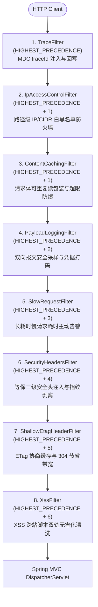
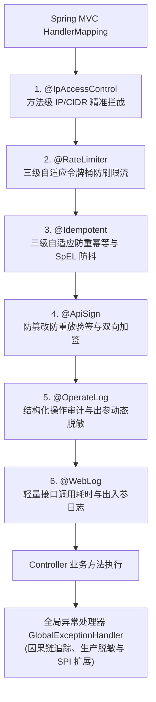

# ateng-boot-web Web 运行时增强套件

> 提供基于 Filter 的全链路追踪、全局统一异常安全防御拦截、Jackson 53 位精度防失真与时间格式化、自适应幂等防重、自适应限流、动态安全 CORS、双向加签验签、审计日志与安全流式文件下载辅助。

---

## 0. 特性与公共 API 全景速查矩阵 (100% 覆盖)

| 特性分类 | 特性名称 | 核心门面 / 注解 / SPI | 关键配置项 (`ateng.boot.*`) | 关键 API 签名 / 核心行为 | 锚定验证源头 (*Test / Sample) |
| :--- | :--- | :--- | :--- | :--- | :--- |
| **链路追踪** | HTTP 链路追踪过滤器与门面 | `TraceFilter`, `TraceUtil` | `ateng.boot.web.trace.enabled`, `header` (或 `header-name`) | `TraceUtil.getTraceId()`, `setTraceId(id)`, `clear()`, MDC `traceId` 注入并在 `finally` 严格清理 | `TraceFilterTest.java`, `TraceUtilTest.java`, `WebObservabilityAndAuditControllerTest.java` |
| **全局异常防御** | 全局统一异常拦截与生产脱敏 | `GlobalExceptionHandler`, `GlobalExceptionCustomizer` | - | 挂载 `GlobalExceptionCustomizer` SPI 链式定制，拦截 `BusinessException`（双模因果堆栈）、`MethodArgumentNotValidException`、`HandlerMethodValidationException`、`BindException`、`ConstraintViolationException`、400/404/405/406/413/415/503/500 精细化转译与生产脱敏 | `GlobalExceptionHandlerTest.java`, `WebContractAndExceptionControllerTest.java`, `WebExceptionSampleControllerTest.java` |
| **精度与时间规范** | 53 位雪花精度防截断与时间序列化 | `JacksonCustomizer` | `ateng.boot.web.long-to-string` | Long/BigInteger 序列化为 String，标准 `yyyy-MM-dd HH:mm:ss` 格式化，不覆盖原生 `ObjectMapper` | `JacksonCustomizerTest.java`, `WebContractAndExceptionControllerTest.java`, `WebContractSampleControllerTest.java` |
| **接口审计日志** | 声明式接口耗时审计与安全防 OOM | `@WebLog`, `WebLogAspect` | `ateng.boot.web.log.enabled` | `@WebLog(value, printParams, printResult, excludeParams)`，大文件 Multipart 自动占位防 OOM | `WebLogAspectTest.java`, `WebObservabilityAndAuditControllerTest.java` |
| **动态 CORS 跨域** | 动态跨域来源校验与凭证安全反射 | `CorsOriginProvider`, `DefaultCorsOriginProvider`, `DynamicCorsConfigurationSource` | `ateng.boot.web.cors.enabled`, `allowed-origins`, `allow-credentials`, `allow-localhost`, `max-age` | 基于配置属性通配或 SPI 动态扩展校验 Origin，安全反射并支持凭据传输（Cookie），放行本地 localhost 调试 | `DynamicCorsTest.java`, `WebSecurityAndSignControllerTest.java` |
| **自适应限流防刷** | 三级自适应令牌桶与多维限流 | `@RateLimiter`, `LimitType`, `RateLimiterStore`, `InMemoryRateLimiterStore`, `RedisRateLimiterStore`, `RedissonRateLimiterStore` | `ateng.boot.web.ratelimit.enabled`, `in-memory.max-capacity`, `in-memory.clean-interval` | `@RateLimiter(key, time, count, limitType)`，支持默认/IP/用户/租户（LimitType.TENANT）多维限流防刷与租户流量隔离 | `RateLimiterAspectTest.java`, `AtengRateLimiterAutoConfigurationTest.java`, `InMemoryRateLimiterStoreTest.java`, `WebTrafficGovernanceControllerTest.java`, `WebTenantRateLimiterSampleTest.java` |
| **自适应防重幂等** | 三级自适应防重幂等引擎 | `@Idempotent`, `IdempotentKeyStore`, `InMemoryIdempotentKeyStore`, `RedisIdempotentKeyStore`, `RedissonIdempotentKeyStore` | `ateng.boot.web.idempotent.enabled`, `key-prefix`, `in-memory.max-capacity`, `in-memory.clean-interval` | `@Idempotent(key, timeout, message, delKeyOnException)`，支持 SpEL 动态提取业务键、自动防抖、业务异常释放 | `IdempotentAspectTest.java`, `AtengIdempotentAutoConfigurationTest.java`, `InMemoryIdempotentKeyStoreTest.java`, `WebTrafficGovernanceControllerTest.java` |
| **云原生优雅停机** | K8s 就绪探针排空与容器生命周期治理 | `AtengGracefulShutdownHandler`, `PreStopEndpoint`, `PreStopController` | `ateng.boot.web.shutdown.enabled`, `drain-timeout`, `smart-lifecycle-enabled`, `actuator-endpoint-enabled`, `mvc-endpoint-enabled`, `mvc-endpoint-path` | 翻转 `ReadinessState.REFUSING_TRAFFIC`，受管静默排空等待（`drain-timeout: 10s`），`AtomicBoolean` 状态机排空幂等，支持 Actuator `/actuator/pre-stop` 与 MVC `/pre-stop` 双模端点，`SmartLifecycle` 兜底 | `AtengGracefulShutdownHandlerTest.java`, `PreStopEndpointTest.java`, `PreStopControllerTest.java`, `AtengGracefulShutdownAutoConfigurationTest.java`, `WebRuntimePipelineSampleControllerTest.java` |
| **慢请求主动告警** | 长耗时慢请求性能主动告警与长连接放行 | `SlowRequestFilter` | `ateng.boot.web.slow-request.enabled`, `threshold`, `exclude-urls` | 请求出口处计算总耗时，超过阈值（强类型 Duration）输出包含 TraceId、URI、Method、耗时与 ClientIp 的 `[SLOW_REQUEST]` 格式化 WARN 日志，自动放行 WebSocket、SSE、文件下载与异步挂起请求，支持 Ant 路径白名单 | `SlowRequestFilterTest.java`, `SlowRequestMockMvcTest.java`, `WebObservabilityAndAuditControllerTest.java` |
| **结构化操作审计** | 企业级操作审计切面与存储解耦 SPI | `@OperateLog`, `OperateLogAspect`, `OperateLogStorageProvider`, `DefaultOperateLogStorageProvider`, `OperateLogModel` | `ateng.boot.web.operate-log.enabled` | `@OperateLog(module, type, description, saveParams, saveResult, excludeParams)`，自动关联线程上下文（操作人/租户），出参自动联动 `@FieldSensitive` 视图脱敏，保留原始异常因果链，支持异步存储 SPI 与开箱即用 JSON 保底 | `OperateLogAspectTest.java`, `OperateLogAutoConfigurationTest.java`, `WebObservabilityAndAuditControllerTest.java` |
| **请求体可重读管道** | 通用请求体重复多次读取与载荷防爆管道 | `ContentCachingFilter`, `CachedBodyHttpServletRequest` | `ateng.boot.web.body-cache.max-body-size`, `sign.enabled`, `payload-log.enabled` | 自动包装 POST/PUT/PATCH 请求为可重复读包装器，支持多次重复消费输入流，单次超限（DataSize）快速失败截断防 OOM，自动跳过表单与文件上传，旧版 `RequestBodyCachingFilter` 保持向后兼容委托 | `ContentCachingFilterTest.java`, `ContentCachingAutoConfigurationTest.java`, `ContentCachingMockMvcTest.java`, `WebObservabilityAndAuditControllerTest.java` |
| **载荷采样日志** | HTTP 请求/响应双向安全采样与截断防 OOM | `PayloadLoggingFilter` | `ateng.boot.web.payload-log.enabled`, `max-payload-size`, `exclude-urls` | 请求出口处单行聚合输出包含 TraceId、Method、URI、Status、Cost、ReqBody 与 RespBody 的 `[HTTP_PAYLOAD]` 日志，内建 MIME 过滤、凭据正则掩码（`***`）、强类型截断（默认 4KB）、状态自适应提升（$\ge 400$ 提升为 WARN）并在 `finally` 确定性执行 `copyBodyToResponse()` | `PayloadLoggingFilterTest.java`, `PayloadLoggingMockMvcTest.java`, `WebObservabilityAndAuditControllerTest.java` |
| **双向加签验签** | API 报文防篡改防重放加签验签引擎 | `@ApiSign`, `SignAlgorithm`, `ApiSigner`, `HmacSha256Signer`, `RsaSigner`, `Sm2Signer`, `SignKeyProvider`, `DefaultSignKeyProvider`, `SignCanonicalUtil`, `RequestBodyCachingFilter`, `CachedBodyHttpServletRequest` | `ateng.boot.web.sign.enabled`, `algorithm`, `app-id`, `secret-key`, `public-key`, `private-key`, `expire`, `max-body-size`, `header-app-id`, `header-timestamp`, `header-nonce`, `header-signature` | `@ApiSign(expireSeconds, signResponse)`，支持 HMAC-SHA256 对称、RSA 非对称与国密 SM2/SM3 非对称算法，请求体可重读包装，Nonce 防重放与响应加签 | `ApiSignerTest.java`, `Sm2SignerTest.java`, `SignCanonicalUtilTest.java`, `AtengApiSignAutoConfigurationTest.java`, `RequestBodyCachingFilterTest.java`, `WebSecurityAndSignControllerTest.java`, `WebSecuritySignRsaSampleTest.java`, `WebSecuritySignSm2SampleTest.java` |
| **安全响应头防御** | 等保三级基线安全响应头注入与容器指纹剥离 | `SecurityHeadersFilter`, `SecurityHeadersProperties` | `ateng.boot.web.security-headers.enabled`, `content-type-options`, `frame-options`, `xss-protection`, `referrer-policy`, `content-security-policy`, `permissions-policy`, `remove-server-header` | 注入 `X-Content-Type-Options: nosniff`、`X-Frame-Options: SAMEORIGIN`、`X-XSS-Protection: 1; mode=block`、`Referrer-Policy: strict-origin-when-cross-origin` 等基准头，剥离容器 `Server` 头，`containsHeader` 守卫防覆盖 | `SecurityHeadersFilterTest.java`, `AtengWebAutoConfigurationTest.java`, `WebSecurityHeadersAndEtagSampleTest.java` |
| **ETag 协商缓存** | 基于浅层哈希的内容协商缓存与 304 节省带宽 | `ShallowEtagHeaderFilter`, `EtagProperties` | `ateng.boot.web.etag.enabled`, `write-weak-etag` | 条件自动装配 Spring 原生 `ShallowEtagHeaderFilter`，自动计算内容摘要并生成 `ETag` 响应头，配合 `If-None-Match` 返回 `304 Not Modified` 节省网络带宽 | `AtengWebAutoConfigurationTest.java`, `WebSecurityHeadersAndEtagSampleTest.java` |
| **XSS 安全清洗与放行** | 双轨无害化清洗与字段级富文本放行 | `XssFilter`, `XssHttpServletRequestWrapper`, `XssCleaner`, `XssMode`, `XssStringDeserializer`, `@XssIgnore` | `ateng.boot.web.xss.enabled`, `mode`, `exclude-urls` | 支持 `XssMode.ESCAPE`（默认 HTML 转义）与 `STRIP`（标签剔除），拦截 Query/Form 表单参数与 JSON 请求体，通过 `@XssIgnore` 声明式在字段或类级别豁免富文本，支持 Ant 白名单路径排除 | `XssCleanerTest.java`, `XssFilterTest.java`, `XssHttpServletRequestWrapperTest.java`, `XssStringDeserializerTest.java`, `WebXssSampleControllerTest.java`, `WebXssStripModeSampleTest.java` |
| **IP 访问控制防火墙** | 声明式 IP 防火墙与 CIDR 子网判定 | `@IpAccessControl`, `IpAccessMode`, `IpAccessControlFilter`, `IpAccessControlAspect`, `IpAccessControlProperties` | `ateng.boot.web.ip-access-control.enabled`, `http-status-403`, `mode`, `rules`, `filter.enabled`, `filter.mode`, `filter.rules`, `filter.url-patterns`, `filter.exclude-urls` | `@IpAccessControl(mode, rules, message, httpStatus403)`，单 IP 与 IPv4/IPv6 CIDR 子网位运算判定，白名单/黑名单双模，方法级切面与 URL 路径级过滤器双重防线，默认遵循 ADR-0004 返回 HTTP 200 + Result 403 并注入 `X-Denied-Reason: IP_BLOCKED`，支持物理 403 切断 | `IpUtilTest.java`, `IpAccessControlFilterTest.java`, `IpAccessControlAspectTest.java`, `WebIpAccessSampleControllerTest.java`, `WebIpAccessFilterSampleTest.java` |
| **客户端 IP 提取** | 多级反向代理穿透与 CIDR 判定 | `IpUtil` | - | `IpUtil.getClientIp()`, `getClientIp(request)`, `isInRange(ip, cidrOrIp)`, `isInRange(ip, rules)`，穿透 X-Forwarded-For 等多级代理，纯 JDK 原生无 DNS 依赖 CIDR/单 IP 子网判定 | `IpUtilTest.java`, `WebRuntimePipelineSampleControllerTest.java` |
| **Servlet 上下文与下载** | 上下文安全门面与 RFC 6266 文件下载 | `ServletUtil` | - | `ServletUtil.getRequest()`, `getResponse()`, `getHeader()`, `writeDownload(response, filename, bytes/stream)`，RFC 6266 双重编码彻底杜绝浏览器乱码 | `ServletUtilTest.java`, `WebRuntimePipelineSampleControllerTest.java` |
| **声明式 API 多版本分流** | 路径前缀与请求头双模版本控制 | `@ApiVersion`, `ApiVersionCondition`, `ApiVersionRequestMappingHandlerMapping`, `ApiVersionProperties` | `ateng.boot.web.api-version.enabled`, `default-version`, `header`, `path-prefix-enabled` | 支持 Controller 类或方法标注，URL 路径前缀（`/v{version}/`）与请求头（`X-API-Version`）双向自动分流，缺省默认版本回退与方法级覆盖类级 | `ApiVersionConditionTest.java`, `ApiVersionRequestMappingHandlerMappingTest.java`, `WebVersionSampleControllerTest.java` |
| **枚举字典与反序列化** | 启动期枚举扫描注册表、三阶只读 HTTP 字典端点与 Jackson 强类型双向反序列化器 | `EnumDictionaryRegistry`, `EnumDictionaryController`, `EnumDictionaryProperties`, `EnumNamingStrategy`, `BaseEnumDeserializer`, `AtengEnumDictionaryAutoConfiguration` | `ateng.boot.web.enum.enabled`, `path-prefix`, `naming-strategy`, `scan-packages` | `GET {prefix}` 全量目录索引; `GET {prefix}/{name}` 单枚举查询; `POST/GET {prefix}/batch` 批量聚合; 别名冲突启动期 Fail-Fast; i18n 多语言透明适配 (`enum.{SimpleName}.{NAME}`) 与平滑回退; `BaseEnumDeserializer` 自动拦截数字 code、字符串 code 与常量名精准反序列化为 `IBaseEnum` 实例 | `EnumDictionaryTest.java`, `EnumDictionaryI18nTest.java`, `BaseEnumDeserializerTest.java`, `WebEnumSampleControllerTest.java` |
| **启动一体化就绪卡片** | 启动完成规整 ASCII 欢迎卡片与在线文档直达 | `ApplicationReadyCardListener`, `ApplicationReadyEvent` | `ateng.boot.web.ready-card.enabled` | 容器启动就绪输出一体化 ASCII 卡片，自适应探测 Local/Network 访问地址、Swagger/SpringDoc 接口文档、运行环境、进程 PID、JVM 堆内存与秒级启动耗时 | `ApplicationReadyCardListenerTest.java`, `WebReadyCardSampleTest.java` |
| **生产环境高危安全防呆** | 生产环境高危配置主动探测与启动防呆自检 | `ProductionSanityChecker`, `ApplicationReadyEvent` | `ateng.boot.web.sanity-check.enabled` | 生产环境 (`prod`/`production`) 启动就绪安全防呆自检，前置扫描并告警 Swagger/Knife4j 文档公网暴露、HTTP Payload 全量双向采样日志与 H2 控制台暴露，输出高危安全告警日志 | `ProductionSanityCheckerTest.java`, `WebReadyCardSampleTest.java`, `WebProductionSanitySampleTest.java` |

---

## 1. 模块定位与 Maven 坐标

`ateng-boot-web` 专注于提升 Web 接口层的高可用、安全性与工程规范。依托 Spring MVC 与 Servlet 标准，通过防御性自动装配为 Controller 传输边界提供全方位开箱即用护航。

```xml
<dependency>
    <groupId>io.github.atengk</groupId>
    <artifactId>ateng-boot-web</artifactId>
</dependency>
```

---

## 2. 核心架构与设计不变量

### 2.1 Web 过滤器链 (Filter Chain) 优先级拓扑

框架内建完整的 Web 过滤器防线，基于 `FilterRegistrationBean.setOrder()` 严格控制执行先后次序：



### 2.2 AOP 切面防护链优先级拓扑

当请求抵达 Spring MVC 调度层后，Controller 业务方法周围构建起纵深防御切面链：



### 2.3 四大核心设计不变量

1. **显式响应契约 (Explicit Result Contract, No `@ResponseBodyAdvice`)**：
   - 遵循 [ADR-0002](./docs/adr/0002-explicit-result-contract-no-response-body-advice.md)，坚决杜绝全局 `@ResponseBodyAdvice` 自动拦截隐式包装；
   - Controller 接口必须显式声明并返回强类型 `Result<T>`，依托强类型契约实现自洽与全链路确定性。
2. **53 位雪花精度防失真 (Long to String Invariant)**：
   - JavaScript `Number` 遵循 IEEE 754 双精度浮点标准，最大安全整数为 $2^{53}-1$（`9007199254740991`）；
   - 后端 64 位雪花算法 ID（如 `1846182948192841920L`）通过 `JacksonCustomizer` 统一序列化为字符串输出，标准日期时间统一格式化为 `yyyy-MM-dd HH:mm:ss`，且坚决不覆盖底座 `ObjectMapper` Bean。
3. **内存真明文与脱敏收敛于视图 (In-Memory Plaintext Invariant)**：
   - 遵循 [ADR-0012](./docs/adr/0012-lifecycle-separated-data-security.md)，业务层与实体对象在 JVM 内存中 100% 保持真实原始明文，严禁在业务逻辑中直接对实体属性打星号；
   - 敏感数据脱敏展示（如 `@FieldSensitive`）统一收敛于视图序列化与操作审计切面，彻底杜绝掩码脏数据写回数据库。
4. **分层双防校验体系 (Fail-Fast First Line of Defense Validation)**：
   - 遵循 [ADR-0027](./docs/adr/0027-defense-in-depth-validation-and-standardized-primitives.md)，传输边界（Controller）作为第一道防线，统一采用 JSR-303 注解声明语法与格式校验以实现 Fail-Fast；
   - 批量列表入参强制使用 `ValidList<E>` 杜绝 Spring 默认漏检，分组校验统一使用 `ValidationGroups` 标准标记。

---

## 3. 传输契约、序列化规范与全局异常防御体系

### 3.1 显式强类型契约与分层防卫校验

#### 场景痛点与设计原则
- 杜绝隐式 `@ResponseBodyAdvice` 导致的 Swagger 契约失真、文件下载/第三方接口被误包装次生灾难；
- 杜绝 ORM 实体（Entity）直接暴露在 Controller 传输边界引发的信息泄露与无权限字段篡改；
- 解决 Spring MVC 默认对 `List<UserDTO>` 批量入参直接忽略 `@Valid` 级联校验的隐蔽漏检缺陷；
- 通过 `ValidationGroups.Create` 与 `ValidationGroups.Update` 实现单 DTO 复用与差分校验。

#### 1:1 实测业务代码范式

```java
package io.github.atengk.boot.sample.web.dto;

import io.github.atengk.boot.core.validation.ValidationGroups;
import jakarta.validation.constraints.Email;
import jakarta.validation.constraints.Max;
import jakarta.validation.constraints.Min;
import jakarta.validation.constraints.NotBlank;
import jakarta.validation.constraints.NotNull;
import jakarta.validation.constraints.Pattern;
import lombok.Data;

/**
 * 用户注册与更新传输载荷对象
 */
@Data
public class UserRegisterDTO {

    @NotNull(groups = ValidationGroups.Update.class, message = "更新操作用户ID不能为空")
    private Long id;

    @NotBlank(message = "用户姓名不能为空")
    private String name;

    @NotNull(message = "年龄不能为空")
    @Min(value = 1, message = "年龄必须大于0")
    @Max(value = 150, message = "年龄不能超过150岁")
    private Integer age;

    @NotBlank(message = "邮箱不能为空")
    @Email(message = "邮箱格式不正确")
    private String email;

    @NotBlank(message = "手机号不能为空")
    @Pattern(regexp = "^1[3-9]\d{9}$", message = "手机号格式不正确")
    private String phone;

    private String password;
}
```

```java
package io.github.atengk.boot.sample.web.vo;

import io.github.atengk.boot.core.annotation.FieldSensitive;
import io.github.atengk.boot.core.enums.SensitiveType;
import lombok.AllArgsConstructor;
import lombok.Builder;
import lombok.Data;
import lombok.NoArgsConstructor;

/**
 * 用户注册成功返回视图对象
 */
@Data
@Builder
@NoArgsConstructor
@AllArgsConstructor
public class UserRegisterVO {

    // 64 位雪花算法主键 ID（由 Jackson 序列化为 String 防失真）
    private Long id;

    private String name;

    private Integer age;

    private String email;

    // 手机号码（出库动态脱敏掩码呈现，如 138****5678）
    @FieldSensitive(SensitiveType.MOBILE_PHONE)
    private String phone;
}
```

```java
package io.github.atengk.boot.sample.web.controller;

import io.github.atengk.boot.core.model.Result;
import io.github.atengk.boot.core.validation.ValidList;
import io.github.atengk.boot.core.validation.ValidationGroups;
import io.github.atengk.boot.sample.web.dto.UserRegisterDTO;
import io.github.atengk.boot.sample.web.vo.UserRegisterVO;
import jakarta.validation.Valid;
import jakarta.validation.groups.Default;
import org.springframework.validation.annotation.Validated;
import org.springframework.web.bind.annotation.PostMapping;
import org.springframework.web.bind.annotation.PutMapping;
import org.springframework.web.bind.annotation.RequestBody;
import org.springframework.web.bind.annotation.RequestMapping;
import org.springframework.web.bind.annotation.RestController;

@RestController
@RequestMapping("/sample/web/contract")
public class WebContractAndExceptionController {

    // 1. 会员实名注册（第一道防线 JSR-303 格式校验）
    @PostMapping("/user")
    public Result<UserRegisterVO> createUser(@Valid @RequestBody UserRegisterDTO dto) {
        UserRegisterVO vo = UserRegisterVO.builder()
                .id(1846182948192841920L)
                .name(dto.getName())
                .age(dto.getAge())
                .email(dto.getEmail())
                .phone(dto.getPhone())
                .build();
        return Result.success(vo);
    }

    // 2. 渠道商批量入驻（依托 ValidList 实现 Fail-Fast 级联校验）
    @PostMapping("/users/batch")
    public Result<Integer> batchCreateUsers(@Valid @RequestBody ValidList<UserRegisterDTO> users) {
        return Result.success(users.size());
    }

    // 3. 会员信息更新（演示 ValidationGroups.Update 分组校验，必须校验 id 非空）
    @PutMapping("/user")
    public Result<UserRegisterVO> updateUser(@Validated({Default.class, ValidationGroups.Update.class}) @RequestBody UserRegisterDTO dto) {
        UserRegisterVO vo = UserRegisterVO.builder()
                .id(dto.getId())
                .name(dto.getName())
                .age(dto.getAge())
                .email(dto.getEmail())
                .phone(dto.getPhone())
                .build();
        return Result.success(vo);
    }
}
```

#### 真实 HTTP 响应报文验证

##### (1) 会员注册成功响应 (`POST /sample/web/contract/user`)
```json
{
  "code": 200,
  "msg": "操作成功",
  "data": {
    "id": "1846182948192841920",
    "name": "张三",
    "age": 25,
    "email": "zhangsan@example.com",
    "phone": "138****5678"
  },
  "success": true,
  "traceId": "c8a14b0365734fb4864f7bdf753b890a"
}
```

##### (2) 校验失败快速阻断响应 (入参手机号格式错误)
```json
{
  "code": 400,
  "msg": "手机号格式不正确",
  "data": null,
  "success": false,
  "traceId": "d1e2f3a4b5c6d7e8"
}
```

---

### 3.2 53 位雪花精度防失真与时间标准化

#### 专属 YAML 配置片段
```yaml
ateng:
  boot:
    web:
      # 是否将 Long/BigInteger 序列化为 String（防前端 JS 53 位雪花 ID 精度截断，默认 true）
      long-to-string: true
```

#### 核心机制
- 挂载 `Jackson2ObjectMapperBuilderCustomizer`，在序列化时将 `Long`、`long`、`BigInteger` 自动转为 `String` 输出；
- 统一格式化时间类型：`LocalDateTime` (`yyyy-MM-dd HH:mm:ss`)、`LocalDate` (`yyyy-MM-dd`)、`LocalTime` (`HH:mm:ss`)；
- **坚决不覆盖底座 `ObjectMapper` Bean**，完美保留下游 Spring Boot 原生定制链条。

#### 1:1 实测业务代码范式
```java
package io.github.atengk.boot.sample.web.vo;

import lombok.AllArgsConstructor;
import lombok.Builder;
import lombok.Data;
import lombok.NoArgsConstructor;
import java.time.LocalDate;
import java.time.LocalDateTime;
import java.time.LocalTime;

@Data
@Builder
@NoArgsConstructor
@AllArgsConstructor
public class DateTimeDemoVO {
    private Long id;
    private LocalDateTime dateTime;
    private LocalDate date;
    private LocalTime time;
}
```

```java
// Controller 端点：获取日期时间与雪花 ID 序列化视图
@GetMapping("/datetime")
public Result<DateTimeDemoVO> getDateTimeDemo() {
    DateTimeDemoVO vo = DateTimeDemoVO.builder()
            .id(1846182948192841920L)
            .dateTime(LocalDateTime.of(2026, 10, 19, 14, 30, 0))
            .date(LocalDate.of(2026, 10, 19))
            .time(LocalTime.of(14, 30, 0))
            .build();
    return Result.success(vo);
}
```

#### 真实 HTTP 响应报文验证 (`GET /sample/web/contract/datetime`)
```json
{
  "code": 200,
  "msg": "操作成功",
  "data": {
    "id": "1846182948192841920",
    "dateTime": "2026-10-19 14:30:00",
    "date": "2026-10-19",
    "time": "14:30:00"
  },
  "success": true,
  "traceId": "e3f4a5b6c7d8e9f0"
}
```

---

### 3.3 全局异常防御体系与因果堆栈双模治理

#### 核心机制与异常边界
1. **业务受控异常双模治理 (`BusinessException`)**：
   - **无 `cause` 异常**：属于前置常规业务阻断，记录 INFO 级别日志，返回业务错误码与提示，无须打印巨幅堆栈；
   - **有 `cause` 异常**：属于底层驱动或依赖异常转译，记录 ERROR 级别日志并打印完整因果链调用栈与 `traceId`，对外返回受管提示。
2. **JSR-303 参数校验失败**：
   - 统一拦截 `MethodArgumentNotValidException`、`HandlerMethodValidationException`（Spring 6.1+）、`ConstraintViolationException` 与 `BindException`，自动提取首个不合规字段的友好提示返回 HTTP 200 + Code 400。
3. **精细化 Web 传输层协议异常拦截**：
   - `MaxUploadSizeExceededException` $
ightarrow$ 413 "上传文件大小超出限制"；
   - `HttpMediaTypeNotSupportedException` $
ightarrow$ 415 "不支持的媒体类型"；
   - `HttpMediaTypeNotAcceptableException` $
ightarrow$ 406 直接回写 JSON 契约，彻底杜绝 MVC 内容协商次生死锁；
   - `AsyncRequestTimeoutException` $
ightarrow$ 503 "异步请求处理超时"；
   - `MissingServletRequestPartException` $
ightarrow$ 400 "缺少必要的文件或表单分片"。
4. **未知根异常强制生产脱敏**：
   - 未捕获的系统根异常（如 `NullPointerException`、`SQLException`）统一脱敏返回 `{"code":500, "msg":"系统繁忙，请稍后再试"}`，严防向前端泄露数据表结构、SQL 或私有类名；后端日志全量打印原始堆栈与 MDC `traceId`。

#### 1:1 实测业务代码范式
```java
// 1. 业务受控异常中断（无 cause：轻量级日志记录，返回业务错误码）
@GetMapping("/error/business")
public Result<Void> triggerBusinessException() {
    throw new BusinessException(CommonResultCode.BAD_REQUEST.getCode(), "用户积分余额不足");
}

// 2. 携带底层驱动 cause 根因的因果业务异常（保留完整异常因果链）
@GetMapping("/error/causal")
public Result<Void> triggerCausalException() {
    throw new BusinessException(CommonResultCode.INTERNAL_SERVER_ERROR, "网关代理服务通信异常",
            new IOException("Connection reset by peer"));
}

// 3. 未捕获未知根异常（生产强制脱敏，MDC traceId 闭环溯源）
@GetMapping("/error/unexpected")
public Result<Void> triggerUnexpectedException() {
    throw new NullPointerException("内部系统模拟空指针异常");
}

// 4. 大文件超限异常（MaxUploadSizeExceededException -> 413 Payload Too Large）
@GetMapping("/error/payload-too-large")
public Result<Void> triggerMaxUploadSizeExceeded() {
    throw new MaxUploadSizeExceededException(10485760L);
}

// 5. 异步请求处理超时异常（AsyncRequestTimeoutException -> 503 Service Unavailable）
@GetMapping("/error/async-timeout")
public Result<Void> triggerAsyncTimeout() {
    throw new AsyncRequestTimeoutException();
}
```

#### 真实 HTTP 响应报文验证

##### (1) 业务受控异常 (`GET /sample/web/contract/error/business`)
```json
{
  "code": 400,
  "msg": "用户积分余额不足",
  "data": null,
  "success": false,
  "traceId": "f1a2b3c4d5e6f7a8"
}
```

##### (2) 未知系统异常生产脱敏 (`GET /sample/web/contract/error/unexpected`)
```json
{
  "code": 500,
  "msg": "系统繁忙，请稍后再试",
  "data": null,
  "success": false,
  "traceId": "a9b8c7d6e5f4a3b2"
}
```

##### (3) 上传文件超限拦截 (`GET /sample/web/contract/error/payload-too-large`)
```json
{
  "code": 413,
  "msg": "上传文件大小超出限制",
  "data": null,
  "success": false,
  "traceId": "b1c2d3e4f5a6b7c8"
}
```

---

### 3.4 业务领域异常定制扩展点 (`GlobalExceptionCustomizer` SPI)

#### 场景痛点与扩展机制
- 业务系统常需集成第三方 SDK（如微信/支付宝支付 SDK、短信网关、风控云服务），其抛出的专有受检异常需要转译为自定义业务错误码（如 `40020`）；
- 严禁直接侵入修改 Starter 内部的 `GlobalExceptionHandler` 源码；
- 框架提供 `GlobalExceptionCustomizer` SPI 接口，支持通过 `@Order` 声明链式优先级。当转译器识别目标异常时返回非空 `Result<?>` 即完成处理；返回 `null` 则平滑穿透至下一定制器或默认处理器。

#### 1:1 实测业务代码范式

```java
package io.github.atengk.boot.sample.web.exception;

/**
 * 支付通道专有受控异常
 */
public class PaymentChannelException extends RuntimeException {
    private final String channelCode;

    public PaymentChannelException(String channelCode, String message) {
        super(message);
        this.channelCode = channelCode;
    }

    public String getChannelCode() { return channelCode; }
}
```

```java
package io.github.atengk.boot.sample.web.handler;

import io.github.atengk.boot.core.model.Result;
import io.github.atengk.boot.sample.web.exception.PaymentChannelException;
import io.github.atengk.boot.web.handler.GlobalExceptionCustomizer;
import org.springframework.core.annotation.Order;
import org.springframework.stereotype.Component;

/**
 * 支付通道异常自定义转译器
 */
@Component
@Order(10)
public class PaymentExceptionCustomizer implements GlobalExceptionCustomizer {

    @Override
    public Result<?> customize(Throwable throwable) {
        if (throwable instanceof PaymentChannelException pce) {
            // 转译为自定义领域状态码 40020
            return Result.fail(40020, "支付通道异常 [" + pce.getChannelCode() + "]: " + pce.getMessage());
        }
        return null;
    }
}
```

#### 真实 HTTP 响应报文验证 (`GET /sample/web/contract/error/payment`)
```json
{
  "code": 40020,
  "msg": "支付通道异常 [ALIPAY]: 通道账户可用余额不足",
  "data": null,
  "success": false,
  "traceId": "c3d4e5f6a7b8c9d0"
}
```

---

### 3.5 Web 只读枚举字典与 Jackson 强类型双向反序列化

#### 场景痛点
1. **下拉字典割裂**：前端下拉选项依赖零散接口，重复开发且无法随后端枚举变动即时同步；
2. **反射穿透隐患**：传统字典方案往往通过“传类全路径”任意反射枚举，存在严重的安全代码执行漏洞（RCE）与 GC 压力；
3. **入参反序列化断层**：Controller Request DTO 接收枚举参数时，Jackson 原生默认只认常量名，前端传入数字 code（如 `1`）或字符串 code（如 `"1"`）直接反序列化崩溃；
4. **多语言割裂**：国际化应用中，枚举选项文案无法随请求头 `Accept-Language` 动态切换。

#### 专属 YAML 配置片段
```yaml
ateng:
  boot:
    web:
      enum:
        # 是否启用只读枚举字典与反序列化增强（默认 true）
        enabled: true
        # 枚举字典 HTTP 端点前缀（默认 /api/system/enums）
        path-prefix: /api/system/enums
        # 枚举命名策略（LOWER_CAMEL / LOWER_UNDERSCORE，默认 LOWER_CAMEL）
        naming-strategy: LOWER_CAMEL
        # 枚举扫描包路径（建议配置具体业务包）
        scan-packages:
          - io.github.atengk.boot.sample.web.enums
```

#### 核心机制与五维生产模型
- **启动期白名单扫描与 Fail-Fast 阻断**：严格依据 `scan-packages` 白名单扫描，绝不运行时任意类反射；启动期发现同名或别名碰撞立即终止应用启动；
- **只读不可变预热与零 GC 分配**：预编译构建为不可变 Map，运行时提供 $O(1)$ 无锁纯内存检索，零锁争用与零瞬态垃圾对象；
- **三阶只读 HTTP 端点矩阵**：
  - 单枚举查询：`GET /api/system/enums/{name}` $
ightarrow$ `Result<List<OptionItem<Object>>>`
  - 批量聚合查询：`POST /api/system/enums/batch` 或 `GET /api/system/enums/batch?names=userStatus,orderType` $
ightarrow$ `Result<Map<String, List<OptionItem<Object>>>>`
  - 全量目录检索：`GET /api/system/enums` $
ightarrow$ `Result<Map<String, List<OptionItem<Object>>>>`，供前端系统初始化时一次性拉取并持久化至 Pinia / Vuex 全局状态；
- **Jackson 强类型双向反序列化**：自动装配 `BaseEnumDeserializer`，Controller DTO 可直接声明强类型枚举字段（如 `private UserStatusEnum status;`），前端无论传入数字 `1`、字符串 `"1"` 还是常量名 `"ACTIVE"`（大小写不敏感），均能精准自动映射为枚举实例；
- **多语言 (i18n) 透明适配与平滑回退**：弱依赖接入 Spring `MessageSource` 与 `LocaleContextHolder`，自动按 `enum.{SimpleName}.{NAME}` 规则提取当前请求区域设置文案；未配置国际化时平滑回退为枚举自带的 `getLabel()`。

#### 1:1 实测业务代码范式

```java
package io.github.atengk.boot.sample.web.enums;

import io.github.atengk.boot.core.annotation.EnumAlias;
import io.github.atengk.boot.core.enums.IBaseEnum;
import java.util.Map;

// 1. 实现 IBaseEnum<Integer>，重写 getDisabled 与 getExtra 携带扩展样式
public enum UserStatusEnum implements IBaseEnum<Integer> {
    ACTIVE(1, "启用"),
    DISABLED(2, "禁用") {
        @Override
        public Boolean getDisabled() { return true; }
        @Override
        public Map<String, Object> getExtra() { return Map.of("color", "red", "reason", "违规停用"); }
    },
    LOCKED(3, "锁定");

    private final Integer code;
    private final String label;

    UserStatusEnum(Integer code, String label) {
        this.code = code;
        this.label = label;
    }

    @Override public Integer getCode() { return code; }
    @Override public String getLabel() { return label; }
}

// 2. 显式标注 @EnumAlias 别名覆盖
@EnumAlias("orderType")
public enum OrderTypeEnum implements IBaseEnum<String> {
    NORMAL("normal", "普通订单"),
    SECKILL("seckill", "秒杀订单"),
    PROMOTION("promotion", "促销订单");

    private final String code;
    private final String label;

    OrderTypeEnum(String code, String label) {
        this.code = code;
        this.label = label;
    }

    @Override public String getCode() { return code; }
    @Override public String getLabel() { return label; }
}
```

```java
package io.github.atengk.boot.sample.web.dto;

import io.github.atengk.boot.core.annotation.InEnum;
import io.github.atengk.boot.sample.web.enums.OrderTypeEnum;
import io.github.atengk.boot.sample.web.enums.UserStatusEnum;
import jakarta.validation.constraints.NotBlank;
import jakarta.validation.constraints.NotNull;
import java.io.Serializable;
import lombok.Data;

@Data
public class WebEnumUserRequest implements Serializable {
    @NotBlank(message = "用户名不能为空")
    private String username;

    // 第一道防线：校验原始编码合法性
    @NotNull(message = "状态编码不能为空")
    @InEnum(value = UserStatusEnum.class, message = "用户状态编码不合法")
    private Integer statusCode;

    // Jackson 强类型双向反序列化绑定：前端传 1, "1", "ACTIVE" 均可自动解析
    private UserStatusEnum status;

    private OrderTypeEnum orderType;
}
```

```java
// Controller 端点：接收强类型枚举绑定请求
@PostMapping("/enum-bind")
public Result<WebEnumUserResponse> bindEnum(@Valid @RequestBody WebEnumUserRequest request) {
    return Result.success(new WebEnumUserResponse(
            request.getUsername(),
            request.getStatusCode(),
            request.getStatus(),
            request.getOrderType()
    ));
}
```

#### 真实 HTTP 响应报文验证

##### (1) 查询单枚举字典 (`GET /api/system/enums/userStatus`)
```json
{
  "code": 200,
  "msg": "操作成功",
  "data": [
    {
      "code": 1,
      "label": "启用",
      "disabled": false,
      "extra": {}
    },
    {
      "code": 2,
      "label": "禁用",
      "disabled": true,
      "extra": {
        "color": "red",
        "reason": "违规停用"
      }
    },
    {
      "code": 3,
      "label": "锁定",
      "disabled": false,
      "extra": {}
    }
  ],
  "success": true,
  "traceId": "9b1c2d3e4f5a6b7c"
}
```

##### (2) 批量聚合字典 (`POST /api/system/enums/batch` 入参 `["userStatus", "orderType"]`)
```json
{
  "code": 200,
  "msg": "操作成功",
  "data": {
    "userStatus": [
      { "code": 1, "label": "启用", "disabled": false, "extra": {} },
      { "code": 2, "label": "禁用", "disabled": true, "extra": { "color": "red", "reason": "违规停用" } },
      { "code": 3, "label": "锁定", "disabled": false, "extra": {} }
    ],
    "orderType": [
      { "code": "normal", "label": "普通订单", "disabled": false, "extra": {} },
      { "code": "seckill", "label": "秒杀订单", "disabled": false, "extra": {} },
      { "code": "promotion", "label": "促销订单", "disabled": false, "extra": {} }
    ]
  },
  "success": true,
  "traceId": "a1b2c3d4e5f60718"
}
```

##### (3) Jackson 强类型枚举自动反序列化 (`POST /sample/web/contract/enum-bind`)
入参无论传整型 `1` 还是字符串 `"1"` 亦或常量名 `"ACTIVE"`，后端均能精准映射为强类型枚举：
```json
// 请求体
{
  "username": "张三",
  "statusCode": 1,
  "status": "ACTIVE",
  "orderType": "normal"
}

// 响应体 (HTTP 200)
{
  "code": 200,
  "msg": "操作成功",
  "data": {
    "username": "张三",
    "statusCode": 1,
    "status": "ACTIVE",
    "orderType": "NORMAL"
  },
  "success": true,
  "traceId": "7ebf8152661ffdafc927a86c0646e1d9"
}
```

---

## 4. 全链路追踪、请求体缓存与双向可观测审计

### 4.1 全链路追踪与 MDC 安全流转 (`TraceFilter` & `TraceUtil`)

#### 场景痛点
微服务或高并发单体应用在排查生产异常时，若缺乏唯一的全链路追踪 ID，海量并发日志交织在一起无法还原现场调用上下文；若异步线程池或虚拟线程未透传该上下文，排障链条将在异步边界彻底断裂；若请求出口处未彻底清理 ThreadLocal，将引发线程复用下的上下文脏读与内存泄露。

#### 专属 YAML 配置片段
```yaml
ateng:
  boot:
    web:
      trace:
        # 是否启用全链路追踪过滤器（默认 true）
        enabled: true
        # HTTP 链路追踪请求头/响应头名称（默认 X-Trace-Id）
        header: X-Trace-Id
```

#### 核心机制与全链路流转
- **入口自洽提取与生成**：在 HTTP 入口处自动提取入站请求头 `X-Trace-Id`；若调用方未传，则基于无锁 `IdUtil.fastSimpleUUID()` 极速初始化；
- **MDC 注入与响应头回写**：将 TraceId 注入 SLF4J MDC `traceId`，并在 HTTP 响应头自动回写 `X-Trace-Id`，便于前端与网关协同溯源；
- **确定性出口现场清理**：在 `TraceFilter` 的 `finally` 块中严格执行 `TraceUtil.clear()`（MDC 现场清空），杜绝 Servlet 容器线程池内存泄露或跨请求污染；
- **虚拟线程与异步透传**：配合 Core 模块的 `ContextCopyingTaskDecorator` 与受管线程池，异步任务与虚拟线程可无感透传 `traceId`。

#### 1:1 实测业务代码范式
```java
// Controller 端点：获取当前请求的全局 TraceId 与虚拟线程透传状态
@GetMapping("/trace")
public Result<String> getTraceId() {
    return Result.success(TraceUtil.getTraceId());
}

@GetMapping("/virtual-thread")
public Result<Map<String, Object>> checkVirtualThread() throws Exception {
    Map<String, Object> data = new LinkedHashMap<>();
    Executor executor = taskExecutorProvider.getIfAvailable();
    if (executor != null) {
        CompletableFuture<Boolean> future = CompletableFuture.supplyAsync(
                () -> isVirtualThread(Thread.currentThread()),
                executor
        );
        data.put("isVirtual", future.get(3, TimeUnit.SECONDS));
    } else {
        data.put("isVirtual", isVirtualThread(Thread.currentThread()));
    }
    data.put("threadName", Thread.currentThread().getName());
    data.put("traceId", TraceUtil.getTraceId());
    return Result.success(data);
}
```

#### 真实 HTTP 响应报文验证 (`GET /sample/web/observability/trace`)
```http
HTTP/1.1 200 OK
X-Trace-Id: custom-trace-88889999
Content-Type: application/json

{
  "code": 200,
  "msg": "操作成功",
  "data": "custom-trace-88889999",
  "success": true,
  "traceId": "custom-trace-88889999"
}
```

---

### 4.2 通用请求体可重读管道与载荷防爆 (`ContentCachingFilter`)

#### 场景痛点
Servlet 标准的 `HttpServletRequest.getInputStream()` 属于单向瞬态流，一旦被加签验签切面、操作审计或认证过滤器读取一次后流便耗尽，后续 Controller 将直接抛出 `HttpMessageNotReadableException`；若盲目缓冲所有报文，攻击者投递超大载荷将瞬间引发应用内存溢出（OOM）。

#### 专属 YAML 配置片段
```yaml
ateng:
  boot:
    web:
      body-cache:
        # 单次请求体最大缓存与重读容量限制（超限快速失败截断防 OOM，默认 2MB）
        max-body-size: 2MB
```

#### 核心机制
- **按需条件装配**：仅在开启 API 加签验签或 Payload 采样日志时激活，关闭时零包装开销；
- **安全可重读包装**：自动将 POST/PUT/PATCH 请求升级为 `CachedBodyHttpServletRequest`，支持多次重复调用 `getInputStream()`；
- **智能跳过与载荷截断**：自动跳过 `multipart/form-data` 文件上传与普通表单；单次请求体超出 `max-body-size`（强类型 DataSize）时安全截断防 OOM。

#### 1:1 实测业务代码范式
```java
// Controller 端点：多次连续读取输入流验证可重复消费能力
@PostMapping("/body-cache")
public Result<Map<String, Object>> testBodyCache(HttpServletRequest request) throws IOException {
    // 第一次读取
    byte[] firstRead = request.getInputStream().readAllBytes();
    // 第二次在同一次请求中再次读取输入流
    byte[] secondRead = request.getInputStream().readAllBytes();

    boolean isCachedWrapper = request instanceof CachedBodyHttpServletRequest;
    byte[] cachedBodyBytes = isCachedWrapper
            ? ((CachedBodyHttpServletRequest) request).getCachedBody()
            : new byte[0];

    Map<String, Object> map = new LinkedHashMap<>();
    map.put("firstReadLength", firstRead.length);
    map.put("secondReadLength", secondRead.length);
    map.put("isCachedWrapper", isCachedWrapper);
    map.put("cachedLength", cachedBodyBytes.length);
    map.put("contentMatch", firstRead.length == secondRead.length);
    return Result.success(map);
}
```

#### 真实 HTTP 响应报文验证 (`POST /sample/web/observability/body-cache`)
```json
{
  "code": 200,
  "msg": "操作成功",
  "data": {
    "firstReadLength": 47,
    "secondReadLength": 47,
    "isCachedWrapper": true,
    "cachedLength": 47,
    "contentMatch": true
  },
  "success": true,
  "traceId": "a1b2c3d4e5f60718"
}
```

---

### 4.3 HTTP Payload 双向安全采样打印与截断防 OOM (`PayloadLoggingFilter`)

#### 场景痛点
线上排查接口交互纠纷或第三方回调对接时，往往需要完整的请求体与响应体日志。但传统 LogFilter 极易引发三个致命问题：①日志被拆分为多行，在多线程高并发下交织断裂无法检索；②密码、Token、私钥等凭据在日志中裸奔泄露；③文件上传或大报文导致日志巨幅膨胀与内存爆仓。

#### 专属 YAML 配置片段
```yaml
ateng:
  boot:
    web:
      payload-log:
        # 是否启用 HTTP 请求/响应双向安全采样日志（默认 false）
        enabled: true
        # 单次最大采样打印字节上限（超限自动截断防爆，默认 4KB）
        max-payload-size: 4KB
        # 免采样路径白名单（支持 Ant 通配符）
        exclude-urls:
          - "/actuator/**"
          - "/sample/web/observability/payload-excluded"
```

#### 核心机制
- **单行聚合日志**：在请求出口处单行聚合输出包含 `traceId`、`method`、`uri`、`status`、`cost`、`reqBody` 与 `respBody` 的 `[HTTP_PAYLOAD]` 日志；
- **凭据正则掩码**：内建高性能正则过滤器，对 JSON、表单及 XML 格式中的 `password`、`pwd`、`secret`、`token`、`authorization` 等凭据自动打码替换为 `***`；
- **强类型截断防爆**：超出 `max-payload-size`（默认 4KB）的超长报文自动截断并追加 `... [TRUNCATED]` 标识；
- **状态码自适应提升**：正常请求输出 INFO 级别日志；状态码 $\ge 400$ 自动提升为 WARN 级别；并在 `finally` 中确定性调用 `responseWrapper.copyBodyToResponse()`，杜绝丢包。

#### 1:1 实测业务代码范式
```java
// 1. 业务回显端点（自动触发双向采样与凭据打码）
@PostMapping("/payload-echo")
public Result<Map<String, Object>> echoPayload(@RequestBody Map<String, Object> payload) {
    return Result.success(payload);
}

// 2. 免采样白名单端点（匹配 exclude-urls 跳过日志打印）
@PostMapping("/payload-excluded")
public Result<Map<String, Object>> excludedPayload(@RequestBody Map<String, Object> payload) {
    return Result.success(payload);
}
```

#### 后台聚合日志输出范式
```text
2026-11-07 23:43:48.905 INFO  [main] [trace-payload-001] i.g.a.b.web.filter.PayloadLoggingFilter : [HTTP_PAYLOAD] traceId=[trace-payload-001], method=[POST], uri=[/sample/web/observability/payload-echo], status=[200], cost=[4ms], reqBody=[{"username":"audit-admin","password":"***","token":"***","amount":100}], respBody=[{"code":200,"msg":"操作成功","data":{"username":"audit-admin","password":"***","token":"***","amount":100},"traceId":"trace-payload-001","success":true}]
```

---

### 4.4 声明式企业级操作审计切面与存储解耦 SPI (`@OperateLog` & `OperateLogStorageProvider`)

#### 场景痛点
等保合规要求核心业务系统对操作员的重要行为（新增、修改、删除、导出等）留存结构化审计痕迹。然而手写审计日志极易入侵业务代码，且容易在审计日志中遗留密码明文，或在脱敏过程中污染 JVM 内存实体导致写回数据库被二次损坏。

#### 专属 YAML 配置片段
```yaml
ateng:
  boot:
    web:
      operate-log:
        # 是否启用企业级声明式操作审计切面（默认 true）
        enabled: true
```

#### 核心机制与五维生产模型
- **声明式无侵入拦截**：通过 `@OperateLog(module, type, description, excludeParams)` 标注 Controller 即可完成审计采集；
- **四维上下文全息关联**：自动关联当前请求的 $\langle\text{MDC traceId}, \text{User}, \text{TenantId}, \text{ClientIp}\rangle$，无须业务显式传参；
- **敏感入参安全排除**：配置 `excludeParams = {"password"}`，切面自动将入参中的对应字段安全替换为 `[EXCLUDED]`；
- **出参动态脱敏与内存真明文守卫**：出参序列化时自动联动 Core 模块的 `@FieldSensitive` 对手机号等敏感字段掩码入库（如 `138****5678`），同时断言 JVM 内存实体中的字段 100% 保持原始真明文；
- **异常捕获与透明重抛**：业务方法异常时，切面捕获并记录错误信息与状态（`status = 1`），保留原始异常因果链原样向外抛出；
- **存储架构解耦 SPI**：提供 `OperateLogStorageProvider` SPI 接口，默认通过 `DefaultOperateLogStorageProvider` 以 SLF4J 格式化 JSON 保底输出，业务系统可轻松扩展投递至 MySQL、Elasticsearch 或 Kafka。

#### 1:1 实测业务代码范式
```java
// 1. 新增操作员审计（排除 password 入参，出参 phone 动态脱敏）
@PostMapping("/audit/operator")
@OperateLog(
        module = "权限中心",
        type = OperateTypeEnum.INSERT,
        description = "新增系统操作员",
        excludeParams = {"password"}
)
public Result<UserRegisterVO> createOperator(@Valid @RequestBody AuditUserDTO dto) {
    UserRegisterVO vo = UserRegisterVO.builder()
            .id(1846182948192841920L)
            .name(dto.getUsername())
            .age(28)
            .email(dto.getEmail() != null ? dto.getEmail() : "operator@example.com")
            .phone(dto.getPhone() != null ? dto.getPhone() : "13812345678")
            .build();
    return Result.success(vo);
}

// 2. 查询操作员详情审计
@GetMapping("/audit/operator/{id}")
@OperateLog(
        module = "权限中心",
        type = OperateTypeEnum.QUERY,
        description = "查询操作员详情"
)
public Result<UserRegisterVO> getOperator(@PathVariable Long id) {
    UserRegisterVO vo = UserRegisterVO.builder()
            .id(id)
            .name("系统管理员")
            .age(30)
            .email("admin@example.com")
            .phone("13912345678")
            .build();
    return Result.success(vo);
}

// 3. 业务操作异常审计（记录失败状态并原样重抛）
@GetMapping("/audit/error")
@OperateLog(
        module = "权限中心",
        type = OperateTypeEnum.OTHER,
        description = "异常操作审计"
)
public Result<Void> triggerAuditError() {
    throw new BusinessException(CommonResultCode.BAD_REQUEST.getCode(), "操作员状态已冻结，禁止变更");
}
```

#### 存储模型快照 (`OperateLogModel`)
```json
{
  "traceId": "trace-audit-001",
  "userName": "admin-operator",
  "tenantId": "tenant-888",
  "clientIp": "127.0.0.1",
  "module": "权限中心",
  "operateType": "INSERT",
  "description": "新增系统操作员",
  "requestParams": "{\"username\":\"audit-user\",\"password\":\"[EXCLUDED]\",\"email\":\"audit@example.com\",\"phone\":\"13812345678\"}",
  "responseResult": "{\"code\":200,\"msg\":\"操作成功\",\"data\":{\"id\":\"1846182948192841920\",\"name\":\"audit-user\",\"age\":28,\"email\":\"audit@example.com\",\"phone\":\"138****5678\"},\"success\":true}",
  "status": 0,
  "costTime": 4,
  "errorMsg": null
}
```

---

### 4.5 轻量级接口耗时日志与出入参审计 (`@WebLog`)

#### 场景痛点
排查接口偶发慢响应或线上入参复现时，业务开发常常在方法开头与结尾手工编写繁琐且易漏的 `log.info`，不仅产生面条代码，还容易因序列化大文件（如 `MultipartFile`）导致内存 OOM。

#### 专属 YAML 配置片段
```yaml
ateng:
  boot:
    web:
      log:
        # 是否启用接口耗时与出入参审计日志切面（默认 true）
        enabled: true
```

#### 核心机制
- **声明式一行标注**：使用 `@WebLog(value = "...", printParams = true, printResult = true, printCostTime = true)` 即可自动打印请求开始与结束日志；
- **敏感参数过滤**：配置 `excludeParams = {"password"}`，入参敏感字段自动替换为 `[EXCLUDED]`；
- **防 OOM 占位保护**：自动检测 `MultipartFile`、`HttpServletRequest`、`HttpServletResponse` 等不可序列化或大对象，并以 `[MultipartFile: filename, size]` 自动占位，杜绝内存爆仓。

#### 1:1 实测业务代码范式
```java
// Controller 端点：操作员档案更新耗时审计
@PostMapping("/weblog")
@WebLog(value = "操作员档案更新耗时审计", excludeParams = {"password"}, printCostTime = true)
public Result<Map<String, Object>> webLogDemo(@Valid @RequestBody AuditUserDTO dto) {
    Map<String, Object> data = new LinkedHashMap<>();
    data.put("operator", dto.getUsername());
    data.put("status", "AUDITED");
    data.put("traceId", TraceUtil.getTraceId());
    return Result.success(data);
}
```

#### 后台日志输出范式
```text
2026-11-07 23:43:48.755 INFO  [main] [8eb3869ffe6423ed77edfd47e3a65d88] i.g.atengk.boot.web.aspect.WebLogAspect : [WebLog] 开始请求: URL=[POST /sample/web/observability/weblog], IP=[127.0.0.1], 操作=[操作员档案更新耗时审计], 目标=[io.github.atengk.boot.sample.web.controller.WebObservabilityAndAuditController#webLogDemo], 入参={"dto":{"username":"weblog-tester","password":"[EXCLUDED]","email":null,"phone":null}}
2026-11-07 23:43:48.757 INFO  [main] [8eb3869ffe6423ed77edfd47e3a65d88] i.g.atengk.boot.web.aspect.WebLogAspect : [WebLog] 结束请求: URL=[POST /sample/web/observability/weblog], 耗时=[2ms], 出参={"code":200,"msg":"操作成功","data":{"operator":"weblog-tester","status":"AUDITED","traceId":"8eb3869ffe6423ed77edfd47e3a65d88"},"success":true}
```

---

### 4.6 长耗时慢请求性能主动告警 (`SlowRequestFilter`)

#### 场景痛点
生产环境中偶发的大报表统计、复杂多表联查或网络调用卡顿容易拖垮容器吞吐量。若依赖排查日志逐条定位，滞后性极大；若无脑拦截所有长连接，又会误伤 WebSocket、SSE 流式推送与大文件下载。

#### 专属 YAML 配置片段
```yaml
ateng:
  boot:
    web:
      slow-request:
        # 是否启用慢请求性能主动告警过滤器（默认 true）
        enabled: true
        # 慢请求耗时判定阈值（超过该时长输出 WARN 告警日志，默认 3s）
        threshold: 3s
        # 慢请求告警豁免白名单路径（支持 Ant 通配符，自动放行免打扰）
        exclude-urls:
          - "/actuator/**"
          - "/sample/web/observability/slow-excluded"
```

#### 核心机制
- **出口主动告警**：在请求出口处统计总耗时，超过阈值（强类型 Duration）输出包含 TraceId、URI、Method、耗时与 ClientIp 的 `[SLOW_REQUEST]` 格式化 WARN 日志；
- **智能长连接放行**：自动识别并放行 WebSocket、SSE、流式大文件下载及异步挂起请求；
- **白名单免打扰**：配置 `exclude-urls`（如定时报表跑批端点）实施全局告警豁免。

#### 1:1 实测业务代码范式
```java
// 1. 模拟慢报表查询（耗时超出阈值触发 [SLOW_REQUEST] 告警）
@GetMapping("/slow-query")
public Result<Map<String, Object>> slowQueryDemo(@RequestParam(defaultValue = "60") long delayMs) throws InterruptedException {
    Thread.sleep(delayMs);
    Map<String, Object> data = new LinkedHashMap<>();
    data.put("reportName", "2026年度财务汇总对账单");
    data.put("records", 100000);
    data.put("costMs", delayMs);
    data.put("status", "SUCCESS");
    return Result.success(data);
}

// 2. 慢请求白名单排除（即使耗时超限也不输出告警日志）
@GetMapping("/slow-excluded")
public Result<String> slowExcludedDemo(@RequestParam(defaultValue = "60") long delayMs) throws InterruptedException {
    Thread.sleep(delayMs);
    return Result.success("excluded-ok");
}
```

#### 后台告警日志范式
```text
2026-11-07 23:43:48.758 WARN  [main] [8eb3869ffe6423ed77edfd47e3a65d88] i.g.a.boot.web.filter.SlowRequestFilter : [SLOW_REQUEST] 检测到慢 HTTP 请求: method=[GET], uri=[/sample/web/observability/slow-query], cost=[68ms], threshold=[50ms], clientIp=[127.0.0.1], traceId=[8eb3869ffe6423ed77edfd47e3a65d88]
```

---

## 5. 接口防刷限流与防重幂等治理套件

### 5.1 三级自适应令牌桶限流防刷引擎 (`@RateLimiter`)

#### 场景痛点
恶意爬虫高频扫库、短信网关遭遇黑产盗刷短信、突发秒杀流量压垮数据库；单体小项目引入 Redis 往往带来额外运维成本，而分布式集群仅用单机内存又无法统管全局配额；多租户 SaaS 架构下若无法按租户实现流量隔离，某一租户的突发流量将直接挤占全站资源引发系统雪崩。

#### 专属 YAML 配置片段
```yaml
ateng:
  boot:
    web:
      ratelimit:
        # 是否启用三级自适应令牌桶限流引擎（默认 true）
        enabled: true
        in-memory:
          # 单机内存限流存储最大令牌桶容量（防 OOM 软上限，默认 10000）
          max-capacity: 10000
          # 内存过期令牌桶后台定时清理周期（默认 5m）
          clean-interval: 5m
```

#### Tier 1 $\rightarrow$ Tier 2 $\rightarrow$ Tier 3 三级自适应架构
- **Tier 1 (Redisson 分布式令牌桶)**：检测到类路径存在 `RedissonClient` 时自动装配 `RedissonRateLimiterStore`，依托 Redis 原生 `RRateLimiter` 实施微秒级集群全局分布式精准限流；
- **Tier 2 (Redis Lua 脚本原子限流)**：仅检测到 `StringRedisTemplate` 时自动装配 `RedisRateLimiterStore`，基于原子 Lua 脚本与 Sliding Window 算法实现分布式限流；
- **Tier 3 (纯原生单机内存令牌桶保底)**：无任何中间件连接时，平滑降级为 `InMemoryRateLimiterStore`，基于并发无锁哈希表与定时清理守护线程提供极速单机防护，零外部网络依赖与内存泄漏风险；
- **SPI 扩展接管**：支持通过实现 `RateLimiterStore` 并在 Spring 容器注册自定义 Bean，全权接管限流底层存储（如自建 Guava RateLimiter 或 Sentinel 集成）。

#### 多维限流防御模型
- `LimitType.DEFAULT`：方法全局维度统一限流；
- `LimitType.IP`：基于客户端真实 IP（经由 `IpUtil` 穿透多级反向代理）实施联合防刷（如短信验证码防刷）；
- `LimitType.USER`：提取 `UserContextHolder.get()` 实施登录用户配额限流；
- `LimitType.TENANT`：自动提取 `TenantContextHolder.getTenantId()` 实施 SaaS 多租户原生流量隔离，超限返回 `429 Too Many Requests` 并注入 `Retry-After` 响应标头；
- **SpEL 复合维度**：支持通过 `key = "#tenantId"` 与 `limitType = LimitType.IP` 组合出“IP + 业务租户”双重联合限流键。

#### 1:1 实测业务代码范式
```java
// 1. 全局默认接口限流（10秒内最多允许2次请求）
@GetMapping("/ratelimit/default")
@RateLimiter(count = 2, time = 10, message = "默认接口限流拦截")
public Result<String> testDefaultRateLimit() {
    return Result.success("全局接口访问成功");
}

// 2. 短信验证码客户端 IP 防刷限流（10秒内同一客户端 IP 最多允许2次发送）
@GetMapping("/ratelimit/ip")
@RateLimiter(limitType = LimitType.IP, count = 2, time = 10, message = "短信验证码请求过于频繁，请稍后再试")
public Result<String> testIpRateLimit(HttpServletRequest request) {
    String clientIp = IpUtil.getClientIp(request);
    return Result.success("验证码已发送至客户端 IP: " + clientIp);
}

// 3. 用户维度限流（10秒内同一已登录用户最多允许2次调用）
@GetMapping("/ratelimit/user")
@RateLimiter(limitType = LimitType.USER, count = 2, time = 10, message = "用户操作过于频繁，请稍后再试")
public Result<String> testUserRateLimit() {
    String userName = UserContextHolder.get();
    return Result.success("用户资料操作成功: " + (userName != null ? userName : "anonymous"));
}

// 4. SpEL 与客户端 IP 复合限流（10秒内同一 IP 与同一租户最多允许2次调用）
@GetMapping("/ratelimit/composite")
@RateLimiter(limitType = LimitType.IP, key = "#tenantId", count = 2, time = 10, message = "复合租户限流拦截")
public Result<String> testCompositeRateLimit(@RequestParam String tenantId) {
    return Result.success("租户配额请求成功: " + tenantId);
}

// 5. SaaS 多租户原生流量隔离限流（每个租户 60 秒内最多允许 2 次调用，租户间完全隔离）
@GetMapping("/ratelimit/tenant")
@RateLimiter(limitType = LimitType.TENANT, count = 2, time = 60, timeUnit = TimeUnit.SECONDS, message = "当前租户请求过于频繁，请稍后再试")
public Result<String> testTenantRateLimit() {
    String tenantId = TenantContextHolder.getTenantId();
    return Result.success("tenant=" + (tenantId != null ? tenantId : "default"));
}
```

#### 真实 HTTP 响应报文验证

##### (1) 正常放行响应 (`GET /sample/web/traffic/ratelimit/default`)
```json
{
  "code": 200,
  "msg": "操作成功",
  "data": "全局接口访问成功",
  "success": true,
  "traceId": "9b1c2d3e4f5a6b7c"
}
```

##### (2) 超限熔断拦截响应 (HTTP 200 + Code 429 + 标头注入)
```http
HTTP/1.1 200 OK
Retry-After: 60
Content-Type: application/json

{
  "code": 429,
  "msg": "当前租户请求过于频繁，请稍后再试",
  "data": null,
  "success": false,
  "traceId": "aba6866f993f3bb5"
}
```

---

### 5.2 三级自适应防重幂等治理引擎 (`@Idempotent`)

#### 场景痛点
用户弱网环境下反复双击提交、网络抖动引发网关自动重发重试，或者前端未做防抖，导致电商系统重复创建订单、重复扣款或生成多笔重复流水；当业务校验发生异常（如库存不足、密码错误）被捕获时，若幂等锁未主动释放，用户将被强制等待数秒锁超时方可再次提交，严重损害交互体验。

#### 专属 YAML 配置片段
```yaml
ateng:
  boot:
    web:
      idempotent:
        # 是否启用三级自适应防重幂等引擎（默认 true）
        enabled: true
        # 幂等锁全局缓存键前缀（默认 idempotent:）
        key-prefix: "idempotent:"
        in-memory:
          # 单机内存幂等存储最大键容量（防 OOM 软上限，默认 10000）
          max-capacity: 10000
          # 内存过期防重键定时清理周期（默认 5m）
          clean-interval: 5m
```

#### Tier 1 $\rightarrow$ Tier 2 $\rightarrow$ Tier 3 自适应抢占架构
- **Tier 1 (Redisson 分布式原子锁)**：类路径存在 `RedissonClient` 时装配 `RedissonIdempotentKeyStore`，通过分布式锁实现精准并发互斥与自动看门狗续期；
- **Tier 2 (Redis SETNX 原子抢占)**：仅存在 `StringRedisTemplate` 时装配 `RedisIdempotentKeyStore`，通过 `setIfAbsent` 带过期时间实现毫秒级轻量分布式防重；
- **Tier 3 (纯原生单机内存防抖)**：零中间件环境下平滑装配 `InMemoryIdempotentKeyStore`，基于原子 `ConcurrentHashMap` 与带容量阈值的清理引擎保障单机安全运行；
- **SPI 扩展接管**：提供 `IdempotentKeyStore` SPI，支持自定义第三方存储（如分布式缓存或数据库唯一流水表）。

#### 核心防重机制与参数配置
- **精准 SpEL 业务键锁定**：通过 `key = "#dto.orderNo"` 动态从入参中提取全局唯一业务流水号，配合 `prefix = "order:pay:"` 实现细粒度防重；
- **无参请求特征指纹自动哈希**：未指定 `key` 时，系统自动提取调用方类名、方法名、用户标识及入参哈希值组装为请求指纹，实现通用的防连击防抖；
- **业务异常锁确定性释放 (`delKeyOnException = true`)**：业务方法抛出异常时，切面在 `finally` 块中立即主动释放当前线程持有的幂等键，无需等待 `timeout` 超时即可允许用户修正参数后立即重试。

#### 1:1 实测业务代码范式
```java
// 1. 电商订单支付 SpEL 业务键精准防重（以订单号为业务锁，锁定2秒）
@PostMapping("/idempotent/order")
@Idempotent(key = "#dto.orderNo", prefix = "order:pay:", timeout = 2, message = "订单处理中，请勿重复提交")
public Result<String> createOrder(@Valid @RequestBody TrafficOrderDTO dto) {
    return Result.success(dto.getOrderNo());
}

// 2. 营销领券按钮特征指纹自动哈希防抖（基于入参特征自动生成防抖指纹）
@PostMapping("/idempotent/button")
@Idempotent(timeout = 2, message = "操作过于频繁，请稍后再试")
public Result<String> submitButton(@RequestParam String formToken) {
    return Result.success("表单提交成功: " + formToken);
}

// 3. 优惠券领取精准业务防重
@PostMapping("/idempotent/coupon")
@Idempotent(key = "#couponCode", prefix = "coupon:claim:", timeout = 2, message = "领券操作过于频繁，请稍后再试")
public Result<String> claimCoupon(@RequestParam String couponCode) {
    return Result.success("优惠券领取成功: " + couponCode);
}

// 4. 业务异常时锁自动释放（delKeyOnException = true，业务可恢复异常时立即允许重试）
@PostMapping("/idempotent/fail-retry")
@Idempotent(key = "#bizId", prefix = "biz:retry:", timeout = 5, delKeyOnException = true)
public Result<String> failAndRetry(@RequestParam String bizId, @RequestParam boolean fail) {
    if (fail) {
        throw new BusinessException(CommonResultCode.BAD_REQUEST.getCode(), "可恢复业务校验失败");
    }
    return Result.success("success: " + bizId);
}
```

#### 真实 HTTP 响应报文验证

##### (1) 首次提交成功放行 (`POST /sample/web/traffic/idempotent/order`)
```json
{
  "code": 200,
  "msg": "操作成功",
  "data": "ORD_TRAFFIC_1729000000000",
  "success": true,
  "traceId": "7ebf8152661ffdaf"
}
```

##### (2) 快速重复提交被切面拦截 (Code 40003)
```json
{
  "code": 40003,
  "msg": "订单处理中，请勿重复提交",
  "data": null,
  "success": false,
  "traceId": "9c8b7a6f5e4d3c2b"
}
```

---

## 6. 传输安全防护网、双向加签与边界防火墙

### 6.1 双向 API 数据加签验签与防重放 (`@ApiSign` & `ApiSigner`)

#### 场景痛点
开放平台商户 API 与外部 Webhook 回调暴露在公网，面临恶意嗅探、参数篡改（如篡改支付金额、收款账户）以及黑产网络重放攻击（重复扣款、虚假结算）；传统接口签名往往缺少严格待签串拼装规范，极易因 JSON 字段乱序或空格引起哈希漂移，且大多数框架仅支持入站验签而无法保障服务端出站数据的防篡改。

#### 专属 YAML 配置片段
```yaml
ateng:
  boot:
    web:
      sign:
        # 是否启用 API 双向数据加签验签引擎（默认 false）
        enabled: true
        # 签名算法（HMAC_SHA256 | RSA | SM2，默认 HMAC_SHA256）
        algorithm: HMAC_SHA256
        # 应用系统标识（用于多商户/多应用隔离）
        app-id: "test-app"
        # 对称签名密钥（HMAC-SHA256 对称加验签时使用）
        secret-key: "TestSecretKey123"
        # 非对称签名公钥（RSA/SM2 时入站验签使用）
        public-key: ""
        # 非对称签名私钥（RSA/SM2 时出站加签使用）
        private-key: ""
        # 签名时效窗口（强类型 Duration，防重放时间窗口，默认 60s）
        expire: 60s
        # 请求体可重读最大缓存容量（强类型 DataSize，默认 2MB）
        max-body-size: 2MB
        # 自定义请求头映射规范
        header-app-id: "X-App-Id"
        header-timestamp: "X-Timestamp"
        header-nonce: "X-Nonce"
        header-signature: "X-Signature"
```

#### 核心机制与不变量
- **金融级标准化待签串规范**：严格遵循 `Method
URI
Timestamp
Nonce
SortedQueryString
BodySha256` 六段拼装协议，消解排版空格与参数乱序引起的签名哈希漂移；
- **全算法矩阵原生支持**：
  - `HMAC_SHA256`：基于共享对称密钥的高性能对称加验签；
  - `RSA`：基于 2048 位标准公私钥对的金融级非对称数字签名；
  - `SM2`：100% 依托原生标准库实现的纯原生国密 SM2/SM3 算法，零第三方外部依赖；
- **原子 Nonce 防重放**：基于自适应幂等存储引擎（Tier 1 Redisson $
ightarrow$ Tier 2 Redis $
ightarrow$ Tier 3 In-Memory），在 `expire` 时效窗口内严密防范请求重放拦截（返回 `40003` 业务错误）；
- **实时签名请求头预生成辅助端点 (`POST /sample/web/security/sign/prepare-headers`)**：为接入方前端或测试客户端动态拼装并计算签名请求头，一键输出开箱可用的 cURL 命令；
- **密钥提供者扩展点 (`SignKeyProvider` SPI)**：支持实现 `SignKeyProvider` 接口并在 Spring 容器注册 Bean，对接 KMS、HashiCorp Vault 或企业数据库密钥中心。

#### 1:1 实测业务代码范式
```java
// 1. 开放平台商户提单双向加验签：验签入站请求并对返回的 Result 加签回写响应头
@PostMapping({"/sign/orders", "/sign/order"})
@ApiSign(verifyRequest = true, signResponse = true, expireSeconds = 10)
public Result<Map<String, Object>> createOrder(@Valid @RequestBody OrderSignDTO dto) {
    Map<String, Object> data = new LinkedHashMap<>();
    data.put("orderNo", dto.getOrderNo());
    data.put("amount", dto.getAmount());
    data.put("status", "CONFIRMED");
    data.put("message", "商户订单验签通过并建单成功");
    return Result.success(data);
}

// 2. 国密 SM2/SM3 非对称双向加验签
@PostMapping("/sign/sm2")
@ApiSign(verifyRequest = true, signResponse = true, expireSeconds = 10)
public Result<Map<String, Object>> createOrderSm2(@Valid @RequestBody OrderSignDTO dto) {
    Map<String, Object> data = new LinkedHashMap<>();
    data.put("orderNo", dto.getOrderNo());
    data.put("amount", dto.getAmount());
    data.put("algorithm", "SM2");
    data.put("status", "CONFIRMED");
    data.put("message", "国密SM2/SM3双向加验签成功");
    return Result.success(data);
}

// 3. GET Query 查询参数防篡改加签验签
@GetMapping("/sign/query")
@ApiSign(verifyRequest = true, signResponse = true, expireSeconds = 10)
public Result<Map<String, Object>> queryData(@RequestParam("code") String code) {
    Map<String, Object> data = new LinkedHashMap<>();
    data.put("merchantCode", code);
    data.put("verified", true);
    data.put("qualificationStatus", "NORMAL");
    return Result.success(data);
}

// 4. 单向验签：仅校验入站数据签名（第三方 Webhook 支付结果异步通知场景）
@PostMapping("/sign/inbound")
@ApiSign(verifyRequest = true, signResponse = false, expireSeconds = 10)
public Result<Map<String, Object>> inboundOnly(@Valid @RequestBody OrderSignDTO dto) {
    Map<String, Object> data = new LinkedHashMap<>();
    data.put("orderNo", dto.getOrderNo());
    data.put("inboundStatus", "RECEIVED");
    data.put("message", "第三方支付通知验签成功");
    return Result.success(data);
}

// 5. 单向加签：入站免签，服务端出站数据强制加签（对账单或高敏感数据查询）
@GetMapping("/sign/outbound")
@ApiSign(verifyRequest = false, signResponse = true, expireSeconds = 10)
public Result<Map<String, Object>> outboundOnly() {
    Map<String, Object> data = new LinkedHashMap<>();
    data.put("reportTitle", "2026年第四季度结算报表");
    data.put("settlementAmount", 88888.88);
    data.put("currency", "CNY");
    data.put("securityLevel", "HIGH");
    return Result.success(data);
}

// 6. 实时签名请求头预生成辅助端点（一键动态生成签名头与 cURL 命令）
@PostMapping("/sign/prepare-headers")
public Result<Map<String, Object>> prepareHeaders(@RequestBody(required = false) PrepareSignHeadersDTO dto) {
    // 动态计算标准化待签串，按配置调用 ApiSigner 生成签名头与一键体验命令
    return Result.success(result);
}
```

#### 真实 HTTP 响应报文验证

##### (1) 商户提单验签放行并回写签名头 (`POST /sample/web/security/sign/orders`)
```http
HTTP/1.1 200 OK
Content-Type: application/json;charset=UTF-8
X-Timestamp: 1729000000000
X-Nonce: e8d4f0a1c3b2e9d8f7a6b5c4d3e2f1a0
X-Signature: MEQCIA2+...==
X-Trace-Id: 5d1f8a7e3b9c2a10

{
  "code": 200,
  "msg": "操作成功",
  "data": {
    "orderNo": "ORD_SIGN_001",
    "amount": 99.99,
    "status": "CONFIRMED",
    "message": "商户订单验签通过并建单成功"
  },
  "success": true,
  "traceId": "5d1f8a7e3b9c2a10"
}
```

##### (2) 签名超时或遭篡改拦截 (Code 400)
```json
{
  "code": 400,
  "msg": "请求签名已过期",
  "data": null,
  "success": false,
  "traceId": "9b8a7c6d5e4f3a2b"
}
```

---

### 6.2 XSS 跨站脚本双轨无害化清洗与字段级富文本豁免 (`XssFilter` & `@XssIgnore`)

#### 场景痛点
用户在输入框中提交恶意 `<script>alert('xss')</script>` 或 `` 畸变标签，若未做防护极易在展示时盗取用户 Token、Cookie 凭证甚至篡改页面 DOM；若全量一刀切过滤，会导致 CMS 文章、运营公告等合法富文本编辑器内容中的 HTML 格式被全部破坏；且传统的清洗往往遗漏了 URL Query 与 Form 表单入参。

#### 专属 YAML 配置片段
```yaml
ateng:
  boot:
    web:
      xss:
        # 是否启用全局 XSS 跨站脚本安全清洗（默认 false）
        enabled: true
        # 清洗模式（ESCAPE 实体转义 | STRIP 标签剔除，默认 ESCAPE）
        mode: ESCAPE
        # 排除白名单路径列表（Ant 匹配规则，整条路径整体跳过 XSS 清洗）
        exclude-urls:
          - "/sample/web/security/xss/excluded/**"
```

#### 双轨清洗模式与字段级精准豁免
- **`XssMode.ESCAPE`（默认推荐）**：将 `<`、`>`、`"`、`'` 等特殊字符转换为 `&lt;`、`&gt;`、`&quot;`、`&#39;`，既消除执行风险又保留原始文本可视内容；
- **`XssMode.STRIP`**：彻底剔除 HTML 标签与 `<script>` 代码块，保留纯净文本内容；
- **全链路双防线覆盖**：
  - `XssHttpServletRequestWrapper`：负责对 GET Query 参数与 POST Form 表单入参做无害化清洗；
  - `XssStringDeserializer`：注入 Jackson 反序列化管道，深度递归清洗 JSON 请求体中所有字符串属性；
- **声明式富文本豁免 (`@XssIgnore`)**：
  - **字段级豁免**：在 DTO 的特定字段上标注 `@XssIgnore`（如 `private String content;`），仅该富文本属性保留原样 HTML，同对象其他字段（如 `title`、`author`）依然强制安全清洗；
  - **类级豁免**：在 DTO 类头部标注 `@XssIgnore`，整个实体内所有字符串属性均跳过清洗（如内部全站公告发布）。

#### 1:1 实测业务代码范式
```java
// 1. 混合 DTO 资讯发布：普通字段自动清洗，@XssIgnore 标注的 content 字段安全豁免放行
@PostMapping("/xss/article")
public Result<ArticlePublishDTO> publishArticle(@Valid @RequestBody ArticlePublishDTO dto) {
    return Result.success(dto);
}

// 2. 类级别 @XssIgnore 豁免：全站公告实体内所有字符串属性均跳过清洗
@PostMapping("/xss/announcement")
public Result<AnnouncementPublishDTO> publishAnnouncement(@Valid @RequestBody AnnouncementPublishDTO dto) {
    return Result.success(dto);
}

// 3. Query 参数 XSS 清洗（基于 XssHttpServletRequestWrapper 自动转义）
@GetMapping("/xss/query")
public Result<String> searchByQuery(@RequestParam String keyword) {
    return Result.success(keyword);
}

// 4. Form 表单参数 XSS 清洗
@PostMapping("/xss/form")
public Result<Map<String, String>> submitForm(@RequestParam String title, @RequestParam String summary) {
    Map<String, String> map = new LinkedHashMap<>();
    map.put("title", title);
    map.put("summary", summary);
    return Result.success(map);
}

// 5. 白名单 URL 排除：整条路径跳过 XSS 清洗
@PostMapping("/xss/excluded/article")
public Result<ArticlePublishDTO> publishExcludedArticle(@Valid @RequestBody ArticlePublishDTO dto) {
    return Result.success(dto);
}
```

---

### 6.3 IP 访问控制双重防火墙与 CIDR 子网判定 (`@IpAccessControl` & `IpAccessControlFilter`)

#### 场景痛点
管理后台、内部监控与敏感特许通道暴露在公网，极易遭遇越权探测与黑产爆破；传统硬编码 IP 拦截缺乏 IPv6 与 CIDR 子网掩码支持，无法满足企业混合云专线（如 `172.16.0.0/12`）或 IPv6 集群（如 `2001:db8::/32`）的批量访问控制需求；同时不同场景下需要灵活在“统一业务拦截”与“物理 403 切断”间切换。

#### 专属 YAML 配置片段
```yaml
ateng:
  boot:
    web:
      ip-access-control:
        # 是否启用 IP 访问控制防火墙引擎（默认 true）
        enabled: true
        # 默认模式（WHITE_LIST 白名单 | BLACK_LIST 黑名单，默认 WHITE_LIST）
        mode: WHITE_LIST
        # 全局默认规则列表（支持单 IP、CIDR 子网掩码与 IPv6）
        rules:
          - "127.0.0.1"
          - "192.168.1.0/24"
        # 全局拦截是否强制切断为物理 HTTP 403 状态码（默认 false，遵循统一 HTTP 200 + Result 403）
        http-status-403: false
        filter:
          # 是否启用 URL 路径级 IP 防火墙过滤器（默认 false）
          enabled: true
          mode: WHITE_LIST
          rules:
            - "192.168.1.0/24"
          url-patterns:
            - "/sample/web/security/ip/filter-admin/**"
          exclude-urls:
            - "/sample/web/security/ip/filter-admin/public-ping"
```

#### 双重防火墙与核心机制
- **第一道防线：URL 路径级过滤器 (`IpAccessControlFilter`)**：在 Servlet 容器最外层实施路径阻断，不经过 Spring MVC HandlerMapping 调度，高效拦截恶意流量，保护管理员控制台；
- **第二道防线：方法级声明式切面 (`@IpAccessControl`)**：精准贴附于 Controller 方法，为特定高危操作配置专属独立黑白名单与自定义拦截文案；
- **纯原生 CIDR 位运算无 DNS 依赖**：依托 `IpUtil.isInRange()` 支持 IPv4 CIDR、IPv6 CIDR 与本地环回（`::1`），杜绝因 DNS 解析引发的性能卡顿与超时；
- **双模响应治理**：
  - **默认业务优雅拦截**：遵循 ADR-0004 统一返回 HTTP 200 + `Result.fail(403)`，并注入 `X-Denied-Reason: IP_BLOCKED` 响应标头供前端与网关快速识别；
  - **物理 403 切断**：配置 `httpStatus403 = true` 时，直接响应物理 HTTP 403 Forbidden 状态码。

#### 1:1 实测业务代码范式
```java
// 1. 方法级白名单控制：仅允许 127.0.0.1 及 192.168.1.0/24 访问
@GetMapping("/ip/whitelist")
@IpAccessControl(mode = IpAccessMode.WHITE_LIST, rules = {"127.0.0.1", "192.168.1.0/24"})
public Result<String> whitelistEndpoint() {
    return Result.success("白名单放行成功");
}

// 2. 方法级黑名单控制：拒绝 10.0.0.0/8 与 203.0.113.100 访问
@GetMapping("/ip/blacklist")
@IpAccessControl(mode = IpAccessMode.BLACK_LIST, rules = {"10.0.0.0/8", "203.0.113.100"})
public Result<String> blacklistEndpoint() {
    return Result.success("黑名单未命中，放行成功");
}

// 3. CIDR 子网掩码与 IPv6 网段白名单
@GetMapping("/ip/cidr-ipv6")
@IpAccessControl(mode = IpAccessMode.WHITE_LIST, rules = {"172.16.0.0/12", "2001:db8::/32", "::1"})
public Result<Map<String, String>> cidrIpv6Endpoint() {
    return Result.success(Map.of("network", "CIDR-IPv6-Allowed"));
}

// 4. 自定义拒绝文案（HTTP 200 + Result 403 + X-Denied-Reason）
@GetMapping("/ip/custom-message")
@IpAccessControl(
        mode = IpAccessMode.WHITE_LIST,
        rules = {"192.168.1.200"},
        message = "内部核心机房特许通道，当前 IP 无权访问"
)
public Result<String> customMessageEndpoint() {
    return Result.success("特许通道放行成功");
}

// 5. 物理 403 切断模式（直接返回 HTTP 403 状态码）
@GetMapping("/ip/http-403")
@IpAccessControl(
        mode = IpAccessMode.WHITE_LIST,
        rules = {"192.168.1.200"},
        httpStatus403 = true
)
public Result<String> http403Endpoint() {
    return Result.success("特许通道放行成功");
}
```

---

### 6.4 等保三级安全响应头防御与 Server 容器特征剥离 (`SecurityHeadersFilter`)

#### 场景痛点
网络安全等保三级基线与 OWASP ASVS 强制要求生产环境必须注入防 MIME 嗅探、防点击劫持等安全标头，且严禁泄露 Undertow/Tomcat 等底层容器指纹特征；传统在各个 Controller 中手动设置容易遗漏，且若框架粗暴覆盖业务已声明的头会导致特定业务定制失效。

#### 专属 YAML 配置片段
```yaml
ateng:
  boot:
    web:
      security-headers:
        # 是否启用安全响应头自动注入与容器指纹剥离（默认 true）
        enabled: true
        # 防 MIME 类型嗅探标头（默认 nosniff）
        content-type-options: "nosniff"
        # 防点击劫持 iframe 嵌套标头（DENY | SAMEORIGIN，默认 SAMEORIGIN）
        frame-options: "SAMEORIGIN"
        # 浏览器内置 XSS 拦截标头（默认 1; mode=block）
        xss-protection: "1; mode=block"
        # 跨域引用策略（默认 strict-origin-when-cross-origin）
        referrer-policy: "strict-origin-when-cross-origin"
        # 内容安全策略 CSP（可选，默认空）
        content-security-policy: ""
        # 浏览器权限策略（可选，默认空）
        permissions-policy: ""
        # 是否强制剥离底层容器 Server 特征标识头（默认 true）
        remove-server-header: true
```

#### 核心机制与防覆盖保护
- **等保三级基准全覆盖**：无感自动为全站外发响应注入合规安全响应标头；
- **容器指纹剥离**：拦截并移除 `Server` 响应头，隐藏底座运行时版本特征；
- **`containsHeader` 防覆盖保护**：注入前优先执行 `response.containsHeader()`，若业务方法或网关已主动设置特定安全头（如 `X-Frame-Options: DENY`），框架绝对保持开发者设定值，绝不覆盖。

#### 1:1 实测业务代码范式
```java
// 业务自定义响应头：验证 SecurityHeadersFilter 的 containsHeader 防覆盖保护机制
@GetMapping("/headers/custom")
public Result<String> getCustomSecurityHeaders(HttpServletResponse response) {
    // 业务主动设置 DENY，框架不强制覆盖为全局默认的 SAMEORIGIN
    response.setHeader("X-Frame-Options", "DENY");
    return Result.success("自定义安全响应头已设置");
}
```

---

### 6.5 ETag 304 协商缓存加速 (`ShallowEtagHeaderFilter`)

#### 场景痛点
高频调用的静态配置、枚举字典或系统元数据，客户端每次请求服务端都全量生成并传输相同 JSON 报文，浪费网络出口带宽与客户端渲染时间；客户端若缺乏有效的服务端协商校验机制，容易引发重复渲染或数据陈旧。

#### 专属 YAML 配置片段
```yaml
ateng:
  boot:
    web:
      etag:
        # 是否启用 Spring 原生 ShallowEtagHeaderFilter 协商缓存（默认 false）
        enabled: true
        # 是否生成 W/ 弱 ETag 标记（默认 false 生成强 ETag）
        write-weak-etag: false
```

#### 核心机制与不变量
- **内容哈希摘要自动计算**：基于响应载荷内容哈希自动计算 `ETag: "0123456789abcdef"` 响应头；
- **标准 304 协商**：当客户端二次请求携带 `If-None-Match` 时，若摘要匹配则直接响应 `HTTP 304 Not Modified`，响应体大小降为 0 字节，大幅节省网络带宽。

#### 1:1 实测业务代码范式
```java
// 配合 ShallowEtagHeaderFilter 验证 ETag 协商缓存与 304 Not Modified
@GetMapping("/etag/dict")
public Result<Map<String, String>> getCachedDict() {
    Result<Map<String, String>> result = Result.success(
            Map.of("status", "ACTIVE", "locale", "zh_CN", "app", "ateng-boot-sample-web")
    );
    // 固定时间戳保证内容摘要一致
    result.setTimestamp(1700000000000L);
    return result;
}
```

---

### 6.6 安全动态 CORS 跨域凭证反射 (`CorsOriginProvider` & `DynamicCorsConfigurationSource`)

#### 场景痛点
在跨域预检与允许携带 Cookie 凭证（`allow-credentials: true`）场景下，W3C 规范严禁将 `Access-Control-Allow-Origin` 设为通配符 `*`；传统做法直接反射所有客户端请求的 `Origin`，极易导致任何恶意网站跨站读取用户的受限数据（CORS 凭证盗取漏洞）；多租户微服务架构下租户域名动态增加，静态配置难以维系。

#### 专属 YAML 配置片段
```yaml
ateng:
  boot:
    web:
      cors:
        # 是否启用安全动态跨域过滤器（默认 false）
        enabled: true
        # 允许跨域的白名单来源列表（支持精确域名与通配符 *.example.com）
        allowed-origins:
          - "https://atengk.github.io"
          - "https://*.example.com"
        # 是否允许携带安全凭证（Cookie/Authorization，默认 true）
        allow-credentials: true
        # 是否允许本地开发环境环回放行（http://localhost:* 与 http://127.0.0.1:*，默认 true）
        allow-localhost: true
        # 预检请求 OPTIONS 浏览器缓存时长（强类型 Duration，默认 1800s）
        max-age: 1800s
```

#### 核心机制与不变量
- **安全动态反射**：仅当请求 `Origin` 匹配 `allowed-origins` 白名单或为 localhost 环回时，才动态将当前请求 Origin 写入响应头，杜绝通配符漏洞与任意来源反射；非法来源直接返回 `null` 拒绝跨域；
- **`CorsOriginProvider` SPI 扩展点**：支持实现 `CorsOriginProvider` 并在 Spring 容器注册 Bean，从租户数据库或分布式缓存中动态查询校验 Origin 合法性。

#### 1:1 实测业务代码范式
```java
// 1. 动态跨域调用体验端点
@GetMapping("/cors/ping")
public Result<String> testCorsPing() {
    return Result.success("CORS 动态跨域凭证校验成功");
}

// 2. 自定义 CorsOriginProvider SPI 扩展实现（生产动态接管）
@Component
public class DatabaseCorsOriginProvider implements CorsOriginProvider {
    @Override
    public boolean isAllowed(String origin) {
        // 从租户数据库或 Redis 中动态查询是否为合法租户域名
        return tenantDomainService.isValidOrigin(origin);
    }
}
```


---

## 11. Web 运行时工具集 (`IpUtil` & `ServletUtil`)

### 真实客户端 IP 提取 (`IpUtil`)
```java
// 穿透 Nginx / HAProxy / SLB 等多级反向代理，安全过滤内网伪造 IP 并规整 IPv6 本地环回 (::1 -> 127.0.0.1)
String clientIp = IpUtil.getClientIp();
```

### Servlet 上下文门面与安全流式下载 (`ServletUtil`)
```java
import io.github.atengk.boot.web.util.ServletUtil;

// 1. 获取当前请求与响应对象
HttpServletRequest request = ServletUtil.getRequest();
HttpServletResponse response = ServletUtil.getResponse();

// 2. 快捷获取请求头与 Cookie
String token = ServletUtil.getHeader("Authorization");
String cookie = ServletUtil.getCookieValue("SESSION_ID");

// 3. 判断是否为 JSON 或 AJAX 请求
boolean isJson = ServletUtil.isJsonRequest(request);

// 4. 一键安全流式下载文件（RFC 6266 双重文件名编码，彻底杜绝 Edge/Chrome/Safari 中文乱码）
byte[] pdfBytes = reportService.exportPdf();
ServletUtil.writeDownload(response, "2026年半年度财务分析.pdf", pdfBytes);

// 5. 或通过输入流零拷贝写出
InputStream in = fileService.openStream();
ServletUtil.writeDownload(response, "数据清单.csv", in);

// 6. 配合 EasyExcel 等报表引擎仅设置安全下载头
ServletUtil.setDownloadHeader(response, "用户花名册.xlsx");
```

---

---

## 14. 云原生就绪探针排空与优雅停机治理 (`AtengGracefulShutdownHandler`)

### 场景痛点
Kubernetes 在滚动发布或 Pod 缩容销毁时，默认会并行向 Pod 发送 `SIGTERM` 信号并将 Pod 从 Service Endpoints 中摘除。然而，由于 kube-proxy 与 Ingress 网关路由表同步存在客观延迟（通常需 1~5 秒），若容器直接关闭端口停止监听，极易导致上游在途请求遭遇连接重置、HTTP 502 Bad Gateway 或 504 超时。

### 核心机制
- **就绪探针主动拒绝**：收到下线信号时，自动调用 Spring 核心事件 `AvailabilityChangeEvent.publish(publisher, this, ReadinessState.REFUSING_TRAFFIC)`，使就绪探针即刻失效，驱动网关主动剔除实例；
- **静默排空与在途保活**：在就绪探针拒绝后，受管安全阻塞等待可配置的静默排空时长（`drain-timeout: 10s`），为在途请求提供充足时间处理完毕；
- **双模主动端点**：
  - **Actuator 环境**：自动注册 `@Endpoint(id = "preStop")`，暴露 `/actuator/pre-stop`（支持 GET 与 POST）；
  - **无 Actuator 环境**：条件降级自动注册轻量级 MVC 控制器 `PreStopController`，暴露 `/pre-stop`（支持 GET 与 POST）；
- **SIGTERM 兜底保护**：实现 `SmartLifecycle`（优先级 `Integer.MAX_VALUE`，早于 WebServer 停机执行），在未配置 K8s preStop 脚本直接收到终止信号时也能自动触发就绪探针拒绝与静默排空保护；
- **原子布尔幂等防重入**：内部基于 `AtomicBoolean` 状态机抢占，保证无论是 preStop 钩子还是 SIGTERM 信号触发，多次调用仅执行一次排空等待，绝不叠加延时。

### K8s Deployment 生产配置范式
```yaml
apiVersion: apps/v1
kind: Deployment
metadata:
  name: ateng-app
spec:
  template:
    spec:
      containers:
        - name: app
          image: ateng-app:1.0.0
          lifecycle:
            preStop:
              httpGet:
                path: /actuator/pre-stop  # 无 Actuator 时自动降级改为 /pre-stop
                port: 8080
          # 终止宽限期（建议大于 drain-timeout）
          terminationGracePeriodSeconds: 30
```

---

---

## 20. 声明式 API 多版本控制与分流 (`@ApiVersion`)

### 场景痛点
1. 业务迭代演进时，老版本客户端需继续维护，新版本接口需快速上线；传统硬编码 URL 前缀繁琐且无法支持通过 Header 优雅平滑升级；
2. 当客户端未传递任何版本时，缺乏统一优雅的缺省默认版本回退机制；
3. 需要同时兼顾 URL 路径前缀（如 `/v1/user`, `/v2/user`）与请求头（`X-API-Version`）双向自动路由分流。

### 核心机制
- 依托 Spring MVC 原生扩展点 `RequestCondition` 实现 `ApiVersionCondition`，在保留原有路径的同时，自动扩展注册 `/v{version}` 路径前缀模式；
- 双向智能识别：优先提取 URL 路径中的版本标识（`/v1/`、`/v2/`），若无则提取请求头（`X-API-Version`），若均未提供则安全回退至配置的 `default-version`（默认 `"1"`）；
- 方法级优先覆盖：方法上声明的 `@ApiVersion` 优先级高于 Controller 类级别注解。

### 核心代码范式
```java
// 1. V1 版本控制器
@RestController
@RequestMapping("/api/sample/version-user")
@ApiVersion("1")
public class WebVersionV1SampleController {

    @GetMapping("/info")
    public Result<UserVersionInfoVO> getUserInfo() {
        return Result.success(UserVersionInfoVO.builder()
                .version("1")
                .name("张三")
                .contract("legacy")
                .build());
    }
}

// 2. V2 版本控制器（增强契约）与方法级覆盖
@RestController
@RequestMapping("/api/sample/version-user")
@ApiVersion("2")
public class WebVersionV2SampleController {

    @GetMapping("/info")
    public Result<UserVersionInfoVO> getUserInfo() {
        return Result.success(UserVersionInfoVO.builder()
                .version("2")
                .name("张三")
                .level("VIP")
                .contract("enhanced")
                .build());
    }

    // 方法级显式指定 2.1 版本
    @GetMapping("/feature")
    @ApiVersion("2.1")
    public Result<String> getV21Feature() {
        return Result.success("feature_v2.1");
    }
}
```

### 多维调用方式
- **URL 路径前缀访问**：
  - `GET /v1/api/sample/version-user/info` -> 路由至 V1
  - `GET /v2/api/sample/version-user/info` -> 路由至 V2
  - `GET /v2.1/api/sample/version-user/feature` -> 路由至 2.1 特性端点
- **请求头分流访问**：
  - `GET /api/sample/version-user/info` + `X-API-Version: 2` -> 路由至 V2
  - `GET /api/sample/version-user/info` + `X-API-Version: 1` -> 路由至 V1
- **缺省回退访问**：
  - `GET /api/sample/version-user/info`（不带版本标识） -> 自动回退至默认版本 V1

---

## 22. 一体化启动就绪总览卡片与生产安全防呆

### 场景痛点
1. **控制台信息淹没**：Spring Boot 启动后输出海量框架初始化与组件日志，开发者需要向上大幅翻滚才能找到应用实际绑定的端口；多网卡环境下不清楚哪个物理局域网 IP 可供外部设备访问；
2. **文档寻址困难**：在线接口文档（如 Swagger / Knife4j / SpringDoc）路径多样，各项目配置不同，测试人员或前端同学反复询问文档地址；
3. **生产高危配置裸奔**：在开发或测试环境开启的 H2 Web Console（`spring.h2.console.enabled=true`）、Druid 默认弱口令监控页、未授权暴露的敏感 Actuator 端点或 Swagger，一旦带上生产环境直接构成重大等保漏洞。

---

### 22.1 一体化启动就绪总览卡片 (`ApplicationReadyCardListener`)

当 Spring Boot 容器完全就绪并触发 `ApplicationReadyEvent` 时，`ApplicationReadyCardListener` 自动计算并输出统一且美观的双线 ASCII 卡片：
- **自适应地址探测**：
  - **Local URL**：准确获取 `server.port`（支持动态随机端口 `0`）与 `server.servlet.context-path` 拼接完整本地访问 URL；
  - **Network URL**：联动 `ateng-boot-core` 的 `NetUtil.getLocalIpv4()`，智能过滤虚拟与容器网卡，输出真实宿主机内网物理 IPv4 访问 URL；
  - **Doc URL**：自动嗅探 SpringDoc（`/swagger-ui/index.html`）、Knife4j（`/doc.html`）或原生 Swagger 接口文档端点，探测存在即自动展示直达超链接；
- **环境与运行时快照**：
  - 激活 Profile 环境、操作系统进程 PID、Java 运行版本（含供应商）、JVM 初始堆与最大堆容量；
  - 从进程启动到完全就绪的秒级启动耗时（精确至毫秒）。

#### 控制台真实呈现效果（实测逆向提取）
```text
╔══════════════════════════════════════════════════════════════════════════════════╗
║     ___  _____ _____ _   _  ____                                                 ║
║    / _ \_   _| ____| \ | |/ ___|   :: Ateng Boot :: (v1.2.0)                     ║
║   / /_\ \| | |  _| |  \| | |  _                                                  ║
║  / /   \ \ | | |___| |\  | |_| |                                                 ║
║ /_/     \_\_| |_____|_| \_|\____|                                                ║
╠══════════════════════════════════════════════════════════════════════════════════╣
║ Application   : ateng-boot-sample-web                                            ║
║ Active Profile: local                                                            ║
║ Startup Time  : 2.15 s                                                           ║
║ Local URL     : http://localhost:8080/                                           ║
║ Network URL   : http://192.168.1.100:8080/                                       ║
║ Doc URL       : http://192.168.1.100:8080/swagger-ui/index.html                 ║
╠══════════════════════════════════════════════════════════════════════════════════╣
║ Process PID   : 12345                                                            ║
║ OS / Arch     : Windows 11 (amd64)                                               ║
║ Java Runtime  : 17.0.12 (Eclipse Adoptium)                                       ║
║ Heap Memory   : 128MB / 4096MB                                                   ║
╚══════════════════════════════════════════════════════════════════════════════════╝
```

---

### 22.2 生产环境高危安全防呆自检 (`ProductionSanityChecker`)

在生产环境（激活 `prod` 或 `production` Profile）下，`ProductionSanityChecker` 在就绪事件中主动执行红线安全自检：
1. **Swagger / OpenAPI / Knife4j 公网暴露拦截**：检测在线接口文档是否被意外暴露于公网，输出 `[SECURITY-WARN]` 告警提示关闭；
2. **HTTP Payload 采样日志防呆**：检测 `ateng.boot.web.payload-log.enabled` 是否在生产环境误开启，避免高并发性能损耗与敏感凭据全量落盘；
3. **H2 控制台泄露拦截**：检测 `spring.h2.console.enabled` 是否在生产环境误开启，防御数据库管理控制台公网暴露风险；
4. **防御策略**：发现违规配置时，控制台输出醒目的 `[SECURITY-WARN]` 警示日志并打印危险配置项，指引运维与开发快速排查隐患。

---

## 23. 模块配置属性参考 (`application.yml`)

```yaml
ateng:
  boot:
    web:
      # 是否启用 Web 模块整体增强（默认 true）
      enabled: true
      # 是否将 Long 序列化为 String（防前端雪花丢失精度，默认 true）
      long-to-string: true
      trace:
        # 是否启用 TraceFilter 链路追踪与 MDC 自动流转（默认 true）
        enabled: true
        # 链路追踪头名称（默认 X-Trace-Id；属性别名亦兼容 header）
        header-name: "X-Trace-Id"
      security-headers:
        # 是否启用安全响应头防御（默认 true）
        enabled: true
        # 是否注入 X-Content-Type-Options: nosniff（默认 true）
        content-type-options: true
        # X-Frame-Options 配置（默认 SAMEORIGIN）
        frame-options: "SAMEORIGIN"
        # X-XSS-Protection 配置（默认 1; mode=block）
        xss-protection: "1; mode=block"
        # Referrer-Policy 配置（默认 strict-origin-when-cross-origin）
        referrer-policy: "strict-origin-when-cross-origin"
        # Content-Security-Policy 策略（默认 null）
        content-security-policy: null
        # Permissions-Policy 权限策略（默认 null）
        permissions-policy: null
        # 是否剥离容器 Server 响应头（默认 true）
        remove-server-header: true
      etag:
        # 是否启用基于 ShallowEtagHeaderFilter 的 ETag 协商缓存（默认 false）
        enabled: false
        # 是否生成弱 ETag（默认 false 为强 ETag）
        write-weak-etag: false
      xss:
        # 是否启用 XSS 跨站脚本安全清洗（默认 false，按需开启）
        enabled: false
        # XSS 清洗模式（默认 ESCAPE 实体转义；可选 STRIP 标签剔除）
        mode: ESCAPE
        # XSS 排除路径白名单（Ant 风格匹配）
        exclude-urls:
          - "/api/sample/xss/excluded/**"
      slow-request:
        # 是否启用慢请求性能告警过滤器（默认 true）
        enabled: true
        # 慢请求判定阈值（强类型 Duration，默认 3s）
        threshold: 3s
        # 慢请求监控排除路径白名单（Ant 风格匹配）
        exclude-urls:
          - "/actuator/**"
      shutdown:
        # 是否启用云原生流量排空与生命周期治理（默认 true）
        enabled: true
        # 就绪探针置为拒绝后静默排空等待时间（强类型 Duration，默认 10s）
        drain-timeout: 10s
        # 是否启用 SmartLifecycle 兜底保护（未配 preStop 收到 SIGTERM 时自动排空，默认 true）
        smart-lifecycle-enabled: true
        # 是否启用 Actuator preStop 端点（默认 true，当类路径存在 Actuator 时生效）
        actuator-endpoint-enabled: true
        # 是否启用 Spring MVC preStop 控制器（为 null 时自动判定：无 Actuator 时自动降级启用）
        mvc-endpoint-enabled: null
        # Spring MVC 降级端点路径（默认 /pre-stop）
        mvc-endpoint-path: "/pre-stop"
      operate-log:
        # 是否启用结构化操作审计切面（默认 true）
        enabled: true
      body-cache:
        # 通用请求体可重读最大缓存载荷上限（强类型 DataSize 防 OOM，默认 2MB）
        max-body-size: 2MB
      payload-log:
        # 是否启用 HTTP Payload 双向采样安全日志过滤器（默认 false，按需开启）
        enabled: false
        # 单次最大采样截断字节数上限（强类型 DataSize，默认 4KB）
        max-payload-size: 4KB
        # 采样日志排除路径白名单（Ant 风格匹配）
        exclude-urls:
          - "/actuator/**"
      log:
        # 是否装配 @WebLog 接口审计切面（默认 false，按需开启）
        enabled: true
      cors:
        # 是否开启通用跨域支持（默认 false）
        enabled: false
        # 允许跨域请求的源域名模式列表（支持精确域名、*.domain.com 通配与 *）
        allowed-origins:
          - "*"
        # 是否允许携带凭证（开启时自动安全反射请求源 Origin）
        allow-credentials: false
        # 是否自动放行本地 localhost 与 127.0.0.1 跨域调试（默认 true）
        allow-localhost: true
        # 跨域预检请求缓存有效时间（强类型 Duration 格式，支持 3600s, 1h 等，默认 3600s）
        max-age: 3600s
      idempotent:
        # 是否启用接口防重幂等切面与存储引擎（默认 true）
        enabled: true
        # 存储全局 Key 前缀（默认 idempotent:）
        key-prefix: "idempotent:"
        in-memory:
          # 单机内存存储软上限（防爆防 OOM，默认 10000）
          max-capacity: 10000
          # 定时清理过期 Key 周期（强类型 Duration，默认 60s）
          clean-interval: 60s
      ratelimit:
        # 是否启用接口限流防刷切面与存储引擎（默认 true）
        enabled: true
        in-memory:
          # 单机内存令牌桶最大容量软上限（默认 10000）
          max-capacity: 10000
          # 过期淘汰扫描周期（强类型 Duration，默认 60s）
          clean-interval: 60s
      sign:
        # 是否启用 API 接口双向加签验签与防重放引擎（默认 false，按需开启）
        enabled: false
        # 签名算法（支持 HMAC_SHA256、RSA、SM2，默认 HMAC_SHA256）
        algorithm: HMAC_SHA256
        # 对称密钥（HMAC_SHA256 算法下使用）
        secret-key: "YourSecretKey"
        # 非对称算法公钥（RSA X.509 Base64 或 SM2 Hex/Base64，用于入站验签）
        public-key: "YourPublicKey"
        # 非对称算法私钥（RSA PKCS#8 Base64 或 SM2 Hex/Base64，用于出站加签）
        private-key: "YourPrivateKey"
        # 全局签名时效窗口（强类型 Duration，默认 60s；向后兼容 expire-seconds: 60）
        expire: 60s
        # 请求体缓存最大载荷大小（强类型 DataSize 防 OOM，支持 2MB, 10MB 等，默认 2MB）
        max-body-size: 2MB
        # 应用标识请求头名称（默认 X-App-Id，支持动态定制）
        header-app-id: "X-App-Id"
        # 时间戳请求头/响应头名称（默认 X-Timestamp，支持动态定制）
        header-timestamp: "X-Timestamp"
        # 随机防重放串请求头/响应头名称（默认 X-Nonce，支持动态定制）
        header-nonce: "X-Nonce"
        # 签名串请求头/响应头名称（默认 X-Signature，支持动态定制）
        header-signature: "X-Signature"
      ip-access-control:
        # 是否启用 IP 访问控制模块（默认 true）
        enabled: true
        # 是否启用 HTTP 403 物理切断模式（默认 false，遵循 ADR-0004 返回 HTTP 200 + Result.fail(403)）
        http-status-403: false
        # 全局默认拒绝提示文案
        default-denied-message: "IP 访问受限，拒绝访问"
        # 全局校验模式（默认 WHITE_LIST）
        mode: WHITE_LIST
        # 全局 IP / CIDR 规则清单
        rules:
          - "127.0.0.1"
          - "192.168.1.0/24"
        filter:
          # 是否启用 URL 路径级全局过滤器（默认 false，按需开启）
          enabled: false
          # 过滤器校验模式（为空时回退继承全局 mode）
          mode: WHITE_LIST
          # 过滤器专属规则清单（为空时回退继承全局 rules）
          rules: []
          # 过滤器拦截匹配的 URL 路径模式列表（Ant 风格匹配）
          url-patterns:
            - "/admin/**"
          # 过滤器排除放行的 URL 路径模式列表（Ant 风格匹配）
          exclude-urls:
            - "/admin/public/**"
      api-version:
        # 是否启用 API 多版本控制与分流（默认 true）
        enabled: true
        # 缺省默认版本（当请求未携带版本时回退，默认 "1"）
        default-version: "1"
        # 提取版本的 HTTP 请求头名称（默认 X-API-Version）
        header: "X-API-Version"
        # 是否启用 URL 路径前缀版本匹配（如 /v1/...，默认 true）
        path-prefix-enabled: true
      enum:
        # 是否启用枚举字典只读 HTTP 控制器与自动装配（默认 false，按需开启）
        enabled: true
        # 枚举字典 HTTP 端点统一路径前缀（默认 /api/system/enums）
        path-prefix: "/api/system/enums"
        # 枚举别名自动推导命名策略（默认 LOWER_CAMEL_CASE；可选 SNAKE_CASE、ORIGINAL）
        naming-strategy: "LOWER_CAMEL_CASE"
        # 待扫描的枚举类基础包路径列表（启动期白名单扫描，为空时保持空注册表）
        scan-packages:
          - "io.github.atengk.boot.sample.web.enums"
      ready-card:
        # 是否启用服务启动就绪一体化 ASCII 卡片输出（默认 true）
        enabled: true
      sanity-check:
        # 是否启用生产环境高危配置安全防呆自检（默认 true）
        enabled: true
```
