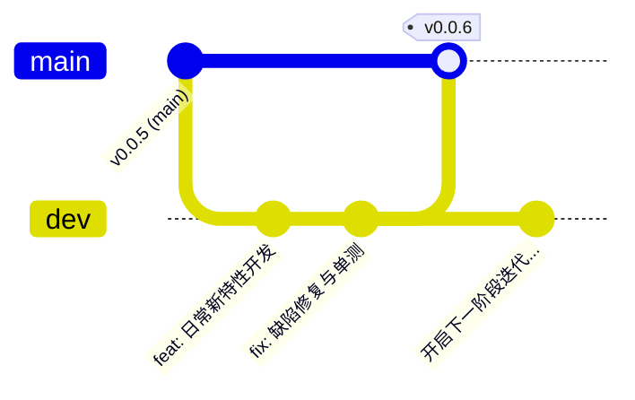

# 9. main 稳定发布与 dev 活跃开发双分支架构决策

## 背景与痛点

在 `ateng-boot` 的初期基础设施搭建与前 5 个版本（`v0.0.1` ~ `v0.0.5`）的发布演进中，工程采用的是单主干（Trunk-Based）直接演进策略。随着核心 Starter、BOM 管控清单、自动化发版工作流与 Maven Central 官方分发通道全面走通，该模式在日常持续开发中暴露出以下痛点：

1. **主干污染风险**：`main` 分支作为生产发布的唯一权威源，若日常功能开发、探针编写与缺陷修复直接在 `main` 提交，一旦出现半成品代码或调试逻辑，容易破坏主干的绝对可发布状态；
2. **发布严肃性与确定性**：Maven Central 构件具备不可变性（严禁覆盖与撤回），发版必须基于经过充分自验的稳定基线；
3. **协作分工边界模糊**：缺少明确的开发暂存与稳定发布边界，无法从 Git 分支层面直接区分“正在迭代的特性”与“已发布的生产版本”。

---

## 核心架构与决策内容

经团队权衡推演，决定全面采纳**极简实用的双分支演进模型（Dual-Branch Workflow: `main` + `dev`）**，彻底解耦日常开发与正式发布：



### 1. 分支职责边界划分

- **`main` 分支（稳定生产与权威发布分支）**：
  - **只读受控**：日常编码**严禁在 `main` 直接编辑或提交**；
  - **常青正式版**：始终对齐当前全网发布的最新稳定正式版（如当前基线 `0.0.5`）；
  - **发版专享**：版本发布流程（`bash scripts/release.sh`）**必须且只能在 `main` 分支调度发起**；
  - **单一代码来源**：唯一合法的代码流入为来自 `dev` 分支的阶段性合入。
- **`dev` 分支（日常活跃开发分支）**：
  - **开发主场**：所有新特性增加、中间件 Starter 扩展、Bug 修复、样例编写与单测补充，**统一在 `dev` 分支开展**；
  - **自由演进**：支持常规多频次提交，持续推进开发进度；
  - **常驻跟踪**：本地与远程持久保留 `dev` 分支作为默认开发基线。

### 2. CI 质量门禁持续守护

- 在 `.github/workflows/ci.yml` 中将监听触发分支扩展为 `[main, dev]`；
- 开发者与 Agent 向 `origin/dev` 推送代码时，自动触发跨 Java 17 & 21 LTS 的自动化编译与单元测试矩阵，确保开发态代码质量持续在线；
- 保持内部路径短路直通（纯文档改动秒级放行）。

### 3. 发布闭环流程 (dev → main → Release)

当 `dev` 阶段性积累了一批稳定特性，且准备向全网发布全新版本时，遵循标准发布流转：
```bash
# 1. 在 dev 确保本地单测 100% 绿色通过并与远端同步
git checkout dev && git pull origin dev
mvn clean test

# 2. 切换至 main 并合并 dev
git checkout main && git pull origin main
git merge dev

# 3. 在 main 执行自动化发版并推送
bash scripts/release.sh

# 4. 发版完成后切回 dev 继续日常开发
git checkout dev && git merge main
```

### 4. Agent 智能体行为守卫准则

- **开发前置分支校验**：Agent 接收到任何编码、修改文件或修复 Bug 的任务时，前置检查当前 Git 分支必须处于 `dev`；
- **自动防呆切换**：若当前处于 `main`，Agent 必须主动执行 `git checkout dev` 切换至开发分支，绝不在 `main` 分支直接编辑业务代码。

---

## 权衡与后果分析

### 正向收益 (Pros)
1. **结构清晰极简**：相较于大型开源项目每次为单个 Issue 新建特性分支（Feature Branch）的繁琐生命周期，`main` + `dev` 贴合单人/核心维护团队心智，心智负担极低；
2. **主干绝对稳定**：`main` 主干永远处于可构建、可运行、可发布的纯净状态，杜绝任何未经验证的代码意外流出；
3. **安全双保险**：`scripts/release.sh` 原生具备分支防御拦截（非 `main` 强行阻断），与此模型天然契合。

### 妥协成本 (Cons)
- 发版前增加了一次 `git merge dev` 合入主干的操作步骤，但换来了主干生产级别的稳定性。
