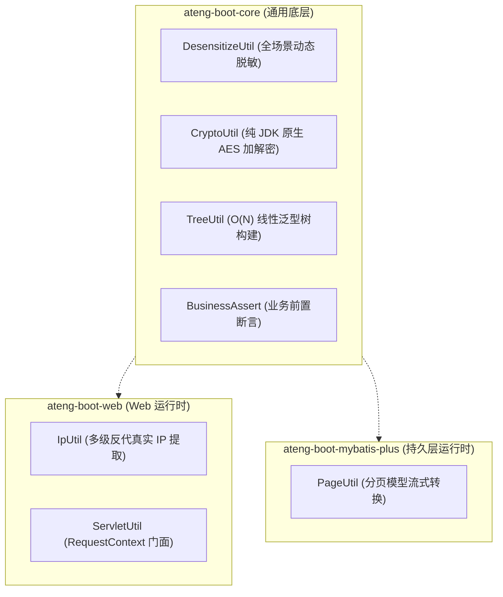

# 11. 零重型外部依赖与上下文就近内聚工具集架构决策

## 背景与痛点

在 Java 企业级项目研发中，开发者常倾向于盲目引入 `hutool-all`、`guava`、`commons-collections` 等全量工具包。这种“拿来主义”虽能快速满足局部编码需求，却在长周期工程演进中埋下了严重的技术债务：

1. **类路径与包体积极度膨胀 (Dependency Bloat)**：全量工具包引入了成百上千个通常仅使用极小一部分的类文件，显著拖慢编译、打包与冷启动速度，在微服务容器化与云原生镜像分发时造成不必要的带宽与资源消耗；
2. **传递性版本冲突与安全漏洞放大**：第三方大型工具包常自带复杂的间接依赖链，极易引发依赖地狱（Dependency Hell）；一旦工具包内部深层依赖被曝出 CVE 高危漏洞，往往迫使全库做被动升级；
3. **“通用垃圾桶 (Junk Drawer)”模块乱象**：缺少强约束时，团队极易衍生出一个庞大且无边界的 `common-util` 模块，将加解密、分页、HTTP 操作、反射、业务算法等一股脑倾倒其中，导致职责混乱、边界模糊与高内聚设计崩塌。

---

## 核心架构与决策内容

经深入评估与架构推演，`ateng-boot` 正式确立 **Zero-Bloat Invariant（零重型依赖不变量）** 与 **Co-located Utilities（就近高内聚工具集）** 原则：

### 1. 100% 依托 JDK 17 与 Spring 原生能力
- **彻底杜绝全量外部工具依赖**：不引入 `hutool-all`、`guava`、`commons-lang3` 等重型依赖；
- **纯 JDK 原生加解密 (`CryptoUtil`)**：直接依托 `javax.crypto.Cipher`，提供 `AES/CBC/PKCS5Padding` 与带认证标签的 `AES/GCM/NoPadding`，内置安全随机 IV 与 Base64 编解码，无需 Bouncy Castle；
- **纯 JDK 动态脱敏 (`DesensitizeUtil`)**：纯字符数组指针算法，极速无额外垃圾回收压力，覆盖手机号、身份证、银行卡、姓名、邮箱、固话与密码；
- **高效树装配 (`TreeUtil`)**：纯函数式接口两遍哈希扫描，以 $O(N)$ 线性时间复杂度实现扁平列表到嵌套树形结构的高性能组装。

### 2. 依赖运行时上下文就近内聚 (Co-location)
- **拒绝通用垃圾桶**：根据工具类所强依赖的运行时基础设施严格就近安置：
  - `core` 仅内聚与任何具体中间件无关的纯算法与领域契约；
  - `web` 内聚依赖 Servlet API 与 `RequestContextHolder` 的组件（如 `IpUtil`、`ServletUtil`）；
  - `mybatis-plus` 内聚依赖 ORM `IPage` 的转换组件（如 `PageUtil`）。

---

## 后果与权衡 (Consequences & Trade-offs)

### 正向收益
- **极度轻量纯净**：模块 Jar 包体积大幅精简，杜绝任何外部漏洞传导；
- **职责边界清晰**：依赖关系自上而下单向流动，杜绝底层依赖向上传透；
- **性能原生无损**：算法针对 JDK 17 优化，零多余反射与中间对象分配。
