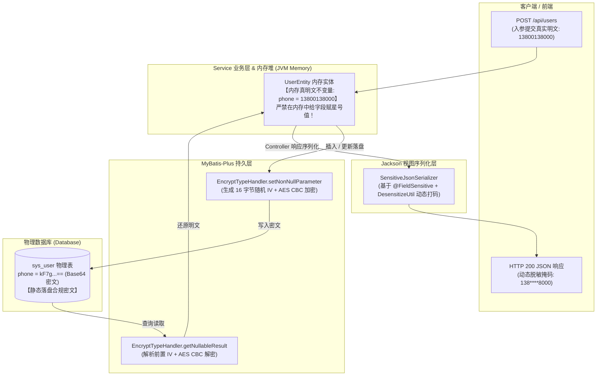

# 12. 数据安全生命周期分离：TypeHandler 存储加密与 Jackson 视图脱敏架构决策

## 背景与痛点

在企业级企业数字化转型与合规监管（如《数据安全法》、个人信息保护法 PIPL、等保 2.0）要求下，敏感个人信息（如手机号码、身份证号、银行卡号等）的安全防护成为系统建设的刚性底线。然而在传统研发实践中，常因生命周期边界不清引发严重的数据损毁与安全隐患：

1. **业务实体直接打码引发的“脏写回”灾难 (In-Memory Mutation Dirty Writeback)**：
   - 传统开发中，部分开发者为在前端展示脱敏效果，常习惯于在 Service 层或查询后直接调用实体 Setter 打星号（例如 `user.setPhone("138****5678")`）；
   - 一旦该实体在后续流程中被复用、受 ORM 脏检查机制追踪，或被直接调用 `userMapper.updateById(user)`，掩码星号就会被直接持久化覆盖写入数据库，造成底层真实客户数据永久不可逆损坏与丢失；
2. **静态存储合规与出库视图脱敏职责混淆 (Storage Compliance vs View Masking Ambiguity)**：
   - 静态存储加密（At-Rest Encryption）诉求是数据库物理文件中存储密文，防止 DBA、运维误泄露或备份脱库；
   - 动态视图脱敏（In-Transit Masking）诉求是对终端展示掩码，防止操作员屏幕偷窥或前端传输泄露；
   - 研发人员若混淆二者，往往要么仅做展示脱敏导致数据库明文裸奔，要么仅做数据库加密导致接口响应直出真实明文，或在数据库中存储星号导致失去解密反查与短信通知能力；
3. **全局类型处理器拦截的不可控破坏性 (Global TypeHandler Blast Radius)**：
   - 部分方案试图通过在 MyBatis 全局注册通用 `BaseTypeHandler<String>` 来实现“零配置加密”；
   - 这一举措会导致系统中**所有 String 类型的属性与列**被无差别拦截加解密，严重破坏非敏感业务字段（如用户名、订单号、状态字典、租户 ID 等），直接引发全库数据乱码、模糊检索瘫痪与系统崩溃。

---

## 核心架构与决策内容

经深入推演，`ateng-boot` 正式确立 **Lifecycle-Separated Data Security（生命周期分离数据安全）** 架构体系，其核心不变量为：**“内存真明文、存储真密文、出库动态码”**。

### 1. 内存真明文不变量 (In-Memory Plaintext Invariant)
- **业务逻辑透明**：在 Controller、Service、Domain 内存流转期间，Java 实体的字段值**100% 保持原始真实明文**；
- **防脏写回铁律**：严禁在业务逻辑中对实体属性打星号；后续任何对实体的局部属性更新（如修改用户年龄或姓名后调用 `updateById`），敏感字段依然由 `EncryptTypeHandler` 安全重加密写入，彻底杜绝掩码脏数据污染数据库。

### 2. 落盘存储加密：`@FieldEncrypt` 与 `EncryptTypeHandler`
- **局域显式驱动，杜绝全局污染**：
  - 严禁向 MyBatis 全局 `TypeHandlerRegistry` 无差别注册 String 处理器；
  - 必须由实体属性显式标注 `@FieldEncrypt` 并挂载 `@TableField(typeHandler = EncryptTypeHandler.class)`；
  - 实体类统一标注 `@TableName(value = "...", autoResultMap = true)`，确保 MyBatis-Plus 在单表查询与动态 SQL 中正确识别并激活 TypeHandler。
- **高抗碰撞语义安全 (Semantic Security)**：
  - 每次执行加密时，内部基于 `CryptoUtil.generateIv()` 动态生成 16 字节高强度随机初始向量（IV）；
  - 将 16 字节 IV 与 AES/CBC 密文字节拼装后输出单一 Base64 编码字符串。相同明文在多次落盘时产生的密文 100% 随机不同，彻底粉碎基于密文频次分析的字典彩虹表探测与已知明文重放攻击。
- **零凭据硬编码与配置注入 (Zero-Secret & Config Injection)**：
  - 框架基于类路径坐标哈希自适应派生默认密钥，代码库 100% 无任何明文字符串凭据；
  - 生产环境统一由配置项 `ateng.boot.mybatis-plus.crypto.secret-key` 进行外部密钥注入。

> [!IMPORTANT]
> 框架内置派生的默认密钥仅供本地极速开发与单元测试开箱即用；生产环境发布上线前，必须显式在 `application.yml` 中配置 16/24/32 字符的专属强密钥（`ateng.boot.mybatis-plus.crypto.secret-key`），确保密钥与代码彻底解耦。

- **防御性容错降级 (Defensive Plaintext Fallback)**：
  - 读取数据时若发现空值直接返回；若遇到非 Base64、非 AES 密文或由于密钥不匹配导致解密失败时，处理器自动捕获异常并原样返回原始字符串，确保平滑兼容老系统已存在的历史未加密明文数据。

### 3. 视图出库动态脱敏：`@FieldSensitive` 与 `SensitiveJsonSerializer`
- **Jackson 原生非侵入挂载**：
  - 基于 Jackson 标准 `JsonSerializer<String>` 与 `ContextualSerializer` 上下文机制，在序列化时动态感知字段上的 `@FieldSensitive` 配置；
  - 仅在 Controller 将对象写出为 HTTP JSON 文本流的瞬间动态计算并写出掩码字符串，**完全不影响 Java 堆内存中原对象的任何属性状态**。
- **枚举策略高内聚**：
  - 提供 `SensitiveType` 枚举，涵盖中文姓名、手机号、固话、身份证、邮箱、银行卡、密码及自定义区间；
  - 脱敏策略统一委托给纯 JDK 字符指针算法实现的 `DesensitizeUtil`，具备高内聚与极速零 GC 优势。

---

## 后果与权衡 (Consequences & Trade-offs)

### 正向收益
- **彻底根绝脏写回灾难**：通过将脱敏推迟至 Jackson 视图序列化层，Java 实体对象始终保持纯洁真明文，从根源上消除了星号脏写回的系统性漏洞；
- **全链路合规自洽**：物理数据库静态存储呈现为高强度 AES CBC 密文，完全符合网络安全与隐私合规要求；终端出库呈现为标准掩码，防止操作侧窥探；
- **研发心智负担最小化**：业务开发人员无需在 Controller/Service 中手工编写繁复的 `encrypt(...)` 或 `mask(...)` 工具调用代码，开发体验近乎透明；
- **零全局依赖副作用**：显式注解驱动使得未标注属性完全不受任何性能与行为干扰。

### 妥协成本
- **SQL 模糊检索受限**：由于采用了随机 IV 语义加密，密文字段在数据库层面无法直接使用 SQL `LIKE '%keyword%'` 进行模糊检索。针对需要模糊搜索的场景，建议在架构层面引入确定性盲索引哈希（Blind Index）、引入专用全文检索中间件（如 Elasticsearch），或在内存中执行解密后过滤；
- **显式契约配置要求**：实体类必须显式声明 `@TableName(autoResultMap = true)` 与 `@TableField(typeHandler = ...)`。此项配置虽然增加了极少量模板代码，但换取了零全局副作用与高度明确的架构意图，收益远大于成本。
