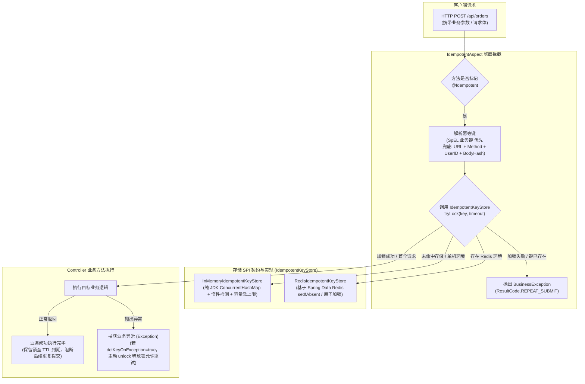

# 13. 基于 SPI 抽象的混合式接口幂等防重引擎架构决策

## 背景与痛点

在 Web 应用与微服务高频交互场景中，接口重复提交与并发重放是导致业务数据异常的高危痛点（如用户连击导致的重复下单、支付回调并发重试引发的重复扣款、网络抖动超时引发的重放等）。但在传统框架落地接口防重幂等时，常面临以下架构困境：

1. **强绑定外部中间件破坏零依赖基线 (Middleware Bloat vs Zero-Dependency Invariant)**：
   - 常见开源方案多强制要求引入 Redis 或 Redisson 依赖；
   - 对轻量级单体系统、本地开发自测、H2 内存验证或弱中间件场景而言，强绑外部中间件直接破坏了 `ateng-boot` 恪守的 [ADR-0011](./0011-zero-bloat-and-co-located-utilities.md)（零全量外部依赖与极致精炼）心智底线；
2. **生命周期锁语义粗糙引发可用性受阻 (Rigid Fixed-Window Lockout)**：
   - 多数简易实现仅采用固定时间窗口死锁（Fixed-Window TTL），即无论接口业务执行成功与否，强行锁死指定秒数；
   - 一旦业务方法因参数校验非法、数据库乐观锁冲突或外部网络暂时超时而中断（可恢复异常），前端用户被强制锁死无法立即修正重试，严重损伤系统可用性与用户体验；
3. **微模块过度碎片化反模式 (Micro-Module Fragmentation Anti-Pattern)**：
   - 部分架构试图为仅有 6~7 个源码类的幂等切面独立创建 `ateng-boot-starter-idempotent` Maven 模块；
   - 这一举措造成模块极度“贫血”，徒增根 POM 版本治理、BOM 纳管、Release 打包与 Maven Central 发布的维护成本，违背了深模块（Deep Modules）的高内聚设计准则。

---

## 核心架构与决策内容

经多轮推演与架构质询，`ateng-boot` 正式确立 **基于 SPI 抽象的混合式接口幂等防重引擎**，内聚于 `ateng-boot-web` 运行时中。



### 1. 深度内聚与渐进式演进 (Deep Module Placement)
- **归属上下文**：幂等组件归属于 `ateng-boot-web`，专设包名 `io.github.atengk.boot.web.idempotent.*`；
- **杜绝形式主义微模块**：不为单一微切面独立开辟 Maven 构件，下游引入 `ateng-boot-web` 或 `ateng-boot-all` 即可一键获得防重能力；
- **解耦设计**：未来若引入独立消息中间件套件且消费端需脱离 Web 使用纯防重锁时，仅需将通用的 `IdempotentKeyStore` 抽象下沉即可。

### 2. 存储 SPI 与两级优雅自适应装配 (Two-Tier Hybrid KeyStore)
定义纯净的幂等状态操作 SPI：
```java
public interface IdempotentKeyStore {
    boolean tryLock(String key, long timeout, TimeUnit unit);
    void unlock(String key);
}
```
- **Tier 1 默认单机保底（InMemoryIdempotentKeyStore）**：
  - 基于纯 JDK 原生 `ConcurrentHashMap`，绝不引入 Guava 或 Caffeine；
  - 采用 **“惰性过期检测 + 软容量上限淘汰（Soft LRU Guard）+ 低频后台定时清理”** 三重防护，加锁路径无全局锁争用，当达到最大容量阈值时安全淘汰过期数据，彻底杜绝单机内存泄漏与 OOM 隐患；
  - 配置 `@ConditionalOnMissingBean(IdempotentKeyStore.class)`，无任何外部配置即开箱可用；
- **Tier 2 分布式无缝升级（RedisIdempotentKeyStore）**：
  - 在存在 `StringRedisTemplate` 时自动激活；
  - 基于 `stringRedisTemplate.opsForValue().setIfAbsent(key, "1", timeout, unit)` 执行分布式原子加锁；
  - 宿主工程引入 Redis 依赖即可秒级无缝平滑升级为多实例集群防重，**上层业务代码与 Controller 无需任何修改**。

### 3. SpEL 优先与请求特征自动哈希兜底 (Key Generation Strategy)
- **精准业务防重**：声明 `@Idempotent(key = "#dto.orderNo")` 时，基于 Spring 原生 SpEL 解析器精准绑定业务主键；
- **零配置通用防抖**：未声明 `key` 时，切面自动提取 `Request URI + HTTP Method + UserContextHolder.getUserId() + 入参 SHA-256 哈希` 生成防重指纹，开发者仅需标记无参 `@Idempotent` 即可获得页面按钮防抖能力；
- **微命名空间隔离**：支持 `@Idempotent(prefix = "order_create:")` 为特定接口定制 Key 前缀，便于运维与监控辨识。

### 4. 全生命周期锁语义与异常重试放行 (Lifecycle & Retry Semantics)
- **成功请求**：执行成功后，锁严格保持至 TTL 到期，彻底封死网络重复提交与并发竞态；
- **异常自动释放**：默认配置 `delKeyOnException = true`；当业务方法抛出异常时，切面在 `finally` 块中立即调用 `keyStore.unlock(key)` 释放锁，允许客户端修改参数后即刻重试。

### 5. 统一契约与全局异常防御 (Explicit Result Contract)
- 触发重复提交时，切面统一抛出受控业务异常 `BusinessException`（状态码 `40003` / `ResultCode.REPEAT_SUBMIT`）；
- 注解提供 `message` 属性支持业务定制文案（如 `@Idempotent(message = "订单处理中，请勿重复操作")`）；
- 完全受管于 [ADR-0002](./0002-explicit-result-contract-no-response-body-advice.md) 与 [ADR-0004](./0004-http-200-with-business-code-and-exception-masking.md)，由全局异常处理器安全转译为 HTTP 200 + 业务码的规范 `Result<Void>` 响应。

---

## 结果与影响 (Consequences)

### 正向收益
1. **零外部依赖开销**：单体项目与本地测试无需安装运行 Redis，零配置直接启动生效；
2. **渐进式平滑演进**：进入分布式生产集群部署时，仅需按需挂载 Redis 依赖，即刻自动切换为分布式锁；
3. **内存绝对防爆**：单机内存实现包含硬性容量边界与双重淘汰策略，杜绝并发攻击与内存泄漏；
4. **用户体验友好**：异常时自动释放锁，避免了“一朝出错、卡死数秒”的僵硬防重体验。

### 妥协与成本
- 在纯单机内存模式下，各应用实例内存独立，无法跨多节点拦截重复请求（对于生产级多节点集群，必须引入 Redis 实现）。

---

## 相关决策与参考
- [ADR-0002: 显式统一返回契约，严禁全局拦截包装](./0002-explicit-result-contract-no-response-body-advice.md)
- [ADR-0004: 传输层 HTTP 200 与业务错误脱敏拦截](./0004-http-200-with-business-code-and-exception-masking.md)
- [ADR-0011: 零重型外部依赖与上下文就近内聚工具集](./0011-zero-bloat-and-co-located-utilities.md)
