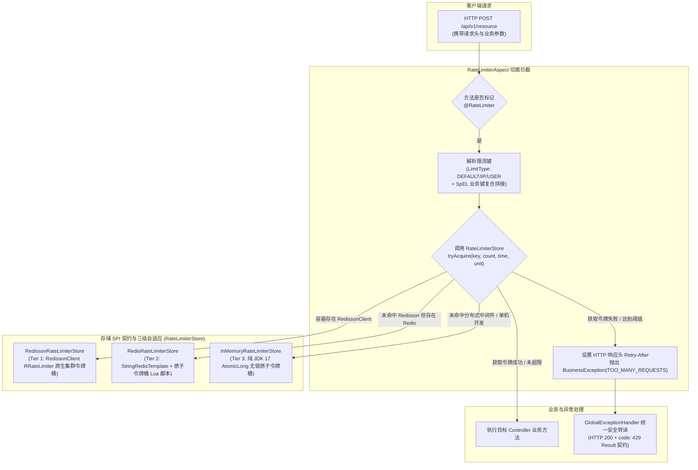

# 14. 基于三级自适应 SPI 架构的接口限流防刷引擎架构决策

## 背景与痛点

在高并发 Web 系统与微服务对外接口中，突发高流量、恶意高频脚本爬取或滥用请求是造成系统资源耗尽、数据库连接池打满及服务雪崩的头号风险。但在传统落地限流防刷时，架构常面临以下困境：

1. **依赖膨胀与零外部依赖基线冲突 (Dependency Bloat vs Zero-Bloat Invariant)**：
   - 业界单机限流多深度绑定 Google Guava 的 `RateLimiter` 或 Caffeine，或强制引入 Sentinel 等重量级流量防护套件；
   - 对轻量级单体系统或微服务底座而言，强行引入第三方大包严重违背了 [ADR-0011](./0011-zero-bloat-and-co-located-utilities.md) 恪守的“零全量外部依赖与 100% 依托 JDK 17 原生能力”的设计心智；
2. **分布式环境与单机环境架构割裂 (Fragmented Implementation Models)**：
   - 部分方案单机使用一套计数逻辑，分布式又换用另一套全然不同的中间件接口，开发者使用成本高，环境切换时易出现不一致行为；
3. **限流维度单一难以应对复合黑产防护 (Rigid Dimension Limitation)**：
   - 传统限流注解通常仅支持粗粒度的全局方法限流或单一 IP 限流，缺乏用户（User ID）、多租户（Tenant ID）与自定义业务参数（SpEL 表达式）的灵活动态组合能力。

---

## 核心架构与决策内容

经架构质询与严格推演，`ateng-boot` 正式确立 **基于三级自适应 SPI 架构的接口限流防刷引擎**，内聚于 `ateng-boot-web` 运行时中（包路径 `io.github.atengk.boot.web.ratelimit.*`）。



### 1. 存储 SPI 与三级自适应条件装配 (Three-Tier Adaptive Store)
定义纯净的限流操作 SPI：
```java
public interface RateLimiterStore {
    boolean tryAcquire(String key, long count, long time, TimeUnit unit);
}
```
- **Tier 1 生产分布式最优选（RedissonRateLimiterStore）**：
  - 基于 Redisson 官方客户端 `RRateLimiter`，原生享有分布式集群环境下的精确令牌桶算法与自动过期机制；
- **Tier 2 轻量级分布式扩展（RedisRateLimiterStore）**：
  - 在未命中 Redisson 但存在 `StringRedisTemplate` 时自动激活；
  - 基于内聚的原子令牌桶 Lua 脚本，单 Key 记录当前可用令牌数与上次刷新时间戳，单次网络往返（RTT）完成时间换算与扣减，内存占用极小；
- **Tier 3 默认单机保底兜底（InMemoryRateLimiterStore）**：
  - 基于纯 JDK 17 原生 `AtomicLong` 与 `ConcurrentHashMap`，绝不引入 Guava 或 Caffeine；
  - 采用无锁原子时间换算算法模拟令牌桶补充，加锁路径零全局锁争用，辅以软容量防护与惰性过期清理，杜绝内存泄漏；
  - 在无任何外部依赖时开箱即用；
- **用户自定义全量退让**：宿主工程显式注入任何自定义 `RateLimiterStore` Bean 时，三级自动装配全量自动退让。

### 2. 令牌桶全链路模型统一 (Unified Token Bucket Semantics)
- 全层级统一坚持 **令牌桶算法 (Token Bucket)**：从单机 Tier 3 到分布式 Tier 2、Tier 1 保持完全一致的流量整型心智；
- 相比滑动窗口计数器，令牌桶在具备同等精度的同时，原生支持应对受控的突发脉冲流量，并平滑将其整型输出。

### 3. 限流维度枚举与 SpEL 复合组合策略 (Composite Limiting Dimensions)
- 注解提供 `limitType` 属性，支持 `LimitType` 枚举：
  - `DEFAULT`：以目标方法（Class + Method）或 Request URI 为限流维度；
  - `IP`：依托 `IpUtil.getClientIp()` 按客户端 IP 维度限流；
  - `USER`：依托 `UserContextHolder.getUserId()` 按当前登录操作人维度限流；
- 注解提供 `key` 属性，支持 Spring 原生 SpEL 表达式（如 `@RateLimiter(key = "#dto.tenantId")`）；
- 当同时配置 `limitType` 与 `key` 时，系统自动合成复合限流键（如 `rate_limit:ip:tenant_1001:...`），无缝满足多租户与高阶业务防刷需求。

### 4. 显式契约与标准 HTTP 协商兼顾 (Result Contract & Protocol Standard)
- 在 `CommonResultCode` 统一扩充 `TOO_MANY_REQUESTS(429, "访问过于频繁，请稍后再试")`；
- 超限拦截时切面抛出受控 `BusinessException(CommonResultCode.TOO_MANY_REQUESTS)`，由 `GlobalExceptionHandler` 转译为规范的 `Result<Void>`；
- 切面在抛出异常前通过 `ServletUtil.getResponse()` 写入标准响应头 `Retry-After: <seconds>`，既满足前后端统一业务错误码契约（[ADR-0004](./0004-http-200-with-business-code-and-exception-masking.md)），又兼容标准 HTTP 客户端重试协议。

---

## 后果与权衡 (Consequences & Trade-offs)

### 正向收益
1. **零外部重包**：彻底消除了引入 Guava / Sentinel 等巨型依赖的包体负担与版本冲突，单机性能极高；
2. **开箱即用与集群平滑演进**：单机开发直接可用，接入 Redis/Redisson 后自动升阶为集群级限流，无需修改任何业务代码或注解；
3. **复合防刷能力**：支持 IP、User 与 SpEL 多重组合，应对黑产刷单与租户隔离得心应手。

### 妥协考量
- Tier 3 单机内存模式在极端海量不同 IP 冲击下，内存 Map 会产生较多桶节点；为此我们设计了惰性清理与软容量上限淘汰机制，确保极端单机场景下的堆内存安全。
