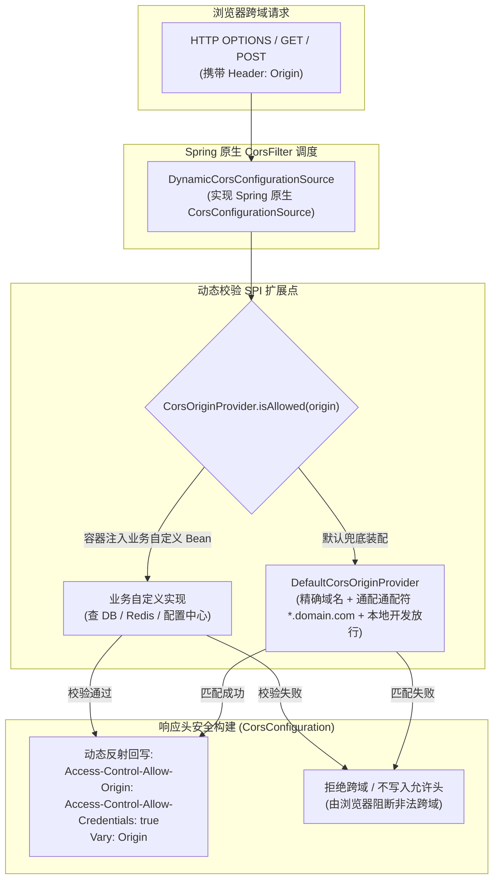

# 15. 基于 SPI 扩展与凭证安全反射的动态 CORS 架构决策

## 背景与痛点

在多系统协同、多租户微前端以及企业级 OpenAPI 交互中，浏览器同源策略（SOP）与跨域资源共享（CORS）是 Web 接入层的基础安全防线。然而传统 Spring Boot 的静态 CORS 配置存在显著痛点：

1. **静态配置缺乏动态响应能力 (Inflexible Static Configurations)**：
   - 现有的 `UrlBasedCorsConfigurationSource` 只能在应用启动时从 `application.yml` 加载固定的 `allowed-origins`；
   - 一旦新增业务子域名、合作方商户或多租户动态前端，必须修改配置并重新发布重启服务，无法满足企业级热更新需求；
2. **通配符与带凭证认证的规范死锁 (Wildcard vs Credentials Deadlock)**：
   - 当现代 Web 应用需要携带 Cookie、Token 或认证信息（`allowCredentials = true`）时，W3C 与浏览器安全规范严格禁止将响应头设置为通配符 `Access-Control-Allow-Origin: *`；
   - 开发者常被迫手动配置或错误关闭凭据支持，导致移动端或第三方嵌入页面的跨域认证受阻；
3. **绕过官方架构导致生态脱节 (Framework Incompatibility Risks)**：
   - 部分方案采用原生手写 Servlet Filter 强行截断并写入响应头，导致与 Spring MVC 的 Preflight OPTIONS 请求处理、Spring Security 安全链及 WebMvcConfigurer 产生冲突与重复 Header 报错。

---

## 核心架构与决策内容

经架构质询与严格推演，`ateng-boot` 正式确立 **基于 SPI 扩展与凭证安全反射的动态 CORS 架构**，内聚于 `ateng-boot-web` 运行时中（包路径 `io.github.atengk.boot.web.cors.*`）。



### 1. 深度复用 Spring 原生 `CorsConfigurationSource` (Native MVC Integration)
- 放弃生硬侵入的外部 Filter 拦截，选择实现 Spring 官方基础设施 `CorsConfigurationSource`（类名 `DynamicCorsConfigurationSource`）；
- 在 `getCorsConfiguration(HttpServletRequest request)` 方法中，提取当前 HTTP 请求头 `Origin`，委托 `CorsOriginProvider` 校验；
- 若校验通过，则动态实例化并缓存 `CorsConfiguration`，实现对浏览器预检（Preflight OPTIONS）与真实跨域请求的一致性治理，绝不破坏 Spring MVC 生态契约。

### 2. 核心 SPI 契约与业务退让 (CorsOriginProvider SPI)
定义高内聚、职责单一的来源判定 SPI：
```java
public interface CorsOriginProvider {
    /**
     * 判断指定来源 Origin 是否允许跨域访问
     *
     * @param origin 客户端请求携带的 Origin 域名
     * @return true 允许访问；false 拒绝跨域
     */
    boolean isAllowed(String origin);
}
```
- **默认提供者（DefaultCorsOriginProvider）**：
  - 继承自属性 `ateng.boot.web.cors`；
  - 原生支持 3 种匹配模式：
    1. **精确匹配**：如 `https://admin.ateng.com`；
    2. **通配模式**：如 `https://*.ateng.com`（基于 AntPath 或正则实现动态匹配）；
    3. **本地开发快速放行**：检测到请求源为 `localhost` 或 `127.0.0.1` 且开启开发模式时自动放行，提升本地联调体验；
- **业务 SPI 自定义全量退让**：宿主应用若声明自定义 `CorsOriginProvider` Bean，则优先交由业务（从数据库、Redis 或配置中心）进行多租户动态判断。

### 3. 带凭据场景下的动态 Origin 安全反射机制 (Safe Origin Reflection)
- 当 `allowCredentials = true` 时，系统依据动态校验结果，将合法的真实请求源动态回写为：
  `Access-Control-Allow-Origin: <Request Origin>`
- 同步追加 `Vary: Origin` 响应头，通知 CDN 或反向代理服务按不同来源缓存响应，杜绝不同客户端之间的跨域响应串包与安全泄露。

---

## 后果与权衡 (Consequences & Trade-offs)

### 正向收益
1. **热更新零重启**：业务接入微前端、新增合作品牌或商户域名时，可通过数据库/Redis 动态生效，告别配置修改重启；
2. **规范安全自洽**：彻底化解浏览器在 `allowCredentials=true` 下对 `*` 通配符的拦截限制，兼顾最高安全性与灵活性；
3. **原生无缝兼容**：100% 依托 Spring MVC 原生架构，避免手写 Filter 导致的响应头重复写出或与 Spring Security 冲突。

### 妥协考量
- 动态 SPI 若频繁调用远程数据库或 Redis，在高并发握手场景下可能引入额外查询开销；建议业务方在自定义 `CorsOriginProvider` 实现中采用本地短期缓存（如基于 ConcurrentHashMap 维持 5 秒缓存）以平滑性能。
