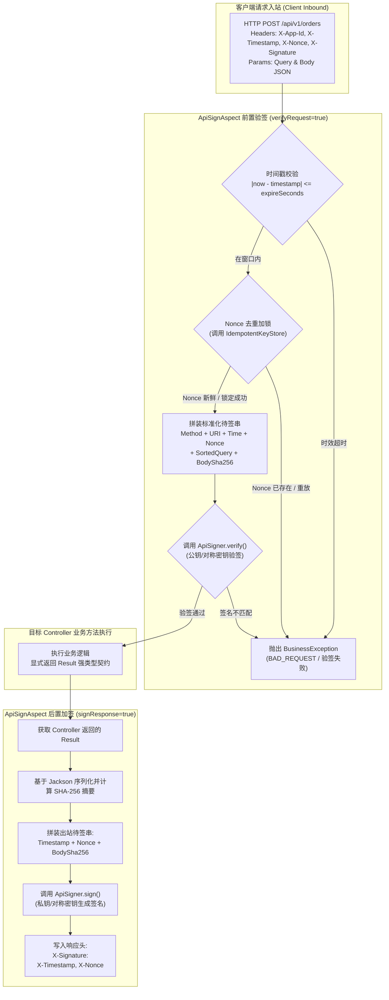

# 16. 双向 API 数据加签验签与防重放引擎架构决策

## 背景与痛点

在企业级开放平台（OpenAPI）、金融级核心交易、App 移动端接口以及第三方 Webhook 回调场景中，网络明文传输面临被中间人窃听、请求报文恶意篡改（Tampering）以及历史报文截获后反复重放（Replay Attacks）的高危安全隐患。传统框架在解决加签验签时存在以下弊端：

1. **强绑外部重型加密库违背零依赖基线 (Bouncy Castle Bloat vs Zero-Bloat Invariant)**：
   - 常见加签组件动辄强制引入 Bouncy Castle（如 `bcprov-jdk15on`），体积极大且常引发复杂类加载器与版本冲突；
   - 违背了 [ADR-0011](./0011-zero-bloat-and-co-located-utilities.md) 确立的“100% 依托 JDK 17 原生能力”的极简心智；
2. **全生命周期报文截获与 ADR-0002 契约冲突 (ResponseBodyAdvice Conflicts)**：
   - 传统框架常依赖全局 `ResponseBodyAdvice` 拦截出站数据，这直接违反了 [ADR-0002](./0002-explicit-result-contract-no-response-body-advice.md) 关于“严禁隐式自动包装，保证契约显式透明”的铁律；
   - 采用全局 Servlet Filter 包装字节流（`ContentCachingResponseWrapper`）则会在文件流下载、SSE 异步推送等场景下引发内存暴涨甚至流死锁；
3. **缺少成熟防重放机制与状态存储孤岛 (Replay Vulnerability & Redundant Stores)**：
   - 仅对时间戳进行宽泛校验无法防范时效窗口内的重放重放攻击；
   - 额外为 Nonce 去重造一套独立的存储体系，造成框架内部冗余与割裂。

---

## 核心架构与决策内容

经架构质询与严格推演，`ateng-boot` 正式确立 **基于纯 JDK 17 与 AOP 拦截的双向 API 数据加签验签与防重放引擎**，内聚于 `ateng-boot-web` 运行时中（包路径 `io.github.atengk.boot.web.sign.*`）。



### 1. 注解式声明与双向细粒度治理 (`@ApiSign`)
提供灵活的方法与类级注解：
```java
@Target({ElementType.METHOD, ElementType.TYPE})
@Retention(RetentionPolicy.RUNTIME)
@Documented
public @interface ApiSign {
    boolean verifyRequest() default true;  // 是否开启入站请求验签
    boolean signResponse() default true;   // 是否开启出站响应加签
    long expireSeconds() default 60L;      // 请求时效防重放窗口（秒）
    String message() default "数据验签失败"; // 验签失败提示文案
}
```
允许根据接口性质自由启闭：开放接口配置双向加验签；三方通知回调配置单向入站验签；敏感数据查询导出配置单向出站加签。

### 2. 100% 依托纯 JDK 17 的 `ApiSigner` SPI 与零膨胀保证
定义高内聚数字签名 SPI 契约：
```java
public interface ApiSigner {
    String sign(String data, String privateOrSecretKey);
    boolean verify(String data, String signature, String publicOrSecretKey);
}
```
- **HmacSha256Signer（对称算法，默认高频首选）**：100% 依托 JDK 原生 `javax.crypto.Mac`，基于共享 SecretKey，运算纳秒级，极速高效，适用于内网微服务与移动端 App；
- **RsaSigner（非对称算法，开放生态首选）**：100% 依托 JDK 原生 `java.security.Signature`（`SHA256withRSA`），公私钥分离，适用于开放平台外部商户对接；
- 杜绝一切 Bouncy Castle 外部强依赖，纯净零膨胀。

### 3. 金融级标准化待签串规范 (Canonical String Assembly)
前后端严格遵循统一的规范化明文拼装协议，杜绝因键序或空格引起的签名哈希漂移：
- **入站请求待签串**：
  `Method\nURI\nTimestamp\nNonce\nSortedQueryString\nBodySha256`
  - Query 参数按 ASCII 字典序排序拼接为 `k1=v1&k2=v2`；
  - 请求体计算 SHA-256 十六进制摘要，空请求体使用空串摘要；
- **出站响应待签串**：
  `Timestamp\nNonce\nResponseBodySha256`
  - 对 Controller 返回的标准 `Result<?>` 经统一定制 Jackson 序列化后计算 SHA-256 摘要，签名生成后注入响应头 `X-Signature`。

### 4. 深度复用 `IdempotentKeyStore` 实施 Nonce 防重放
- 入站验签在时效窗口（`expireSeconds`）内，需确保 `Nonce` 全局唯一；
- 架构全面复用前面已就绪的 **`IdempotentKeyStore`**（三级自适应：Redisson / Redis / InMemory），以 `sign:nonce:{appId}:{nonce}` 执行原子加锁（TTL 为 `expireSeconds`）；
- 若加锁失败立即判定为恶意重放；零冗余代码，天然具备集群无缝适配能力。

### 5. 多商户多应用密钥检索 SPI (`SignKeyProvider`)
- 定义 `SignKeyProvider` 契约，支持根据客户端请求头携带的 `X-App-Id` 动态获取密钥：
  ```java
  public interface SignKeyProvider {
      String getSecretKey(String appId);
      String getPublicKey(String appId);
      String getPrivateKey(String appId);
  }
  ```
- 默认装配 `DefaultSignKeyProvider`：读取属性 `ateng.boot.web.sign` 满足单商户极简开箱即用；
- 业务系统可通过注入自定义 Bean，无缝对接多商户数据库或配置中心。

### 6. AOP 切面实现与 ADR-0002 契约不变量和谐统一
- 严格遵循 [ADR-0002](./0002-explicit-result-contract-no-response-body-advice.md)，加签验签收口于 `ApiSignAspect` 切面，**坚决不使用全局 ResponseBodyAdvice 隐式包装**；
- 切面直接环绕获取 Controller 显式声明的 `Result<?>` 强类型对象，完成出站加签并经由 `ServletUtil.getResponse().setHeader(...)` 注入响应头，前后端契约清晰透明、零副作用。

---

## 后果与权衡 (Consequences & Trade-offs)

### 正向收益
1. **最高等级端到端安全**：防篡改、防重放、防假冒三位一体；
2. **零第三方加密依赖**：完全依赖 JDK 17 原生安全提供程序，兼容性与包体纯净度达最高标准；
3. **架构资产最大化复用**：无缝复用 `IdempotentKeyStore` 完成防重放，各模块高内聚低耦合。

### 妥协考量
- 包含 POST Body 的请求需要读取请求体计算哈希，切面层需依托 Servlet 上下文的包装（或仅对 Controller 绑定的入参进行摘要序列化）。为确保与流式下载及大文件上传解耦，切面通过参数类型检测安全跳过二进制流，保障系统稳定性。
