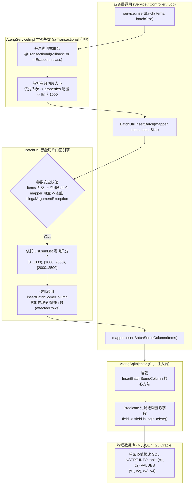

# 19. 原生高性能分批批量插入引擎架构决策 (AtengBaseMapper & AtengBaseService)

## 背景与痛点

在企业级后端服务与高并发数据导入、日志归档及批量处理场景中，高吞吐量的数据持久化写入是持久层核心性能瓶颈之一。传统开发模式普遍面临以下挑战：

1. **`IService.saveBatch` 伪批量与极高的网络往返耗时 (False Batch Overhead)**：
   - MyBatis-Plus 原生提供的 `saveBatch(Collection<T> entityList)` 底层本质上是逐条生成单条 `INSERT INTO table (cols) VALUES (...)` 语句并放入 JDBC `executeBatch` 中执行。尽管比裸逐条提交有所改善，但在每条数据仍需单独通信与解析的前提下，大量单条 SQL 依然产生显著的数据库驱动通信开销（Network RTT）与数据库解析开销。实测在万级数据导入时耗时常高达数十秒；
2. **单条多值 SQL 注入缺乏开箱即用支持 (Lack of Turnkey Multi-Values Injection)**：
   - MySQL 等主流关系型数据库天然支持单条多值插入语法：`INSERT INTO table (cols) VALUES (...), (...), (...)`。这种语法能将万级数据的插入开销缩减 10~50 倍。然而 MyBatis-Plus 仅在扩展包中提供了 `InsertBatchSomeColumn` 注入器，默认未挂载进全局 SQL 注入器中，开发者需要繁琐地自定义 `DefaultSqlInjector`、手动绑定注入方法与 Mapper 接口；
3. **未切片的超大批量面临网络包溢出与参数超限崩塌 (Packet Overflow & Parameter Exceeded Risk)**：
   - 若直接调用无限制的单条多值批量插入，当单次插入数据量达到几千或上万条时，单条拼接出的 SQL 极易超过 MySQL `max_allowed_packet` 限制，或触发预编译参数最大数量限制（如 JDBC/MySQL 65535 占位符上限），引发物理崩溃或长事务锁超时；
4. **逻辑删除字段的污染陷阱 (Logic Delete Column Pollution)**：
   - 新增数据入库时不应当显式插入逻辑删除字段（如 `deleted = 0`），应交由数据库默认值约束或受管实体规则保障；若未在批量注入器中显式排除逻辑删除字段，可能导致开发者意外传递脏数据覆盖或产生多余字段列；
5. **业务切片代码碎片化与事务原子性缺失 (Fragmented Slicing & Fragile Transactions)**：
   - 业务往往在各个 Service 中使用 `for` 循环手动 `subList` 切片，写法五花八门且容易因越界或切片错误产生 Bug；同时，分批执行多次物理插入时若缺失声明式事务守护，中途失败将导致数据部分入库而部分丢失，产生难以自愈的脏数据。

---

## 核心架构与决策内容

经架构推演与基准验证，`ateng-boot` 正式确立 **原生高性能分批批量插入引擎**，深度内聚于 `ateng-boot-mybatis-plus` 模块中（包路径 `io.github.atengk.boot.mybatisplus.injector`、`mapper`、`service` 与 `util`）。



### 1. 自动挂载与逻辑删除字段过滤 (`AtengSqlInjector`)
- 继承 MyBatis-Plus `DefaultSqlInjector`；
- 在 `getMethodList(Configuration configuration, Class<?> mapperClass, TableInfo tableInfo)` 中追加 `InsertBatchSomeColumn`；
- 构造 `InsertBatchSomeColumn` 时注入安全断言谓词 `field -> !field.isLogicDelete()`，在 SQL 生成期从列清单中彻底剔除逻辑删除字段，交由数据库默认值兜底，杜绝污染；
- 在 `AtengMybatisPlusAutoConfiguration` 中通过 `@ConditionalOnMissingBean(ISqlInjector.class)` 完成自动化条件装配。

### 2. 增强型持久层通用接口 (`AtengBaseMapper<T>`)
- 扩展自 MyBatis-Plus `BaseMapper<T>`；
- 显式声明强类型批量插入 API：
  ```java
  int insertBatchSomeColumn(@Param("list") Collection<T> entityList);
  ```
- 继承 `AtengBaseMapper<T>` 的业务 Mapper 无需编写任何 XML 即可直接享有单条多值 SQL 注入能力。

### 3. 无状态分批切片门面工具 (`BatchUtil`)
- 零外部重型依赖，仅依赖 JDK 17 原生集合与切片机制；
- 内置默认切片大小 `DEFAULT_BATCH_SIZE = 1000`；
- 严密的前置卫语句防御：输入集合为 `null` 或空时即刻返回 `0`；`mapper == null` 时抛出标准语义化 `IllegalArgumentException`；传入切片大小 `<= 0` 时自动回退至默认值 `1000`；
- 使用 `List.subList` 视图避免深拷贝内存冗余，安全将万级数据切片并循环调用 `insertBatchSomeColumn`，聚合返回真实影响行数。

### 4. 事务守护的增强业务服务基类 (`AtengBaseService<T>` & `AtengServiceImpl<M, T>`)
- 继承 `IService<T>` 与 `ServiceImpl<M, T>`，对标 MyBatis-Plus 架构体系；
- 显式标注 `@Transactional(rollbackFor = Exception.class)`，确保在分批切片执行过程中一旦任意批次发生异常，已写入的所有批次数据全部原子回滚，无残留脏数据；
- 深度整合配置属性 `ateng.boot.mybatis-plus.batch.default-size`，支持应用级灵活调优；
- 统一提供 `insertBatch` 与 `insertBatchSomeColumn` 命名方法，契合不同开发者的编码直觉。

---

## 性能与基准收益

| 批量操作方案 | 底层 SQL 机制 | 网络通信开销 (RTT) | 10,000 条数据耗时预估 | 内存与包大小安全性 |
| :--- | :--- | :--- | :--- | :--- |
| **原生 `saveBatch`** | 10,000 条单值 INSERT (JDBC batch) | 较高 (逐条交互与解析) | ~15,000ms - 25,000ms | 安全，单条极小 |
| **单次裸 `insertBatchSomeColumn`** | 1 条包含 10,000 values 的超长 SQL | 极低 (单次交互) | ~800ms - 1,200ms | **高危** (易超 packet 限制崩溃) |
| **`ateng-boot` 原生分批插入引擎** | 10 条各含 1,000 values 的多值 SQL | **极低 (仅 10 次交互)** | **~900ms - 1,300ms** | **极高 (智能切片 + 事务原子回滚)** |

---

## 质量验证与门禁标准

1. **逻辑删除过滤验证**：内存赋 `deleted = 1` 时批量插入，断言列未出现在 INSERT 中，数据库物理落盘为默认值 `0`；
2. **切片完整性验证**：2,500 条数据按 `batchSize = 1000` 切为 3 批（1000 + 1000 + 500），数据库物理全量落盘 2,500 条且 ID 回填完整；
3. **事务原子性验证**：写入中途模拟未受检异常，受 `@Transactional` 守护所有批次全量回滚，数据库记录数严格为 0；
4. **防御性安全**：空集合返回 0，null Mapper 抛出 `IllegalArgumentException`，无效 batchSize 自动兜底。
