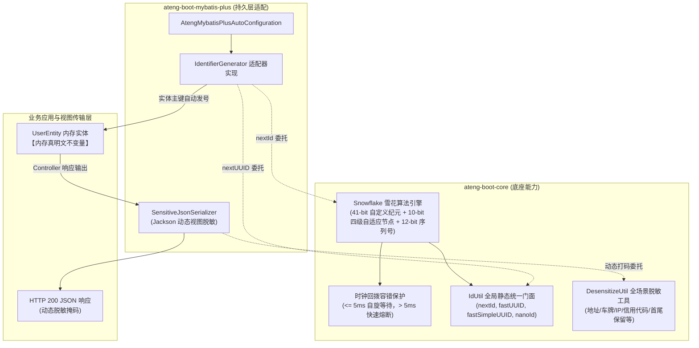

# 20. 零膨胀分布式 ID 引擎与全场景敏感数据脱敏架构决策

## 背景与痛点

在企业级分布式微服务与数据安全合规治理实践中，全局唯一发号器与敏感数据安全防护是基础底座的刚性基石。但在既往架构中普遍存在以下痛点：

1. **分布式发号器与重型外部依赖绑定 (Heavy Dependencies & Vendor Lock-in)**：
   - 业界常见雪花算法实现重度依赖 `hutool-core`、`baidu-uid-generator` 或大型分布式协调组件（如 ZooKeeper、Redis、Consul 等），违背了框架零重型外部依赖原则（参见 [ADR-0011](./0011-zero-bloat-and-co-located-utilities.md)）；
   - 在单体轻量部署或边缘部署场景下，引入中心化协调器带来了巨大的运维开销与不可靠网络依赖；
2. **框架内部多套雪花发号逻辑割裂 (Generator Fragmentation & Dual Inconsistency)**：
   - 业务开发既使用 MyBatis-Plus 的 `DefaultIdentifierGenerator`，又在业务层使用各类工具生成 ID；
   - 纪元时间戳、节点分配规则与时钟回拨处理策略不一致，导致系统内生成的分布式 ID 规则割裂，无法实现统一溯源与解析；
3. **敏感数据脱敏场景覆盖不全与业务硬编码侵入 (Masking Incompleteness & In-Memory Mutation)**：
   - 既往脱敏仅覆盖手机号、身份证、邮箱等基础维度，国内地址、车牌号（含新能源与间隔符）、IPv4/IPv6、企业统一社会信用代码及动态自定义首尾保留等场景缺失；
   - 开发者常因缺乏开箱即用的脱敏工具而在业务代码中手工截取字符串打星号，极易引发“星号脏数据写回数据库”的数据损毁灾难（参见 [ADR-0012](./0012-lifecycle-separated-data-security.md)）。

---

## 核心架构与决策内容

经系统性推演，`ateng-boot` 确立纯原生分布式 ID 生成体系与全场景脱敏策略，并实现持久层发号器大一统闭环。

### 1. 纯 JDK 17 原生分布式雪花算法引擎 (`Snowflake`)
- **位结构与纪元规划**：
  - 1 位符号位（固定 0）；
  - 41 位时间戳差值：采用自定义 2026 纪元（`2026-01-01 00:00:00 UTC`，对应 `1767225600000L`），提供长达 69 年的充裕生命周期；
  - 10 位机器标识位：支持 5 位数据中心 ID（0~31）与 5 位工作节点 ID（0~31），最多容纳 1024 个计算节点；
  - 12 位自增序列号：毫秒内并发容量达 4096 个 ID/ms，单节点理论峰值 409.6 万 QPS。
- **四级自适应轻量节点推导 (Adaptive Node Resolution)**：
  在未显式指定 `workerId` 与 `datacenterId` 时，引擎按以下四级流水线全自动推导，实现零配置集群碰撞规避：
  1. **系统属性与环境变量**：读取 `-Dateng.boot.worker-id` / `-Dateng.boot.datacenter-id` 或环境变量 `ATENG_BOOT_WORKER_ID` / `ATENG_BOOT_DATACENTER_ID`；
  2. **硬件 MAC 地址哈希**：读取本机物理网卡 MAC 地址进行加权哈希计算，生成节点识别码；
  3. **局域网 IP 地址哈希**：在容器或虚拟网卡环境 MAC 缺失时，提取内网 IPv4 地址哈希作为降级；
  4. **随机兜底**：若网络接口均不可达，安全降级至基于随机数生成 0~31 节点号。
- **时钟回拨容错与安全熔断**：
  - 若检测到当前时钟小于上一次生成时间戳，且差值 $\le 5\text{ms}$ 时，自动执行纳秒级自旋等待，避免 NTP 阶跃引发系统异常；
  - 若回拨差值 $> 5\text{ms}$，立即抛出受控 `IllegalStateException` 熔断，坚决杜绝因时钟回拨生成重复主键。

### 2. 全局统一发号门面工具 (`IdUtil`)
- **多场景发号统一收口**：
  - `IdUtil.getSnowflakeNextId()` / `getSnowflakeNextIdStr()`：全局单例雪花 ID 生成，兼顾高吞吐与全局有序；
  - `IdUtil.fastSimpleUUID()` / `fastUUID()`：基于 `ThreadLocalRandom` 的高性能无锁 UUID 生成，去除横杠生成纯 32 位 Hex，比标准 `UUID.randomUUID()` 吞吐提升 3~5 倍；
  - `IdUtil.nanoId()`：基于 URL 安全字符集（`A-Za-z0-9_-`）生成的 21 位短 ID，适用于短链接、取件码与轻量业务凭据。

### 3. 持久层发号器大一统桥接 (`IdentifierGenerator`)
- 消除框架内部发号体系割裂，在 `AtengMybatisPlusAutoConfiguration` 中将 MyBatis-Plus 的 `IdentifierGenerator` 声明为桥接适配器：
  - 存在外部配置 `ateng.boot.mybatis-plus.snowflake.worker-id` 与 `datacenter-id` 时，实例化指定节点专属 `Snowflake` 引擎；
  - 默认未配置时，直接桥接复用 `IdUtil.getSnowflake()` 全局单例；
  - 覆写 `nextId(entity)` 委托至雪花引擎，覆写 `nextUUID(entity)` 委托至 `IdUtil.fastSimpleUUID()`，使持久层主键生成行为与业务层 100% 自洽。

### 4. 全场景敏感数据脱敏扩展与“内存真明文”坚守
- **策略矩阵全面扩展**：
  - `ADDRESS`：国内详细地址精确等长脱敏，保留前 6 位，后续字符等长替换为 `*`；
  - `CAR_LICENSE`：车牌号脱敏，保留前 2 位与后 2 位，兼容传统 7 位与新能源 8 位车牌，保留点号或短横线等间隔符；
  - `IPV4`：IPv4 脱敏，默认掩码末位段（如 `192.168.1.*`），支持重载掩码末两位段（`192.168.*.*`）；
  - `IPV6`：IPv6 脱敏，保留首段与尾段，中间压缩掩码（如 `2001:****:7334`）；
  - `SOCIAL_CREDIT_CODE`：统一社会信用代码脱敏，保留前 2 位与后 4 位，中间 12 位等长掩码为 `*`；
  - `KEEP_HEAD_TAIL`：灵活自定义首尾保留字符数掩码（如 `@FieldSensitive(value = KEEP_HEAD_TAIL, keepHead = 2, keepTail = 2)`）。
- **坚守“内存真明文”不变量**：
  脱敏依然严格收敛于 Jackson 视图序列化层，Java 实体对象在 JVM 内存中 100% 保持原始真实明文，即使发生更新写回，也不会将掩码星号污染数据库。

---

## 后果与权衡 (Consequences & Trade-offs)

### 正向收益
- **彻底消除重型依赖**：100% 依托 JDK 17 原生 API 实现，零第三方库依赖，发号性能与脱敏性能极致卓越；
- **全系统发号规范大一统**：MyBatis-Plus 持久层主键生成与业务层发号统一归口于 `Snowflake` 与 `IdUtil`，消除时间戳基准与节点割裂；
- **多节点自适应免配置**：轻量级四级节点推导在容器多实例部署下大幅减少人工配置工作量；
- **安全与合规全覆盖**：脱敏策略扩展全面覆盖现代政企系统中的地址、车牌、网络地址与组织机构代码场景。

### 妥协成本
- **单机自适应节点碰撞概率极低但理论非零**：四级轻量自适应节点推导依赖 MAC/IP 哈希，在超大规模（如同一网段数百容器）极端碰撞场景下，仍推荐在生产环境通过配置文件或环境变量显式为各 Pod 注入明确唯一的 `workerId` 与 `datacenterId`。
