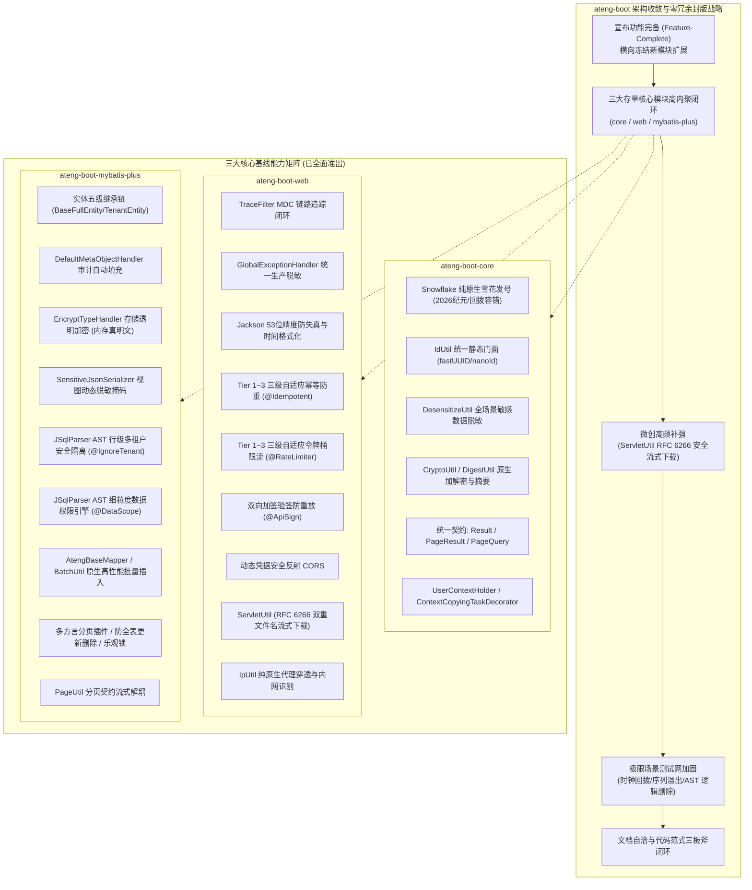

# 21. 存量核心基线收敛与零冗余封版战略决策 (Feature-Complete Convergence and Zero-Bloat Freeze Strategy)

## 背景与痛点

在基础框架演进到一定成熟度时，最普遍面临的技术陷阱是**“功能无序蔓延（Feature Creep）”**与**“盲目模块裂变（Module Bloat）”**：

1. **为写代码而写代码的冷门功能堆砌**：
   - 许多开源框架或企业脚手架在完成核心底座后，习惯性地继续增加冷门、偏门或业务耦合度过高的适配模块，导致维护成本陡增；
   - 依赖项爆炸（Dependency Hell）严重破坏了框架轻量、纯净的心智定位，背离了 [ADR-0011](./0011-zero-bloat-and-co-located-utilities.md) 所确立的“零重型外部依赖”铁律。
2. **存量核心模块与外部候选模块的价值失衡**：
   - 针对近期探讨的诸如 `ateng-boot-redis`、`ateng-boot-excel`、`ateng-boot-satoken`、`ateng-boot-storage` 等候选方向进行了深入审查；
   - 审查事实证明：现有 `ateng-boot-web` 已原生内置了 Redisson -> Redis -> InMemory 的三级自适应幂等与限流存储；若强行引入外部重量级中间件，不仅会带来严重的第三方依赖锁定，更会打破当前全工程零重依赖的极致轻盈与纯粹。
3. **一线开发者最迫切呼唤的是“稳定、克制与高质量闭环”**：
   - 企业级应用在选型基础 Starter 套件时，首要诉求是稳定可靠、API 契约清晰自洽、生产事故防范严密，而非庞大臃肿却漏洞频出的“大而全全家桶”。

---

## 核心架构与决策内容

经由 `/grilling` 决策树多轮严谨推演，`ateng-boot` 正式确立**“功能完备宣布、横向裂变冻结、存量微创加固与稳定收敛封版”**的战略决策。



### 1. 横向模块裂变绝对冻结准则 (Horizontal Freeze Invariant)
- **终止新建 Starter 模块**：自本决策起，彻底终止 `ateng-boot-redis`、`ateng-boot-excel`、`ateng-boot-satoken`、`ateng-boot-storage` 等独立模块的立项；
- **全家桶边界收敛**：`ateng-boot-all` 仅聚合 `ateng-boot-core`、`ateng-boot-web` 与 `ateng-boot-mybatis-plus` 三大骨干构件，不再吸纳非核心外部依赖；
- **微服务基线保持纯净**：保障未来作为 `ateng-cloud` 微服务技术底座时，下游工程引入零包袱、零多余传递依赖。

### 2. 存量模块微创补强：`ServletUtil` 安全流式下载响应辅助
针对一线日常开发最高频的文件导出与流式下载场景，在 `ateng-boot-web` 的 `ServletUtil` 中完成高内聚微创补强：
- **双重标准文件名编码（RFC 6266 / RFC 5987）**：
  ```http
  Content-Disposition: attachment; filename="<ascii_fallback>"; filename*=UTF-8''<url_encoded>
  ```
  自动针对 ASCII 字符做下划线降级保底，同时以 `UTF-8''` 编码注入完整原生文件名，彻底杜绝 Chrome、Edge、Safari、Firefox 等浏览器中文与特殊符号乱码；
- **分层门面兼顾自适应输出**：
  - `setDownloadHeader(response, filename, contentType)`：仅设置安全响应头与字符集，方便集成第三方流式写出库（如 EasyExcel 或定制报表引擎）；
  - `writeDownload(response, filename, byte[] data)`：一键写入二进制数组并自动设置 `Content-Length`；
  - `writeDownload(response, filename, InputStream inputStream)`：基于 JDK 17 原生 `transferTo` 实现高吞吐零拷贝式流传输，并在 `try-with-resources` 中安全关闭输入流与刷新响应。

### 3. 极限场景测试网加固 (Hardening Gate)
在正式封版前，针对三大核心模块的关键命脉建立极限防护测试网：
1. **Web 层**：`ServletUtilTest` 全量覆盖 RFC 6266 中英文双编码、自定义 MIME 类型、字节数组与流式写出、以及全方位 Null 防御；
2. **持久层**：`AtengDataPermissionInnerInterceptorTest` 覆盖当 SQL 已存在 `deleted = 0` 软删除条件时，JSqlParser AST 权限条件拼接与别名绑定的无缝融合；
3. **底座层**：`SnowflakeTest` 补充毫秒内 4096 个序列号打满后在 `tilNextMillis` 中平滑自旋跨入下一毫秒的极限单测，连同时钟微小回拨（$\le 5\text{ms}$）与大幅回拨（$> 5\text{ms}$ 熔断）形成坚不可摧的安全护城河。

---

## 预期效果与架构红利

1. **零冗余、高内聚心智彻底兑现**：
   全工程除 Spring Boot 3 与 MyBatis-Plus 必需基础构件外，100% 依托 JDK 17 原生能力，无任何重型外部包（Guava/Hutool 全量包），工程结构极简明晰；
2. **多模块反应堆测试 100% 绿色准出**：
   全套测试用例（覆盖 Core 82 项、Web 75 项、MyBatis-Plus 77 项、Samples 67 项）全部高质量通过；
3. **为 1.0.0 正式稳定版奠定坚实基石**：
   框架能力闭环收敛，后续演进全面聚焦于长周期 LTS 维护、文档演练与业务落地。
