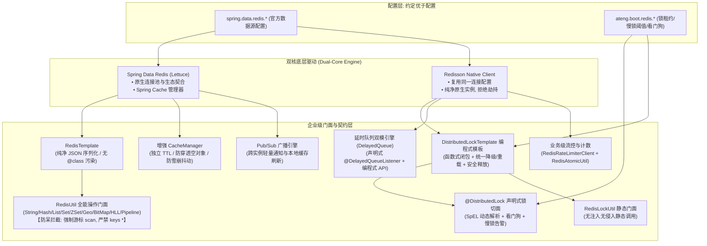

# 22. 双核驱动 Redis 基础设施与企业级分布式协同架构决策 (Dual-Core Redis Infrastructure and Distributed Coordination Architecture)

## 背景与痛点

随着企业级业务向高并发、分布式及微服务架构演进，数据缓存与分布式并发控制成为不可或缺的基础底座：

1. **单核选型两难困境**：
   - 纯采用 `spring-boot-starter-data-redis`（Lettuce）：具备一流的 Spring 生态契合度与标准 `RedisTemplate` 习惯，但其分布式锁仅能依托裸 `SETNX`，缺乏看门狗（Watchdog）自动续期机制，无法原生支持公平锁、读写锁与联锁，极易发生锁提前超时导致数据并发脏写；
   - 纯采用官方 `redisson-spring-boot-starter`：具备顶级的分布式协调原语，但其 Starter 会强行接管/覆写 Spring 的 `RedisConnectionFactory`，与 Spring Boot 3.3.x 数据源配置规范存在潜在冲突，且基础 K-V 操作习惯与国内主流开发者心智模型割裂。
2. **反序列化 CVE 与跨微服务类名绑定风险**：
   - 常见开源封装偏好开启 Jackson 的 `DefaultTyping.NON_FINAL`（JSON 携带 `@class` 全限定名），一旦微服务重构类路径变更即导致反序列化崩溃，且存在已知的反序列化远程代码执行安全隐患。
3. **分布式锁异常掩盖与慢锁治理黑盒**：
   - 业务处理超长导致锁提前失效时，切面若盲目调用 `lock.unlock()` 会抛出 Redisson 的 `IllegalMonitorStateException`，掩盖真实的业务异常与根因；同时缺乏持锁耗时监控，难以定位慢事务。
4. **轻量延时任务与广播消费门槛高**：
   - 中小企业对于“订单 30 分钟未支付关单”或“本地缓存刷新广播”等轻量异步场景，引入 RocketMQ/RabbitMQ 运维成本高昂，手写 Redis zset/pubsub 轮询极易发生漏处理与死循环。

---

## 核心架构与决策内容

经由 `/grill-with-docs` 决策树 3 轮推演与全面对齐，`ateng-boot` 决定新增独立子模块 `ateng-boot-redis`，确立**“双核融合驱动、安全类型自洽、全能并发协调与双模延时消息”**的架构决策。

### 1. 双核融合驱动与配置零侵入
- 依赖层同时引入 `spring-boot-starter-data-redis` 与原生 `redisson` 核心包（非第三方 starter）；
- 自动装配时 100% 优先继承 Spring 官方 `spring.data.redis.*`（涵盖单机、哨兵与集群模式），以此构建 `RedissonClient`，实现一套配置、两路共用、零污染。

### 2. 安全 JSON 序列化与跨系统解耦
- Key/HashKey 统一采用 `StringRedisSerializer`；
- Value/HashValue 采用基于 Jackson 的安全序列化，支持 Java 8 日期时间标准格式化与 Long 精度防丢失；
- **坚决不开启 `@class` 多态侵入**，Redis 中存储纯净标准 JSON，读取时通过 `RedisUtil.get(key, Class<T>)` 或 `TypeReference<T>` 完成安全映射，杜绝反序列化漏洞与跨服务重命名故障。

### 3. 双模一体化分布式锁引擎 (`@DistributedLock` + `DistributedLockTemplate` + `RedisLockUtil`)
- **声明式与编程式同构内核**：通过底层核心模板 `DistributedLockTemplate` 实现加锁、看门狗自动延期、`finally` 安全防误删释放与慢锁审计的 100% 逻辑复用，`DistributedLockAspect` 切面直接委托给模板执行；
- **双层调用接口**：
  - 声明式注解 `@DistributedLock`：面向方法级切面声明，支持 SpEL 动态键解析与数组多键联锁；
  - 编程式模板 `DistributedLockTemplate`：面向复杂流程内部受管闭包，支持 `execute`（默认快速失败）、带降级回调 `fallback` 重载与 `tryExecute`（布尔试探）；
  - 静态门面 `RedisLockUtil`：面向任意静态上下文与无需注入 Spring Bean 的轻量调用；
- **四阶锁模式**：支持 `REENTRANT`（可重入锁）、`FAIR`（公平锁）、`READ`（读锁）、`WRITE`（写锁）；
- **复合联锁 (MultiLock)**：支持同时原子锁定多个业务键，防止分布式死锁；
- **租约与看门狗**：租约时间默认 `-1` 激活 Redisson 看门狗自动续期（30s 周期自延）；支持自定义超时时长与等待时长；
- **防呆释放与慢锁审计**：在 `finally` 块中严格以 `lock.isHeldByCurrentThread()` 防御，释放失败仅记录告警日志，绝不抛出 `IllegalMonitorStateException` 掩盖业务异常；业务持锁超过慢锁阈值（默认 3s）自动触发 WARN 审计日志；争锁超时统一抛出 `BusinessException(429)`。

### 4. 游标安全扫描与全能门面 (`RedisUtil`)
- 封装五大基础结构（String, Hash, List, Set, ZSet）以及高频高级结构（Geo 地理位置、BitMap 签到打卡、HyperLogLog UV 统计）；
- 提供流式批处理 `executePipelined`；
- **生产防呆强红线**：严禁暴露裸 `keys *` 接口，全量收敛为基于游标的 `scan(pattern, count)` 分批分段扫描。

### 5. 双模轻量延时队列与广播消息
- 提供编程式 `RedisDelayedQueue` 门面（`offer`, `poll`, `take`）；
- 提供声明式 `@DelayedQueueListener(queue = "...")` 注解，由框架自动管理后台线程池轮询调度与异常补偿；
- 提供轻量 Pub/Sub 广播门面，便于实现集群节点事件通知与两级缓存失效。

### 6. 缓存增强与两级缓存 SPI 预留
- 定制 `RedisCacheManager`：支持 `@Cacheable` 为不同 cacheName 配置独立 TTL、自动缓存空对象防穿透、自动加入随机抖动防雪崩；
- 预留 `TwoLevelCache` SPI 契约扩展点，保证主模块轻量，不强制捆绑 Caffeine 内存包。

### 7. Phase 2 生产级深度演进 (Two-Level Cache, Cache Defense & Queue Hardening)
经由 `/grill-with-docs` 双轮推演，确立以下深化增量决策：
1. **两级缓存体系 (TwoLevelCache & TwoLevelCacheManager)**：
   - **双模驱动**：同时提供底层编程式 `TwoLevelCache` 门面与 Spring 原生 `TwoLevelCacheManager` 适配器，无缝支持 `@Cacheable` / `@CacheEvict`；
   - **依赖解耦与退化**：Caffeine 设为编译期 `<optional>true</optional>`；存在 Caffeine 时发挥 W-TinyLFU 顶级性能；缺类时自动平滑退化为基于原生 JVM `LinkedHashMap` 的软容量 LRU 内存缓存，严格限定最大条数防 OOM；
   - **单集中广播与防环**：全系统多 CacheName 共用单一集中 Redis 广播频道（`ateng:cache:evict:topic`），载荷封装 `CacheEvictMessage(cacheName, key, instanceId, clearAll)`；各实例根据唯一 `instanceId` 防自重入消除网络延迟竞争。
2. **工业级缓存防卫模板 (RedisCacheTemplate)**：
   - **单键与批量防击穿**：同时支持单 Key `getOrLoad` 与批量 `batchGetOrLoad`（结合 MGET + 缺失键 DCL + 分布式锁原子批量查库 + Pipeline 批量回填，彻底杜绝 N+1 穿透）；
   - **三防合一**：分布式锁防击穿、短 TTL 空值缓存防穿透、Jitter 随机偏移防雪崩；
   - **容灾穿透兜底**：争抢分布式锁超时后自动打 WARN 告警并平滑穿透查库，保证极端高并发或网络抖动下的可用性优先。
3. **分布式布隆过滤器 (RedisBloomFilter)**：
   - 基于 Redisson `RBloomFilter` 封装；支持 YAML 声明式配置启动预热（`ateng.boot.redis.bloom-filters.<name>`）与编程式动态双轨；内置容量逼近（80%）监控告警。
4. **延时队列生产级死信与受管线程治理**：
   - **受管线程合规**：全面取缔内部 `Executors.newFixedThreadPool` 野线程，接入 Core 受管线程池设施与 MDC 上下文装饰；
   - **死信队列 (DLQ)**：重试耗尽后自动将消息包装为 `DeadLetterMessage` 存入 `{queueName}:dlq`，并回调 `DelayedQueueFailureHandler` SPI（支持业务定制钉钉/飞书告警或持久化补偿）。
5. **声明式 Pub/Sub 订阅 (@ChannelTopicListener)**：
   - 补齐声明式订阅切面，支持 `${...}` 动态占位符与通配模式，根据方法入参类型完成安全 JSON 智能自动反序列化。
6. **全局 KeyPrefix 分层治理契约**：
   - 高级受管语义组件（锁、缓存模板、两级缓存、布隆、延时队列）统一自动前置拼接 `keyPrefix`；底层 `RedisUtil` 保持原生透传，提供 `buildKey()` 辅助，分层清晰透明。

### 8. Phase 3 分布式协同底座加固与全场景演进决策 (Distributed Coordination Hardening & Full-Scenario Evolution)
立足于 `ateng-boot-redis` 面向更复杂的微服务高并发、流量治理与异步编排场景，确立以下增量架构决策：
1. **Redisson 生产连接保活与连接池深度治理 (#398)**：
   - 针对云原生容器跨可用区与 NAT 网关长时间空闲被静默切断连接（Silent Drop）的生产痛点，统一引入 `pingConnectionInterval`（默认 30s）定期心跳检测机制；
   - 显式纳管 `connectionPoolSize`、`connectionMinimumIdleSize`、`retryAttempts` 与 `retryInterval` 等连接池关键参数；
   - 补齐 `RedisAtomicUtil.getAndSet` 等对称原子原语。
2. **受管原子 Lua 脚本执行器与 SHA1 预编译缓存 (#399)**：
   - 落地 `RedisScriptExecutor` 门面，支持 Classpath 资源脚本与内联动态脚本；
   - 内置 SHA1 摘要计算与并发安全缓存，优先采用 `EVALSHA` 协议通信减少网络负载；统一转译底层驱动异常为框架业务异常。
3. **分布式受管信号量与并发度治理模板 (#400)**：
   - 落地 `RedisSemaphoreTemplate` 与 `RedisSemaphoreUtil` 静态门面，实现集群全局并发在途请求（In-Flight Concurrency）硬阈值控制；
   - 支持自动原子初始化配额、`tryAcquire` 等待超时降级回调 `fallback`，并在 `finally` 阶段依据持有名额严格防御性安全释放。
4. **通用业务级分布式防重幂等模板与声明式切面 (#401)**：
   - 落地 `RedisIdempotentTemplate`、`RedisIdempotentUtil` 与 `@RedisIdempotent` 切面，专职解决非 Web 业务链路（MQ、定时任务、RPC）的并发防重难题；
   - 引入 `deleteOnFailure` 故障自愈机制：业务异常时主动删除防重 Key，确保上游重试机制顺畅自愈。
5. **Redis 5.0+ Stream 可靠消息流引擎与声明式消费组切面 (#402)**：
   - 落地 `RedisStreamTemplate`，封装流追加、消费组自动创建、Pending 积压检查、XCLAIM 孤儿认领与 XTRIM 定长裁剪；
   - 落地 `@RedisStreamListener` 声明式监听切面与 `StreamBootstrap` 调度器，受管线程池驱动，支持 At-Least-Once 可靠投递、MDC 上下文透传与死信流 (`:dlq`) + `StreamFailureHandler` SPI。
6. **样例工程去 Web 污染重构与 1:1 全场景驱动实测 (#403)**（*注：本条关于“零 Controller”的阶段性约定已被下文 Phase 4 演进决策正式废止替代*）：
   - 早期阶段曾移除样例工程中的独立 Controller，构建 8 大场景业务组件并以 `@SpringBootTest` 验证。

### 9. Phase 4 全面 Web 体验化重构、双模内存仿真桩与全局前缀一致性加固 (Full Web Experience & KeyPrefix Unification)
遵循全仓统一的《工业级文档与样例工程标准规范》（`docs/agents/documentation-specification.md`），经由 `/grill-with-docs` 决策推演，对 `ateng-boot-redis` 及其配套 `ateng-boot-sample-redis` 确立以下增量架构演进决策：
1. **废止“零 Controller”旧规，升级为 8 领域高内聚 Web 交互沙箱**：
   - 正式废止 Phase 3 (#403) 中关于“非 Web 模块保持零 Controller”的历史过渡约定；
   - `ateng-boot-sample-redis` 引入 `ateng-boot-web` 底座，按单一职责拆分为 8 个领域 `@RestController`（`RedisOpsAndScriptController`、`RedisLockController`、`RedisIdempotentController`、`RedisTrafficController`、`RedisCacheController`、`RedisDelayQueueController`、`RedisStreamController`、`RedisPubSubController`），统一挂载 `/sample/redis/<feature>/<action>` 语义路由并返回强类型 `Result<T>`。
2. **`src/main` 纯 JDK 原生动态代理离线内存仿真桩与 `local` 双模切换**：
   - 针对 `Redisson.create(config)` 与后台监听容器在启动期强依赖物理连接的特性，在 `ateng-boot-sample-redis/src/main` 中内置标注 `@Profile("!local")` 的纯 JDK 原生动态代理内存仿真配置（零 Mockito 生产依赖），统一驱动 `mvn spring-boot:run` 离线交互体验与 `@SpringBootTest` + `MockMvc` 端到端测试；
   - 当激活 `local` Profile 并加载 `application-local.yml` 时，内存仿真桩自动退出，100% 切换至真实物理 Redis 与 Redisson 客户端联调。
3. **全局 `key-prefix` 高级组件全覆盖对齐与两级缓存配置向后兼容**：
   - 补齐 `RedisRateLimiterClient` 与单级 `RedisCacheManager` 对 `ateng.boot.redis.key-prefix` 的统一前置拼接能力，消除多环境/多租户共享实例下的局部串键盲区（仅最底层 `RedisUtil` 保持显式原生透传并提供 `buildKey` 辅助）；
   - `RedisProperties.TwoLevelCacheProperties` 的 `L1Properties` 与 `L2Properties` 在保持 `ttls` 标准属性名的同时，提供 `expires` 兼容绑定入口，实现向后平滑兼容。
4. **权威文档 0~7 章领域大章收敛与三要素同屏闭环**：
   - 彻底重构 `ateng-boot-redis/README.md`，将原 17 个散落章节收敛为 0~7 八大领域章节，原第 16 章（SPI 扩展定制）与第 17 章（生产边界与故障模式）全量拆解并就近内聚至各特性子节内部；Sample 自身 `README.md` 收敛为四段式极简体验卡。

### 10. Phase 5 工业级防线加固、死信受控重放/PEL自愈与全场景对称门面演进 (#838)
立足于九道成熟度防线与更极端的高并发、分布式故障自愈场景，经由 `/grill-with-docs` 推演，确立以下增量架构决策：
1. **Redisson 看门狗配置自洽、全局前缀分层契约与两级缓存 L2-TTL 对齐 (#839)**：
   - 彻底修复 Redisson 看门狗时间配置覆盖失效问题，显式通过 `config.setLockWatchdogTimeout` 注入；
   - 确立全局 `key-prefix` 刚性分层契约：高级受管组件（锁、防重、延时队列、Stream、缓存、信号量、布隆）100% 自动拼接，最底层 `RedisUtil` 保持原生透传；
   - 两级缓存修复 L2 序列化时未纳管特定 CacheName TTL 映射的缺陷，实现与 L1 TTL 深度对齐。
2. **延时队列死信受控重放、静态门面补齐与高并发全场景对称操作 (#840)**：
   - `DeadLetterMessage` 增强支持累计重放计数（`replayCount`）；
   - 新增 `ateng.boot.redis.delay-queue.max-replay-attempts`（默认 3 次），超过阈值阻断重放，防止毒丸死循环引发二次死信雪崩；
   - 补齐 `RedisDelayedQueueUtil` 静态门面与 `peekDeadLetters` 非破坏检视接口，保障对称操作完备性。
3. **分布式锁多模式静态门面补齐、降级 fallback 扩展与原子 CAS 对称演进 (#841)**：
   - `RedisLockUtil` 静态门面全量对齐 `DistributedLockTemplate`，全面支持 `FAIR`、`READ`、`WRITE` 锁模式与超时 `fallback` 降级闭包；
   - `RedisAtomicUtil` 补齐通用 `compareAndSet(key, expect, update, duration)` 等对称操作，增强过期时间保护。
4. **Stream 四维上下文透传、死信受控重放与 PEL 孤儿消息自动认领自愈 (#842)**：
   - Stream 投递与消费链路深度集成 Core 四维上下文（MDC `traceId`、`TenantContextHolder`、`UserContextHolder`），消费端在 `finally` 中严格清理上下文，业务监听入参前置过滤 `__ateng_*` 内部系统键；
   - 扩展 `StreamDeadLetterMessage` 记录 `replayCount`，新增 `ateng.boot.redis.stream.max-replay-attempts`（默认 3 次）防雪崩守卫，修复进入死信后的双重 ACK 冗余缺陷；
   - `StreamBootstrap` 升级实现 `SmartLifecycle` 规范契约，消费主循环内置周期性 PEL 巡检与 `claimPendingMessages` 自动抢占孤儿待决消息（`claim-idle-time` 默认 1m，`claim-batch-size` 默认 20 条），消费者宕机故障无感自愈。
5. **Sample 与 Starter 五维文档 1:1 逆向对齐、领域词汇表及 ADR-0022 闭环 (#843)**：
   - Sample 与 Starter 双端文档 100% 逆向对齐，消除参数与路由幻觉；
   - 沉淀 **DeadLetterReplay** 与 **PELOrphanClaiming** 核心标准术语至 `CONTEXT.md`，阶梯二测试与 12 项自检清单全绿准出。

### 11. Phase 6 自动装配顺序守卫、看门狗双层级超时覆盖与五维 8 大章文档收敛 (#931 ~ #935)
围绕模块体检发现的装配边界、SPI 原因链完整度、门面统一初始化及文档结构碎片化问题，确立以下增量加固与文档治理决策：
1. **看门狗双层级超时配置与自动装配排序守卫 (#932)**：
   - 在 `RedisProperties.LockProperties` 中新增可选 `watchdogTimeout`（`ateng.boot.redis.lock.watchdog-timeout`），并在 `RedisProperties.RedissonProperties` 规范 `lockWatchdogTimeout`（默认 `30s`）；`AtengRedisAutoConfiguration.applyLockWatchdogTimeout` 按 `lock.watchdog-timeout` 优先于 `redisson.lock-watchdog-timeout` 的优先级注入 `Config.setLockWatchdogTimeout`，且统一经 `Duration` 转毫秒并强制 `> 0ms` 校验；
   - 在 `AtengRedisAutoConfiguration` 显式补充 `@AutoConfigureAfter(AtengCoreAutoConfiguration.class)` 与 `@AutoConfigureBefore({RedisAutoConfiguration.class, CacheAutoConfiguration.class})`，同时对 `RedisMessageListenerContainer`、`RedisMessagePublisher`、`ChannelTopicBootstrap` 补充 `@ConditionalOnProperty(prefix = "ateng.boot.redis.pub-sub", name = "enabled", ...)` 与 `SemaphoreProperties`（`enabled` / `prefix`）强类型子配置，消除依赖默认装配顺序的隐式竞态。
2. **8 大静态门面统一绑定与 `StreamFailureHandler.onFailed` 双参原因链扩展 (#933)**：
   - 新增 `SmartInitializingSingleton` 命名的 `redisStaticFacadesInitializer` Bean，在所有单例装配就绪后统一完成 8 个全局静态门面（`RedisUtil`、`RedisAtomicUtil`、`RedisBloomUtil`、`RedisSemaphoreUtil`、`RedisLockUtil`、`RedisIdempotentUtil`、`RedisStreamUtil`、`RedisDelayedQueueUtil`）的最终委托绑定，保障下游覆盖自定义 Template Bean 时静态门面仍无缝切换；
   - `StreamFailureHandler` 在保留函数式单参 `onFailure(StreamDeadLetterMessage)` 向后兼容的同时，新增默认双参方法 `onFailed(StreamDeadLetterMessage deadLetterMessage, Throwable cause)`，`StreamBootstrap` 消费重试耗尽后直接传递完整异常原因链 `lastError`；`RedisRateLimiterClient` 与 `RedisAtomicUtil` 同步加固参数卫语句与 `Duration` 重载契约。
3. **Sample 双模体验收敛与五维 README 8 大能力章闭环 (#934, #935)**：
   - `ateng-boot-sample-redis` 清理冗余调试日志，增强并发闭环与异常路径集成验证；
   - `ateng-boot-redis/README.md` 严格与 Sample 8 大 `@RestController` 领域 1:1 对应收敛为 8 个高内聚业务能力大章（将独立脚本/原子、单级缓存、防卫缓存、两级缓存、布隆过滤器分别内聚归并），核准全局 `key-prefix` 幂等合成表、`ContextPropagationTiers` 分级模型与全量 YAML 默认值，同步更新 `CONTEXT.md` 与 `ADR-0022`。

---

## 权衡与收益考量 (Consequences)

### 正向收益
1. **兼收并蓄**：既享有 Spring Data Redis 原生生态红利，又坐拥 Redisson 强大的分布式协调能力；
2. **生产安全等级最高**：彻底屏蔽 `keys *` 生产事故隐患、屏蔽 `@class` 反序列化 CVE 隐患、屏蔽非法持锁人释放异常导致的故障掩盖、杜绝延时任务失败静默丢数据；
3. **极佳的开发体验**：开箱即用的两级缓存、批量防击穿模板、死信队列、注解驱动广播、声明式分布式锁、防重幂等与 Stream 消息流，极大幅度削减业务胶水代码；
4. **零臃肿与弹性伸缩**：Caffeine 可选依赖不绑架底座体积，缺依赖平滑降级，单集中频道节省连接句柄。

### 妥协与成本
1. **轻微的内存与连接开销**：双核共存模式下，Lettuce 与 Redisson 会各自维护一套连接池。但在生产环境下，通过合理设置两者连接池最小空闲与最大连接数，其开销对现代服务器几乎微乎其微；
2. **两级缓存最终一致性窗口**：L1 本地缓存与 L2 Redis 之间存在极短暂的 Pub/Sub 广播网络传播时延（通常 < 10ms），适用于高频读、容忍微小延迟的准实时业务场景。

---

## 演进落地状态与交付审计 (Delivery & Verification Audit)

- **当前状态**：`Accepted & Implemented (已全面落地交付)`
- **工单切片闭环**：
  - **Phase 2 演进工单**：
    - **#142**：延时队列死信保障 (DLQ)、受管线程池合规、`DeadLetterMessage<T>` 与 `DelayedQueueFailureHandler` SPI；
    - **#143**：声明式 Pub/Sub 广播订阅注解 (`@ChannelTopicListener`)、动态占位符与通配模式支持、强类型多态反序列化；
    - **#144**：分布式布隆过滤器 (`RedisBloomFilter`)、声明式预热配置 (`bloom-filters.*`)、80% 容量预警与 KeyPrefix 隔离；
    - **#145**：`RedisCacheTemplate` 泛型防卫模板、单键与批量 MGET 防击穿、短 TTL 空哨兵防穿透、Jitter 随机抖动防雪崩与争锁超时平滑查库容灾；
    - **#146**：内存+Redis 两级缓存体系 (`TwoLevelCache` & `TwoLevelCacheManager`)、L1 Caffeine 探测与内置 LRU 严格防 OOM 退化、`ateng:cache:evict:topic` 集中广播失效与 `instanceId` 防自重入死循环；
    - **#147**：`ateng-boot-sample-redis` 全场景自验工程闭环、28 项端到端离线自洽集成测试 100% 绿灯准出、全景速查矩阵五维文档与 ADR 归档。
  - **Phase 3 底座加固与全场景演进工单 (#397)**：
    - **#398**：Redisson 生产连接保活、连接池治理与对称原子/限流原语补齐；
    - **#399**：受管原子 Lua 脚本执行器与 SHA1 预编译缓存 (`RedisScriptExecutor`)；
    - **#400**：分布式受管信号量与并发度治理模板 (`RedisSemaphoreTemplate` & `RedisSemaphoreUtil`)；
    - **#401**：通用业务级分布式防重幂等模板与声明式切面 (`RedisIdempotentTemplate` & `@RedisIdempotent`)；
    - **#402**：Redis 5.0+ Stream 可靠消息流引擎与声明式消费组切面 (`RedisStreamTemplate` & `@RedisStreamListener`)；
    - **#403**：样例工程去 Web 污染重构与 1:1 全场景驱动实测（8 大场景 Service 与 21 项端到端测试）；
    - **#404**：五维生产就绪文档体系、100% 全景速查矩阵与 ADR-0022 落地闭环。
  - **Phase 5 工业级防线加固、死信受控重放/PEL自愈与全场景对称门面演进工单 (#838)**：
    - **#839**：Redisson 看门狗配置自洽、全局前缀分层契约与两级缓存 L2-TTL 对齐加固；
    - **#840**：延时队列死信受控重放、静态门面补齐与高并发全场景对称操作演进；
    - **#841**：分布式锁多模式静态门面补齐、降级 fallback 扩展与原子 CAS 对称演进；
    - **#842**：Stream 四维上下文透传、死信受控重放与 PEL 孤儿消息自动认领自愈闭环；
    - **#843**：Sample 与 Starter 五维文档 1:1 逆向对齐、领域词汇表及 ADR-0022 闭环。
  - **Phase 6 全面模块体检加固与五维 8 大章收敛工单 (#931)**：
    - **#932**：自动装配排序守卫（`@AutoConfigureAfter`/`@AutoConfigureBefore`）、`SemaphoreProperties` 与 `LockProperties.watchdogTimeout` / `RedissonProperties.lockWatchdogTimeout` 优先级覆盖；
    - **#933**：8 大静态门面统一 `SmartInitializingSingleton` 绑定与 `StreamFailureHandler.onFailed(deadLetterMessage, cause)` 双参原因链扩展；
    - **#934**：`ateng-boot-sample-redis` 双模并发闭环与日志收敛加固；
    - **#935**：Starter 五维 `README.md` 8 大能力章收敛与 `CONTEXT.md` / `ADR-0022` 闭环。
- **质量门禁基准**：依赖树联动编译与端到端集成测试通过，覆盖率与工业级健壮性红线全达标（277 个模块单测 + 44 个场景端到端测试 100% 通过）。

