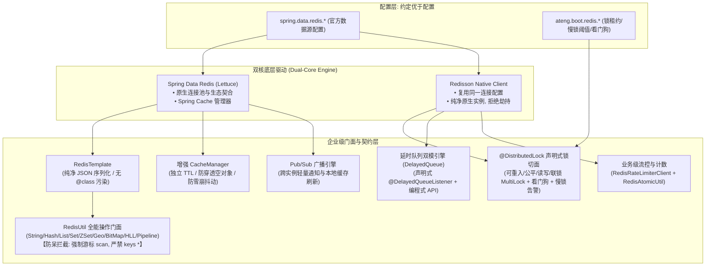

# 22. 双核驱动 Redis 基础设施与企业级分布式协同架构决策 (Dual-Core Redis Infrastructure and Distributed Coordination Architecture)

## 背景与痛点

随着企业级业务向高并发、分布式及微服务架构演进，数据缓存与分布式并发控制成为不可或缺的基础底座：

1. **单核选型两难困境**：
   - 纯采用 `spring-boot-starter-data-redis`（Lettuce）：具备一流的 Spring 生态契合度与标准 `RedisTemplate` 习惯，但其分布式锁仅能依托裸 `SETNX`，缺乏看门狗（Watchdog）自动续期机制，无法原生支持公平锁、读写锁与联锁，极易发生锁提前超时导致数据并发脏写；
   - 纯采用官方 `redisson-spring-boot-starter`：具备顶级的分布式协调原语，但其 Starter 会强行接管/覆写 Spring 的 `RedisConnectionFactory`，与 Spring Boot 3.3.x 数据源配置规范存在潜在冲突，且基础 K-V 操作习惯与国内主流开发者心智模型割裂。
2. **反序列化 CVE 与跨微服务类名绑定风险**：
   - 常见开源封装偏好开启 Jackson 的 `DefaultTyping.NON_FINAL`（JSON 携带 `@class` 全限定名），一旦微服务重构类路径变更即导致反序列化崩溃，且存在已知的反序列化远程代码执行安全隐患。
3. **分布式锁异常掩盖与慢锁治理黑盒**：
   - 业务处理超长导致锁提前失效时，切面若盲目调用 `lock.unlock()` 会抛出 Redisson 的 `IllegalMonitorStateException`，掩盖真实的业务异常与根因；同时缺乏持锁耗时监控，难以定位慢事务。
4. **轻量延时任务与广播消费门槛高**：
   - 中小企业对于“订单 30 分钟未支付关单”或“本地缓存刷新广播”等轻量异步场景，引入 RocketMQ/RabbitMQ 运维成本高昂，手写 Redis zset/pubsub 轮询极易发生漏处理与死循环。

---

## 核心架构与决策内容

经由 `/grill-with-docs` 决策树 3 轮推演与全面对齐，`ateng-boot` 决定新增独立子模块 `ateng-boot-redis`，确立**“双核融合驱动、安全类型自洽、全能并发协调与双模延时消息”**的架构决策。

### 1. 双核融合驱动与配置零侵入
- 依赖层同时引入 `spring-boot-starter-data-redis` 与原生 `redisson` 核心包（非第三方 starter）；
- 自动装配时 100% 优先继承 Spring 官方 `spring.data.redis.*`（涵盖单机、哨兵与集群模式），以此构建 `RedissonClient`，实现一套配置、两路共用、零污染。

### 2. 安全 JSON 序列化与跨系统解耦
- Key/HashKey 统一采用 `StringRedisSerializer`；
- Value/HashValue 采用基于 Jackson 的安全序列化，支持 Java 8 日期时间标准格式化与 Long 精度防丢失；
- **坚决不开启 `@class` 多态侵入**，Redis 中存储纯净标准 JSON，读取时通过 `RedisUtil.get(key, Class<T>)` 或 `TypeReference<T>` 完成安全映射，杜绝反序列化漏洞与跨服务重命名故障。

### 3. 全能声明式分布式锁 (`@DistributedLock`)
- **四阶锁模式**：支持 `REENTRANT`（可重入锁）、`FAIR`（公平锁）、`READ`（读锁）、`WRITE`（写锁）；
- **复合联锁 (MultiLock)**：支持 SpEL 数组形式动态解析多个业务键，原子锁住多重资源；
- **租约与看门狗**：租约时间默认 `-1` 激活 Redisson 看门狗自动续期；支持显式配置超时时长与等待时长；
- **防呆释放与慢锁审计**：在 `finally` 块中严格以 `lock.isHeldByCurrentThread()` 防御，释放失败仅记录告警日志，绝不抛出 `IllegalMonitorStateException`；业务持锁超过慢锁阈值（默认 3s）自动触发 WARN 审计日志；争锁超时统一抛出 `BusinessException`。

### 4. 游标安全扫描与全能门面 (`RedisUtil`)
- 封装五大基础结构（String, Hash, List, Set, ZSet）以及高频高级结构（Geo 地理位置、BitMap 签到打卡、HyperLogLog UV 统计）；
- 提供流式批处理 `executePipelined`；
- **生产防呆强红线**：严禁暴露裸 `keys *` 接口，全量收敛为基于游标的 `scan(pattern, count)` 分批分段扫描。

### 5. 双模轻量延时队列与广播消息
- 提供编程式 `RedisDelayedQueue` 门面（`offer`, `poll`, `take`）；
- 提供声明式 `@DelayedQueueListener(queue = "...")` 注解，由框架自动管理后台线程池轮询调度与异常补偿；
- 提供轻量 Pub/Sub 广播门面，便于实现集群节点事件通知与两级缓存失效。

### 6. 缓存增强与两级缓存 SPI 预留
- 定制 `RedisCacheManager`：支持 `@Cacheable` 为不同 cacheName 配置独立 TTL、自动缓存空对象防穿透、自动加入随机抖动防雪崩；
- 预留 `TwoLevelCache` SPI 契约扩展点，保证主模块轻量，不强制捆绑 Caffeine 内存包。

---

## 权衡与收益考量 (Consequences)

### 正向收益
1. **兼收并蓄**：既享有 Spring Data Redis 原生生态红利，又坐拥 Redisson 强大的分布式协调能力；
2. **生产安全等级最高**：彻底屏蔽 `keys *` 生产事故隐患、屏蔽 `@class` 反序列化 CVE 隐患、屏蔽非法持锁人释放异常导致的故障掩盖；
3. **极佳的开发体验**：开箱即用的注解驱动延时队列、声明式分布式锁与全能 `RedisUtil` 极大幅度削减业务胶水代码。

### 妥协与成本
1. **轻微的内存与连接开销**：双核共存模式下，Lettuce 与 Redisson 会各自维护一套连接池。但在生产环境下，通过合理设置两者连接池最小空闲与最大连接数，其开销对现代服务器几乎微乎其微。
