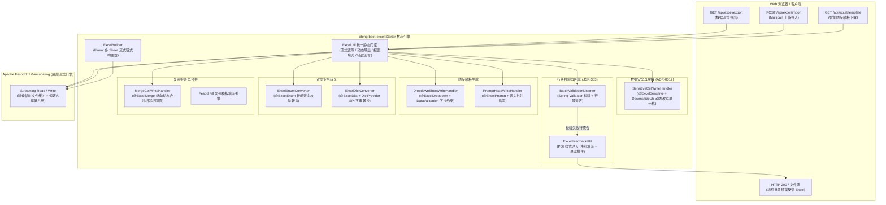

# 23. 企业级轻量流式 Excel 引擎与数据安全/校验/防呆一体化架构决策

## 背景与痛点

在企业级企业应用中，Excel 导入导出是与业务最贴近、使用频度最高的数据流转手段。然而在传统研发实践与老旧技术栈中，Excel 处理长期面临以下严峻问题：

1. **传统 POI 内存暴涨与 OOM 崩溃 (Heap Exhaustion & OOM)**：
   - 原生 Apache POI 的 `XSSFWorkbook` 采用全内存 DOM 树模型，解析或生成包含数万行乃至数十万行的数据时，每个单元格均生成独立的 Java 堆对象，极易瞬时耗尽堆内存触发频繁 Full GC，导致系统雪崩；
2. **历史组件停更停滞与依赖膨胀 (Dependency Stagnation & Vulnerabilities)**：
   - 历史上广泛使用的 Alibaba EasyExcel（3.x 系列）维护停滞、更新缓慢，对 Spring Boot 3 与 JDK 17+ 模块化的适配存在历史包袱；社区正统演进分支进入 Apache 软件基金会孵化器（Apache Fesod），亟需在工程基准上锁定纯净、合规的现代流式引擎；
3. **数据展示脱敏引发的“内存脏污染” (In-Memory Mutation Dirty Data)**：
   - 传统导出若需对手机号、身份证等敏感字段掩码，开发人员往往在内存对象中执行 Setter 替换，严重破坏 [ADR-0012](./0012-lifecycle-separated-data-security.md) 确立的“内存真明文”不变量，导致实体写回数据库时造成真实数据永久性损坏；
4. **大批量数据导入校验缺失结构化反馈 (Brittle Import Validation & Poor UX)**：
   - 传统导入往往采用“遇到首个错误立即中断”的脆弱模式，或抛出毫无上下文的异常，无法对全表校验错误进行行号、列名、错误原因的结构化聚合；更无法为业务人员直接生成带有“单元格标红 + 批注悬浮提示”的错误反馈 Excel 文件（错题集）；
5. **模板自由手填导致的数据脏乱差 (Template Vulnerability)**：
   - 缺乏在生成模板时自动化植入单元格下拉选项约束与表头填写指南的能力，导致用户随意输入无效代码或格式错误，大幅增加数据清洗与校验失败成本；
6. **枚举与业务字典转义代码臃肿分散 (Dispersed Enum/Dict Conversion)**：
   - 业务状态、性别、分类等枚举与字典项在导入导出时需要大量样板代码反复转换，缺乏统一的声明式注解与标准化 SPI 扩展支撑。

---

## 核心架构与决策内容

经深入推演，`ateng-boot` 正式确立并交付 `ateng-boot-excel` 企业级轻量流式 Starter，建立集**“流式低损耗、内存真明文、行级精准验、模板智能防、双向自转义、多流式编排”**于一体的 Excel 处理底座。

### 1. 技术基线与引擎选型：Apache Fesod 纯原生流式基准
- **正统继承与合规**：全面选用 `org.apache.fesod:fesod-spring-boot-starter:2.1.0-incubating` 与 `fesod-core`，基于 Apache 软件基金会权威孵化基线，消除商业协议风险与停止维护隐患；
- **纯净低内存**：读写全流程严格采用流式管道与磁盘临时换页技术，百万级数据写入与读取 JVM 堆内存波动稳定控制在安全水位（恒定低内存）；
- **零臃肿依赖**：底层 POI 统一纳管为 `poi:5.4.1` 与 `poi-ooxml:5.4.1`，坚决杜绝引入额外第三方全量工具包，严格恪守 [ADR-0011](./0011-zero-bloat-and-co-located-utilities.md)。

### 2. 数据安全不变量：导出动态脱敏机制
- **恪守 ADR-0012 铁律**：确立“内存真明文”在 Excel 导出场景的完整延续。业务传入 `ExcelUtil.export` 的 Java 实体集合在整个生命周期中**保持 100% 原始真实明文**；
- **视图层动态拦截改写**：定义属性级注解 `@ExcelSensitive`，搭配 `SensitiveCellWriteHandler` 在 Apache Fesod 的 `afterCellDataConverted` 阶段通过 `DesensitizeUtil` 仅将写出至工作表单元格的字面量动态打码；杜绝任何在 Service 业务内存中打星号的行为。

### 3. JSR-303 行级校验监听器与失败标红批注回写
- **结构化行级错误模型**：交付 `ExcelErrorRow` 与 `ExcelReadResult<T>`，记录物理行号（严格对齐 Excel 从 1 开始的行索引，默认补偿表头偏移）、列名与校验不通过原因列表；
- **双模校验支持**：交付 `BatchValidationListener<T>`，结合 JSR-303 `Validator`，支持“快速失败（Fast-Fail，遇到首错即抛出 `ExcelValidationException`）”与“全量聚合（收集全部失败行至 `ExcelReadResult`）”双重模式；
- **无感错题集回写**：交付 `ExcelFeedbackUtil` 与 `ExcelUtil.exportErrorFeedback`，以原始导入文件流或数据结构为底板，将校验失败单元格自动填充柔和浅红背景（`IndexedColors.ROSE`）并挂载悬浮批注（`Comment`），用户可直接下载修正后重新上传，体验大幅跃升。

### 4. 防呆模板智能生成与下拉/提示约束
- **输入端源头治理**：定义 `@ExcelDropdown`（支持静态字符数组或实现 `DropdownProvider` 动态提供下拉候选）与 `@ExcelPrompt`（表头操作指南）；
- **全自动注入拦截器**：交付 `DropdownSheetWriteHandler`（通过 POI `DataValidation` 生成单元格内下拉选择框）与 `PromptHeadWriteHandler`（在表头单元格插入悬浮批注指南）；
- **一键极简门面**：通过 `ExcelUtil.exportTemplate(response, filename, clazz)` 一行代码即可向浏览器直接输出带有完整字段类型、下拉列表及表头批注的防呆导入模板。

### 5. 业务数据双向转义：@ExcelEnum 与 @ExcelDict SPI
- **声明式双向枚举**：定义 `@ExcelEnum`，通过 `ExcelEnumConverter` 实现导出时将枚举实例或代码转义为描述文本（`textField`），导入时将中文文本无缝还原为对应枚举实例或字典代码（`codeField`），内置并发线程安全映射缓存；
- **松耦合业务字典 SPI**：定义 `@ExcelDict` 与 `DictProvider` 接口，结合 Spring 上下文或 `DictProviderHolder`，解耦底层具体字典服务（如 Redis、数据库或微服务 Feign 接口），实现导入导出透明字典翻译。

### 6. 复杂报表填充、单元格合并与 Fluent 多 Sheet 构建器
- **复杂模板填充**：交付 `ExcelUtil.fill`，支持复杂合同、对账单占位符对象填充与行循环列表填充；
- **动态单元格合并**：交付 `@ExcelMerge` 与 `MergeCellWriteHandler`，在数据写出时智能识别相邻行相同值，并支持依赖父列的级联层级纵向合并；
- **无实体动态导出**：交付 `ExcelUtil.exportDynamic`，支持基于动态表头 `List<List<String>>` 与动态数据行 `List<List<Object>>` 直接导出，免除创建静态 VO 的沉重开销；
- **Fluent 链式编排**：交付 `ExcelBuilder` 构建器，支持在同一个工作簿中链式编排多个 Sheet、独立配置不同表头与数据源，一键输出至文件、输出流或 HTTP 响应。

---

## 后果与权衡 (Consequences & Trade-offs)

### 正向收益
1. **彻底解决内存泄漏与 OOM 风险**：基于 Apache Fesod 流式管道，在处理百万级海量数据导入导出时堆内存保持低水位平稳运行；
2. **严守数据安全红线**：端到端贯彻 [ADR-0012](./0012-lifecycle-separated-data-security.md)，保障业务内存明文一致性，彻底消除打星号导致的数据库脏回写灾难；
3. **极佳的开发者与用户体验**：
   - 开发者仅需基于统一门面 `ExcelUtil` 或 `ExcelBuilder` 即可完成从简单单表导出到复杂报表填充的全部需求；
   - 业务用户获得带下拉防呆约束的规范模板，并在导入出错时获得精准标红与悬浮批注的错题集 Excel，大幅降低沟通排查成本。

### 负向代价与权衡
1. **错误反馈回写需要 POI 内存句柄**：标红批注回写机制（`ExcelFeedbackUtil`）需要基于 POI 操作样式与批注，若单次导入百万级全部报错并全量标红会带来瞬时内存压力。
   - **权衡处置**：错误回写仅在“导入校验存在失败行”的异常流程中触发，且通常大批量数据合格率较高；对于单次导入行数超过 10,000 行的极端场景，推荐在业务层限制导入批次或结合快速失败模式。
2. **多 Sheet 链式构建器的状态收口**：`ExcelBuilder` 内部封装了 Apache Fesod 的 `ExcelWriter` 生命周期。
   - **权衡处置**：构建器在执行 `finish()` 或流式写出完毕后自动关闭底层 Writer 与流句柄，并通过 API 防呆设计确保一次构建仅能触发一次终止写入。
