# 23. 企业级轻量流式 Excel 引擎与数据安全/校验/防呆一体化架构决策

## 背景与痛点

在企业级企业应用中，Excel 导入导出是与业务最贴近、使用频度最高的数据流转手段。然而在传统研发实践与老旧技术栈中，Excel 处理长期面临以下严峻问题：

1. **传统 POI 内存暴涨与 OOM 崩溃 (Heap Exhaustion & OOM)**：
   - 原生 Apache POI 的 `XSSFWorkbook` 采用全内存 DOM 树模型，解析或生成包含数万行乃至数十万行的数据时，每个单元格均生成独立的 Java 堆对象，极易瞬时耗尽堆内存触发频繁 Full GC，导致系统雪崩；
2. **历史组件停更停滞与依赖膨胀 (Dependency Stagnation & Vulnerabilities)**：
   - 历史上广泛使用的 Alibaba EasyExcel（3.x 系列）维护停滞、更新缓慢，对 Spring Boot 3 与 JDK 17+ 模块化的适配存在历史包袱；社区正统演进分支进入 Apache 软件基金会孵化器（Apache Fesod），亟需在工程基准上锁定纯净、合规的现代流式引擎；
3. **数据展示脱敏引发的“内存脏污染” (In-Memory Mutation Dirty Data)**：
   - 传统导出若需对手机号、身份证等敏感字段掩码，开发人员往往在内存对象中执行 Setter 替换，严重破坏 [ADR-0012](./0012-lifecycle-separated-data-security.md) 确立的“内存真明文”不变量，导致实体写回数据库时造成真实数据永久性损坏；
4. **大批量数据导入校验缺失结构化反馈 (Brittle Import Validation & Poor UX)**：
   - 传统导入往往采用“遇到首个错误立即中断”的脆弱模式，或抛出毫无上下文的异常，无法对全表校验错误进行行号、列名、错误原因的结构化聚合；更无法为业务人员直接生成带有“单元格标红 + 批注悬浮提示”的错误反馈 Excel 文件（错题集）；
5. **模板自由手填导致的数据脏乱差 (Template Vulnerability)**：
   - 缺乏在生成模板时自动化植入单元格下拉选项约束与表头填写指南的能力，导致用户随意输入无效代码或格式错误，大幅增加数据清洗与校验失败成本；
6. **枚举与业务字典转义代码臃肿分散 (Dispersed Enum/Dict Conversion)**：
   - 业务状态、性别、分类等枚举与字典项在导入导出时需要大量样板代码反复转换，缺乏统一的声明式注解与标准化 SPI 扩展支撑；
7. **原生样式单调生硬与列宽计算失真 (Default Aesthetics & Width Distortion)**：
   - Apache Fesod 原生导出默认无正文样式、表头采用陈旧宋体，整体视觉老旧粗糙；中文字符在原生自适应列宽中按 UTF-8 字节计算导致 3 字节膨胀、数字格式缺乏边界安全内边距导致在 Excel/WPS 中频繁变为 `###`；且缺乏开箱即用的商务主题色系与斑马纹支持。

---

## 核心架构与决策内容

经深入推演，`ateng-boot` 正式确立并交付 `ateng-boot-excel` 企业级轻量流式 Starter，建立集**“流式低损耗、内存真明文、行级精准验、模板智能防、双向自转义、多流式编排、商务美观排版”**于一体的 Excel 处理底座。

```mermaid
flowchart TD
    subgraph Client["Web 浏览器 / 客户端"]
        ExpReq["GET /api/excel/export\n(数据流式导出)"]
        ImpReq["POST /api/excel/import\n(Multipart 上传导入)"]
        TplReq["GET /api/excel/template\n(智能防呆模板下载)"]
        ErrResp["HTTP 200 / 文件流\n(标红批注错误反馈 Excel)"]
    end

    subgraph ExcelStarter["ateng-boot-excel Starter 核心引擎"]
        ExcelFacade["ExcelUtil 统一静态门面\n(流式读写 / 动态导出 / 报表填充 / 错误回写)"]
        ExcelBuilderFacade["ExcelBuilder\n(Fluent 多 Sheet 流式链式构建器)"]

        subgraph Security["数据安全与脱敏 (ADR-0012)"]
            SensitiveHandler["SensitiveCellWriteHandler\n(@ExcelSensitive + DesensitizeUtil 动态改写单元格)"]
        end

        subgraph Styling["多模版样式与自适应列宽"]
            ThemeHandler["ExcelThemeWriteHandler\n(@ExcelTheme + 5 套商务色系 + 斑马纹交替)"]
            WidthHandler["SmartAutoColumnWidthWriteHandler\n(中文2.0/英文1.0加权 + 2.0内边距防###)"]
        end

        subgraph Validation["行级校验与回写 (JSR-303)"]
            ValListener["BatchValidationListener\n(Spring Validator 校验 + 行号对齐)"]
            FeedbackUtil["ExcelFeedbackUtil\n(POI 样式注入: 浅红填充 + 悬浮批注)"]
        end

        subgraph Template["防呆模板生成"]
            DropdownHandler["DropdownSheetWriteHandler\n(@ExcelDropdown + DataValidation 下拉约束)"]
            PromptHandler["PromptHeadWriteHandler\n(@ExcelPrompt + 表头批注指南)"]
        end

        subgraph Conversion["双向业务转义"]
            EnumConverter["ExcelEnumConverter\n(@ExcelEnum 智能双向枚举转义)"]
            DictConverter["ExcelDictConverter\n(@ExcelDict + DictProvider SPI 字典转换)"]
        end

        subgraph Advanced["复杂报表与合并"]
            MergeHandler["MergeCellWriteHandler\n(@ExcelMerge 纵向动态合并相邻相同值)"]
            FillEngine["Fesod Fill 复杂模板填充引擎"]
        end
    end

    subgraph FesodEngine["Apache Fesod 2.1.0-incubating (底层流式引擎)"]
        FesodStream["Streaming Read / Write\n(磁盘临时文件缓冲 + 恒定内存低占用)"]
    end

    ExpReq --> ExcelFacade
    ExcelFacade --> SensitiveHandler
    ExcelFacade --> ThemeHandler
    ExcelFacade --> WidthHandler
    ExcelFacade --> EnumConverter
    ExcelFacade --> DictConverter
    ExcelFacade --> MergeHandler
    ExcelFacade --> FesodStream

    ImpReq --> ExcelFacade
    ExcelFacade --> ValListener
    ValListener -->|校验失败行聚合| FeedbackUtil
    FeedbackUtil --> ErrResp

    TplReq --> ExcelFacade
    ExcelFacade --> DropdownHandler
    ExcelFacade --> PromptHandler
    ExcelFacade --> FesodStream

    ExcelBuilderFacade --> FesodStream
```

### 1. 技术基线与引擎选型：Apache Fesod 纯原生流式基准
- **正统继承与合规**：全面选用 `org.apache.fesod:fesod-spring-boot-starter:2.1.0-incubating` 与 `fesod-core`，基于 Apache 软件基金会权威孵化基线，消除商业协议风险与停止维护隐患；
- **纯净低内存**：读写全流程严格采用流式管道与磁盘临时换页技术，百万级数据写入与读取 JVM 堆内存波动稳定控制在安全水位（恒定低内存）；
- **零臃肿依赖**：底层 POI 统一纳管为 `poi:5.4.1` 与 `poi-ooxml:5.4.1`，坚决杜绝引入额外第三方全量工具包，严格恪守 [ADR-0011](./0011-zero-bloat-and-co-located-utilities.md)。

### 2. 数据安全不变量：导出动态脱敏机制
- **恪守 ADR-0012 铁律**：确立“内存真明文”在 Excel 导出场景的完整延续。业务传入 `ExcelUtil.export` 的 Java 实体集合在整个生命周期中**保持 100% 原始真实明文**；
- **视图层动态拦截改写**：定义属性级注解 `@ExcelSensitive`，搭配 `SensitiveCellWriteHandler` 在 Apache Fesod 的 `afterCellDataConverted` 阶段通过 `DesensitizeUtil` 仅将写出至工作表单元格的字面量动态打码；杜绝任何在 Service 业务内存中打星号的行为；
- **通用脱敏注解原生兼容**：`SensitiveCellWriteHandler` 具备双轨注解自适应识别能力，优先识别 `@ExcelSensitive`，同时无缝回退兼容 `ateng-boot-core` 通用 `@FieldSensitive` 注解，配合并发安全的反射元数据缓存，使同一个业务 VO 在 Controller JSON 序列化与 Excel 报表导出中复用统一脱敏规范，免除多重注解冗余标注。

### 3. JSR-303 行级校验监听器与失败标红批注回写
- **结构化行级错误模型**：交付 `ExcelErrorRow` 与 `ExcelReadResult<T>`，记录物理行号（严格对齐 Excel 从 1 开始的行索引，默认补偿表头偏移）、列名与校验不通过原因列表；
- **双模校验支持**：交付 `BatchValidationListener<T>`，结合 JSR-303 `Validator`，支持“快速失败（Fast-Fail，遇到首错即抛出 `ExcelValidationException`）”与“全量聚合（收集全部失败行至 `ExcelReadResult`）”双重模式；
- **无感错题集回写**：交付 `ExcelFeedbackUtil` 与 `ExcelUtil.exportErrorFeedback`，以原始导入文件流或数据结构为底板，将校验失败单元格自动填充柔和浅红背景（`IndexedColors.ROSE`）并挂载悬浮批注（`Comment`），用户可直接下载修正后重新上传，体验大幅跃升。

### 4. 防呆模板智能生成与下拉/提示约束
- **输入端源头治理**：定义 `@ExcelDropdown`（支持静态字符数组或实现 `DropdownProvider` 动态提供下拉候选）与 `@ExcelPrompt`（表头操作指南）；
- **全自动注入拦截器**：交付 `DropdownSheetWriteHandler`（通过 POI `DataValidation` 生成单元格内下拉选择框）与 `PromptHeadWriteHandler`（在表头单元格插入悬浮批注指南）；
- **一键极简门面**：通过 `ExcelUtil.exportTemplate(response, filename, clazz)` 一行代码即可向浏览器直接输出带有完整字段类型、下拉列表及表头批注的防呆导入模板。

### 5. 业务数据双向转义：@ExcelEnum 与 @ExcelDict SPI
- **声明式双向枚举**：定义 `@ExcelEnum`，通过 `ExcelEnumConverter` 实现导出时将枚举实例或代码转义为描述文本（`textField`），导入时将中文文本无缝还原为对应枚举实例或字典代码（`codeField`），内置并发线程安全映射缓存；
- **松耦合业务字典 SPI**：定义 `@ExcelDict` 与 `DictProvider` 接口，结合 Spring 上下文或 `DictProviderHolder`，解耦底层具体字典服务（如 Redis、数据库或微服务 Feign 接口），实现导入导出透明字典翻译。

### 6. 复杂报表填充、单元格合并与 Fluent 多 Sheet 构建器
- **复杂模板填充**：交付 `ExcelUtil.fill`，支持复杂合同、对账单占位符对象填充与行循环列表填充；
- **动态单元格合并**：交付 `@ExcelMerge` 与 `MergeCellWriteHandler`，在数据写出时智能识别相邻行相同值，并支持依赖父列的级联层级纵向合并；
- **无实体动态导出**：交付 `ExcelUtil.exportDynamic`，支持基于动态表头 `List<List<String>>` 与动态数据行 `List<List<Object>>` 直接导出，免除创建静态 VO 的沉重开销；
- **Fluent 链式编排**：交付 `ExcelBuilder` 构建器，支持在同一个工作簿中链式编排多个 Sheet、独立配置不同表头与数据源，一键输出至文件、输出流或 HTTP 响应。

### 7. 企业级多模版样式体系与自适应列宽 (@ExcelTheme & SmartAutoColumnWidth)
- **内置 5 套商务主题**：交付 `ExcelTheme`，全局默认推荐选用极简高雅白（`MINIMAL_CLEAN`，表头无底色加粗，正文纯白配细灰边框，清爽高雅），并提供石墨灰（`CLASSIC_GREY`，厚重工业石墨灰表头 `#B0B7C0` 搭配黑色加粗字体，正文白底与清晰浅灰斑马纹 `#DEE2E6` 规律交替，立体感鲜明）、商务蓝（`BUSINESS_BLUE`）、清新绿（`FRESH_GREEN`）、暖阳橙（`WARM_ORANGE`），统一采用“微软雅黑”字体与清晰的灰度/色阶对比；
- **零额外开销斑马纹**：基于 Fesod 原生 `HorizontalCellStyleStrategy` 多重 `WriteCellStyle` 实现奇偶行交替底色，完全依托 Fesod 行索引取模机制，无额外内存开销；
- **精准中英文双字节列宽**：交付 `SmartAutoColumnWidthWriteHandler`，严格遵循中文/全角 2.0 字符宽、英文/半角 1.0 字符宽计算，换行文本取各段最大值，追加 2.0 字符安全内边距（解决数值变为 `###`），并设置 12~60 字符宽度边界保护；
- **三级平滑优先级控制**：`ExcelBuilder` 链式设置 > 类级 `@ExcelTheme` 注解 > `application.yml` 全局配置 (`ateng.boot.excel.style.*`)；可全局/局部彻底开启或关闭（`enabled: false` 零开销旁路）；
- **100% 兼容原生**：零冲突继承 Apache Fesod 原生 `@HeadStyle`、`@ContentStyle`、`@ColumnWidth` 等字段级定制注解。

### 8. 生产级深度演进（异步导出中心、差错隔离导出、智能多媒体图片与防拍照暗水印）
- **异步海量导出任务中心 (`AsyncExportTaskService`)**：提供大报表后台异步执行、任务查询与过期清理 SPI，标配 `InMemoryAsyncExportTaskService` 默认实现，解耦长连接与 Nginx 60s 超时；基于 `AsyncContext` 实现四维上下文 $\langle\text{MDC}, \text{User}, \text{TenantId}, \text{IgnoreTenant}\rangle$ 全链路透传与对称清理；采用有界队列与 `AbortPolicy` 快速失败防御（抛出 `TOO_MANY_REQUESTS` 业务异常），配备单线程定时清理调度器周期回收物理临时文件与平滑停机保护；
- **差错数据隔离提取与纠错 Excel (`FailSplitFeedback`)**：针对大规模批量导入，支持“成功数据自动入库，失败数据单独提取生成纠错 Excel”（附带错误原因汇总列与出错单元格标红高亮），免除整表重试；
- **智能多媒体图片内嵌 (`@ExcelImage` & `SmartImageConverter`)**：零配置智能识别网络图片 URL、Base64、本地路径与字节流，联动行高处理器自动撑高所在行，抹平 Fesod 原生图片压扁与类型割裂硬伤；
- **工作表透明防拍照暗水印与锁定 (`WatermarkSheetWriteHandler`)**：利用 Java 2D 动态生成半透明倾斜工号防伪切片注入为工作表底图，屏幕与打印全屏覆盖，不影响单元格操作，配合密码锁定强化合规。

### 9. 工业级高阶扩展演进（流式游标分页与跨表轮转、分布式任务协同、前置表头契约与错误熔断、公式注入防御与多语言表头）
- **海量数据流式分页与跨 Sheet 轮转分割 (`StreamingPageExportTemplate`)**：
  - 支持标准页码驱动（`exportByPage`）与高性能主键/时间戳游标驱动（`exportByCursor`，消除大偏移量慢 SQL 与内存溢出）；
  - 单工作表行数达到配置上限（默认 1,000,000 行，Excel 极限为 1,048,576 行）时，自动无缝跨 Sheet 轮转分割，新 Sheet 100% 自动重绘完整表头并无缝继承全部样式、脱敏与安全拦截器；实现海量报表恒定极低堆内存写出。
- **分布式异步导出任务中心与文件存储 SPI (`RedisAsyncExportTaskService` & `ExportFileStorage`)**：
  - 抽象文件存储 SPI `ExportFileStorage`，默认提供 `LocalFileSystemStorage` 本地存储实现，可平滑扩展至 MinIO / S3 / OSS 云对象存储；
  - 基于 Redis 实现分布式异步导出任务状态协同与元数据纳管，支持断网重连、宕机恢复、TTL 自动失效回收与租约续期防死锁；
  - 自动装配采用嵌套配置类防御性守卫，有条件探测 `StringRedisTemplate`，在未引入 Redis 时平滑降级至纯内存模式。
- **导入前置表头契约校验与错误行数熔断器 (`ExcelHeaderValidator` & `BatchValidationListener`)**：
  - 交付 `ExcelHeaderValidator`，在逐行解析大文件业务数据前，前置校验第一行/多行表头的契约完整性，支持 `STRICT`（列名与顺序严格一致）、`IGNORE_ORDER`（包含所有必要列，允许列序调换）、`LOOSE`（仅校验必要列）三级策略；
  - 交付 500 行错误熔断机制（`maxErrorRows`，默认 500 行）：当错误行数达到或超出熔断阈值时，`BatchValidationListener` 立即终止后续解析（`hasNext = false`），防御畸形超大文件带来的解析资源耗尽与 DOS 攻击风险。
- **Excel 公式注入安全防御 (CWE-1236) 与列级防呆只读保护 (`ExcelSecurityUtil`, `@ExcelFormulaAllowed`, `@ExcelColumnLock`)**：
  - 防御公式注入 (CSV/Excel Formula Injection, CWE-1236)：在导出阶段自动识别以 `=`, `+`, `-`, `@`, `\t`, `\r` 开头的字符串，默认前置单引号 `'` 转译为普通静态文本；导入时自动识别前置单引号逆向反转译还原为内存真明文；
  - 白名单豁免注解 `@ExcelFormulaAllowed`：针对确实需要计算公式的字段提供白名单豁免，保持合法公式正常计算；
  - 列级防呆锁定注解 `@ExcelColumnLock`：在工作表受保护状态下锁定特定列（只读），防止业务人员误改系统工号、计算结果等关键数据。
- **多语言国际化表头动态转译 (`I18nHeadWriteHandler`)**：
  - 拦截表头渲染事件（声明 `order() = -80000`，绝对优先于自适应列宽与样式渲染）；
  - 自动识别表头占位符 `{i18n:message.code}`，联动 Spring `MessageSource` 与 `LocaleContextHolder.getLocale()` 动态转译；
  - 支持 `{i18n:code:default}` 缺省文本回退，并在无 Spring 容器、Key 失配或配置关闭时平滑原样保底输出。

---

## 后果与权衡 (Consequences & Trade-offs)

### 正向收益
1. **彻底解决内存泄漏与 OOM 风险**：基于 Apache Fesod 流式管道与 `StreamingPageExportTemplate` 游标拉取，在处理百万级海量数据导入导出时堆内存保持低水位平稳运行；
2. **严守数据安全与合规红线**：
   - 端到端贯彻 [ADR-0012](./0012-lifecycle-separated-data-security.md)，保障业务内存明文一致性，彻底消除打星号导致的数据库脏回写灾难；
   - 内置 CWE-1236 公式注入前置单引号防卫与列级锁定保护，消除客户端代码执行与关键字段篡改隐患；
3. **极佳的开发者与用户体验**：
   - 开发者仅需基于统一门面 `ExcelUtil` 或 `ExcelBuilder` 即可完成从简单单表导出到复杂报表填充的全部需求；
   - 业务用户获得带下拉防呆约束的规范模板，并在导入出错时获得精准标红与悬浮批注的错题集 Excel，大幅降低沟通排查成本；
   - 原生支持多语言表头自适应转译，助力跨国业务与出海系统无缝开箱。
4. **企业级现代商务美感与防呆排版**：
   - 告别老旧宋体与生硬纯白底色，内置 5 套经典商务色系与优雅斑马纹；自适应列宽计算精准，杜绝文字挤压与数值 `###` 遮挡。

### 负向代价与权衡
1. **错误反馈回写需要 POI 内存句柄**：标红批注回写机制（`ExcelFeedbackUtil`）需要基于 POI 操作样式与批注，若单次导入百万级全部报错并全量标红会带来瞬时内存压力。
   - **权衡处置**：错误回写仅在“导入校验存在失败行”的异常流程中触发，且通常大批量数据合格率较高；对于单次导入行数超过 10,000 行的极端场景，推荐在业务层限制导入批次或结合快速失败模式。
2. **多 Sheet 链式构建器的状态收口**：`ExcelBuilder` 内部封装了 Apache Fesod 的 `ExcelWriter` 生命周期。
   - **权衡处置**：构建器在执行 `finish()` 或流式写出完毕后自动关闭底层 Writer 与流句柄，并通过 API 防呆设计确保一次构建仅能触发一次终止写入。
3. **样式与列宽拦截器微量计算开销**：自适应列宽需对每行写出单元格进行字符加权计算。
   - **权衡处置**：字符长度加权基于高效单循环与位运算；针对极限超大文件导出，提供全局 `ateng.boot.excel.style.enabled=false` 或注解 `@ExcelTheme(autoColumnWidth = false)` 旁路机制，完全回退至零计算开销模式。
