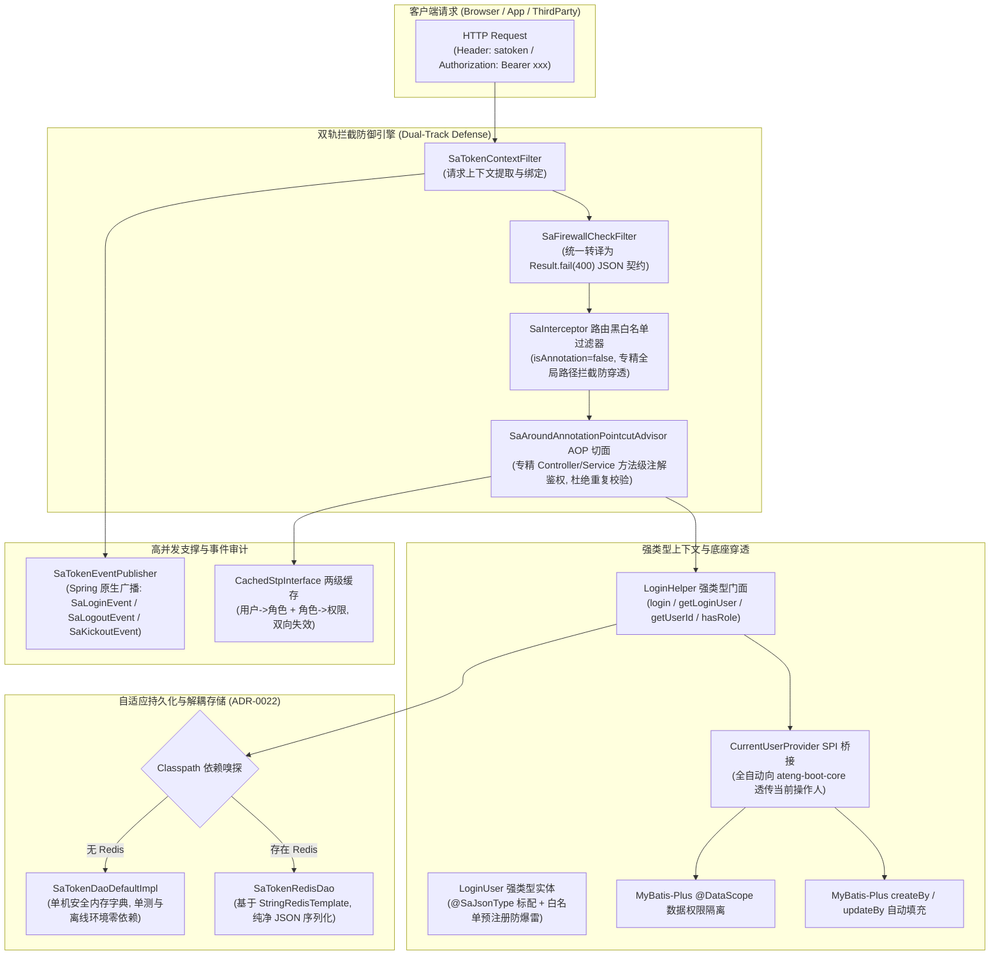

# 24. 企业级 Sa-Token 鉴权生态与安全防御/分布式会话一体化架构决策

## 背景与痛点

在企业级企业应用与分布式微服务架构中，身份认证（Authentication）、细粒度权限控制（Authorization）与分布式会话治理是构建业务系统的核心安全防线。然而在现代研发体系下，主流安全框架在实际工程落地时往往面临严峻困境：

1. **Spring Security 架构沉重与学习曲线陡峭**：
   - 官方 Spring Security 滤镜链（FilterChain）抽象庞杂，配置繁琐，对初中级开发人员心智负担极重；尤其在需要动态调整角色、实时踢人下线或多账号多设备共存时，扩展改造成本极高；
2. **开源 Sa-Token 官方 Starter 在生产环境中的“暗礁”与隐患**：
   - **多态反序列化白名单陷阱 (Sa-Token 1.46.0)**：新版在 `SaJsonTemplateForJackson` 中正式引入了基于 `BasicPolymorphicTypeValidator` 的白名单限制。一旦业务向会话存储未注册的自定义类，从 Redis 反序列化时将立即抛出 `SaJsonConvertException` 崩溃；
   - **CORS 跨域冲突隐患**：官方 Starter 默认装配 `SaTokenCorsFilterForJakartaServlet`，这与 `ateng-boot-web` 基于 Spring 原生 `CorsConfigurationSource` 的动态 CORS 架构（[ADR-0015](./0015-dynamic-cors-and-credentials-safe-origin-reflection.md)）产生严重冲突，极易导致重复写入响应头使预检 OPTIONS 报错；
   - **防火墙裸字符串违背契约**：官方防火墙 Filter 拦截攻击时直接回写裸字符串，破坏 [ADR-0002](./0002-explicit-result-contract-no-response-body-advice.md) 的统一 `Result` 契约；
   - **Controller 双重鉴权性能浪费**：`SaInterceptor` 默认自带注解拦截，若同时引入 `sa-token-spring-aop`，Controller 上的注解鉴权将被执行两次，带来不必要的反射损耗；
   - **权限高频打爆数据库**：官方 `StpInterface` 每次鉴权默认实时回调，缺乏两级解耦缓存，高并发查询直接打垮数据库；
   - **官方 JWT 强引 Hutool 依赖**：官方 `sa-token-jwt` 强制传递引入 `cn.hutool:hutool-jwt`，违背 [ADR-0011](./0011-zero-bloat-and-co-located-utilities.md) 零臃肿约束。

---

## 核心架构与决策内容

经由 `/grill-with-docs` 双轮架构质询与源码深度推演，`ateng-boot` 决定新增独立子模块 `ateng-boot-satoken`，确立**“独立生态 Starter、双轨拦截防御、自适应存储桥接、强类型上下文贯通、两级权限缓存与原生事件广播”**的工业级安全架构。

### 1. 独立生态 Starter (`ateng-boot-satoken`)
- 保持单一职责与正交解耦，按需引入，杜绝向纯批处理或免鉴权计算应用强塞安全包袱；
- BOM 统一统管 Sa-Token 依赖版本（基线锁定 `1.46.0`），子模块声明免配 `<version>`。

### 2. 双轨拦截防御引擎 (Dual-Track Defense Engine)
- **网关/路由级拦截**：自动装配全局 `SaInterceptor` 并显式设置 `isAnnotation(false)`，专注路径级白名单配置（Swagger、Knife4j、Actuator、静态资源等）与保护路径拦截防漏；
- **方法级注解鉴权**：通过 Spring AOP `SaAroundAnnotationPointcutAdvisor` 承接所有 `@SaCheckLogin`、`@SaCheckRole`、`@SaCheckPermission`、`@SaCheckSafe`（二级认证）、`@SaCheckDisable`（封禁检查）注解，覆盖 Controller 与 Service 边界，彻底消除同一 Controller 方法被重复校验两次的性能损耗。

### 3. 跨域与防火墙自洽
- **屏蔽原生 CORS Filter**：自动装配层主动关闭 Sa-Token 内置的粗暴 CORS Filter，100% 委派给 `ateng-boot-web` 的 [ADR-0015](./0015-dynamic-cors-and-credentials-safe-origin-reflection.md) 动态安全反射 CORS 体系；
- **防火墙结果自洽**：覆写 `SaFirewallStrategy.instance.checkFailHandle`，将非法路径穿越等攻击异常格式化为标准的 `Result.fail(400, e.getMessage())` JSON 响应。

### 4. 强类型 `LoginUser` 载荷与会话零 `@class` 净化 (Zero-@class Session Storage)
- 提供标准的 `LoginUser` 载荷模型（标配 `@SaJsonType` 与白名单预注册）；
- **纯净 JSON 字符串封包**：`LoginHelper.setLoginUser(user)` 存入 Session 时，底层使用本地纯净 `ObjectMapper` 转为纯 JSON 字符串存入；`LoginHelper.getLoginUser()` 读取时反序列化为当前类加载器中的实体；
- 彻底杜绝在 Redis 存储中引入 `@class`，完全贯彻 [ADR-0022](./0022-dual-core-redis-and-distributed-coordination-architecture.md)，100% 免疫 Sa-Token 1.46.0 反序列化白名单崩溃与跨服务类路径重构异常。

### 5. 底座全链路贯通与租户上下文自动同步 (Core & Multi-Tenant Synergy)
- 自动注册 `SaTokenCurrentUserProvider` 接入 `ateng-boot-core` 的 `CurrentUserProvider` SPI；
- 只要用户在 Sa-Token 中登录，`ateng-boot-mybatis-plus` 的 `createBy`、`updateBy` 审计填充与 `@DataScope` 数据权限过滤全链路自动感知当前操作人；
- **四维上下文生命周期双向镜像对称**：受管拦截器 `AtengSaTokenInterceptor` 在 `preHandle` 阶段不仅校验会话态，而且自动将当前会话对应的用户和租户同步无感写入 `UserContextHolder` 与 `TenantContextHolder`；在 `afterCompletion` 阶段严格对称调用 `clearUser()` 与 `clearTenant()`，彻底杜绝 Web 容器工作线程池复用导致的跨请求上下文串染与数据越权。

### 6. 多租户 LoginId 防碰撞命名空间与复合主键双向对称解析 (Composite LoginId)
- 在 SaaS 多租户场景下，`LoginHelper.login(user)` 自动识别租户上下文，内部采用下划线合成复合登录凭据（`{tenantId}_{userId}`），规避 Sa-Token 默认禁用冒号的限制并杜绝不同租户相同数字用户主键的会话踩踏；
- **双向对称解析与健壮防空**：`LoginHelper.getUserId()` 与 `getUserIdAsLong()` 自动对称识别并剥离 `{tenantId}_` 复合前缀，向业务层透明还原纯净的真实业务主键；同时对 `login(null)`、`setLoginUser(null)` 及未登录态提供前置防空与完全清空防御，消除 NullPointerException 隐患。

### 7. 自适应持久化存储 (Zero-Bloat Storage Adaptor)
- 遵循 [ADR-0011](./0011-zero-bloat-and-co-located-utilities.md) 与 [ADR-0022](./0022-dual-core-redis-and-distributed-coordination-architecture.md)，提供 `SaTokenRedisDao`；
- 当 classpath 存在 Redis 底座时自动激活分布式会话存储，遵从纯净 JSON 与游标 Scan 规范；未引入 Redis 时无缝回退至内置安全内存存储，确保 H2 单测与离线环境秒起步。

### 8. 两级权限缓存与穿透/雪崩高并发防御 (Cache Defense)
- 提供 `CachedStpInterface` 两级缓存抽象模型：`[用户ID -> 角色集]` + `[角色ID -> 权限集]`；
- 配套 `PermissionCacheService` 门面工具，支持角色变更时精准热刷新，杜绝鉴权打垮数据库；
- **防穿透与防雪崩双重防护**：对空角色/空权限写入带短 TTL（如 60s）的哨兵空集合防止缓存穿透，对基础缓存 TTL 引入 10%~20% 的 Jitter 动态随机抖动防止缓存集体雪崩。

### 9. 路由默认策略与内置工业级白名单 (Configurable Strict Mode)
- 默认提供 `ateng.boot.satoken.interceptor.check-login = false`（以灵活注解鉴权为主）；
- 内置开箱即用的标准工业白名单（自动放行 Swagger/Knife4j `doc.html`, `/v3/api-docs/**`, Actuator `/actuator/**`, 静态资源 `*.html, *.js, *.css, *.ico`, 错误路由 `/error`）；
- 支持通过 `ateng.boot.satoken.interceptor.check-login = true` 一键切换为严苛路由全局拦截模式。

### 10. Knife4j / Swagger OpenAPI 鉴权头自动挂载 (Auto OpenAPI SecurityScheme)
- 基于 `@ConditionalOnClass(OpenAPI.class)`，在引入 Springdoc / Knife4j 时自动注册 `GlobalOpenApiCustomizer`；
- 自动在 API 文档右上角渲染 `satoken`（或 Bearer）鉴权 Lock 弹窗并自动关联当前 `token-name`，极大简化接口联调心智负担。

### 11. Same-Token 微服务内部调用防伪装 (Zero-Trust Internal Token)
- 预置 `@CheckSameToken` 注解与配套 `SaCheckSameTokenAspect` AOP 切面，针对微服务内部 RPC/HTTP 接口实施防伪造防重放校验，阻断绕过网关的非法内网探测；
- 请求头名称通过 `ateng.boot.satoken.same-token.header-name` 统一定制（默认契约对齐为 `SA-SAME-TOKEN`），确保跨服务协同零歧义。

### 12. Spring 原生事件广播总线
- 实现 `SaTokenListener` 并装配 `SaTokenEventPublisher`；
- 将 Sa-Token 登录、注销、顶人、踢人、封禁等底层生命周期转换为标准 Spring `ApplicationEvent`（`SaLoginEvent`、`SaLogoutEvent` 等），方便业务无缝接入登录日志归档与风险审计。

### 13. 细粒度异常精准映射 (ADR-0002 & ADR-0004)
- 自动捕获 `NotLoginException`，根据其 7 种类型精准映射为 HTTP 200 + 业务码 `401`（详细告知“已被顶下线”、“已被管理员踢出”或“登录已过期”）；
- 捕获 `NotPermissionException` / `NotRoleException` / `DisableServiceException` / `NotSafeException` 映射为 HTTP 200 + 业务码 `403`。

---

## 后果与权衡 (Consequences & Trade-offs)

### 正向收益
- **企业级极速开箱即用**：开发人员引入依赖后，无需手写复杂配置即可获得企业级安全防御、分布式会话与全链路上下文联动；
- **零安全暗礁**：全面规避反序列化白名单崩溃、CORS 重复 Header 报错与防火墙裸文本违背契约等高危生产陷阱；
- **生态正交性**：与 `ateng-boot-web`、`ateng-boot-redis`、`ateng-boot-mybatis-plus` 深度互补但保持松耦合。

### 妥协与成本
- **依赖约束**：官方 `sa-token-jwt` 插件因强依赖 `hutool-jwt`，被设为可选依赖，推荐优先使用生产级有状态分布式会话。
