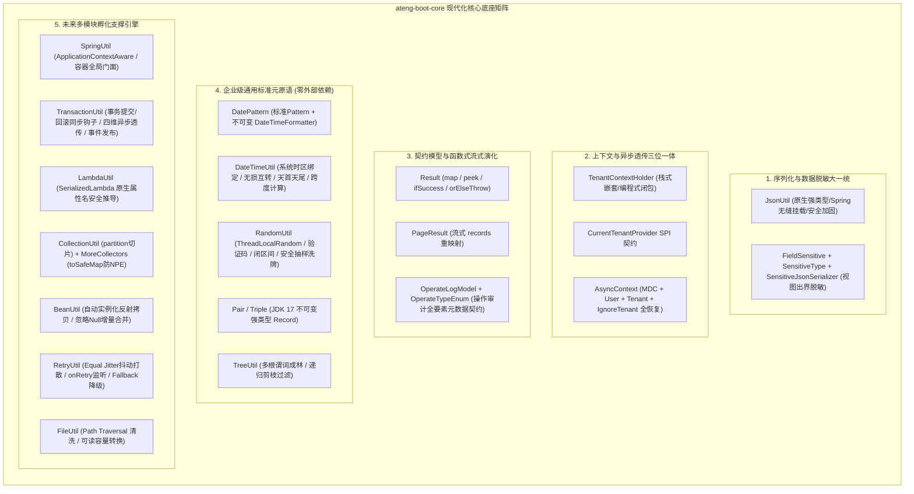

# 25. Core 核心底座全方位扩建与未来中间件孵化地基架构决策 (Core Expansion and Future-Proof Middleware Foundations)

## 背景与痛点

随着 `ateng-boot` 基础框架的演进，框架已成功落地 `core`、`web`、`mybatis-plus`、`redis`、`excel`、`satoken` 等六大核心 Starter，未来还将持续孵化 `storage`（对象存储）、`mq`（消息队列）、`job`（分布式调度）、`mail/sms`、`ai` 等多维企业级中间件。

然而，对当前基础底座 [ateng-boot-core](../ateng-boot-core) 的深度审查揭示出多项深层次的**架构倒置、能力真空与上下文割裂**：

1. **核心序列化工具缺位与碎片化**：
   - 全工程无开箱即用的统一 `JsonUtil` 静态门面；
   - `web` 模块与 `redis` 模块各自手动创建并重复配置 `ObjectMapper`（如时区、JSR-310 序列化、Long 防精度截断），格式化常量在多处散落硬编码。
2. **脱敏体系与租户上下文严重倒置**：
   - 动态脱敏注解 `@FieldSensitive`、枚举 `SensitiveType` 及序列化器错置于 `mybatis-plus` 模块，导致纯 Web 视图层或非持久层 DTO 无法独立使用；`excel` 模块甚至被迫自创 `DesensitizeType` 枚举；
   - `TenantContextHolder` 被私有化放置在 `mybatis-plus` 中，导致 `AsyncContext` 跨线程装饰器仅能透传 MDC 与 User，在异步任务与非持久层场景中**租户上下文彻底丢失**。
3. **面向未来多中间件的基础组件真空**：
   - 缺少轻量、零冗余的 Spring 容器全局门面（`SpringUtil`），导致非受管对象与静态工具难以编程式获取 Bean 或读取配置；
   - 缺少强类型方法引用解析（`LambdaUtil`）、防 NPE 集合与流式切片（`CollectionUtil` / `MoreCollectors`）、免 new 对象反射拷贝（`BeanUtil`）、高可用退避重试（`RetryUtil`）及路径遍历安全防护（`FileUtil`）。

---

## 核心架构与决策内容

经由 `/grill-with-docs` 决策树三轮严密推演，正式确立**“Core 核心底座全方位扩建与未来中间件孵化地基”**架构升级方案。

### 1. 序列化生态下沉与 `JsonUtil` 工业级门面
- **正式引入 `jackson-databind` 依赖**：将原本仅存于 test 作用域的 `jackson-databind` 提升为 Core 正式依赖；
- **纯原生 `JsonUtil` 门面**：
  - 默认单例预配置：东八区、JSR-310 日期时间模块、`FAIL_ON_UNKNOWN_PROPERTIES=false`、杜绝 `@class` 漏洞；
  - 严格保持 **JDK 原始数值类型**（Long 默认输出为数字 123L），提供独立方法 `toJsonStringWithLongToString` 专供需要前端字符串防失真场景；
  - 提供 `init(ObjectMapper)` 钩子，由 Web 自动配置在 Spring 容器就绪后自动接入 Spring 受管的定制 ObjectMapper。

### 2. 脱敏体系下沉与全工程无残留重构
- **直接全量下沉**：将 `@FieldSensitive`、`SensitiveType` 与 `SensitiveJsonSerializer` 迁入 `ateng-boot-core`，直接重构并同步修改 `mybatis-plus` 与 `excel` 中的 import 与引用，不保留 `@Deprecated` 历史包袱；
- **全生态打通**：Controller 返回 VO/DTO、持久层实体、Excel 导出均统一对齐 Core 核心脱敏体系，彻底消灭 `DesensitizeType` 重复枚举。

### 3. 多租户上下文下沉与全链路四维跨线程透传
- **租户上下文归位**：将 `TenantContextHolder` 迁移至 `ateng-boot-core.context`；提供 `CurrentTenantProvider` 函数式 SPI 接口；
- **四维一体异步现场恢复**：升级 `AsyncContext` 与 `ContextCopyingTaskDecorator`，在抓取与还原现场时完整覆盖：
  $$\text{Context Snapshot} = \langle \text{MDC}, \text{UserContext}, \text{TenantId}, \text{IgnoreTenantFlag} \rangle$$
  确保异步线程与线程池在执行任务时，既不丢失租户隔离，也不遗漏 `@IgnoreTenant` 忽略标记，并在 finally 严格自清理与现场还原。

### 4. 核心契约函数式流转能力升级
- 为 `Result<T>` 扩充流式方法集：
  - `map(Function<? super T, ? extends R>)`：成功时转换载荷，失败时透传业务码与链路信息；
  - `peek(Consumer<? super T>)`、`ifSuccess(Consumer<? super T>)`、`ifFail(Consumer<Result<T>>)`；
  - `orElse(T)`、`orElseGet(Supplier<? extends T>)`；
  - `orElseThrow()`：失败时抛出 `BusinessException(code, msg)`，并提供自定义异常抛出重载。

### 5. 零重型外部依赖的高频标准件矩阵 (ADR-0011 Invariant)
- **`DatePattern`**：标准化日期时间格式字符串与预编译不可变 `DateTimeFormatter` 常量；
- **`Pair<L, R>` & `Triple<L, M, R>`**：基于 JDK 17 `record` 打造轻量不可变元组；
- **`TreeUtil`**：扩充 `Predicate<T> rootPredicate` 多根节点成林与递归剪枝 `filter`；
- **`SpringUtil`**：基于 `ApplicationContextAware` 与 `BeanFactoryPostProcessor` 实现容器全局门面；
- **`LambdaUtil`**：纯 JDK 17 `SerializedLambda` 原生推导属性名；
- **`CollectionUtil` & `MoreCollectors`**：安全分批切片 `partition` 与防 NPE `toSafeMap`；
- **`BeanUtil`**：免 new 反射实例化拷贝与 `copyIgnoreNull` 增量覆盖；
- **`FileUtil`**：路径穿越安全清洗与可读容量转换。

### 6. 事务同步生命周期门面与上下文穿透 (`TransactionUtil`)
- **双向生命周期完备性**：基于 Spring `TransactionSynchronizationManager` 打造全局门面，显式提供 `executeAfterCommit` 与 `executeAfterRollback` 对称钩子，从源头消灭“事务未提交、异步已读库”的时序并发脏读；
- **四维上下文无损穿透**：`executeAfterCommitAsync` 自动调度受管 `taskExecutor` 线程池并全量透传四维快照 $\langle\text{MDC}, \text{User}, \text{TenantId}, \text{IgnoreTenant}\rangle$，防止线程池污染与租户越权；
- **自适应降级与异常隔离**：具备非事务上下文与类探测机制，在无事务环境平滑降级就地同步执行，回调异常受控隔离记录 WARN 日志，杜绝次生异常反向冲垮外部主链路。

### 7. 退避重试抖动打散与 Fallback 降级 (`RetryUtil`)
- **平滑随机抖动 (Equal Jitter)**：采用 `delay/2 + random(0, delay/2)` 平滑打散重试时序，彻底化解微服务大规模重试引发的下峰流量共振与雪崩击穿；
- **多维观测与兜底降级**：提供 `onRetry` 异常监听器与 `Fallback` 降级回调接口，支持带返回值的 `execute` 与 `Runnable` 类型的 `executeAction`；
- **无侵入与零破坏性**：保持重试最大上限与超时防无界挂起守卫，100% 向后兼容存量 API。

### 8. 全栈操作审计标准模型契约 (`OperateLogModel` & `OperateTypeEnum`)
- **审计枚举收敛**：`OperateTypeEnum` 集中收敛 11 种通用操作动作（`OTHER(0)` ~ `CLEAN(10)`），提供 `of(Integer code)` 安全匹配与 `@JsonCreator fromValue` 大小写/多源解析；
- **18 项全要素元数据契约**：`OperateLogModel` 统一纳管 TraceId、租户、用户、模块端点、出入参、状态耗时、异常、扩展字典与时间戳，为 Web 切面、事件总线与持久层提供统一强类型契约；
- **无失真序列化与语法糖**：`isSuccess()` 标注 `@JsonIgnore` 杜绝派生字段污染，提供 `addExtra(k, v)` 链式扩展，100% 适配 Jackson 规范。

### 9. 原生日期时间互转与无锁安全随机工具 (`DateTimeUtil` & `RandomUtil`)
- **`DateTimeUtil`**：100% 依托原生 `java.time`，实现 `LocalDateTime`、`LocalDate`、`Date` 与时间戳三者在系统时区下的无损互转，提供天首天尾起止（含今日语法糖）与多维度跨度计算（`betweenDays`、`betweenHours`、`betweenDuration` 等）；
- **`RandomUtil`**：基于 `ThreadLocalRandom` 提供无锁高性能纯数字验证码（`randomNumbers`）、混合随机串（`randomString`）、双向闭区间 `[min, max]` 防溢出随机数、防空抽样（`randomEle`、`randomEles`）与洗牌打乱（`shuffle` 与 `shuffleNew`），杜绝全量第三方工具包依赖。

### 10. Zero-Regex 高性能脱敏扩建与算法对称 (`DesensitizeUtil` & `SensitiveType`)
- **高频隐私算法增补**：增补统一社会信用代码（`unifiedCreditCode`，前2后4）、密钥与 Token（`secretKey`，前4后4）、护照号（`passport`，前2后3）及通用首尾保留掩码算法；
- **Zero-Regex 与纯字符扫描**：100% 废除低效正则表达式，采用纯原生 `char[]` 数组遍历与原地替换，脱敏性能较传统正则提升 5~10 倍；
- **枚举契约与持久层/视图层 100% 镜像对齐**：`SensitiveType` 同步补充对应枚举，确保 Controller 序列化与下游 Excel 导出统一复用。

### 11. 雪花算法元数据逆向反解与纯原生 Base62 双向短码 (`IdUtil` & `SnowflakeIdInfo`)
- **不可变元数据逆向解析**：提供 `Snowflake.parse(id)` 与 `IdUtil.parseSnowflake(id)`，逆向反解不可篡改的结构化 `SnowflakeIdInfo` Record（包含毫秒时间戳、Instant、LocalDateTime、数据中心 ID、工作节点 ID、序列号与基准纪元），实现纯内存离线审计回溯；
- **纯原生零依赖无锁 Base62 双向短码**：提供 `IdUtil.toBase62(long)` 与 `IdUtil.fromBase62(str)`，将 18~19 位十进制雪花 ID 紧凑无损压缩为 10~11 位 URL 安全短串，内置负数安全与 64 位长整型上下限算术溢出防卫。

### 12. 受管线程池全景治理、运行时动态调优与监控门面 (`AsyncUtil` & `ThreadPoolStatus`)
- **运行时度量快照**：通过 `AsyncUtil.getStatus(executor)` 实时提取不可变 `ThreadPoolStatus` 快照，包含核心/最大线程数、当前存活数、活跃执行数、队列积压数、剩余容量与是否饱和状态；
- **动态平滑热调优**：提供 `AsyncUtil.updatePoolSize(executor, corePoolSize, maxPoolSize)`，在运行时无需重启平滑调整线程池容量，严格遵循 `core <= max` 阶梯步调防御异常；
- **告警拒绝策略拓展**：在现有标准策略基础上扩充 `WARN_CALLER_RUNS` 与 `WARN_ABORT`，在触发饱和拒绝时自动输出 WARN 级结构化报警日志与堆栈上下文；
- **四维上下文感知的编程式异步协调**：`AsyncUtil.runAsync`、`supplyAsync`、`allMatches`（提前短路）与 `allOf`（结果汇聚），100% 自动装配上下文装饰器。

### 13. 进程内高性能单机内存滑动窗口流控标准件 (`SlidingWindowCounter`)
- **环形时间切片算法**：基于 `System.currentTimeMillis()` 动态推进与 `LongAdder` 累加器，实现零外部中间件的单机平滑流量削峰与防刷；
- **双重业务门面**：提供 `incrementAndGet(delta)` 计数器与 `tryAcquire(delta, threshold)` 原子判定许可，彻底杜绝固定时间窗口交界处的两倍瞬时尖峰漏洞。

### 14. 纯原生高频新原语下沉与对称完备 (`HexUtil`, `StringUtil`, `StopWatch`, `NetUtil`, `ConvertUtil`, `ExceptionUtil`)
- **`HexUtil`**：基于 JDK 17 原生 `java.util.HexFormat` 实现高吞吐十六进制编解码，支持大小写指定与奇偶长度/非法字符校验，消除外部 codec 依赖；
- **`StringUtil`**：纯原生字符扫描状态机实现驼峰与下划线命名互转，消除正则替换内存拷贝；提供安全文本截断与敏感子串包含探针；
- **`StopWatch`**：纳秒级高精度任务秒表，支持分段任务阶梯耗时统计、格式化可视化报告（`prettyPrint()`）与函数闭包耗时测算；
- **`NetUtil`**：遍历系统物理网卡过滤回环与虚拟网卡，智能推导局域网非回环 IPv4（`getLocalIpv4()`），提供本地空闲端口探测与远程 Socket 连通性探针；
- **`ConvertUtil`**：纯原生强类型安全类型转换门面，提供保底默认值防御，彻底杜绝运行时 NPE 与 `ClassCastException`；
- **`ExceptionUtil`**：提供递归下钻提取深层根本原因（`getRootCause`，内置循环因果死循环防御）、自解释提示信息提取及带长度截断防御的有界堆栈序列化；
- **`TreeUtil` / `FileUtil` / `MoreCollectors`**：增补展平与路径探寻（`flatten`, `findPath`, `getLeafNodes`）、防 OOM 安全有界流读取与受管临时文件（`readNBytesSafe`, `createTempFile`）、流式属性去重谓词（`distinctByKey`）。

### 15. 纯原生有界 LRU 缓存原语与底层防 OOM 加固 (`ConcurrentLruCache` & `LambdaUtil`)
- **纯原生零外部依赖**：基于 JDK 17 `LinkedHashMap(accessOrder=true)` 与 `ReentrantLock` 构建纯原生并发安全有界 LRU 缓存容器 `ConcurrentLruCache`；
- **容量自动淘汰与惰性 TTL**：设置最大容量上限，读写自动刷新访问顺序并在超限时确定性淘汰最久未访问条目；可选支持 `Duration TTL` 惰性过期与主动 `cleanUp()`；
- **拔除历史无界内存隐患**：彻底重构 `LambdaUtil` 等底层工具类中原有无界 `ConcurrentHashMap`，统一改用容量为 1024 的 `ConcurrentLruCache`，防范高基数动态输入引发的内存泄漏与 OOM 隐患。

### 16. 虚拟线程运行态度量统一与并发状态自适应 (`ThreadPoolStatus` & `AsyncUtil`)
- **模型度量无缝统一**：在 `ThreadPoolStatus` 不可变快照中扩充 `virtual`（是否虚拟线程执行器）与 `concurrencyLimit`（并发限额阈值）维度；
- **虚拟与平台线程自适应**：当异步执行器工作在虚拟线程模式时，`getStatus()` 智能解析虚拟线程并发槽位与活跃计数，避免将虚拟线程误判为常驻平台线程池导致的度量指标畸形。

### 17. 业务状态码千位号段规约与唯一性防重校验 (`ResultCodeSegment` & `ResultCodeUtil`)
- **跨 Starter 领域号段划分**：确立千位划分的标准号段契约 `ResultCodeSegment`，将状态码严格归属于核心底座（1000~1999）、认证鉴权（2000~2999）、对象存储（3000~3999）、网络通信（4000~4999）、持久事务（5000~5999）及业务预留（6000~9999）；
- **自防卫与冲突阻断**：提供 `ResultCodeUtil.assertInSegment` 强制约束状态码落在合规区间，`assertUnique(IResultCode...)` 在启动期与单测阶段快速失败拦截编号冲突与碰撞。

### 18. 安全受限 SpEL 表达式求值门面与 AST 缓存 (`SpelUtil`)
- **安全沙箱 (彻底阻断 RCE)**：`SpelUtil` 默认基于 `SimpleEvaluationContext.forReadOnlyDataBinding()` 建立安全沙箱，严格阻断构造器实例化、任意类加载（`T(...)`）与运行时反射调用，从根源杜绝表达式注入高危漏洞；
- **AST 编译 LRU 缓存**：内部组合 `ConcurrentLruCache<String, Expression>`（容量 1024）缓存 AST 语法树，消除高并发下重复编译解析的 CPU 尖刺与 GC 压力；
- **参数语义自适应绑定**：集成 Spring `DefaultParameterNameDiscoverer` 自动提取方法形参名，并同时支持 `#paramName` 与 `#p0`/`#a0` 别名绑定；
- **受控可信逃生舱**：提供带显式安全警告说明的 `evaluateTrusted` 逃逸方法，支持管理台内部脚本的全反射能力。

### 19. 轻量函数式业务管道编排与中断异常隔离 (`Pipeline`)
- **强类型流水线编排**：通过 `Pipeline.<C>builder().addStage(...).build()` 建立标准阶段链，支持流式装配、阶段短路与纯 JDK 17 原生泛型上下文传递；
- **受控可中断性 (`PipelineInterruptible`)**：支持业务上下文实现 `PipelineInterruptible` 标记，由前置步骤触发 `interrupt(reason)` 后优雅终止后续阶段流转并记录业务原因；
- **结构化中断与异常双轨隔离**：显式提供 `PipelineErrorHandler` 错误隔离监听，返回不可变 `PipelineResult`，支持 `isSuccess()`、`isTerminated()` 与 `orThrow()` 链式调用。

### 20. 纯原生安全 HMAC 密钥散列加签与恒定时间防侧信道比对 (`HmacUtil`)
- **纯 JDK 原生标准库实现**：基于 `javax.crypto.Mac` 封装 HMAC-SHA256、HMAC-SHA1 与 HMAC-MD5，支持小写十六进制 Hex 与 Base64 输出；
- **防侧信道时序攻击 (Timing Attack Safe)**：`verifyHex` 与 `verifyBase64` 底层依托 `MessageDigest.isEqual` 恒定时间比较，彻底杜绝针对字符串逐位比对耗时差异的侧信道密钥嗅探。

### 21. 纯原生数据传输与硬件报文校验和计算 (`ChecksumUtil`)
- **多维算法统一封装**：组合 JDK 原生 `CRC32`、`CRC32C`（Castagnoli 多项式，现代网络硬件报文指令集加速首选）与 `Adler32`（Zlib 协议压缩首选）；
- **确定性流式读取与数值验证**：提供字节数组、UTF-8 文本及 `InputStream` 流式分块计算，确定性释放句柄；提供强类型数值比对与标准 8 位小写十六进制输出。

### 22. 纯无锁 CAS 纳秒级平滑令牌桶限流器 (`TokenBucketLimiter`)
- **纯无锁并发原子设计**：采用 `AtomicReference` 结合纯数学增量推演，在极高并发竞争下免受监视器锁竞争颠簸，杜绝虚拟线程 Carrier 锁定；
- **纳秒级惰性时间推进 (Lazy Refill)**：请求到达时按真实流逝时间动态推导可补充令牌数，消除后台常驻定时任务线程开销；
- **突发削峰与超时等待**：支持瞬时突发容量缓冲、平滑速率整形、非阻塞快速失败与超时阻塞等待（`tryAcquire(permits, timeout)`）。

### 23. 脱敏隔离内存安全深克隆与不变量捍卫 (`JsonUtil.deepClone`)
- **内存真明文原则捍卫 (ADR-0012 Invariant)**：在纯内存深拷贝对象时，定制专属 `cloneMapper` 与注解内省器，强制抑制 `@FieldSensitive` 的 Jackson 脱敏序列化器；
- **杜绝二次掩码污染**：确保业务实体或 DTO 在内存克隆后保持 100% 原始真实明文，彻底根除“克隆后数据带星号导致写库脏写污染”的灾难性隐患。

### 24. 核心配置属性外置化与雪花发号器全链路加固 (`CoreProperties` & `Snowflake`)
- **强类型配置外置化与 IDE 友好元数据**：推出 `@ConfigurationProperties(prefix = "ateng.boot.core")` 统管 `SnowflakeProperties` 与 `CacheProperties`，凡涉及时间超时与容忍阈值一律推行强类型 `java.time.Duration`；
- **Spring 容器自动装配与自适应优雅降级**：`AtengCoreAutoConfiguration` 自动装配 `@Bean @ConditionalOnMissingBean Snowflake`，未显式配置时平滑降级至网卡 MAC / IP 自适应推导；
- **时钟回拨严格熔断与规范转译**：当系统 NTP 时钟发生大幅回拨超过 `clock-backoff-tolerance`（默认 5ms）时，严格快速失败并转译抛出框架受管业务异常 `BusinessException(CommonResultCode.INTERNAL_SERVER_ERROR)`，杜绝无序死循环或发号碰撞。

---

## 后果与权衡 (Consequences & Trade-offs)

### 正向收益
1. **地基稳固，彻底打通未来新模块通道**：开发 Web 审计切面、Storage、MQ、Job 等模块时，底层事务同步、操作审计契约、退避重试、日期随机等通用原语开箱即用，彻底杜绝下游重复造轮子；
2. **消除架构倒置与并发时序隐患**：脱敏注解与租户上下文归属于底座，彻底解绑持久层；事务同步门面消灭跨事务脏读，四维快照保障异步线程数据不越权；
3. **保持 100% 零臃肿与极高纯粹性**：所有增补构件除 Spring 核心/Jackson 必需生态外，100% 依托 JDK 17 原生能力，零 Hutool、零 Guava、零外部字节码生成库。

### 妥协与改造成本
- 需要对 `ateng-boot-mybatis-plus` 与 `ateng-boot-excel` 中原脱敏和租户引用直接进行全局包路径重构；
- `ateng-boot-core` 的 `pom.xml` 正式吸纳 `jackson-databind`（编译期）与 `spring-context`（可选依赖），但鉴于二者本就是 Spring Boot 的核心构件，实际无任何额外打包负荷。

