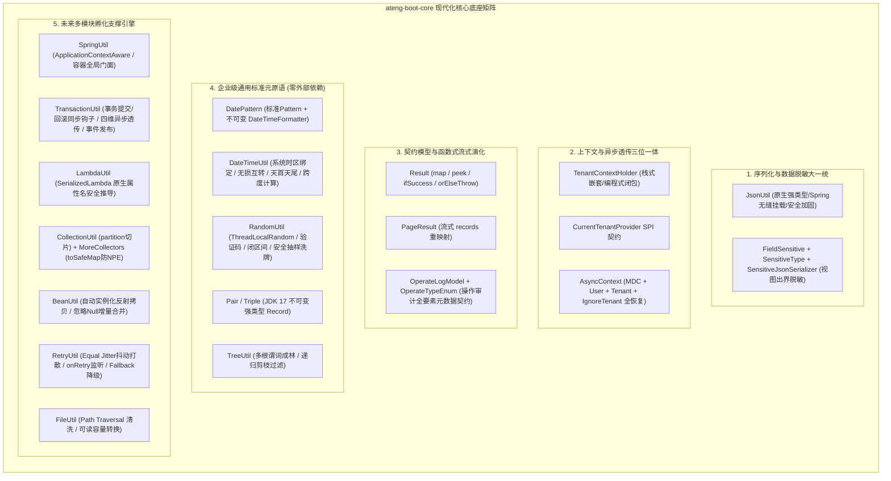

# 25. Core 核心底座全方位扩建与未来中间件孵化地基架构决策 (Core Expansion and Future-Proof Middleware Foundations)

## 背景与痛点

随着 `ateng-boot` 基础框架的演进，框架已成功落地 `core`、`web`、`mybatis-plus`、`redis`、`excel`、`satoken` 等六大核心 Starter，未来还将持续孵化 `storage`（对象存储）、`mq`（消息队列）、`job`（分布式调度）、`mail/sms`、`ai` 等多维企业级中间件。

然而，对当前基础底座 [ateng-boot-core](../ateng-boot-core) 的深度审查揭示出多项深层次的**架构倒置、能力真空与上下文割裂**：

1. **核心序列化工具缺位与碎片化**：
   - 全工程无开箱即用的统一 `JsonUtil` 静态门面；
   - `web` 模块与 `redis` 模块各自手动创建并重复配置 `ObjectMapper`（如时区、JSR-310 序列化、Long 防精度截断），格式化常量在多处散落硬编码。
2. **脱敏体系与租户上下文严重倒置**：
   - 动态脱敏注解 `@FieldSensitive`、枚举 `SensitiveType` 及序列化器错置于 `mybatis-plus` 模块，导致纯 Web 视图层或非持久层 DTO 无法独立使用；`excel` 模块甚至被迫自创 `DesensitizeType` 枚举；
   - `TenantContextHolder` 被私有化放置在 `mybatis-plus` 中，导致 `AsyncContext` 跨线程装饰器仅能透传 MDC 与 User，在异步任务与非持久层场景中**租户上下文彻底丢失**。
3. **面向未来多中间件的基础组件真空**：
   - 缺少轻量、零冗余的 Spring 容器全局门面（`SpringUtil`），导致非受管对象与静态工具难以编程式获取 Bean 或读取配置；
   - 缺少强类型方法引用解析（`LambdaUtil`）、防 NPE 集合与流式切片（`CollectionUtil` / `MoreCollectors`）、免 new 对象反射拷贝（`BeanUtil`）、高可用退避重试（`RetryUtil`）及路径遍历安全防护（`FileUtil`）。

---

## 核心架构与决策内容

经由 `/grill-with-docs` 决策树三轮严密推演，正式确立**“Core 核心底座全方位扩建与未来中间件孵化地基”**架构升级方案。

### 1. 序列化生态下沉与 `JsonUtil` 工业级门面
- **正式引入 `jackson-databind` 依赖**：将原本仅存于 test 作用域的 `jackson-databind` 提升为 Core 正式依赖；
- **纯原生 `JsonUtil` 门面**：
  - 默认单例预配置：东八区、JSR-310 日期时间模块、`FAIL_ON_UNKNOWN_PROPERTIES=false`、杜绝 `@class` 漏洞；
  - 严格保持 **JDK 原始数值类型**（Long 默认输出为数字 123L），提供独立方法 `toJsonStringWithLongToString` 专供需要前端字符串防失真场景；
  - 提供 `init(ObjectMapper)` 钩子，由 Web 自动配置在 Spring 容器就绪后自动接入 Spring 受管的定制 ObjectMapper。

### 2. 脱敏体系下沉与全工程无残留重构
- **直接全量下沉**：将 `@FieldSensitive`、`SensitiveType` 与 `SensitiveJsonSerializer` 迁入 `ateng-boot-core`，直接重构并同步修改 `mybatis-plus` 与 `excel` 中的 import 与引用，不保留 `@Deprecated` 历史包袱；
- **全生态打通**：Controller 返回 VO/DTO、持久层实体、Excel 导出均统一对齐 Core 核心脱敏体系，彻底消灭 `DesensitizeType` 重复枚举。

### 3. 多租户上下文下沉与全链路四维跨线程透传
- **租户上下文归位**：将 `TenantContextHolder` 迁移至 `ateng-boot-core.context`；提供 `CurrentTenantProvider` 函数式 SPI 接口；
- **四维一体异步现场恢复**：升级 `AsyncContext` 与 `ContextCopyingTaskDecorator`，在抓取与还原现场时完整覆盖：
  $$\text{Context Snapshot} = \langle \text{MDC}, \text{UserContext}, \text{TenantId}, \text{IgnoreTenantFlag} \rangle$$
  确保异步线程与线程池在执行任务时，既不丢失租户隔离，也不遗漏 `@IgnoreTenant` 忽略标记，并在 finally 严格自清理与现场还原。

### 4. 核心契约函数式流转能力升级
- 为 `Result<T>` 扩充流式方法集：
  - `map(Function<? super T, ? extends R>)`：成功时转换载荷，失败时透传业务码与链路信息；
  - `peek(Consumer<? super T>)`、`ifSuccess(Consumer<? super T>)`、`ifFail(Consumer<Result<T>>)`；
  - `orElse(T)`、`orElseGet(Supplier<? extends T>)`；
  - `orElseThrow()`：失败时抛出 `BusinessException(code, msg)`，并提供自定义异常抛出重载。

### 5. 零重型外部依赖的高频标准件矩阵 (ADR-0011 Invariant)
- **`DatePattern`**：标准化日期时间格式字符串与预编译不可变 `DateTimeFormatter` 常量；
- **`Pair<L, R>` & `Triple<L, M, R>`**：基于 JDK 17 `record` 打造轻量不可变元组；
- **`TreeUtil`**：扩充 `Predicate<T> rootPredicate` 多根节点成林与递归剪枝 `filter`；
- **`SpringUtil`**：基于 `ApplicationContextAware` 与 `BeanFactoryPostProcessor` 实现容器全局门面；
- **`LambdaUtil`**：纯 JDK 17 `SerializedLambda` 原生推导属性名；
- **`CollectionUtil` & `MoreCollectors`**：安全分批切片 `partition` 与防 NPE `toSafeMap`；
- **`BeanUtil`**：免 new 反射实例化拷贝与 `copyIgnoreNull` 增量覆盖；
- **`FileUtil`**：路径穿越安全清洗与可读容量转换。

### 6. 事务同步生命周期门面与上下文穿透 (`TransactionUtil`)
- **双向生命周期完备性**：基于 Spring `TransactionSynchronizationManager` 打造全局门面，显式提供 `executeAfterCommit` 与 `executeAfterRollback` 对称钩子，从源头消灭“事务未提交、异步已读库”的时序并发脏读；
- **四维上下文无损穿透**：`executeAfterCommitAsync` 自动调度受管 `taskExecutor` 线程池并全量透传四维快照 $\langle\text{MDC}, \text{User}, \text{TenantId}, \text{IgnoreTenant}\rangle$，防止线程池污染与租户越权；
- **自适应降级与异常隔离**：具备非事务上下文与类探测机制，在无事务环境平滑降级就地同步执行，回调异常受控隔离记录 WARN 日志，杜绝次生异常反向冲垮外部主链路。

### 7. 退避重试抖动打散与 Fallback 降级 (`RetryUtil`)
- **平滑随机抖动 (Equal Jitter)**：采用 `delay/2 + random(0, delay/2)` 平滑打散重试时序，彻底化解微服务大规模重试引发的下峰流量共振与雪崩击穿；
- **多维观测与兜底降级**：提供 `onRetry` 异常监听器与 `Fallback` 降级回调接口，支持带返回值的 `execute` 与 `Runnable` 类型的 `executeAction`；
- **无侵入与零破坏性**：保持重试最大上限与超时防无界挂起守卫，100% 向后兼容存量 API。

### 8. 全栈操作审计标准模型契约 (`OperateLogModel` & `OperateTypeEnum`)
- **审计枚举收敛**：`OperateTypeEnum` 集中收敛 11 种通用操作动作（`OTHER(0)` ~ `CLEAN(10)`），提供 `of(Integer code)` 安全匹配与 `@JsonCreator fromValue` 大小写/多源解析；
- **18 项全要素元数据契约**：`OperateLogModel` 统一纳管 TraceId、租户、用户、模块端点、出入参、状态耗时、异常、扩展字典与时间戳，为 Web 切面、事件总线与持久层提供统一强类型契约；
- **无失真序列化与语法糖**：`isSuccess()` 标注 `@JsonIgnore` 杜绝派生字段污染，提供 `addExtra(k, v)` 链式扩展，100% 适配 Jackson 规范。

### 9. 原生日期时间互转与无锁安全随机工具 (`DateTimeUtil` & `RandomUtil`)
- **`DateTimeUtil`**：100% 依托原生 `java.time`，实现 `LocalDateTime`、`LocalDate`、`Date` 与时间戳三者在系统时区下的无损互转，提供天首天尾起止（含今日语法糖）与多维度跨度计算（`betweenDays`、`betweenHours`、`betweenDuration` 等）；
- **`RandomUtil`**：基于 `ThreadLocalRandom` 提供无锁高性能纯数字验证码（`randomNumbers`）、混合随机串（`randomString`）、双向闭区间 `[min, max]` 防溢出随机数、防空抽样（`randomEle`、`randomEles`）与洗牌打乱（`shuffle` 与 `shuffleNew`），杜绝全量第三方工具包依赖。

---

## 后果与权衡 (Consequences & Trade-offs)

### 正向收益
1. **地基稳固，彻底打通未来新模块通道**：开发 Web 审计切面、Storage、MQ、Job 等模块时，底层事务同步、操作审计契约、退避重试、日期随机等通用原语开箱即用，彻底杜绝下游重复造轮子；
2. **消除架构倒置与并发时序隐患**：脱敏注解与租户上下文归属于底座，彻底解绑持久层；事务同步门面消灭跨事务脏读，四维快照保障异步线程数据不越权；
3. **保持 100% 零臃肿与极高纯粹性**：所有增补构件除 Spring 核心/Jackson 必需生态外，100% 依托 JDK 17 原生能力，零 Hutool、零 Guava、零外部字节码生成库。

### 妥协与改造成本
- 需要对 `ateng-boot-mybatis-plus` 与 `ateng-boot-excel` 中原脱敏和租户引用直接进行全局包路径重构；
- `ateng-boot-core` 的 `pom.xml` 正式吸纳 `jackson-databind`（编译期）与 `spring-context`（可选依赖），但鉴于二者本就是 Spring Boot 的核心构件，实际无任何额外打包负荷。

