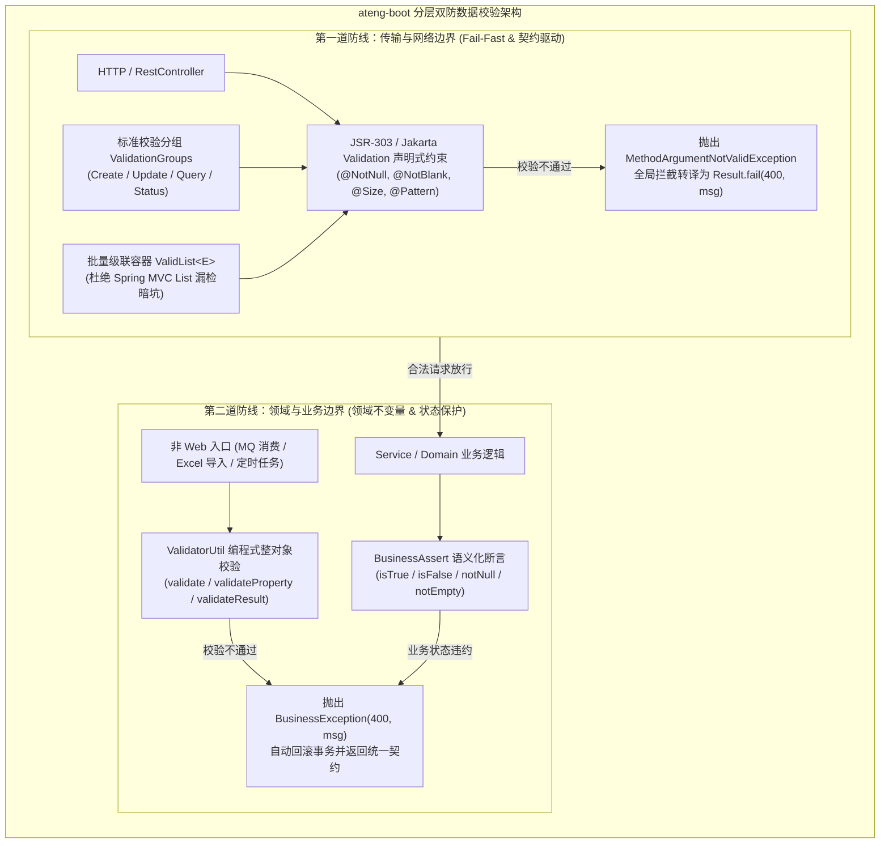

# 27. 分层双防数据校验体系与标准化原语架构决策 (Defense-in-Depth Validation and Standardized Primitives)

## 背景与痛点

在企业级分布式与单体应用中，关于“**接口与业务层校验的职责划分**”长期存在严重的分歧与反模式：

1. **一刀切下沉业务层校验反模式**：
   - 部分团队主张 Controller 完全不作校验，透传给 Service 内部手动通过 `if` 或自定义工具校验；
   - **痛点**：破坏了 **Fail-Fast（快速失败）** 原则，非法请求无谓地穿透进入拦截器、方法调用栈甚至提前开启数据库事务；抹除了 Controller DTO 上的 JSR-303 注解导致 Knife4j / Swagger / OpenAPI 无法自动推导字段约束，破坏团队协作；在 Service 头部充斥数十行样板式的非空与正则判断，业务代码严重面条化。
2. **单一 Controller 校验漏网反模式**：
   - 另一部分团队仅在 Controller 入口标注 `@Valid`，Service 默认传入参数绝对合法；
   - **痛点**：当业务逻辑被 MQ 消费者、Excel 流式导入、定时调度 Job 或内部 RPC 调用复用时，绕过了 Controller 导致非法脏数据未经拦截直接入库，破坏领域不变量。
3. **Spring MVC 批量 List 参数校验暗坑**：
   - 在 Controller 接收批量新增或修改请求 `@RequestBody @Valid List<UserCreateDTO> list` 时，Spring MVC **默认不会触发**列表内部元素字段的 JSR-303 校验，造成严重的静默安全漏洞。
4. **校验分组随意定义与类爆炸**：
   - 新增（Create，无 ID）与更新（Update，强依赖 ID）场景校验规则不一致，业务方随处创建空 `interface` 作为分组 Marker，命名五花八门，语义严重割裂。
5. **非 Web 边界缺乏整对象编程式校验原语**：
   - 在 MQ 消费或纯 Service 中对反序列化 POJO 执行 JSR-303 校验时，原生 Java 需手工调度 `Validation.buildDefaultValidatorFactory()`、获取 `Validator` 并繁琐提取 `ConstraintViolation`，且在无 EL 环境极易抛出 `HV000183` 异常。

---

## 核心架构与决策内容

经由 `/grill-with-docs` 架构推演，正式确立**“分层双防数据校验体系与标准化原语”**架构方案。

### 1. 确立“分层双防 (Defense-in-Depth)”治理铁律
- **第一道防线（传输边界 / Controller）**：严格聚焦**无状态的“语法与格式性校验”**（非空、长度、正则表达式、数值范围），强制使用 JSR-303 注解声明，实现 Fail-Fast 阻断，并作为 Knife4j / OpenAPI 自动生成文档契约的唯一数据源；
- **第二道防线（业务边界 / Service）**：严格聚焦**有状态的“语义与业务不变量校验”**（跨表唯一性、状态机流转合法性、余额库存充足性），统一推行 `BusinessAssert` 流式断言；对于非 Web 入口（MQ、Excel、Job），统一采用 `ValidatorUtil.validate(obj)` 执行编程式整对象防卫。

### 2. 沉淀全域标准校验分组契约 `ValidationGroups`
- 在 `ateng-boot-core` 中提供标准静态标记接口：
  - `ValidationGroups.Create`：新增操作分组（如主键 ID 为空，必填字段强校验）；
  - `ValidationGroups.Update`：更新操作分组（如主键 ID 必填，选填属性增量校验）；
  - `ValidationGroups.Query`：查询检索操作分组；
  - `ValidationGroups.Status`：状态流转操作分组。
- 全团队统一导入使用 `@Validated(ValidationGroups.Create.class)`，终结随意新建空 interface 的混乱现状。

### 3. 沉淀零开销批量级联校验包装容器 `ValidList<E>`
- 提供 `io.github.atengk.boot.core.validation.ValidList<E> implements List<E>`；
- 内部字段与 Getter 显式标注 `@Valid` 并完整实现 `List<E>` 委托；
- Controller 接收批量 JSON 数组声明为 `@RequestBody @Valid ValidList<UserCreateDTO> list`，Spring MVC 原生扫描并级联触发内部每一个元素的字段校验，完美封死 Spring MVC 默认忽略 List 元素校验的大坑。

### 4. 扩展 `ValidatorUtil` 整对象编程式校验与无 EL 优雅降级
- 在 `ValidatorUtil` 中追加：
  - `validate(T object, Class<?>... groups)`：若校验不通过直接抛出语义化 `BusinessException(400, "第一条错误信息")`；
  - `validateProperty(T object, String propertyName, Class<?>... groups)`：单属性编程式校验；
  - `validateResult(T object, Class<?>... groups)`：返回完整违规信息集合 `Set<ConstraintViolation<T>>`。
- 获取校验器采用两级策略：优先从 Spring 容器获取受管 `Validator`（支持依赖注入）；若未在 Spring 容器中，回退至单例工厂构建；在缺失 `jakarta.el` 的极简环境下，自动降级为 Hibernate Validator 的 `ParameterMessageInterpolator`，杜绝 `HV000183` 启动崩溃。

---

## 后果与权衡 (Consequences & Trade-offs)

### 正向收益
1. **代码整洁度大幅跃升**：彻底终结 Controller 裸放行与 Service 头部 20 行样板 `if` 的面条代码；`BusinessAssert` 与 `ValidatorUtil` 保持业务流极致纯净；
2. **契约自解释与协作成本降低**：Controller DTO 的 JSR-303 注解 100% 映射至 Knife4j / Swagger 文档，前端联调无需口头核实规则；
3. **批量接口零漏洞安全保障**：`ValidList` 以极其优雅的零样板方式解决 Spring MVC 集合校验失效问题，不需要额外编写外层包装 DTO；
4. **全链路统一错误体验**：无论第一道防线（`MethodArgumentNotValidException`）还是第二道防线（`BusinessException`），均由 `GlobalExceptionHandler` 统一映射为标准 `Result.fail(400, msg)`，对外保持契约自洽。

### 权衡与约束
1. **依赖范围微调**：
   - `ateng-boot-core` 正式引入 `jakarta.validation:jakarta.validation-api` 标准契约依赖（属于 Java EE / Jakarta 标准规范，零臃肿实现）；
   - 在无 Web 环境且未引入 `hibernate-validator` 的极端场景下，调用 `ValidatorUtil.validate()` 将自动安全忽略或要求宿主环境提供 validation-provider。
