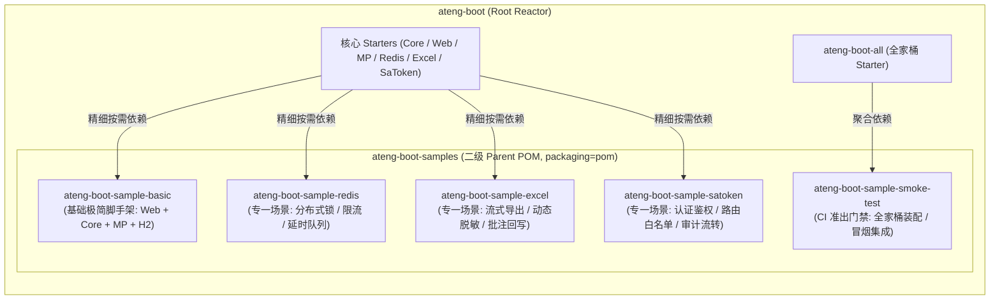

# 28. 示例工程多模块解耦与精准增量集成测试架构决策 (Samples Modularization and Incremental Integration Testing)

## 背景与痛点

在框架演进早期，`ateng-boot` 将所有的特性演示与端到端集成测试统一收敛在单体模块 `ateng-boot-samples` 中，并直接依赖全家桶 Starter（`ateng-boot-all`）。随着框架支持的中间件组件（Web、MyBatis-Plus、Redis、Excel、Sa-Token 等）持续扩充，这种“单一胖样例（Fat Sample Module）”工程架构暴露出三大不可忽视的瓶颈与痛点：

1. **测试反馈周期急剧膨胀**：
   - 每次运行集成测试都需要加载包含全套中间件的“全家桶大容器”，本地与 CI 单次测试耗时突破 1 分多钟；对于单点模块的微小改动，开发者必须承受漫长的等待，严重破坏了日常开发的心流与快速迭代节奏。
2. **场景过度耦合与开发者认知负担过重**：
   - 演示用例彼此交织。当下游开发者只想参考“纯粹的 Redis 分布式锁”或“纯粹的 Excel 流式导出”时，必须连带引入 MySQL/H2、Sa-Token、OpenAPI 等不相关的类库、表结构和配置，无法获得开箱即用的“最小可用代码块（Minimum Viable Snippet）”。
3. **未来中间件横向扩展受阻**：
   - 随着后续 Storage (MinIO/OSS)、消息队列 (Kafka/RocketMQ)、分布式调度 (Job) 等新模块的规划孵化，若继续塞入单体样例，必将引发严峻的依赖地狱、类路径冲突、本地服务端口与资源争抢，甚至在 CI 自动化构建中诱发内存溢出（OOM）。

---

## 核心架构与决策内容

经由 `/grill-with-docs` 架构推演，正式确立**“示例工程多模块解耦拆分与精准增量集成测试”**架构方案。

### 1. 二级 Parent POM 聚合与物理目录 1:1 对齐
- `ateng-boot-samples` 调整为二级聚合 Parent POM（`<packaging>pom</packaging>`），统一纳管子模块公共测试依赖（`spring-boot-starter-test`、`lombok`）与打包插件配置；
- 下属各场景子模块严格遵循 `ateng-boot-sample-<scenario>` 命名规范，物理目录名称与 `artifactId` 保持 1:1 强一致；
- 子模块继承 `ateng-boot-samples`，免去重复配置版本号与公共编译插件。

### 2. 坚持零共享代码（Zero-Shared-Code）不变量
- **严禁创建 `sample-common` 公共抽离子模块**：坚决杜绝因盲目抽象公共代码而重新引入隐式耦合；
- **100% 自包含（Self-Contained）**：各子模块拥有独立的 `Application` 启动入口、`application.yml` 配置、最小领域模型与专有集成测试用例，确保开发者对任意一个子模块均可“直接复制、零修改即用”。

### 3. 首发五大自验场景子模块矩阵与职责边界
1. **`ateng-boot-sample-basic`（基础企业级极简脚手架）**：
   - **依赖基线**：`ateng-boot-web`、`ateng-boot-mybatis-plus`、`ateng-boot-core`、`h2`、`springdoc-openapi`；
   - **职责覆盖**：标准 RESTful CRUD、MyBatis-Plus 通用实体继承五级阶梯链、行级多租户隔离、细粒度数据权限、分批批量插入、接口加签防重放、统一响应与分层双防校验。
2. **`ateng-boot-sample-redis`（专一 Redis 协同场景）**：
   - **依赖基线**：`ateng-boot-redis`、`ateng-boot-web`；
   - **职责覆盖**：`@DistributedLock` 声明式分布式锁、`@RateLimiter` 接口限流防刷、`@Idempotent` 幂等防重、Redisson 双模延时队列、原子 RedisUtil 工具演示；**实现零数据库依赖（Zero DB Dependency）**。
3. **`ateng-boot-sample-excel`（专一流式 Excel 场景）**：
   - **依赖基线**：`ateng-boot-excel`、`ateng-boot-web`；
   - **职责覆盖**：基于 Apache Fesod 的大批量流式导出、`@ExcelSensitive` 视图导出动态脱敏（严守 ADR-0012 内存真明文）、JSR-303 导入行级校验与红字批注错误回写（`ExcelFeedbackUtil`）、智能防呆模板生成；**实现零数据库依赖（Zero DB Dependency）**。
4. **`ateng-boot-sample-satoken`（专一 Sa-Token 鉴权与会话治理场景）**：
   - **依赖基线**：`ateng-boot-satoken`、`ateng-boot-mybatis-plus`、`ateng-boot-web`、`h2`；
   - **职责覆盖**：用户登录注销、Sa-Token 路由拦截器与白名单放行、Service 层 `@SaCheckRole` / `@SaCheckPermission` 方法级鉴权、自适应内存存储降级，以及跨框架自动打通操作人与租户至底层 MyBatis-Plus 审计全链路。
5. **`ateng-boot-sample-smoke-test`（全家桶 CI 冒烟准出门禁）**：
   - **依赖基线**：`ateng-boot-all`、`h2`、`springdoc-openapi`；
   - **职责覆盖**：专职负责检验全量 Starter 无冲突自动装配与典型跨模块端到端主链路，测试执行耗时严格压制在 8 秒以内。

### 4. 三阶梯测试准出与精准增量集成测试规约
结合多模块矩阵，在 `AGENTS.md` 中升级阶梯二测试准出规约：
- **定向联动公式**：`mvn test -pl <changed-module>,ateng-boot-samples/ateng-boot-sample-<scenario> -am -T 1C -nsu`；
- **智能分流机制**：修改单一中间件（如 `ateng-boot-redis`）仅需联动回归对应的 `ateng-boot-sample-redis`，将单次准出验收耗时从 1 分多钟大幅压缩至 5~10 秒；仅在涉及全家桶打包或底层重大重构时，触发 `ateng-boot-sample-smoke-test` 冒烟验收。

### 5. Maven Central 发布与打包双层防御性隔离
- **生命周期跳过**：在 `ateng-boot-samples/pom.xml` 中配置 `<properties><maven.deploy.skip>true</maven.deploy.skip></properties>`，所有场景子模块自动继承；
- **反应堆打包排除**：在根 `pom.xml` 的 `central-publishing-maven-plugin` 中将 `ateng-boot-samples` 以及所有 `ateng-boot-sample-*` 显式加入 `<excludeArtifacts>`，彻底杜绝自验子模块意外进入 Staging Bundle 导致发布校验被拒。

---

## 后果与权衡 (Consequences & Trade-offs)

### 正向收益 (Positive)
1. **测试反馈秒级达成**：日常特性变更测试由 1 分多钟缩减至 5~10 秒，构建吞吐量提升近 10 倍；
2. **极简开发者上手体验**：每个样例子工程均为极简独立沙箱，零无关依赖，直接阅读运行，开箱即用；
3. **无限平滑的中间件扩展性**：未来新增 Storage、MQ、Job 等任意新 Starter 时，仅需同级挂载一个专属场景子模块即可，彼此零耦合、零互扰；
4. **发布管道安全自洽**：双层排除守卫确保中央仓库发布 100% 纯净化。

### 妥协成本 (Trade-offs)
1. **模块与 POM 数量增加**：拆分为 5 个子工程后，工程内 POM 数量有所增加；通过二级 Parent POM 统一纳管通用依赖与插件配置，有效抑制了维护成本；
2. **自包含带来的微量重复代码**：为保障零耦合（Zero-Shared-Code），部分简单测试实体（如极简的 Order/User）在个别子模块中独立声明；这种微量重复是保障“复制即用”和“模块彻底隔离”所付出的可控且必要的成本。
