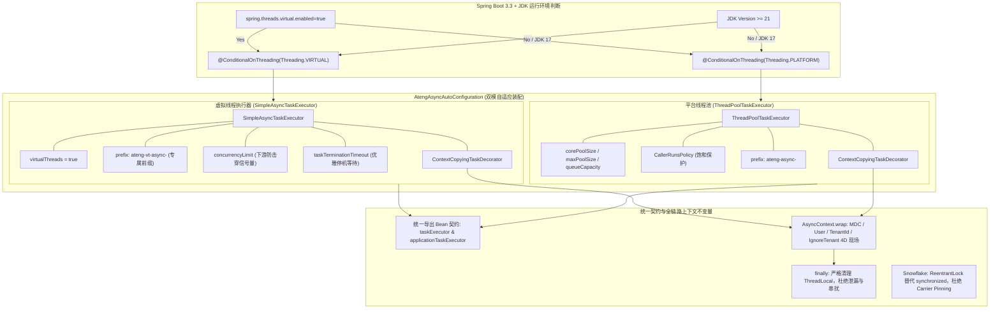

# 29. 基于 Spring Boot 3.3 与 JDK 21+ 的自适应虚拟线程异步运行时架构决策 (Virtual Threads and Adaptive Async Runtime)

## 背景与痛点

随着 Java 21 LTS 正式发布，虚拟线程（Project Loom）作为划时代的并发原语全面落地。Spring Boot 3.2+ / 3.3+ 引入了官方原生支持，开发者只需在配置文件中声明 `spring.threads.virtual.enabled=true`，即可将 Web 容器与异步调度基础设施透明切换为轻量级虚拟线程。

然而，在对 `ateng-boot` 现有并发基础设施的深度审查中，发现以下关键痛点与阻断点：

1. **自动装配无条件顶替阻断官方虚拟线程**：
   - `ateng-boot-core` 中的 `AtengAsyncAutoConfiguration` 声明了 `@AutoConfiguration(before = TaskExecutionAutoConfiguration.class)`；
   - 此前无条件注册了 `ThreadPoolTaskExecutor` 作为主执行器 Bean（`taskExecutor` / `applicationTaskExecutor`）；
   - 导致即使开发者在 JDK 21+ 环境下显式配置了 `spring.threads.virtual.enabled=true`，Spring Boot 3.3 官方的虚拟线程执行器（`SimpleAsyncTaskExecutor`）仍然被完全阻断覆盖，无法生效。
2. **载体线程固定（Carrier Thread Pinning）暗礁**：
   - 在 JDK 21 虚拟线程运行时中，若在 `synchronized` 同步块内部执行阻塞调用或休眠，JVM 会将虚拟线程永久锁定（Pin）在底层的 OS Carrier 载体线程上，导致载体线程池调度饥饿；
   - 核心发号器 [`Snowflake.java`](../../ateng-boot-core/src/main/java/io/github/atengk/boot/core/id/Snowflake.java) 在 `synchronized nextId()` 中包含轻量 NTP 时钟回拨容错逻辑：`Thread.sleep(offset)`。在极端时钟跳变下，该阻塞休眠会引发载体线程 Pinning。
3. **无界虚拟线程对下游资源的击穿风险**：
   - 虚拟线程创建成本极低，单个 JVM 可并发运行数十万甚至数百万虚拟任务；
   - 但是下游关系型数据库连接池（如 HikariCP 默认 10~30 连接）、Redis 连接池以及第三方 HTTP 服务的吞吐容量是有界的；
   - 若缺乏执行器层面的并发限流（Backpressure）守卫，瞬时并发洪峰可能引发数据库连接池耗尽、锁超时甚至雪崩。
4. **线上运维转储可观测性辨识盲区**：
   - 平台线程与虚拟线程在 Thread Dump、JConsole 或 Arthas 中的排查机理截然不同；
   - 若虚拟线程沿用与平台线程相同的线程名前缀，线上排查时难以瞬间辨识当前故障线程的底层模型。

---

## 核心架构与决策内容

经由 `/grill-with-docs` 架构推演，正式确立**“基于 Spring Boot 3.3 规范的自适应双模受管异步执行器”**架构方案。



### 1. Spring Boot 规范优先与声明式分流装配
- 在 [`AtengAsyncAutoConfiguration`](../../ateng-boot-core/src/main/java/io/github/atengk/boot/core/autoconfigure/AtengAsyncAutoConfiguration.java) 中引入 Spring Boot 3.2+ 官方原生的条件注解：
  - `@ConditionalOnThreading(Threading.VIRTUAL)`：在满足 `spring.threads.virtual.enabled=true` 且运行时为 JDK 21+ 时激活；
  - `@ConditionalOnThreading(Threading.PLATFORM)`：在平台线程模式（默认、未配置或运行于 JDK 17）下激活；
- 两个方法互斥导出，均命名为 `{"taskExecutor", "applicationTaskExecutor"}`，彻底消除对 Spring Boot 官方自动装配的阻断，实现零外部私有开关的平滑自适应。

### 2. 虚拟线程执行器装备与背压限流
- 虚拟线程模式下导出 [`SimpleAsyncTaskExecutor`](https://docs.spring.io/spring-framework/docs/current/javadoc-api/org/springframework/core/task/SimpleAsyncTaskExecutor.html)：
  ```java
  SimpleAsyncTaskExecutor executor = new SimpleAsyncTaskExecutor();
  executor.setVirtualThreads(true);
  executor.setThreadNamePrefix(asyncProperties.getVirtualThreadNamePrefix());
  executor.setTaskDecorator(new ContextCopyingTaskDecorator());
  if (asyncProperties.isWaitForTasksToCompleteOnShutdown()) {
      executor.setTaskTerminationTimeout(asyncProperties.getAwaitTerminationSeconds() * 1000L);
  }
  if (asyncProperties.getConcurrencyLimit() > 0) {
      executor.setConcurrencyLimit(asyncProperties.getConcurrencyLimit());
  }
  ```
- 在 [`AsyncProperties`](../../ateng-boot-core/src/main/java/io/github/atengk/boot/core/properties/AsyncProperties.java) 中新增扩展属性：
  - `virtualThreadNamePrefix`（默认 `ateng-vt-async-`）：专属前缀，在线上 Thread Dump 与 Arthas 中清晰可辨；
  - `concurrencyLimit`（默认 `-1` 表示无界）：当指定正整数（如 64、128）时，直接委托 Spring 内置信号量限制并发执行数，防止下游关系数据库 HikariCP 连接池瞬时耗尽。

### 3. 四维上下文全生命周期还原与清理不变量
- 无论是平台线程池还是轻量虚拟线程，统一挂载 [`ContextCopyingTaskDecorator`](../../ateng-boot-core/src/main/java/io/github/atengk/boot/core/context/ContextCopyingTaskDecorator.java)；
- 在任务执行前抓取 $\langle\text{MDC traceId}, \text{User}, \text{TenantId}, \text{IgnoreTenant}\rangle$ 四维快照并在子线程恢复；
- 在执行完毕后的 `finally` 块中严格执行 `AsyncContext.clear()`，彻底规避载体线程复用带来的脏数据或上下文污染。

### 4. 发号器同步原语升级彻底消除 Carrier Pinning
- 将 [`Snowflake.java`](../../ateng-boot-core/src/main/java/io/github/atengk/boot/core/id/Snowflake.java) 发号方法由 `synchronized nextId()` 升级为内部 `ReentrantLock` 独占锁保护：
  ```java
  private final ReentrantLock lock = new ReentrantLock();

  public long nextId() {
      lock.lock();
      try {
          // 时钟回拨防御、序列号递增与位运算发号
      } finally {
          lock.unlock();
      }
  }
  ```
- 在 `ReentrantLock` 保护下发生时钟回拨 `Thread.sleep` 时，JDK 21 虚拟线程能正常被 JVM 调度器卸载（unmount），载体线程释放给其他任务，彻底杜绝 Carrier Thread Pinning。

### 5. 声明式多业务受管异步线程池 (Multi-Pool) 与舱壁隔离演进
为解决单线程池缺乏舱壁隔离（Bulkhead Isolation）、耗时大任务与在线轻量任务相互挤占，以及下游自建线程池易遗漏四维上下文挂载等生产痛点，对异步并发基础设施进行增量演进：

1. **继承聚合与向后兼容配置模型**：
   - 提取单池配置实体 [`AsyncPoolProperties`](../../ateng-boot-core/src/main/java/io/github/atengk/boot/core/properties/AsyncPoolProperties.java)；
   - 根级 [`AsyncProperties`](../../ateng-boot-core/src/main/java/io/github/atengk/boot/core/properties/AsyncProperties.java) 直接继承 `AsyncPoolProperties` 并保留既有所有字段与兼容适配方法，存量单池配置零修改即可直接生效并作为默认主线程池参数；
   - 新增 `pools: Map<String, AsyncPoolProperties>` 命名空间，支持以极简 YAML 声明多个独立命名的业务专属线程池。
2. **Spring 容器标准契约与别名注入保障**：
   - 主线程池固定注册为 `taskExecutor` 与 `applicationTaskExecutor` 并显式标记为 `@Primary`，保证无限定条件的 `@Async` 与 `@Autowired Executor` 稳定匹配主池，杜绝多候选 Bean 歧义；
   - 额外业务池通过 [`DynamicAsyncPoolRegistrar`](../../ateng-boot-core/src/main/java/io/github/atengk/boot/core/autoconfigure/DynamicAsyncPoolRegistrar.java) 自动注册为 `${key}TaskExecutor` 并挂载别名 `${key}`，既符合 Spring 官方命名规范，又允许开发者通过 `@Async("export")` 或 `@Qualifier("exportTaskExecutor")` 极简调度；
   - 每个额外线程池独立支持 `enabled` 开关，未显式指定的参数自动享受安全生产默认值。
3. **独立线程模型（AUTO / PLATFORM / VIRTUAL）与智能前缀推导**：
   - 引入强类型枚举 `AsyncExecutionMode (AUTO, PLATFORM, VIRTUAL)`，支持全局跟随或按池独立指定线程模型，兼顾计算密集型与 IO 密集型场景；
   - 线程名前缀支持未配置时智能自动合成：平台线程为 `ateng-async-${poolName}-`，虚拟线程为 `ateng-vt-async-${poolName}-`，极大增强线上 Thread Dump 与监控可读性。
4. **强类型饱和拒绝策略与生命周期统管**：
   - 引入强类型枚举 `AsyncRejectedPolicy (CALLER_RUNS, ABORT, DISCARD, DISCARD_OLDEST)`，消除字符串拼写错误风险；
   - 所有动态注册的线程池强制挂载 `ContextCopyingTaskDecorator`，保证四维上下文无损穿透与确定性清理；
   - 注册 Spring 容器销毁钩子并在应用停机时统一遵循 `waitForTasksToCompleteOnShutdown` 优雅停机。

---

## 后果与权衡 (Consequences & Trade-offs)

### 正向收益
1. **百万级并发高吞吐飞跃**：在 JDK 21+ 生产环境下，开发者只需声明 `spring.threads.virtual.enabled=true`，即可将异步任务、邮件发送、非阻塞 I/O 调度全面迁移至虚拟线程，内存占用降低数个数量级；
2. **多 JDK 基线平滑兼容**：项目以 JDK 17 字节码编译，但在 JDK 21+ 运行时能自动触发虚拟线程分支；而在 JDK 17 运行时安全回退至平台线程池，零编译与启动异常；
3. **可观测性显著增强**：专属命名 `ateng-vt-async-` 让运维人员在 JConsole、Arthas 与日志中一眼区分虚拟线程与普通工作线程；
4. **下游安全有防护**：`concurrencyLimit` 为海量虚拟线程调用数据库提供了优雅的背压防击穿安全气囊；
5. **底层原语高可靠**：`Snowflake` 消除 Carrier Pinning，确保并发极端场景下底层调度稳健；
6. **业务级舱壁物理隔离**：声明式多线程池彻底解耦了长耗时大任务与在线轻量异步任务，杜绝了单一队列被打满导致的系统级服务雪崩；
7. **全链路上下文确定性流转**：无论是主池还是任意子池，统一由底座透明注入四维上下文装饰器并严格清理现场，杜绝下游自建线程池导致的上下文丢失与跨租户越权。

### 权衡与向后兼容
1. **注入契约向后兼容性**：
   - 在平台线程下，导出的 Bean 是 `ThreadPoolTaskExecutor`；在虚拟线程下，导出的 Bean 是 `SimpleAsyncTaskExecutor`；
   - 二者均实现 Spring 的 `AsyncTaskExecutor`、`TaskExecutor` 与 JDK 的 `Executor` 接口；
   - 绝大多数业务代码通过 `@Async` 注解或按接口 `@Autowired Executor taskExecutor` 注入，完全无感兼容；若个别旧代码硬编码强类型注入具体类 `ThreadPoolTaskExecutor`，在开启虚拟线程时需微调为注入 `Executor` 抽象接口（已在文档中说明）。
