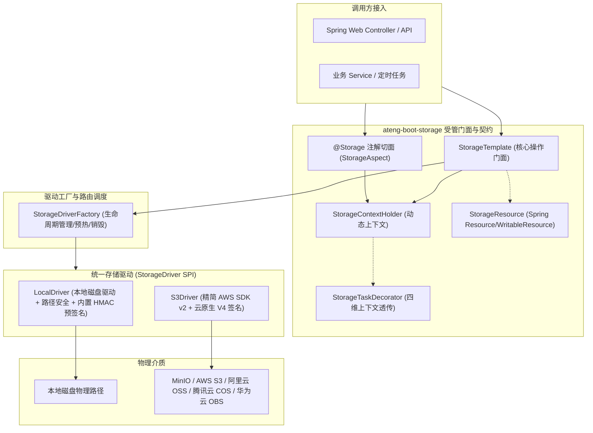

# 30. 企业级轻量多源对象存储与安全预签名一体化架构决策 (Dynamic Multi-Storage Architecture & Unified Presigned Contract)

## 状态
`Accepted`

---

## 背景与痛点 (Context & Problem Statement)
在现代化企业级微服务与单体工程演进中，文件、报表与多媒体对象存储是高频核心基础设施。然而在既有开源方案与传统 Spring Boot 封装中，普遍存在以下严重痛点：
1. **厂商 SDK 臃肿爆炸与类冲突 (SDK Bloat & Transitive Vulnerabilities)**：
   各主流云厂商（阿里云 OSS、腾讯云 COS、华为云 OBS、MinIO、AWS）均维护各自独立的专有 SDK。若项目中引入多个厂商 SDK，不仅造成成倍增加的 HTTP 客户端（如重复的 Apache HttpClient、OkHttp）与 JSON 库依赖，导致打包体积急剧膨胀，且极易引发依赖版本冲突与潜在 CVE 漏洞。
2. **本地环境与云端行为割裂 (Local vs. Cloud Inconsistency)**：
   云原生对象存储标配预签名外链（Presigned URL）直传与只读下载能力，而本地开发与私有部署（Local 驱动）通常缺乏统一的安全签名机制，以往多依赖手写临时 Controller 或反向代理静态目录，导致业务代码中充斥大量 `if (isLocal) ... else ...` 的补丁分流代码，难以实现统一的业务契约。
3. **混合多存储源与动态路由诉求 (Multi-Storage Routing)**：
   生产业务中常面临“公开文件存公共云 CDN、敏感凭证存私有 MinIO”或“按业务场景/按租户分桶隔离”等混合存储诉求。缺乏标准化、轻量级、兼顾声明式与编程式的动态多源路由支持。
4. **路径穿越与越权安全漏洞 (Path Traversal & Security Risks)**：
   存储路径若未进行严格规范化清洗与前置防御，极易受到包含 `../` 的路径穿越攻击；删除操作缺乏分布式天然幂等保障，失败重试易引发业务调用链异常阻断。

---

## 决策内容与架构拓扑 (Decision & Architecture)



### 1. 统一协议生态与依赖极限瘦身 (Zero-Bloat Protocol Convergence)
- 放弃为每个云厂商维护一套专有客户端，统一抽象为 **Local** 与 **S3 兼容协议** 双原生驱动。几乎所有主流对象存储服务（MinIO、AWS S3、阿里云 OSS、腾讯云 COS、华为云 OBS 等）均原生支持 S3 协议标准，实现“一套驱动通吃全球主流对象存储”。
- 依赖治理坚决杜绝臃肿全量包：云端驱动统一基于 AWS 官方现代版 `software.amazon.awssdk:s3`（AWS SDK for Java 2.x），并在 BOM 依赖统管中通过 `<exclusions>` 彻底剔除庞大的 Netty NIO 传输层（`netty-nio-client`），选用纯净轻量传输，纳入根 BOM 统管，子模块免配版本号。

### 2. 动态多源与智能双模配置 (Smart Dual-Mode Configuration)
配置属性统领于 `ateng.boot.storage.*`，支持智能双模演进：
- **极简单源模式**：平铺直叙，为 80% 常见中小型项目提供零门槛起步配置：
  ```yaml
  ateng:
    boot:
      storage:
        enabled: true
        type: local # 或 s3
        local:
          base-path: /data/storage
          domain: http://localhost:8080
  ```
- **多存储源层次化模式**：配置 `sources` 字典自动升阶为多源拓扑架构：
  ```yaml
  ateng:
    boot:
      storage:
        enabled: true
        primary: default
        sources:
          default:
            type: local
            local:
              base-path: target/sample-storage/default
              domain: http://localhost:8080
          backup:
            type: local
            local:
              base-path: target/sample-storage/backup
              domain: http://localhost:8080
  ```

### 3. Local 内置 HMAC 预签名端点 (Behavioral Parity & Tamper Defense)
- 为彻底抹平本地环境与云端 S3 在预签名外链能力上的割裂，`LocalDriver` 内置基于 `HMAC-SHA256` 算法的预签名安全下载端点（默认 `/storage/local/download`）。
- 生成外链时，结合对象路径与过期时间戳计算安全防篡改签名 `HMAC-SHA256(path + ":" + expires, secretKey)`。
- 下载端点执行四重防卫：
  1. `StorageSecurityUtil.normalizePath` 二次路径清洗防御穿越；
  2. Unix 时间戳过期校验；
  3. HMAC 签名防篡改校验（未配置密钥则启动时自动基于安全伪随机数生成）；
  4. 物理文件存在性校验与流式安全输出。
- 由此实现无论在单机 Local 环境还是云端 S3 环境，上层业务统一调用 `storageTemplate.getPresignedUrl(path, duration)`，实现 100% 行为平替与防盗链闭环。

### 4. 三位一体动态切源与四维上下文透传 (Three-in-One Multi-Tenant Routing)
- **编程式切源**：`storageTemplate.use("backup").upload(...)`，获取绑定特定驱动的不可变轻量句柄，局部作用域，线程安全，即用即走；
- **声明式切源**：`@Storage("backup")` 注解切面，方法执行前置压入上下文，`finally` 严格清理现场；
- **四维上下文透传**：`StorageContextHolder` 提供 `StorageTaskDecorator`，与 Core 模块的 `ContextCopyingTaskDecorator` 全面集成，在线程池、异步任务或虚拟线程切换中无缝透传当前存储源。

### 5. Spring 原生资源桥接与 HTTP Range 断点续传 (StorageResource)
- 提供 `StorageResource`，实现 Spring 原生 `Resource` 与 `WritableResource` 接口；
- Controller 下载方法直接返回 `ResponseEntity<Resource>`，天然支持 Spring MVC 内置的 HTTP Range 206 Partial Content 断点续传与大文件分片拉取，无需业务手动计算字节偏移量与响应头。

### 6. 分布式天然幂等与统一异常体系
- 统一转译为 `StorageException extends BusinessException`，规范化 `StorageResultCode`；
- **删除操作（`delete` / `deleteBatch`）分布式天然幂等**：当目标文件本身不存在时，静默视为删除成功返回 `true`，杜绝分布式调用链路因对象不存在重试导致雪崩阻塞。

### 7. 对象跨路径复移与常用载荷便捷存取 (Object Relocation & Convenient Payloads)
- 底层 SPI 显式声明 `copy` 与 `move` 原子契约，`LocalDriver` 优先利用 NIO `Files.copy` / `Files.move(..., ATOMIC_MOVE)` 实现本地磁盘秒级复移；`S3Driver` 封装云原生 `CopyObject` API 并安全移除源对象；
- 高阶门面 `StorageTemplate` 暴露 `uploadString` / `downloadString`、`uploadBytes` / `downloadBytes` 以及基于 `JsonUtil` 门面的 `uploadJson` / `downloadJson`，消灭业务层样板代码。

### 8. 目录前缀列举与分页检索体系 (Hierarchical Listing & Pagination)
- 扩展 `StorageObject` 模型，引入 `directory` 标识以无缝兼容虚拟目录项；
- `list(prefix, recursive)` 支持当前层级与递归子目录检索，内置 `.DS_Store` / `desktop.ini` / `.chunks` 等系统隐藏项自动过滤；
- `listPage(prefix, pageQuery, recursive)` 全面打通 Core 模块的强类型分页契约（`PageQuery` / `PageResult<StorageObject>`），基于流式内存切片完成分页转换。

### 9. 纯流式 ZIP 打包与 Spring 原生存储事件广播 (Streaming ZIP & Event-Driven Architecture)
- 彻底摒弃传统“落盘临时文件再读取发送”的高风险做法，推行纯流式 `downloadAsZip`：边自存储驱动按序拉取输入流边写出至 `ZipOutputStream`，支持通用流与直接写入 `HttpServletResponse`；内置同名文件 `file (1).ext` 防重命名算法与严格文件存在性防卫；
- 存储生命周期领域事件：在对象上传/创建完成及删除完成时，分别广播 `StorageUploadedEvent` 与 `StorageDeletedEvent`；门面层采用 `publishEventSafely` 实现 Fail-Safe 异常隔离，坚决杜绝下游监听器故障反向阻断主存储操作。

### 10. 文件真实魔数特征嗅探与防伪装安全加固 (Magic Byte Sniffing & Camouflage Defense)
- 解决通过伪造扩展名或 HTTP Header 绕过安全检验的渗透风险，提供 `StorageGuard` 嗅探器；
- 预置 20+ 种高频标准类型特征（图片、文档、压缩包、音视频及 PE EXE、Linux ELF、Shebang、Java Class 等高危特征）；
- **零流截断损耗不变量 (Zero-Truncation Invariant)**：基于 `mark(512)` 与 `reset()` 机制探查真实二进制特征，探查完成后流指针精确复位，确保写入下游介质的文件 MD5 与原始数据 100% 绝对一致；
- 提供白名单拦截、严格魔数比对与高危二进制伪装强拦截。

### 11. 大文件分片合并暂存与生命周期状态机 (Chunked Upload & Lifecycle State Machine)
- 针对极端大文件上传易受网络波动影响导致全量重传的痛点，构建 1-based 连续性分片状态机；
- 底层 SPI 扩充 `initiateChunkedUpload`、`uploadChunk`、`completeChunkedUpload`、`abortChunkedUpload`；
- `LocalDriver` 采用 `.chunks/<uploadId>` 物理隔离目录管理碎片，基于 NIO `FileChannel.transferTo` 实现零拷贝顺序追加合并，并在完成后自动物理清理；
- `S3Driver` 标准适配 AWS S3 Multipart Upload 原生 API，驱动内部维护并发安全 `S3UploadSession` 分片 ETag 集合，支持本地极速合并与跨节点 fallback；
- 缺失分片阻断抛出 `STORAGE_CHUNK_MISSING (40012)`，非法分片索引拦截抛出 `STORAGE_CHUNK_INVALID (40013)`。

### 12. 纯内存自验门禁 (In-Memory Verification Gate)
- 遵循 ADR-0028 规范，全套单元测试与场景工程 `ateng-boot-sample-storage` 0 外部物理依赖；
- 模块单测基于 `@TempDir` 验证本地驱动，基于 Mockito 打桩验证 S3Client 与 S3Presigner；
- 场景工程通过 MockMvc 开展端到端 HTTP 上传、Range 206 断点续传、HMAC 授权与防篡改、动态多源隔离、对象复移、目录分页、便捷存取、流式 ZIP 打包、分片状态机、魔数安全防卫与领域事件广播全链路自验，秒级准出。

### 13. Local 预签名直传端点与全对称行为平替 (LocalStorageUploadController)
- 为抹平 S3 与 Local 在“客户端直传”能力上的割裂，新增 `LocalStorageUploadController`（默认端点 `PUT /storage/local/upload`）。
- 客户端通过 HTTP PUT 流式直传二进制流，URL Query 携带 `path`、`expires`、`signature`，可选携带 `contentType`、`maxBytes` 及分片参数 `uploadId` 与 `chunkIndex`。
- 多源感知与防篡改：HMAC-SHA256 签名因子涵盖 `path`、`expires`、限定 `contentType`、`maxBytes` 及多源 `source` 标识；通过 `StorageDriverFactory` 动态路由至对应 Local 实例与密钥验签；
- 上传写入本地磁盘后即时联动 `StorageGuard` 触发魔数安全校验，与云端 S3 PUT 预签名在契约上达成 100% 对称。

### 14. 强类型预签名直传约束与分片直传预签名 (Presigned Direct Upload & Chunk Presigning)
- 提供强类型请求模型 `PresignedUploadRequest`，支持设定有效时长、严格限制的 `contentType`、`maxSizeBytes` 及必须携带的 HTTP Headers，升级 `PresignedUrl` 携带必须附加的 Headers 映射；
- 保留 `getPresignedUploadUrl(path, duration)` 简易重载严守向后兼容；
- **分片直传预签名**：新增 `getPresignedUploadPartUrl(path, uploadId, chunkIndex, duration)`，S3 驱动封装 `UploadPartPresignRequest`，Local 驱动由上传控制器统一承接；支持浏览器或客户端将大文件本地切片后并发直传到存储介质，应用服务端零网络带宽代理消耗。

### 15. S3 分片上传集群无状态化与自包含签名 Token (Stateless S3 Chunk Sessions)
- 彻底废除 `S3Driver` 本地内存缓存 `ConcurrentMap<String, S3UploadSession>`，解决多 Pod / K8s 集群部署下分片请求漂移导致的“会话未找到”崩溃；
- `initiateChunkedUpload` 生成的 `uploadId` 采用防篡改无状态签名 Token：`Base64Url(cleanPath + "::" + s3UploadId + "::" + hmac)`，任意节点收到分片或合并请求均可自洽验签并解析真实 `key` 与底层 `s3UploadId`；
- 在 `completeChunkedUpload` 阶段，动态调用 S3 `listParts` 接口从云端拉取已上传的所有分片与 ETag，正序自洽组装发起合并，实现 100% 纯无状态与集群免疫。

### 16. 孤儿分片碎片生命周期治理与后台清理调度 (Chunk Cleaner Lifecycle Governance)
- 解决客户端因网络异常或放弃上传造成的磁盘/云存储孤儿碎片积压问题；
- 门面层暴露 `cleanExpiredChunkSessions(Duration maxAge)` 运维方法；
- 提供轻量守护调度配置 `ateng.boot.storage.chunk-cleaner`（`enabled: true`, `interval: 2h`, `max-age: 24h`），依托受管后台线程执行定时清理：LocalDriver 递归扫描 `.chunks` 目录删除超时碎片，S3Driver 遍历 `listMultipartUploads` 自动调用 `abortMultipartUpload` 取消超时会话。

### 17. 目录级与前缀级流式批量删除与防清库熔断 (deletePrefix & Directory Guard)
- 在 `StorageOperations` 与底层 SPI 扩充 `deletePrefix(String prefix)` 与 `deleteDirectory(String dirPath)`；
- S3Driver 采用 `ListObjectsV2Paginator` 游标流式拉取，每满 1,000 个 Key 触发一次 S3 批量删除（`DeleteObjects`），支持海量对象分批平稳清理；LocalDriver 基于 `Files.walkFileTree` 自底向上深度优先递归删除；
- **防误删熔断铁律**：前缀经过安全归一化后，若为空字符串、`/`、包含通配符 `*` 或仅有点号，立即抛出 `StorageException(INVALID_PATH)` 强行熔断，坚决杜绝清空整盘或清空整个 Bucket。

### 18. 原生零拷贝流式散列计算与秒传支撑 (StorageHashUtil & Instant Upload)
- 遵循底座优先与零业务污染原则，存储底座提供 `StorageHashUtil`，覆盖 MD5、SHA-256、SHA-1 与 CRC32 计算；
- 依托 Java NIO `FileChannel` 与流式固定缓冲区（8KB~64KB）恒定内存复用，实现零堆内存拷贝；输出规约为标准小写十六进制字符串，提供常数级抗时序攻击比对 `verifyHash`；
- 业务系统结合 `StorageHashUtil` 计算散列并联动 `storageTemplate.copy` 实现极速秒传，存储模块自身不绑定任何业务数据表。

### 19. Spring Boot Actuator 存储健康探针 (StorageHealthIndicator)
- 当应用引入 `spring-boot-starter-actuator` 时自动注册 `StorageHealthIndicator`；
- LocalDriver 探测基准物理目录的存在性与磁盘可写权限（`Files.isWritable`）；
- S3Driver 触发存储桶存活性与连通性轻量探查（`headBucket`）；
- 支持多源探测，异常时报告 DOWN 并安全脱敏输出异常摘要，无缝接入 Kubernetes 存活与就绪探针。

### 20. 结构化错误码与用户自定义元数据扩展 (StorageResultCode & userMetadata)
- `StorageResultCode` 新增结构化错误码：`STORAGE_SIGNATURE_INVALID (40018)`、`STORAGE_URL_EXPIRED (40019)`、`STORAGE_SIZE_EXCEEDED (40020)`、`STORAGE_HASH_MISMATCH (40021)`；
- `StorageObject` 模型扩充 `Map<String, String> userMetadata` 属性，并在 `upload` 门面增加携带元数据的重载，S3 驱动原生映射为 `x-amz-meta-*`，兼顾云原生业务打标与合规审计。

---

## 后果与权衡 (Consequences & Trade-offs)

### 正向收益 (Positive Consequences)
1. **体积与依赖纯净**：排除庞大 Netty 传输层后，S3 SDK 极致轻量；零第三方专用云厂商 SDK，极大收敛依赖树；
2. **动静分离与多源无缝切换**：一套配置与一套 API 支持动态多源路由，彻底消灭 `if-else` 硬编码切源；
3. **环境平替与体验统一**：Local 内置 HMAC 预签名下载与直传端点，让离线单机开发与本地环境也能完整闭环客户端预签名直传与防盗链下载；
4. **防御纵深安全可靠**：路径归一化防御穿越，HMAC 签名防御篡改与过期，JSR-303 与显式 `Result<StorageObject>` 契约自洽，防空路径批量删除熔断卫语句；
5. **Spring 框架高度融合**：`StorageResource` 带来原生 HTTP Range 206 断点续传，Actuator `StorageHealthIndicator` 带来云原生就绪感知，Spring 原生事件广播无缝接入事件驱动架构；
6. **企业级高阶能力完备**：对象秒级复移、目录树分页、纯流式零磁盘临时文件 ZIP 打包、零流截断损耗魔数防伪装嗅探、1-based 大文件分片状态机一体化自洽交付；
7. **集群无状态与生命周期治理**：S3 分片签名 Token 彻底破除多 Pod 内存黏性，孤儿分片定时扫描防止磁盘与云存储账单泄漏膨胀，`StorageHashUtil` 零拷贝支撑秒传。

### 妥协与规约 (Trade-offs & Constraints)
1. **S3 协议通用性 vs. 厂商特有专有特性**：
   采用标准 S3 兼容协议统一驱动，默认覆盖主流 CRUD、元数据与预签名能力。若极个别业务需要使用某云厂商高度特异化的专有函数（如专有图片即时处理样式管道），建议通过各厂商标准的 Query 参数或自定义元数据头附加传递，而非引入厂商侵入式 SDK。
2. **Local 预签名与集群环境**：
   在多实例集群部署 Local 驱动时，各节点必须通过配置显式指定相同的 `ateng.boot.storage.local.secret-key` 并配合共享存储卷（NFS / NAS），以保障跨节点验签通过；单节点或未配置密钥时系统将在启动时安全随机生成。
3. **分片暂存与临时目录清理**：
   LocalDriver 的分片暂存目录 `.chunks` 会在完成合并或显式调用 abort 时自动递归清理；在多节点分布式集群部署 Local 驱动时，建议启用 `ateng.boot.storage.chunk-cleaner` 定时清理以防异常中断残留。
