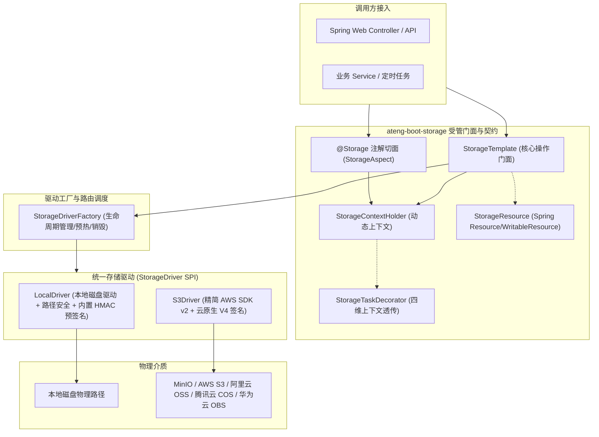

# 30. 企业级轻量多源对象存储与安全预签名一体化架构决策 (Dynamic Multi-Storage Architecture & Unified Presigned Contract)

## 状态
`Accepted`

---

## 背景与痛点 (Context & Problem Statement)
在现代化企业级微服务与单体工程演进中，文件、报表与多媒体对象存储是高频核心基础设施。然而在既有开源方案与传统 Spring Boot 封装中，普遍存在以下严重痛点：
1. **厂商 SDK 臃肿爆炸与类冲突 (SDK Bloat & Transitive Vulnerabilities)**：
   各主流云厂商（阿里云 OSS、腾讯云 COS、华为云 OBS、MinIO、AWS）均维护各自独立的专有 SDK。若项目中引入多个厂商 SDK，不仅造成成倍增加的 HTTP 客户端（如重复的 Apache HttpClient、OkHttp）与 JSON 库依赖，导致打包体积急剧膨胀，且极易引发依赖版本冲突与潜在 CVE 漏洞。
2. **本地环境与云端行为割裂 (Local vs. Cloud Inconsistency)**：
   云原生对象存储标配预签名外链（Presigned URL）直传与只读下载能力，而本地开发与私有部署（Local 驱动）通常缺乏统一的安全签名机制，以往多依赖手写临时 Controller 或反向代理静态目录，导致业务代码中充斥大量 `if (isLocal) ... else ...` 的补丁分流代码，难以实现统一的业务契约。
3. **混合多存储源与动态路由诉求 (Multi-Storage Routing)**：
   生产业务中常面临“公开文件存公共云 CDN、敏感凭证存私有 MinIO”或“按业务场景/按租户分桶隔离”等混合存储诉求。缺乏标准化、轻量级、兼顾声明式与编程式的动态多源路由支持。
4. **路径穿越与越权安全漏洞 (Path Traversal & Security Risks)**：
   存储路径若未进行严格规范化清洗与前置防御，极易受到包含 `../` 的路径穿越攻击；删除操作缺乏分布式天然幂等保障，失败重试易引发业务调用链异常阻断。

---

## 决策内容与架构拓扑 (Decision & Architecture)



### 1. 统一协议生态与依赖极限瘦身 (Zero-Bloat Protocol Convergence)
- 放弃为每个云厂商维护一套专有客户端，统一抽象为 **Local** 与 **S3 兼容协议** 双原生驱动。几乎所有主流对象存储服务（MinIO、AWS S3、阿里云 OSS、腾讯云 COS、华为云 OBS 等）均原生支持 S3 协议标准，实现“一套驱动通吃全球主流对象存储”。
- 依赖治理坚决杜绝臃肿全量包：云端驱动统一基于 AWS 官方现代版 `software.amazon.awssdk:s3`（AWS SDK for Java 2.x），并在 BOM 依赖统管中通过 `<exclusions>` 彻底剔除庞大的 Netty NIO 传输层（`netty-nio-client`），选用纯净轻量传输，纳入根 BOM 统管，子模块免配版本号。

### 2. 动态多源与智能双模配置 (Smart Dual-Mode Configuration)
配置属性统领于 `ateng.boot.storage.*`，支持智能双模演进：
- **极简单源模式**：平铺直叙，为 80% 常见中小型项目提供零门槛起步配置：
  ```yaml
  ateng:
    boot:
      storage:
        enabled: true
        type: local # 或 s3
        local:
          base-path: /data/storage
          domain: http://localhost:8080
  ```
- **多存储源层次化模式**：配置 `sources` 字典自动升阶为多源拓扑架构：
  ```yaml
  ateng:
    boot:
      storage:
        enabled: true
        primary: default
        sources:
          default:
            type: local
            local:
              base-path: target/sample-storage/default
              domain: http://localhost:8080
          backup:
            type: local
            local:
              base-path: target/sample-storage/backup
              domain: http://localhost:8080
  ```

### 3. Local 内置 HMAC 预签名端点 (Behavioral Parity & Tamper Defense)
- 为彻底抹平本地环境与云端 S3 在预签名外链能力上的割裂，`LocalDriver` 内置基于 `HMAC-SHA256` 算法的预签名安全下载端点（默认 `/storage/local/download`）。
- 生成外链时，结合对象路径与过期时间戳计算安全防篡改签名 `HMAC-SHA256(path + ":" + expires, secretKey)`。
- 下载端点执行四重防卫：
  1. `StorageSecurityUtil.normalizePath` 二次路径清洗防御穿越；
  2. Unix 时间戳过期校验；
  3. HMAC 签名防篡改校验（未配置密钥则启动时自动基于安全伪随机数生成）；
  4. 物理文件存在性校验与流式安全输出。
- 由此实现无论在单机 Local 环境还是云端 S3 环境，上层业务统一调用 `storageTemplate.getPresignedUrl(path, duration)`，实现 100% 行为平替与防盗链闭环。

### 4. 三位一体动态切源与四维上下文透传 (Three-in-One Multi-Tenant Routing)
- **编程式切源**：`storageTemplate.use("backup").upload(...)`，获取绑定特定驱动的不可变轻量句柄，局部作用域，线程安全，即用即走；
- **声明式切源**：`@Storage("backup")` 注解切面，方法执行前置压入上下文，`finally` 严格清理现场；
- **四维上下文透传**：`StorageContextHolder` 提供 `StorageTaskDecorator`，与 Core 模块的 `ContextCopyingTaskDecorator` 全面集成，在线程池、异步任务或虚拟线程切换中无缝透传当前存储源。

### 5. Spring 原生资源桥接与 HTTP Range 断点续传 (StorageResource)
- 提供 `StorageResource`，实现 Spring 原生 `Resource` 与 `WritableResource` 接口；
- Controller 下载方法直接返回 `ResponseEntity<Resource>`，天然支持 Spring MVC 内置的 HTTP Range 206 Partial Content 断点续传与大文件分片拉取，无需业务手动计算字节偏移量与响应头。

### 6. 分布式天然幂等与统一异常体系
- 统一转译为 `StorageException extends BusinessException`，规范化 `StorageResultCode`；
- **删除操作（`delete` / `deleteBatch`）分布式天然幂等**：当目标文件本身不存在时，静默视为删除成功返回 `true`，杜绝分布式调用链路因对象不存在重试导致雪崩阻塞。

### 7. 纯内存自验门禁 (In-Memory Verification Gate)
- 遵循 ADR-0028 规范，全套单元测试与场景工程 `ateng-boot-sample-storage` 0 外部物理依赖；
- 模块单测基于 `@TempDir` 验证本地驱动，基于 Mockito 打桩验证 S3Client 与 S3Presigner；
- 场景工程通过 MockMvc 开展端到端 HTTP 上传、Range 206 断点续传、HMAC 授权与防篡改、动态多源隔离全链路自验，秒级准出。

---

## 后果与权衡 (Consequences & Trade-offs)

### 正向收益 (Positive Consequences)
1. **体积与依赖纯净**：排除庞大 Netty 传输层后，S3 SDK 极致轻量；零第三方专用云厂商 SDK，极大收敛依赖树；
2. **动静分离与多源无缝切换**：一套配置与一套 API 支持动态多源路由，彻底消灭 `if-else` 硬编码切源；
3. **环境平替与体验统一**：Local 内置 HMAC 预签名端点让离线单机开发与本地环境也能完整闭环预签名防盗链下载；
4. **防御纵深安全可靠**：路径归一化防御穿越，HMAC 签名防御篡改与过期，JSR-303 与显式 `Result<StorageObject>` 契约自洽；
5. **Spring 框架高度融合**：`StorageResource` 带来原生 HTTP Range 206 断点续传与极简代码风格。

### 妥协与规约 (Trade-offs & Constraints)
1. **S3 协议通用性 vs. 厂商特有专有特性**：
   采用标准 S3 兼容协议统一驱动，默认覆盖主流 CRUD、元数据与预签名能力。若极个别业务需要使用某云厂商高度特异化的专有函数（如专有图片即时处理样式管道），建议通过各厂商标准的 Query 参数或自定义元数据头附加传递，而非引入厂商侵入式 SDK。
2. **Local 预签名与集群环境**：
   在多实例集群部署 Local 驱动时，各节点必须通过配置显式指定相同的 `ateng.boot.storage.local.secret-key` 并配合共享存储卷（NFS / NAS），以保障跨节点验签通过；单节点或未配置密钥时系统将在启动时安全随机生成。
