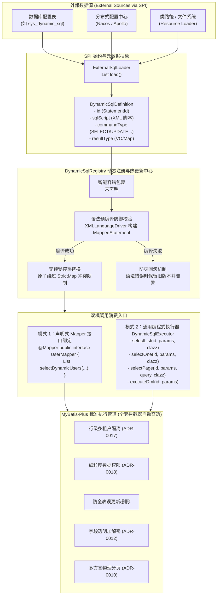

# 31. 外部动态 SQL 引擎与运行时热更新架构决策 (External Dynamic SQL Engine & Hot Reload)

## 背景与痛点

在标准 MyBatis / MyBatis-Plus 架构体系中，SQL 语句通常静态固化在编译期的 Java Mapper 注解或 `src/main/resources/mapper/*.xml` 文件中。随着企业级低代码平台、动态统计报表、运营指标大屏以及外部配置化业务的演进，这种静态编译模式面临显著挑战：

1. **静态编译打包固化与发布流程冗长 (Static Packaging Rigidity)**：
   - 任何针对复杂报表 SQL 的微调、索引提示优化或业务逻辑补充，都必须修改源码、重新编译打包并重启微服务集群，无法满足运营端秒级生效的动态诉求；
2. **动态低代码与通用报表场景契约割裂 (Dynamic Low-Code / BI Impedance Mismatch)**：
   - 低代码平台或报表系统的数据集由业务人员在前端动态配置（存储于数据库配置表或外部配置中心），无法提前在代码中为每个报表编写固定的 Java Mapper 接口与 XML 文件；
3. **直接拼接 SQL 极易引发 SQL 注入漏洞 (Raw SQL Concatenation & Injection Risk)**：
   - 部分团队为了绕过 XML 限制，在业务代码中采用字符串直接拼接 SQL 并裸调用 JDBC `Statement` 执行。这彻底丧失了预编译参数绑定的安全屏障，极易导致高危 SQL 注入漏洞；
4. **运行时热更新（Hot Reload）缺乏并发安全保障 (Fragile Hot-Reloading in StrictMap)**：
   - MyBatis 内部核心容器 `Configuration.mappedStatements` 底层采用定制的 `StrictMap`。当向其注册已存在的 StatementId 时，默认直接抛出 `IllegalArgumentException`；若采用非线程安全的粗暴清空替换，在高并发业务读取时极易发生空指针（NPE）或并发修改异常；
5. **外部动态 SQL 易沦为安全与拦截盲区 (Interceptor Chain Bypass)**：
   - 传统的外部 SQL 执行往往通过独立旁路连接，无法享受 `ateng-boot-mybatis-plus` 已有的行级多租户隔离（ADR-0017）、细粒度数据权限（ADR-0018）、防全表误操作以及持久层透明加解密（ADR-0012），导致严重的数据越权与灾难风险。

---

## 核心架构与决策内容

经架构推演与全面设计，`ateng-boot` 正式确立 **外部动态 SQL 引擎与运行时热更新体系 (External Dynamic SQL Engine)**，深度内聚于 `ateng-boot-mybatis-plus` 模块中（包路径 `io.github.atengk.boot.mybatisplus.dynamicsql`）。



### 1. 外部数据源 SPI 契约抽象 (`ExternalSqlLoader`)
- 定义纯 Java 原生 SPI 接口 `ExternalSqlLoader`，声明方法 `List<DynamicSqlDefinition> loadAll()` 与 `Optional<DynamicSqlDefinition> loadById(String id)`；
- 彻底解耦存储媒介：Starter 核心不强绑定任何特定数据库表或外部组件，业务端只需注入一个 `@Bean` 实现该接口，即可自由接入 MySQL 表、Nacos、Apollo、Redis 或远程网关；
- 默认提供 `ResourceExternalSqlLoader`，开箱即用支持扫描 `classpath*:dynamic-sql/**/*.xml` 或外部指定路径，确保单测与本地开发零额外中间件依赖。

### 2. 元数据模型与智能容错包裹 (`DynamicSqlDefinition`)
- 包含五大核心属性：
  - `id`（全局唯一 StatementId，如 `"com.example.mapper.UserMapper.selectDynamicUsers"` 或通用标识 `"rpt_user_growth"`）；
  - `sqlScript`（MyBatis XML 脚本，支持 `<where>`, `<if>`, `<foreach>`, `<choose>`, `#{param}` 占位符）；
  - `commandType`（`SqlCommandType`: `SELECT`, `INSERT`, `UPDATE`, `DELETE`）；
  - `resultType`（目标返回类型的 Class 或全限定名，默认 `java.util.Map`，支持 POJO / VO）；
  - `description`（语义化注释与业务说明，便于审计与追踪）。
- **智能容错包裹机制**：外部人员书写 SQL 时常遗漏根标签 `<script>...</script>`。引擎自动检测：若脚本文本中包含 `<where>`、`<if>` 等动态 XML 标签且首尾未包含 `<script>` 时，自动为其包裹 `<script>` 根标签，防止解析失败。

### 3. 无锁受控热替换与防灾回滚注册中心 (`DynamicSqlRegistry`)
- 深度利用 MyBatis `XMLLanguageDriver` 将 XML 文本构建为 `SqlSource`，并组装为完整 `MappedStatement`；
- **StrictMap 冲突安全规避**：通过受控反射移除旧的 key 映射后原子覆盖放入，或对包装 Map 实施引用替换，彻底消除 `IllegalArgumentException` 冲突；
- **语法校验失败防御回滚**：运行时热更新（通过 `refresh(id)` 或 `refreshAll()` 触发）时，先在内存中尝试完整预编译解析。若新传入的外部 SQL 存在 XML 语法错误或非法标签，立即捕获异常并记录 ERROR 日志，坚决保留上一版本可用的 `MappedStatement`，绝不造成调用端 NPE 或系统挂起。

### 4. 深度契约对齐的编程式执行器 (`DynamicSqlExecutor`)
- 提供注入式 Spring Bean `DynamicSqlExecutor`，为低代码和报表场景提供统一编程式入口；
- **深度融合 ADR-0010 分页契约**：
  ```java
  PageResult<UserVO> pageResult = dynamicSqlExecutor.selectPage(
      "rpt_user_growth",
      Map.of("status", 1, "deptId", 100L),
      pageQuery,
      UserVO.class
  );
  ```
  底层全自动绑定 MyBatis-Plus 的方言物理分页插件，自动推导并执行 count 计数与 limit 分页截取，并流式转换为前端标准的 `PageResult<T>`，无需开发者手工编写两套分页与计数逻辑；
- 同步提供 `selectList`、`selectOne` 及 `executeDml`（支持 INSERT/UPDATE/DELETE）。

### 5. 拦截器管道 100% 透明继承 (Full Pipeline Transparency)
- 动态注册生成的 `MappedStatement` 完全等价于静态编译期 XML 生成的 Statement，执行时完全穿透 MyBatis-Plus 的 `MybatisPlusInterceptor` 插件链；
- 行级多租户（`AtengTenantLineInnerInterceptor`）、细粒度数据权限（`AtengDataPermissionInnerInterceptor`）、防全表误操作（`BlockAttackInnerInterceptor`）以及透明字段加解密（`EncryptTypeHandler`）自动生效，杜绝出现安全旁路。

---

## 配置属性参考 (`application.yml`)

```yaml
ateng:
  boot:
    mybatis-plus:
      dynamic-sql:
        enabled: true                     # 是否启用外部动态 SQL 增强引擎（默认 false）
        auto-script-wrap: true            # 是否自动容错包裹 <script> 根标签（默认 true）
        locations:                        # 默认 Resource 加载器扫描路径
          - "classpath*:dynamic-sql/**/*.xml"
```

---

## 后果与权衡 (Consequences & Trade-offs)

### 正向收益 (Positive)
1. **秒级业务响应**：报表与动态数据统计需求不再依赖发版流程，支持数据库表或配置中心在线修改即时生效；
2. **零注入安全底座**：100% 复用 MyBatis 官方 `XMLLanguageDriver` 与预编译参数绑定机制，杜绝裸字符串拼接造成的 SQL 注入；
3. **零外部重型依赖**：依托 JDK 17 与 Spring 6 / MyBatis-Plus 原生能力实现，严格恪守 ADR-0011 零臃肿基线；
4. **架构自洽与多租户安全**：原生支持 ADR-0010 分页契约，并无缝继承多租户与数据权限拦截守护。

### 妥协成本与防御 (Trade-offs & Mitigations)
1. **外部 SQL 性能与慢查询管控**：外部配置的 SQL 质量不受编译期审查管控。*防御措施*：外部 SQL 同样受已有的 `SlowSqlInterceptor` 监控与方言分页单页 500 条上限保护；
2. **权限与审计管控**：外部 SQL 属于敏感配置。*防御措施*：业务端实现 `ExternalSqlLoader`（如数据库配置表）时，必须在管理后台严格设立 RBAC 权限与变更历史审计，防止非授权人员篡改。
