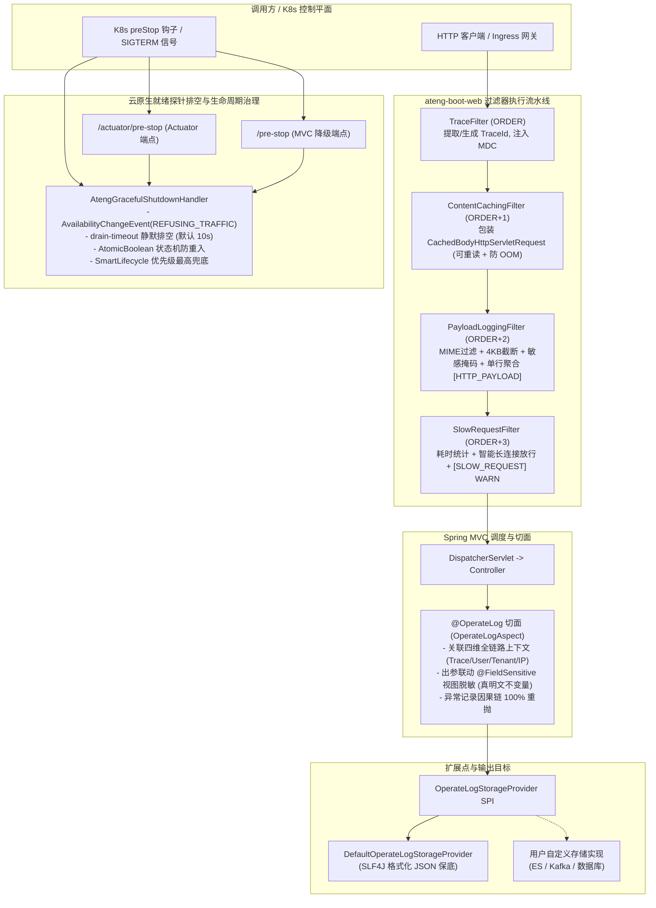

# 32. 运行时安全与流量治理架构决策 (Web Runtime Audit, Safe Payload Sampling & Traffic Governance Architecture)

## 状态
`Accepted`

---

## 背景与痛点 (Context & Problem Statement)

在企业级微服务与现代化云原生单体架构演进中，Web 接入层作为流量接入与安全防护的第一道防线，面临日益复杂的运行时治理挑战。传统的实现方案多存在散乱、脆弱与隐性高危缺陷：

1. **ServletInputStream 阅后即焚与多次消费冲突 (Single-Read Stream & Pipeline Starvation)**：
   Servlet 规范中的原生 `ServletInputStream` 为一次性流，调用方读取后即耗尽。在实际生产场景中，API 签名校验（`@ApiSign`）、HTTP Payload 采样日志（`PayloadLoggingFilter`）以及安全审计往往需要多次重复消费请求体。若无统一底座可重读包装管道，各过滤器不得不各自为政或因流枯竭导致管道断裂；若采用无边界的粗暴内存缓存，在大文件上传或恶意超大载荷下极易直接引发 JVM OOM 崩溃。
2. **操作审计切面与业务紧密耦合及数据越界 (Coupled Audit & In-Memory Entity Tampering)**：
   传统操作审计日志通常直接硬编码侵入 Controller/Service 业务逻辑，或死绑定在特定关系型数据库上，缺乏异步存储解耦 SPI；审计元数据缺乏全链路四维上下文（TraceId、UserId、Username、TenantId、ClientIp）的自动穿透与结构化对齐；更致命的是，部分实现为了实现出参数据脱敏，在业务层直接修改内存实体的敏感属性打星号，严重违背 [ADR-0012](./0012-lifecycle-separated-data-security.md) 确立的“内存真明文”不变量，导致被掩码污染的脏数据意外持久化回写至数据库。
3. **K8s 云原生缩容/滚动更新发布断流与 502/504 故障 (K8s PreStop Drain Lag & 502 Bad Gateway)**：
   在 Kubernetes 容器化部署中，当 Pod 发生缩容或版本滚动更新销毁时，kubelet 会并行向 Pod 发送 `SIGTERM` 终止信号并将 Pod 从 Service Endpoints 中摘除。然而，由于 kube-proxy 与 Ingress 网关路由表同步存在客观的网络传播与刷新延迟（通常需 1~5 秒），若 Spring Boot 容器在收到信号后立即关闭端口或终止线程池，上游路由仍在转发的在途 HTTP 请求将被直接连接重置，造成高频的 HTTP 502 Bad Gateway 与 504 Gateway Timeout 生产事故。
4. **隐蔽长耗时慢请求难以定位现场与误报干扰 (Undetected Slow Requests & Long-Connection False Alarms)**：
   线上生产环境中，偶发性慢 SQL、外部第三方 API 延迟抖动或深层循环计算会导致部分 HTTP 接口响应时间显著恶化，甚至耗尽 Servlet 容器线程池。传统做法依赖 APM 系统或排查整体日志，往往缺乏毫秒级就近在请求出口处输出带 TraceId、客户端 IP 与耗时上下文的主动告警；同时，若缺乏智能识别机制，容易将 WebSocket 升级长连接、Server-Sent Events（SSE）长推事件、文件分块下载以及异步挂起任务等正常长耗时场景误判为慢请求，引发严重的误报风暴。
5. **HTTP Payload 打印的 OOM 崩溃、凭据泄露与客户端挂起 (Payload Logging Vulnerabilities)**：
   为了排查接口集成交互故障与外部三方回调，开发与运维人员迫切需要在日志中打印完整的请求与响应报文。然而直接使用传统的 Payload 过滤器隐藏着三大高危陷阱：
   - **OOM 崩溃风险**：将大文件上传（Multipart）或二进制流无脑转为全量字符串读取，极易瞬间撑爆堆内存；
   - **凭据合规泄露**：请求入参中的登录密码、API Token、私钥及 Authorization 请求头若以明文落盘日志，将直接违反网络安全法与数据安全红线；
   - **响应截留挂起**：使用 `ContentCachingResponseWrapper` 拦截响应体后，若在异常或降级分支遗漏调用 `copyBodyToResponse()`，客户端将永久挂起或接收到空响应。

---

## 决策内容与架构拓扑 (Decision & Architecture)

经系统性推演与高可用基线设计，`ateng-boot` 正式确立 **Web 运行时安全与流量治理架构体系 (Web Runtime Audit, Safe Payload Sampling & Traffic Governance Architecture)**，全面内聚于 `ateng-boot-web` 模块，并与 `ateng-boot-core` 共享通用契约。

### 1. 通用请求体可重读管道下沉与向后兼容 (`ContentCachingFilter`)
- **下沉归位与条件激活**：将原散落在加签模块内部的流缓存逻辑提升为通用 Web 底座，命名为 `ContentCachingFilter` 与 `CachedBodyHttpServletRequest`。引入条件装配 `ContentCachingCondition`：仅当配置了加签（`ateng.boot.web.sign.enabled=true`）或 Payload 日志（`ateng.boot.web.payload-log.enabled=true`）时才自动激活；两者均未开启时跳过装配，实现运行时零额外包装与零性能损耗。
- **可重复消费与防 OOM 不变量**：
  - `CachedBodyHttpServletRequest` 将请求体安全缓冲至受控的 `byte[]` 中，并发重写 `getInputStream()` 与 `getReader()`，支持后续所有中间件、切面与业务 Controller 无限次重复消费；
  - 严格设立强类型载荷上限 `max-body-size: 2MB`（`DataSize`），若 `Content-Length` 请求头或实际流式读取字节数超出阈值，立即抛出受控的业务异常 `BusinessException(CommonResultCode.REQUEST_BODY_TOO_LARGE)` 实施快速失败，从根本上杜绝恶意构造的超大请求体打爆 JVM 堆内存；
  - 智能过滤非目标请求：仅对 `POST`/`PUT`/`PATCH` 且为文本/JSON 类型实施包装，文件上传（`multipart/form-data`）与表单（`application/x-www-form-urlencoded`）自动放行不予缓存；
  - 原加签模块的 `RequestBodyCachingFilter` 声明 `@Deprecated`，内部完全委托至通用 `ContentCachingFilter`，实现 100% 向后兼容。

### 2. 声明式结构化操作审计切面与存储解耦 SPI (`@OperateLog` & `OperateLogStorageProvider`)
- **企业级标准化契约**：在 `ateng-boot-core` 下沉 `OperateLogModel` 标准审计实体与 `OperateTypeEnum` 操作类型枚举，确立跨模块解耦的标准元数据契约。
- **声明式 AOP 切面**：在 `ateng-boot-web` 落地 `@OperateLog` 注解与 `OperateLogAspect`。标注于 Controller 方法上，支持定义业务模块（`module`）、操作类型（`type`）、操作描述（`description`）、入参/出参保存开关（`saveParams`/`saveResult`）及敏感参数排除列表（`excludeParams`）。
- **四维上下文全链路对齐**：切面执行时自动穿透并提取全链路元数据快照：MDC `traceId`、当前操作人 ID/姓名（`UserContextHolder`）、当前租户 ID（`TenantContextHolder`）及真实客户端 IP（`IpUtil.getClientIp()`），实现全维审计追溯。
- **坚守 ADR-0012“内存真明文”不变量**：
  - 出参记录时，自动联动实体上的 `@FieldSensitive` 注解完成视图层脱敏转换；
  - 严格使用脱敏后的克隆/序列化副本记录至审计模型，业务实体对象在内存中始终保持 100% 原始真实明文，彻底消除传统方案中将脱敏星号写回数据库造成数据损毁的灾难性隐患。
- **存储解耦 SPI 架构**：对外抽象 `OperateLogStorageProvider` SPI 扩展点接口，开箱内置 `DefaultOperateLogStorageProvider`（基于受管 SLF4J 异步格式化输出 JSON），用户可通过实现接口平滑接管投递至 Kafka、Elasticsearch 或关系型数据库。
- **严格遵循成熟度因果异常红线**：业务方法若抛出异常，切面在捕获后准确标记操作状态为失败（`status = 1`）并记录异常摘要，在 `finally` 块完成异步事件投递后 **100% 原样重抛原始异常**，严禁吞咽异常或二次包装破坏因果调用链。

### 3. K8s 云原生就绪探针排空与容器生命周期治理 (`AtengGracefulShutdownHandler`)
- **主动反转就绪探针**：收到容器下线信号时，第一时间通过 Spring 核心事件发布机制广播 `AvailabilityChangeEvent.publish(publisher, this, ReadinessState.REFUSING_TRAFFIC)`。Kubernetes 的 readinessProbe 探针即刻探测到就绪失效，驱动外部 Ingress / kube-proxy 立即将该 Pod 从 Endpoints 列表中摘除，不再下发任何新流量。
- **受管静默排空与在途保活**：探针反转后，线程受控执行静默排空等待（可配置 `drain-timeout: 10s`，强类型 `Duration`），留出充裕的缓冲时间供外部路由表同步刷新完成，并确保已到达的在途请求顺利执行完毕，彻底终结发布与缩容过程中的 502/504 偶发报错。
- **双模主动触发端点支持**：
  - **Actuator 环境**：自动装配 `@Endpoint(id = "preStop")`，暴露 `/actuator/pre-stop`（支持 HTTP GET 与 POST），与 K8s Pod Lifecycle preStop 钩子标准化联动；
  - **无 Actuator 轻量环境**：条件降级自动注册轻量级 Spring MVC 控制器 `PreStopController`，暴露 `/pre-stop`（支持 HTTP GET 与 POST），确保零额外依赖下开箱即用。
- **`SmartLifecycle` 兜底保护不变量**：实现 Spring `SmartLifecycle` 接口，显式声明优先级为最高值 `getPhase() = Integer.MAX_VALUE`（早于嵌入式 WebServer 停机执行）。即使 K8s Deployment 未配置 preStop 脚本直接下发 `SIGTERM` 信号，也能在 Spring 容器关闭前自动拦截触发就绪探针拒绝与静默排空保护。
- **并发原子幂等状态机**：内部设立 `AtomicBoolean` 状态标记，无论是 preStop 钩子先行调用还是与 SIGTERM 信号并发到达，均保证排空流程仅执行一次，杜绝延时重复叠加。

### 4. 长耗时慢请求性能主动告警拦截器 (`SlowRequestFilter`)
- **出口统一精准耗时统计**：过滤器注册优先级固定为 `TraceFilter.ORDER + 3`，在请求出口 `finally` 阶段精确统计全生命周期处理耗时。
- **强类型阈值判定与 WARN 告警**：耗时超过配置的强类型阈值 `threshold: 3s`（`Duration`，支持 `500ms`, `3s` 等）时，输出规范化单行 WARN 日志，完整聚合 MDC 全链路 `traceId`、HTTP 方法、请求 URI、耗时（ms）、阈值（ms）及客户端真实 IP。
- **智能长连接与流式免打扰放行**：
  - 自动识别并放行请求/响应头中的 `Upgrade` 握手标头（WebSocket 升级协议）；
  - 自动识别并放行 `text/event-stream`（Server-Sent Events 长推流）；
  - 自动识别并放行 `application/octet-stream`（大文件与数据流分块下载）；
  - 自动识别并放行 `request.isAsyncStarted()` 异步挂起任务；
  - 杜绝上述正常长耗时场景产生无意义误告警。
- **白名单精准排除与因果链透明**：支持通过 `exclude-urls`（Ant 风格路径匹配）排除监控；若下游控制器抛出异常，在 `finally` 记录慢请求告警后 100% 原样重抛原始异常。

### 5. HTTP Payload 双向安全采样打印与防 OOM 不变量 (`PayloadLoggingFilter`)
- **执行优先级对齐**：注册优先级固定为 `TraceFilter.ORDER + 2`，位于 `ContentCachingFilter` 之后，确保能够稳定复用已缓冲的请求体。
- **单行聚合日志呈现**：采用结构化单行输出，包含 `traceId`、`method`、`uri`、`status`、`cost`、`reqBody` 与 `respBody`，彻底解决传统分段多行日志在并发环境下相互穿插错乱的痛点。
- **MIME 智能过滤防卫**：仅针对文本与结构化媒介（`application/json`、`application/xml`、`text/plain`、`application/x-www-form-urlencoded` 等）进行安全采样；遇到 `multipart/*`、`application/octet-stream`、`image/*` 等二进制流时自动跳过并填充 `[BINARY_STREAM]` 占位，坚决杜绝大文件上传下载导致的 OOM 风险。
- **强类型截断防卫**：严格遵循 `max-payload-size: 4KB`（强类型 `DataSize`），请求体与响应体超出阈值部分强制截断并追加 ` ... [TRUNCATED]` 标识。
- **敏感凭据纯原生正则掩码**：对请求体与响应体中出现的 `password`、`secret`、`token`、`authorization` 等字段，内置高效率纯原生正则表达式自动掩码替换为 `***`，筑牢合规防线。
- **响应确定性释放不变量 (Deterministic Cleanup)**：使用 `ContentCachingResponseWrapper` 拦截响应体并在 `finally` 嵌套块中 **100% 确保调用 `responseWrapper.copyBodyToResponse()`**，从底层架构上消除因异常中断导致客户端挂起的恶性 Bug。
- **状态码自适应提升**：HTTP 响应状态码 $\ge 400$ 时，单行聚合日志级别自动由 `INFO` 提升为 `WARN`，提升运维感知灵敏度。

---

## 核心配置与类拓扑速查 (Configuration & Architecture Map)

| 组件 / SPI | 核心配置项 (`ateng.boot.web.*`) | 默认值 | 作用与职责 |
| :--- | :--- | :--- | :--- |
| `ContentCachingFilter` | `body-cache.max-body-size` | `2MB` | 通用请求体可重读管道，超限快速失败截断防 OOM |
| `OperateLogAspect` | `operate-log.enabled` | `true` | 声明式结构化操作审计切面，自动关联四维上下文，守卫内存真明文 |
| `OperateLogStorageProvider` | - | `DefaultOperateLogStorageProvider` | 操作审计存储解耦 SPI 扩展点，开箱提供 SLF4J JSON 保底 |
| `AtengGracefulShutdownHandler` | `shutdown.enabled` `shutdown.drain-timeout` `shutdown.smart-lifecycle-enabled` | `true` `10s` `true` | K8s 云原生就绪探针主动反转与静默排空，SmartLifecycle 兜底 |
| `PreStopEndpoint` / `PreStopController` | `shutdown.actuator-endpoint-enabled` `shutdown.mvc-endpoint-enabled` | `true` `true` | `/actuator/pre-stop` 与 `/pre-stop` 双模停机排空端点 |
| `SlowRequestFilter` | `slow-request.enabled` `slow-request.threshold` `slow-request.exclude-urls` | `true` `3s` `[]` | 长耗时慢请求性能告警，智能放行 WebSocket/SSE/下载/异步任务 |
| `PayloadLoggingFilter` | `payload-log.enabled` `payload-log.max-payload-size` `payload-log.exclude-urls` | `false` `4KB` `[]` | HTTP 请求与响应双向安全采样，内建 MIME 过滤、正则掩码与防挂起 |

---

## 后果与权衡 (Consequences & Trade-offs)

### 正向收益 (Positive Impacts)
1. **零断流平滑发布 (Zero-Downtime Deployment)**：彻底消除容器滚动更新期间因为网关路由同步滞后造成的 502/504 报错，大幅提升生产高可用指标。
2. **零 OOM 崩溃与全真排障 (Safe Observability)**：请求体缓存（2MB）与采样截断（4KB）双层强类型防爆守卫，在提供详尽报文观测能力的同时，确保极端流量下 JVM 堆内存绝对安全。
3. **安全合规与内存真明文 (Data Security Compliance)**：操作审计与 Payload 采样均遵循凭据掩码规范，且审计切面严格保持“内存真明文”，彻底切断掩码脏数据回写持久层的隐患。
4. **低侵入与高扩展 (Extensibility & Zero-Bloat)**：全量能力基于 Spring 6 与 JDK 17 原生能力实现，无任何三方重型工具包；操作审计、停机端点均支持 SPI 与 `@Bean` 覆盖接管。

### 妥协成本与运维规范 (Operational Invariants & Caveats)
1. **停机延迟延长**：开启优雅停机排空后，Pod 停止运行将增加 `drain-timeout`（默认 10 秒）的静默等待时间。K8s Deployment 必须配套将 `terminationGracePeriodSeconds` 设置为大于排空时长（建议 $\ge 30$ 秒），防止 Pod 被 kubelet 强制超时 SIGKILL 强杀。
2. **条件内存开销**：`ContentCachingFilter` 与 `PayloadLoggingFilter` 会在请求处理期间占用微量的堆内存缓冲区。因此，框架坚持“按需装配”原则，仅在显式开启对应特性时才装配生效。
