# 33. 持久层生产级加固与流式游标防 OOM 架构决策 (MyBatis-Plus Production Hardening & Streaming Architecture)

## 背景与痛点

在企业级高并发、微服务与大规模数据处理演进过程中，持久层面临着一系列极其隐蔽但破坏力极强的生产痛点：

1. **联合唯一索引与逻辑删除冲突死锁 (Unique Key Collision on Soft-Delete)**：
   - 业界通常采用 `deleted = 0/1` 标志逻辑删除。当数据表存在业务复合唯一索引（如 `(tenant_id, code, deleted)`）时，同租户下若一条记录被删除（`deleted=1`），用户再次创建同名编码后又删除，数据库将因唯一索引碰撞抛出 `DuplicateKeyException`，导致逻辑删除与唯一索引无法共存；
2. **原生批量插入自愈缺失与主键空缺风险 (Batch Insert Null Ingestion & ID Void)**：
   - 原生多值批量插入 `insertBatchSomeColumn` 能生成单条 `INSERT INTO ... VALUES (...), (...)` 高性能 SQL，但其直接跳过 MyBatis-Plus 单条插入的全局主键生成器与 `MetaObjectHandler` 审计逻辑。若业务集合中存在未预先赋值主键、租户 ID、创建时间或操作人的实体，会直接抛出数据库非空约束异常或将空主键写入数据库，导致开发者不得不手写大量脆弱的前置补偿循环；
3. **慢 SQL 性能黑洞与盲目 EXPLAIN 诱发雪崩 (Slow SQL Avalanche & Explain Stampede)**：
   - 慢 SQL 是导致数据库连接池打满甚至服务雪崩的核心诱因。传统排查要么依赖事后巡检，要么由中间件盲目自动执行 `EXPLAIN`。当数据库已处于高负载甚至行锁排队时，自动 `EXPLAIN` 会急剧加重数据库负担导致连锁雪崩；同时，慢 SQL 日志常将敏感密码凭据明文外泄；
4. **百万级大表导出引发 JVM 堆内存 OOM (Large Dataset Export & OOM)**：
   - 在大规模批处理或海量数据导出（如对接 `ateng-boot-excel`）场景下，传统 `selectList` 会一次性将百万行数据加载进 JVM 堆内存，极易打爆内存引发 FullGC 或 OOM；而使用物理分页（`LIMIT offset, size`）在进入深分页后底层扫描行数爆炸，导致数据库 IO 枯竭；
   - 原生 MyBatis 提供了 `Cursor<T>` 游标，但必须由外部长事务维持底层 JDBC 连接持续开启；若开发者忘记显式开启事务或发生异常未闭合游标，将导致严重的连接池句柄悬挂泄漏；
5. **多数据源环境下活跃事务假切源与上下文污染 (Multi-DataSource Phantom Routing & Context Tainting)**：
   - 业务引入动态切源框架后，若在 Spring `@Transactional` 事务内部切换数据源，Spring 事务管理器已将最初的物理连接绑定至当前线程，切源将被底层连接静默覆盖导致更新写错库（假切源）；同时，上一数据源遗留的租户 ID 或数据权限超管状态极易跨库串读越权。

---

## 核心架构与决策内容

立足于纯原生、零臃肿依赖与工业级代码成熟度防线，`ateng-boot-mybatis-plus` 正式确立 **持久层生产级加固与流式游标防 OOM 体系 (Phase 2.2)**：

```mermaid
flowchart TD
    subgraph EntityTier["1. 唯一索引防冲突占位实体 (BaseDeleteIdEntity)"]
        DelId["deleted = 0 (未删除)\ndeleted = id (删除时雪花 ID 占位)"]
        UqIndex["联合唯一索引天然兼容\nUNIQUE KEY uq_code (code, deleted)"]
    end

    subgraph BatchEngine["2. 原生批量插入自愈补偿 (BatchUtil)"]
        FastPath["Fast-Path 基类实体极速赋值\n(ID / 时间 / 租户 / 审计 / 版本)"]
        ReflectionPath["元数据缓存反射通道\n(@TableId 智能回填雪花 ID)"]
        BatchChunk["集合动态分批切片 (默认 1000)\n防 max_allowed_packet 网络溢出"]
    end

    subgraph SlowSqlPipeline["3. 慢 SQL 性能审计与防雪崩 (SlowSqlInterceptor)"]
        NanoTimer["System.nanoTime() 零损耗放行\n未超时请求零额外对象分配"]
        SensitiveMask["凭据与 @FieldEncrypt 真实脱敏\n规避日志泄密"]
        CallStack["业务调用栈精准穿透定位\n精准过滤框架底层类库"]
        AlertSPI["SlowSqlAlertProvider SPI\n+ Spring 原生 SlowSqlEvent 广播"]
        AntiAvalanche["生产防雪崩铁律：严禁自动 EXPLAIN\n仅输出结构化排查建议"]
    end

    subgraph StreamingPipeline["4. 受管游标流式查询门面 (StreamingQueryTemplate)"]
        TxReadOnly["TransactionTemplate 强制只读事务守护\n自适应透传外层已有事务"]
        TryResources["try-with-resources 100% 游标生命周期管理\n正常/异常均确定性关闭 Cursor 释放连接"]
        DualContract["双消费契约：\n- forEach 逐条流式消费\n- forEachBatch 不可变切片分批消费"]
        FetchBuffer["JDBC FetchSize (默认 1000) 缓冲防溢出\n杜绝 JVM 堆内存 OOM"]
    end

    subgraph MultiDsGuard["5. 多数据源协同诊断探针 (DynamicDatasourceGuard)"]
        Probe["SmartInitializingSingleton 启动自检探针\n无感感知多源与路由数据源并输出建议"]
        StaticAssert["validateContextIsolated() 编程式静态断言\n主动阻断活跃事务假切源与上下文污染"]
    end

    DelId --> UqIndex
    FastPath --> BatchChunk
    ReflectionPath --> BatchChunk
    NanoTimer --> SensitiveMask
    SensitiveMask --> AlertSPI
    TxReadOnly --> TryResources
    TryResources --> DualContract
    Probe --> StaticAssert
```

### 1. 唯一索引防冲突受管实体 (`BaseDeleteIdEntity`)
- 继承 `BaseEntity`，将逻辑删除字段声明为 `Long deleted`，初始值为 `0L`；
- 在执行删除时，以分布式雪花 ID 占位：`UPDATE table SET deleted = id WHERE id = ?`；
- 联合唯一索引声明为 `(biz_code, deleted)`：未删除时 `deleted = 0` 保证唯一性；已删除记录各自持有唯一的雪花 ID，从根本上解决同一业务标识多次删除新增的唯一索引冲突问题。

### 2. 原生批量插入智能自愈补偿引擎 (`BatchUtil`)
- 双轨制自愈补偿机制：
  - **Fast-Path 极速通道**：优先匹配 `BaseIdEntity`、`BaseTimeEntity`、`BaseEntity`、`BaseFullEntity`、`BaseDeleteIdEntity` 与 `TenantEntity` 基类实体，直接调用 Getter/Setter 赋初值，性能损耗趋近于零；
  - **元数据反射缓存通道**：针对自定义实体，解析并高频缓存 `@TableId(type = ASSIGN_ID)` 字段反射引用，自动为其生成分布式雪花 Long 或 String ID，杜绝空主键落盘；
- 智能切片分批：默认按 1000 条切片（`batch.default-size` 可配），循环调用 `insertBatchSomeColumn` 原生多值 SQL，兼顾性能与网络包上限。

### 3. 慢 SQL 性能审计与防雪崩架构 (`SlowSqlInterceptor`)
- **零损耗纳秒比对**：在 MyBatis `StatementHandler.query/update` 拦截点采用 `System.nanoTime()` 高精度时钟，未超时请求差值比对直接快速放行，未超时零对象分配；
- **敏感数据动态掩码**：自动探测 `@FieldEncrypt` 属性、`EncryptTypeHandler` 以及参数名中的敏感凭据关键字（`password`、`secret`、`token` 等），输出日志与告警前自动掩码为 `******`；
- **防雪崩严禁自动 EXPLAIN**：拦截器坚决杜绝在线上环境自动发起 `EXPLAIN`，避免高负载时加剧连接池耗尽；
- **解耦告警体系**：提供 `SlowSqlAlertProvider` SPI 与 Spring 原生 `SlowSqlEvent` 事件广播，开箱即用支持飞书、钉钉群机器人对接与 APM 指标异步采集。

### 4. 受管游标流式查询模板 (`StreamingQueryTemplate`)
- **只读事务闭环守护**：内部由 `TransactionTemplate` 开启只读事务（`readOnly = true`，`PROPAGATION_REQUIRED`），自适应加入外层既有事务，确保游标在遍历期间底层物理连接保持开启且只读安全；
- **确定性生命周期回收**：采用 `try-with-resources` 守卫 `Cursor<T>`，正常消费完成或下游业务抛出异常时，100% 确定性关闭游标归还连接，杜绝句柄悬挂泄漏；
- **因果异常传递与原子回滚**：下游消费抛出异常时原样保留因果链向外抛出，并显式标记事务回滚（`setRollbackOnly()`）；
- **双消费契约与不可变切片**：提供逐条流式（`forEach`）与分批切片（`forEachBatch`）消费门面；切片返回 `Collections.unmodifiableList` 不可变列表，消费完即时解除引用协助 GC。

### 5. 多数据源协同诊断探针与上下文守卫 (`DynamicDatasourceGuard`)
- **启动期轻量自检探针**：基于 Spring 原生 `SmartInitializingSingleton` 接口，在所有单例 Bean 实例化完成后无感探测 Spring 容器中数据源实例数量或动态路由特征（`AbstractRoutingDataSource` / `DynamicRoutingDataSource`），输出多租户表放行与禁止事务内切源的健康自检建议；
- **静态断言防卫门面**：提供 `validateContextIsolated()` 静态断言方法，供切源切面主动调用：
  - 检测到当前处于活跃事务中（`TransactionActive=true`）时立即拦截抛出 `IllegalStateException`，防御假切源与串库风险；
  - 检测到数据权限残留状态（`isSuperAdmin=true` 或 `isIgnore=true`）时立即阻断，防御跨库越权穿透。

### 6. 可执行带参 SQL 日志打印与耗时诊断引擎 (`SqlLogInterceptor` + `SqlParameterFormatter`) (Phase 2.3)
- **终态物理执行切入点 (`StatementHandler`)**：拦截 MyBatis 原生 `StatementHandler` 的 `query`、`update`、`batch` 与 `queryCursor` 方法，捕获在行级租户改写、数据权限作用域追加与分页改写之后的 100% 真实执行物理 SQL；
- **自研零依赖字符流 Token 状态机反填 (`SqlParameterFormatter`)**：
  - 采用逐字符流式扫描，精准识别并跳过单引号常量、SQL 转义引号、双引号/反引号标识符及 SQL 注释内部的 `?` 占位符；
  - 按 ANSI SQL JDBC 规范安全格式化：`null` $\rightarrow$ `NULL`，数值/布尔 $\rightarrow$ 原生字面量，字符串/字符/枚举 $\rightarrow$ 转义单引号包裹，时间类型 $\rightarrow$ 标准时间字符串，字节数组/Blob $\rightarrow$ `'<BLOB>'`；
  - 纯 `StringBuilder` 字符流反填，彻底杜绝 `String.replaceFirst` 正则替换，消除参数含 `$` 或反斜杠时的正则解析异常；
  - **属性提取 Fail-Safe 容错防崩铁律**：参数反射提取与分级属性导航挂载局部安全防御，遇异常优雅回退保底，坚守“诊断日志绝不能反噬或阻断业务主链路”铁律；
  - **反射缓存容量上限守卫**：`FIELD_ENCRYPT_CACHE` 限制 4096 条容量上限，达到上限自动清空保护，杜绝动态类或极端代理类导致的无界内存泄漏；
  - **超长 SQL 性能熔断旁路**：当 SQL 字符长度超过 `max-sql-length` 阈值时，自动短路跳过深层多行分段排版，直接单行截断输出，避免大报文下的无谓 CPU 与 GC 压力；
- **自适应敏感数据脱敏 (`mask-sensitive: true`)**：自动感知 `@FieldEncrypt` 实体属性、`EncryptTypeHandler`、密码凭据（`password`、`secret`、`token` 等）及常见个人敏感隐私字段（`idcard`、`phone`、`mobile`、`bankcard` 等），默认反填 `'******'`，兼顾调试便捷与数据安全；支持本地测试显式关闭输出真明文；
- **原生批量插入单条完整输出与截断防爆 (`max-sql-length: 4096`)**：
  - 对 `batch(Statement)`（传统循环 `addBatch()`）执行静默放行，杜绝循环单条刷屏；配合 `BatchUtil.insertBatch` 原生多值 SQL 单条执行，仅在控制台输出 1 条完整大 SQL；
  - 超出 `max-sql-length` 时优雅截断并标注参数组数摘要，防御开发终端缓冲区爆满；
- **游标流式只读防卫与失败现场捕获**：
  - 遇 `Cursor<?>` 流式游标时严格禁止提前遍历消费，安全标注 `[Cursor 延迟游标流]`；
  - SQL 执行抛出 `SQLException` 失败时，捕获 MappedStatement、耗时、调用栈、错误信息与 SQL 现场并输出 `[MyBatis-Plus SQL 执行失败诊断]` 看板后原样向外抛出因果异常。

---

## 影响与后果分析 (Consequences)

### 正向收益 (Positive Consequences)
1. **彻底解决复合唯一索引与逻辑删除冲突**：业务系统无需再引入假唯一列或手工拼装触发器，继承 `BaseDeleteIdEntity` 即可开箱即用原生唯一索引占位删除；
2. **原生批量插入 100% 零 null 入库**：无需业务层手工为批量集合循环补全雪花 ID 和审计时间，`BatchUtil` 自愈补偿杜绝空字段写入；
3. **消除慢 SQL 生产隐患并守住安全底线**：精准定位业务行号与自动敏感脱敏，同时恪守严禁自动 EXPLAIN 防雪崩铁律；
4. **彻底防御海量数据拉取导致的 OOM 与深分页瓶颈**：`StreamingQueryTemplate` 让开发者以最简洁的门面消费百万级游标数据，确定性保障连接池零泄漏；
5. **多数据源协同零暗坑**：启动期主动自检排查，切源前静态断言 Fail-Fast，消除假切源与权限跨源污染风险；
6. **一键可复制运行的 SQL 调试体验与数据安全闭环**：单开关 `ateng.boot.mybatis-plus.sql-log.enabled = true` 开箱即用带参 SQL 看板，消除参数拼装苦恼，兼备凭据脱敏、批量防刷屏与游标只读防卫。

### 权衡与取舍 (Trade-offs & Constraints)
1. **`BaseDeleteIdEntity` 占用一个额外实体层级**：针对没有复合唯一索引的表，推荐依然采用标准 `BaseFullEntity`，以维持数据库 `deleted` 字段直观的 `0/1` 逻辑；
2. **`StreamingQueryTemplate` 必须依赖事务管理器**：游标生命周期必须绑定在受管事务中，因此环境中需要提供 `PlatformTransactionManager`（自动装配通过 `@ConditionalOnBean` 进行了安全守卫）；
3. **`SqlLogInterceptor` 默认强制关闭 (`enabled: false`)**：全量 SQL 参数反射提取与格式化存在微量 CPU/内存开销，生产环境必须严格遵循防灾默认关闭铁律，仅在开发与测试联调期按需开启。
