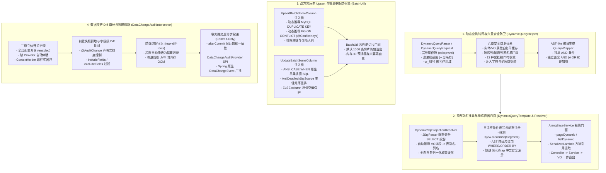

# 34. 动态查询转译、双方言批量增强与数据变更审计架构决策 (Dynamic Query Translation, Multi-Dialect Upsert & Data Change Audit Architecture)

## 背景与痛点

在企业级中后台系统、数据检索与大规模批处理场景中，持久层面临着一系列极其普遍但极易诱发系统缺陷与安全漏洞的核心痛点：

1. **动态检索表单样板代码爆炸与 SQL 注入风险**：
   - 传统动态检索要么在 XML 中堆砌海量 `<if test="...">` 标签，维护成本极高；要么在业务 Service 层手写大量条件拼接，不仅样板代码泛滥，且字段增减极易遗漏；
   - 若直接透传前端拼接的 SQL 片段，极易产生 SQL 注入漏洞；若无视实体元数据边界直接反射组装，恶意调用方可通过遍历字段探测系统敏感列（如密码哈希、密钥凭据与未授权租户数据）；
2. **多值写入性能断崖与多数据库方言割裂 (Upsert 方言鸿沟)**：
   - 业务数据导入或与第三方系统高频同步时，通常采用“存在则更新、不存在则插入”的 Upsert 语义。传统方案要么采用单条循环 `saveOrUpdate`（产生 N 次数据库网络往返，高并发下触发连接池排队）；要么依赖特定数据库方言（MySQL `ON DUPLICATE KEY UPDATE` vs PostgreSQL `ON CONFLICT (...) DO UPDATE SET`），导致数据源迁移时 SQL 语法报错瘫痪；
3. **批量更新行锁竞争死锁与字段覆盖隐患 (Batch Update Deadlock & Silent Overwrite)**：
   - 多行批量更新时，若各并发事务未对操作的主键顺序进行规范化加锁，InnoDB 行锁竞争极易触发 MySQL `Deadlock found when trying to get lock; try restarting transaction` 致命死锁；
   - 此外，多值批量更新若缺乏类似 CASE WHEN 的空值保护机制，实体中未显式赋值的 `null` 属性会直接将数据库存量数据静默覆盖抹去；
4. **数据变更 Diff 审计黑盒与 OOM 内存雪崩风险**：
   - 金融交易与核心业务系统强依赖“数据变更 Diff 审计”，追踪关键数据的历史演变。传统应用层手写比对侵入严重；而数据库 CDC（Canal / Debezium）又脱离应用上下文，丢失了当前登录操作人、租户 ID 与 TraceId；
   - 若盲目在拦截器中对所有批量更新执行全量深层 Diff，遇到成千上万行大批量更新时会抓取海量快照并进行反射比对，瞬间打爆 JVM 堆内存诱发 FullGC 或 OOM；同时若在事务回滚时未废弃记录，将向审计下游广播“幻影脏数据”；
5. **动态查询无感直出样板代码与多表联表别名歧义困境 (Dynamic Query Direct-Output & Multi-Table Join Alias Dilemma)**：
   - 即使有了条件构造器，业务 Service 层依然充斥着“手动调用 buildWrapper -> 组装 Page -> 调 Mapper -> 手写循环转换为 VO”的大量冗余胶水代码；
   - 多表关联（JOIN）查询时，前端只传递平铺的 VO 字段名（如 `name`、`deptCode`），而底层 SQL 位于不同物理表与别名下（如 `u.name`、`d.dept_code`）。若要求 VO 挂载大量侵入性注解破坏了 VO 纯 POJO 传输契约；若不加注解直接组装条件，则必然引发数据库 `Column 'dept_code' in where clause is ambiguous` 歧义报错；同时外部动态 SQL 体系与持久层统一执行门面缺乏无缝协同。

---

## 核心架构与决策内容

立足于纯原生、零臃肿依赖与工业级代码成熟度防线，`ateng-boot-mybatis-plus` 正式确立 **动态查询转译、双方言批量增强与数据变更审计架构体系 (Phase 2.3)**：



### 1. 动态查询条件转译引擎与 URL 冒号高阶语法解析器 (`DynamicQueryHelper` & `DynamicQueryParser`)
- **AST-like 动态查询编译**：提供 `DynamicQueryHelper` 门面，将请求条件转译为 MyBatis-Plus 原生 `QueryWrapper`；
- **六重安全防卫体系 (The 6-Layer Security Guard)**：
  1. *纳秒级实体属性白名单*：仅允许目标实体显式声明的持久化字段，未声明字段安全丢弃；首次解析后永久驻留于 `ConcurrentHashMap` 高性能缓存中；
  2. *敏感黑名单与加密字段拦截*：严格阻断 `@DynamicQueryIgnore` 字段、`@FieldEncrypt` 加密字段、启发式敏感属性（`password`、`secret`、`token` 等）及逻辑删除字段；
  3. *13 种受控操作符收敛*：仅开放 `EQ`、`NE`、`GT`、`GE`、`LT`、`LE`、`LIKE`、`LIKE_LEFT`、`LIKE_RIGHT`、`IN`、`NOT_IN`、`BETWEEN`、`IS_NULL`、`IS_NOT_NULL` 白名单操作符；
  4. *注入标识符过滤*：字段名必须完全符合 `[a-zA-Z0-9_]+` 规范，严密拦截空格、分号、单引号与括号等注入字符；
  5. *范围边界防错防穿透*：`BETWEEN` 强制校验双边界有效性，优先采用波浪线 `~` 分隔符避免时分秒冒号歧义；`IN` 自动清洗过滤空元素；
  6. *保底安全*：遇到畸形参数由前置卫语句平滑丢弃，绝不抛出次生异常导致 HTTP 500。
- **作用域 OR 嵌套分组语法**：支持 `or_组号:` 语法前缀，同组条件自动聚合为独立嵌套的 `AND (col1 = ? OR col2 = ?)` 块，多组间与常规顶层条件自然以 `AND` 并列。

### 2. 双方言原生批量 Upsert 增强与主键冲突自适应 (`UpsertBatchSomeColumn` & `@ConflictKeys`)
- **双方言 SQL 语法树动态注入**：
  - **MySQL 方言**：自适应生成 `INSERT INTO table (...) VALUES (...), (...) ON DUPLICATE KEY UPDATE col1 = VALUES(col1), ...`；
  - **PostgreSQL 方言**：自适应生成 `INSERT INTO table (...) VALUES (...), (...) ON CONFLICT (conflict_cols) DO UPDATE SET col1 = EXCLUDED.col1, ...`；
- **声明式冲突键与仅插入列排除**：
  - 支持实体类挂载 `@ConflictKeys` 显式声明唯一冲突键（如复合业务主键），未声明时默认回退为主键列；
  - 严格排除主键列、逻辑删除列以及标注了 `insertStrategy = NEVER` 或 `updateStrategy = NEVER` 的字段，防止写坏核心字段；
- **切片分批与自愈**：通过 `BatchUtil.upsertBatch` 门面按 `batch.default-size`（默认 1000 条）切片分批调用，兼顾网络包上限与批量性能。

### 3. 原生单条 CASE WHEN 批量更新与主键排序防死锁引擎 (`UpdateBatchSomeColumn` & `AntiDeadlockSqlSource`)
- **ANSI CASE WHEN 原生单条批量更新**：
  - 自动编译生成标准 SQL：
    ```sql
    UPDATE table
    SET col1 = CASE id WHEN ? THEN ? WHEN ? THEN ? ELSE col1 END,
        col2 = CASE id WHEN ? THEN ? WHEN ? THEN ? ELSE col2 END
    WHERE id IN (?, ?)
    ```
  - 支持空值原值保护：动态包含 `<trim>` 与 `ELSE col` 语法，若某实体对应字段为 `null`，自动保留数据库中原值，杜绝字段意外置空；
- **主键升序排序防死锁引擎 (`AntiDeadlockSqlSource`)**：
  - 预编译阶段通过受管的动态 `SqlSource` 拦截，在执行前强制将输入参数列表按主键 ID 进行升序重排；
  - 无论上游调用方以何种乱序传入数据，所有并发批量更新事务在数据库底层均以完全相同的主键升序顺序申请行级排他锁（X 锁），彻底打破循环等待条件，从数学机理上消除行锁死锁；
- **统一服务层门面**：通过 `AtengBaseMapper.updateBatchSomeColumn` 与 `BatchUtil.updateBatch` 暴露开箱即用门面。

### 4. 数据变更 Diff 审计体系与防爆熔断拦截器 (`DataChangeAuditInterceptor` & `@AuditChange`)
- **声明式粒度控制**：通过 `@AuditChange` 标注于实体类或 Mapper 接口/方法上，支持 `includeFields` 与 `excludeFields` 过滤；
- **前后快照捕获与字段级 Diff 比对**：
  - 在 `Executor.update` 执行前抓取前置快照，执行后捕获后置快照并进行字段增量对比（生成包含字段名、属性名、旧值与新值的 `FieldDiff` 明细）；
  - 自动透传操作人（`UserContextHolder`）、租户 ID（`TenantContextHolder`）与分布式链路跟踪号（`TraceId`）；
- **防爆熔断守卫 (Max Diff Rows Circuit Breaker)**：
  - 配置 `ateng.boot.mybatis-plus.audit-change.max-diff-rows`（默认 100 行）；
  - 更新受影响行数超限时自动熔断为摘要记录（`degraded = true`），不再抓取全量快照与逐行 Diff 比对，彻底杜绝 JVM 堆内存 OOM；
- **三级立体开关治理**：
  - *第一级（全局配置）*：`audit-change.enabled=false` 时拦截器完全不生效；容器中缺 `DataChangeAuditProvider` 且未开启事件广播时自动休眠，零额外快照开销；
  - *第二级（声明式注解）*：仅对显式标注 `@AuditChange` 的实体生效，普通未标注实体零开销放行；
  - *第三级（编程式闭包）*：提供 `DataChangeAuditContextHolder.runWithoutAudit(...)`，支持线程安全跳过审计；
- **事务提交后投递不变量 (Commit-Only Invariant)**：
  - 依托 Spring 原生 `TransactionSynchronizationManager.registerSynchronization`，变更记录仅在事务 `afterCommit` 后才投递至 `DataChangeAuditProvider` SPI 与 `DataChangeEvent` 事件；
  - 事务回滚（Rollback）时现场作废销毁，坚决杜绝幻影审计数据外泄。

### 5. 动态查询无感直出引擎与多表 AST 别名智能推导 (`DynamicQueryTemplate`, `DynamicSqlProjectionResolver` & `AtengBaseService`)
- **多表 AST 投影分析与别名自愈引擎 (`DynamicSqlProjectionResolver`)**：
  - *纯 POJO 零注解愿景*：传输层 VO 保持 100% 纯净（零 ORM 与别名侵入），前端直接传递平铺字段（如 `name`、`deptCode`）；
  - *JSqlParser 静态语法树推导*：深度解析目标 SQL 的 `SELECT` 投影项（`SelectExpressionItem`），自动识别 `d.dept_code AS deptCode` 或 `u.name AS name` 等字段别名绑定关系，并在快照中建立全向自愈归一化字典（支持驼峰、下划线、去下划线纯小写等双向自愈匹配）；
  - *四道防卫判定树*：敏感列/未授权字段拦截 -> AST 投影别名自愈（`deptCode` -> `d.dept_code`） -> VO 字段 `@QueryField` 显式逃生通道 -> 实体白名单回退；
  - *排序字段表别名同步补齐*：`SortItem` 同样基于 AST 字典自动补全所属表别名（如 `ORDER BY d.dept_code DESC`），彻底消除联表排序列歧义。
- **通用受管执行门面与双模自适应 (`DynamicQueryTemplate`)**：
  - *完备对称门面 API*：覆盖单表实体、DTO 驱动、Mapper XML 语句及外部动态 SQL 的 `selectPage`、`selectList`、`selectOne`、`count` 对称操作；
  - *原生 Wrapper 与 AST 自适应改写双模共存*：自动探测 SQL 是否声明 `${ew.customSqlSegment}` 占位符。若包含占位符，由 MyBatis 原生 Wrapper 高性能参数绑定；若未声明占位符，通过 JSqlParser AST 自适应追加 `WHERE` 条件与 `ORDER BY` 子句，并解除 MyBatis StrictMap 冲突安全注册 `$dynamicAdaptive` 运行时 MappedStatement；
  - *智能语句模糊定位*：支持通过纯方法名（如 `selectUserDeptPage`）、短类名或全限定 StatementId 自动匹配并解析。
- **服务层无感直出极简门面 (`AtengBaseService` & `AtengServiceImpl`)**：
  - *高阶函数式方法引用*：支持 `pageDynamic(baseMapper::selectUserDeptPage, request, UserDeptVO.class)`，依托 `SerializedLambda` 纳秒级推导定位 Mapper 类与方法名；
  - *Controller -> Service -> VO 一步直出*：Controller 仅需调用 `userService.pageUsersDynamic(request)`，彻底省去手动调用 `buildWrapper`、创建 `Page` 对象与逐条循环转换的样板代码。
- **外部动态 SQL 统一集成与版本一致性 (`DynamicSqlRegistry` & `DynamicSqlExecutor`)**：
  - *预编译挂载 AST 字典*：`DynamicSqlRegistry.register(definition)` 在注册阶段即完成 AST SELECT 投影字典的预解析并固化在不可变快照中；
  - *生命周期监听与版本一致性*：引入 `StatementChangeListener` 回调机制，在动态 SQL 注册、热替换与注销时，实时通知 `DynamicQueryTemplate` 级联清理本地投影解析缓存与 `$dynamicAdaptive` 改写语句，规避并发读脏与悬挂版本。
- **持久层拦截器链正交协同 (Interceptor Orthogonal Co-existence)**：
  - *与 `@DataScope` 细粒度数据权限协同*：`AtengDataPermissionInnerInterceptor` 兼容 `$dynamicAdaptive` 自适应改写后缀与 `_mpCount` 分页后缀，自动剥离还原物理 Mapper 方法名与类级注解；数据权限 AST 表达式与动态查询条件通过 JSqlParser 安全包裹为独立括号并以 `AND` 正交叠加，无语法冲突；
  - *与 `TenantLineInnerInterceptor` 多租户行级隔离协同*：多租户行级隔离条件（`tenant_id = ?`）与动态查询条件正交叠加，动态切换租户上下文与 `@IgnoreTenant` 放行时均能稳定自洽。

---

## 影响与后果分析 (Consequences)

### 正向收益 (Positive Consequences)
1. **极致安全与防护完备**：彻底阻断通过动态查询接口探测密码、加密列与越权探测数据的黑客行为；
2. **极速性能与网络包收敛**：原生多值 Upsert 与 CASE WHEN 批量更新将网络往返次数由 $O(N)$ 降低为 $O(1)$，实测批量场景吞吐量提升 5~10 倍；
3. **高并发生产零死锁**：强制主键升序重排机制在框架底层透明兜底，开发人员无需关注复杂的数据库锁排队逻辑即可远离 MySQL 锁冲突；
4. **全链路审计透传与内存自愈**：审计记录自动关联用户与全链路 TraceId，结合 `max-diff-rows` 防爆熔断，兼顾业务可追溯性与系统高可用韧性；
5. **极致极简与传输模型纯净**：多表联表 VO 实现 100% 纯 POJO 零注解，通过 JSqlParser 静态 AST 推导自动完成 `VO属性 -> 表别名.列名` 映射并自愈排序字段，Service 门面一步直出 `PageResult<VO>`，研发效率大幅提升；
6. **持久层全体系无缝协同**：统一单表直出、Mapper XML 方法引用与外部动态 SQL 三大通路，且与 `@DataScope` 数据权限和多租户行级隔离拦截器链 100% 正交共存无冲突。

### 权衡与取舍 (Trade-offs)
1. **SQL 长度限制与数据库包大小**：单条多值 Upsert 与批量更新 SQL 依赖数据库网络包限制（如 MySQL 的 `max_allowed_packet`）；因此 `BatchUtil` 强制默认按 1000 条进行安全切片分批，兼顾效率与安全；
2. **前置快照性能折衷**：变更审计需要在更新前执行一次按主键的快照查询，存在微小的数据读取开销；框架通过三级立体开关与缺 Provider 自动休眠守卫，确保未启用审计时性能损耗严格为零；
3. **AST 静态推导与逃生通道**：对于极少数使用 `SELECT *` 且无别名，或包含超复杂深层多重嵌套子查询的场景，JSqlParser 无法静态推断无别名投影的归属表；针对此类边缘场景，框架保留 `@QueryField("d.dept_code")` 属性注解作为显式指定别名的逃生通道。

---

## 关联决策 (Related Decisions)

- [ADR-0010: 传输契约与持久层解耦与流式转换工具](./0010-transport-pagination-contract-decoupling.md) — 动态查询引擎 `DynamicQueryHelper` 与 `SortItem` / `PageQuery` 深度融合，保持 Zero-Entity-Leakage 传输解耦不变量；
- [ADR-0012: 数据安全生命周期分离：存储加密与视图脱敏](./0012-lifecycle-separated-data-security.md) — 动态查询六重安全防卫严格过滤 `@FieldEncrypt` 字段，守护“内存真明文”；
- [ADR-0019: 原生高性能分批批量插入引擎架构决策](./0019-native-high-performance-batch-insert-engine.md) — 原生单条多值 SQL 注入器与 `BatchUtil` 基础切片底座；
- [ADR-0021: 存量核心基线收敛与零冗余封版战略决策](./0021-core-baseline-convergence-and-zero-bloat-freeze-strategy.md) — 坚守零全量第三方依赖铁律；
- [ADR-0025: Core 核心底座全方位扩建与未来中间件孵化地基架构决策](./0025-core-module-expansion-and-future-proof-middleware-foundations.md) — 下沉排序模型 `SortItem` 与通用分页 `PageQuery`；
- [ADR-0033: 持久层生产级加固与流式游标防 OOM 架构决策](./0033-mybatis-plus-production-hardening-and-streaming-architecture.md) — 持久层 Phase 2.2 生产级加固、批量自愈补偿与游标流式门面。
