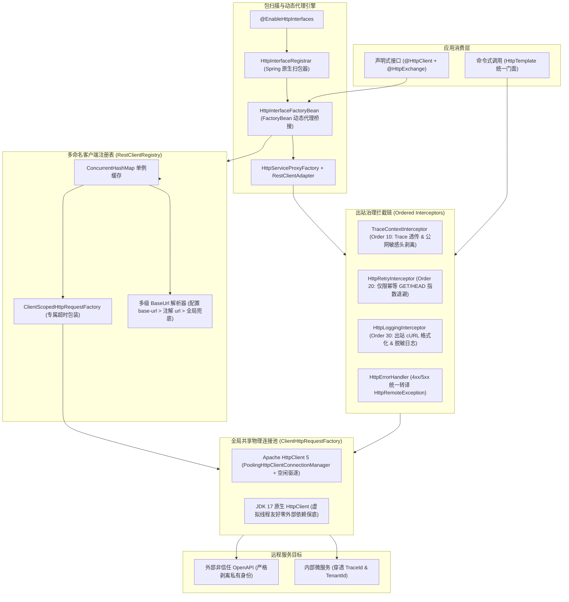

# 35. 声明式与命令式双模 HTTP 通信底座与多命名客户端架构决策 (Declarative & Imperative Dual-Mode HTTP Client Architecture)

## 状态
`Accepted`

---

## 背景与痛点 (Context & Problem Statement)

在 Spring Boot 3 与分布式微服务演进中，远程 HTTP 通信是不可或缺的底层基础设施。然而在传统研发实践与开源生态中，普遍存在以下严重痛点：

1. **官方声明式包扫描机制缺位 (Missing Spring Boot Declarative Scanner)**：
   Spring 6 正式引入了优雅的原生 `@HttpExchange` 与 `HttpServiceProxyFactory` 声明式客户端体系，但 Spring Boot 3 官方并未配套提供自动包扫描与装配注解（官方计划的 `@ImportHttpServices` 推迟至 Spring 7 / Spring Boot 4）。这导致开发者若想使用声明式接口，被迫手动为每一个客户端编写样板代码装配动态代理，或倒退回 OpenFeign、Retrofit 等重型第三方组件。
2. **第三方依赖臃肿与跨框架类冲突 (Dependency Bloat & Version Conflicts)**：
   为获得声明式或命令式调用能力，过往应用往往引入 `spring-cloud-starter-openfeign`、`okhttp`、`retrofit` 以及各类非标全量工具包（如 `hutool-http`）。这些依赖携带庞大的传递性依赖树，导致工程包体积急剧膨胀，且与 Spring 6 原生序列化和虚拟线程（Virtual Threads）产生割裂，甚至引发高危 CVE 漏洞。
3. **物理连接池滥用与资源枯竭 (Connection Pool Proliferation & FD Exhaustion)**：
   缺乏统一的底层连接池治理时，业务代码极易针对不同的外部三方或微服务反复 new 出独立的 `HttpClient` 或 `WebClient`。每个客户端实例维护各自的连接池与后台驱逐线程，在高并发场景下极易导致宿主机文件描述符（FD）耗尽、本地端口耗尽与连接池死锁。
4. **全链路上下文断流与公网敏感数据泄漏 (Context Truncation vs. Sensitive Header Leakage)**：
   内部微服务协同需要出站透明穿透 MDC `traceId`、多租户 `tenantId` 与操作人 `userId`；然而，向外部非信任域（如微信支付、支付宝、外部 SaaS 等 OpenAPI）发起调用时，若无严格的非信任域剥离防线，内部敏感租户与用户标识极易被原样泄漏至公网。
5. **重试失控与非幂等业务风险 (Unsafe Retries & Cascading Failures)**：
   网络偶发抖动时，缺乏弹性重试机制会导致调用失败率飙升；但若盲目配置全量重试，对 POST/PUT 等非幂等动词执行重试极易造成重复扣款、重复建单等严重资损事故。

---

## 决策内容与架构拓扑 (Decision & Architecture)

基于纯原生、零臃肿与防御性设计原则，我们决定依托 Spring 6 原生 `RestClient`、`HttpServiceProxyFactory` 与 JDK 17 标准库，自研构建一体化双模 HTTP 客户端 Starter：`ateng-boot-http`。

### 1. 声明式接口轻量扫描与动态代理生命周期
- 研发轻量 `@EnableHttpInterfaces` 动态包扫描注解，依托 Spring 原生 `ClassPathScanningCandidateComponentProvider` 扫描候选包路径，仅扫描顶级接口（严格过滤 `@interface` 注解自身）；
- 解析 `@HttpClient` 元数据（支持元注解派生），利用 `BeanDefinitionBuilder` 注册 `HttpInterfaceFactoryBean`；
- 在 Bean 实例化期，桥接 `RestClientRegistry` 提取或定制专属 `RestClient`，通过 Spring 6 原生 `RestClientAdapter` 与 `HttpServiceProxyFactory` 构建强类型动态代理。

### 2. 多命名客户端注册表 (`RestClientRegistry`) 与物理连接池共享
- **全局唯一连接池**：全应用统一共享一个物理 `ClientHttpRequestFactory` 单例，严禁重复创建底层连接池；
- **单例缓存与并发安全**：以 `clientName` 为键维护 `ConcurrentHashMap<String, RestClient>` 实例缓存，相同客户端名称共享同一个 `RestClient` 实例；
- **多级 BaseUrl 动态融合**：
  $$\text{Target BaseUrl} = \text{Config}(\text{ateng.boot.http.clients.<name>.base-url}) \succ \text{Annotation}(@\text{HttpClient.url}) \succ \text{Global Default}$$
  全面支持 `${...}` 环境变量与占位符动态解析；
- **专属超时隔离**：通过 `ClientScopedHttpRequestFactory` 包装物理请求工厂，采用 `previousTimeout` 现场还原模式为特定客户端安全附加独立的 `connect-timeout` 与 `read-timeout`，确保单客户端阻塞绝不拖垮其他客户端。

### 3. 四维全链路上下文透传与非信任域安全隔离
- **全链路闭环**：通过 `TraceContextInterceptor`（Order 10）自动从 MDC 提取 `traceId` 注入出站头（缺省自动调用 `IdUtil.fastSimpleUUID()` 注入），保障跨进程调用链路不断流；
- **域隔离双轨判定**：依据目标 URI 最长前缀自适应匹配（Longest Prefix Match）与单次请求显式声明：
  - 内部微服务（`propagate-context: true`）：注入 `X-Tenant-Id`、`X-User-Id` 与 `X-Ignore-Tenant`；
  - 外部非信任域（`propagate-context: false`）：强制出站前 100% 物理剥离敏感头，坚决杜绝内网数据泄漏。

### 4. 幂等弹性指数退避重试安全防线
- 出站重试拦截器（`HttpRetryInterceptor`，Order 20）深度复用 Core 模块 `RetryUtil` 函数式引擎；
- **动词白名单铁律**：默认仅对 `GET` 与 `HEAD` 执行重试，**严禁重试非幂等操作**；
- 遭遇 502/503/504 触发重试时，显式关闭前一轮失败响应流（`response.close()`），防止连接堆积导致连接池泄漏；
- 默认开启 `jitter = true` 随机抖动，避免重试流量共振打垮下游刚恢复的服务。

### 5. 结构化脱敏日志与统一异常转译体系
- `HttpLoggingInterceptor`（Order 30）将请求格式化为可直接复制调试的标准 cURL 片段，自动对 `Authorization`、`Cookie` 等敏感头执行星号掩码脱敏，大载荷安全截断防爆内存；
- `HttpErrorHandler` 拦截 4xx 与 5xx 状态码并统一转译为 `HttpRemoteException`（继承 `BusinessException`），100% 保持原始因果链并映射清晰语义化错误码（`HttpResultCode`）。

---

## 核心设计不变量 (Key Invariants)

1. **零第三方重型依赖不变量 (Zero-Bloat Invariant)**：
   100% 依托 Spring 6 与 JDK 17 原生能力，杜绝引入任何第三方客户端框架（Feign/Retrofit）与非标工具包。
2. **全局物理连接池唯一共享不变量 (Global Connection Pool Invariant)**：
   全应用无论定义多少个命令式或声明式客户端，必须且只能共享同一个底座 `ClientHttpRequestFactory` 物理连接池。
3. **外部公网敏感身份零泄漏不变量 (Zero-Secret Leakage Invariant)**：
   向配置了 `propagate-context: false` 的外部非信任域发起请求时，必须在出站前严格剥离所有内部租户与用户信息。
4. **幂等安全重试不变量 (Idempotent-Only Retry Invariant)**：
   指数退避重试默认且只能针对安全的幂等动词（GET/HEAD），严禁盲目重试非幂等调用。
5. **单例配置严格只读不变量 (Configuration Immutability Invariant)**：
   单例服务在运行期严禁反向突变外部传入的 `@ConfigurationProperties` 对象，杜绝线程竞争与隐式副作用。
6. **虚拟线程高并发零 Pinning 不变量 (Virtual Threads Resilience Invariant)**：
   在 Java 21+ 下探测拉起 500+ 虚拟线程并发压测时，连接池必须具备无锁高吞吐表现，零死锁、零载体线程钉死。

---

## 后果与影响 (Consequences)

### 正面收益 (Positive)
- **研发体验跃升**：仅需 `@EnableHttpInterfaces` 与接口注解即可声明式编程，极大降低微服务与第三方 OpenAPI 对接样板代码；
- **资源利用率最优化**：全局物理连接池统一管理与空闲驱逐，彻底消除连接池泛滥与 FD/端口耗尽隐患；
- **出站安全与治理可控**：全链路 Trace 穿透、外部敏感头剥离、脱敏日志与幂等重试由底座统一拦截接管，业务代码无需重复编写脆弱的防御逻辑；
- **平滑演进与多 JDK 兼容**：生产推荐 HttpClient 5，开发测试或精简容器平滑降级 JDK 原生 Client，同时自适应支持 Java 21+ 虚拟线程。

### 负面成本与限制 (Trade-offs)
- **JDK 17 下建联超时限制**：在 JDK 17 原生 Client 引擎下，单次请求仅支持读取响应超时覆盖，TCP 建联超时受限于连接池初始化配置；生产环境推荐优先使用 Apache HttpClient 5 获得全生命周期精细化控制。
