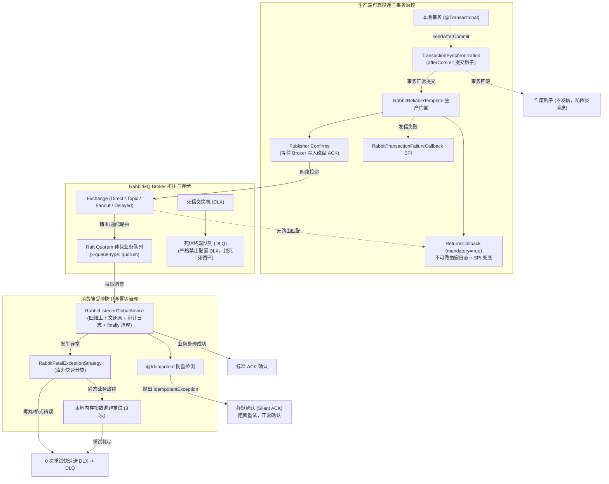

# 37. RabbitMQ 生产级路由与可靠投递底座架构决策 (RabbitMQ Production Routing, Reliable Delivery & Topology Governance Architecture)

## 状态
`Accepted`

---

## 背景与痛点 (Context & Problem Statement)

在分布式系统与现代微服务架构中，RabbitMQ 依托标准 AMQP 协议与灵活的 Exchange / Queue / Binding 拓扑体系，承载着金融支付回调、状态机履约信令、定时延迟触发与系统跨域削峰等关键业务高地。然而，直接使用原生或简单封装的 RabbitMQ 客户端在工业级生产环境中普遍面临以下严峻挑战与深水区陷阱：

1. **事务“幽灵消息”与资损黑洞 (Ghost Messages & Inconsistent State)**：
   业务在执行数据库事务（如扣款、创建订单）时调用发信。若本地事务因校验异常或主键冲突回滚，而物理网络发信已先发出，导致下游消费了数据库中根本不存在的数据（幽灵消息）；反之，若先提事务再网络发信，发信失败又缺乏兜底补偿，引发数据单向丢失。
2. **静默丢信与不可路由盲区 (Silent Drop & Unroutable Disasters)**：
   默认异步发信时，生产者并不等待 Broker 写入磁盘确认；当交换机不存在、路由键拼写错误或队列未绑定时，AMQP 默认将消息静默丢弃（Silent Drop），运维无感知，链路无法追溯。
3. **“毒丸消息”死循环风暴与主队列阻塞 (Poison Pill Crash Loop)**：
   当非法 JSON 格式或破坏 JSR-303 格式约束的报文进入消费端时，反序列化或校验立即抛错。若容器配置了无脑 `requeue=true`，消息会被反复重新投递、再次抛错，瞬间消耗 100% CPU 并引发主队列雪崩。
4. **幂等冲突引发重试风暴 (Idempotency Conflicts Triggering Retries)**：
   当上游网络抖动导致重复投递时，防重幂等组件拦截并抛出异常。若缺乏针对幂等语义的特殊识别，容器会将其当做普通消费失败执行指数退避重试甚至推向死信队列，引发不必要的告警与处理开销。
5. **死信队列互咬死循环 (Terminal DLQ Invariant Violation)**：
   部分团队在声明死信队列（DLQ）时错误复制了业务队列的参数，为 DLQ 也配置了 `x-dead-letter-exchange`。当死信队列内的异常无法处理时，死信再次流转，在队列间形成互咬死循环，导致磁盘急剧膨胀。
6. **微服务类路径耦合与反序列化漏洞 (Type-Id Coupling & RCE CVEs)**：
   默认 Spring AMQP 序列化器常在 Message Header 写入 `__TypeId__`（类的全限定名）。跨微服务边界消费时，若包名或 DTO 命名不一致，直接抛出 `ClassNotFoundException`；若允许自由反序列化任意类，又面临 RCE 反序列化攻击风险。
7. **拓扑演进与只读运维安全 (Quorum Migration & Read-Only Safety)**：
   RabbitMQ 4.0 逐步废弃传统镜像队列（Mirrored Queues）转向 Raft Quorum 仲裁队列，业务缺乏统一标准化声明脚手架；而在生产环境配置了只读运维账号时，`RabbitAdmin` 启动盲目向 Broker 声明建队直接导致 403 启动崩溃。

---

## 决策内容与架构拓扑 (Decision & Architecture)

为彻底攻克上述深水区缺陷，`ateng-boot-rabbitmq` Starter 遵循**纯原生、零臃肿依赖、四维上下文透明贯通、零丢信双重确认（Confirms/Returns）、防死循环受控重试与死信终点隔离（DLX/DLQ）、事务提交感知（sendAfterCommit + 补偿 SPI）、Quorum 现代高可用、云原生平滑下线、100% 离线自洽**的工业级设计原则，确立以下核心架构体系：

### 1. 事务感知发信与防幽灵消息 (`sendAfterCommit`)
- 在当前存在活跃事务（`TransactionSynchronizationManager.isActualTransactionActive()`）时，将发信操作注册至 Spring `TransactionSynchronization.afterCommit` 钩子；
- **回滚绝对零发信**：若事务因校验、数据库错误或业务主动回滚，物理网络发信绝不触发，彻底消灭“幽灵消息”；
- **提交后发信失败补偿网**：若事务提交后发信因瞬态网络断开失败，除记录高优先级宏日志 `[MQ-TRANSACTION-POST-COMMIT-FAILED]` 外，同步回调 `RabbitTransactionFailureCallback` SPI，供企业落库重发。

### 2. 双重确认保障与零丢信体系 (Confirms & Returns)
- **Publisher Confirms**：门面方法 `sendReliable(...)` / `sendReliableAsync(...)` 注入 `CorrelationData`，同步等待 Broker 磁盘落盘 ACK；NACK 或超时自动转译为框架受管的语义化 `MessageDeliveryException`；
- **Mandatory Returns**：开启 `rabbitTemplate.setMandatory(true)`，装配全局 `ReturnsCallback`。当消息未命中任何队列被 Broker 退回时，打印格式化告警 `[MQ-RETURNS]` 并触发 `RabbitUnroutableMessageCallback` SPI。

### 3. 反序列化泛型推断与跨微服务解耦 (`TypePrecedence.INFERRED`)
- 装配纯净安全 Jackson 消息转换器，强制设置 `TypePrecedence.INFERRED` 与 `alwaysConvertToInferredType(true)`；
- 消费端完全依据 `@RabbitListener` 方法签名声明的 DTO 类型进行动态泛型推断，彻底剥离对生产者类路径和 `__TypeId__` 的耦合，杜绝 `@class` 反序列化安全漏洞。

### 4. 消费端环绕拦截与幂等静默确认 (`RabbitListenerGlobalAdvice`)
- **四维上下文全链路激活与现场清理**：入站自动提取消息头中的 `X-Trace-Id`、`X-Tenant-Id`、`X-User-Id` 与 `X-Ignore-Tenant` 激活本地上下文与 MDC，方法执行完毕后在 `finally` 块中确定性清理；
- **幂等静默确认 (Silent ACK)**：当检测到业务抛出 `IdempotentException` 时，拦截器判定为重复幂等触发，记录轻量宏日志并阻断异常上抛，引导 AMQP 容器平滑执行标准 ACK，杜绝重复投递风暴。

### 5. 毒丸受控隔离与死信终点不变量 (Fatal Strategy & Terminal DLQ)
- 装配 `RabbitFatalExceptionStrategy`：针对反序列化失败（`MessageConversionException`）、格式校验违规（`MethodArgumentNotValidException` / `ConstraintViolationException`）以及非法参数，判定为致命不可自愈的“毒丸消息”，0 次重试快速推入死信队列；
- **死信终点不变量（Terminal Invariant）**：`RabbitTopologyBuilder` 在拓扑声明阶段强制断言死信队列名称不得为业务队列本身、死信队列不得再挂载死信交换机，从拓扑根源封死死信互咬死循环。

### 6. 声明式拓扑构建与只读账号安全 (`RabbitTopologyBuilder`)
- 提供流式 Fluent API 链式声明 Direct、Topic、Fanout 及 Delayed 插件交换机，一键声明 Raft Quorum 高可用仲裁队列（`.quorum()`）与单活独占消费者（`.singleActiveConsumer()`）；
- 联动 `ateng.boot.rabbitmq.topology.auto-declare` 开关：当置为 `false` 时，受控关闭 `RabbitAdmin.autoStartup`，杜绝只读账号在生产环境启动建队导致 403 崩溃。

---

## 后果与权衡 (Consequences & Trade-offs)

### 正向收益 (Positive Consequences)
1. **全链路零丢信与零幽灵**：通过 Publisher Confirm 等待、Returns SPI 告警与 `sendAfterCommit` 事务感知，构建了生产级严密的投递安全网。
2. **微服务契约松耦合**：泛型推断反序列化消除了微服务间 DTO 包名同构的硬性要求，防御了 `@class` 反序列化攻击。
3. **弹性抗雪崩**：本地指数退避重试隔离瞬态故障，毒丸快速进死信，幂等静默确认阻断重发风暴，保障集群整体吞吐稳定。
4. **运维排障极简透明**：`[MQ-SEND]`、`[MQ-CONSUME]`、`[MQ-RETURNS]` 宏日志与四维 TraceId 深度结合，配合 `RabbitDeadLetterHelper` 使死信排障一目了然。
5. **100% 离线秒级自洽**：通过 `TestRabbitTemplate` 与 Mockito，脱离对外部网络与 Docker 容器的硬依赖，实现云端 CI/CD 极速反馈。

### 妥协与成本 (Trade-offs & Mitigations)
1. **同步 Confirm 吞吐开销**：`sendReliable` 阻塞等待 Broker ACK 会带来微秒/毫秒级等待。对于高并发极致吞吐场景，推荐调用非阻塞的 `sendReliableAsync` 配合 CompletableFuture 响应式处理。
2. **TTL 延迟队列存在队头阻塞 (Head-of-Line Blocking)**：纯原生 TTL+DLX 双模方案仅适用于固定时长的延迟队列。对于每条消息延迟时间各不相同的多变场景，建议开启服务端的 `rabbitmq_delayed_message_exchange` 插件。
