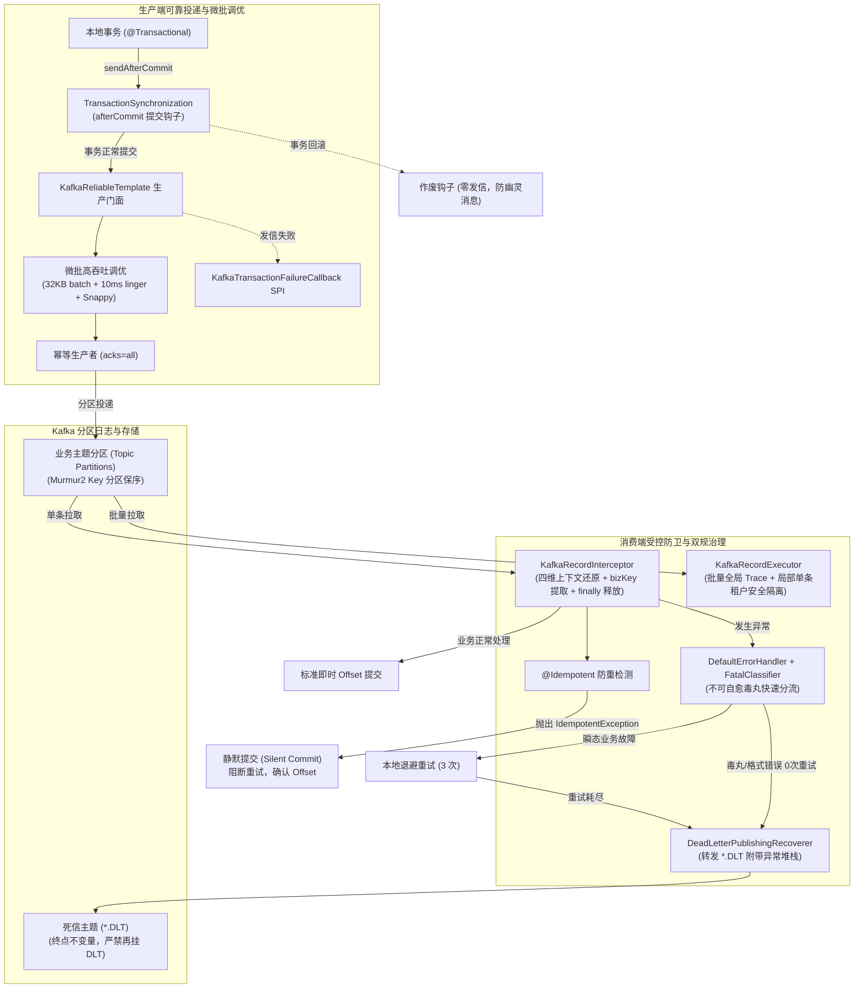

# 38. Kafka 高性能流批处理与 Offset 治理底座架构决策 (Kafka High-Throughput Streaming, Offset Governance & Poison-Pill Defense Architecture)

## 状态
`Accepted`

---

## 背景与痛点 (Context & Problem Statement)

在分布式大数据生态、行为日志审计、高频时序流处理与高并发事件驱动架构中，Kafka 凭借其底层追加日志（Append-Only Log）、分区并行扩展与拉取（Poll）机制，成为支撑百万级 QPS 消息流转的核心基础设施。然而，在真实生产落地与高并发分布式场景下，直接使用原生或未经生产调优的 Kafka 客户端面临一系列严峻挑战与深水区隐患：

1. **默认低效单条即发与网络吞吐瓶颈 (Low Throughput & Default Unoptimized Producer)**：
   Kafka 原生生产端默认参数偏向保守（如 `batch.size=16KB`, `linger.ms=0`, `compression.type=none`），消息单条即发，不仅网络系统调用极其频繁，而且无法发挥 Kafka 动态微批聚合与压缩的核心性能优势。
2. **事务“幽灵消息”与资损隐患 (Ghost Messages & Inconsistent State)**：
   当业务在执行本地数据库事务（如订单创建、用户扣款）时，若发信操作直接嵌入事务体内，一旦本地数据库因主键冲突或业务校验回滚，网络消息却已先一步投递，下游消费了数据库中不存在的“幽灵数据”；反之，若在事务提交后直接发信，一旦网络抖动发信失败又缺乏补偿安全网。
3. **“毒丸消息”死循环崩溃与监听器容器瘫痪 (Poison-Pill Crash Loops)**：
   当非法 JSON 格式或破坏 JSR-303 格式约束的畸形报文进入 Kafka 分区时，反序列化器直接抛出异常。若缺乏错误隔离机制，Spring Kafka 监听器容器将反复拉取该分区、反复崩溃并重启，CPU 飙升 100%，造成该分区彻底卡死。
4. **批量拉取下的多租户与链路追踪串门 (Batch Context Pollution & Tenant Leakage)**：
   在启用高吞吐批量监听（Batch Listener）时，一次 Poll 拉取的数百条消息可能来源于不同租户甚至不同分布式调用链。若缺乏严格的局部上下文隔离机制，极易导致线程内的 MDC `traceId` 与 `tenantId` 发生交叉污染与脏读串门。
5. **微服务类路径强耦合与反序列化漏洞 (TypeId Tight-Coupling & ClassNotFoundException)**：
   默认序列化器常在 Header 写入发送方全类名（`__TypeId__`）。跨微服务边界消费时，若包名或 DTO 命名不一致，直接抛出 `ClassNotFoundException` 并导致消费容器反复崩溃。
6. **重平衡抖动与粗暴停机丢信 (Rebalance Storms & Abrupt Shutdown)**：
   在 K8s 容器频繁滚动发布或扩缩容时，默认 Eager 重平衡策略会触发全局 STW 式业务暂停；若缺乏确定性的优雅停机缓冲，在途处理的消息可能来不及提交 Offset，导致服务重启后大面积重复消费。

---

## 决策内容与架构拓扑 (Decision & Architecture)

为彻底解决上述深水区缺陷，`ateng-boot-kafka` Starter 遵循**纯原生、零臃肿依赖、四维上下文透明贯通、高吞吐微批预调优、事务提交感知（sendAfterCommit + 补偿 SPI）、严格即时提交（AckMode.RECORD / MANUAL_IMMEDIATE）、不可自愈毒丸快速隔离至死信 Topic（*.DLT）、微服务推断反序列化解耦、批量消费多租户安全执行（KafkaRecordExecutor）、云原生协作重平衡与 10 秒优雅停机、100% 离线自洽**的工业级设计原则，确立以下核心架构体系：

### 1. 生产端高可靠与高吞吐调优体系
1. **高吞吐微批参数开箱即用**：通过 `DefaultKafkaProducerFactoryCustomizer` 预设高可靠高吞吐生产基线：`acks=all`, `enable.idempotence=true`, `linger.ms=10`, `batch.size=32KB`, `compression.type=snappy`，兼顾消息零丢失与高吞吐网络聚合；
2. **事务防幽灵发信与补偿机制**：`KafkaReliableTemplate.sendAfterCommit(topic, key, payload)` 在当前活动事务成功提交后再执行物理发信；发信失败触发高危告警并回调 `KafkaTransactionFailureCallback` SPI 允许企业记录本地补偿表；
3. **超大报文前置防御 (Fail-Fast)**：配置 `max-payload-size`（默认 1MB），发信前卫语句校验报文大小，超限立即拦截，防止打爆 Broker 内存。

### 2. 消费端受控防卫与死信隔离 (`*.DLT`)
1. **反序列化崩溃防卫**：消费端使用 `ErrorHandlingDeserializer` 包裹 `JsonUtil` 序列化器，非法报文不导致监听器崩溃重启，安全封装异常交由错误处理器处理；
2. **不可自愈毒丸快速送 DLT**：整合 Spring Kafka `DefaultErrorHandler` 与 Core 模块 `FatalExceptionClassifier`，反序列化与参数校验失败执行 0 次重试，通过 `DeadLetterPublishingRecoverer` 快速转移至 `${topic}.DLT`；
3. **DLT 终点不变量 (Terminal Invariant)**：`.DLT` 死信消费者发生异常仅记录日志与报警，坚决禁止二次重试，彻底封死队列间互咬死循环。

### 3. 双规监听模式与多租户上下文隔离
1. **双容器工厂正交共存**：装配 `kafkaListenerContainerFactory`（单条监听模式）与 `batchKafkaListenerContainerFactory`（批量监听模式，`batchListener=true`）；
2. **单条消费拦截器**：`KafkaRecordInterceptor` 在消费前提取消息头中的 UTF-8 字符串，激活四维上下文并提取 `bizKey`，消费后在 `finally` 严格清理现场并输出 `[MQ-CONSUME]` 结构化日志；
3. **批量安全执行器 (`KafkaRecordExecutor`)**：批次分配全局 `Batch-TraceId`，提供 `runInContext` 与 `processBatchSafely` 供业务遍历时安全绑定单条租户与链路，实现批处理容错与多租户零串门。

### 4. 微服务解耦与幂等静默确认
1. **推断类型优先**：生产端不写入 `__TypeId__`；消费端直接依据方法入参类型（如 `void onMessage(OrderVO vo)`）推断反序列化，解耦微服务物理包名；
2. **泛型精确提取**：利用反射提取 `ParameterizedType` 深度构造泛型类型，杜绝粗暴推断为 `List<LinkedHashMap>`；
3. **幂等静默确认**：业务消费方法标注 `@Idempotent` 发生重复投递时，捕获 `IdempotentException`，记录 `[MQ-IDEMPOTENT-DUPLICATE]` 警告并安全提交 Offset，阻断重试。

### 5. 云原生弹性治理与 100% 离线自洽
1. **渐进式协作重平衡与优雅停机**：推荐 `CooperativeStickyAssignor` 消除全局 STW 暂停；容器配置 `shutdownTimeout=10s`，确保停机时在途消息处理完毕并提交 Offset；
2. **虚拟线程与 Micrometer 适配**：探测到 JDK 21+ 虚拟线程自动适配执行器；探测到 Micrometer 自动开启 Observation 指标收集；
3. **100% 离线自洽测试**：模块单测与 1:1 Sample 强制采用 `@EmbeddedKafka` 嵌入式集群，纯内存离线毫秒级全绿。

---

## 后果与权衡 (Consequences & Trade-offs)

### 正向收益
1. **极致高吞吐与资源节省**：微批聚合、Snappy 压缩与虚拟线程调度，大幅降低网络系统调用与高并发 OS 线程占用；
2. **业务最终一致性有保障**：事务防幽灵发信与失败补偿网彻底消除资损黑洞；
3. **消费稳定性与防雪崩**：毒丸 0 次重试进 DLT、幂等静默确认、CooperativeStickyAssignor 与优雅停机，杜绝死循环与重平衡风暴；
4. **多租户安全自洽**：`KafkaRecordExecutor` 彻底攻克批量拉取模式下的多租户串门业界难题；
5. **秒级 CI/CD 验证**：纯内存嵌入式单测，摆脱外部 Docker 依赖，完全符合敏捷交付标准。

### 妥协与规约
1. **延迟消息边界收敛**：Kafka 原生无延迟消息机制，框架坚决不引入脆弱的多 Topic 轮询伪轮子，延迟诉求需明确引导至 `rabbitmq` / `redis` / `rocketmq`；
2. **Topic 自动创建权限**：生产受限只读账号需将 `ateng.boot.kafka.auto-create-topics` 设为 `false`，改由运维提前在 Broker 预置分区拓扑。
