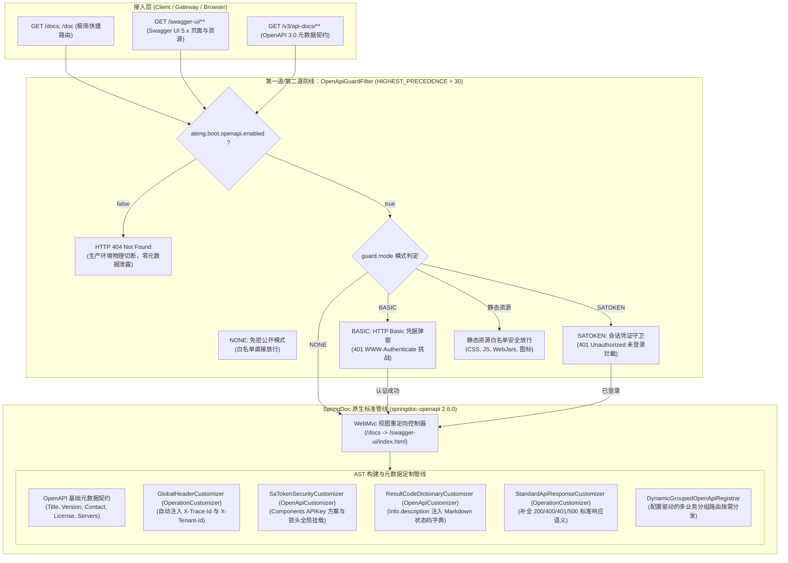

# 41. 纯原生 SpringDoc 架构选型与接口文档生产治理防护决策 (Pure SpringDoc OpenAPI and Production Guard Architecture)

## 背景与痛点

在现代微服务与企业级中后台系统研发中，RESTful 接口契约文档（OpenAPI 3.0 / Swagger）是前后端协同、第三方系统集成与客户端 SDK 自动生成的核心底座。然而，既有主流开源实践在生产就绪度、依赖健康度与安全防护上面临四大痛点：

1. **国内传统 Knife4j Starter 停更腐烂与类冲突风险 (Knife4j Stagnation & Classpath Hell)**：
   国内广泛采用的 `knife4j-openapi3-jakarta-spring-boot-starter` 自 2024 年 1 月发布 4.5.0 后已停更超过 2 年半。其硬编码绑定的旧版 SpringDoc 传递依赖在 Spring Boot 3.3.x 及未来 3.4/4.0 环境下频繁触发路径匹配失效、分组 NPE 及依赖版本冲突；社区个人 fork 存在供应链安全隐患与维护中断风险；
2. **生产环境接口元数据严重泄露与权限失控 (Production Exposure & Unauthenticated Scraping)**：
   接口文档与元数据端点（`/swagger-ui/**`、`/v3/api-docs/**`）若在生产环境意外暴露，将导致整个系统的接口拓扑、参数模型、数据结构被黑客或恶意爬虫一览无余。传统方案缺乏防御纵深——要么粗暴全开，要么全关，无法满足“生产仅限授权内网人员/运维排障调试”的灵活管控诉求；
3. **Controller 层通用标头重复样板代码膨胀 (Boilerplate Header Annotations)**：
   全链路追踪标头（`X-Trace-Id`）、多租户隔离标头（`X-Tenant-Id`）及分布式会话 Token（如 `satoken`）属于跨切面通用请求头。若要求业务开发者在每一个 Controller 方法上手动标注 `@Parameter`，样板代码极易遗漏且破坏业务纯净性；
4. **统一响应契约模型失真与“伪 RPC 剥壳”违背显式强类型原则 (Contract Distortion & Schema Inconsistency)**：
   部分方案为了追求文档简洁，试图通过反射黑盒剥除外层 `Result<T>` 统一包装外壳。这直接破坏了 HTTP 真实网络响应报文的一致性，严重违背项目 [ADR-0002](./0002-explicit-result-contract-no-response-body-advice.md) 确立的“显式契约、所见即所得”铁律，导致前端依据 OpenAPI JSON 自动生成 TypeScript/Java SDK 时反序列化全面崩溃。

---

## 核心架构与决策内容

经由架构推演与全面选型评估，正式确立 **“纯原生 SpringDoc 架构与双层生产防御纵深”** 方案：

### 1. 官方原生纯净内核 (Pure SpringDoc Official Baseline)
- 彻底抛弃停更的 Knife4j 外部 Java 依赖，全面拥抱 **SpringDoc 官方原生生态 (`springdoc-openapi-starter-webmvc-ui:2.6.0` + Swagger UI 5.x)**；
- 紧跟 Spring Boot 官方版本演进，BOM 统一纳管版本，零冗余第三方封装，根除类冲突与未来升级隐患。

### 2. 双层生产防御纵深 (Defense-in-Depth Security Guard)
- **第一层（物理切断，零内存开销）**：
  配置 `ateng.boot.openapi.enabled = false` 时彻底卸载 OpenAPI 所有 Bean，文档页面及 `/v3/api-docs/**` 元数据接口直接响应原生 HTTP 404，从物理根源杜绝信息泄露；
- **第二层（运行时访问凭证守卫，`OpenApiGuardFilter`）**：
  在文档启用状态下，提供三模安全守卫（`guard.mode = NONE | BASIC | SATOKEN`）：
  - `NONE`：默认免密模式，适合本地与开发环境；
  - `BASIC`：利用标准 HTTP 401 `WWW-Authenticate: Basic` 响应头触发浏览器原生登录弹窗，零框架外部依赖，提供高强度内网免密/口令防护；
  - `SATOKEN`：弱依赖联动 Sa-Token 鉴权中心，仅允许内网已登录用户会话查阅。静态前端资源（CSS、JS、WebJars）白名单安全放行，保障弹窗与样式加载不受死锁阻断。

### 3. 全局标头切面与 Sa-Token 锁头鉴权自动集成
- `GlobalHeaderCustomizer` 实现 `OperationCustomizer`：在 AST 构建期自动向每个 Operation 追加 `X-Trace-Id`（非必填，全链路追踪）与 `X-Tenant-Id`（非必填，多租户），支持配置开关与防重排重；
- `SaTokenSecurityCustomizer` 实现 `OpenApiCustomizer`：弱依赖感知 Sa-Token，动态解析 `tokenName` 并向 `Components.securitySchemes` 注册 `APIKEY in HEADER` 认证方案，全局挂载 `SecurityRequirement`，激活 Swagger UI 右上角“Authorize / 锁头”弹窗，单次输入全局自动携带。

### 4. 显式契约真实保真与状态码全景字典
- 严格遵循 [ADR-0002](./0002-explicit-result-contract-no-response-body-advice.md) 强契约原则，坚决不搞反射虚假剥壳，完整保留 Controller 返回的真实 `Result<T>` 网络结构；
- `ResultCodeDictionaryCustomizer`：自动在 `Info.description` 尾部追加 Markdown 格式的系统状态码全景字典（基于 Core 模块 `CommonResultCode` 规范）；
- `StandardApiResponseCustomizer`：自动为所有接口追加标准 200/400/401/500 响应语义说明。

### 5. 配置驱动的多业务分组路由
- `DynamicGroupedOpenApiRegistrar`：依据 `ateng.boot.openapi.groups` 强类型配置列表，动态生成并注册 `GroupedOpenApi` Bean；未配置分组时兜底注册 `default` 全量单分组，实现单体多端、管理端/移动端的清晰契约物理隔离。

---

## 影响与后果评估

### 正向收益 (Positive Consequences)
1. **依赖纯净可控**：紧随 Spring 官方版本演进，告别停更类库绑架，无缝兼容虚拟线程与 JDK 17/21；
2. **生产绝对安全**：具备 404 物理切断与 Basic/Sa-Token 凭证守卫双重保障，有效防御渗透测试与网络爬虫；
3. **极佳开发体验**：开箱即用集成 `/docs` 极简重定向、全链路追踪头透传、锁头全局鉴权与状态码字典呈现，开发人员零样板注解负担。

### 妥协与规约 (Trade-offs & Constraints)
1. **摒弃 Knife4j 专有前端皮肤**：原生 Swagger UI 5.x 界面相比 Knife4j 略显简洁，但 Swagger UI 5.x 渲染速度更快、规范兼容性 100% 对齐 OpenAPI 3.0 标准；
2. **测试环境优雅停机配置**：在测试用例中需配合 `ateng.boot.web.shutdown.drain-timeout: 0s` 确保测试用例退出时不发生无谓等待。
