# 42. 工业级异步邮件与模板通知底座架构设计决策 (Industrial Grade Asynchronous Mail and Template Architecture)

## 背景与痛点

在企业级中后台、微服务与 SaaS 平台中，邮件通信是账号注册验证码、密码重置、系统异常告警、月度报表推送及财务电子对账单分发的核心外呼基础设施。然而，Spring Boot 官方原生的 `spring-boot-starter-mail` 与常见的开源二次封装在企业复杂生产场景下面临六大严峻痛点：

1. **单静态账号绑定与多业务/多租户割裂 (Single Account Lock-in & Tenancy Rift)**：
   Spring 原生仅支持通过 `spring.mail.*` 绑定单组静态 SMTP 连接配置。在企业级真实场景中，往往需要“运维告警”、“日常营销通知”与“交易对账单”使用不同的专用发件源账号；在多租户 SaaS 系统中，各租户更要求配置独立的专用 SMTP 服务器。原生体系无法支持多账号并发动态路由与按需传参发信；
2. **同步阻塞调用拖垮主线程与全链路追踪断裂 (Synchronous Blocking & 4D Context Lost)**：
   SMTP 协议涉及复杂的 TCP 三次握手、TLS 协商与多轮命令交互，单次发信往往耗时数百毫秒至数秒。若在 Web 业务线程中同步发信极易耗尽 Tomcat 线程池；而简单使用 `@Async` 异步发信会导致 MDC 链路追踪标识（`traceId`）、多租户上下文（`tenantId`）与当前操作人（`userId`）彻底丢失；
3. **模板引擎强耦合引发依赖膨胀与类冲突 (Template Bloat & Framework Coupling)**：
   邮件富文本通常需要 HTML 模板渲染。常见方案强绑定 Thymeleaf 或 Freemarker，迫使纯文本或简单占位符替换的应用打包数兆重量级模板依赖；而在多模板引擎共存时又极易发生视图解析冲突；
4. **大附件堆内存溢出 (OOM) 与中文乱码黑洞 (Attachment OOM & Encoding Chaos)**：
   业务导出的几十兆对账单或附件常被以 `byte[]` 全量加载至 JVM 堆内存，极易诱发频繁 Full GC 乃至堆内存溢出（OOM）；同时，由于缺乏对 RFC 6266 与 RFC 2047 规范的严格遵循，中文附件名与发件人昵称在 Outlook、Foxmail、Gmail 等异构客户端中频繁产生乱码；
5. **本地事务未感知引发“幽灵邮件”与缺乏失败补偿 (Phantom Email & Inconsistent Compensation)**：
   在 Spring `@Transactional` 事务内发信，若网络发信成功后本地数据库因死锁或后续业务校验回滚，外部用户将收到无法兑现的“幽灵邮件”（如虚假的充值或出单成功通知）；反之，事务提交后若发信网络抖动失败，缺乏可靠的重试退避与降级补偿机制；
6. **缺乏敏感数据脱敏、全生命周期审计与 Message-ID 追踪脱节 (Unmasked PII & Disconnected Tracing)**：
   常规邮件工具在打印日志时直接输出收件人明文邮箱与手机号，造成严重的数据合规漏洞；底层自动生成的随机 Message-ID 无法与应用层日志及 APM 全链路追踪双向锚定，导致生产退信排查困难。

---

## 核心架构与决策内容

经由架构推演与全面选型评估，正式确立 **“工业级异步邮件与模板通知底座 (`ateng-boot-mail`)”** 核心架构：

```mermaid
flowchart TB
    subgraph Client["调用接入层 (Caller / Business Service)"]
        direction TB
        C1["极简三板斧: sendText / sendHtml / sendTemplate"]
        C2["全能领域对象: send(MailMessage)"]
        C3["函数式 DSL: send(msg -> msg.to(...).inline(...).attachment(...))"]
        C4["事务一致性感知: sendAfterCommit / sendAsyncAfterCommit"]
        C5["受管异步调用: sendAsync (CompletableFuture)"]
    end

    subgraph Facade["核心门面与拦截编排 (MailTemplate)"]
        direction TB
        INTERCEPTOR["MailSendInterceptor 链路<br/>(前置黑名单 / 标头改写 / 频控流控)"]
        RESOLVER["MailAccountResolver 账号解析<br/>(显式指定 -> 多租户 TenantContextHolder -> 默认账号)"]
        TRACE_INJECT["RFC 5322 Message-ID 追踪注入<br/>(<traceId-nanoTime@domain>)"]
        PII_MASK["PII 审计脱敏 (Core DesensitizeUtil.email)"]
    end

    subgraph AccountPool["发件账号注册中心与连接池 (MailAccountRegistry)"]
        direction TB
        STATIC_POOL["静态账号池<br/>(ateng.boot.mail.accounts.* 并发复用)"]
        SPRING_FALLBACK["Spring 原生兼容保底<br/>(自动探测转换 spring.mail.* 为 default 账号)"]
        DYNAMIC_LRU["编程式动态账号 LRU 缓存<br/>(支持数据库动态多租户账号，防内存泄漏)"]
    end

    subgraph RenderingEngine["模板渲染底座 (MailTemplateRenderer SPI)"]
        direction TB
        SPI_RENDERER["MailTemplateRenderer 接口"]
        TPL_THYMELEAF["Thymeleaf 条件装配适配器<br/>(@ConditionalOnClass SpringTemplateEngine)"]
        TPL_FREEMARKER["Freemarker 条件装配适配器<br/>(@ConditionalOnClass Configuration)"]
        TPL_SIMPLE["SimpleMailTemplateRenderer<br/>(纯原生零外部依赖正则插值保底)"]
    end

    subgraph SecurityAndStream["安全防爆与流式装配"]
        direction TB
        ATTACH["MailAttachment 独立下载附件<br/>(InputStreamSource/Resource, RFC 6266 中文编码)"]
        INLINE["MailInlineResource 正文内嵌资源<br/>(独立 cid: 绑定，防误作附件下载)"]
        OOM_GUARD["DataSize 防爆阈值硬限制<br/>(max-attachment-size / max-total-size)"]
        CLEANUP["确定性生命周期清理<br/>(finally 物理释放流句柄与临时文件)"]
    end

    subgraph Reliability["可靠性保障与事务协同"]
        direction TB
        TX_SYNC["Spring TransactionSynchronization<br/>(数据库事务 Commit 成功后触发物理发信)"]
        RETRY["Core RetryUtil 指数退避重试<br/>(网络抖动/421/450 错误重试)"]
        FAIL_TRIPLE["三重安全网: ERROR脱敏日志 + MailSendFailedEvent + MailSendFailureHandler SPI"]
    end

    subgraph Observability["可观测性与 Spring 事件中心"]
        direction TB
        EVT_SENDING["MailSendingEvent (发信前)"]
        EVT_SENT["MailSentEvent (发信成功，记录耗时与 Message-ID)"]
        EVT_FAILED["MailSendFailedEvent (发信失败，捕获原始因果链)"]
    end

    Client --> Facade
    Facade --> INTERCEPTOR --> RESOLVER --> AccountPool
    Facade --> RenderingEngine
    Facade --> SecurityAndStream
    Facade --> Reliability
    Facade --> Observability
```

### 1. 纯原生协议边界与专有增强 (Outbound SMTP Specialization)
- 坚决杜绝收发一体的臃肿设计，纯粹且深度专注 SMTP/SMTPS 工业级出站发信基础设施，杜绝把 POP3/IMAP 做成半吊子；
- 底层深度接入 Jakarta Mail 2.1 与 Eclipse Angus Mail 标准实现，保留 100% 原生传输能力并提供工业级防护。

### 2. 多发件源拓扑与多租户动态路由 (Multi-Account & Tenancy Routing)
- **多命名账号注册表**：配置前缀 `ateng.boot.mail.accounts.<name>.*`，支持配置多套独立的发件源，启动时统一注册至 `MailAccountRegistry` 并预热连接池；
- **多租户自适应解析**：提供 `MailAccountResolver` SPI，发信时若未显式指定账号，默认联动 `TenantContextHolder.getTenantId()` 动态匹配租户发件源，找不到则平滑回退至 `default-account`；
- **编程式动态账号与 LRU 缓存**：支持 `mailTemplate.forDynamicAccount(account).send(...)`，对运行时临时传入的动态配置（如数据库中保存的租户 SMTP）采用带容量上限的 LRU 缓存管理物理 Sender，兼顾性能与防内存泄漏；
- **官方配置平滑纳管**：优先识别 `ateng.boot.mail.*`，当仅存在 Spring 官方 `spring.mail.*` 时自动将其转换为 `default` 账号纳管，保证存量应用零侵入升级。

### 3. 双模对称门面与四维上下文透传 (Symmetric Facades & 4D Context)
- **对称方法矩阵**：统一命令式操作门面 `MailTemplate` 对称提供 `send(...)`、`sendAsync(...)`、`sendAfterCommit(...)` 及 `sendAsyncAfterCommit(...)`；
- **受管异步与四维快照透传**：异步发信强制接入 Core 模块受管线程池（`ThreadPoolTaskExecutor`），自动通过 `AsyncContext` 透传 $\langle\text{MDC TraceId}, \text{UserId}, \text{TenantId}, \text{IgnoreTenant}\rangle$ 四维快照，杜绝野线程与链路断流。

### 4. 模板引擎 SPI 解耦与零依赖保底 (Template SPI & Zero-Bloat Fallback)
- **SPI 契约抽象**：定义标准 `MailTemplateRenderer` 接口，解耦具体模板引擎实现；
- **零依赖极简保底**：内置 `SimpleMailTemplateRenderer`，基于纯原生正则表达式实现 `${variable}` 变量插值，不依赖任何第三方 Jar 包；
- **条件装配自适应升级**：基于 `@ConditionalOnClass` 提供 Thymeleaf 与 Freemarker 专属渲染适配器，当宿主工程引入对应依赖时自动升级接管。

### 5. 流式大附件防爆、内联资源正交与 RFC 编码规范 (Attachment Streaming & Anti-OOM)
- **职责正交双模型**：
  - `MailAttachment`：专职用于独立文件下载附件，流式支持 `File`、`InputStreamSource` 及 Spring 原生 `Resource`（如 `StorageResource`）；
  - `MailInlineResource`：专职用于 HTML 正文内嵌资源（通过唯一的 Content-ID 映射 ``），防止内嵌图片被 Outlook 等客户端误识别为重复附件；
- **RFC 6266 / RFC 2047 严格编码**：依据文件名严格执行安全路径清洗，并通过 `MimeUtility.encodeWord` 规范编码，彻底消除中文附件名与发件人昵称乱码；
- **容量防爆与确定性资源清理**：强类型配置 `max-attachment-size` 与 `max-total-size`（统一采用 `DataSize`），超限立即快速失败；所有流在 `finally` 块中确定性安全关闭并清理临时文件。

### 6. 本地事务感知发信与三重安全网 (Transactional Safety & Failure Compensation)
- **本地事务 Commit 感知**：提供 `sendAfterCommit` 原语，当前存在活跃的 `@Transactional` 事务时，自动注册事务同步回调，保证且仅在数据库事务物理提交成功后触发发信；事务回滚则自动取消并记录审计日志；
- **弹性指数退避重试**：联动 Core 模块 `RetryUtil` 函数式引擎，针对网络抖动、421/450 临时频控执行指数退避重试；
- **三重失败补偿安全网**：在异步或事务后发信最终失败时：
  1. 打印带 TraceId 与 PII 脱敏的结构化 ERROR 审计日志；
  2. 广播 Spring 原生 `MailSendFailedEvent`；
  3. 触发可插拔的 `MailSendFailureHandler` SPI，业务系统可据此沉淀失败补偿表或向群机器人告警。

### 7. 可观测性、PII 脱敏与结构化 Message-ID (Observability & PII Masking)
- **敏感数据打码**：审计日志与事件中自动联动 Core 模块 `DesensitizeUtil.email(to)` 进行掩码输出；
- **全生命周期事件广播**：广播 Spring 原生 `MailSendingEvent`、`MailSentEvent` 与 `MailSendFailedEvent`；
- **双向 Message-ID 追踪**：结构化生成 `<${traceId}-${nanoTime}@${mailDomain}>` 标头注入出站邮件，实现退信/对账单反查至分布式链路。

### 8. 生产就绪配置与 100% 离线自洽测试 (Safe Defaults & Hermetic Testing)
- **强类型配置防挂起**：连接超时、读取超时与写入超时统一定义为 `java.time.Duration`（默认 5s / 10s / 10s），彻底消除无量纲配置与无限等待挂死应用隐患；
- **防御性自动装配**：未检测到有效 SMTP 配置时，打印清晰 WARN 日志并静默跳过初始化，严禁容器启动崩溃；
- **GreenMail 100% 离线单测**：基于 `com.icegreen:greenmail-junit5` 纯内存启动虚拟 SMTP 服务器（动态端口），在本地与 CI 环境中 100% 离线自洽验证所有邮件发送特性。

---

## 影响与收益 (Consequences)

1. **多端多业务线统一收敛**：一套基础设施完美适配单发件人、多命名账号及多租户动态发信全场景；
2. **高并发安全与资源防爆**：受管线程池、流式附件挂载与容量熔断彻底根治邮件引发的线程耗尽与 OOM 隐患；
3. **全链路可信追溯**：TraceId 穿透、Message-ID 反查与 PII 脱敏保障金融级安全合规；
4. **零外部环境依赖准出**：GreenMail 离线自洽测试保障 CI/CD 多 JDK 矩阵毫秒级稳定运行。
