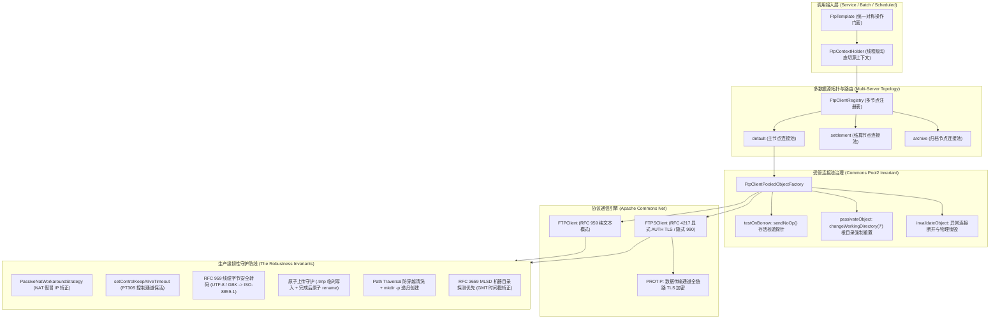

# 43. FTP/FTPS 双模远程文件传输与连接池韧性治理架构决策 (FTP and FTPS Connection Pooling and Resilient Client Architecture)

## 背景与痛点

在企业级中后台、金融清结算对账、政企跨网络数据交互及传统工业系统中，文件传输协议（FTP / FTPS）依旧是高频使用的事实标准数据通道。然而，既有主流开源实践在 Spring Boot 3 生态下面临六大严重生产痛点：

1. **依赖过重与框架绑定违背零臃肿原则 (Bloated Dependencies)**：
   主流开源实现常强行捆绑 `spring-integration-ftp`，引入庞大的 Spring Integration 消息通道与响应式依赖栈；或采用个人维护的非标小众包装库，存在依赖腐烂与维护中断风险。
2. **连接生命周期失管与并发端口耗尽 (Connection Lifecycle & Port Exhaustion)**：
   FTP 协议是基于 TCP 的有状态协议，每次建连伴随着 TCP 握手、用户鉴权、传输模式协商与被动端口开辟，握手成本极高。若每次操作创建短连接，高并发或批处理时会导致客户端 Ephemeral 端口迅速耗尽；若缺乏受管连接池，则难以抵御网络抖动与长耗时阻塞。
3. **连接池脏状态串目录与数据污染灾难 (Dirty Connection State Leaks)**：
   FTP 客户端会话持有当前工作目录（CWD）与流状态。在连接池复用场景下，若某个线程执行了 `cd /data/tenantA`，归还连接池后若未严格重置，下一个借出该连接的业务线程执行 `upload("bill.csv")` 将直接写入 `/data/tenantA/bill.csv` 而非根目录，引发灾难性串目录与数据越权事故。
4. **大文件传输控制通道假死与防火墙静默中断 (Control Channel Silent Disconnect)**：
   传输数 GB 批量对账文件时，数据通道（Data Socket）高速吞吐，但控制通道（Control Socket，端口 21）完全静止。中间云网关或企业硬件防火墙存在 60~120 秒空闲超时斩断规则，导致传输完毕后客户端读取 `226 Transfer complete` 触发 `SocketTimeoutException` 崩溃。
5. **云原生/NAT 环境被动模式 IP 假冒陷阱 (Passive Mode NAT Traversal Pitfall)**：
   在 Docker、Kubernetes 或云服务器 NAT 架构下，服务端响应 `227 Entering Passive Mode (10,0,x,x,p1,p2)` 时通常携带其内网 IP。客户端若未配置 NAT 穿透矫正，会盲目连接无法路由的内网私有地址，导致连接持续挂起直至超时。
6. **RFC 959 协议线缆转码陷阱与中文乱码 (Wire Transcoding & Encoding Drift)**：
   传统 Windows IIS FTP 或未启用 RFC 2640 的 Linux FTP 服务端对中文路径极为敏感。FTP 控制通道规定指令一律采用 8-bit `ISO-8859-1` 线缆编码。若客户端未对 UTF-8/GBK 中文字符串执行底层线缆转码，服务端将频繁抛出 `550 File not found` 或创建乱码目录。

---

## 核心架构与决策内容

经由架构推演与极限场景研讨，正式确立 **`ateng-boot-ftp`（工业级 FTP/FTPS 远程文件传输与连接池治理底座）**，整体架构如下：

### 1. 协议边界与底层依赖基线
- **纯粹协议定位**：严格聚焦 **FTP（RFC 959）+ FTPS（RFC 4217）** 协议家族。显式排除 SFTP（SSH File Transfer Protocol），避免重型 SSH 类库污染，SFTP 作为未来独立模块孵化；
- **零臃肿双核基线**：
  - 核心传输引擎：`commons-net:commons-net`（300KB 原生轻量，工业级标准）；
  - 连接池引擎：`org.apache.commons:commons-pool2`（Spring Boot 官方 BOM 纳管版本，零额外维护成本）。

### 2. 拓扑架构：三位一体多源路由
- **平铺默认 + 嵌套多节点**：配置上支持单服务器平铺属性（`ateng.boot.ftp.*`），开箱即用；同时支持嵌套多服务器声明（`ateng.boot.ftp.servers.<name>.*`）；
- **动态切源与上下文贯通**：
  - 提供 `FtpClientRegistry` 支持根据名称按需检索；
  - 提供 `FtpContextHolder` 支持线程局部上下文与 `runWith(name, task)` 函数式闭包，无缝适配 SaaS 多租户切源与微服务路由。

### 3. 连接池治理与脏状态重置铁律
- **借出存活探针（`testOnBorrow`）**：借出时发送 `sendNoOp()` 校验 TCP 连通性，失效连接就地销毁并自愈重建；
- **归还强制重置（`passivateObject`）**：归还连接时，**100% 强制执行 `changeWorkingDirectory("/")` 重置回根路径**，并复位传输模式为 `BINARY`，彻底杜绝高并发多线程间的串目录灾难；
- **异常物理销毁（`destroyObject`）**：凡流未闭合或抛出传输异常的连接，无条件执行物理断开并移出连接池，严禁脏连接回流。

### 4. 传输安全与云原生韧性防线
- **被动模式与 NAT 穿透默认激活**：默认启用本地被动模式（PASV）与二进制传输（TYPE I）；配置内置 `PassiveNatWorkaroundStrategy`，强制使用控制通道宿主地址，免疫 Docker/K8s/NAT 网关返回内网虚假 IP；
- **控制通道保活（KeepAlive）**：大文件传输期间，底层以 `controlKeepAliveTimeout`（默认 PT30S）周期向控制通道发送 `NOOP`，阻断云防火墙与网关空闲截断；
- **原子上传防脏读（Atomic Upload）**：默认启用 `.tmp` 临时文件机制，全量写入成功后原子执行 `rename`；前置路径防穿越安全清洗与 `mkdir -p` 递归多级目录创建；
- **RFC 959 线缆字节转码防乱码**：握手阶段探测 `OPTS UTF8 ON`；在控制通道底层统一执行路径字节线缆转码，全面兼容 Windows IIS 与 Linux vsftpd 中文路径；
- **RFC 3659 MLSD 机器目录探测**：获取文件列表时优先采用 `MLSD`（机器级精确解析，自带规范 UTC 时间戳），老旧系统自适应平滑回退传统 `LIST`。

### 5. 对称门面与流生命周期安全
- **对称操作体系**：`FtpTemplate` 全面对称覆盖上传（InputStream/File/byte[]/Resource）、下载（OutputStream/File/downloadToBytes）、存在性检查、目录递归创建、文件/目录删除、重命名与移动；
- **安全流消费回调**：坚决禁止对外泄露裸 `InputStream`，统一通过 `downloadStream(path, Consumer<InputStream>)` 在 `try-with-resources` 内受管执行并在闭合后执行 `completePendingCommand()`。

---

## 权衡与影响 (Consequences & Trade-offs)

### 正向收益 (Pros)
1. **生产级高可用与零脏读**：连接池根目录重置、借出心跳探针与原子上传彻底消灭了串目录、网络中断与脏文件读取隐患；
2. **云原生与跨网免配置**：NAT 防假冒策略与控制通道保活使得应用在 K8s 容器、云防火墙与 NAT 网关下免受超时断网困扰；
3. **中文文件名与老旧系统零乱码**：线缆转码与 RFC 2640/3659 探测解决了国内政企遗留系统的中文乱码与时区漂移痼疾；
4. **多租户与微服务高度适配**：平铺单例与多节点注册表、动态上下文无缝对接复杂分布式业务。

### 妥协成本 (Cons)
1. **SFTP 协议暂不内聚**：由于严格排除 SSH 类库依赖，需要 SFTP（SSH 22 端口）的场景需后续依赖 `ateng-boot-sftp` 模块；
2. **状态重置网络往返开销**：连接池每次归还执行 `CWD /` 会带来一次极轻微的 TCP 指令往返，但相比业务串目录导致的资金与数据事故，该防御开销完全符合生产安全设计原则。
