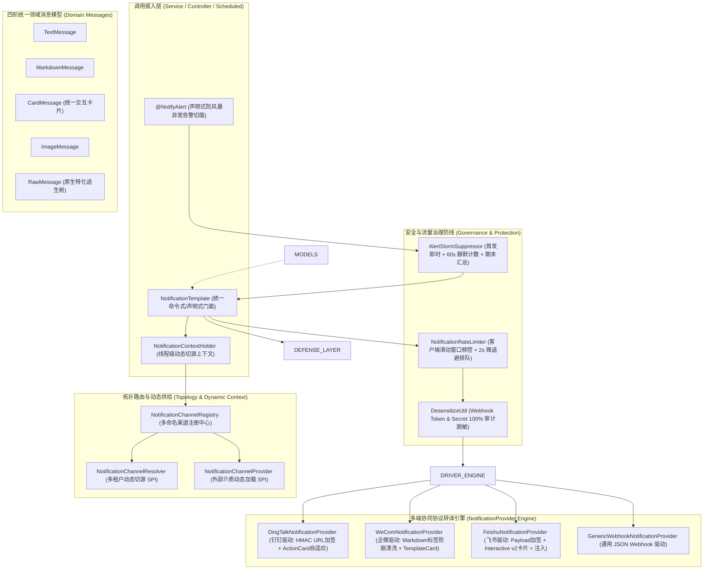

# 44. 企业协同多端 Webhook 机器人通知与防风暴告警底座架构决策 (Enterprise Collaboration and Webhook Notification Architecture)

## 背景与痛点

在现代化企业级中后台系统研发、自动化运维度量与持续交付体系中，群机器人（Webhook Bot）已成为业务流程流转、工单审批流推送与系统异常突发告警的事实标准第一入口。然而，在以企业微信（WeCom）、钉钉（DingTalk）与飞书（Feishu）为代表的国内协同办公生态下，企业自研或集成通知能力普遍面临以下六大核心生产痛点：

1. **协同平台异构协议碎片化与卡片抽象失真 (Protocol Fragmentation & Disparate Card Schemas)**：
   三大平台的数据结构与卡片渲染协议差异极大：钉钉采用 `actionCard`（区分独立横竖按钮与单按钮整体跳转）；飞书采用高度组件化的 `interactive` 卡片（包含 Header、Elements、Actions、Notes 等复杂节点）；企业微信采用 `template_card`（图文卡片、文本通知与按钮交互）。业务开发人员通常被迫编写大量平台耦合的胶水代码，平台切换或多端聚合推送成本高昂。
2. **严苛频控惩罚机制与机器人封号风险 (Strict Rate Limiting & Account Banning Risk)**：
   各平台对群机器人均设定了极其严厉的出站频率限制（如钉钉与企微限制单个机器人 20 条/分钟；飞书限制 100 条/分钟且每秒不超过 5 条）。一旦业务遇到批量触发或流量高峰，无防护的请求会瞬间触发服务端限流（HTTP 429 或 `errcode=130101`），**钉钉甚至会对超频机器人实施 10 分钟的惩罚性拉黑封禁**，导致后续关键告警全量丢失。
3. **高并发线上故障与告警风暴轰炸 (Alert Storms & Noise Flooding)**：
   当下游数据库闪断或网络抖动时，相同业务逻辑每秒可能抛出数千次相同的未捕获异常。若缺乏客户端告警聚合治理，群内将在数秒内涌入成千上万条重复告警，不仅直接打爆机器人触发平台封禁，更会形成“告警风暴”，将现场关键的故障首发信息与排查上下文瞬间淹没。
4. **安全加签复杂度与日志凭据泄漏灾难 (Signature Overhead & Credential Leaking)**：
   钉钉要求使用 `HmacSHA256` 结合 `timestamp` 进行 Base64 签名并拼装至 URL Query 参数中；飞书要求将签名与时间戳作为独立字段计算并注入 JSON 请求体；企微采用 Webhook Key 路由。业务自研容易出现签名时钟漂移、算法实现脆弱等问题；更严重的是，未经防护的 HTTP 日志打印经常直接输出完整的 Webhook URL（包含明文 Token/Secret），引发严重的安全审计红牌。
5. **@人机制严重割裂与语义难以统一 (Disparate @Mention Semantics)**：
   精准 @人是故障应急与审批触达的刚需。但钉钉通过外层对象 `at: { atMobiles, atUserIds, isAtAll }` 声明；企微通过 `mentioned_list`（工号）与 `mentioned_mobile_list`（手机号）控制；飞书则不在外部字段控制，强制要求在正文文本中内嵌 `<at id="user_id">姓名</at>` 标签。缺乏统一抽象导致跨平台 @人 逻辑支离破碎。
6. **缺乏事务一致性与四维上下文透传断流 (No Transaction Sync & Context Disconnection)**：
   在业务本地事务（`@Transactional`）执行过程中提前推送机器人通知，若事务在后续执行中发生回滚，外部人员却已收到通知，造成虚假告警与业务混淆（幽灵通知）；且异步线程发信时常丢失 MDC `traceId` 与当前操作人上下文，导致群内告警无法快速关联日志链路。

---

## 核心架构与决策内容

经由严格推演与场景研讨，正式确立 **`ateng-boot-notification`（企业协同与多端 Webhook 机器人通知底座）**，其整体架构拓扑如下：



---

### 1. 统一跨平台领域卡片自适应引擎 (CardMessage & Adaptive Translation)

针对三大平台异构卡片的割裂现状，框架确立 **“最小完备公倍数 + 平台自适应转译 + 原始逃生舱”** 铁律：
- **统一领域卡片模型 `CardMessage`**：
  - 核心属性包含：`title`（卡片标题）、`content`（摘要/正文）、`headerColor`（卡片顶栏主题色：BLUE、GREEN、RED、ORANGE、GREY）、`mainImageUrl`（主图封面）、`buttons`（按钮列表，包含文本、URL 跳转链接与样式）、`singleAction`（单按钮跳转配置）、`mention`（`MentionTarget` 绑定的 @人 目标）；
- **自适应驱动转译**：
  - **钉钉驱动**：若配置了 `singleAction` 或 `buttons` 长度为 1，自动转译为单按钮跳转 `actionCard`；若多按钮则转译为列表按钮 `actionCard`；
  - **飞书驱动**：自动转译为飞书标准的 Interactive Card v2 JSON 结构，`headerColor` 精准对齐飞书 Header Template 调色板，按钮映射为 Interactive Actions 组件；
  - **企微驱动**：自动转译为企业微信标准的 `template_card`（图文/文本按钮通知卡片）；
- **企微 Markdown 防崩清洗守卫**：
  企微 Webhook Markdown 官方仅支持 1-6 级标题、加粗、行内代码、引用及颜色标签，不支持表格与任何外链图片。企微驱动内置轻量正则清洗器，自动将表格转译为易读的键值引用列表（`> 键: 值`），过滤潜在的破坏性 HTML 标签，杜绝客户端解析崩溃。
- **100% 原始逃生舱 (`RawMessage`)**：
  若业务必须使用飞书极其复杂的多选表单卡片或企微专属投票卡片，可通过 `RawMessage` 直接装配原生 JSON 载荷，驱动层原样透明交付，杜绝抽象锁死。

---

### 2. 声明式 `@NotifyAlert` 与防告警风暴抑制算法 (Alert Storm Suppression)

针对突发生产故障引发的海量告警轰炸，框架提供声明式 AOP 切面 `@NotifyAlert` 与防风暴聚合器 `AlertStormSuppressor`：
- **异常指纹精准提取 (Fingerprint Calculation)**：
  指纹计算采用无碰撞哈希算法：
  $$\text{Fingerprint} = \text{MD5}(\text{ExceptionClassName} + \text{RootCauseClassName} + \text{ThrowingMethodSignature} + \text{FirstBusinessLineNumber})$$
  该算法能够有效剔除异常错误描述中不断变动的业务参数（如订单号、时间戳），将同因故障精确归纳为同一指纹，同时区分不同代码点抛出的相同类型异常。
- **三阶防风暴抑制算法 (Suppression Algorithm)**：
  - **阶段一（首发即时透传）**：在滑动抑制窗口期（默认 60 秒）内，若指纹首次出现，立即构建精美的红色主题故障卡片实时推送（携带当前 MDC `traceId`、当前操作人、调用方法入参脱敏快照及 Top 10 核心调用栈）；
  - **阶段二（窗口期静默抗洪）**：在接下来的窗口期内，相同指纹的异常被静默拦截，原子计数器累加频次，杜绝群内刷屏与平台限流；
  - **阶段三（周期末汇总通报）**：窗口期结束时，若累加计数器 $>0$，自动补发轻量统计消息：`【告警汇总】在过去 60 秒内，该异常在相同位置重复触发了 N 次（首次排查链路 TraceId: xxx）`。

---

### 3. 客户端双轨频控防卫体系 (Client-Side Sliding Window Rate Limiting)

为彻底杜绝触发钉钉 10 分钟拉黑封号等毁灭性后果，框架在出站最外层铸造客户端主动频控防线：
- **单通道频控配额**：
  各通道独立配置 `permits-per-minute`（钉钉/企微默认 20，飞书默认 100）；
- **微退避排队与快速失败**：
  出站前调用 `rateLimiter.tryAcquire(channel, maxWaitDuration)`（默认最大等待 2 秒）：
  - 若在微退避窗口内排队获取到令牌，平滑放行；
  - 若等待超时依然耗尽，**立即抛出受控的业务异常 `NotificationRateLimitException` 并终止发送**，坚决不向平台强推报文，确保机器人账号高可用；
- **双轨架构设计**：
  抽象 `NotificationRateLimiter` 接口，默认装配单机内存版 `InMemoryNotificationRateLimiter`；当探测到容器内存在 `ateng-boot-redis`（`RedissonClient`）且开启 `ateng.boot.notification.rate-limit.distributed=true` 时，平滑升级为 Redis Lua 分布式滑动窗口频控，保障多 Pod 集群聚合频控不超限。

---

### 4. 全自动加签安全与凭证零泄露不变量 (Automated Signing & Zero-Leakage)

- **算法透明装配**：
  - **钉钉**：驱动出站时自动抓取当前 Unix 毫秒时间戳，执行 `HmacSHA256(timestamp + "\n" + secret)` 计算，经 Base64 与 UTF-8 URLEncode 后自动挂载至 Webhook URL 请求参数；
  - **飞书**：驱动出站时自动抓取 Unix 秒级时间戳，执行 `HmacSHA256(timestamp + "\n" + secret)` 计算，经 Base64 编码后作为 `timestamp` 与 `sign` 顶层节点自动合并注入 JSON 请求体；
  - 业务调用方只需在配置中填写 `secret`，发信调用代码 100% 零感知。
- **零泄露审计脱敏 (Zero-Leakage Invariant)**：
  遵循 ADR-0012，发信调试日志、异常报错堆栈以及配置属性输出时，统一经由 `DesensitizeUtil` 对 Webhook URL 中的 `access_token`、`key` 参数及 `secret` 密钥进行前置掩码处理（如 `https://oapi.dingtalk.com/robot/send?access_token=68***abcd`），严禁凭据在任何日志中明文落地。

---

### 5. 跨端统一 @人领域建模与正文自适应注入 (Unified @Mention Model)

定义统一领域对象 `MentionTarget`，结构化封装 `isAtAll`、`atMobiles` 与 `atUserIds`：
- **钉钉与企微**：驱动提取 `MentionTarget` 属性，直接映射为外围协议字段（如钉钉 `at.atMobiles`、企微 `mentioned_mobile_list`）；
- **飞书**：飞书官方不支持在外层字段 @人，飞书驱动在构建 Post/Interactive 内容时，自动在消息首部或尾部动态插入 `<at id="user_id">姓名</at>` 或 `<at id="all">所有人</at>` 标签，彻底抹平平台语义鸿沟。

---

### 6. 本地事务感知发信与四维全链路追踪 (Transaction-Aware & 4D Context)

- **事务感知发信 (`sendAfterCommit`)**：
  通过 `TransactionSynchronizationManager` 注册提交后回调，确保数据库事务成功提交后才触发网络发送，杜绝事务回滚后的“幽灵通知”；若发送失败，自动触发 `NotificationSendFailureHandler` 补偿 SPI；
- **受管异步与四维快照透传 (`sendAsync`)**：
  异步发送由 Core 模块受管线程池（`ThreadPoolTaskExecutor`）调度，并依托 `AsyncContext` 自动穿透 $\langle\text{MDC TraceId}, \text{UserId}, \text{TenantId}, \text{IgnoreTenant}\rangle$ 快照，任务结束后严格排空线程，杜绝上下文污染。

---

## 架构设计规范与接口契约

### 1. 核心门面 API 签名 (`NotificationTemplate`)

```java
public class NotificationTemplate {

    /**
     * 同步发送通知（投递至默认渠道）
     */
    public NotificationSendResult send(NotificationMessage message);

    /**
     * 同步发送通知（指定目标渠道）
     */
    public NotificationSendResult send(String channelName, NotificationMessage message);

    /**
     * 异步非阻塞发送通知（基于受管线程池与四维上下文透传）
     */
    public CompletableFuture<NotificationSendResult> sendAsync(NotificationMessage message);

    public CompletableFuture<NotificationSendResult> sendAsync(String channelName, NotificationMessage message);

    /**
     * 本地事务感知发送（事务成功提交后触发，带失败补偿回调）
     */
    public void sendAfterCommit(NotificationMessage message);

    public void sendAfterCommit(String channelName, NotificationMessage message);

    /**
     * 模板化动态渲染并发送
     */
    public NotificationSendResult sendTemplate(String channelName, String templateName, Map<String, Object> variables);
}
```

### 2. 标准配置属性结构 (`ateng.boot.notification.*`)

```yaml
ateng:
  boot:
    notification:
      enabled: true
      default-channel: ops-alert
      connect-timeout: 3s
      read-timeout: 5s
      rate-limit:
        enabled: true
        distributed: false
        max-wait-duration: 2s
      alert:
        enabled: true
        default-channel: ops-alert
        suppress-window: 60s
        include-args: true
      channels:
        ops-alert:
          platform: DINGTALK
          webhook: https://oapi.dingtalk.com/robot/send?access_token=YOUR_DINGTALK_TOKEN
          secret: YOUR_DINGTALK_SECRET
          permits-per-minute: 20
        finance-notice:
          platform: WECOM
          webhook: https://qyapi.weixin.qq.com/cgi-bin/webhook/send?key=YOUR_WECOM_KEY
          permits-per-minute: 20
        team-feishu:
          platform: FEISHU
          webhook: https://open.feishu.cn/open-apis/bot/v2/hook/YOUR_FEISHU_TOKEN
          secret: YOUR_FEISHU_SECRET
          permits-per-minute: 100
```

---

## 离线自洽测试与 1:1 独立沙箱保障

遵循工业级自洽单测铁律，模块严禁在单元测试与 CI 流水线中连接外部真实的公网机器人：
- **纯内存 MockWebServer 测试套件**：
  单元测试基于 Spring 原生 MockMvc 与 In-Memory MockWebServer 驱动，毫秒级模拟钉钉、企微与飞书服务端的成功返回（`errcode=0`）、签名异常、平台 429 频控报错与超时故障；
- **全场景对抗性验证覆盖**：
  1. 验证签名算法计算的数学确定性（对比标准测试向量）；
  2. 验证防风暴聚合器在 1000 次并发 NPE 异常下的首发即时送达与期末聚合汇总；
  3. 验证客户端滑动窗口频控在超出限额时的最大 2 秒微退避与超时快速失败；
  4. 验证 Webhook Key 脱敏拦截器对出站日志的掩码保护；
- **1:1 场景工程**：`ateng-boot-samples/ateng-boot-sample-notification`，提供端到端开箱即用演示用例。
