# 44. SSH 远程命令执行与安全文件传输基础设施架构决策 (SSH Remote Command Execution and Secure File Transfer Governance Architecture)

## 背景与痛点

在现代企业级自动化运维平台、DevOps CI/CD 流水线、跨网络数据分发、以及批量资产纳管系统中，通过 SSH（Secure Shell）与 SFTP（SSH File Transfer Protocol）协议远程操控 Linux/Unix 实例与传输敏感数据是不可替代的核心基础设施能力。然而，既有主流开源实践在 Spring Boot 3 与云原生环境下面临以下七大严峻生产痛点：

1. **历史类库停更与现代加密算法失配 (JSch Abandoned & Cryptographic Obsolescence)**：
   Java 生态中广泛使用的 `com.jcraft:jsch` 官方早在 2018 年（0.1.55 版本）即已彻底停止维护，原生不支持现代 OpenSSH 密钥格式、ED25519 签名算法及 `rsa-sha2-512` 等高安全密钥协商算法，导致连接现代 Linux 操作系统（如 Ubuntu 22.04+、RHEL 9+、Debian 12+）时频繁发生算法不兼容协商失败。
2. **动态主机资产直连与连接生命周期失管 (Ad-hoc Dynamic Assets & Connection Leaks)**：
   在运维管理系统与多租户平台中，服务器资产通常存储于数据库（如 CMDB / 资产表），调用端需要在运行时根据传入的连接凭据动态连接指定主机。现有类库通常缺乏受管的多主机路由治理，要么每次调用盲目创建短连接（导致频繁进行 TCP 握手 + SSH 密钥协商，单次耗时高达 200ms~500ms），要么缺乏 LRU/TTL 超时回收机制导致网络连接与句柄在内存中无界悬挂泄漏。
3. **`sudo` 提权执行的“无终端阻断与密码挂起”死锁陷阱 (Sudo TTY Trap & Headless Deadlock)**：
   自动化脚本执行 `sudo systemctl restart` 等提权命令时，Linux 默认安全机制尝试打开 `/dev/tty` 要求交互输入密码。若通过普通 SSH Exec 通道执行，Linux 服务端会直接抛出 `sudo: a terminal is required to read the password` 报错阻断，或无限挂起等待密码输入直至客户端硬超时。
4. **命令超时后远端“孤儿僵死进程”失控 (Remote Orphan Processes on Timeout)**：
   当调用方设置超时阈值（如 `command-timeout: 30s`）并发生熔断切断 Channel 时，若协议层未向服务端进程组发送终止信号，远程宿主机上的子进程（如耗时检索、编译脚本或数据库 Dump）依然在后台持续运行并占满 CPU/内存，沦为脱缰的孤儿僵死进程。
5. **SFTP 原生协议缺陷与大文件黑盒传输 (SFTP Non-Empty Rmdir & Progress Blindness)**：
   SFTP 原生协议 `rmdir` 指令要求目标目录必须为空，遇到非空目录直接抛出 `SSH_FX_DIR_NOT_EMPTY` 失败，缺乏开箱即用的深度优先递归删除原语；传输百兆或吉字节大文件时，缺乏细粒度的流式进度监听（Progress Listener），无法为前端暴露真实百分比与传输速率。
6. **云原生 K8s 只读容器 KnownHosts 写入崩溃 (Container-Friendly KnownHosts & Read-Only Rootfs)**：
   在 Kubernetes 无状态 Pod 或以非 root 用户挂载 Read-Only 根文件系统的安全容器中，传统 SSH 客户端强行尝试向 `~/.ssh/known_hosts` 写入主机公钥指纹，直接触发 `java.io.IOException: Read-only file system` 导致服务启动或连接崩溃。
7. **跨平台中文环境与老旧系统 Charset 乱码 (Non-UTF8 Encoding Drift)**：
   连接国内老旧政企系统或 Windows Server（默认代码页 936 / GBK）时，硬编码 `UTF-8` 解码导致命令回显与日志充满乱码，缺乏主机级与调用级字符集自适应治理。

---

## 核心架构与决策内容

经由深度推演与极限场景研讨，正式确立 **`ateng-boot-ssh`（工业级 SSH 远程命令执行与安全文件传输基础设施）**，整体架构如下：

```mermaid
flowchart TD
    subgraph Client["调用接入层 (DevOps / Service / Batch / WebSSH)"]
        direction TB
        SSH_TEMPLATE["SshTemplate (命令执行/提权/隧道/终端门面)"]
        SFTP_TEMPLATE["SftpTemplate (流式文件传输/递归同步门面)"]
        HOLDER["SshContextHolder (线程切源上下文)"]
    end

    subgraph Topology["连接拓扑与动态路由 (Topology & Dynamic Routing)"]
        direction TB
        REGISTRY["SshClientRegistry (命名主机注册表)"]
        DYNAMIC_INFO["SshServerInfo (动态主机描述符 - 数据库资产按需传入)"]
        SESSION_POOL["SshSessionPool (受管 LRU/TTL 会话缓存池 + 保活心跳)"]
    end

    subgraph Engine["核心协议驱动引擎 (Apache MINA SSHD)"]
        direction TB
        SSHD_CLIENT["SshClient (NIO 异步事件驱动内核)"]
        AUTH_FACADE["多元认证中心 (密码 / 纯内存私钥PEM / 密钥对)"]
        HOSTKEY_POLICY["HostKeyPolicy (LENIENT纯内存自适应 / STRICT / IGNORE)"]
    end

    subgraph ChannelExecution["通道执行与安全治理体系 (The Execution Guards)"]
        direction TB
        EXEC_GUARD["Exec Channel (双模同步 SshExecResult / 流式 Consumer 按行消费)"]
        SUDO_PIPE["execSudo 提权安全管道 (-S -p 自动密码脱敏管道)"]
        TIMEOUT_KILL["SIGTERM / SIGINT 孤儿进程信号主动防卫"]
        OPTIONS_ENV["SshExecOptions (工作目录 CWD + 环境变量 + Charset 注入)"]
        BATCH_POOL["execBatch (Core 受管线程池 + MDC 四维上下文批量并发)"]
    end

    subgraph SftpSubsystem["SFTP 传输与文件治理 (SFTP Robustness Invariants)"]
        direction TB
        ATOMIC_UP["原子上传守护 (.uploading.tmp 写入 + 原子 rename)"]
        RECURSIVE_OPS["递归操作引擎 (DFS 递归删除 / 目录树双向上传下载)"]
        PROGRESS_OBS["SftpProgressListener (流式传输进度实时观测)"]
        CLEAN_TRAVERSAL["Path Traversal 防穿越清洗 + mkdir -p 递归自动建目录"]
        METADATA_CHMOD["SftpFileInfo 元数据解析 + POSIX 权限 chmod"]
    end

    subgraph TunnelAndPty["内网穿透与终端交互 (Tunnels & PTY)"]
        direction TB
        PROXY_JUMP["ProxyJump (跳板机 / 堡垒机级联多跳穿透)"]
        TUNNEL_HANDLE["SshTunnelHandle (本地端口转发受管句柄 - AutoCloseable)"]
        SHELL_HANDLE["SshShellHandle (PTY 交互式终端句柄 - 配合 WebSocket/xterm.js)"]
    end

    SSH_TEMPLATE --> HOLDER
    SFTP_TEMPLATE --> HOLDER
    HOLDER --> REGISTRY
    HOLDER --> DYNAMIC_INFO

    REGISTRY --> SESSION_POOL
    DYNAMIC_INFO --> SESSION_POOL
    SESSION_POOL --> SSHD_CLIENT

    SSHD_CLIENT --> AUTH_FACADE
    SSHD_CLIENT --> HOSTKEY_POLICY

    SSHD_CLIENT --> ChannelExecution
    SSHD_CLIENT --> SftpSubsystem
    SSHD_CLIENT --> TunnelAndPty
```

### 1. 底层引擎基线与零臃肿原则
- **引擎选型**：全面选用 **Apache MINA SSHD (`sshd-core` + `sshd-sftp`)** 作为核心协议驱动库；
- **原生技术契合**：基于 Java 原生 NIO 异步非阻塞事件驱动模型，100% 拥抱 JDK 17 LTS 与 Spring 6，无缝兼容现代 SSHv2、SFTP (v3~v6)、本地/远程端口转发、跳板机穿透、ED25519、RSA-SHA2、OpenSSH 8+ 新密钥体系，杜绝引入任何非标遗留黑盒依赖。

### 2. 四位一体多主机拓扑与会话池化治理
- **四位一体接入模型**：
  1. **配置驱动单节点**：`ateng.boot.ssh.host` 开箱即用；
  2. **命名多节点注册表**：`ateng.boot.ssh.servers.<name>.*` 支持静态多主机字典映射，由 `SshClientRegistry` 统一管理；
  3. **线程上下文动态切源**：`SshContextHolder` 依托 ThreadLocal 支持业务层无感按机房或多租户动态切源；
  4. **动态主机资产直连 (`SshServerInfo`)**：深度适配从业务数据库（如资产表/CMDB）动态拉取的主机信息，支持在调用门面时作为不可变值对象直接传入。
- **双轨会话池化 (`SshSessionPool`)**：
  - 高频复用场景：提供受管会话缓存池，按 `host:port:username` 为键缓存活会话，配置 `idle-timeout`（默认 5 分钟空闲注销）与 `heartbeat-interval`（默认 15 秒心跳保活），握手开销从 300ms 降至 0ms；
  - 瞬态一次性任务：提供 `executeOnce(serverInfo, ...)` 闭包，执行完立即物理关闭断开，零连接与句柄残留。

### 3. 多元凭据矩阵与云原生纯内存指纹容器
- **四种凭据形态全覆盖**：
  - 口令认证：`password(String)`；
  - **纯内存私钥字符串**：`privateKey(String pemOrRawContent, String passphrase)`（直接将数据库存储的私钥字符串载入内存解析，**严禁落盘临时文件**，防范物理磁盘泄密）；
  - 磁盘私钥文件：`privateKeyPath(String path, String passphrase)`；
  - 预解析密钥对：`keyPair(KeyPair)`。
- **云原生只读容器适配 (`HostKeyPolicy`)**：
  - 默认提供 `LENIENT / ACCEPT_NEW` 模式，基于**纯内存 `ServerKeyVerifier`** 运行；
  - 绝不强制写入 `~/.ssh/known_hosts`，保障在 K8s 只读根文件系统（Read-Only Rootfs）与非 root 容器中 0 配置、0 挂载、0 报错启动；同时支持配置切换为 `STRICT`（生产强校验）或 `IGNORE`（纯内网免检）。

### 4. 正交双门面与全场景执行体系
- **`SshTemplate`（核心执行与穿透门面）**：
  - **短命令同步契约**：`exec(...)` 返回强类型 `SshExecResult`（包含 `exitCode`, `stdout`, `stderr`, `isSuccess()`, `duration`）；
  - **长任务流式监听契约**：`execStream(...)` 支持按行回调 `Consumer<String> stdoutConsumer`，配合 WebSocket 秒级实现实时构建与滚动日志；
  - **原生提权管道 (`execSudo`)**：底层自动构建管道与 `-S -p ''` 协议，安全处理密码回显与内存擦除，攻克无 TTY 提权死锁；
  - **超时孤儿进程信号主动防卫**：超时触发时，在关闭通道前主动向服务端发送 `SIGTERM` / `SIGINT` 信号包，根除远端失控僵尸进程；
  - **跨平台字符集注入 (`SshExecOptions`)**：支持声明工作目录（`workingDir`）、环境变量（`env`）及解码字符集（`charset`，支持 GBK），彻底根除中文乱码；
  - **集群批量并发巡检 (`execBatch`)**：基于 Core 模块受管异步线程池设施（`ThreadPoolTaskExecutor`），自动透传四维快照，支持集群批量并发下发与限流。
- **`SftpTemplate`（工业级文件传输门面）**：
  - **原子上传铁律 (Atomic Upload)**：默认先写入 `.uploading.tmp`，闭合后原子执行 `rename`，杜绝脏文件被下游误读；
  - **路径穿越清洗**：复用 Core 模块 `FileUtil.cleanPath`，强制拦截 `../` 越界提权；
  - **递归建目录与目录树双向同步**：上传多级文件自动递归创建父目录；提供 `deleteRecursively`（DFS 递归清空非空目录）与 `uploadDirectory` / `downloadDirectory` 目录树整包同步；
  - **流式传输与进度监听**：全量重载 `InputStream` / `OutputStream` / `File`，挂载 `SftpProgressListener` 实时透传已传输字节数与总大小；
  - **POSIX 权限与元数据**：提供强类型 `SftpFileInfo`，支持上传后设定 `chmod` 权限位。

### 5. 跳板机穿透、端口转发与 Web 终端交互
- **级联跳板机穿透 (`ProxyJump`)**：`SshServerInfo` 结构体原生支持递归内嵌 `jumpHost`，底层自适应构建多跳 SSH 隧道代理通道；
- **受管端口转发 (`SshTunnelHandle`)**：提供 `openLocalTunnel(localPort, remoteHost, remotePort)`，句柄实现 `AutoCloseable`，在 Spring 容器销毁或显式调用时确定性释放本地监听端口；
- **Web 终端交互句柄 (`SshShellHandle`)**：提供交互式 PTY 终端抽象，支持 `resize(cols, rows)` 调整窗口大小与流式字节收发，与 `ateng-boot-realtime` 无缝协同构建企业级 WebSSH 控制台。

### 6. 因果异常体系与离线测试沙箱
- **十维因果错误码 (`SshResultCode implements IResultCode`)**：底层异常统一封装为 `SshOperationException`（继承 `BusinessException`），完整挂载底层原始 `cause`，包含 `SSH_CONNECT_ERROR`、`SSH_AUTH_ERROR`、`SSH_COMMAND_TIMEOUT`、`SFTP_FILE_NOT_FOUND` 等；
- **确定性三步优雅停机**：应用停止时，严格遵循【1. 关闭活跃端口转发隧道 -> 2. 安全注销池化 Session -> 3. 停止底层 NIO Client】的停机时序；
- **100% 离线自洽测试沙箱**：基于 Apache MINA SSHD 原生内置的嵌入式 `SshServer` 与 JUnit 5 `@TempDir` 构建秒级运行的纯内存测试夹具，完全摆脱对外部物理机或 Docker 容器的依赖。

---

## 权衡与影响 (Consequences & Trade-offs)

### 正向收益 (Pros)
1. **全场景 100% 完备覆盖**：无缝打通配置驱动静态节点与数据库资产动态节点，对称收敛命令执行、提权、流式日志、文件传输、跳板机隧道与 Web 终端六大核心场景；
2. **生产级高可靠与高安全**：原子上传、路径防穿越、孤儿进程超时信号防卫、无 TTY 提权管道与纯内存私钥载入彻底消除了常见的线上事故隐患；
3. **云原生环境零报错适配**：纯内存主机指纹校验器彻底解决了 K8s 只读容器中 `known_hosts` 写入崩溃的痼疾；
4. **性能极致与开销最低**：基于受管 LRU/TTL 会话池与保活心跳，高频任务消除了数百毫秒的建连延迟，同时避免了无界内存悬挂。

### 妥协成本 (Cons)
1. **依赖体积轻微增加**：引入 `sshd-core` 与 `sshd-sftp` 构件（合计约 1.5MB 纯 Java JAR），但由于采用了按需引入的独立 Starter（`ateng-boot-ssh`），未引入该模块的业务系统完全不受任何依赖体积影响；
2. **内存指纹在动态环境中的权衡**：`LENIENT` 模式在内存中记录首次连接的主机指纹，若云主机频繁以相同 IP 重建并更换公钥，需要显式将策略设为 `IGNORE` 或通过 API 清理缓存指纹。
