# 46. 企业级 Word 模板填充与 PDF 综合治理底座架构决策 (Enterprise Word Template and PDF Governance Architecture)

## 背景与痛点

在企业数字化协同、电子政务、智能制造、金融对账与人力资源管理等中大型业务系统中，办公文档（Office Documents & PDF）的处理、渲染与防泄密流转属于最核心的基础设施能力之一。常见的刚需场景包括：自动化生成劳动合同与商业协议、生成报价单与采购结算表、导出财务审计对账单、加盖防泄密暗水印防截屏拍照泄露、填充官方交互式审批表单并归档。

然而，在基于 Java 和 Spring Boot 的传统文档开发实践中，业界普遍面临以下六大核心痛点与架构陷阱：

1. **开源协议侵权地雷与商业合规风险 (Licensing Hazards & AGPL Contagion)**：
   Java 生态中最著名的 PDF 处理库 iText 早期基于 LGPL/MPL（如 2.1.7 版本，年代久远且存在已知漏洞），后续版本（iText 5/7/8）则全面转向激进且具有传染性的 **AGPLv3 商业闭源许可协议**，在商业化企业应用或开源 SDK 中引入具有极高的法律合规风险与侵权索赔隐患；
2. **Word XML AST 碎片化与自研模板排版崩塌 (Run Fragmentation & Layout Distortion)**：
   基于原生 Apache POI（`XWPFDocument`）手写文本替换极易掉入“Run 碎片化”深坑——Word 在编辑保存时常将同一个占位符（如 `{{contractNo}}`）切割分散在多个底层的 `XWPFRun` 中，简单的字符串替换直接失效；此外，动态表格循环追加行、单元格跨行跨列合并（ColSpan/RowSpan）以及浮动电子公章图片的精确定位极其繁琐，自研解析器极易导致文档损坏与排版崩塌；
3. **云原生容器环境 CJK 中文字体缺失导致乱码方块与崩溃 (CJK Font Absence in Containers)**：
   在现代化云原生 K8s 与 Docker 最小化基础镜像（如 Alpine / Debian Slim）中，宿主机默认**完全缺失中文字体**（如 SimSun、SimHei、Microsoft YaHei）。直接使用底层图形或 PDF 渲染引擎绘制中文时，会抛出 `IllegalArgumentException: No glyph for ...` 异常，或将所有中文渲染为无意义的方块豆腐块（`口口口`），排查成本极高；
4. **动态表单未扁平化导致数据被二次篡改 (AcroForm Tampering Vulnerability)**：
   在利用 PDF 动态表单（AcroForm）填充签署合同或证明文件时，若直接保存，生成的 PDF 中依然保留交互式表单控件（TextField/CheckBox），任何用户均可使用 Adobe Reader 或免费 PDF 工具再次修改金额、姓名或条款，失去合同作为法律凭证的不可篡改性；
5. **大文档操作引发 FullGC 与 JVM 堆内存爆破 (Memory Inflation & OOM Risks)**：
   复杂 Word 合同（上百页条款）或包含大量高分辨率图表/印章的 PDF 文件，在基于堆内存 DOM 解析时，内存占用可达到文件本身大小的 5 至 10 倍。多并发下载与生成极易打满 JVM 堆内存引发频繁 FullGC 甚至 OOM 宕机；
6. **防泄密暗水印形式主义与易被遮挡抹除 (Flawed Watermark Placement)**：
   许多自研水印工具默认将水印压印在底层背景（Underlay），遇到包含底色背景的表格或附图时，水印被 100% 遮挡失效；或者缺乏透明度与倾斜度规范，影响文字正常阅读或无法有效防范手机拍照与截屏泄密。

---

## 核心架构与决策内容

经由严格的架构拷问与场景推演，正式确立 **`ateng-boot-document`（企业级 Word 模板填充与 PDF 综合治理底座）**，其整体架构拓扑如下：

```mermaid
flowchart TB
    subgraph Client["调用接入层 (Service / Controller / Scheduled)"]
        direction TB
        WORD_TMPL["WordTemplate (Word 模板渲染与多文档拼装门面)"]
        PDF_TMPL["PdfTemplate (PDF 水印/合并/表单/安全治理门面)"]
        CONVERTER_SPI["DocumentConverter SPI (文档格式转换逃生舱)"]
        WEB_UTILS["WordWebUtil / PdfWebUtil (RFC 6266 Web 流式下载工具)"]
    end

    subgraph CoreEngine["双核无忧驱动引擎 (Engine Layer - Pure Apache 2.0)"]
        direction LR
        POITL_ENGINE["Word 引擎: poi-tl 1.12.x<br/>(基于 Apache POI 5.x 生产加固)"]
        PDFBOX_ENGINE["PDF 引擎: Apache PDFBox 3.x<br/>(纯正 Apache 2.0 商业合规)"]
    end

    subgraph WordCapabilities["Word 核心能力矩阵"]
        direction TB
        W_TEXT["文本与段落插值: {{title}}"]
        W_TABLE["复杂表格循环: {{#items}} 与 跨行跨列合并"]
        W_IMAGE["多媒体与签章嵌入: {{@seal}} (尺寸锁定/浮动)"]
        W_COND["条件分支控制: {{?hasDiscount}}"]
        W_STITCH["多文档物理无缝拼接 (Stitching)"]
        W_PROTECT["文档只读密码锁定 (Read-Only Protection)"]
    end

    subgraph PdfCapabilities["PDF 核心能力矩阵 (四大支柱 + 企业增强)"]
        direction TB
        P_WM["防泄密暗水印: OVERLAY 半透明平铺矩阵 + 动态宏变量"]
        P_PAGE["页面治理: 物理合并 (Merge) / 拆分 (Split) / 90°-270° 旋转"]
        P_NUM["页码压印: Header/Footer '第 X 页 / 共 Y 页' (跳过封面)"]
        P_FORM["AcroForm 表单填充 + 默认不可逆扁平化 (Flattening)"]
        P_SEC["安全加密: User/Owner 密码 + 禁止复制/打印权限控制"]
        P_STAMP["坐标绝对定位盖章: (pageIndex, x, y, width, height)"]
    end

    subgraph Resilience["云原生弹性与资源治理防线 (Governance & Protection)"]
        direction TB
        FONT_RESOLVER["DocumentFontResolver<br/>(三级弹性 CJK 探测: 配置覆盖 -> 宿主机枚举 -> 语义化快速失败)"]
        MEM_GUARD["Anti-OOM 机制<br/>(10MB 强类型阈值换磁盘 + try-with-resources 确定性物理销毁)"]
        MACRO_RESOLVER["WatermarkMacroResolver<br/>(联动 Sa-Token/Core 提取操作人/工号/TraceId + DesensitizeUtil 脱敏)"]
    end

    Client --> CoreEngine
    CoreEngine --> WordCapabilities
    CoreEngine --> PdfCapabilities
    CoreEngine --> Resilience
```

---

### 1. 双核驱动引擎与绝对开源协议合规 (Pure Apache 2.0 Baseline)
- **Word 引擎选型**：全面拥抱 `poi-tl`（1.12.x，Apache 2.0 许可证）结合 Apache POI 5.x。`poi-tl` 具有业界极高的成熟度，彻底克服原生 POI 的 Run 碎片化与样式克隆难题，语法纯净直观；
- **PDF 引擎选型**：全面选用 `Apache PDFBox 3.x`（纯正 Apache 2.0 许可证），坚决一票否决具有 AGPL 传染风险的 iText，并规避 LGPL 协议模糊的 OpenPDF。PDFBox 3.x 带来了现代化的 I/O 抽象架构，内存开销较 2.x 大幅降低，在页面操作、水印压印、AcroForm 填充和文档加解密方面表现极佳。

### 2. 格式边界与格式转换 SPI 逃生舱 (Scope & DocumentConverter SPI)
- **格式不变性**：Word 领域**100% 聚焦现代 OpenXML 格式（`.docx`）**，显式宣布不支持 20 年前基于 OLE2 的陈旧 `.doc` 二进制格式，杜绝引入老旧臃肿的 POI HWPF 依赖；
- **纯 Java 独立自洽，绝不内置重型进程**：模块坚决不强制捆绑需要外部容器进程的 LibreOffice 或商业闭源转换器，保障 Starter 的轻量纯净与秒级启动；
- **转换 SPI 逃生舱**：定义 `DocumentConverter` SPI 接口，声明 `docxToPdf`、`htmlToPdf` 标准方法签名。底座默认装配快速失败实现（抛出语义明确的 `UnsupportedConversionException` 并指引接入方式），为需要高保真复杂排版转换的企业预留无缝外挂 Gotenberg 或外部渲染集群的扩展点。

### 3. Word 核心能力矩阵与门面抽象 (`WordTemplate`)
- **多输入自适应抽象**：内部通过统一流适配器兼容 `Resource`、`InputStream`、`File` 与类路径字符串；
- **六大场景全覆盖**：
  1. 文本插值与多行换行保留；
  2. 复杂表格动态追加行与行内/跨行跨列合并；
  3. 多媒体与电子公章嵌入（`{{@seal}}`），支持物理宽高锁定与浮动图层模式；
  4. 条件语法块按需渲染；
  5. 多 `.docx` 文档物理拼接（`stitch`），支持将主合同与多份补充协议合成单一文档；
  6. 文档只读密码锁定（`protect`），防止客户预览时误改排版。

### 4. PDF 四大支柱与企业级增强矩阵 (`PdfTemplate`)
- **支柱一：防拍照防截屏平铺暗水印**：
  - **图层默认前置 (`OVERLAY`)**：默认以半透明（默认 `opacity = 0.2`）、倾斜 -30° 覆盖在正文上方，手机拍照与截图无法通过任何修图工具抹去，且不影响正文阅读；支持显式切为 `UNDERLAY`；
  - **动态宏变量自动脱敏**：内置解析 `#{user.nickname}`、`#{user.username}`、`#{user.phone}`（经由 `DesensitizeUtil` 自动打码）、`#{traceId}`、`#{now('yyyy-MM-dd HH:mm')}`，自动桥接当前线程上下文；
- **支柱二：页面物理编排与旋转校准**：
  - 支持多 PDF 物理合并（`merge`）、多页拆分（`split`）、特定页提取；
  - 提供 `rotatePages` 方法支持 90°/180°/270° 页面旋转校准，解决扫描件横置与倒置痛点；
- **支柱三：规范页码压印（支持跳过封面）**：
  - 动态压印 Header / Footer（如 `第 X 页 / 共 Y 页`），支持 `skipPages` 属性跳过封面与前置目录页；
- **支柱四：AcroForm 动态表单填报与扁平化防篡改铁律**：
  - 提供 `fillForm` 门面绑定表单域数据；
  - **核心安全不变量**：`FormOptions` 默认强制开启 `flatten = true`，自动将交互控件彻底转换为不可编辑的底层矢量图形，从根源杜绝合同篡改；
- **企业增强：精准物理坐标盖章 (`addImageStamp`)**：
  - 支持在指定页面 `(pageIndex, x, y, width, height)` 盖上实心或半透明的公章/签名图片。

### 5. CJK 中文字体云原生容器三级弹性探测体系 (`DocumentFontResolver`)
为彻底解决 Docker / K8s 容器环境缺失中文字体导致方块乱码或报错的问题，构建三级防御体系：
1. **一级：外部显式配置优先**：读取 `ateng.boot.document.pdf.font-path`，优先加载开发者指定的外部字体文件（支持绝对路径或 `classpath:`）；
2. **二级：系统字体目录自适应枚举探测**：按有序候选清单（`SimSun`、`Microsoft YaHei`、`Source Han Sans CN`、`WenQuanYi Micro Hei`、`PingFang SC`）自动扫描操作系统标准字体目录（Windows `C:/Windows/Fonts`、Linux `/usr/share/fonts`、`/usr/local/share/fonts`、macOS `/System/Library/Fonts`）；
3. **三级：前置快速失败防卫**：当各级探测均未找到中文字体时，立即抛出受控业务异常 `DocumentFontException`，并在异常堆栈和错误日志中显式输出 Docker 修复指南（如：`apt-get install -y fonts-wqy-microhei` 或配置 `ateng.boot.document.pdf.font-path`），坚决杜绝向后穿透产生黑盒豆腐块乱码。

### 6. 内存上限治理与大文档防 OOM 铁律 (Anti-OOM & Spill-to-Disk)
- 引入 Spring 强类型配置 `ateng.boot.document.in-memory-threshold = 10MB`（`DataSize`）；
- 小于等于 10MB 的文档完全在堆内存快速完成流转，保持极高吞吐；
- 超过 10MB 的大文档自动启用 PDFBox 磁盘临时文件模式（`RandomAccessReadBufferedFile`）与受管临时目录；
- 恪守第 3 道成熟度防线，所有流、文件句柄与临时文件必须且只能在 `try-with-resources` 或 `finally` 块中完成 100% 物理清除，杜绝句柄悬挂与临时文件膨胀。

### 7. 框架既有生态协同与因果异常体系
- **Web 流式安全输出**：专职提供 `WordWebUtil` 与 `PdfWebUtil`，向 `HttpServletResponse` 输出时自动挂载 RFC 6266 标准防乱码标头，支持浏览器内联预览与附件下载切换；
- **Storage 存储无缝直连**：输入与输出均支持 `InputStreamSource` / `WritableResource`，生成文档可零磁盘落地直传 S3 或本地存储；
- **因果异常体系**：
  - 根异常：`DocumentException` extends `BusinessException`；
  - 派生子类：`WordRenderException`、`PdfOperationException`、`DocumentFontException`、`UnsupportedConversionException`；
  - 错误码契约：实现 `IResultCode` 的 `DocumentResultCode` 枚举（前缀 `B06xx`），100% 保留底层原始 `cause`。

---

## 权衡与后果 (Trade-offs & Consequences)

### 正向收益 (Positive Impacts)
1. **法务无忧与零合规风险**：坚持纯正 Apache 2.0 许可证技术栈，彻底杜绝 AGPL 侵权风险；
2. **极简优雅的开箱体验**：`WordTemplate` 抹平 POI 复杂的底层 XML API，`PdfTemplate` 统一收敛 PDF 全流程操作；
3. **企业级防泄密与防篡改不变量**：OVERLAY 半透明水印结合操作人动态宏变量，以及 AcroForm 默认扁平化，铸就企业合同的法律安全防线；
4. **云原生环境鲁棒自洽**：通过字体三级探测与内存溢出防卫，消除了容器无中文字体崩溃与并发大文档 OOM 两大生产隐患。

### 妥协与成本 (Trade-offs & Constraints)
1. **不支持老旧 `.doc` 二进制格式**：仅支持现代化 `.docx`，若客户存有 20 年前 Word 97-2003 历史模板，需先行升级保存为 `.docx`；
2. **Word 转 PDF 依赖外部 SPI 实现**：底座为保持轻量自洽，默认不包含高保真的纯 Java Word-to-PDF 渲染器（纯 Java 排版还原度极低），若需高保真转换需通过 `DocumentConverter` SPI 外接 Gotenberg / LibreOffice 服务；
3. **字体探测开销**：初次启动时系统字体扫描会有毫秒级探测耗时，通过只读缓存（Thread-safe Cache）在首次探测后完全消除后续开销。
