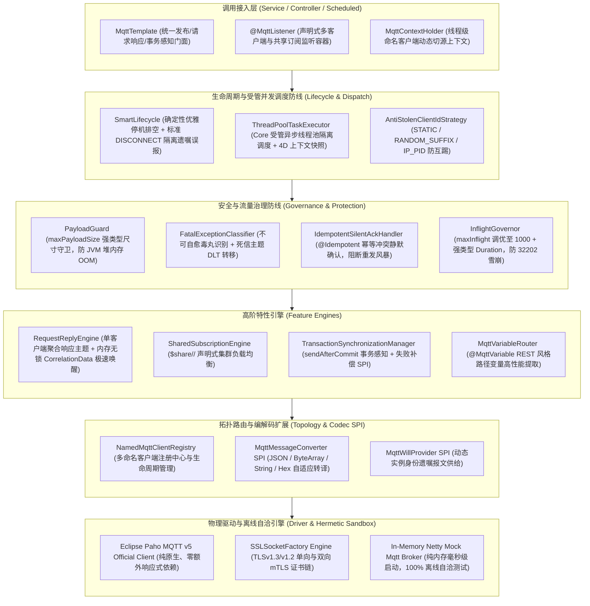

# 47. 工业物联网与车联网双向通信底座架构决策 (MQTT IoT Communication and Edge Control Architecture)

## 背景与痛点

在现代智能制造、智慧园区、工业能源、车联网（TSP 平台）以及各种边缘 IoT 硬件网关场景中，MQTT（Message Queuing Telemetry Transport）凭借极轻量的协议标头开销（最小仅 2 字节）、发布/订阅解耦模式及原生 QoS 传输质量保障，已成为端云双向实时通信的事实工业标准。然而，在以 Spring Boot 3 与微服务为底座的企业级中后台开发中，团队自研或直接集成裸 Paho 客户端普遍面临以下七大深水区生产痛点：

1. **协议版本割裂与全链路追踪断流 (Protocol Split & Context Disconnection)**：
   工业边缘现场设备型号参差不齐，大量的存量传感器仅支持 MQTT 3.1.1，而现代物联网 Broker（如 EMQX、HiveMQ、Mosquitto 2.x）与云平台全面推荐 MQTT 5.0。3.1.1 协议层完全没有标头概念，许多框架为了传递 `traceId` 与租户上下文粗暴地破坏原始 Payload 报文（强制套一层自定义 JSON Envelope），导致通用第三方硬件与国标协议设备完全无法解析；而在 5.0 下又缺乏开箱即用的 User Properties 自动编解码体系，造成微服务跨网络调用全链路追踪彻底断流。
2. **集群部署下的 ClientId 互踢风暴与单播争抢 (ClientId Collision & Inappropriate Broadcast)**：
   MQTT Broker 强制规定：若两个客户端使用相同 ClientId 连接，Broker 会强制将旧连接踢下线（Connection Stolen）。在微服务多 Pod 容器化部署下，若配置固定 ClientId，各 Pod 启动时将陷入死循环的“互相踢下线”连接风暴；另一方面，传统 MQTT 订阅是广播模式，若后端部署 3 个 Pod 订阅传感器数据，同一条遥测上行报文会被 3 个 Pod 同时重复拉取处理，导致数据库严重争抢与重复消费。
3. **Paho 单回调线程阻塞与网络心跳假死 (Single Callback Bottleneck & Ping Timeout)**：
   Eclipse Paho Java 客户端对于单一连接底层仅使用单一线程依次执行 `MqttCallback.messageArrived`。一旦业务监听逻辑涉及慢 SQL、外部 HTTP 调用或复杂运算，该单线程被长时间霸占，客户端网络保活 Ping 无法发出，导致 Broker 判定其 KeepAlive 超时并暴力切断连接，进而引发无限断线重连雪崩。
4. **指令下发缺乏统一 RPC 交互闭环 (Request-Response Asymmetry)**：
   在设备控制场景中，大量存在“平台下发控制指令 -> 等待设备执行完成并回执应答”的高频交互。传统实现通常需要业务方自行手写两个互相独立的主题、手动管理 CorrelationId 映射与超时定时器，代码极度脆弱且极易发生内存泄漏。
5. **不可自愈毒丸报文死循环与 QoS 1 重复重发风暴 (Poison Pill Storm & Missing Silent ACK)**：
   当传感器上报格式损坏或不可自愈的反序列化毒丸报文时，若监听器直接抛出未捕获异常，QoS 1 机制会导致 Broker 不断重发该毒丸，无限阻塞后续报文；而在网络波动下，QoS 1 原生必然出现重复报文，若业务引入防重幂等切面后直接报错，又会破坏确认机制引发二次重投递。
6. **优雅停机排空缺失与遗嘱虚假报警 (Shutdown Collision & False LWT Alarms)**：
   微服务在 K8s 滚动更新或正常发布重启时，若未受管关闭，底层 TCP 连接直接被 OS 斩断，Broker 将误判为“客户端意外崩溃”，瞬间向监控中心广播预设的遗嘱消息（Last Will and Testament, LWT），导致每次正常发布运维告警群都遭遇“节点挂死”的虚假报警刷屏。
7. **大报文打爆堆内存与工业非 JSON 协议割裂 (Payload OOM & Non-JSON Protocol Split)**：
   误报或恶意设备上传几十兆日志/图片会瞬间打爆 Paho 堆内存导致 JVM OOM；同时，工业电力（DL/T 645）、汽车国标（GB/T 32960）及两客一危（JT/T 808）重度依赖原始十六进制 HEX 或压缩二进制结构体，现有开源工具清一色强绑定 Web JSON，无法无缝适配工业多规数据。

---

## 核心架构与决策内容

经由严格推演与场景研讨，正式确立 **`ateng-boot-mqtt`（工业物联网与车联网双向轻量通信底座）**，其整体架构拓扑如下：



---

## 关键架构设计与不变量 (The Architectural Invariants)

### 1. SDK 基线与双轨自适应四维上下文透传 (Dual-Track 4D Context)
- **纯原生官方基线**：直接基于官方权威纯净标准 `org.eclipse.paho:org.eclipse.paho.mqttv5.client` 构建，杜绝引入 Spring Integration 的重型抽象通道，保持底层网络能力的 100% 专有发挥。
- **双轨自适应透传**：
  - **MQTT 5.0 连接**：充分利用协议原生 `User Properties`，将 $\langle\text{MDC TraceId}, \text{UserId}, \text{TenantId}, \text{IgnoreTenant}\rangle$ 注入为标头键值对，**对报文 Payload 载荷保持 100% 零侵入**；
  - **MQTT 3.1.1 连接（存量硬件兼容）**：出站严禁私自包装破坏外部传感器契约的 JSON Envelope；消费端入站检测到无 User Properties 时，自适应通过 `IdUtil.fastSimpleUUID()` 就地生成全局唯一 `traceId` 补齐上下文，保障下游日志链路自洽不断流。

### 2. 共享订阅与集群横向伸缩 (`$share/<group>/<topic>`)
- 针对微服务集群部署下广播监听导致的重复消费问题，`@MqttListener` 原生提供 `sharedGroup` 声明式属性；
- 当指定 `sharedGroup = "telemetry-worker"` 时，底座在底层订阅时自动前缀转换为标准共享主题 `$share/telemetry-worker/sensor/+/telemetry`；
- 由 Broker（EMQX、Mosquitto 2.x 等）负责在集群活跃 Pod 间实施均匀负载均衡，保证每条遥测报文在微服务集群中仅被消费一次。

### 3. Request-Response 模式与内存无锁关联唤醒
- 针对平台控制指令回执需求，`MqttTemplate` 封装 `sendAndReceive(topic, payload, Duration timeout)`；
- 采用**单客户端专属聚合响应主题架构**：每个客户端连接建立后，自动订阅私有主题（如 `sys/response/<clientId>`），无需在每次发信时高频发起 SUBSCRIBE/UNSUBSCRIBE 网络握手；
- 发送时自动在 MQTT 5.0 报文中注入 `Response Topic` 与基于 UUID 的 `Correlation Data`；
- 设备应答时携带该标识，底座接收端利用内存无锁并发 Map 瞬间定位挂起的 `CompletableFuture` 并触发唤醒，配有超时安全扫描器彻底防范内存泄露。

### 4. 消费端受管线程池隔离与毒丸死信 DLT 转移
- **网络保活与业务隔离**：Paho 入站回调线程收到报文后，毫秒级提取四维上下文快照，提交给 Core 模块的受管异步线程池设施（`ThreadPoolTaskExecutor`），支持在 `@MqttListener(concurrency = 4)` 配置并发度，杜绝慢业务逻辑霸占 I/O 线程导致 KeepAlive 超时被剔；
- **毒丸识别与死信转移 (DLT)**：集成 Core 模块 `FatalExceptionClassifier`。凡遇到不可自愈的语法错误、反序列化崩溃或超过最大重试次数的异常，底座自动将原始载荷与异常堆栈转发出站到死信主题（默认为 `${topic}/DLT`），随后向 Broker 安全提交 ACK，彻底阻断死循环毒丸卡死队列。

### 5. 消费幂等去重与静默确认 (Silent ACK Invariant)
- 遵循全家桶可靠投递规范，`@MqttListener` 与 `ateng-boot-redis` 的 `@Idempotent` 深度打通；
- 当因网络重传导致重复报文触发 `IdempotentException` 时，底座全局拦截并记录 DEBUG 级防重摘要，**直接向 Broker 提交安全 ACK**，代表“该重复消息此前已成功消费”，坚决不向外抛出次生异常，从源头阻断 QoS 1 重新投递风暴。

### 6. 确定性优雅停机排空与遗嘱误报隔离 (`SmartLifecycle`)
- 接入 Spring 原生 `SmartLifecycle` 机制（设置高优先级 Phase）；
- 容器接收到关闭信号时，**第一阶段**：先注销所有入站订阅，阻断新报文涌入；**第二阶段**：等待受管线程池中未决任务执行完毕（最大排空超时 `Duration shutdownTimeout`）；
- **第三阶段（核心防误报）**：主动向 Broker 发送规范的 `DISCONNECT` 报文。MQTT 规范明确要求：**收到客户端主动发送的标准 DISCONNECT 后，Broker 绝对严禁触发 LWT 遗嘱广播**；
- 彻底杜绝每次正常发布上线导致运维告警群虚假报警刷屏的顽疾。

### 7. 客户端 ClientId 治理与持久会话自省 (Anti-Stolen Disconnection)
- 支持 `clientIdStrategy` 策略化配置：
  - `STATIC`：严格等于配置，用于单机特定离线追溯；
  - `RANDOM_SUFFIX`（集群默认）：自动追加短随机序列（如 `gateway_a8f9`），彻底防御多 Pod 启动引发的“互相踢下线”死循环；
  - `IP_PID`：绑定宿主 IP 与进程号；
- **自省 Fail-Fast 防线**：启动期执行语义交叉校验，若配置了持久会话 `cleanStart = false`，但同时启用了 `RANDOM_SUFFIX`，底座立即抛出显式 WARN 警告或快速失败，杜绝离线报文无法找回的逻辑自相矛盾。

### 8. 强类型配置、高并发流控与大报文熔断防卫
- **流控生产预调优**：底座默认将 Paho 内部极度保守的 `maxInflight` 从 10 调优至 1000（可配置），从根本上消除高并发下抛出 `MqttException (32202)` 的重大隐患；
- **强类型时间与容量**：凡超时、保活与重试间隔统一声明为 `java.time.Duration`；
- **大报文防卫 (`PayloadGuard`)**：配置类标配强类型 `DataSize maxPayloadSize`（生产默认 1MB）。反序列化前检测超限立即阻断并警告，坚决阻断超大报文击穿 JVM 堆内存。

### 9. 工业多规编解码 SPI 与 REST 风格路径变量
- **`MqttMessageConverter` SPI**：提供可拔插消息转换器，开箱内置 `JsonMqttMessageConverter`、`ByteArrayMqttMessageConverter`、`StringMqttMessageConverter` 及专职工业国标的 `HexMqttMessageConverter`；
- **路径变量注入**：支持在 `@MqttListener` 声明 `topics = "factory/{factoryId}/device/{deviceId}/data"`，底层内置高性能分词匹配器，自动提取占位符并通过 `@MqttVariable("deviceId") String deviceId` 注入方法形参，杜绝业务手动写繁琐脆弱的 `split("/")`。

### 10. 100% 离线自洽测试沙箱 (Netty In-Memory TestDouble)
- 恪守架构第 5 铁律，单测杜绝外部 Docker 依赖，杜绝存在老旧 JDK 模块冲突的陈旧 Broker；
- 自研基于 Netty 原生 `io.netty.handler.codec.mqtt` 的超轻量级 In-Memory Mock Mqtt Broker；
- 支持 CONNECT、CONNACK、PUBLISH、PUBACK、SUBSCRIBE、SUBACK、PINGREQ 与 DISCONNECT 核心报文闭环；
- 本地与 GitHub Actions CI 离线秒级拉起，测试毫秒级全绿。

---

## 配置元数据契约 (`ateng.boot.mqtt.*`)

```yaml
ateng:
  boot:
    mqtt:
      # 全局主连接开关
      enabled: true
      # 默认生效的客户端名称
      default-client: primary
      # 命名多客户端注册表
      clients:
        primary:
          # Broker 连接地址（支持 tcp://, ssl://, ws://, wss://）
          server-uri: "tcp://127.0.0.1:1883"
          # 客户端标识前缀
          client-id: "ateng-gateway"
          # 防互踢标识策略 (STATIC | RANDOM_SUFFIX | IP_PID)
          client-id-strategy: RANDOM_SUFFIX
          # 认证账号与密码
          username: "admin"
          password: "YOUR_MQTT_PASSWORD"
          # 协议版本 (5.0 | 3.1.1)
          protocol-version: "5.0"
          # 会话保持与清除
          clean-start: true
          session-expiry-interval: 0s
          # 心跳与超时治理（统一强类型 Duration）
          connection-timeout: 10s
          keep-alive-interval: 60s
          max-reconnect-delay: 128s
          automatic-reconnect: true
          # 生产级流控调优与大报文守卫
          max-inflight: 1000
          max-buffered-messages: 5000
          max-payload-size: 1MB
          # 持久化模式 (memory | file)
          persistence-type: memory
          persistence-dir: ""
          # 停机排空最大超时
          shutdown-timeout: 10s
          # 遗嘱消息配置
          lwt:
            enabled: true
            topic: "sys/gateway/status"
            payload: '{"status":"OFFLINE","event":"UNEXPECTED_TERMINATION"}'
            qos: 1
            retain: false
          # TLS/SSL 单双向证书认证配置
          ssl:
            enabled: false
            protocol: "TLSv1.3"
            ca-cert: ""
            client-cert: ""
            client-key: ""
```

---

## 结论与收益

通过本架构决策，`ateng-boot-mqtt` 彻底确立了在 Spring Boot 3 与 JDK 17 环境下的工业物联网与车联网双向通信最高成熟度基线：
1. **协议现代化**：全面对齐 MQTT 5.0 原生规范，通过 User Properties 优雅维系四维追踪链路，并自适应向下兼容 3.1.1；
2. **集群云原生就绪**：原生共享订阅（`sharedGroup`）、智能防互踢 ClientId、`SmartLifecycle` 优雅排空彻底消除了多 Pod 部署下的所有运维顽疾；
3. **高并发抗洪防卡死**：受管线程池隔离调度、流控预调优（`maxInflight = 1000`）、大报文 OOM 熔断与 DLT 毒丸转移确保了底座的极致坚韧性；
4. **工业特种场景打通**：支持双向 mTLS、REST 风格主题变量提取、Request-Response RPC 模式与 HEX 二进制无缝转译；
5. **100% 离线自洽**：基于 Netty 轻量 TestDouble 确保持续集成与本地单测秒级全绿。
